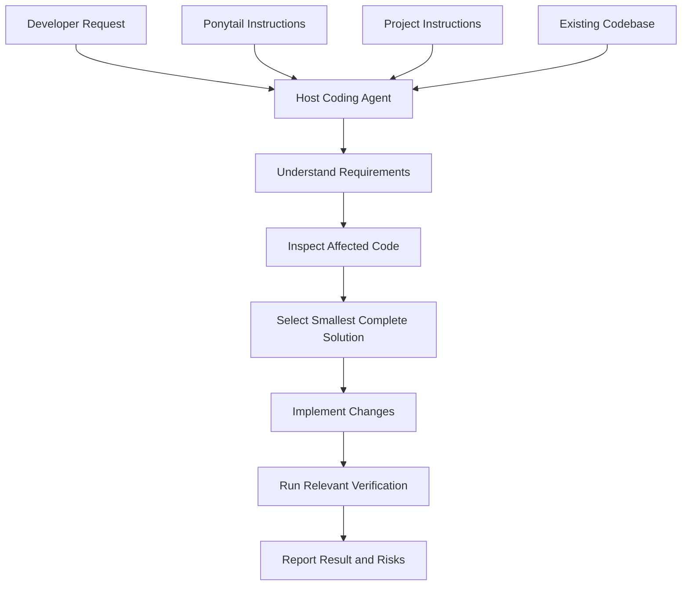
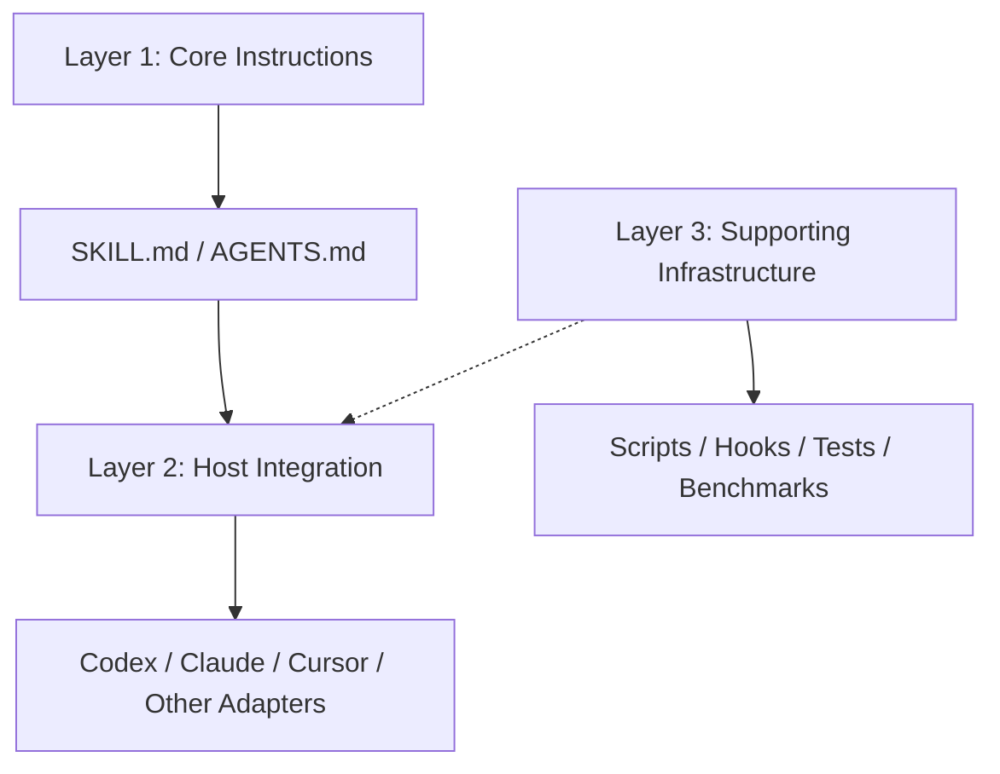
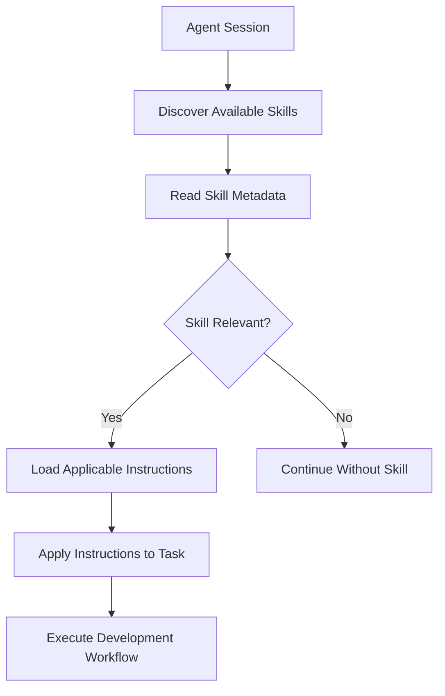
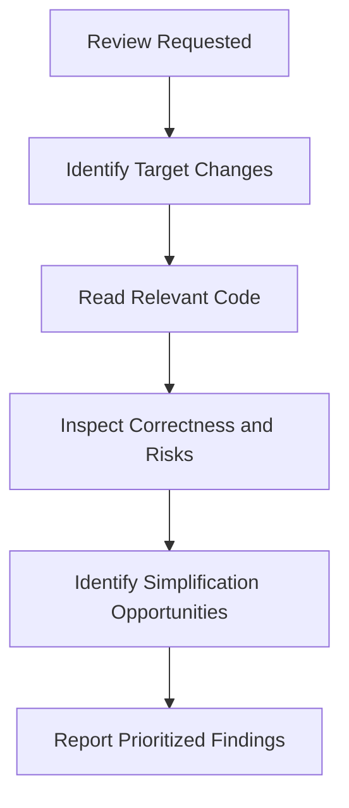
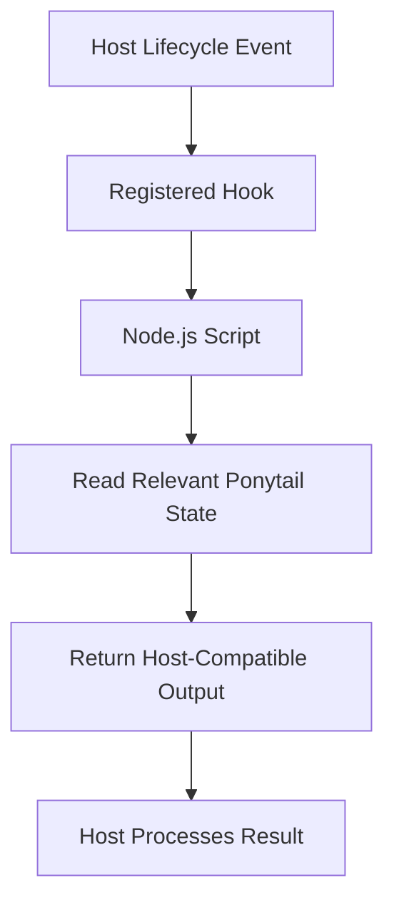
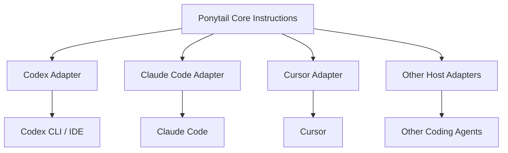
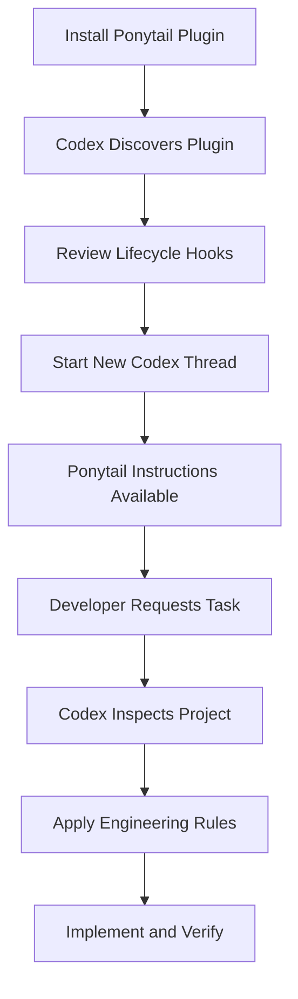

# 01 — Ponytail: Architecture and Core Concepts

> [!abstract] Lesson Overview
> **Repository:** [DietrichGebert/ponytail](https://github.com/DietrichGebert/ponytail)
>
> **Category:** Agent Skills / Agent Architecture / Context Engineering
>
> **Difficulty:** Intermediate
>
> **Prerequisite:** [[00 - Repository Overview]]
>
> **Learning Goal:** Understand Ponytail's architecture, instruction system, plugin adapters, lifecycle hooks, commands, and integration with Codex CLI.

---

## 1. Learning Objectives

After completing this lesson, you should be able to:

1. Explain Ponytail's prompt-centered architecture.
2. Identify the responsibilities of its main directories.
3. Understand how `SKILL.md` influences an AI coding agent.
4. Differentiate `SKILL.md` from `AGENTS.md`.
5. Explain instruction discovery, loading, and activation.
6. Understand commands, hooks, scripts, and plugins.
7. Describe how Ponytail integrates with Codex CLI.
8. Identify potential conflicts between project instructions and Ponytail.
9. Apply its architecture concepts to Android, Laravel, and Next.js development.

---

# Part I — Repository Architecture

## 2. High-Level Architecture

### 2.1 What Type of Architecture Does Ponytail Use?

Ponytail primarily uses a **prompt-centered, adapter-based architecture**.

Its core engineering behavior is defined through textual instructions rather than a standalone application engine.

The repository's README explicitly identifies two central instruction files:

- `skills/ponytail/SKILL.md` — Primary agent skill.
- `AGENTS.md` — Compact instruction version.

Other repository components provide integration with supported coding agents.

This distinction is important.

Ponytail does not need to implement a new language model to influence an agent's coding decisions.

Instead, it uses the instruction-loading mechanisms supported by the host agent.

### 2.2 Conceptual Architecture



**Explanation:**

- **Developer Request:** Defines the required functionality.
- **Host Coding Agent:** Codex, Claude Code, or another compatible agent.
- **Ponytail Instructions:** Guide engineering decisions.
- **Project Instructions:** Define architecture, conventions, and project constraints.
- **Existing Codebase:** Provides the implementation context.
- **Verification:** Confirms that changes behave as intended.

> [!important] Architecture Principle
> Ponytail influences how an AI agent makes decisions.
>
> It does not independently execute the entire development workflow. The host agent performs the actual file operations, tool calls, and code generation.

---

## 3. Actual Repository Structure

The official repository contains the following major components.

```text
ponytail/
├── .agents/
├── .claude-plugin/
├── .codex-plugin/
├── .cursor/rules/
├── .devin-plugin/
├── .github/
├── .grok-plugin/
├── .kiro/steering/
├── .opencode/
├── .qoder-plugin/
├── .windsurf/rules/
├── commands/
├── hooks/
├── scripts/
├── skills/ponytail/SKILL.md
├── tests/
├── benchmarks/
├── examples/
├── docs/
├── assets/
├── i18n/
├── pi-extension/
├── AGENTS.md
├── INSTALL.md
├── README.md
├── LICENSE
├── package.json
├── plugin.json
├── plugin.yaml
└── gemini-extension.json
```

This is a simplified representation of the verified top-level structure, not an exhaustive listing of every file.

### 3.1 Component Responsibilities

| Component | Responsibility |
|---|---|
| `skills/` | Contains agent skill definitions |
| `AGENTS.md` | Provides compact coding instructions |
| `commands/` | Contains command-related definitions |
| `hooks/` | Contains lifecycle integration resources |
| `scripts/` | Contains supporting automation scripts |
| `.codex-plugin/` | Codex integration metadata |
| `.claude-plugin/` | Claude Code plugin integration |
| `.cursor/rules/` | Cursor instruction adapter |
| `.opencode/` | OpenCode integration |
| `tests/` | Tests for repository functionality |
| `benchmarks/` | Performance and evaluation materials |
| `examples/` | Example implementations and comparisons |
| `docs/` | Supporting technical documentation |
| `INSTALL.md` | Installation instructions |

### 3.2 Architectural Separation

The repository can be understood as three conceptual layers.

**Layer 1 — Core Instructions** contains the engineering rules that guide the agent.

**Layer 2 — Host Integration** contains skills, commands, adapters, and lifecycle integrations that make the instructions available to supported hosts.

**Layer 3 — Supporting Infrastructure** contains scripts, tests, examples, benchmarks, and documentation.



These layers are a conceptual interpretation of the repository, not separate runtime services.

---

# Part II — Understanding SKILL.md

## 4. What Is SKILL.md?

`SKILL.md` is the primary instruction file for Ponytail, located at `skills/ponytail/SKILL.md`.

A skill provides specialized instructions that a compatible agent can discover and apply to relevant tasks. Unlike an ordinary source-code module, a skill is primarily a **behavioral specification**: it describes how the agent should approach work.

### 4.1 Structure of the Actual Skill

The verified Ponytail skill begins with YAML metadata. Its metadata includes fields such as:

```yaml
name: ponytail
description: >
  Guidance for minimal, complete coding changes.
argument-hint: "[lite|full|ultra|off]"
license: MIT
```

This is an abbreviated educational representation, not a verbatim copy of the original description. The complete file also contains the actual engineering instructions.

### 4.2 Metadata Responsibilities

| Field | Purpose |
|---|---|
| `name` | Identifies the skill |
| `description` | Explains when the skill is relevant |
| `argument-hint` | Indicates supported arguments |
| `license` | Declares licensing information |

A compatible agent may use the description to determine whether the skill is relevant, but exact discovery behavior depends on the host.

### 4.3 Main Instruction Sections

- **Before Writing Code:** Understand the requirement and inspect affected code.
- **Smallest Complete Change:** Evaluate reuse and simpler alternatives before adding code.
- **Verification:** Non-trivial logic should receive an appropriate test or self-check.
- **Safety and Correctness:** Preserve necessary validation, security, accessibility, and data-loss protections.
- **Intensity Levels:** `lite`, `full`, and `ultra` behaviors.

### 4.4 Why This Architecture Matters

A small instruction file can influence Android Java, Laravel APIs, Next.js frontends, database queries, refactoring, bug fixing, and code review. The instructions are reusable because they describe engineering decisions rather than one specific programming language.

---

## 5. How Skills Are Loaded

Skill loading is controlled by the host agent.



### 5.1 Skill Discovery

A compatible host may identify skills through installed plugins, known skill directories, metadata, explicit user invocation, or host-specific automatic selection.

### 5.2 Skill Activation

Activation occurs when the host makes the instructions applicable to the current task or session. Ponytail's skill describes itself as active throughout the session until disabled, but persistent activation depends on the host's integration and lifecycle capabilities.

### 5.3 Skill Execution

**Loading a skill is not the same as executing a script.** Loading generally makes instructions available to the agent. Executing a script involves a runtime such as Node.js or Python. An installation may use both mechanisms for different responsibilities.

---

# Part III — Understanding AGENTS.md

## 6. What Is AGENTS.md?

`AGENTS.md` is a Markdown instruction file recognized by compatible coding agents. It commonly defines repository-specific rules and expectations. For Ponytail, the root `AGENTS.md` contains a compact version of its engineering philosophy.

### 6.1 SKILL.md vs AGENTS.md

| Aspect | SKILL.md | AGENTS.md |
|---|---|---|
| Main purpose | Define a reusable skill | Define agent instructions |
| Discovery | Skill-capable host | AGENTS.md-compatible host |
| Metadata | Skill frontmatter | Usually ordinary Markdown |
| Activation | Skill invocation or host integration | Instruction discovery |
| Portability | Requires compatible skill support | Works with compatible rules-file readers |
| Ponytail role | Primary skill | Compact instruction alternative |

### 6.2 Why Both Files Exist

Different coding agents support different integration mechanisms. Some discover reusable skills; others rely on instruction files. Providing both lets Ponytail's principles work across more environments.

### 6.3 Example Project Instructions

Imagine an Android project:

```text
GroupTrack/
├── AGENTS.md
├── docs/
├── app/src/main/java/
├── app/src/main/res/
└── settings.gradle.kts
```

Its `AGENTS.md` might contain:

```markdown
# GroupTrack Engineering Rules
## Technology Stack
- Android Studio
- Java
- XML Layouts
- Firebase
## Architecture
- Follow existing project conventions.
- Reuse existing components.
- Keep changes within the documented MVP.
## Scope
- Do not add unrequested features.
- Avoid unnecessary dependencies.
- Preserve existing functionality.
## Verification
- Run relevant checks after changes.
- Report tests that were not executed.
```

This is illustrative, not part of Ponytail's repository.

### 6.4 Combining Project Instructions with Ponytail

```text
Developer Request
       |
       v
Codex CLI
       +-- Project AGENTS.md
       +-- Ponytail Skill
       +-- Source Code
       |
       v
Implementation Decision
```

Project instructions define what the project needs and how it is organized. Ponytail adds general guidance about minimizing unnecessary complexity. These responsibilities complement each other.

> [!warning] Instruction Conflicts
> Never assume that a third-party skill overrides all project instructions. Actual precedence depends on the host's instruction hierarchy. A project requirement must not be silently discarded because a skill prefers shorter code.

---

# Part IV — Commands, Hooks, and Scripts

## 7. Understanding Commands

Commands provide named entry points for Ponytail workflows.

| Command | Purpose |
|---|---|
| `/ponytail` | View or change the active intensity |
| `/ponytail-review` | Review code changes |
| `/ponytail-audit` | Audit the repository |
| `/ponytail-debt` | Collect documented shortcuts |
| `/ponytail-gain` | Show benchmark impact information |
| `/ponytail-help` | Display command guidance |

### 7.1 Review Workflow

The review command checks correctness, security, performance, missing tests, and unnecessary complexity.



### 7.2 Audit Workflow

The audit command applies similar checks across a broader repository. It first tries to understand entry points, data flow, expected workload, dependencies, and implementation risks, then reports actionable findings.

### 7.3 Review vs Audit

| Review | Audit |
|---|---|
| Focuses on selected changes | Examines broader repository scope |
| Useful before committing | Useful for repository health checks |
| Smaller analysis target | Larger analysis target |
| Change-oriented | System-oriented |

---

## 8. Understanding Lifecycle Hooks

A **lifecycle hook** lets a host application invoke custom functionality when an event occurs. Possible events include session initialization, prompt submission, tool invocation, or subagent creation. Supported events depend on the host.

### 8.1 Ponytail Hooks

The repository documents lifecycle hooks for Codex and Claude Code. The installation documentation says these integrations use two small Node.js lifecycle hooks to make instructions available at suitable points in the agent lifecycle.

### 8.2 Conceptual Hook Flow



This illustrates the integration pattern; it is not a line-by-line reconstruction of the implementation.

### 8.3 Why Hooks Matter

Without lifecycle integration, an agent may need explicit skill invocation or project instructions. Hooks can support automatic instruction delivery, but only if the host supports the event, the hook is registered, dependencies are available, and execution is permitted.

### 8.4 Security Considerations

Hooks can execute code. Before enabling one, review the script, when it runs, filesystem and network behavior, source, and requested permissions. Avoid unnecessary privileges.

> [!important] Security Rule
> A Markdown instruction file and an executable lifecycle hook have different risk profiles. Do not automatically trust executable scripts because the repository also provides useful instructions.

---

## 9. Understanding Supporting Scripts

The `scripts/` directory contains executable supporting automation. The skill defines desired behavior; scripts perform specific tasks. For example, the repository documents this Cursor hook installer:

```bash
node ponytail/scripts/cursor-hooks.js install
```

This command is for Cursor integration, not the normal Codex installation path.

```text
SKILL.md     -> Behavioral instructions
AGENTS.md    -> Project/agent rules
commands/    -> Named workflows
hooks/       -> Lifecycle integration
scripts/     -> Executable utilities
```

### 9.1 Node.js Requirement

The installation guide says Claude Code and Codex lifecycle hooks require Node.js on the executable search path. On Windows, inspect it with:

```powershell
node --version
where.exe node
```

These commands only inspect the local environment.

---

# Part V — Plugin Architecture

## 10. What Is a Plugin Adapter?

A plugin adapter connects Ponytail's instructions and supporting functionality to a particular coding agent. Hosts differ in installation systems, command conventions, skill discovery, lifecycle events, and configuration formats. An adapter exposes the same core engineering philosophy through host-specific mechanisms.

### 10.1 Plugin Architecture Diagram



### 10.2 Adapter vs Core Logic

The core instructions describe engineering decisions. Adapters determine how those instructions reach a host. This supports multiple coding environments without a different engineering philosophy for each.

### 10.3 Portability Limitations

Not every host supports every capability. Some support hooks or reusable skills; some only read instruction files; some support persistent intensity modes; others require explicit activation. Compatible instructions do not guarantee identical functionality.

---

# Part VI — Codex Integration Architecture

## 11. How Ponytail Integrates with Codex

The official repository documents installation through Codex's plugin system:

```powershell
codex plugin marketplace add DietrichGebert/ponytail
codex plugin add ponytail@ponytail
```

These are documented commands, not commands executed in this lesson. The installation guide then directs users to open `/hooks`, review and trust the two lifecycle hooks, and start a new thread.

### 11.1 Integration Flow



### 11.2 Skills in Codex

The repository documents namespaced skill invocation, for example:

```text
$ponytail:ponytail-review
```

This invokes the Ponytail review skill in supported Codex environments. Do not assume identical syntax in every agent.

### 11.3 Project-Level Instructions

Codex also supports `AGENTS.md` instructions:

```text
MyProject/
├── AGENTS.md
├── docs/
├── src/
└── tests/
```

Project instructions can define architecture and constraints; Ponytail provides reusable simplicity-oriented guidance.

### 11.4 Context Engineering

Context engineering provides relevant instructions and information to an AI system at the appropriate time. Ponytail illustrates these ideas:

1. Keep reusable engineering principles separate from project-specific requirements.
2. Use a standard skill format when supported.
3. Avoid repeating large instructions unnecessarily.
4. Load relevant guidance through supported host mechanisms.
5. Preserve the project's architecture and actual requirements.

These are general lessons inspired by Ponytail's design.

---

# Part VII — Instruction Priority and Scope

## 12. Understanding Instruction Sources

```text
Host-Level Instructions
         |
         v
User Request
         |
         v
Project AGENTS.md
         |
         v
Installed Skill
         |
         v
Repository Source Code
```

This is a conceptual list, not a universal priority ranking. The host determines actual priority and conflict resolution.

### 12.1 Example Conflict

Suppose a Laravel project requires all database operations to follow existing service and repository conventions. Ponytail encourages minimal implementations, but that is not permission to bypass project architecture. Find the smallest complete solution **within the project's established conventions**.

### 12.2 Practical Principle

**Follow the required architecture while avoiding unnecessary additions to it.** Ponytail helps simplify choices without violating legitimate project constraints.

---

# Part VIII — Practical Development Examples

## 13. Android Example

### Scenario

You want to add an empty-state message to an Android screen. An agent might propose a reusable framework, but the project may need only one message.

### Simplicity-Oriented Approach

1. Inspect the existing XML layout.
2. Check whether an empty-state component exists.
3. Reuse existing styling.
4. Add only the required UI element.
5. Verify visibility behavior.

```xml
<TextView
    android:id="@+id/tvEmptyState"
    android:layout_width="wrap_content"
    android:layout_height="wrap_content"
    android:text="No tasks available"
    android:visibility="gone" />
```

This is illustrative and may need more layout attributes for its parent. Avoid building a component system when the requirement does not need one.

---

## 14. Laravel Example

An existing Laravel application needs an endpoint returning active users:

```php
public function index()
{
    return User::query()
        ->where('status', 'active')
        ->get();
}
```

This is illustrative, not a complete production endpoint. A real implementation must consider authorization, response fields, pagination for larger datasets, existing API conventions, and database performance. Avoid extra service layers when the existing architecture already has an appropriate path, but never skip required authorization or expose sensitive fields.

---

## 15. Next.js Example

For a small in-memory dashboard list, existing React state may be enough:

```tsx
const [query, setQuery] = useState("");

const filteredItems = items.filter((item) =>
  item.name.toLowerCase().includes(query.toLowerCase())
);
```

Assume `useState` is imported, `items` is defined, and the component is a Client Component. A new state library may be unnecessary for a small list. Large server-side datasets may instead need server filtering, pagination, or debouncing.

**Minimal implementation depends on actual requirements and scale.**

---

# Part IX — Architectural Tradeoffs

## 16. Strengths

- **Reusable core:** the same engineering philosophy applies across languages.
- **Host portability:** multiple integration mechanisms support different agents.
- **Separation of concerns:** instructions are distinct conceptually from adapters and scripts.
- **Lightweight guidance:** a small skill can influence many coding decisions.
- **Project compatibility:** Ponytail can complement architecture documentation and development standards.

---

## 17. Limitations

- **Host dependency:** a compatible agent must interpret and apply instructions.
- **Model variability:** different models may interpret the same instructions differently.
- **Integration differences:** hosts expose different commands, hooks, and persistent modes.
- **Instruction conflicts:** general simplicity rules can conflict with project requirements if misread.
- **Verification remains necessary:** instructions alone cannot guarantee correct, secure, maintainable code.

---

# Part X — Practical Exercises

## 18. Exercise 1: Repository Exploration

**Objective:** Identify Ponytail's major architectural components.

Open https://github.com/DietrichGebert/ponytail and find `SKILL.md`, `AGENTS.md`, `commands/`, `hooks/`, `scripts/`, `.codex-plugin/`, and `INSTALL.md`. Write a short explanation of each responsibility.

**Expected Outcome:** Understand how Ponytail separates instructions, integration, and supporting infrastructure.

---

## 19. Exercise 2: Compare Instruction Files

Read `SKILL.md` and `AGENTS.md`. Answer:

1. Which file includes skill metadata?
2. Which file provides compact instructions?
3. What engineering rules do both share?
4. Which file is designed for skill-capable hosts?
5. Why might a repository provide both?

**Expected Outcome:** Understand reusable skills versus repository instruction files.

---

## 20. Exercise 3: Trace a Coding Request

**Scenario:** “Add a task status filter to an Android project.” Write a hypothetical agent workflow covering requirement analysis, relevant file inspection, existing component discovery, implementation choice, required file changes, verification, and final report.

**Expected Outcome:** Apply Ponytail's smallest-complete-change philosophy.

---

## 21. Exercise 4: Identify Overengineering

Requirement: “Display the number of active tasks.” An agent proposes an analytics microservice, event bus, caching infrastructure, background synchronization worker, and separate analytics database.

1. Which parts are clearly unnecessary for a simple local count?
2. What existing project capabilities should be inspected first?
3. When could extra infrastructure be justified?
4. How would you verify the smallest appropriate implementation?

**Expected Outcome:** Distinguish necessary architecture from speculative complexity.

---

## 22. Exercise 5: Codex Integration Analysis

Review the Codex section of `INSTALL.md`, `.codex-plugin/`, the documented review command, and lifecycle hook requirements. Explain how Codex discovers Ponytail, why hooks require review, how the skill reaches the agent, what depends on the host, and why installation may require a new session.

**Expected Outcome:** Understand the integration before installing it.

---

# Part XI — Knowledge Check

## 23. Review Questions

1. What does prompt-centered architecture mean?
2. Why is `SKILL.md` considered Ponytail's core?
3. What is the purpose of `AGENTS.md`?
4. What is the difference between a skill and a plugin?
5. What is a lifecycle hook?
6. Why do some integrations require Node.js?
7. What is the responsibility of `commands/`?
8. How do scripts differ from instructions?
9. What is the purpose of `.codex-plugin/`?
10. Why might Ponytail behave differently across agents?
11. What is instruction discovery?
12. What is instruction activation?
13. Why should project architecture remain respected?
14. How does Ponytail relate to context engineering?
15. Why must third-party executable hooks be reviewed?

---

# Part XII — Key Takeaways

> [!summary] Lesson Summary
> - Ponytail uses prompt-centered architecture with host-specific integrations.
> - `SKILL.md` contains its primary engineering instructions; `AGENTS.md` is a compact alternative.
> - Plugin adapters connect Ponytail to supported agents.
> - Commands expose workflows such as review and audit.
> - Hooks can deliver instructions during supported host events.
> - Scripts provide executable supporting functionality.
> - Codex integration follows the repository's documented plugin installation.
> - Loading and persistence depend on host capabilities.
> - Project requirements should remain respected.
> - Simplicity must not compromise security, correctness, or verification.

### Core Mental Model

```text
Ponytail
   |
   +-- WHAT TO FOLLOW
   |      +-- SKILL.md
   |      +-- AGENTS.md
   +-- HOW TO INTEGRATE
   |      +-- Plugins
   |      +-- Commands
   |      +-- Hooks
   +-- HOW TO SUPPORT
          +-- Scripts
          +-- Tests
          +-- Benchmarks
          +-- Documentation
```

**Remember:** Ponytail does not replace the coding agent's intelligence or tools. It supplies reusable engineering guidance that helps the agent choose appropriately simple, complete implementations.

---

# Part XIII — Official References

### Primary Repository

- [Ponytail — GitHub](https://github.com/DietrichGebert/ponytail)

### Core Architecture

- [Ponytail SKILL.md](https://github.com/DietrichGebert/ponytail/blob/main/skills/ponytail/SKILL.md)
- [Ponytail AGENTS.md](https://github.com/DietrichGebert/ponytail/blob/main/AGENTS.md)
- [Repository README](https://github.com/DietrichGebert/ponytail/blob/main/README.md)

### Integration and Supporting Components

- [Installation Guide](https://github.com/DietrichGebert/ponytail/blob/main/INSTALL.md)
- [Commands Directory](https://github.com/DietrichGebert/ponytail/tree/main/commands)
- [Hooks Directory](https://github.com/DietrichGebert/ponytail/tree/main/hooks)
- [Scripts Directory](https://github.com/DietrichGebert/ponytail/tree/main/scripts)
- [Codex Plugin Directory](https://github.com/DietrichGebert/ponytail/tree/main/.codex-plugin)
- [Tests Directory](https://github.com/DietrichGebert/ponytail/tree/main/tests)

### Supporting Materials

- [Benchmarks](https://github.com/DietrichGebert/ponytail/tree/main/benchmarks)
- [Examples](https://github.com/DietrichGebert/ponytail/tree/main/examples)
- [Documentation](https://github.com/DietrichGebert/ponytail/tree/main/docs)

> [!note] Source Verification
> The main repository structure, primary instruction files, documented commands, and installation guidance were checked against the official repository.
>
> Some internal relationships are conceptual diagrams rather than verified execution traces. The next investigation should inspect the adapter and hook implementations directly.

---

# Part XIV — Next Lesson

**[[02 - Installation and Setup]]**

Topics: prerequisites; Windows environment preparation; Codex CLI compatibility; official plugin installation; reviewing lifecycle hooks; verifying skill availability; testing intensity modes; running the first code review; troubleshooting; removal or safe disablement.

**Learning Progression:** Repository Overview → **Architecture and Core Concepts** → Installation and Setup → Configuration and Features → Practical Workflows → Codex Integration → Best Practices and Exercises
