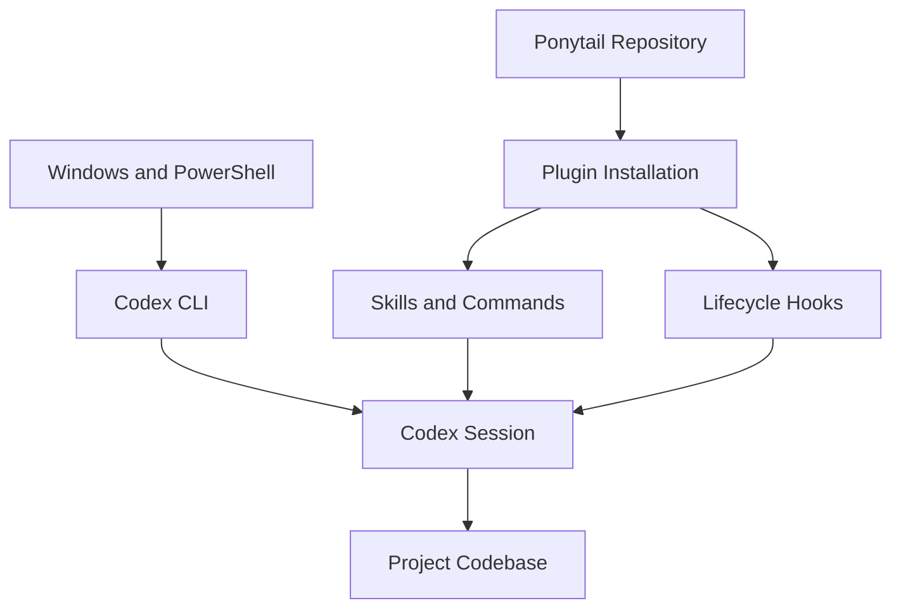

# 02 — Ponytail: Installation and Setup

> [!abstract] Lesson Overview
> **Repository:** [DietrichGebert/ponytail](https://github.com/DietrichGebert/ponytail)
>
> **Category:** Agentic Engineering / Codex CLI / Plugin Installation
>
> **Difficulty:** Beginner to Intermediate
>
> **Operating System:** Windows 10/11
>
> **Environment:** PowerShell, Git, Node.js, Codex CLI
>
> **Prerequisites:** [[00 - Repository Overview]] and [[01 - Architecture and Core Concepts]]
>
> **Learning Goal:** Install Ponytail safely, understand its integration methods, verify Codex support, configure its default mode, and troubleshoot common issues.

---

## 1. Learning Objectives

After this lesson, you should be able to identify requirements, verify Git/Node.js/Codex, distinguish plugin setup from instruction-only setup, install the Codex plugin, review lifecycle hooks, configure and verify Ponytail, troubleshoot issues, and remove it safely.

# Part I — Installation Fundamentals

## 2. Installation Approaches

Ponytail is a set of agent instructions, skills, plugin adapters, and supporting integration files; it is not a standalone coding application. Available approaches provide different features.

| Method | What it provides | Typical use |
|---|---|---|
| Plugin | Host-specific skills, commands, and supported hooks | Full supported integration |
| Skill only | Reusable skill definitions | Skill-capable agents |
| `AGENTS.md` only | General coding instructions | Lightweight, project-scoped setup |
| Source checkout | Files for study or manual integration | Learning and development |

Copying `AGENTS.md` alone does not install plugin commands or lifecycle hooks. This lesson focuses on Windows, PowerShell, Codex CLI, and the Ponytail plugin.



Codex remains the coding agent. Ponytail adds guidance and supported integration behavior.

# Part II — Prerequisites

## 3. Verify the Environment

Run these commands in PowerShell:

```powershell
$PSVersionTable.PSVersion
git --version
node --version
npm --version
codex --version
codex plugin --help
```

Windows PowerShell 5.1 or newer handles the examples here. Git is useful for source inspection but is not required to use the documented Codex plugin commands. Node.js must be available on Codex's executable search path for the lifecycle hooks; check with:

```powershell
where.exe node
```

If a command is missing, install it from its official source and restart the terminal and Codex. Codex CLI can be installed with:

```powershell
npm install -g @openai/codex
```

Use the installed CLI's help output to check plugin support; commands can vary by version. Do not reinstall tools that already work.

## 4. Review the Repository

Repository: [DietrichGebert/ponytail](https://github.com/DietrichGebert/ponytail)

For source inspection, use a separate practice directory:

```powershell
New-Item -ItemType Directory -Force C:\DevTools | Out-Null
Set-Location C:\DevTools
git clone https://github.com/DietrichGebert/ponytail.git
Set-Location .\ponytail
Get-ChildItem
Get-Content .\INSTALL.md
Get-Content .\skills\ponytail\SKILL.md
Get-Content .\AGENTS.md
```

Cloning is optional for plugin installation. Review `INSTALL.md`, plugin metadata, hooks, skills, and scripts before trusting executable integrations.

# Part III — Install in Codex

## 5. Official Installation Steps

The Ponytail installation guide documents two separate commands:

```powershell
codex plugin marketplace add DietrichGebert/ponytail
codex plugin add ponytail@ponytail
```

The first registers the marketplace. The second installs the plugin. Then start Codex:

```powershell
codex
```

In the interactive session, open `/hooks`. Review each hook's command and purpose before trusting it. The guide instructs users to start a new thread afterward. The same install also applies to the Codex desktop app; restart it after installation.

> [!warning] Security
> A plugin provides third-party instructions and executable hooks. Review the source and commands before enabling hooks. Keep Codex sandbox and approval controls enabled.

### Installation checklist

- [ ] Codex CLI runs.
- [ ] Plugin commands are supported.
- [ ] Node.js is available to Codex.
- [ ] Marketplace is registered and plugin installed.
- [ ] Hooks have been reviewed before enabling.
- [ ] New thread starts and skills are discoverable.

# Part IV — Verify and Configure

## 6. Verify Availability

Check `codex plugin --help` for supported management commands. In Codex, inspect available skills and confirm Ponytail's namespaced review skill is discoverable:

```text
$ponytail:ponytail-review
```

Do not assume every Codex version exposes the same plugin-listing command. Verify activation through the host interface as well as through behavior.

A read-only functional prompt:

```text
Inspect this repository without modifying files.
Find one small way to reduce unnecessary complexity while
preserving behavior and project conventions. Explain the
change you would make, but do not implement it.
```

This checks the workflow, but does not prove by itself that Ponytail loaded.

## 7. Set the Default Mode

Ponytail supports `lite`, `full`, `ultra`, and `off`; the documented default is `full`. For a single PowerShell session:

```powershell
$env:PONYTAIL_DEFAULT_MODE = "full"
$env:PONYTAIL_DEFAULT_MODE = "lite"
Remove-Item Env:PONYTAIL_DEFAULT_MODE
```

Only the last chosen value is active. Codex processes started from that shell inherit the environment variable.

The documented Windows configuration location is `%APPDATA%\ponytail\config.json`, with a `defaultMode` field:

```json
{
  "defaultMode": "full"
}
```

Check for an existing file before editing it so existing settings are preserved. Supported integrations may differ in how they apply defaults and runtime switching.

## 8. Optional Subagent Matcher

`PONYTAIL_SUBAGENT_MATCHER` is a regular expression used by supported lifecycle integrations to select subagent types that receive Ponytail instructions:

```powershell
$env:PONYTAIL_SUBAGENT_MATCHER = "explore|general"
```

The match is case-insensitive and unanchored. Leave it unset for initial setup unless you need to scope subagent injection.

# Part V — Instruction-Only Setup

## 9. Project AGENTS.md

If plugins are unavailable, review Ponytail's [`AGENTS.md`](https://github.com/DietrichGebert/ponytail/blob/main/AGENTS.md) and adapt relevant rules into the project instructions. Never overwrite an existing `AGENTS.md` without checking its architecture, security, and workflow rules.

Instruction-only setup does not automatically provide plugin commands, lifecycle hooks, or all host-specific mode controls. It can be easier to inspect, scoped to a project, and does not need hook execution.

# Part VI — Safe Practice and Troubleshooting

## 10. Practice in a Disposable Project

Start with a non-critical repository. Ask Codex to inspect a small example first, propose a minimal behavior-preserving change, then implement only after review. Run the relevant check and inspect `git diff`. This evaluates the workflow, not Ponytail's effectiveness in every task.

For Android, Laravel, or Next.js projects, follow their existing `AGENTS.md`, architecture, security, accessibility, and test conventions. Do not add dependencies or layers without need.

## 11. Common Problems

**`codex` is not recognized:** Check `npm list -g --depth=0`, `where.exe codex`, and PATH; restart the terminal after installation.

**Plugin command unavailable:** Check `codex --version` and both help commands. Your CLI may not support the documented interface.

**`node` is not found:** Run `node --version` and `where.exe node`; correct PATH and restart Codex.

**Skills not visible:** Confirm installation, restart Codex, start a new thread, and check the host's skill interface.

**Hooks do not run:** Inspect `/hooks`, confirm Node.js, verify they were trusted, and check host diagnostics.

**Instructions conflict:** Preserve required project behavior and host instruction precedence; simplicity guidance does not remove legitimate constraints.

# Part VII — Disable and Uninstall

## 12. Disable or Remove

In supported integrations, `off` disables Ponytail guidance; setting the default to `off` does not uninstall the plugin.

The documented Codex removal command is:

```powershell
codex plugin remove ponytail
```

Check the installed CLI's help first. Ponytail documents that removal can leave configuration and state files. Its `scripts/uninstall.js` cleans additional Ponytail state; review the script before running it, and run it before removing the plugin if it is still available. Do not delete unrelated Codex files.

# Part VIII — Exercises and Review

## 13. Hands-On Exercises

1. Record the output of the prerequisite checks and confirm plugin support.
2. Inspect `INSTALL.md`, `AGENTS.md`, `skills/ponytail/SKILL.md`, `hooks/`, `scripts/`, and `.codex-plugin/`.
3. Install the plugin, review hooks, start a new thread, and verify skill discovery.
4. Test a small behavior-preserving simplification in a disposable project and run its check.
5. Compare plugin installation with `AGENTS.md` only: manager requirement, hooks, commands, and mode support.

## 14. Knowledge Check

1. Why does Ponytail need a host coding agent?
2. How do plugin and instruction-only setup differ?
3. Why does the Codex integration need Node.js?
4. What do marketplace registration and plugin installation each do?
5. Why review lifecycle hooks and start a new thread?
6. What does `PONYTAIL_DEFAULT_MODE` configure?
7. What does `PONYTAIL_SUBAGENT_MATCHER` select?
8. How can you verify skill availability?
9. Why use a disposable project first?
10. What is the Codex plugin removal command?

> [!summary] Key Takeaways
> - Verify Codex and Node.js before setup; check plugin support in the installed CLI.
> - Marketplace registration and plugin installation are separate steps.
> - Review hooks before enabling them; use a new thread afterward.
> - The default mode can be set through the environment or Ponytail configuration.
> - `AGENTS.md` is a lightweight alternative without full plugin features.
> - Verify both plugin availability and actual behavior.
> - Uninstalling the plugin may leave its configuration state behind.

# Part IX — Official References

- [Ponytail Repository](https://github.com/DietrichGebert/ponytail)
- [Installation Guide](https://github.com/DietrichGebert/ponytail/blob/main/INSTALL.md)
- [README](https://github.com/DietrichGebert/ponytail/blob/main/README.md)
- [Primary Skill](https://github.com/DietrichGebert/ponytail/blob/main/skills/ponytail/SKILL.md)
- [AGENTS.md](https://github.com/DietrichGebert/ponytail/blob/main/AGENTS.md)
- [Codex Plugin](https://github.com/DietrichGebert/ponytail/tree/main/.codex-plugin) · [Hooks](https://github.com/DietrichGebert/ponytail/tree/main/hooks) · [Scripts](https://github.com/DietrichGebert/ponytail/tree/main/scripts)
- [Codex Documentation](https://developers.openai.com/codex/) · [Node.js](https://nodejs.org/) · [Git](https://git-scm.com/)

> [!note] Source Verification
> Installation commands, hook requirements, configuration, and removal guidance are based on Ponytail's official installation guide. Examples and diagrams are educational, not a record of installation on this computer.

---

## Next Lesson

**[[03 - Configuration and Features]]**

**Progression:** Repository Overview → Architecture and Core Concepts → **Installation and Setup** → Configuration and Features → Practical Workflows → Codex Integration → Best Practices and Exercises
