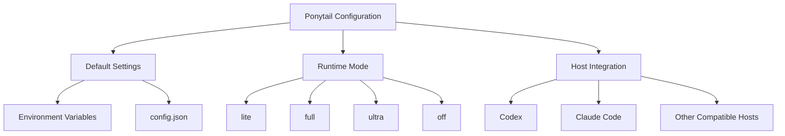
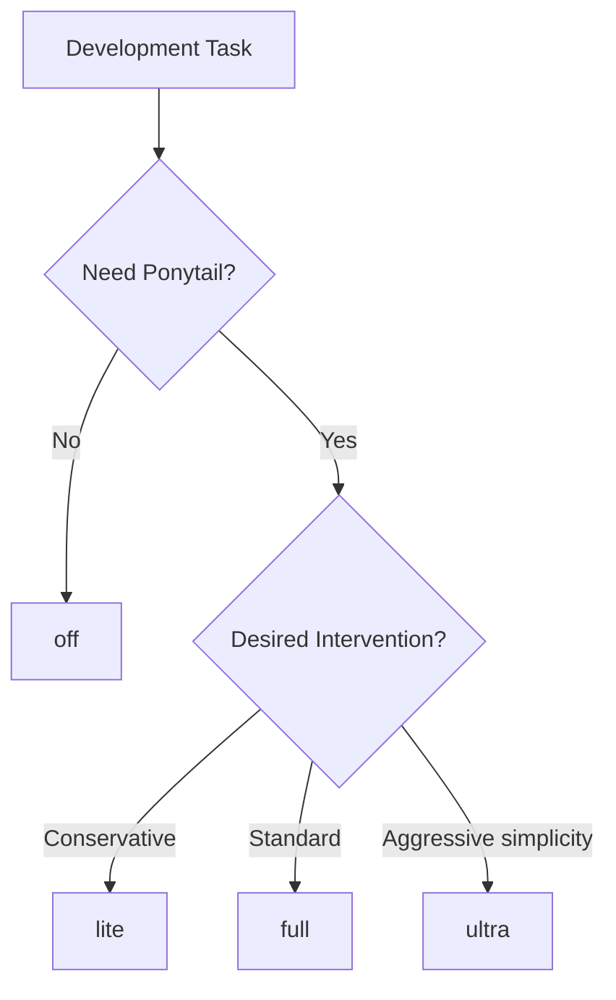
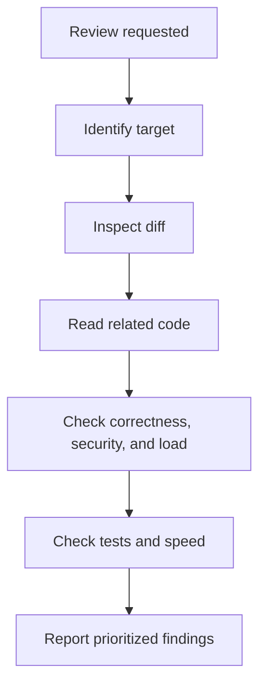
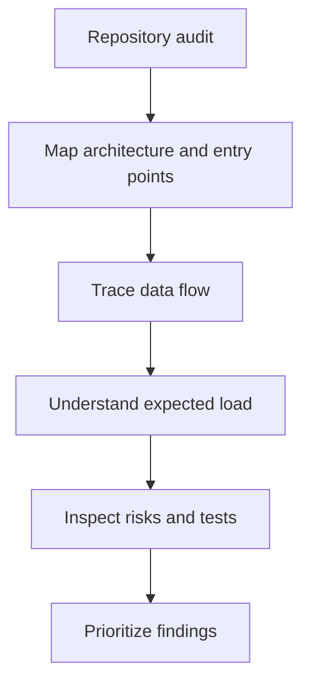

# 03 — Ponytail: Configuration and Features

> [!abstract] Lesson Overview
> **Repository:** [DietrichGebert/ponytail](https://github.com/DietrichGebert/ponytail)
>
> **Category:** Agentic Engineering / Agent Configuration / Code Quality
>
> **Difficulty:** Intermediate
>
> **Prerequisites:** [[00 - Repository Overview]], [[01 - Architecture and Core Concepts]], [[02 - Installation and Setup]]
>
> **Learning Goal:** Understand how to configure Ponytail, control its intensity, use its review and audit capabilities, manage technical debt, and integrate its features into real development workflows.

---

## 1. Learning Objectives

After completing this lesson, you should be able to:

1. Explain Ponytail's configuration architecture.
2. Differentiate its four intensity modes.
3. Configure defaults with environment variables and configuration files.
4. Understand session-level activation and persistence.
5. Use Ponytail's documented commands and skills.
6. Explain code review versus repository audit.
7. Track technical debt through shortcut comments.
8. Interpret Ponytail's benchmark and gain reporting.
9. Recognize host-specific capabilities and limits.
10. Apply Ponytail configuration to Android, Laravel, and Next.js workflows.

---

# Part I — Configuration Fundamentals

## 2. Understanding Ponytail Configuration

Ponytail uses a lightweight configuration approach. It does not require a complex configuration system before you can use its core engineering rules. The default intensity is full; configuration files are optional.

### 2.1 Configuration Components

| Component | Responsibility |
|---|---|
| SKILL.md | Defines the primary engineering behavior |
| AGENTS.md | Provides a compact instruction alternative |
| Environment variables | Configure supported runtime defaults |
| config.json | Stores optional configuration |
| Mode commands | Change or inspect intensity in supported hosts |
| Lifecycle hooks | Deliver instructions during supported events |
| Project instructions | Set project-specific architecture and constraints |

### 2.2 Configuration Architecture



The diagram is conceptual. Actual runtime behavior depends on the host and installed Ponytail version.

### 2.3 Default Configuration

Ponytail's documented default is full. You do not need a configuration file just to use this default.

> [!tip] Recommended Approach
> Start with full. Learn how the agent behaves, then add settings only to meet a specific need.

---

# Part II — Intensity Modes

## 3. Understanding Ponytail Modes

Ponytail provides lite, full, ultra, and off. These modes control how strongly the skill applies its simplicity-oriented engineering guidance.

| Mode | Behavior | Suggested Use |
|---|---|---|
| lite | Implements the task and identifies simpler alternatives | Conservative development |
| full | Applies the complete simplicity-oriented rules | Normal development |
| ultra | More aggressively challenges unnecessary requirements | Strict scope control |
| off | Disables active Ponytail guidance | Temporary deactivation |

These summarize the documented intent; they do not guarantee identical behavior across hosts or models.

## 4. Lite Mode

Lite mode is the least aggressive active mode. It prioritizes completing the request while allowing the agent to mention a simpler alternative without challenging every detail.

For a Next.js dashboard filter, the agent might inspect existing components, implement the filter, preserve conventions, and mention an easier approach if relevant.

```text
/ponytail lite
```

Codex users should invoke the installed namespaced skill or other supported Codex mechanism; slash commands are not universal across hosts.

Lite may suit a detailed implementation plan, strict project conventions, or a task where you mainly want a brief simplicity check.

## 5. Full Mode

Full mode applies Ponytail's complete simplicity-oriented rules and is the default. The agent should understand the requirement, inspect affected code, find the smallest complete solution, reuse existing implementations, avoid unnecessary dependencies, preserve safeguards, verify non-trivial changes, and report skipped checks or remaining risks.

For an Android task, inspect existing XML layouts, Java classes, data models, filters, and project instructions before changing code.

```text
/ponytail full
```

Full suits feature development, bug fixing, refactoring, cleanup, MVP work, and routine maintenance. It does not mean removing code at any cost; correctness, security, validation, and maintainability remain required.

## 6. Ultra Mode

Ultra mode applies a more aggressive interpretation of simplicity principles. It encourages questioning unnecessary requirements, features, dependencies, and abstractions.

For a simple task manager, it may challenge a proposed plugin engine, custom event bus, separate microservice, or new state library if requirements do not need them.

```text
/ponytail ultra
```

Use it to control scope, build a small MVP, or examine an overengineered proposal. It does not justify removing security, validation, error handling, accessibility, or required architecture.

## 7. Off Mode

Off disables active Ponytail guidance through supported integration mechanisms; it does not necessarily uninstall the plugin.

```text
/ponytail off
```

It can help compare behavior, troubleshoot an integration, or temporarily turn the skill off.



---

# Part III — Default Configuration

## 8. Environment Variable Configuration

Ponytail supports PONYTAIL_DEFAULT_MODE for the default mode in integrations that read it. Documented values are lite, full, ultra, and off.

### 8.1 Set a Mode in PowerShell

```powershell
$env:PONYTAIL_DEFAULT_MODE = "full"
```

Other examples:

```powershell
$env:PONYTAIL_DEFAULT_MODE = "lite"
$env:PONYTAIL_DEFAULT_MODE = "ultra"
$env:PONYTAIL_DEFAULT_MODE = "off"
```

Check or remove it in the current session:

```powershell
$env:PONYTAIL_DEFAULT_MODE
Remove-Item Env:PONYTAIL_DEFAULT_MODE
```

The $env: setting normally affects the current PowerShell process and child processes. It is not automatically a permanent Windows setting. A Codex process launched from that shell can inherit the value, but Ponytail must be running an integration that reads it.

## 9. Configuration File

Ponytail documents an optional configuration file at ~/.config/ponytail/config.json; on Windows, use %APPDATA%\ponytail\config.json.

```json
{
  "defaultMode": "full"
}
```

Create the directory and inspect for an existing file before writing:

```powershell
$configDir = Join-Path $env:APPDATA "ponytail"
New-Item -ItemType Directory -Force -Path $configDir
Test-Path (Join-Path $configDir "config.json")
```

If no existing settings need preserving, create the file:

```powershell
@'
{
  "defaultMode": "full"
}
'@ | Set-Content -Path (Join-Path $configDir "config.json")
```

Read it back with:

```powershell
Get-Content (Join-Path $configDir "config.json")
```

> [!warning] Configuration Safety
> Review an existing file before changing it. Avoid replacing other settings. Different installations and hosts may use different configuration paths.

### 9.1 Resolution Order

In the current documented implementation, the environment variable takes priority over config.json; the fallback is full:

```text
PONYTAIL_DEFAULT_MODE → config.json defaultMode → full
```

An unrecognized value is ignored by the implementation. Check the code or docs for the version installed before relying on details.

---

# Part IV — Session Behavior

## 10. Understanding Session-Level Activation

Keep these three ideas separate:

| Term | Meaning |
|---|---|
| Default mode | Initial intensity selected by the integration |
| Active mode | Intensity currently used in a supported session |
| Installed plugin | The package and host integration on disk |

```text
Session starts → integration loads → default mode is selected
              → task uses Ponytail guidance → mode may change
```

The skill describes its behavior as active for the session until disabled. Exact persistence depends on the host. Do not assume a mode change persists across restarts, affects other tools, or is inherited by every subagent.

## 11. Subagent Configuration

PONYTAIL_SUBAGENT_MATCHER can scope rule injection in supported lifecycle integrations. It is a regular expression matched against the subagent type.

```powershell
$env:PONYTAIL_SUBAGENT_MATCHER = "explore|general"
```

This example matches names containing explore or general. The current README documents unanchored, case-insensitive matching; an unset or invalid matcher falls back to injecting into every subagent. Host support varies, so verify the installed integration.

Leave this unset unless selective subagent behavior solves a real need.

---

# Part V — Ponytail Commands

## 12. Command Overview

| Command or skill | Purpose |
|---|---|
| /ponytail | Inspect or change intensity in hosts with slash commands |
| /ponytail-review | Review code changes |
| /ponytail-audit | Audit a repository |
| /ponytail-debt | Collect documented shortcuts |
| /ponytail-gain | Display benchmark impact information |
| /ponytail-help | Display the command reference |
| /ponytail band | Control the Claude Code band |
| /ponytail band import | Import historical Claude Code sessions |

The command entry point and skill instructions are related but not identical. A host can expose the same workflow differently. In Codex CLI and its IDE extension, invoke installed skills with namespaced references, for example:

```text
$ponytail:ponytail-review
```

Do not assume Claude Code slash commands are available in Codex.

---

# Part VI — Code Review

## 13. Ponytail Review

The review workflow checks correctness and maintainability. It considers bugs, security, expected load, missing tests, performance, and unnecessary complexity.



A diff alone may miss callers, database constraints, authorization, API contracts, or effects elsewhere. The review skill therefore asks the agent to read connected code and trace the flow.

Documented targets include uncommitted, staged, and branch; plain-language requests can narrow the scope or identify a pull request.

Codex example:

```text
$ponytail:ponytail-review
```

A useful finding says what the code does, what concrete case fails, how to fix it, and what happens if it remains unresolved. The skill reports findings and does not modify code.

---

# Part VII — Repository Audit

## 14. Ponytail Audit

An audit examines a broader repository scope. It maps architecture, entry points, data flow, expected load, and risks before prioritizing findings.



| Aspect | Review | Audit |
|---|---|---|
| Scope | Selected changes | Broader repository |
| Main purpose | Find problems introduced by a change | Find existing system risks |
| Context | Diff and affected code | Architecture and data flow |
| Typical use | Before commit or merge | Periodic codebase assessment |

Codex example:

```text
$ponytail:ponytail-audit
```

An AI audit is not a complete security assessment or production load test. Verify findings with project evidence and appropriate tools.

---

# Part VIII — Technical Debt Tracking

## 15. Understanding Technical Debt

Technical debt is a tradeoff that may need future work. A shortcut can be reasonable when it is correct for expected use, documented, and tied to a clear revisit condition.

Ponytail uses the shortcut: comment marker:

```javascript
// shortcut: linear search is acceptable while the list is small
```

```php
// shortcut: revisit this query if the dataset grows significantly
```

/ponytail-debt collects these comments into a ledger for review. A documented shortcut is not an excuse for a known security flaw or incorrect behavior.

| Location | Shortcut | Revisit condition |
|---|---|---|
| TaskService.java | Linear search | Task list grows beyond expected size |
| AnalyticsController.php | Direct aggregation | Query measurements show a slowdown |
| dashboard.tsx | Local filtering | Server pagination becomes necessary |

This is an illustrative ledger, not output from an installed Ponytail run. Custom markers may be possible in project instructions; verify that the installed debt workflow recognizes them.

---

# Part IX — Benchmark and Gain Reporting

## 16. Understanding Ponytail Gain

/ponytail-gain displays the published Ponytail 5 benchmark scoreboard. These are benchmark measurements, not measurements of your current repository.

The report describes headless Claude Code CLI 2.1.288 with Opus 5.5 at default effort, 39 tasks, and five runs per task. Tasks cover feature work in a real FastAPI and React repository, bug fixes, security and privacy cases, and small apps. Eighteen surgical tasks used hidden correctness and safety checks.

### 16.1 Published Results

| Metric | Ponytail 5 change vs no skill |
|---|---:|
| Lines of code | −53% |
| Output tokens | −45% |
| Cost | −26% |
| Time | −41% |
| Hidden checks passed | 96.7% (no-skill: 95.6%) |
| Tests added where logic needs one | 98% (no-skill: 68%) |

The report gives geometric means of per-task medians. These are not promised savings for every project, host, or model.

### 16.2 Gain Scoreboard

```text
  ponytail gain           benchmark · 39 tasks × 5 runs · Opus 5.5

  no-skill        ████████████████████  100%
  Lines of code   █████████···········   47%   ▼ 53%
  Output tokens   ███████████·········   55%   ▼ 45%
  Cost            ███████████████·····   74%   ▼ 26%
  Time            ████████████········   59%   ▼ 41%
  Hidden checks passed   97%  (no-skill 96%)
  Tests where the logic needs one   98%  (no-skill 68%)

  This repo:  /ponytail-debt  (shortcuts you deferred)
              /ponytail-audit (what's still cuttable)
```

The bar shows Ponytail's share of the no-skill baseline; the label shows the exact reported reduction. Never infer a per-project savings figure: the unbuilt alternative is not a measurable baseline.

### 16.3 Measure Your Own Workflow

For a fair local comparison, record the same task, model and version, Ponytail mode, starting commit, changed files, tests, elapsed time, token usage, and human review findings. Do not attribute differences across unrelated tasks to Ponytail.

---

# Part X — Claude Code Band and Board

## 17. Ponytail Band

The band is a Claude Code-specific display above the prompt. The repository describes task cost, token use, agent time, code reuse indicators, and recent test status, with controls for mode, review, and audit.

```text
/ponytail band
/ponytail band on
/ponytail band off
/ponytail band import
```

The README specifies Claude Code 2.1.290 or later. This is not documented as a Codex UI feature. The board can show local task history and imported Claude Code sessions, with storage documented under ~/.config/ponytail/band/.

This separates portable engineering guidance from host-specific UI and lifecycle features. Do not assume the band or board is available in Codex.

---

# Part XI — Practical Applications

## 18. Android Development

**Scenario:** A Java Android app has a strict MVP scope. Use full mode and inspect its layouts, Java classes, resources, and existing validation before coding.

```text
Use Ponytail's full-mode engineering principles.
Inspect the existing Android project before coding.
Implement only the requested UI functionality.
Reuse existing Java classes, XML layouts, and resources.
Do not introduce unnecessary libraries or abstractions.
Preserve the documented MVP scope.
Verify the affected functionality.
```

Workflow: inspect existing UI → identify the required change → reuse components → implement the smallest complete UI → verify layout and behavior.

## 19. Laravel Development

**Scenario:** Optimize an existing controller. Use full; use ultra selectively to challenge unnecessary architecture.

```text
Inspect the Laravel controller and its dependencies.
Identify correctness, security, and performance issues.
Reuse existing services and models.
Avoid introducing unnecessary abstraction layers.
Preserve validation and authorization.
Propose the smallest complete improvement.
Do not modify files until the analysis is complete.
```

Run checks appropriate to the change, for example:

```powershell
php artisan test
php artisan test --filter=ExampleTest
```

Replace ExampleTest with a real test class or matching name. Inspect database queries when performance matters.

## 20. Next.js Development

**Scenario:** Implement a reusable product card. Use full and follow existing component, Tailwind, TypeScript, and accessibility conventions.

```text
Inspect the existing Next.js component structure.
Reuse existing UI components and Tailwind conventions.
Implement the requested product card.
Avoid adding new UI libraries unless required.
Preserve TypeScript correctness and accessibility.
Verify the implementation.
```

Example checks, if the project defines these scripts:

```powershell
npm run lint
npm run build
```

---

# Part XII — Configuration Best Practices

## 21. Recommended Practices

1. Start with the documented full default.
2. Avoid configuration that solves no current need.
3. Keep project architecture and constraints in force.
4. Verify that the host supports the command or feature.
5. Review important changes for correctness, security, and missing tests.
6. Use audit for broad repository concerns.
7. Track meaningful shortcuts with clear revisit conditions.
8. Never remove needed error handling, authorization, validation, accessibility, or tests just to reduce code.

---

# Part XIII — Common Mistakes

## 22. Mistakes to Avoid

| Mistake | Better approach |
|---|---|
| Using ultra for every task | Choose intensity based on the task |
| Assuming every host supports slash commands | Check host-specific invocation |
| Treating benchmark figures as guarantees | Measure your own workflow |
| Auditing without identifying scope | Name the repository and target first |
| Treating fewer lines as automatic improvement | Verify correctness and maintainability |
| Ignoring project instructions | Preserve required conventions |
| Adding configuration without a reason | Use documented defaults |
| Treating AI review as complete verification | Run tests and inspect findings |
| Assuming Claude Code UI features work in Codex | Verify feature compatibility |

---

# Part XIV — Practical Exercises

## 23. Exercise 1 — Mode Comparison

Use a disposable repository and one small feature request. Compare lite, full, ultra, and off.

| Criterion | Lite | Full | Ultra | Off |
|---|---|---|---|---|
| Requirement analysis | | | | |
| Code reuse | | | | |
| Proposed abstractions | | | | |
| Testing approach | | | | |
| Scope discipline | | | | |

**Expected outcome:** Understand how intensity influences the agent's approach.

## 24. Exercise 2 — Default Configuration

Inspect the environment variable, set PONYTAIL_DEFAULT_MODE to lite, launch a new supported agent session, check the active mode, and restore the previous setting.

**Expected outcome:** Understand environment configuration versus active session behavior.

## 25. Exercise 3 — Code Review

In a practice repository, make a small change, inspect the Git diff, invoke Ponytail review, evaluate findings, and verify reported issues independently.

**Expected outcome:** Understand change-focused code review.

## 26. Exercise 4 — Repository Audit

Identify entry points, dependencies, and one data flow. Run an audit, classify findings by severity, and choose one evidence-backed improvement.

**Expected outcome:** Understand repository-wide analysis.

## 27. Exercise 5 — Technical Debt

Add a meaningful shortcut comment to a practice project, run the supported debt workflow, inspect the ledger, and define a clear revisit condition.

**Expected outcome:** Understand intentional technical debt tracking.

## 28. Exercise 6 — Benchmark Interpretation

Read the official benchmark and answer:

1. Which tasks were included?
2. Which model and host were tested?
3. How many runs were performed?
4. How was code volume measured?
5. What limitations are disclosed?
6. Can the results be generalized to Codex?
7. What would a fair local comparison require?

**Expected outcome:** Evaluate agentic coding claims critically.

---

# Part XV — Knowledge Check

## 29. Review Questions

1. What is Ponytail's default intensity?
2. How does lite differ from full?
3. When is ultra appropriate?
4. What does off do?
5. What is PONYTAIL_DEFAULT_MODE?
6. What is the purpose of config.json?
7. What is the difference between default and active mode?
8. What does PONYTAIL_SUBAGENT_MATCHER configure?
9. How are Ponytail skills invoked in Codex?
10. What does the review workflow inspect?
11. How does audit differ from review?
12. What is the purpose of shortcut: comments?
13. What does /ponytail-debt do?
14. What does /ponytail-gain display?
15. Why are benchmark results not guarantees?
16. What is the Ponytail band, and which host supports it?
17. Why must simplification preserve security and validation?

---

# Part XVI — Key Takeaways

> [!summary] Lesson Summary
> - Ponytail uses lightweight configuration with optional settings.
> - The documented default intensity is full.
> - lite, full, ultra, and off provide different levels of intervention.
> - PONYTAIL_DEFAULT_MODE sets the default in integrations that read it.
> - The environment variable takes priority over config.json, then the default is full.
> - Session behavior depends on the host integration.
> - Ponytail provides review, audit, debt, gain, and help workflows.
> - Codex exposes Ponytail through namespaced skills; other hosts may use slash commands.
> - Review focuses on changes, while audit examines broader repository risks.
> - shortcut: comments track intentional, bounded tradeoffs.
> - Benchmark results describe a specific evaluation, not guaranteed outcomes.
> - The band and board are documented Claude Code-specific features.
> - Simplicity must preserve correctness, security, accessibility, and necessary testing.

### Core Mental Model

```text
Ponytail Configuration → Choose Intensity → Execute Task
        → Inspect and Implement → Verify Changes
        → Review or Audit → Document Tradeoffs
```

**Remember:** The goal is the smallest complete, correct, and maintainable implementation, not minimal code at any cost.

---

# Part XVII — Official References

### Primary Repository

- [Ponytail — GitHub](https://github.com/DietrichGebert/ponytail)
- [README.md](https://github.com/DietrichGebert/ponytail/blob/main/README.md)
- [Ponytail skill](https://github.com/DietrichGebert/ponytail/blob/main/skills/ponytail/SKILL.md)
- [AGENTS.md](https://github.com/DietrichGebert/ponytail/blob/main/AGENTS.md)
- [Installation Guide](https://github.com/DietrichGebert/ponytail/blob/main/INSTALL.md)

### Features and Commands

- [Commands Directory](https://github.com/DietrichGebert/ponytail/tree/main/commands)
- [Hooks Directory](https://github.com/DietrichGebert/ponytail/tree/main/hooks)
- [Scripts Directory](https://github.com/DietrichGebert/ponytail/tree/main/scripts)
- [Codex Plugin Directory](https://github.com/DietrichGebert/ponytail/tree/main/.codex-plugin)

### Evaluation

- [Benchmark Results](https://github.com/DietrichGebert/ponytail/tree/main/benchmarks/results)
- [Agentic Benchmark Report](https://github.com/DietrichGebert/ponytail/blob/main/benchmarks/results/2026-10-07-agentic.md)

### Codex Documentation

- [OpenAI Codex Documentation](https://developers.openai.com/codex/)

> [!note] Source Verification
> Mode names, config locations and priority, subagent matching, Codex skill invocation, review and audit scope, gain figures, and Claude Code band behavior were checked against the official Ponytail repository.
>
> Diagrams, prompts, exercises, and sample workflows are learning examples, not outputs from a live Ponytail run. Confirm host-specific details against your installed version.

---

# Part XVIII — Next Lesson

**[[04 - Practical Workflows]]**

Topics:

1. Ponytail-driven feature development.
2. Bug fixing workflows.
3. Safe refactoring.
4. Reviewing uncommitted and staged changes.
5. Repository audits.
6. Dependency evaluation.
7. Technical debt management.
8. Android, Laravel, and Next.js workflows.
9. Combining Ponytail with Codex CLI.
10. Git-based verification and practical exercises.

**Learning Progression:**

Repository Overview → Architecture and Core Concepts → Installation and Setup → **Configuration and Features** → Practical Workflows → Codex Integration → Best Practices and Exercises
