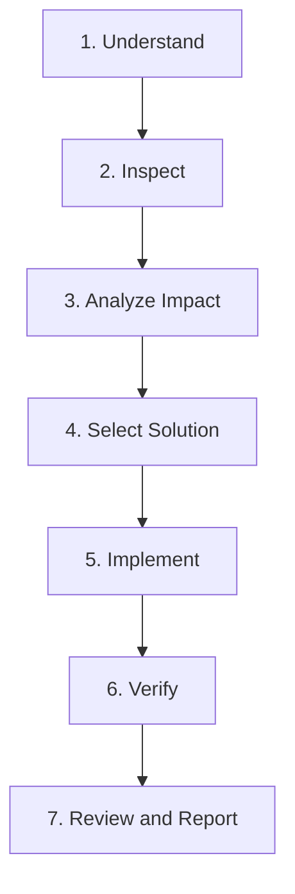
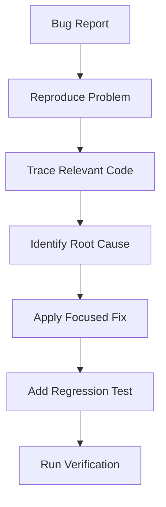
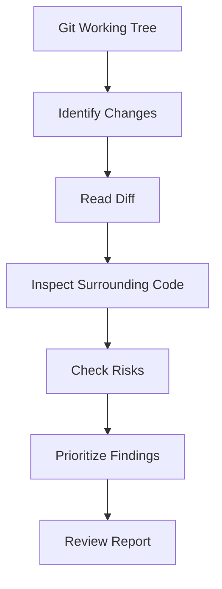
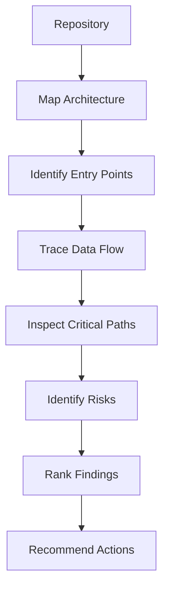
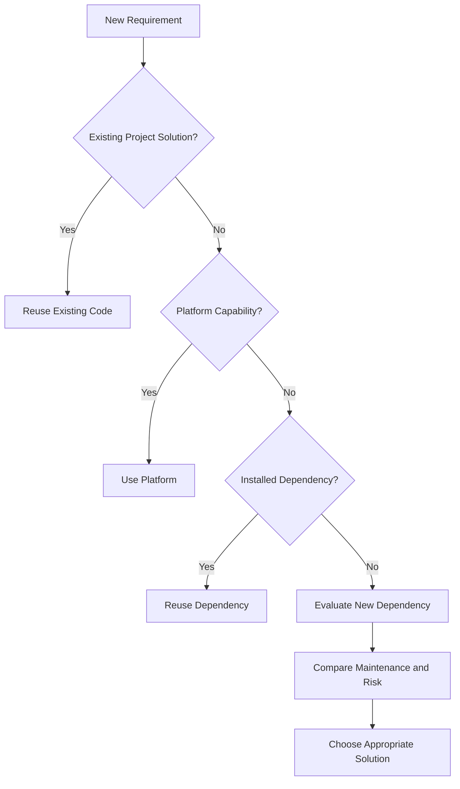
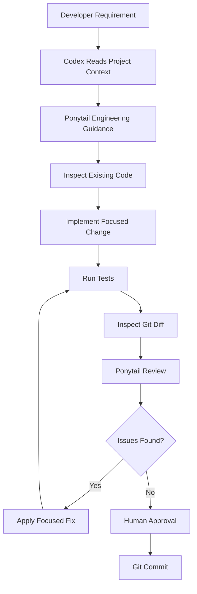

# 04 — Ponytail: Practical Workflows

> [!abstract] Lesson Overview
> **Repository:** [DietrichGebert/ponytail](https://github.com/DietrichGebert/ponytail)
>
> **Category:** Agentic Engineering / Development Workflows / Codex CLI
>
> **Difficulty:** Intermediate to Advanced
>
> **Prerequisites:** [[00 - Repository Overview]], [[01 - Architecture and Core Concepts]], [[02 - Installation and Setup]], [[03 - Configuration and Features]]
>
> **Learning Goal:** Apply Ponytail's engineering principles to real development tasks, including feature implementation, debugging, refactoring, code review, repository audits, dependency evaluation, and technical debt management.

---

# 1. Learning Objectives

After completing this lesson, you should be able to:

1. Design a complete Ponytail-driven development workflow.
2. Implement features using the smallest complete change.
3. Debug existing functionality without unnecessary refactoring.
4. Perform safe, behavior-preserving refactoring.
5. Review uncommitted, staged, and branch changes.
6. Conduct repository-wide audits.
7. Evaluate whether a new dependency is necessary.
8. Track intentional technical debt.
9. Integrate Ponytail principles with Git and Codex CLI.
10. Apply these workflows to Android, Laravel, and Next.js projects.

---

# Part I — Understanding Practical Workflows

## 2. What Is a Ponytail-Driven Workflow?

A Ponytail-driven workflow applies Ponytail's simplicity-oriented engineering principles. Instead of immediately generating code, the agent first understands the requirement and inspects the relevant parts of the project.

The goal is to implement the **smallest complete solution** that satisfies the task while preserving correctness, security, required validation, existing architecture, accessibility, relevant error handling, compatibility, and appropriate verification.

### 2.1 Traditional vs Ponytail-Oriented Workflow

**Unstructured AI Coding**

```text
Developer Request -> Generate Code -> Add Components -> Install Dependencies -> Modify Multiple Files -> Finish
```

This risks unnecessary complexity when implementation starts before the system is understood.

**Ponytail-Oriented Coding**

```text
Developer Request -> Understand Requirements -> Inspect Existing Code -> Trace Affected Dependencies
    -> Choose Smallest Complete Solution -> Implement Focused Changes -> Verify Correctness -> Review and Report
```

### 2.2 Core Engineering Principle

> [!important] Minimal Does Not Mean Incomplete
> Ang objective ng Ponytail ay hindi basta bawasan ang lines of code.
>
> Ang goal ay maiwasan ang unnecessary implementation habang napapanatili ang correctness, security, at maintainability ng system.

---

# Part II — The Core Development Workflow

## 3. The Seven-Stage Workflow

For practical learning, we can organize Ponytail's engineering principles into seven stages. These stages are a teaching framework based on the repository's instructions, not seven separate commands implemented by Ponytail.



### Stage 1 — Understand

Determine exactly what the developer requested: required functionality, expected behavior, scope boundaries, acceptance criteria, and constraints.

Example: “Add a task status filter.” This does not automatically require a new filtering framework, microservice, global state library, or custom query language.

### Stage 2 — Inspect

Read the existing implementation. Look for components, utilities, patterns, services, dependencies, and tests that may already solve the problem.

### Stage 3 — Analyze Impact

Identify files and behavior that may be affected. For a task status filter, this may include the UI, task model, existing state, filtering logic, and tests. Avoid unrelated modules.

### Stage 4 — Select Solution

Evaluate in this order: Is it needed? Can existing code solve it? Can the platform? An installed dependency? A direct implementation? Otherwise, write the minimum new code required.

### Stage 5 — Implement

Make focused changes. Avoid unrelated cleanup, premature abstractions, unrequested features, unnecessary packages, and broad rewrites.

### Stage 6 — Verify

Run checks appropriate to the change, such as unit or integration tests, type checking, builds, manual UI checks, or database query inspection.

### Stage 7 — Review and Report

Summarize what changed and why, what was verified, what was not verified, and remaining risks.

---

# Part III — Feature Development

## 4. Implementing a New Feature

### 4.1 Scenario

A task management application needs a filter for completed and pending tasks. The existing project has `src/components/TaskList.tsx`, `src/types/task.ts`, and `src/app/tasks/page.tsx`. Inspect these files before proposing new components.

### 4.2 Example Codex Prompt

```text
Implement a task status filter.

Requirements:
- Display all, pending, and completed tasks.
- Reuse existing task components.
- Follow established project conventions.
- Do not introduce new dependencies.
- Do not refactor unrelated code.

Before implementation:
1. Inspect affected files.
2. Identify existing reusable functionality.
3. Explain the smallest complete approach.

After implementation:
1. Run relevant checks.
2. Report modified files.
3. Report skipped verification and risks.
```

### 4.3 Example Implementation

For a small in-memory dataset:

```tsx
type Task = {
  id: number;
  title: string;
  status: "pending" | "completed";
};

type Filter = "all" | Task["status"];

function filterTasks(tasks: Task[], filter: Filter): Task[] {
  if (filter === "all") {
    return tasks;
  }

  return tasks.filter((task) => task.status === filter);
}
```

This uses native JavaScript and needs no package. It can be tested independently.

### 4.4 Example Tests

```ts
import { describe, expect, it } from "vitest";
import { filterTasks } from "./filterTasks";

const tasks = [
  { id: 1, title: "Design UI", status: "pending" },
  { id: 2, title: "Write tests", status: "completed" },
] as const;

describe("filterTasks", () => {
  it("returns all tasks", () => {
    expect(filterTasks([...tasks], "all")).toHaveLength(2);
  });

  it("returns pending tasks", () => {
    expect(filterTasks([...tasks], "pending")).toHaveLength(1);
  });

  it("returns completed tasks", () => {
    expect(filterTasks([...tasks], "completed")).toHaveLength(1);
  });
});
```

This assumes Vitest is already installed and configured. Do not add a new test runner if the project already uses another one.

---

# Part IV — Bug Fixing Workflow

## 5. Fixing Bugs Without Unnecessary Refactoring

A coding agent may rewrite an entire component when only one condition is wrong. Isolate the defect first.



### 5.1 Example: JavaScript Bug

```javascript
function calculateDiscount(price, discount) {
  return price - discount;
}
```

If `discount` means a percentage, this subtracts the percentage value directly. A corrected version is:

```javascript
function calculateDiscount(price, discountPercent) {
  return price * (1 - discountPercent / 100);
}
```

This assumes valid numeric inputs and a percentage between 0 and 100. Add validation when required by the input boundary.

### 5.2 Regression Testing

```javascript
const assert = require("node:assert/strict");

function calculateDiscount(price, discountPercent) {
  return price * (1 - discountPercent / 100);
}

assert.equal(calculateDiscount(100, 20), 80);
assert.equal(calculateDiscount(200, 50), 100);
assert.equal(calculateDiscount(100, 0), 100);
```

A regression test ensures the identified bug does not return.

### 5.3 Example Codex Prompt

```text
Investigate the reported bug. Do not rewrite the entire module.

First reproduce the issue, trace the affected execution path, identify the root cause, and check related callers.

Then implement the smallest complete fix, add a regression test where appropriate, and run relevant verification. Do not modify unrelated functionality.
```

> [!tip] Debugging Principle
> Fix the cause, not merely the symptom. A one-line patch is not necessarily correct if it leaves the underlying defect unresolved.

---

# Part V — Safe Refactoring

## 6. What Is Refactoring?

Refactoring changes the internal structure of code without intentionally changing externally observable behavior. Examples include simplifying conditionals, removing duplicate logic, renaming unclear variables, consolidating repeated functionality, and removing unused abstractions.

### 6.1 Refactoring vs Feature Development

| Feature Development | Refactoring |
|---|---|
| Adds or changes behavior | Preserves behavior |
| Implements new requirements | Improves internal structure |
| Uses feature acceptance criteria | Uses behavior-preservation checks |
| May introduce new modules | Often simplifies existing modules |

### 6.2 Example

Before:

```javascript
function canEdit(user) {
  if (user.role === "admin") {
    return true;
  } else {
    return false;
  }
}
```

After:

```javascript
function canEdit(user) {
  return user.role === "admin";
}
```

The behavior is equivalent for the same input object.

### 6.3 Refactoring Workflow

```text
Identify Code Smell -> Understand Current Behavior -> Check Existing Tests
    -> Select Smallest Improvement -> Apply Refactoring -> Run Regression Tests -> Review Diff
```

### 6.4 Refactoring Prompt

```text
Refactor the selected function.

Constraints:
- Preserve existing behavior.
- Avoid new dependencies.
- Do not introduce unnecessary abstractions.
- Keep changes limited to affected code.
- Preserve public interfaces unless explicitly required.

Run existing tests and report the result.
```

### 6.5 When Not to Refactor

Avoid unrelated refactoring when fixing an urgent isolated bug, working outside the requested scope, behavior is poorly understood, adequate verification is unavailable, or the change would add unnecessary risk.

---

---

# Part VI — Git-Based Code Review

## 7. Understanding Review Targets

Ponytail documents review workflows for uncommitted changes, staged changes, branch differences, and pull requests. The official repository exposes review through `/ponytail-review` and, in supported Codex integrations, the namespaced skill.

### 7.1 Inspect Repository Status

```powershell
git status
```

This shows modified, staged, untracked files, and branch information.

### 7.2 Inspect Changes

```powershell
git diff          # unstaged changes
git diff --cached # staged changes
git diff --stat   # change summary
```

These commands provide evidence for reviewing an implementation.

---

## 8. Reviewing Uncommitted Changes

Example invocation in a supported Codex integration:

```text
$ponytail:ponytail-review
```

Example request:

```text
Review the current uncommitted changes.

Focus on correctness, security, missing tests, performance, and unnecessary complexity.
Read relevant surrounding code. Do not modify files. Report findings by severity.
```



Illustrative finding:

```text
Severity: Medium
Location: TaskController.php
Issue: The endpoint returns an unbounded result set.
Impact: Large datasets may increase response time and memory use.
Suggested Fix: Use pagination consistent with existing API conventions.
Verification: Add or run an endpoint test covering pagination.
```

This is an example, not actual Ponytail output.

---

## 9. Reviewing Staged Changes

Before committing, stage only intended files:

```powershell
git add app/Http/Controllers/TaskController.php
git diff --cached
```

Then request:

```text
Review the staged changes only. Identify correctness issues, security risks,
missing tests, and unnecessary complexity. Do not modify files.
```

Staged changes are the snapshot intended for the commit. Reviewing them can catch mistakes before they enter project history.

---

## 10. Reviewing Branch Changes

If working on `feature/task-filter`, compare it with the actual base branch:

```powershell
git diff main...HEAD
```

This compares changes since the merge base with `main`. Not every project uses `main`.

Example request:

```text
Review the current feature branch relative to its base branch.
Inspect relevant surrounding code. Identify breaking changes, missing tests,
security concerns, and unnecessary complexity. Do not modify files.
```

---

# Part VII — Repository Audit

## 11. What Is a Repository Audit?

A repository audit examines a broader codebase instead of a selected diff. Ponytail's documented audit approach maps the repository before prioritizing findings, including entry points, data flow, expected workload, correctness, security, performance, missing tests, and unnecessary complexity.

### 11.1 Audit Workflow



### 11.2 Codex Invocation

```text
$ponytail:ponytail-audit
```

### 11.3 Example Request

```text
Audit the current repository.

First map application entry points, core modules, important dependencies,
database interactions, and main data flows.

Then identify correctness risks, security issues, performance bottlenecks,
missing tests, and unnecessary abstractions. Rank findings by severity and
impact. Do not modify files.
```

### 11.4 Review vs Audit

| Aspect | Review | Audit |
|---|---|---|
| Target | Selected changes | Broader codebase |
| Scope | Focused | System-wide |
| Primary goal | Catch change-related issues | Identify existing technical risks |
| Typical timing | Before commit or merge | Periodic assessment |
| Output | Change-specific findings | Prioritized repository findings |

> [!warning] Audit Limitation
> An AI-generated audit does not replace security testing, profiling, or human engineering review. Validate important findings before implementing changes.

---

# Part VIII — Dependency Evaluation

## 12. Avoiding Unnecessary Dependencies

Check existing solutions before adding packages.



### 12.1 Example: Date Input

A basic Next.js date field may need only native HTML:

```tsx
<input type="date" name="birthDate" required />
```

A calendar package may be justified for complex date ranges, specialized interactions, advanced localization, or features missing from existing components. Decide from the actual requirements.

### 12.2 Dependency Evaluation Checklist

- [ ] Is the functionality already available?
- [ ] Does the project have a suitable dependency?
- [ ] Is the new dependency maintained?
- [ ] Is its license compatible?
- [ ] Does it introduce security concerns?
- [ ] Does it materially increase complexity?
- [ ] Is the functionality substantial enough to justify it?

### 12.3 Example Prompt

```text
Evaluate whether a new dependency is necessary.
Inspect existing project dependencies first.
Compare existing project code, platform-native options, installed dependencies,
and the proposed package. Recommend the smallest maintainable solution.
Do not install anything yet.
```

---

# Part IX — Technical Debt Management

## 13. Tracking Intentional Shortcuts

Ponytail supports documenting deliberate engineering tradeoffs with `shortcut:` comments.

### 13.1 JavaScript Example

```javascript
// shortcut: local filtering is acceptable for the current small dataset
const filtered = tasks.filter((task) => task.status === "pending");
```

### 13.2 Laravel Example

```php
// shortcut: revisit query optimization if measured response time increases
$tasks = Task::where('status', 'pending')->get();
```

These comments are appropriate only when the implementation is correct and meets current requirements.

### 13.3 Debt Workflow

```text
Identify Tradeoff -> Document Shortcut -> Continue Development
    -> Collect Debt Comments -> Review Debt Ledger -> Prioritize Improvements
```

### 13.4 Codex Debt Skill

The repository documents `/ponytail-debt`. In supported Codex integrations, use the corresponding namespaced debt skill from the available Ponytail skills.

### 13.5 Good Shortcut Documentation

A useful comment explains what was simplified, why the tradeoff is acceptable, and when it should be revisited. Avoid `// shortcut: fix later`; prefer `// shortcut: use in-memory filtering until server pagination is required`.

---

# Part X — Android Practical Workflow

## 14. Scenario: GroupTrack Task Status UI

Assume an Android Java project needs a task status indicator:

```text
GroupTrack/
├── AGENTS.md
├── docs/
└── app/src/main/
    ├── java/
    └── res/layout/
```

### 14.1 Step 1 — Inspect

```text
Inspect the existing task-related Java classes and XML layouts.
Identify how task status is represented. Do not modify files.
Report reusable components and relevant constraints.
```

### 14.2 Step 2 — Plan

```text
Propose the smallest complete implementation for displaying task status.
Reuse existing styles and components. Do not add a UI library.
Keep changes within the documented MVP scope.
```

### 14.3 Step 3 — Implement

```xml
<TextView
    android:id="@+id/tvTaskStatus"
    android:layout_width="wrap_content"
    android:layout_height="wrap_content"
    android:text="Pending"
    android:textSize="14sp" />
```

Exact attributes depend on the surrounding layout.

### 14.4 Step 4 — Verify

Use the project's Gradle wrapper:

```powershell
.\gradlew.bat assembleDebug
.\gradlew.bat testDebugUnitTest
```

Run the test task only if tests are configured. Verify UI behavior in an emulator or test device.

### 14.5 Step 5 — Review

Inspect `git diff`, then request a focused Ponytail review.

**Expected Outcome:** A task status indicator that follows existing conventions without unnecessary libraries or architectural changes.

---

# Part XI — Laravel Practical Workflow

## 15. Scenario: Active Tasks Endpoint

### 15.1 Step 1 — Inspect

```text
Inspect the existing task routes, controllers, models, authorization policies,
and API conventions. Identify the smallest complete implementation.
Do not modify files yet.
```

### 15.2 Step 2 — Implementation Example

```php
public function index()
{
    return Task::query()
        ->where('status', 'active')
        ->paginate(15);
}
```

This is illustrative. A production implementation must follow authentication, authorization, resource transformation, and response conventions.

### 15.3 Step 3 — Verify

```powershell
php artisan test
php artisan test --filter=TaskTest
```

Replace `TaskTest` with the actual test name.

### 15.4 Step 4 — Review

Inspect `git diff --stat` and `git diff`. Check authorization, pagination, response fields, query efficiency, and API compatibility.

**Expected Outcome:** A focused endpoint that follows the existing Laravel architecture.

---

# Part XII — Next.js Practical Workflow

## 16. Scenario: Product Search Filter

### 16.1 Step 1 — Inspect

```text
Inspect the existing product components, state management, and data fetching.
Determine whether search can reuse current functionality. Do not install dependencies.
```

### 16.2 Step 2 — Example Implementation

```tsx
const [query, setQuery] = useState("");

const filteredProducts = products.filter((product) =>
  product.name.toLowerCase().includes(query.toLowerCase())
);
```

This assumes a Client Component, imported `useState`, and an existing `products` array. For large datasets, server-side search may fit better.

### 16.3 Step 3 — Verify

```powershell
npm run lint
npm run build
```

Run these commands only if the corresponding scripts exist in `package.json`.

### 16.4 Step 4 — Review

Inspect `git diff` for TypeScript errors, accessibility, empty-state behavior, existing component conventions, and unnecessary dependencies.

---

---

# Part XIII — Combining Ponytail, Codex, and Git

## 17. Complete Agentic Development Cycle

A practical development cycle combines project documentation, Codex CLI, Ponytail, Git, automated tests, and human review.



### 17.1 Recommended Git Workflow

```powershell
git status
git switch -c feature/task-filter
# Implement and verify the change.
git diff
git add src/components/TaskList.tsx
git diff --cached
git commit -m "feat: add task status filter"
```

### 17.2 Why Human Approval Matters

An AI agent can produce plausible but incorrect changes. Before committing, confirm requirements are satisfied, tests are appropriate, no unrelated files changed, no secrets were introduced, and the implementation follows project architecture.

---

# Part XIV — Prompt Engineering for Ponytail

## 18. Writing Effective Development Prompts

Ponytail gives general engineering guidance, but task instructions still need to be clear.

### 18.1 Weak Prompt

```text
Improve my code.
```

This does not identify the desired behavior, file, or quality concern.

### 18.2 Better Prompt

```text
Inspect TaskController.php.
Identify unnecessary complexity in the task retrieval logic.
Preserve existing API behavior and authorization.
Do not modify unrelated files.
Propose the smallest complete improvement.
Run relevant tests after implementation.
```

### 18.3 Recommended Prompt Structure

Include the task objective, relevant scope, required behavior, architecture constraints, allowed modifications, verification expectations, and reporting requirements.

### 18.4 Reusable Prompt Template

```text
TASK:
[Describe the required change]

CONTEXT:
[Relevant project/module information]

REQUIREMENTS:
[Required behavior and acceptance criteria]

CONSTRAINTS:
- Follow existing architecture.
- Reuse existing functionality.
- Avoid unnecessary dependencies.
- Do not modify unrelated files.
- Preserve security and correctness.

WORKFLOW:
1. Inspect affected code.
2. Identify dependencies and impact.
3. Select the smallest complete solution.
4. Implement focused changes.
5. Run relevant verification.
6. Review the final diff.

OUTPUT:
- Summary of changes.
- Modified files.
- Verification results.
- Skipped checks.
- Remaining risks.
```

> [!note] Avoid Redundant Instructions
> If Ponytail is already active, there is no need to repeat its whole skill in every prompt. Focus on project requirements, scope, and acceptance criteria.

---

# Part XV — Common Mistakes

## 19. Mistakes to Avoid

| Mistake | Better Approach |
|---|---|
| Coding before inspecting the project | Read affected files first |
| Refactoring unrelated modules | Keep changes focused |
| Adding packages for trivial features | Check existing capabilities |
| Treating fewer lines as automatically better | Preserve correctness |
| Skipping tests to save tokens | Verify meaningful logic |
| Trusting every AI review finding | Validate findings |
| Auditing the whole repo for a tiny change | Use focused review |
| Committing without checking the diff | Inspect staged changes |
| Ignoring project documentation | Follow established architecture |
| Using broad prompts | Define scope and acceptance criteria |

---

# Part XVI — Practical Exercises

## 20. Exercise 1 — Feature Development

Implement a status filter in a practice task list. Reuse components, avoid new dependencies, preserve behavior, add appropriate tests, and review the final diff.

**Expected Outcome:** A minimal, complete feature implementation.

## 21. Exercise 2 — Bug Fixing

Reproduce a bug, identify the affected function, trace callers, make a focused fix, add a regression test, and verify the result.

**Expected Outcome:** A verified fix with limited scope.

## 22. Exercise 3 — Safe Refactoring

Find a verbose conditional or duplicated function. Understand behavior and edge cases first; then refactor, run tests, compare behavior, and inspect the diff.

**Expected Outcome:** Better readability without intentional behavior changes.

## 23. Exercise 4 — Git Review

Run `git status`, `git diff`, and `git diff --cached`, then use the supported Ponytail review skill. Evaluate correctness, security, performance, missing tests, and unnecessary complexity.

**Expected Outcome:** A prioritized review report.

## 24. Exercise 5 — Repository Audit

Map entry points, core modules, a key data flow, and dependencies. Run the Ponytail audit workflow and validate the most important findings.

**Expected Outcome:** A repository health assessment with actionable priorities.

## 25. Exercise 6 — Dependency Evaluation

For a basic date input, compare an existing project component, native HTML input, installed UI library, and a new package. Document the recommendation and reasoning.

**Expected Outcome:** A justified dependency decision.

## 26. Exercise 7 — Complete Agentic Workflow

Complete a small task through requirement analysis, inspection, impact analysis, implementation, verification, diff review, Ponytail review, human validation, and commit.

**Expected Outcome:** Experience a complete agentic engineering workflow.

---

# Part XVII — Knowledge Check

## 27. Review Questions

1. What is the purpose of a Ponytail-driven workflow?
2. Why inspect existing code before implementation?
3. What is a minimal complete solution?
4. How does feature development differ from refactoring?
5. Why should bug fixes include regression tests?
6. What does `git diff` show?
7. What does `git diff --cached` show?
8. What is the difference between review and audit?
9. Why read surrounding code during review?
10. When is a new dependency justified?
11. What is the purpose of `shortcut:` comments?
12. Why verify AI-generated audit findings?
13. What role does `AGENTS.md` play?
14. Why avoid unrelated changes?
15. What belongs in the agent's final report?

---

# Part XVIII — Key Takeaways

> [!summary] Lesson Summary
> - Understand requirements before writing code.
> - Inspect existing code before adding an implementation.
> - Preserve correctness and security in the smallest complete solution.
> - Fix root causes and verify bug fixes with regression checks.
> - Refactoring should preserve externally observable behavior.
> - Git diffs support focused code review.
> - Ponytail review examines changes and surrounding code; audit examines broader risks.
> - Justify dependencies by real requirements.
> - Document intentional technical debt with clear revisit conditions.
> - Human validation remains useful before committing.

### Core Mental Model

```text
UNDERSTAND -> INSPECT -> ANALYZE -> SIMPLIFY
    -> IMPLEMENT -> VERIFY -> REVIEW -> COMMIT
```

**Remember:** The goal of agentic engineering is to deliver the correct solution with the least unnecessary complexity.

---

# Part XIX — Official References

### Ponytail Repository

- [Ponytail — GitHub](https://github.com/DietrichGebert/ponytail)
- [README.md](https://github.com/DietrichGebert/ponytail/blob/main/README.md)
- [SKILL.md](https://github.com/DietrichGebert/ponytail/blob/main/skills/ponytail/SKILL.md)
- [AGENTS.md](https://github.com/DietrichGebert/ponytail/blob/main/AGENTS.md)
- [Installation Guide](https://github.com/DietrichGebert/ponytail/blob/main/INSTALL.md)

### Workflows and Supporting Materials

- [Commands](https://github.com/DietrichGebert/ponytail/tree/main/commands)
- [Examples](https://github.com/DietrichGebert/ponytail/tree/main/examples)
- [Benchmarks](https://github.com/DietrichGebert/ponytail/tree/main/benchmarks)
- [Tests](https://github.com/DietrichGebert/ponytail/tree/main/tests)

### Development Documentation

- [OpenAI Codex Documentation](https://developers.openai.com/codex/)
- [Git Documentation](https://git-scm.com/docs)
- [Laravel Documentation](https://laravel.com/docs)
- [Next.js Documentation](https://nextjs.org/docs)
- [Android Developers](https://developer.android.com/)

> [!note] Source Verification
> Ponytail's core principles, review and audit descriptions, `shortcut:` debt convention, and Codex namespaced skill invocation are documented in the official repository.
>
> The seven-stage workflow, prompts, snippets, diagrams, and exercises are educational applications of those principles, not separate built-in Ponytail features. Verify host-specific commands against installed versions.

---

# Part XX — Next Lesson

**[[05 - Codex Integration]]**

Topics:

1. Ponytail and Codex integration architecture.
2. Codex CLI session lifecycle.
3. Plugin discovery and skill activation.
4. Namespaced Ponytail skills.
5. Codex `AGENTS.md` integration.
6. Combining Ponytail with project documentation.
7. Context engineering and instruction loading.
8. Codex approval and sandbox modes.
9. Interactive development workflows.
10. Non-interactive Codex execution.
11. Multi-step agentic coding.
12. Android, Laravel, and Next.js examples.
13. Troubleshooting instruction conflicts.
14. Security and verification practices.
15. Practical exercises and key takeaways.

**Learning Progression:**

Repository Overview → Architecture and Core Concepts → Installation and Setup → Configuration and Features → **Practical Workflows** → Codex Integration → Best Practices and Exercises
