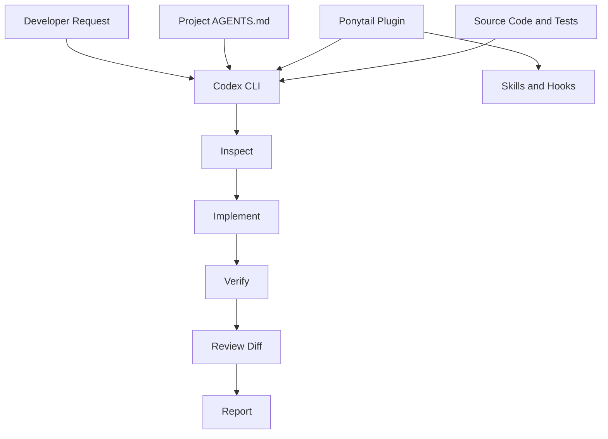
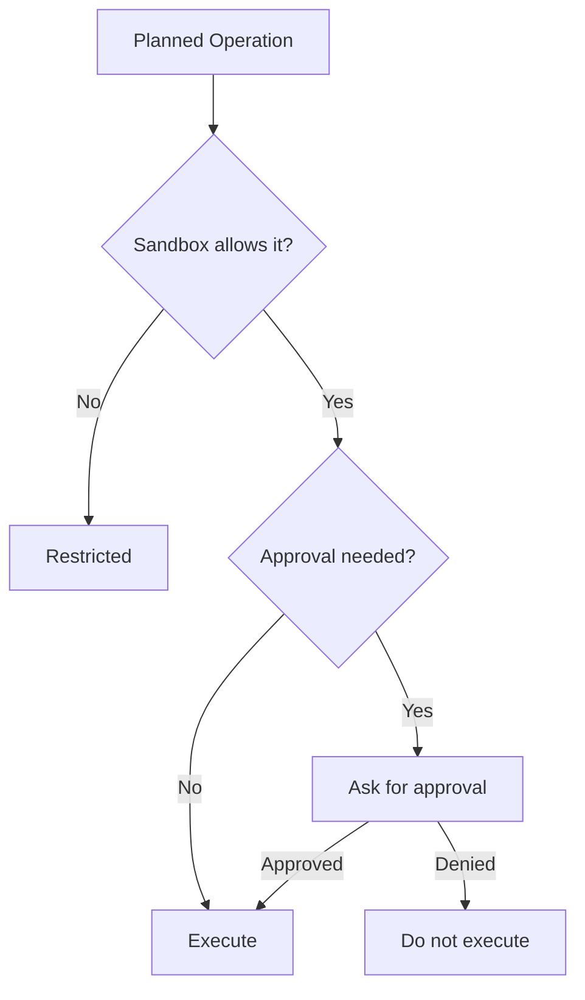
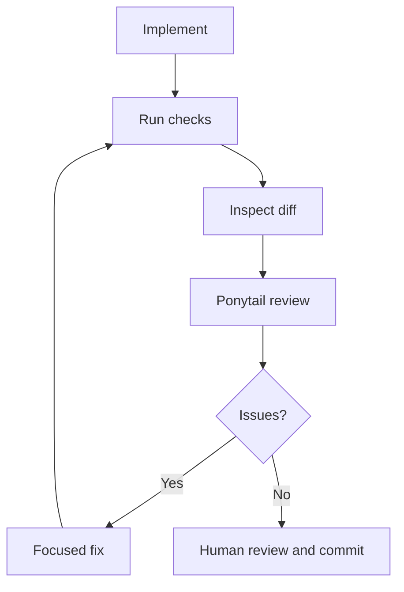

# 05 — Ponytail: Codex Integration

> [!abstract] Lesson Overview
> **Repository:** [DietrichGebert/ponytail](https://github.com/DietrichGebert/ponytail)
>
> **Category:** Agentic Engineering / Codex CLI / Context Engineering
>
> **Difficulty:** Intermediate to Advanced
>
> **Prerequisites:** [[01 - Architecture and Core Concepts]], [[02 - Installation and Setup]], [[03 - Configuration and Features]], [[04 - Practical Workflows]]
>
> **Environment:** Windows, PowerShell, Git, Codex CLI
>
> **Learning Goal:** Integrate Ponytail with Codex CLI while preserving project instructions, security controls, code quality, and efficient context management.

---

## 1. Learning Objectives

After this lesson, you should understand Codex and Ponytail's roles, plugin and skill discovery, `AGENTS.md` versus `SKILL.md`, lifecycle hooks, context management, security controls, interactive and scripted workflows, and integration with Android, Laravel, and Next.js.

# Part I — Understanding the Integration

## 2. What Does Codex Integration Mean?

Codex is the coding agent that inspects repositories, edits files, and runs permitted commands. Ponytail is a third-party skill and plugin that adds engineering guidance. Project documents define application requirements.

| Component | Responsibility |
|---|---|
| Codex CLI | Executes the development workflow |
| Ponytail | Simplicity-oriented engineering guidance |
| `AGENTS.md` | Repository-specific instructions |
| `SKILL.md` | Reusable skill behavior |
| Plugin adapter | Connects Ponytail to Codex |
| Lifecycle hooks | Support session events and instruction delivery |
| Git and tests | Track changes and verify behavior |



Ponytail does not run your application or replace Codex security controls. Codex performs development operations; Ponytail guides engineering decisions; project documents define what the application must do.

> [!important] Core Principle
> Codex is the execution environment. Ponytail is an additional instruction and workflow layer. Project requirements define the application's actual behavior.

# Part II — Plugin Architecture

## 3. Ponytail's Codex Adapter

The official repository includes components such as:

```text
ponytail/
├── .codex-plugin/plugin.json
├── hooks/claude-codex-hooks.json
├── skills/ponytail/SKILL.md
├── AGENTS.md
├── INSTALL.md
└── README.md
```

The plugin manifest provides Codex metadata. Hook configuration defines supported lifecycle integration. The skills directory contains reusable skills. `AGENTS.md` supplies compact instructions, and `INSTALL.md` documents setup. Hosts differ in plugin format, discovery, commands, and lifecycle events; the adapter connects Ponytail's guidance to Codex.

Reference: [Ponytail Agent Portability](https://github.com/DietrichGebert/ponytail/blob/main/docs/agent-portability.md)

# Part III — Installation and Session Lifecycle

## 4. Verify and Install

In PowerShell:

```powershell
codex --version
node --version
git --version
codex plugin --help
```

The installation guide documents:

```powershell
codex plugin marketplace add DietrichGebert/ponytail
codex plugin add ponytail@ponytail
codex
```

The first command registers the marketplace; the second installs the plugin. In Codex, open `/hooks`, review the two lifecycle hooks and their commands before enabling them, then start a new thread. Node.js must be on Codex's executable search path:

```powershell
where.exe node
```

Restart the terminal and Codex if Node was installed while they were running. Check installed version help because the plugin interface may change.

- [ ] Codex and Node.js are available.
- [ ] Plugin commands are supported.
- [ ] Marketplace and Ponytail plugin are installed.
- [ ] Hooks have been reviewed.
- [ ] A new thread starts and Ponytail skills are discoverable.

## 5. Installation Is Not Activation

A plugin can be **installed** (files are present), **discovered** (Codex recognizes it), **activated** (guidance applies), or **executed** (Codex carries out a task). Installation alone does not prove Ponytail influenced a particular task.

Session context may include host instructions, the user request, project `AGENTS.md`, skills, lifecycle hooks, and relevant source files. These are context sources, not a universal priority ranking; the host resolves instruction precedence.

# Part IV — Skills and Project Instructions

## 6. Namespaced Skill Invocation

Ponytail documents namespaced invocation such as:

```text
$ponytail:ponytail-review
```

| Skill | Purpose |
|---|---|
| `ponytail` | Core simplicity guidance and intensity control |
| `ponytail-review` | Review selected changes |
| `ponytail-audit` | Audit repository risks |
| `ponytail-debt` | List documented shortcuts |
| `ponytail-gain` | Display benchmark information |
| `ponytail-help` | Explain available commands |

Example:

```text
$ponytail:ponytail-review
Review uncommitted changes for correctness, security,
missing tests, performance, and unnecessary complexity.
Do not modify files.
```

Host syntax varies; `/ponytail-review` and `$ponytail:ponytail-review` are not universally interchangeable.

## 7. AGENTS.md and SKILL.md

Use project `AGENTS.md` for stable application rules: stack, architecture, conventions, scope, testing, and security. Use `SKILL.md` for reusable task-specific behavior. Ponytail gives general guidance; project instructions describe local constraints.

Example:

```markdown
# Project Instructions
## Technology
- Android Studio, Java, XML layouts, Firebase
## Architecture
- Follow existing conventions and reuse components.
## Scope
- Implement documented MVP features only.
- Avoid unnecessary libraries and abstractions.
## Verification
- Run relevant Gradle checks and report anything not run.
```

Do not overwrite an existing instruction file blindly. Avoid repeating stable rules in every prompt; state the task and its scope:

```text
Implement the task status filter described in docs/features.md.
Follow AGENTS.md. Avoid unrelated changes. Run relevant checks.
```

# Part V — Context Engineering and Conflicts

## 8. Relevant Context, Progressive Disclosure

Context engineering supplies accurate, sufficient information—not the largest amount possible.

| Source | Purpose |
|---|---|
| User prompt | Immediate task |
| `AGENTS.md` | Project rules |
| `SKILL.md` | Specialized workflow |
| Source and tests | Actual behavior and expectations |
| Git diff | Current changes |
| Documentation | Architecture and requirements |

Progressive disclosure means starting with the affected module and its tests, then expanding only when dependencies require it. Repeated instructions, unrelated logs, and full-repository reads for small tasks waste context. Small context is not automatically better; relevant, sufficient context is.

A project may require database writes through an existing service layer while Ponytail advises avoiding needless abstractions. Follow the required service layer without adding more layers without need. Minimal implementation must preserve required validation, authorization, tests, and architecture.

# Part VI — Security Boundaries

## 9. Sandbox and Approval Controls

Sandboxing restricts access and changes; approval controls determine which operations need user authorization. Exact behavior depends on Codex configuration. Ponytail is an instruction layer, not a security boundary.



Keep appropriate controls enabled, review third-party hooks, avoid unnecessary filesystem access, keep credentials out of prompts, and inspect changes before committing. For exploration, request read-only analysis and use host controls for enforcement.

# Part VII — Interactive and Non-Interactive Workflows

## 10. Interactive Codex

Start with `codex`. A useful sequence is: inspect the module, review the plan, request a focused change, run verification, and inspect the diff. Interactive work suits evolving requirements, unfamiliar code, important data, and choices that need developer review.

```text
Inspect the task module and identify files needed for a status
filter. Do not edit yet.
```

Then request implementation following `AGENTS.md`, and finally ask for relevant checks and a diff summary.

## 11. Non-Interactive `codex exec`

```powershell
codex exec "Inspect this repository and summarize its architecture. Do not modify files."
```

PowerShell can pass a multiline prompt:

```powershell
$prompt = @"
Inspect the current repository's main modules and tests.
Do not modify files. Return a concise report.
"@
codex exec $prompt
```

Check process success with `$LASTEXITCODE`, but a successful exit does not prove the analysis is correct. Do not assume interactive and non-interactive execution load every skill, hook, permission, or context identically. Verify before relying on automation; test in a disposable repository first.

# Part VIII — Git and Platform Workflows

## 12. Review with Git and Ponytail

Git makes agent edits reviewable:

```powershell
git status
git diff
git diff --cached
git diff main...HEAD
```

Use your project's actual base branch. Review changes after verification:



## 13. Android

For a task status indicator, inspect Java classes and XML layouts, identify existing status handling and reusable components, then implement only the needed UI using existing resources. Follow `AGENTS.md` and avoid a new UI library.

```powershell
.\gradlew.bat assembleDebug
.\gradlew.bat testDebugUnitTest
```

Run supported checks and inspect the UI on an emulator or device. Review the diff and use the available Ponytail review skill.

## 14. Laravel

For a filtered task endpoint, inspect routes, controllers, models, services, policies, and tests first. Follow existing API conventions, preserve authentication and authorization, and add focused tests.

```powershell
php artisan test
php artisan test --filter=TaskTest
```

Use the real test name. Avoid destructive migrations or resets against a real database; use an isolated test database where appropriate.

## 15. Next.js

For product search, inspect current components and state management. Reuse filtering and UI components, follow TypeScript conventions, and preserve accessibility and responsive behavior.

```powershell
npm run lint
npm run build
```

Run scripts that exist in `package.json`, then review the diff.

# Part IX — Multi-Step Work and Troubleshooting

## 16. Choosing Workflow Stages

A large task may need architecture inspection, impact analysis, a plan, focused implementation, checks, review, and a final report. Use one prompt for a small, clear, low-risk task; split work when requirements are unclear, modules are unfamiliar, database behavior changes, or security matters. Do not add agents unless they provide a clear benefit.

## 17. Common Problems

**Skill not found:** Check Codex version, plugin installation, skill discovery, and whether a new thread is needed.

**Hooks inactive:** Inspect `/hooks`, review commands, check Node.js, start a new thread, and inspect host diagnostics.

**Instructions ignored:** Confirm discovery and invocation, inspect `AGENTS.md`, consider higher-priority host rules, and judge actual behavior.

**Context too large:** Narrow the task, reuse project instructions, and load related files progressively.

**Unexpected changes:** Run `git status` and `git diff`. Identify each change; do not discard potentially unrelated work automatically.

**`codex exec` differs:** Compare working directory, context, skill activation, and permissions. Test a small task before automation.

# Part X — Best Practices and Exercises

## 18. Best Practices

1. Keep stable project instructions in `AGENTS.md`.
2. Avoid repeating Ponytail rules in every prompt.
3. Verify the skill is available and activated.
4. Keep sandbox and approval controls enabled.
5. Inspect before editing; scope prompts clearly.
6. Review Git changes and run relevant checks.
7. Report checks that were not run.
8. Use multiple agents only when they add clear value.
9. Treat Ponytail as guidance, not a replacement for developer judgment.

## 19. Exercises

1. **Verify integration:** Check Codex and plugin support, review hooks, start a new thread, and locate a Ponytail skill.
2. **Write project instructions:** In a practice project, document stack, architecture, scope, and checks in `AGENTS.md`; ask Codex to identify constraints.
3. **Interactive workflow:** Inspect a small task, review the plan, implement, test, inspect the diff, and run Ponytail review.
4. **Compare execution modes:** Run a read-only `codex exec` architecture summary and compare context, permissions, and skill behavior with interactive Codex.
5. **Context efficiency:** Compare a full-repository prompt with one scoped to a module and tests. Check relevance and verification.
6. **Complete workflow:** Read instructions, inspect affected files, plan, implement, verify, inspect changes, review findings, and prepare a commit.

# Part XI — Knowledge Check

## 20. Review Questions

1. What does Codex do, and what does Ponytail add?
2. What is `.codex-plugin/plugin.json` for?
3. Why review lifecycle hooks?
4. What is a namespaced skill?
5. How do `AGENTS.md` and `SKILL.md` differ?
6. What are context engineering and progressive disclosure?
7. Why keep sandbox and approval controls?
8. How do interactive and non-interactive sessions differ?
9. What does `codex exec` do, and why verify it separately?
10. Why inspect Git diffs and run tests?
11. When should work be split into stages?
12. Why preserve existing architecture and verify agent findings?

# Part XII — Key Takeaways

> [!summary] Lesson Summary
> - Codex executes coding tasks; Ponytail adds engineering guidance.
> - The adapter uses plugin metadata, skills, and lifecycle hooks.
> - Installation and activation are different.
> - `AGENTS.md` describes project rules; `SKILL.md` describes reusable skill behavior.
> - Context should be relevant and sufficient. Load it progressively.
> - Host security controls remain important with third-party plugins.
> - Verify interactive and automated behavior separately.
> - Git diffs and tests help establish what changed and whether it works.
> - Ponytail complements project architecture; it does not replace it.

```text
Project Requirements → AGENTS.md → Codex
    → Ponytail + Relevant Source → Inspect → Implement
    → Verify → Review → Report
```

A reliable workflow turns requirements into focused, verifiable changes; it is not defined by the number of tools or plugins used.

# Part XIII — Official References

## Ponytail

- [Repository](https://github.com/DietrichGebert/ponytail)
- [Installation Guide](https://github.com/DietrichGebert/ponytail/blob/main/INSTALL.md)
- [Agent Portability](https://github.com/DietrichGebert/ponytail/blob/main/docs/agent-portability.md)
- [Primary Skill](https://github.com/DietrichGebert/ponytail/blob/main/skills/ponytail/SKILL.md)
- [AGENTS.md](https://github.com/DietrichGebert/ponytail/blob/main/AGENTS.md)
- [Codex Plugin](https://github.com/DietrichGebert/ponytail/tree/main/.codex-plugin)
- [Hooks](https://github.com/DietrichGebert/ponytail/tree/main/hooks)

## Codex and Development Tools

- [Codex Documentation](https://developers.openai.com/codex/)
- [Codex CLI](https://developers.openai.com/codex/cli/)
- [Non-Interactive Mode](https://developers.openai.com/codex/non-interactive/)
- [AGENTS.md Guide](https://developers.openai.com/codex/guides/agents-md/)
- [Skills](https://developers.openai.com/codex/skills/)
- [Security](https://developers.openai.com/codex/security/)
- [Git](https://git-scm.com/docs) · [Android](https://developer.android.com/) · [Laravel](https://laravel.com/docs) · [Next.js](https://nextjs.org/docs)

> [!note] Source Verification
> Plugin commands, hooks, adapter components, and skill integration refer to Ponytail documentation. Diagrams, prompts, and project examples are educational. Codex command and plugin behavior can vary by version; verify compatibility before relying on them in important projects or automation.

# Part XIV — Next Lesson

**[[06 - Best Practices and Exercises]]**

The final lesson covers third-party skill safety, scope and complexity control, dependency management, verification, instruction-injection awareness, Git review, context efficiency, project case studies, exercises, and a proficiency checklist.

**Learning Progression:** Repository Overview → Architecture and Core Concepts → Installation and Setup → Configuration and Features → Practical Workflows → **Codex Integration** → Best Practices and Exercises
