# 01 — Superpowers: Architecture and Core Concepts

> [!abstract] Lesson Information
> **Repository:** [obra/superpowers](https://github.com/obra/superpowers)
>
> **Category:** Agentic Engineering / Skill Architecture / Context Engineering
>
> **Difficulty:** Intermediate
>
> **Learning Approach:** Theory First
>
> **Prerequisites:** [[00 - Repository Overview]]
>
> **Primary Goal:** Understand how Superpowers organizes, discovers, activates, and composes reusable engineering skills within supported AI coding agents.

---

# 1. Learning Objectives

After completing this lesson, you should be able to:

1. Explain the architectural role of Superpowers.
2. Identify its major repository components.
3. Understand how `SKILL.md` files define skills.
4. Explain the purpose of the `using-superpowers` skill.
5. Distinguish skill discovery from skill activation.
6. Understand plugin adapters and host-specific integrations.
7. Explain lifecycle hooks and their security implications.
8. Distinguish skills, agents, commands, and tools.
9. Understand how `AGENTS.md` interacts with skills.
10. Apply progressive disclosure to context management.
11. Describe how Superpowers works with Codex CLI.
12. Recognize the architectural tradeoffs of multi-agent workflows.

---

# Part I — The Architectural Foundation

## 2. What Kind of System Is Superpowers?

Superpowers is a **skills-based methodology layer** for AI coding agents.

It is not a standalone coding agent.

It does not replace:

- Codex CLI.
- Claude Code.
- Cursor.
- Git.
- Build tools.
- Testing frameworks.
- Application architectures.

Instead, it provides instructions and workflows that a supported agent can apply while performing software engineering tasks.

### 2.1 Three Architectural Layers

A useful way to understand Superpowers is through three layers.

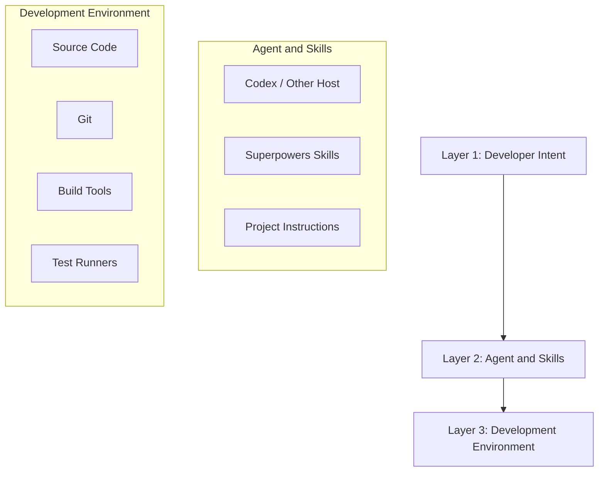

**Layer 1 — Developer Intent** defines what should be accomplished, such as implementing a feature, investigating a bug, refactoring a module, or reviewing changes.

**Layer 2 — Agent and Skills** determines how the task is approached. The host agent interprets instructions, selects tools, and performs work. Superpowers provides specialized development workflows.

**Layer 3 — Development Environment** contains the actual project, files, commands, tests, and version control.

### 2.2 Responsibility Boundaries

| Component | Responsibility |
|---|---|
| Developer | Defines goals and approves important decisions |
| Coding agent | Interprets tasks and operates tools |
| Superpowers | Provides engineering workflows |
| Project instructions | Define application-specific constraints |
| Git | Tracks and isolates changes |
| Test runner | Executes verification |
| Host security controls | Restrict tool and filesystem access |

> [!important] Key Distinction
> Superpowers describes how an agent should work.
>
> The coding-agent host determines which operations it can actually perform.

---

# Part II — Repository Architecture

## 3. Major Repository Components

The official Superpowers repository organizes its implementation around skills and host integrations.

A simplified structure is:

```text
superpowers/
├── .agents/
├── .claude-plugin/
├── .codex-plugin/
├── .cursor-plugin/
├── .opencode/
├── docs/
├── hooks/
├── scripts/
├── skills/
├── tests/
├── AGENTS.md
├── README.md
├── RELEASE-NOTES.md
└── package.json
```

This is a conceptual overview of major components, not an exhaustive directory listing.

### 3.1 Skills Directory

The `skills/` directory is the core learning area.

Each skill represents a reusable engineering practice.

Examples include:

```text
skills/
├── using-superpowers/
├── brainstorming/
├── writing-plans/
├── executing-plans/
├── test-driven-development/
├── systematic-debugging/
├── verification-before-completion/
├── requesting-code-review/
├── receiving-code-review/
├── using-git-worktrees/
├── subagent-driven-development/
└── finishing-a-development-branch/
```

Additional skills may be present in the current repository.

Each skill can contain its own instructions and supporting resources.

### 3.2 Plugin Directories

Host-specific directories help Superpowers integrate with different coding agents. For example:

```text
.codex-plugin/
.claude-plugin/
.cursor-plugin/
```

These directories are integration adapters for different hosts, not separate application frameworks.

### 3.3 Hooks Directory

The `hooks/` directory contains lifecycle-related integration components. Depending on the host, hooks can help initialize skill guidance or respond to supported events. Not every host exposes the same hook capabilities.

### 3.4 Scripts Directory

The `scripts/` directory contains supporting automation for installation, testing, integration, or other repository functions. Unlike a Markdown skill file, a script can execute operations and therefore requires appropriate security review.

### 3.5 Tests Directory

The repository contains tests for its own behavior and integration components. These are distinct from tests belonging to an application developed using Superpowers.

---

# Part III — Anatomy of a Skill

## 4. What Is SKILL.md?

A `SKILL.md` file defines a reusable capability or workflow for an AI coding agent.

It typically explains:

- When the skill should be used.
- What problem it solves.
- Which steps the agent should follow.
- What rules apply.
- How to verify the outcome.

A skill may also reference supporting files.

### 4.1 Conceptual Skill Structure

```text
skill-name/
├── SKILL.md
├── references/
├── scripts/
└── examples/
```

This is an illustrative pattern. Not every Superpowers skill contains all these directories.

### 4.2 Simplified SKILL.md Example

```markdown
---
name: example-review
description: Review code changes for correctness and maintainability.
---

# Example Review Skill

## When to Use

Use when reviewing a completed implementation.

## Workflow

1. Identify changed files.
2. Read relevant surrounding code.
3. Inspect tests.
4. Identify actionable findings.
5. Report findings by severity.

## Completion

Return findings with evidence.
```

This is an educational example, not a copied Superpowers skill.

### 4.3 Metadata vs Instructions

**Metadata** helps the host discover and identify a skill, such as its name and description.

**Instructions** tell the agent how to execute the workflow, such as preconditions, ordered steps, constraints, and verification requirements.

### 4.4 Why Separate Skills?

A single enormous instruction file is harder to maintain, contains more irrelevant context, blurs responsibilities, increases instruction conflicts, and is difficult to reuse. Separate skills enable a more modular architecture.

---

---

# Part IV — The Bootstrap Skill

## 5. Understanding using-superpowers

One of the most important skills is:

```text
using-superpowers
```

This is a meta skill. It teaches the agent how to recognize and use the other available skills.

### 5.1 What Is a Meta Skill?

A meta skill is a skill that governs how other skills are selected or used.

```text
using-superpowers
        |
        v
Check Available Skills
        |
        v
Identify Relevant Skill
        |
        v
Load Instructions
        |
        v
Apply Workflow
```

### 5.2 Conceptual Bootstrap Flow

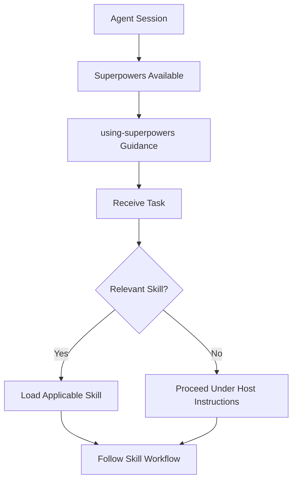

The exact mechanism depends on the host. This diagram illustrates intended behavior, not one universal implementation.

### 5.3 Why Is This Important?

Without skill-discovery guidance, an agent may ignore relevant skills. A debugging request, for example, could be handled through guesswork even though `systematic-debugging` is available. Bootstrap guidance encourages deliberate skill selection.

### 5.4 Skills Are Not Always Optional Suggestions

Some Superpowers skills contain explicit workflow requirements, such as verification before completion or a design process before implementation. These requirements operate within the host's instruction hierarchy. A third-party skill cannot override higher-priority instructions or host security controls.

---

# Part V — Skill Discovery and Activation

## 6. Discovery vs Activation vs Execution

These terms describe different stages.

### Discovery

The host knows that a skill exists.

### Selection

The agent identifies a skill relevant to the current task.

### Activation

The skill instructions are made available and applied.

### Execution

The agent performs the actual workflow using its tools.

### 6.1 Lifecycle Diagram

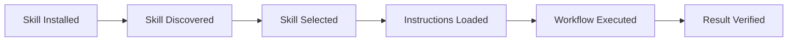

### 6.2 Example

User request: “Investigate why task creation fails.”

```text
Task Received
      |
      v
Identify Debugging Intent
      |
      v
Select systematic-debugging
      |
      v
Read Relevant Instructions
      |
      v
Investigate Root Cause
      |
      v
Apply Fix
      |
      v
Verify Behavior
```

### 6.3 Important Limitation

The existence of a skill file does not guarantee that the host discovered it, the agent selected it, instructions were loaded, or the workflow was followed correctly. Verify the actual integration.

---

# Part VI — Skill Composition

## 7. How Skills Work Together

Superpowers is designed around composable workflows. A larger development task can use several specialized skills.

### 7.1 Feature Development Composition

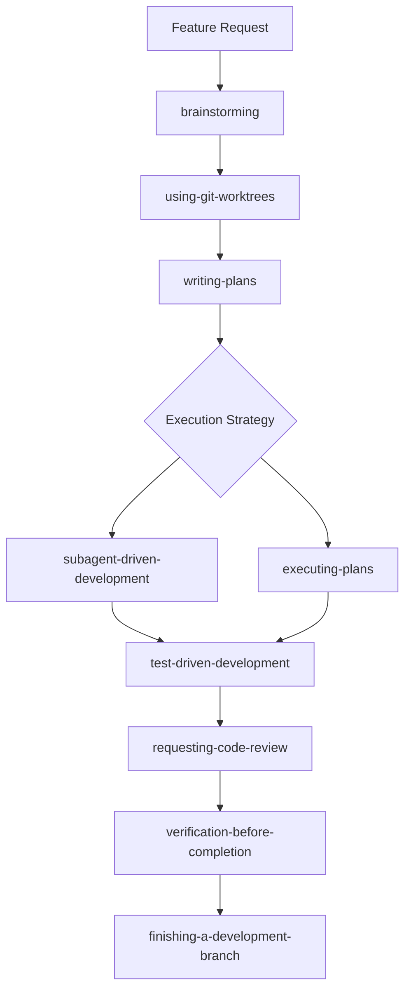

This summarizes relationships among skills. Review and verification often recur during implementation, not just at the end.

### 7.2 Debugging Composition

```text
Bug Report -> systematic-debugging -> Root Cause Identified
    -> Regression Test -> Focused Fix -> verification-before-completion
```

### 7.3 Review Composition

```text
Implementation Complete -> requesting-code-review -> receiving-code-review
    -> Evaluate Findings -> Apply Justified Changes -> verification-before-completion
```

### 7.4 Why Composition Matters

Each skill addresses a particular engineering responsibility. The agent can combine them without requiring one skill to contain the entire software development methodology.

---

# Part VII — Skills, Agents, Commands, Hooks, and Tools

## 8. Understanding the Differences

| Concept | Definition | Example |
|---|---|---|
| Skill | Reusable workflow instructions | `systematic-debugging` |
| Agent | AI system performing work | Codex |
| Subagent | Separate delegated agent execution | Task implementer |
| Command | User-facing invocation or host instruction | A supported slash command |
| Hook | Action associated with a lifecycle event | Session initialization hook |
| Tool | Capability used by an agent | Terminal, file editor, Git |
| Plugin | Packaged integration | Superpowers Codex plugin |

### 8.1 Relationship Diagram

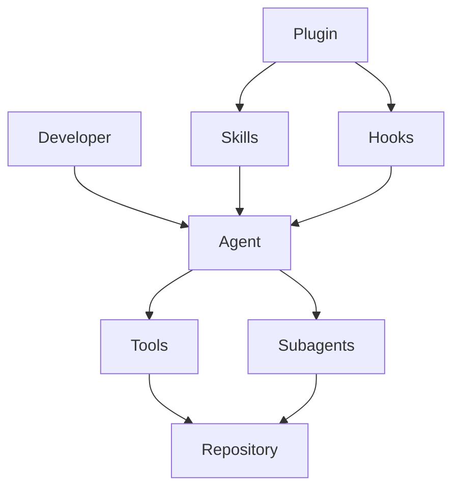

### 8.2 Skill vs Tool

A skill can instruct, “Write a failing test before implementing code.” A tool actually runs a command such as:

```powershell
npm test
```

The skill defines the process; the tool performs the operation.

### 8.3 Skill vs Subagent

A skill is not necessarily an independent AI agent. `writing-plans` describes how to create a plan; a subagent is a separate execution context that can perform an assigned task.

### 8.4 Hook vs Command

A hook is associated with a supported lifecycle event. A command is explicitly invoked through the host's command interface. A hook may run without being manually requested at that moment.

---

# Part VIII — Plugin Adapters

## 9. Why Does Superpowers Need Host Adapters?

Coding agents do not share one universal plugin system. They may differ in skill discovery, plugin manifests, lifecycle events, subagent support, tool permissions, command interfaces, and session initialization.

Superpowers uses host-specific integration components to bridge these differences.

### 9.1 Adapter Architecture

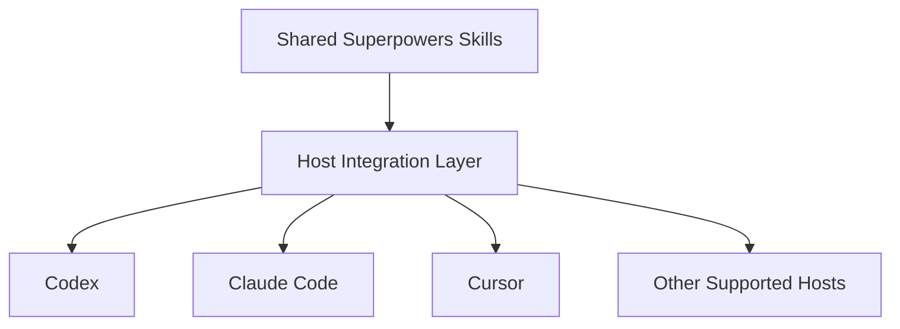

This is conceptual; actual adapters may use different files and mechanisms.

### 9.2 Benefits

- Shared skill methodology.
- Less duplication of core instructions.
- Support for multiple coding agents.
- Host-specific compatibility handling.

### 9.3 Tradeoffs

- Different installation methods.
- Different invocation syntax.
- Different lifecycle capabilities.
- Different subagent behavior.
- Potential version compatibility issues.

### 9.4 Portability Is Not Identical Behavior

A skill may be available on multiple hosts while its execution differs. An agent without the required delegation capability, for example, may not be able to execute a subagent workflow exactly as intended. The host's actual capabilities determine what is possible.

---

# Part IX — Hooks and Lifecycle Events

## 10. What Are Lifecycle Hooks?

A lifecycle hook is a mechanism that allows an integration to respond to supported events. Possible event categories include session startup, tool execution, task transitions, and session shutdown. These are generic concepts; not every host supports all of them.

### 10.1 Conceptual Hook Flow

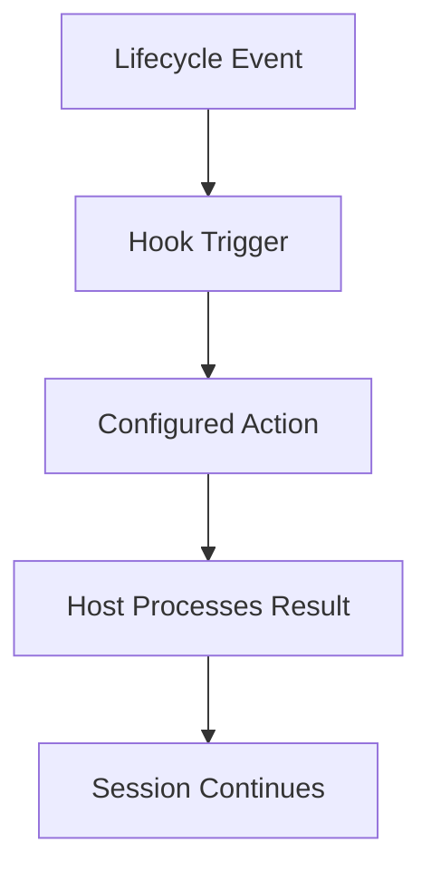

### 10.2 Why Hooks Matter

Hooks can automate repetitive integration tasks. An integration may use a supported startup event to provide relevant skill guidance.

### 10.3 Security Considerations

Hooks can be more sensitive than ordinary Markdown instructions because they may execute scripts. Before enabling third-party hooks:

1. Inspect the hook configuration.
2. Identify executed commands.
3. Check filesystem access.
4. Review network activity.
5. Confirm the repository source.
6. Preserve host approval and sandbox controls.

> [!warning] Important
> A lifecycle hook is not automatically safe because it belongs to a popular repository. Review executable components before trusting them.

---

---

# Part X — AGENTS.md and Instruction Hierarchy

## 11. What Is AGENTS.md?

`AGENTS.md` is a project instruction file recognized by compatible coding agents, including Codex. It can communicate the technology stack, architecture rules, scope limitations, coding standards, testing requirements, and documentation conventions.

### 11.1 Example

```markdown
# Project Instructions

## Technology Stack
- Android Java
- XML layouts
- Firebase

## Architecture
- Follow existing project conventions.
- Keep UI and business logic separated.
- Reuse existing components.

## Scope
- Implement only documented MVP features.
- Avoid unnecessary dependencies.

## Verification
- Run relevant Gradle checks.
- Report unverified behavior.
```

This is an educational example.

### 11.2 AGENTS.md vs SKILL.md

| AGENTS.md | SKILL.md |
|---|---|
| Project or directory instructions | Reusable specialized workflow |
| Defines application constraints | Defines task methodology |
| May apply broadly within a repository | Usually selected when relevant |
| Example: use the existing service layer | Example: apply systematic debugging |

### 11.3 Combining Them

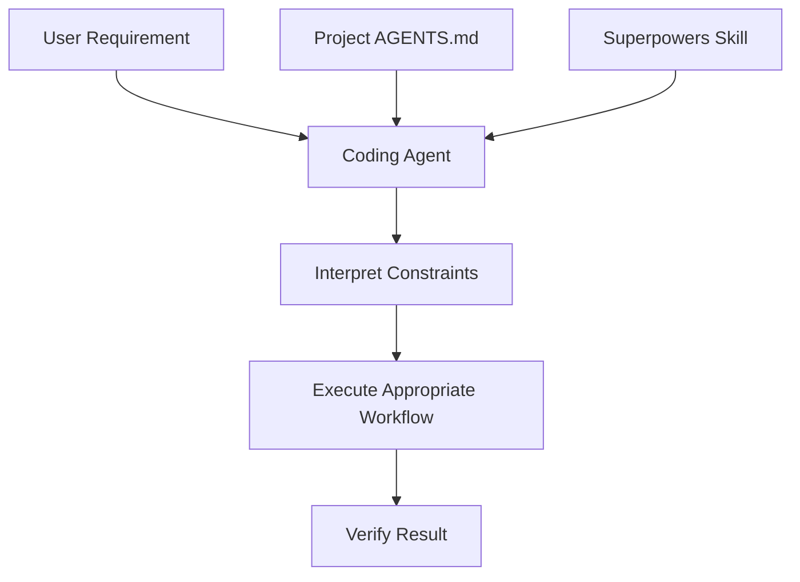

### 11.4 Handling Conflicts

Suppose a project instruction says all database writes must use the existing service layer, while general simplicity guidance says to avoid unnecessary abstractions.

Correct interpretation: reuse the required service layer without introducing additional unnecessary layers. A skill should not justify violating legitimate project architecture.

### 11.5 Instruction Priority

The host determines instruction precedence. A third-party repository or skill does not redefine higher-priority system, developer, or security instructions. Repository source files and tool outputs should also be treated as potentially untrusted content.

---

# Part XI — Context Engineering

## 12. What Is Context Engineering?

Context engineering is the process of selecting and organizing the information an AI agent needs to complete a task. The goal is enough relevant information without unnecessary duplication.

### 12.1 Context Sources

```text
Agent Context
    +-- User Request
    +-- Project Instructions
    +-- Relevant Skills
    +-- Source Files
    +-- Tests
    +-- Git Diff
    +-- Supporting Documentation
```

### 12.2 Why Context Matters

Poor context can cause an agent to misunderstand requirements, ignore existing functionality, duplicate code, violate architecture, miss dependencies, or spend time reading unrelated files.

### 12.3 Progressive Disclosure

Progressive disclosure means loading additional information only when necessary.

For “Fix login validation,” start with the login form, authentication controller, validation rules, and relevant tests. Expand to other modules only if the investigation reveals dependencies.

### 12.4 Context Flow

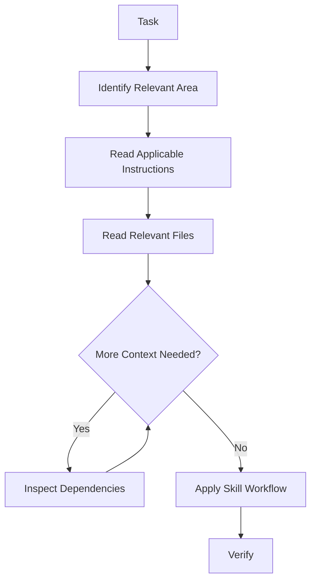

### 12.5 Skill Descriptions as Discovery Metadata

A skill description should communicate when the skill is relevant. A debugging skill's description, for example, should help the agent recognize debugging tasks; the full instructions can then provide the detailed process.

### 12.6 Efficiency Tradeoff

Too much context can be wasteful; too little can cause incorrect changes. The objective is **sufficient relevant context**, not minimum context at all costs.

---

# Part XII — Codex-Specific Architecture

## 13. How Superpowers Integrates with Codex

The official Superpowers repository includes Codex integration and documents installation through the Codex plugin interface.

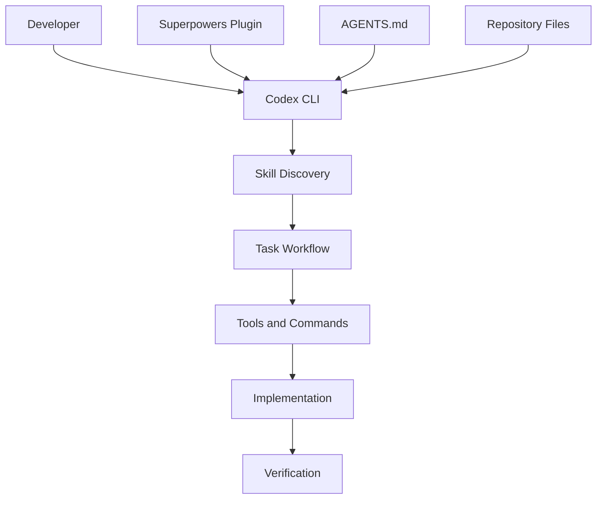

### 13.1 Codex Responsibilities

Codex reads files, edits code, executes permitted commands, works with Git, runs tests, and reports results.

### 13.2 Superpowers Responsibilities

Superpowers supplies development methodology, skill instructions, planning workflows, testing discipline, debugging process, review guidance, and branch completion workflow.

### 13.3 Installation Overview

The current README documents installation through the Codex plugin interface. Inside Codex:

```text
/plugins
```

Search for `superpowers`, then select the plugin installation option. Installation and verification are covered in [[02 - Installation and Setup]].

### 13.4 Verify Actual Activation

Confirm that the plugin is discoverable, skills are listed or available, the relevant skill is selected, its instructions are applied, and host permissions remain intact. Installation alone does not prove the methodology is active.

---

# Part XIII — Multi-Agent Architecture

## 14. Understanding Subagent-Driven Development

Superpowers includes a workflow for delegating implementation tasks to separate agents.

### 14.1 Conceptual Architecture

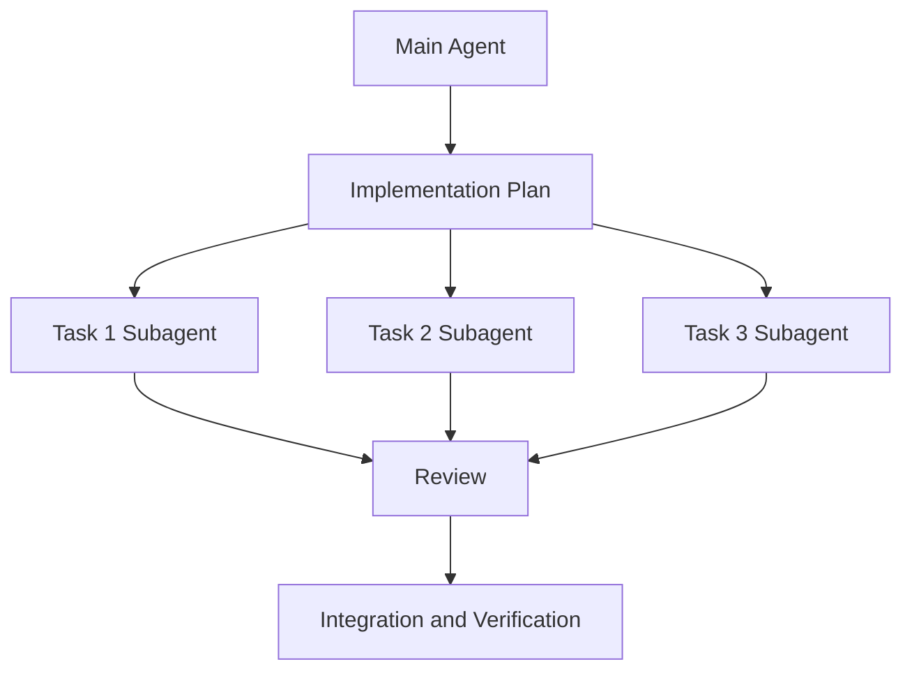

This illustrates delegation; it does not guarantee concurrent execution.

### 14.2 Fresh Context

A subagent may receive a fresh context focused on its assigned task. Potential benefits include less irrelevant history, clear task boundaries, focused implementation, and independent review.

### 14.3 Review Stages

The official subagent-driven workflow includes implementation, specification compliance review, and code quality review.

**Specification compliance:** Did the implementation satisfy the requested behavior?

**Code quality:** Is the implementation maintainable, correct, and consistent with project standards?

### 14.4 Important Limitations

Subagent workflows introduce context transfer, additional agent calls, coordination, integration checks, and review time. A single agent may be sufficient for small changes.

---

# Part XIV — Practical Architecture Examples

## 15. Android Example

An Android Java application needs a task status indicator.

```text
Android Project
├── AGENTS.md
├── docs/
├── app/src/main/java/
├── app/src/main/res/
└── gradlew.bat
```

Possible skill composition: brainstorming to clarify status requirements; writing-plans to identify Java and XML changes; test-driven-development to implement and test; verification-before-completion to check the result.

```powershell
.\gradlew.bat assembleDebug
.\gradlew.bat testDebugUnitTest
```

Run the unit test task only if tests are configured. Verify UI behavior on an emulator or device.

## 16. Laravel Example

A Laravel backend needs schedule filtering.

```text
Laravel Project
├── AGENTS.md
├── app/Http/
├── app/Models/
├── app/Services/
├── routes/
├── database/
└── tests/
```

Possible skill composition: brainstorming to clarify filtering rules; writing-plans to identify routes and services; test-driven-development to implement; requesting-code-review and verification-before-completion before finishing.

```powershell
php artisan test
```

Check authorization, validation, response contracts, and query behavior.

## 17. Next.js Example

A Next.js application needs product search.

```text
Next.js Project
├── AGENTS.md
├── app/
├── components/
├── features/
├── lib/
└── package.json
```

Possible skill composition: brainstorming to clarify search behavior; writing-plans to identify components and data flow; test-driven-development to implement; verification-before-completion to check the result.

```powershell
npm run build
npm run lint
```

Run `lint` only if the script is configured.

---

# Part XV — Architecture Tradeoffs

## 18. Strengths of the Architecture

- **Modularity:** Skills have separate responsibilities.
- **Reusability:** The same methodology can support different projects.
- **Portability:** Multiple coding agents can integrate with the repository.
- **Context efficiency:** Relevant skills can be loaded when needed.
- **Consistency:** Repeatable workflows reduce improvised agent behavior.
- **Testability:** Individual skills and integrations can be evaluated independently.

## 19. Limitations

- **Host differences:** Agents expose different capabilities.
- **Workflow overhead:** Some tasks do not justify extensive planning or delegation.
- **Context cost:** Multiple skills and subagents can increase token usage.
- **Instruction conflicts:** Project instructions and general guidance may need reconciliation.
- **Security risks:** Third-party hooks and scripts require review.
- **Imperfect compliance:** An agent may fail to follow instructions despite successful installation.

> [!important] Engineering Judgment
> A structured workflow should improve the result. If it adds more complexity than the task requires, reconsider the execution strategy within the supported skill and host rules.

---

# Part XVI — Practical Exercises

## 20. Exercise 1 — Architecture Mapping

Draw a diagram containing the developer, Codex CLI, Superpowers, skills, `AGENTS.md`, tools, Git, and tests. Explain the responsibility of each component.

**Expected Outcome:** Understand architectural boundaries.

## 21. Exercise 2 — Inspect a Skill

Open [using-superpowers/SKILL.md](https://github.com/obra/superpowers/blob/main/skills/using-superpowers/SKILL.md). Identify its metadata, activation guidance, workflow instructions, required behavior, and references to other skills.

**Expected Outcome:** Understand how a real skill is written.

## 22. Exercise 3 — Skill Selection

Choose an appropriate skill for each situation:

| Situation | Skill |
|---|---|
| Requirements are unclear | ? |
| A bug needs root-cause analysis | ? |
| A feature needs detailed tasks | ? |
| Tests must precede implementation | ? |
| Changes need review | ? |
| A development branch is complete | ? |

**Expected Outcome:** Understand skill responsibilities.

## 23. Exercise 4 — Context Engineering

For “Fix a task creation validation bug,” identify relevant files, project instructions, applicable skills, necessary tests, and unrelated files that should not be loaded initially.

**Expected Outcome:** Practice progressive disclosure.

## 24. Exercise 5 — Compare Execution Strategies

Compare one agent executing a plan with subagent-driven development. Evaluate context use, coordination overhead, review coverage, task complexity, and verification needs.

**Expected Outcome:** Understand when delegation may be useful.

## 25. Exercise 6 — Instruction Conflict

Project instruction: all database writes must use the service layer. General simplicity guidance: avoid unnecessary abstractions. Explain how the agent should interpret both.

**Expected Outcome:** Understand architectural constraints and instruction priority.

---

# Part XVII — Knowledge Check

## 26. Review Questions

1. What architectural role does Superpowers play?
2. What is the difference between a coding agent and a skill?
3. What is `SKILL.md`?
4. What is the purpose of skill metadata?
5. What is `using-superpowers`?
6. What is a meta skill?
7. How does skill discovery differ from activation?
8. What is skill composition?
9. Why are plugin adapters necessary?
10. What is a lifecycle hook?
11. Why should executable hooks be reviewed?
12. What is the difference between `AGENTS.md` and `SKILL.md`?
13. What is progressive disclosure?
14. Why does host compatibility matter?
15. What is a subagent?
16. What is fresh context?
17. What is specification compliance review?
18. What is code quality review?
19. What are the benefits of modular skills?
20. What are the tradeoffs of multi-agent execution?

---

# Part XVIII — Key Takeaways

> [!summary] Lesson Summary
> - Superpowers is a skills-based methodology layer.
> - The coding-agent host executes tools and development operations.
> - `SKILL.md` defines reusable workflows.
> - `using-superpowers` provides meta guidance for skill usage.
> - Discovery, activation, and execution are separate concepts.
> - Skills can be composed into larger development workflows.
> - Plugin adapters provide host-specific integration.
> - Hooks respond to supported lifecycle events.
> - `AGENTS.md` provides project-specific instructions.
> - Context engineering focuses on relevant information.
> - Progressive disclosure avoids unnecessary context loading.
> - Subagents provide separate execution contexts for delegated tasks.
> - Specification and code-quality reviews serve different purposes.
> - Host compatibility and security controls remain important.

### Final Mental Model

```text
DEVELOPER INTENT
       |
       v
CODING AGENT
       +-- Project Instructions
       +-- Superpowers Skills
       +-- Relevant Context
       |
       v
WORKFLOW SELECTION
       |
       v
DEVELOPMENT TOOLS
       |
       v
IMPLEMENTATION
       |
       v
VERIFICATION
```

**Remember:** Superpowers does not replace the coding agent or project architecture. It supplies structured engineering practices that help the agent approach development tasks systematically.

---

# Part XIX — Official References

## Superpowers

- [Official Repository](https://github.com/obra/superpowers)
- [README.md](https://github.com/obra/superpowers/blob/main/README.md)
- [Skills Directory](https://github.com/obra/superpowers/tree/main/skills)
- [using-superpowers Skill](https://github.com/obra/superpowers/blob/main/skills/using-superpowers/SKILL.md)
- [brainstorming Skill](https://github.com/obra/superpowers/blob/main/skills/brainstorming/SKILL.md)
- [writing-plans Skill](https://github.com/obra/superpowers/blob/main/skills/writing-plans/SKILL.md)
- [subagent-driven-development Skill](https://github.com/obra/superpowers/blob/main/skills/subagent-driven-development/SKILL.md)
- [Codex Plugin Directory](https://github.com/obra/superpowers/tree/main/.codex-plugin)
- [Hooks Directory](https://github.com/obra/superpowers/tree/main/hooks)
- [Repository AGENTS.md](https://github.com/obra/superpowers/blob/main/AGENTS.md)

## Supporting Documentation

- [OpenAI Codex Documentation](https://developers.openai.com/codex/)
- [Codex Skills](https://developers.openai.com/codex/skills/)
- [Codex AGENTS.md Guide](https://developers.openai.com/codex/guides/agents-md/)
- [Git Documentation](https://git-scm.com/docs)
- [Agent Skills Specification](https://agentskills.io/specification)

> [!note] Documentation Scope
> This lesson explains the architecture using the official repository's documented concepts and skill organization.
>
> Diagrams and application examples are educational simplifications. They do not imply every supported coding agent uses identical activation, hook, or subagent mechanisms.
>
> Verify host-specific behavior against the installed integration before using it in production.

---

# Part XX — Next Lesson

**[[02 - Installation and Setup]]**

In the next lesson, we will cover prerequisites for Windows and PowerShell; Codex CLI compatibility; official installation methods; plugin installation; manual alternatives; skill discovery; hook security; disposable-repository testing; common errors; updating and uninstalling; existing `AGENTS.md` files; Android, Laravel, and Next.js setup; and exercises.

**Learning Progression:**

Repository Overview → **Architecture and Core Concepts** → Installation and Setup → Skills and Features → Brainstorming and Planning → Test-Driven Development and Debugging → Subagent-Driven Development → Codex Integration → Git Worktrees and Code Review → Best Practices and Exercises
