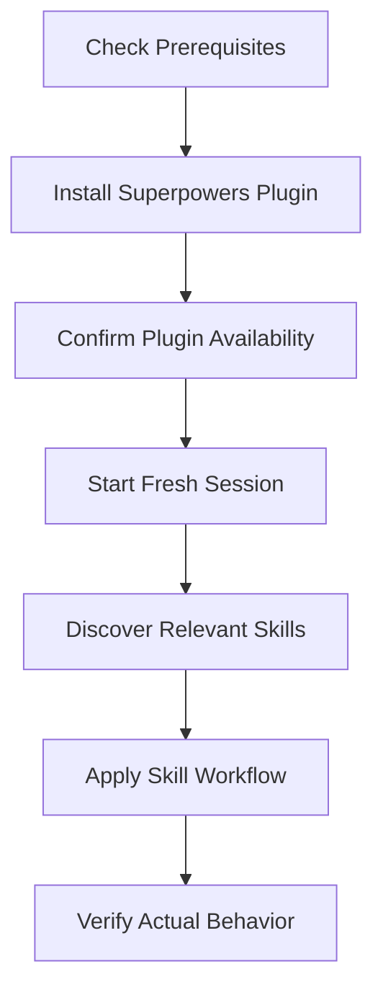
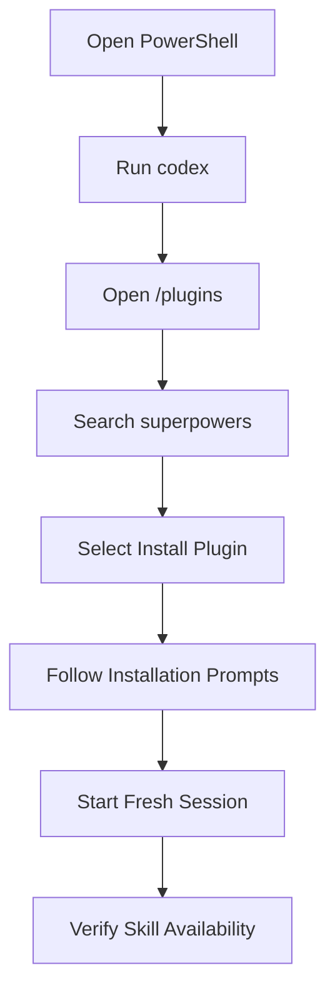
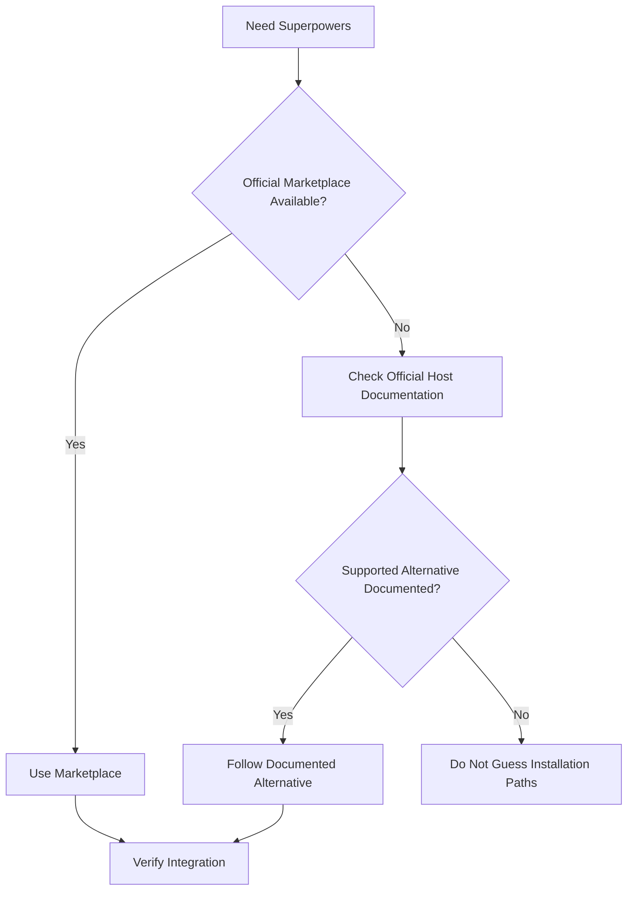
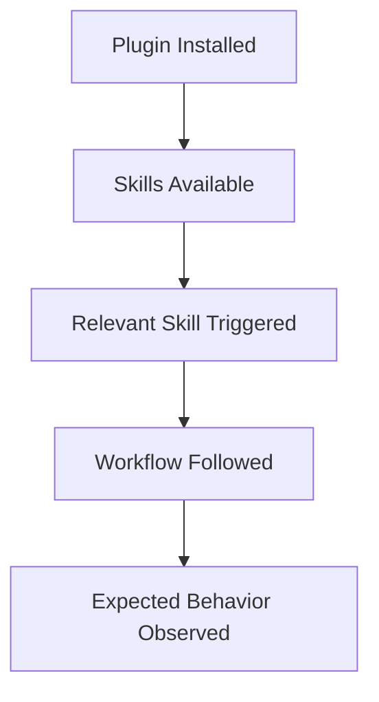
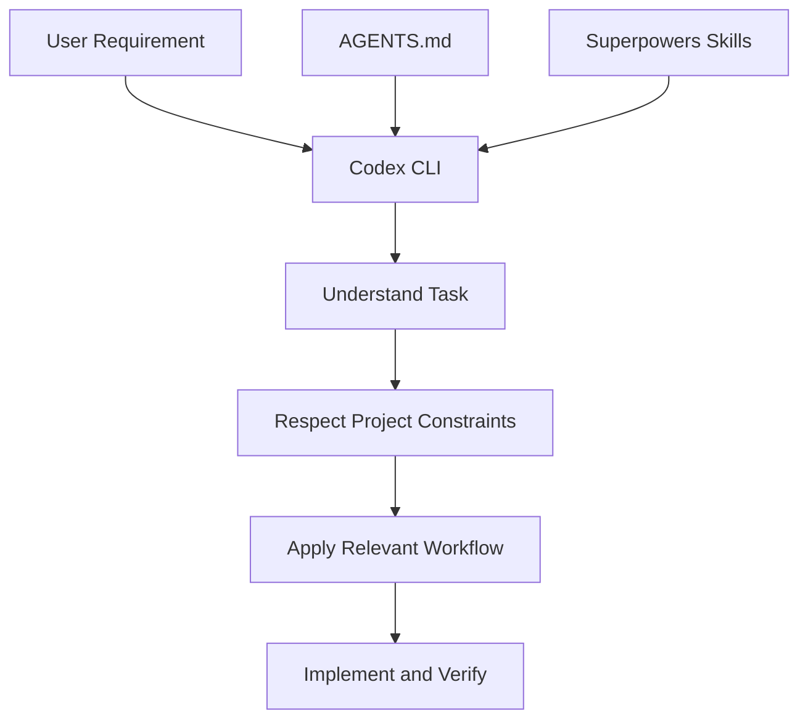

# 02 — Superpowers: Installation and Setup

> [!abstract] Lesson Information
> **Repository:** [obra/superpowers](https://github.com/obra/superpowers)
>
> **Category:** Agentic Engineering / Codex CLI / Plugin Installation
>
> **Difficulty:** Beginner to Intermediate
>
> **Environment:** Windows 10/11, PowerShell, Git, Codex CLI
>
> **Prerequisites:** [[00 - Repository Overview]], [[01 - Architecture and Core Concepts]]
>
> **Learning Approach:** Theory First, with optional hands-on commands
>
> **Primary Goal:** Understand how to install, verify, troubleshoot, update, and safely evaluate Superpowers in Codex CLI without disrupting existing development projects.

---

# 1. Learning Objectives

After completing this lesson, you should be able to:

1. Identify the prerequisites for using Superpowers with Codex CLI.
2. Distinguish plugin installation from repository cloning.
3. Understand the official Codex installation workflow.
4. Verify that the plugin and its skills are available.
5. Explain the difference between installation, discovery, and activation.
6. Inspect third-party plugin components before trusting them.
7. Set up a safe practice repository.
8. Test Superpowers' brainstorming and debugging workflows.
9. Understand how `AGENTS.md` interacts with Superpowers.
10. Troubleshoot common installation problems.
11. Understand updates and uninstallation.
12. Apply the integration to Android, Laravel, and Next.js projects.

---

# Part I — Installation Fundamentals

## 2. What Are We Installing?

Superpowers is a collection of development skills and integration components.

When installed in Codex, it provides instructions that help the agent follow structured engineering workflows.

It is important to distinguish three separate activities.

### 2.1 Repository Cloning

Cloning downloads the repository's source code.

```powershell
git clone https://github.com/obra/superpowers.git
```

This creates a local copy of the repository.

It does **not automatically mean** the plugin is installed or active in Codex.

### 2.2 Plugin Installation

Plugin installation registers Superpowers through a supported host integration.

For Codex CLI, the current official README documents installation through the built-in plugin interface.

### 2.3 Skill Activation

After installation, Codex must discover and apply the appropriate skill.

A plugin can be installed without its skills necessarily being used in every task.

### Installation Lifecycle



> [!important] Core Distinction
> **Downloaded ≠ Installed ≠ Activated ≠ Verified**
>
> Each stage represents a different condition.

---

# Part II — System Requirements

## 3. Recommended Development Environment

For this learning roadmap, we will use:

| Component | Purpose |
|---|---|
| Windows 10/11 | Operating system |
| PowerShell | Terminal |
| Codex CLI | AI coding agent |
| Git | Version control |
| GitHub | Source repository hosting |
| VS Code | Optional code editor |
| Node.js | Useful for development and certain tooling |
| Superpowers | Agentic development skills |

### 3.1 Required vs Optional Components

**Required for the documented Codex CLI workflow:**

- A working Codex CLI installation.
- Access to the supported plugin interface.
- A compatible Superpowers plugin.
- Any runtime dependencies required by the installed plugin.

**Recommended for practice:**

- Git.
- A dedicated test repository.
- A code editor.
- A working language runtime and test runner for the chosen project.

Node.js is useful in this environment, but the official Codex marketplace installation instructions do not establish a separate universal Node.js prerequisite for every Superpowers installation.

---

# Part III — Verify Existing Tools

## 4. Check PowerShell

Open Windows PowerShell or PowerShell 7.

Run:

```powershell
$PSVersionTable.PSVersion
```

This displays the current PowerShell version.

You do not need to change your shell merely to study Superpowers.

---

## 5. Check Git

```powershell
git --version
```

Expected output resembles:

```text
git version 2.x.x.windows.x
```

The exact version depends on your installation.

### Why Git Matters

Superpowers uses Git-related workflows for:

- Branch isolation.
- Worktrees.
- Change inspection.
- Code review.
- Branch completion.

Useful commands:

```powershell
git status
git branch --show-current
git log -5 --oneline
```

---

## 6. Check Codex CLI

```powershell
codex --version
```

This confirms whether the executable is available.

For example:

```text
codex-cli x.y.z
```

The output format may differ by release.

### Check Available Commands

```powershell
codex --help
```

Do not assume every Codex version exposes exactly the same commands or flags.

### Important Compatibility Note

If your installed version does not support the plugin interface documented by Superpowers, consult the current Codex documentation.

Avoid inventing unsupported CLI flags or manually copying plugin files into unknown locations.

---

## 7. Check Node.js

```powershell
node --version
npm --version
```

These checks are useful because many JavaScript-based development environments depend on Node.js.

However, a successful Node.js check does not verify Superpowers installation.

---

# Part IV — Official Codex CLI Installation

## 8. Installation Through the Plugin Marketplace

The official Superpowers README documents a marketplace-based installation workflow for Codex CLI.

### Step 1 — Launch Codex

Open PowerShell.

```powershell
codex
```

Wait for the interactive Codex interface.

### Step 2 — Open the Plugin Interface

Inside Codex, enter:

```text
/plugins
```

This is a Codex interactive command, not a PowerShell command.

### Step 3 — Search for Superpowers

Search:

```text
superpowers
```

### Step 4 — Install

Select:

```text
Install Plugin
```

Follow the prompts displayed by your installed Codex version.

### Step 5 — Start a Fresh Session

After installation, start a new Codex session or thread to avoid relying on an older session's context.

### Step 6 — Verify Skill Availability

Check whether Superpowers appears in the available plugins or skills.

Then test a relevant workflow in a disposable project.

### Official Installation Flow



> [!note] Official vs Educational Instructions
> The `/plugins` search and `Install Plugin` steps are documented by the official Superpowers README.
>
> The additional verification steps in this lesson are recommended engineering practices.

# Part V — Codex App Installation

## 9. Installation in the Desktop Application

Superpowers also documents installation through the Codex app.

The workflow is:

1. Open the Codex application.
2. Select **Plugins** in the sidebar.
3. Find **Superpowers** in the Coding section.
4. Select the `+` installation control.
5. Follow the displayed instructions.

This is different from the Codex CLI interface.

| Codex CLI | Codex App |
|---|---|
| Terminal interface | Desktop interface |
| `/plugins` | Plugins sidebar |
| Search for Superpowers | Find Superpowers under Coding |
| Select Install Plugin | Select the `+` control |

The underlying integration may be related, but do not assume that installing a plugin in one environment automatically installs it in every other environment.

# Part VI — Cloning the Repository

## 10. When Should You Clone Superpowers?

Cloning is useful when you want to study source code, inspect skills and plugin configuration, understand integration architecture, examine scripts and hooks, study tests, or contribute.

Cloning is not required for the marketplace installation workflow.

### 10.1 Recommended Learning Directory

```text
C:\
└── DevTools\
    └── GitHub-Repositories\
        └── superpowers\
```

### 10.2 Clone

```powershell
New-Item -ItemType Directory -Force -Path "C:\DevTools\GitHub-Repositories"
Set-Location "C:\DevTools\GitHub-Repositories"
git clone https://github.com/obra/superpowers.git
```

### 10.3 Inspect the Repository

```powershell
Set-Location ".\superpowers"
Get-ChildItem -Force
Get-ChildItem ".\skills"
Get-Content ".\skills\using-superpowers\SKILL.md"
Get-ChildItem ".\.codex-plugin" -Recurse
```

These commands inspect the local repository. They do not install or activate Superpowers in Codex.

# Part VII — Manual Installation and Alternatives

## 11. Understanding Manual Setup

Different agents use different plugin marketplaces, local plugin directories, native skills, repository-based installation, or documented scripts. For Codex CLI, the official README currently recommends its plugin interface.

### 11.1 Should We Manually Copy SKILL.md Files?

Not by default. Manual copying can cause duplicate registrations, outdated versions, missing supporting files, incorrect paths, incomplete behavior, and conflicting instructions.

### 11.2 Safer Decision Process



You can read skills from a clone without installing them, for example:

```powershell
Get-Content ".\skills\brainstorming\SKILL.md"
```

Reading a file is different from activating an agent skill.

# Part VIII — Verifying Installation

## 12. What Does a Successful Installation Look Like?

Check four levels:

1. **Plugin presence:** Superpowers is listed as installed.
2. **Skill discovery:** relevant skills are available to Codex.
3. **Workflow activation:** a task triggers an appropriate skill.
4. **Behavior:** Codex actually follows the expected process.



## 13. Test the Brainstorming Skill

In a practice project, ask:

```text
I want to build a small task management application.

Help me clarify the requirements and design first.

Do not create or modify files yet.
```

The agent should clarify features, users, constraints, behavior, and scope rather than immediately creating a large application.

A brainstorming-style response alone does not prove that the skill loaded. Check the host's available-skill indicators or diagnostics too.

## 14. Test Systematic Debugging

Use a disposable project containing a deliberately failing test. Ask Codex to:

```text
Investigate the failing test in this practice project.

Use the systematic-debugging workflow.

Identify the root cause before changing code.

Do not modify unrelated files.
```

Expected process: reproduce the failure, gather evidence, identify the root cause, apply a focused fix, and verify it. Do not test unfamiliar behavior against a critical project.

# Part IX — Creating a Safe Practice Repository

## 15. Why Use a Disposable Project?

A new plugin may influence file creation, command execution, Git, worktrees, delegation, and testing. A practice repository lets you observe this behavior without risking project work.

### 15.1 Create a Practice Directory

```powershell
New-Item -ItemType Directory -Force -Path "C:\DevTools\superpowers-practice"
Set-Location "C:\DevTools\superpowers-practice"
git init
```

### 15.2 Create a README

```powershell
@"
# Superpowers Practice

A disposable repository for learning Superpowers with Codex CLI.

## Goals
- Practice brainstorming and planning.
- Practice test-driven development and debugging.
- Practice code review and Git workflows.
"@ | Set-Content -Path "README.md"
```

### 15.3 Create AGENTS.md

```powershell
@"
# Project Instructions

## Scope
This is a disposable practice repository.

## Development Rules
- Keep implementation simple.
- Do not add unnecessary dependencies.
- Do not modify files outside this repository.
- Explain planned changes before implementing them.

## Verification
- Run relevant tests.
- Report checks that could not be completed.
"@ | Set-Content -Path "AGENTS.md"
```

### 15.4 Commit the Initial State

```powershell
git add README.md AGENTS.md
git commit -m "chore: initialize Superpowers practice repository"
git status
```

The commit requires Git identity to be configured. A clean baseline distinguishes original files from agent changes and supports worktree workflows.

# Part X — Using Superpowers with AGENTS.md

## 16. Project Instructions vs Superpowers Skills

Superpowers provides reusable engineering workflows. `AGENTS.md` gives project-specific constraints such as language, architecture, and MVP boundaries.



Example:

```text
Read the project's AGENTS.md and relevant documentation.

Help me design the requested feature using the
Superpowers brainstorming workflow.

Preserve the existing architecture.

Do not modify files until the design is agreed.
```

Superpowers should not override legitimate project instructions or host security controls.

# Part XI — Security Review

## 17. Inspect Before Trusting

Superpowers is a third-party repository. Before enabling executable integration components, understand their behavior.

```powershell
Get-ChildItem ".\.codex-plugin" -Recurse
Get-ChildItem ".\hooks" -Recurse
Get-ChildItem ".\scripts" -Recurse
```

Look for automatically executed commands, files created or modified, network requests, environment variable access, external processes, permission needs, and downloaded dependencies.

### Security Checklist

- [ ] Repository source verified.
- [ ] Plugin manifest reviewed.
- [ ] Executable hooks and scripts reviewed.
- [ ] Required permissions understood.
- [ ] No credentials exposed.
- [ ] Sandbox and approval settings preserved.
- [ ] Practice project available.
- [ ] Git baseline committed.

> [!warning] Security Boundary
> A Markdown skill provides instructions. An executable hook or script can perform operations. Treat these as different security risks.

# Part XII — Common Installation Problems

## 18. Codex Command Not Found

If PowerShell reports that `codex` is not recognized, check installation and PATH:

```powershell
Get-Command codex -ErrorAction SilentlyContinue
where.exe codex
```

Restart the terminal after installation. If still missing, consult current official Codex installation documentation.

## 19. Plugin Interface Not Available

Possible causes include an older Codex version, different host configuration, unsupported environment, or plugin functionality not enabled.

1. Check `codex --version` and `codex --help`.
2. Compare with current Codex documentation.
3. Confirm you are in the interactive Codex CLI.
4. Do not rely on unsupported flags from old tutorials.

## 20. Superpowers Does Not Appear

Reopen the plugin interface, search for `superpowers`, check network access and the official listing, and restart Codex if needed. Do not install an unrelated plugin with a similar name.

## 21. Skills Are Installed but Not Used

Possible causes include an old session, undiscovered or unselected skills, a task that does not match the skill, or conflicting instructions.

1. Start a fresh session.
2. Confirm skill discovery.
3. Give a clear task that should trigger the workflow.
4. Observe behavior and check diagnostics.

The repository also documents a `diagnosing-superpowers` skill for investigating unexpected session behavior.

## 22. Git Worktree Creation Fails

Possible causes include an uninitialized repository, missing initial commit, target-path or branch conflict, or filesystem restrictions. A dirty working tree does not by itself prevent `git worktree add`, but Superpowers expects a clean baseline; inspect and preserve existing changes before beginning.

```powershell
git status
git branch --show-current
git worktree list
```

Inspect repository state before cleanup. Do not run destructive commands just to make worktree creation succeed.

## 23. Tests Cannot Run

Dependencies, test-runner configuration, environment variables, databases, or build tools may be missing. Identify the project's actual test command, inspect build configuration, run a targeted test, and report unresolved setup issues. Never claim a test passed if it did not run.

# Part XIII — Updating Superpowers

## 24. Understanding Updates

Update behavior depends on the host and may be automatic. For a marketplace plugin, use the plugin manager supported by the installed Codex version.

If you cloned the repository only for study, update that separate clone:

```powershell
Set-Location "C:\DevTools\GitHub-Repositories\superpowers"
git status
git pull --ff-only
```

Only pull when local work is clean. Updating a clone does not necessarily update a separately installed plugin. For reproducible experiments, record the version or commit because skills, manifests, hooks, compatibility, and workflows can change.

# Part XIV — Uninstalling Superpowers

## 25. Plugin Removal

Use the Codex plugin management interface to locate and uninstall Superpowers; controls vary by release. Do not manually delete unknown plugin directories.

Removing a source clone is separate from uninstalling the plugin. Confirm the directory is the intended disposable copy, inspect `git status`, and preserve valuable changes first.

Uninstalling does not undo agent-created code changes, Git commits, worktrees, generated documentation, or dependencies. Manage those separately.

# Part XV — Android Integration Example

## 26. GroupTrack Setup

Before using Superpowers on an Android project, confirm Git state, read `AGENTS.md` and architecture documentation, understand the MVP scope, and practice in a separate repository first.

```powershell
Set-Location "C:\Users\Acer\AndroidStudioProjects\GroupTrack"
git status
codex
```

Example prompt:

```text
Read AGENTS.md and relevant project documentation.

Help me design the task status UI using the
Superpowers brainstorming workflow.

Keep the implementation within the existing MVP scope.
Do not modify files yet.
```

When implementation begins, run supported checks:

```powershell
.\gradlew.bat assembleDebug
.\gradlew.bat testDebugUnitTest
```

## 27. Laravel Integration Example

For a schedule-filter enhancement, inspect project instructions, schedule and route modules, controllers, services, validation, authorization, and tests. Preserve existing business rules.

```text
Inspect the schedule and route modules and read project
instructions. Use Superpowers brainstorming to clarify the
filtering requirements. Preserve authorization and schedule
rules. Do not modify files yet.
```

Verify with the project's relevant tests, for example:

```powershell
php artisan test
```

Avoid destructive migrations or database resets against important data.

## 28. Next.js Integration Example

Inspect project instructions and relevant architecture documentation before designing a product search feature. Respect the existing App Router architecture; avoid unneeded dependencies.

```text
Read the frontend AGENTS.md and relevant architecture docs.
Help me design product search using Superpowers brainstorming.
Respect the existing Next.js App Router architecture.
Do not add dependencies or modify files yet.
```

Use commands configured by the project:

```powershell
npm run build
npm run lint
```

# Part XVI — Practical Exercises

## 29. Exercise 1 — Environment Verification

Run `git --version`, `codex --version`, `node --version`, and `npm --version`. Record versions, missing commands, and environment issues.

## 30. Exercise 2 — Repository Inspection

Clone Superpowers into a learning directory. Inspect `skills/`, `.codex-plugin/`, `hooks/`, `scripts/`, `tests/`, `README.md`, `AGENTS.md`, and `skills/using-superpowers/SKILL.md`. Identify which files are instructions and which can execute.

## 31. Exercise 3 — Official Plugin Installation

Open `/plugins` in Codex CLI, search for Superpowers, install it, start a fresh session, and confirm relevant skills are discoverable.

## 32. Exercise 4 — Brainstorming Verification

In the disposable repository, ask Codex to design a small task manager, clarify requirements, and make no changes. Observe whether it follows a design-first process.

## 33. Exercise 5 — Skill Discovery

Check whether these skills are available: `using-superpowers`, `brainstorming`, `writing-plans`, `test-driven-development`, `systematic-debugging`, and `verification-before-completion`.

## 34. Exercise 6 — Security Inspection

Inspect integration files and identify executable components, lifecycle events, permissions, and what needs review before enabling hooks.

## 35. Exercise 7 — Compare Installation Methods

Compare marketplace installation, cloning for source inspection, and manually installing skills through a documented host-specific method. Explain why they are not interchangeable.

# Part XVII — Knowledge Check

## 36. Review Questions

1. How do cloning and installing Superpowers differ?
2. Why is Codex CLI required for this integration?
3. What does `/plugins` do?
4. How does Codex discover installed skills?
5. What is skill activation?
6. Why start a fresh session after installation?
7. Why use a disposable practice repository?
8. Why is an initial Git commit useful?
9. What does `AGENTS.md` provide?
10. Why inspect executable hooks?
11. What does successful installation verification involve?
12. Why might skills fail to activate?
13. How do Git worktrees affect setup?
14. How does updating a clone differ from updating a plugin?
15. Why doesn't uninstalling undo previous code changes?

# Part XVIII — Key Takeaways

> [!summary] Lesson Summary
> - Install Superpowers separately for each supported agent host.
> - The official Codex CLI workflow uses the `/plugins` interface.
> - Cloning the repository is not plugin installation.
> - Installation, discovery, activation, and verification are distinct.
> - A fresh session helps load current integration context.
> - Test new workflows in a disposable repository with a clean Git baseline.
> - `AGENTS.md` supplies project-specific instructions.
> - Review third-party scripts and hooks before execution.
> - Updates depend on the host; updating a clone may not update a plugin.
> - Removing a plugin does not undo prior project changes.

```text
Verify Environment → Install Plugin → Fresh Session
→ Verify Skills → Safe Practice Repo → Test Workflow
→ Review Behavior → Apply to Real Projects
```

Installing a tool is only the beginning. Understand its behavior and permissions, then verify how it affects your workflow.

# Part XIX — Official References

## Superpowers

- [Official Repository](https://github.com/obra/superpowers)
- [Official README and Installation Instructions](https://github.com/obra/superpowers/blob/main/README.md)
- [Skills Directory](https://github.com/obra/superpowers/tree/main/skills)
- [Codex Plugin Directory](https://github.com/obra/superpowers/tree/main/.codex-plugin)
- [Hooks Directory](https://github.com/obra/superpowers/tree/main/hooks)
- [Scripts Directory](https://github.com/obra/superpowers/tree/main/scripts)
- [using-superpowers Skill](https://github.com/obra/superpowers/blob/main/skills/using-superpowers/SKILL.md)
- [Release Notes](https://github.com/obra/superpowers/blob/main/RELEASE-NOTES.md)

## Supporting Documentation

- [OpenAI Codex Documentation](https://developers.openai.com/codex/)
- [Codex CLI Documentation](https://developers.openai.com/codex/cli/)
- [Codex Skills Documentation](https://developers.openai.com/codex/skills/)
- [Codex AGENTS.md Guide](https://developers.openai.com/codex/guides/agents-md/)
- [Git Documentation](https://git-scm.com/docs)
- [Git Worktree Documentation](https://git-scm.com/docs/git-worktree)

> [!note] Documentation Accuracy
> The Codex App and Codex CLI installation instructions were checked against the official Superpowers README on October 20, 2026. PowerShell checks, practice-repository setup, troubleshooting, and example prompts are educational workflows rather than installation commands. Plugin methods and capabilities may change across releases; follow the current host interface when it differs.

---

# Part XX — Next Lesson

**[[03 - Skills and Features]]**

Next: the skills library, categories and activation, `using-superpowers`, brainstorming and planning, TDD and debugging, subagent workflows, code review, Git worktrees, compatibility, exercises, and references.

**Learning Progression:** Repository Overview → Architecture and Core Concepts → **Installation and Setup** → Skills and Features → Brainstorming and Planning → Test-Driven Development and Debugging → Subagent-Driven Development → Codex Integration → Git Worktrees and Code Review → Best Practices and Exercises
