# 04 — Superpowers: Brainstorming and Planning

> [!abstract] Lesson Information
> **Repository:** [obra/superpowers](https://github.com/obra/superpowers)
>
> **Category:** Agentic Engineering / Requirements Engineering / Software Design / Implementation Planning
>
> **Difficulty:** Intermediate
>
> **Learning Approach:** Theory First
>
> **Prerequisites:** [[00 - Repository Overview]], [[01 - Architecture and Core Concepts]], [[02 - Installation and Setup]], [[03 - Skills and Features]]
>
> **Primary Skills:** `brainstorming`, `writing-plans`
>
> **Goal:** Understand how to transform a development request into an agreed design and an actionable implementation plan without prematurely writing code.

---

# 1. Learning Objectives

After this lesson, you should be able to:

1. Explain why brainstorming comes before implementation.
2. Distinguish Spike, Bounded, and Architectural workflows.
3. Identify user intent, requirements, and constraints.
4. Separate assumptions from confirmed requirements.
5. Define functional and non-functional requirements.
6. Compare alternative designs and their tradeoffs.
7. Understand explicit design approval.
8. Write a software design specification.
9. Distinguish a design specification from an implementation plan.
10. Break an approved design into executable tasks.
11. Define interfaces, tests, and verification criteria.
12. Understand task dependencies and execution order.
13. Prevent scope creep and unnecessary complexity.
14. Apply the methodology to Android, Laravel, and Next.js projects.

---

# Part I — The Foundation

## 2. Why Brainstorming and Planning Matter

AI coding agents can produce software quickly. However, generating code is only one part of software engineering.

Before implementation, a developer needs to understand:

- What problem is being solved?
- Who experiences the problem?
- What outcome is expected?
- What functionality is required?
- What constraints must be respected?
- How will success be measured?

Without these answers, an agent may implement something technically functional but inconsistent with the developer's actual goals.

### 2.1 The Problem with Immediate Implementation

Consider this request:

"Create a task management system."

The request does not establish target users, required features, permission rules, technology stack, data model, scope, or acceptance criteria. An agent might independently decide to add notifications, analytics, AI recommendations, or complex role management, even when they are not needed.

### 2.2 The Superpowers Approach

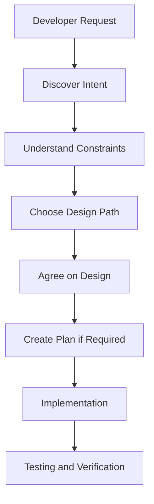

The central principle is:

**Understand what should be built before deciding how to build it.**

---

# Part II — Understanding the Brainstorming Skill

## 3. What Is brainstorming?

The `brainstorming` skill guides an agent through requirements discovery and collaborative software design. It encourages the agent to understand the developer's intent before implementation.

The current skill distinguishes three paths:

1. **Spike**
2. **Bounded**
3. **Architectural**

These paths help match the process to the nature of the task.

### 3.1 Why Classify the Task?

Not every development request needs the same amount of planning. Changing a button label differs from designing an authentication subsystem. A short investigation also differs from implementing a production feature.

The selected path determines which design artifacts and approval stages are necessary.

### 3.2 Three-Path Comparison

| Path | Purpose | Design Artifact | Expected Outcome |
|---|---|---|---|
| Spike | Investigate uncertainty | Question and probe plan | Findings and recommendation |
| Bounded | Implement a contained change | Short in-chat design | Approved, focused implementation |
| Architectural | Build or restructure substantial functionality | Written design specification | Approved specification and implementation plan |

**Important:** The path is determined by the actual work, not simply by how short the developer's message is. A five-word request can still require architectural planning.

---

# Part III — Spike Workflow

## 4. What Is a Spike?

A spike is a time-bounded or scope-bounded investigation used to answer a technical question. Its purpose is learning rather than delivering production functionality.

### Example

"Can our Android application access the device's NFC capability?"

Before implementing a complete NFC feature, a spike could investigate platform support and technical feasibility.

### 4.1 Spike Workflow

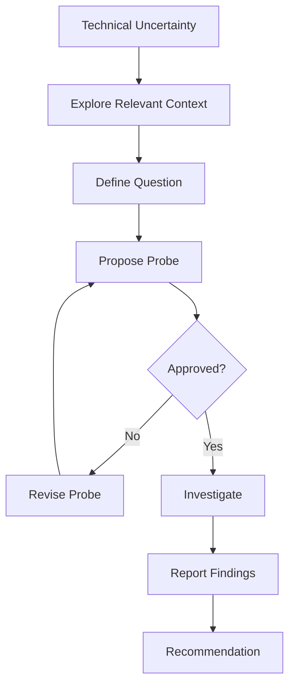

### 4.2 Spike Deliverables

A spike should communicate the question being investigated, method, evidence, findings, limitations, and recommendation.

Any prototype should be clearly labeled experimental or disposable.

### 4.3 Example

**Question:** Can a selected Android API meet our requirement?

**Probe:** Build a minimal isolated test to verify the relevant API behavior.

**Expected result:** A documented yes/no/conditional recommendation.

### 4.4 What a Spike Is Not

A spike is not automatic permission to build the complete production feature. Keeping or expanding the prototype becomes a new implementation decision.

---

# Part IV — Bounded Workflow

## 5. What Is a Bounded Change?

A bounded change has a limited, understandable impact. It does not substantially restructure the application or change interfaces used by other systems.

Examples include correcting a small validation rule, updating an existing UI label, adding a simple filter to an existing list, or fixing a contained formatting issue.

### 5.1 Bounded Workflow

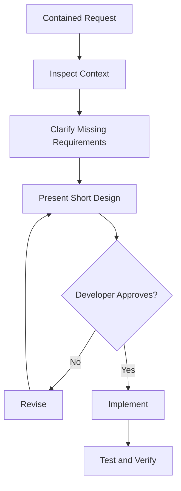

### 5.2 Short Design Example

**Request:** Add a completed-task filter.

**Proposed approach:** Reuse the existing task list and status field. Add a filter control that displays completed tasks without changing the database schema.

**Files affected:** Existing task list UI and its filtering logic.

**Verification:** Confirm completed tasks appear when selected, other tasks are excluded, and the default list remains unchanged.

The agent presents the design and waits for approval.

### 5.3 Important Rule

For the current Bounded path, a separate implementation plan document is not required. After the developer approves the in-chat design, implementation can proceed through the normal development workflow.

---

# Part V — Architectural Workflow

## 6. What Is Architectural Work?

Architectural work involves substantial design decisions, such as building a new application, adding a subsystem, introducing a major integration, restructuring components, changing shared interfaces, or designing a new database-backed workflow.

These changes need careful planning because mistakes can affect multiple parts of the system.

### 6.1 Architectural Workflow

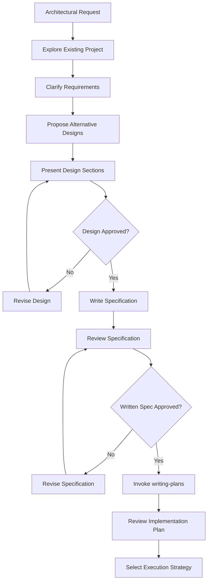

### 6.2 Key Stages

1. **Project exploration:** Understand the current codebase and documentation.
2. **Requirements discovery:** Clarify what must be built.
3. **Alternative designs:** Compare possible approaches.
4. **Design approval:** Confirm the proposed architecture.
5. **Written specification:** Document the approved design.
6. **Specification review:** Confirm the document accurately reflects the agreed design.
7. **Implementation planning:** Convert the approved specification into executable tasks.

### 6.3 Approval Is Stage-Specific

Approving an idea does not automatically approve its detailed design. Approving a conversational design does not automatically approve a written specification. Approving the specification does not automatically authorize unreviewed implementation.

Complete each stage according to the selected workflow.

---

# Part VI — Requirements Discovery

## 7. Understanding User Intent

Before proposing functionality, understand the outcome the developer wants.

```text
User -> Problem -> Desired Outcome -> Required Behavior -> Success Criteria
```

### 7.1 Problem Statement

A problem statement describes the issue motivating the software.

Example: "Student groups have difficulty tracking task assignments and identifying unfinished work."

This describes the problem rather than prescribing an implementation.

### 7.2 Desired Outcome

An outcome describes what improvement should happen.

Example: "Group members can clearly identify assigned tasks and monitor completion."

### 7.3 Requirement

A requirement describes a behavior or property the system must provide.

Example: "The application shall display tasks assigned to the authenticated user."

### 7.4 Acceptance Criterion

An acceptance criterion describes observable evidence that a requirement is satisfied.

Example: "Given a user with three assigned tasks, when the assigned-task screen opens, all three tasks are displayed."

---

## 8. Asking Better Questions

Effective brainstorming asks questions that reduce meaningful uncertainty.

**Weak question:** "What features do you want?" This may be too broad.

**Better question:** "Should task assignments support one assignee or multiple assignees?" This targets a specific design decision.

Ask focused questions one at a time when the answer affects design. Avoid repeating questions already answered by the developer or existing project documentation.

---

# Part VII — Functional and Non-Functional Requirements

## 9. Functional Requirements

Functional requirements describe what the system must do, such as letting users create tasks, update task status, allowing administrators to assign schedules, or letting customers search products.

| ID | Functional Requirement |
|---|---|
| FR-01 | Display tasks assigned to the current user |
| FR-02 | Filter tasks by status |
| FR-03 | Allow authorized users to update task status |
| FR-04 | Show an empty state when no tasks match |

These are illustrative requirements, not an approved project scope.

---

## 10. Non-Functional Requirements

Non-functional requirements describe quality attributes and constraints, including security, performance, reliability, accessibility, maintainability, and compatibility.

| ID | Non-Functional Requirement |
|---|---|
| NFR-01 | Only authorized users may update task status |
| NFR-02 | The UI must remain usable on supported screen sizes |
| NFR-03 | Existing functionality must not regress |
| NFR-04 | The implementation must follow project architecture |

Functional requirements describe behavior. Non-functional requirements describe how well or under what constraints that behavior must operate.

---

# Part VIII — Scope Definition

## 11. Goals, Non-Goals, and Constraints

A design should clearly separate these categories.

**Goals** are what the feature must accomplish.

**Non-goals** are what the feature intentionally does not include.

**Constraints** are rules the implementation must respect.

### Example

**Feature:** Task status filtering.

**Goals:** Filter tasks by existing statuses, display matching results, and preserve the existing task list.

**Non-goals:** Introduce new statuses, add notifications or analytics, or redesign the task database.

**Constraints:** Reuse existing architecture, avoid unnecessary dependencies, and preserve current permissions.

### Why Non-Goals Matter

Without explicit non-goals, an agent may treat unrelated improvements as part of the task. This is a common source of scope creep.

---

# Part IX — Design Alternatives

## 12. Why Compare Multiple Approaches?

The first solution is not necessarily the most appropriate. Different approaches vary in complexity, performance, maintainability, cost, integration effort, and testing requirements.

The Architectural brainstorming path encourages comparing multiple approaches and their tradeoffs.

### 12.1 Example: Product Search

Suppose a Next.js application needs product search.

| Approach | Advantages | Tradeoffs |
|---|---|---|
| Client-side filtering | Simple for small datasets | Requires product data on the client |
| Backend API search | Supports larger datasets and centralized filtering | Requires API integration |
| Dedicated search service | Advanced search capabilities | Adds infrastructure and cost |

### Decision Factors

- Dataset size.
- Existing architecture.
- Performance expectations.
- Available infrastructure.
- Required search features.

### Design Recommendation

Choose the simplest approach that satisfies confirmed requirements and constraints. Do not introduce a dedicated search service merely because it is more sophisticated.

---

# Part X — Design Specifications

## 13. What Is a Design Specification?

A design specification records what will be built and the agreed architectural decisions. It bridges requirements discovery and implementation planning.

### 13.1 Typical Contents

A useful design specification includes an overview, problem and purpose, goals, non-goals, stakeholders, functional and non-functional requirements, architecture, components, data flow, interfaces, error handling, security considerations, testing strategy, and acceptance criteria.

The amount of detail should reflect the project's complexity.

### 13.2 Official Default Location

The current brainstorming skill uses:

```text
docs/superpowers/specs/YYYY-MM-DD-<topic>-design.md
```

Example:

```text
docs/superpowers/specs/2026-10-20-task-assignment-design.md
```

A developer's explicit preferred location can override the default.

---

## 14. Example Design Specification

### Project: Task Status Filtering

**Purpose**

Allow users to view tasks based on their existing statuses.

**Goals**

- Support filtering by available task statuses.
- Preserve the current task list behavior.
- Display a clear empty state.

**Non-Goals**

- New status definitions.
- Notifications.
- Analytics.
- Database redesign.

**Architecture**

Filtering should use the existing task data flow and application state management.

**Data Flow**

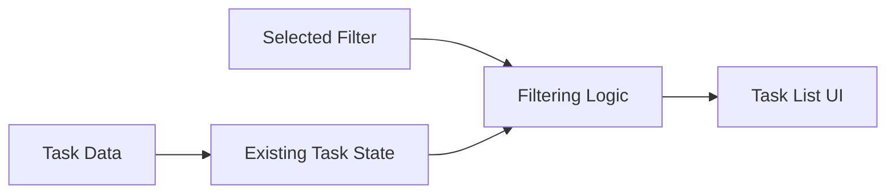

**Acceptance Criteria**

- Selecting a status displays matching tasks.
- Selecting the default filter restores the full list.
- No matching tasks produces an appropriate empty state.
- Existing task permissions remain unchanged.

**Verification**

Run targeted tests and verify the UI behavior.

A design specification explains the agreed solution without duplicating an entire production implementation. Detailed file changes, test assertions, and commands belong primarily in the implementation plan.

---

# Part XI — Design Approval

## 15. Why Approval Matters

Approval prevents the agent from treating assumptions as confirmed requirements. It gives the developer a chance to correct misunderstood goals, unnecessary features, incorrect architecture, missing constraints, or inappropriate dependencies.

### 15.1 Approval Example

The agent presents: "Use the existing task status field and filter the current list without introducing a new database table."

The developer can approve, reject, request changes, or clarify missing requirements.

### Important Principle

**Approval should correspond to the actual artifact being reviewed.** A general statement such as "I like the idea" should not be interpreted as approval of an implementation plan that has not yet been written.

---

# Part XII — Transition to writing-plans

## 16. What Happens After Design Approval?

For Architectural work, the next step is the `writing-plans` skill after the written specification has been reviewed and approved. The planning skill converts design decisions into concrete implementation tasks.

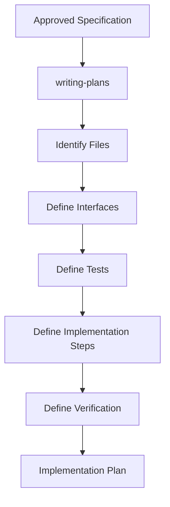

### 16.1 Specification vs Plan

| Design Specification | Implementation Plan |
|---|---|
| Describes what will be built | Describes how to build it |
| Captures user intent | Captures implementation decisions |
| Defines architecture | Identifies exact files |
| Defines requirements | Defines tasks and interfaces |
| Defines acceptance criteria | Defines test assertions and commands |
| Reviewed before planning | Reviewed before execution |

---

# Part XIII — Implementation Planning

## 17. What Makes a Good Implementation Plan?

The current `writing-plans` skill emphasizes recording decisions an implementer cannot safely infer.

A good plan includes exact files, interfaces, required values, tests, commands, expected outcomes, dependencies, and constraints. It should not become a transcript of the production code.

### 17.1 Important Planning Principle

A plan should remove ambiguity without doing the implementation itself.

**Too vague:**

```text
Implement filtering.
```

**Too detailed:** A plan that contains every line of the final implementation even when interfaces and tests already determine the behavior.

**Appropriate:**

```text
File: src/utils/filterTasks.ts

Export:
filterTasks(tasks: Task[], status: TaskStatus | "all"): Task[]

Behavior:
- "all" returns every task.
- A specific status returns matching tasks.

Tests:
- all
- completed
- no matches
```

This records important decisions while leaving straightforward implementation to the developer or agent.

---

# Part XIV — Official Plan Structure

## 18. Recommended Plan Header

The current Superpowers skill defines a plan format containing a feature name, goal, architecture, technology stack, specification reference, global constraints, and review focus.

### Example

```markdown
# Task Status Filter Implementation Plan

**Goal:** Add task status filtering to the existing task list.

**Architecture:** Reuse the current task data and filtering
state without introducing a new persistence layer.

**Tech Stack:** TypeScript, Next.js

**Spec:** docs/superpowers/specs/2026-10-20-task-filter-design.md

## Global Constraints

- Preserve existing task statuses.
- Do not add dependencies.
- Reuse existing task components.

## Review Focus

- Empty task list.
- Unknown status values.
- No matching tasks.
- Existing permission behavior.
- Default filter behavior.
```

This is a simplified educational adaptation. For actual Superpowers execution, follow the installed `writing-plans/SKILL.md` format.

### 18.1 Official Default Plan Location

```text
docs/superpowers/plans/YYYY-MM-DD-<feature-name>.md
```

Example:

```text
docs/superpowers/plans/2026-10-20-task-status-filter.md
```

---

# Part XV — Task Decomposition

## 19. Breaking Work into Tasks

Task decomposition divides implementation into smaller units. A good task has a clear objective, defined inputs and outputs, known dependencies, and a checkable result.

### Example

Feature: "Filter tasks by status."

Possible tasks:

1. Define filtering behavior and tests.
2. Implement filtering logic.
3. Connect filter control to the existing UI.
4. Verify empty-state behavior.
5. Run relevant regression tests.

### 19.1 Task Dependency Diagram

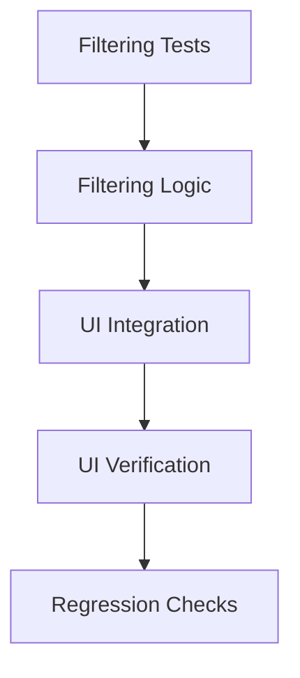

### Why Dependencies Matter

An implementer should know which earlier task provides an interface used by later work. Otherwise, separate agents may create incompatible function names or data structures.

---

# Part XVI — Interface Contracts

## 20. What Is an Interface Contract?

An interface contract defines how components communicate.

```typescript
type TaskStatus = "pending" | "in_progress" | "completed";

interface Task {
  id: string;
  status: TaskStatus;
}

function filterTasks(
  tasks: Task[],
  status: TaskStatus | "all"
): Task[];
```

This is an interface definition, not the complete implementation.

### 20.1 Why Include Interfaces in Plans?

Interfaces reduce ambiguity between tasks.

Task A produces:

```text
filterTasks(tasks, status)
```

Task B consumes:

```text
filterTasks(tasks, selectedStatus)
```

Both tasks must agree on the function name, parameter types, return type, and expected behavior.

### 20.2 Interface Dependency

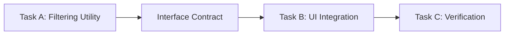

This is especially important during subagent-driven development.

---

# Part XVII — Test-Driven Planning

## 21. Planning for RED-GREEN-REFACTOR

A TDD-ready plan defines tests before implementation.

### RED

Specify a test and expected failure.

### GREEN

Specify the minimal behavior required to pass.

### REFACTOR

Improve code quality while preserving behavior.

### 21.1 Example

**Requirement:** Completed-task filtering returns only completed tasks.

**Test:**

```typescript
expect(
  filterTasks(
    [
      { id: "1", status: "completed" },
      { id: "2", status: "pending" }
    ],
    "completed"
  )
).toEqual([{ id: "1", status: "completed" }]);
```

**Expected RED result:** The test fails before the filtering function is implemented.

**Expected GREEN result:** The test passes after the required behavior is implemented.

**Refactor:** Simplify implementation if appropriate, then rerun tests.

Tests should validate requirements, not merely reproduce the current implementation.

---

# Part XVIII — Acceptance Criteria vs Test Cases

## 22. Understanding the Difference

Acceptance criteria describe the expected user-visible or system-visible outcome. Test cases define specific inputs, actions, and expected results.

**Acceptance criterion:** "Users can filter tasks by completion status."

| Input | Action | Expected Result |
|---|---|---|
| Mixed statuses | Select completed | Only completed tasks appear |
| No completed tasks | Select completed | Empty state appears |
| Any tasks | Select all | Full list appears |
| Empty dataset | Select all | Empty state appears |

Acceptance criteria establish success; test cases provide evidence.

---

# Part XIX — Global Constraints and Review Focus

## 23. Global Constraints

Global constraints apply across implementation tasks. Examples include not adding dependencies, preserving authentication, using existing project architecture, supporting the specified platform version, and not changing unrelated APIs.

The current `writing-plans` skill emphasizes carrying exact project-wide constraints from the approved specification into the plan.

### 23.1 Review Focus

Review focus identifies likely failure conditions that deserve attention. For filtering, these may include empty datasets, unknown values, missing fields, default selection, and authorization behavior. These should lead to suitable tests in the tasks responsible for the relevant code.

Do not invent requirements. Distinguish confirmed requirements, reasonable defensive behavior, and assumptions that need developer approval.

---

# Part XX — Avoiding Overengineering

## 24. Why Planning Can Become Too Detailed

Excessive planning can duplicate complete code, invent abstractions, create unnecessary documents, add unrelated infrastructure, or decompose trivial work into too many tasks.

### 24.1 Simplicity Principles

- **YAGNI:** Do not build functionality that is not required.
- **DRY:** Avoid unnecessary duplication.
- **KISS:** Prefer understandable solutions.

Simplicity does not mean skipping security, validation, required tests, accessibility, error handling, or important architectural constraints. The goal is the smallest complete solution that satisfies requirements.

---

---

# Part XXI — Context Engineering in Planning

## 25. Why Context Matters

An implementation plan should be understandable to an agent that did not participate in the original design conversation. This is especially important for fresh subagents.

### 25.1 Context Sources

```text
Implementation Context
├── Approved specification
├── Project AGENTS.md
├── Relevant source files
├── Interface contracts
├── Global constraints
├── Task dependencies
└── Verification instructions
```

### 25.2 Progressive Disclosure

Do not provide the entire repository when only a few files are relevant.

1. Identify the task.
2. Read applicable instructions.
3. Inspect relevant components.
4. Expand context when dependencies require it.
5. Implement and verify.

### 25.3 Context Efficiency

A good plan minimizes ambiguity without flooding the implementer with unrelated information.

---

# Part XXII — Android Case Study

## 26. GroupTrack: Task Status Filtering

### Scenario

An Android Java application needs a task status filter.

### Step 1 — Discover Intent

**Goal:** Allow students to view tasks by status.

### Step 2 — Identify Requirements

Confirm supported statuses, default filter, filter placement, empty-state behavior, and data source.

### Step 3 — Define Scope

**In Scope:** Filter existing tasks, reuse the existing task list, and display matching tasks.

**Out of Scope:** New status categories, notifications, analytics, and database redesign.

### Step 4 — Design

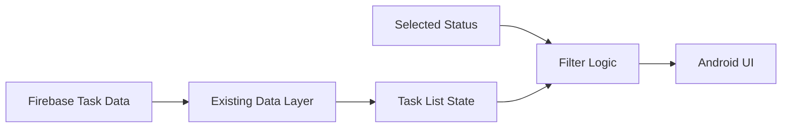

### Step 5 — Planning

1. Test status filtering behavior.
2. Implement filtering logic.
3. Connect the UI control.
4. Verify the empty state.
5. Run regression checks.

### Step 6 — Verification

```powershell
.\gradlew.bat assembleDebug
.\gradlew.bat testDebugUnitTest
```

Run the unit test task if tests are configured.

### Engineering Lesson

The workflow should preserve the documented MVP and existing Android architecture.

---

# Part XXIII — Laravel Case Study

## 27. GoPasig: Schedule Filtering

### Scenario

A Laravel application needs route-based schedule filtering.

### Step 1 — Clarify Requirements

Ask which roles can filter schedules, which route identifiers are accepted, whether dates are included, whether pagination remains unchanged, and how invalid filters behave.

### Step 2 — Architecture

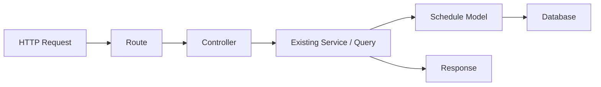

### Step 3 — Plan

1. Define feature tests.
2. Confirm validation behavior.
3. Implement query filtering.
4. Preserve authorization.
5. Verify response structure.
6. Run regression tests.

### Step 4 — Verification

```powershell
php artisan test
```

### Engineering Lesson

Respect existing scheduling rules and avoid unnecessary database or architecture changes.

---

# Part XXIV — Next.js Case Study

## 28. E-Commerce: Product Search

### Scenario

A Next.js frontend needs product search backed by an existing Laravel API.

### Step 1 — Requirements

Clarify searchable fields, backend endpoint availability, pagination, empty results, loading states, and URL query synchronization.

### Step 2 — Alternative Designs

- **Client-side filtering:** Appropriate when the required dataset is already available.
- **Backend API search:** Appropriate when the Laravel backend owns search logic and the dataset is larger.
- **Dedicated search infrastructure:** Only appropriate when justified by requirements.

### Step 3 — Architecture

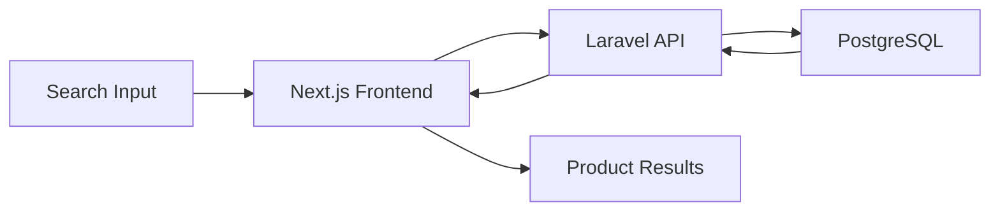

### Step 4 — Plan

1. Define the search API contract.
2. Write relevant tests.
3. Implement frontend search state.
4. Integrate API requests.
5. Handle loading and empty results.
6. Verify responsive behavior.

### Step 5 — Verification

```powershell
npm run build
npm run lint
```

Run `lint` if configured.

### Engineering Lesson

A good design respects the existing frontend/backend separation.

---

# Part XXV — Common Anti-Patterns

## 29. Mistakes to Avoid

| Anti-Pattern | Why It Is a Problem | Better Approach |
|---|---|---|
| Coding immediately | Requirements may be misunderstood | Clarify intent |
| Asking unnecessary questions | Wastes time | Reuse existing context |
| Treating assumptions as facts | Creates incorrect behavior | Label assumptions |
| Skipping design approval | Removes developer control | Respect approval gates |
| Overusing architectural planning | Creates unnecessary overhead | Classify the task correctly |
| Writing vague plans | Leaves decisions unresolved | Specify interfaces and tests |
| Writing complete code in plans | Duplicates implementation | Record decisions |
| Adding unrelated features | Causes scope creep | Define non-goals |
| Ignoring task dependencies | Causes incompatible implementations | Map dependencies |
| Skipping edge cases | Produces fragile behavior | Define review focus |
| Treating plan approval as test evidence | Confuses intent with verification | Run actual checks |

---

# Part XXVI — Practical Exercises

## 30. Exercise 1 — Classify the Request

Choose Spike, Bounded, or Architectural and explain each classification:

1. Investigate whether an Android API supports a specific capability.
2. Change the label of an existing button.
3. Build a new student management application.
4. Add a small filter to an existing list.
5. Introduce a new authentication subsystem.
6. Investigate whether an external API can meet performance requirements.

## 31. Exercise 2 — Write a Problem Statement

Students have difficulty monitoring group assignments. Write a problem statement, target users, desired outcome, and success criteria. Do not propose implementation details yet.

## 32. Exercise 3 — Requirements Discovery

For a task assignment feature, identify five questions that would materially affect the design. Separate confirmed requirements, unknown requirements, and assumptions.

## 33. Exercise 4 — Define Scope

Create five goals, five non-goals, and five constraints for a practice feature in Android, Laravel, or Next.js. Explain how the non-goals prevent scope creep.

## 34. Exercise 5 — Compare Designs

For product search, compare client-side filtering, backend API search, and dedicated search infrastructure. Evaluate complexity, performance, cost, maintainability, and compatibility with existing architecture. Select an approach based on stated assumptions.

## 35. Exercise 6 — Write a Design Specification

Create a practice design document with purpose, goals, non-goals, requirements, architecture, data flow, error handling, security, acceptance criteria, and verification strategy. Do not write production code.

## 36. Exercise 7 — Write an Implementation Plan

Using the approved practice design, write the goal, architecture, technology stack, specification reference, global constraints, review focus, task list, interface contracts, test assertions, and verification commands. Ensure each task has a checkable result.

## 37. Exercise 8 — Identify Overengineering

Requirement: filter tasks by status. An agent proposes a microservice, message queue, notification system, separate analytics database, and new filtering UI. Identify which are justified and which need additional evidence.

---

# Part XXVII — Knowledge Check

## 38. Review Questions

1. What is the purpose of `brainstorming`?
2. Why must user intent be understood first?
3. What are the three brainstorming paths?
4. What is a spike?
5. What is a bounded change?
6. What qualifies as architectural work?
7. Why is approval stage-specific?
8. What is a problem statement?
9. What is the difference between a goal and a requirement?
10. What are functional requirements?
11. What are non-functional requirements?
12. Why are non-goals important?
13. Why compare design alternatives?
14. What belongs in a design specification?
15. What is the purpose of `writing-plans`?
16. What is an interface contract?
17. Why must task dependencies be documented?
18. How do acceptance criteria differ from test cases?
19. What are global constraints?
20. What is review focus?
21. Why should implementation plans avoid duplicating production code?
22. How does TDD influence task planning?
23. How does progressive disclosure improve context efficiency?
24. How can planning prevent architectural drift?
25. What should happen before implementation begins?

---

# Part XXVIII — Key Takeaways

> [!summary] Lesson Summary
> - Brainstorming begins by understanding the developer's intent.
> - The current Superpowers methodology distinguishes Spike, Bounded, and Architectural paths.
> - Spikes investigate uncertainty rather than automatically producing production features.
> - Bounded changes use a short approved in-chat design.
> - Architectural changes require a written specification and implementation planning.
> - Approval is specific to the stage and artifact presented.
> - Requirements should distinguish confirmed facts from assumptions.
> - Goals, non-goals, and constraints prevent scope creep.
> - Design alternatives should be evaluated through explicit tradeoffs.
> - A design specification describes what will be built.
> - An implementation plan describes how to build it.
> - Good plans include exact files, interfaces, tests, and verification steps.
> - Tasks should have clear dependencies and checkable outcomes.
> - TDD-ready plans specify meaningful tests before implementation.
> - Plans should record decisions rather than duplicate all production code.
> - Context engineering ensures implementers receive relevant information.
> - Avoiding overengineering is compatible with disciplined planning.

## Final Mental Model

```text
DEVELOPER REQUEST
       |
       v
UNDERSTAND INTENT
       |
       v
CLASSIFY TASK
       +-- SPIKE -> INVESTIGATE -> REPORT FINDINGS
       +-- BOUNDED -> SHORT DESIGN -> APPROVAL -> IMPLEMENTATION
       +-- ARCHITECTURAL -> DESIGN OPTIONS -> DESIGN APPROVAL
             -> WRITTEN SPECIFICATION -> SPEC REVIEW
             -> IMPLEMENTATION PLAN -> PLAN REVIEW -> EXECUTION
```

**Remember:** The purpose of brainstorming is not to delay coding. It is to make sure the agent builds the right thing. The purpose of planning is not to write the code twice; it is to preserve the decisions required for correct implementation.

---

# Part XXIX — Official References

## Superpowers

- [Official Repository](https://github.com/obra/superpowers)
- [Official README](https://github.com/obra/superpowers/blob/main/README.md)
- [Brainstorming Skill](https://github.com/obra/superpowers/blob/main/skills/brainstorming/SKILL.md)
- [Writing Plans Skill](https://github.com/obra/superpowers/blob/main/skills/writing-plans/SKILL.md)
- [Using Superpowers Skill](https://github.com/obra/superpowers/blob/main/skills/using-superpowers/SKILL.md)
- [Executing Plans Skill](https://github.com/obra/superpowers/blob/main/skills/executing-plans/SKILL.md)
- [Subagent-Driven Development Skill](https://github.com/obra/superpowers/blob/main/skills/subagent-driven-development/SKILL.md)
- [Test-Driven Development Skill](https://github.com/obra/superpowers/blob/main/skills/test-driven-development/SKILL.md)
- [Release Notes](https://github.com/obra/superpowers/blob/main/RELEASE-NOTES.md)

## Supporting Documentation

- [OpenAI Codex Documentation](https://developers.openai.com/codex/)
- [Codex Skills](https://developers.openai.com/codex/skills/)
- [Codex AGENTS.md Guide](https://developers.openai.com/codex/guides/agents-md/)
- [Git Documentation](https://git-scm.com/docs)
- [Git Worktree Documentation](https://git-scm.com/docs/git-worktree)

> [!note] Documentation Accuracy
> The three brainstorming paths, approval stages, default specification and plan locations, and lean planning principles are based on the official Superpowers skill files and release notes checked on October 20, 2026.
>
> The diagrams, example specifications, requirements tables, and case studies are educational adaptations rather than outputs from a running Superpowers installation.
>
> Always read the installed version's `SKILL.md` because workflow requirements can change between releases.

---

# Part XXX — Next Lesson

**[[05 - Test-Driven Development and Debugging]]**

In the next lesson, we will cover:

1. Test-driven development philosophy.
2. RED-GREEN-REFACTOR.
3. Unit, integration, and feature tests.
4. Writing meaningful failing tests.
5. Test doubles and mocking.
6. Regression testing.
7. Systematic debugging.
8. Root-cause analysis.
9. Hypothesis-driven investigation.
10. Verification-before-completion.
11. Evidence-based completion reports.
12. Android Java testing examples.
13. Laravel PHPUnit/Pest examples.
14. Next.js TypeScript testing examples.
15. Exercises, key takeaways, and official references.

**Learning Progression:**

Repository Overview → Architecture and Core Concepts → Installation and Setup → Skills and Features → **Brainstorming and Planning** → Test-Driven Development and Debugging → Subagent-Driven Development → Codex Integration → Git Worktrees and Code Review → Best Practices and Exercises
