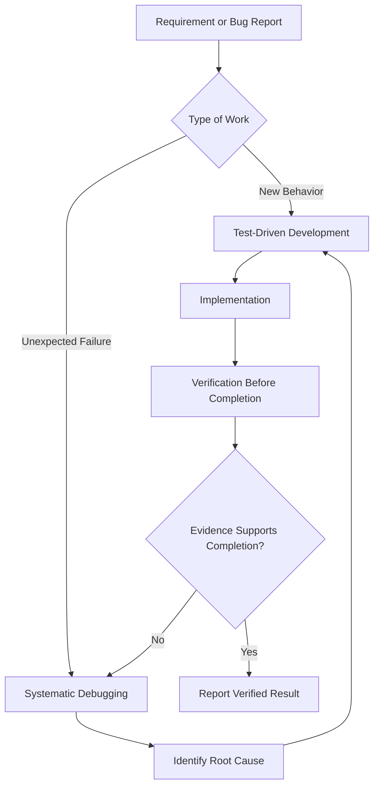
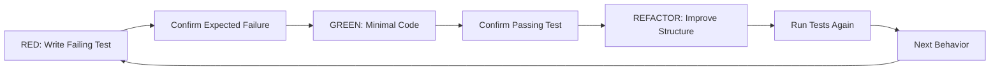
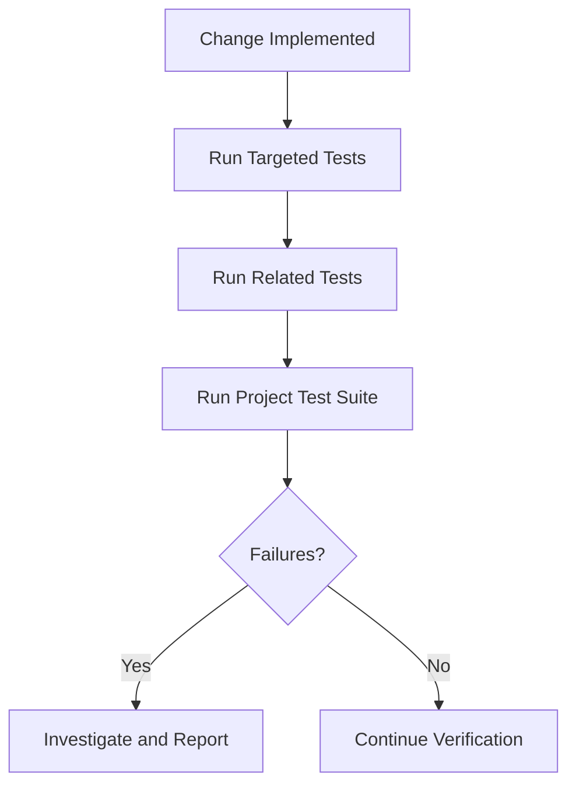
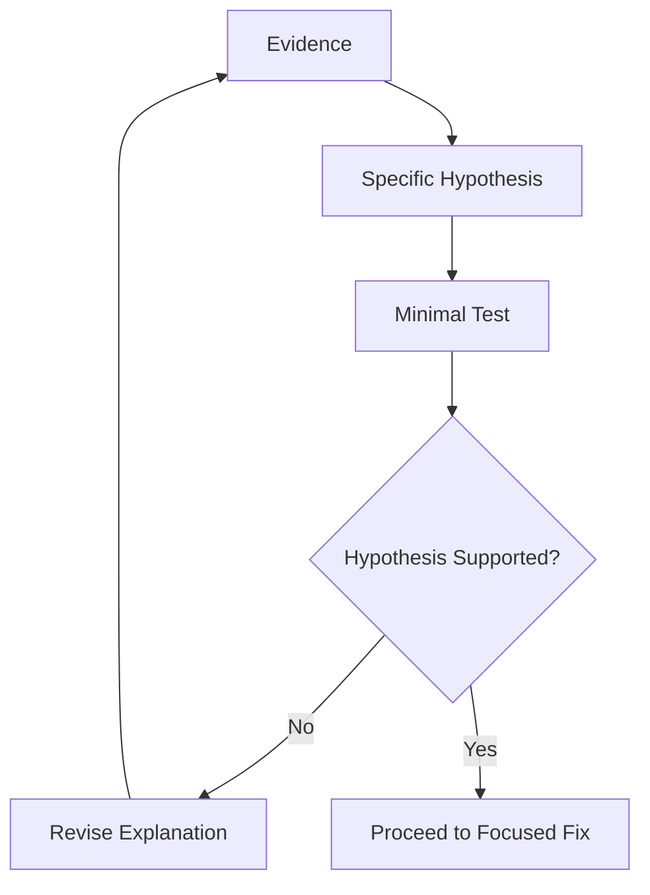
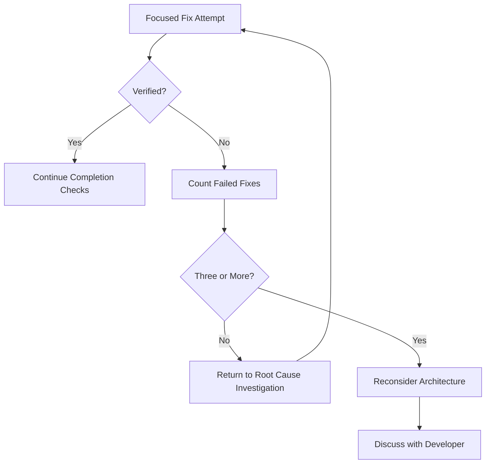
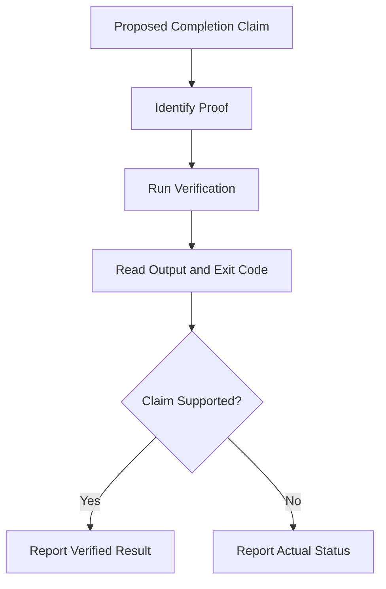

# 05 — Superpowers: Test-Driven Development and Debugging

> [!abstract] Lesson Information
> **Repository:** [obra/superpowers](https://github.com/obra/superpowers)
>
> **Category:** Agentic Engineering / Software Testing / Debugging / Verification
>
> **Difficulty:** Intermediate
>
> **Learning Approach:** Theory First
>
> **Prerequisites:** [[04 - Brainstorming and Planning]]
>
> **Primary Skills:** `test-driven-development`, `systematic-debugging`, `verification-before-completion`
>
> **Goal:** Understand how Superpowers uses test-first implementation, evidence-based debugging, and fresh verification to produce more reliable software.

---

# 1. Learning Objectives

After this lesson, you should be able to explain TDD and RED-GREEN-REFACTOR, distinguish test failures from setup errors, understand test types and test doubles, identify useful tests and edge cases, investigate bugs systematically, recognize the three-failed-fixes checkpoint, distinguish implementation from verification, interpret test output, report evidence accurately, and apply these practices to Android Java, Laravel, and Next.js.

# Part I — The Three Skills

## 2. How Testing, Debugging, and Verification Connect

| Skill | Main Question |
|---|---|
| `test-driven-development` | How do we implement correct behavior? |
| `systematic-debugging` | Why is the existing behavior failing? |
| `verification-before-completion` | What evidence proves the work is complete? |



Example: to prevent duplicate schedule assignments, clarify expected behavior, write a test that exposes the problem, confirm the expected failure, trace the relevant logic, implement a focused correction, run targeted and regression tests, and report actual results. Writing code and proving it correct are separate activities.

# Part II — Test-Driven Development

## 3. What Is TDD?

**Test-Driven Development (TDD)** uses tests to guide implementation. Start with a test describing the required behavior, run it before that behavior exists, and confirm it fails for the expected reason.

Traditional:

```text
Write code → Run application → Discover problems → Write tests later
```

TDD:

```text
Define behavior → Write test → Observe expected failure
→ Write minimal implementation → Observe pass → Refactor
```

TDD is more than writing tests; the tests guide design and implementation.

## 4. The Superpowers TDD Rule

The official `test-driven-development` skill requires observing a failing test before production code for new features, bug fixes, refactoring, and behavior changes. It lists throwaway prototypes, generated code, and configuration files as exceptions to discuss with the developer.

A test written after implementation may pass, but that alone does not show it would detect missing behavior. Test-first provides evidence that it exercises the requirement. These are Superpowers methodology rules; use them when applicable, subject to higher-priority instructions and legitimate developer decisions.

# Part III — RED-GREEN-REFACTOR

## 5. Understanding the Cycle



## 6. RED — Write a Failing Test

Requirement: a task is complete when status equals `completed`. First write a test:

```javascript
import { describe, expect, it } from "vitest";
import { isCompleted } from "./task";

describe("isCompleted", () => {
  it("returns true for a completed task", () => {
    expect(isCompleted({ status: "completed" })).toBe(true);
  });
});
```

The test should fail because the behavior is missing. A test-runner startup error caused by a missing dependency is not the expected RED result.

- [ ] Test describes one behavior with a clear name.
- [ ] Test was executed and failure observed.
- [ ] Failure has the expected reason.

A syntax error or broken test setup does not prove the behavior is missing.

## 7. GREEN — Write Minimal Production Code

```javascript
export function isCompleted(task) {
  return task.status === "completed";
}
```

Rerun the test. Confirm requested behavior, targeted test, and existing tests; avoid unrelated functionality. A simple status check does not automatically justify a new library, service, event bus, or rule engine.

## 8. REFACTOR — Improve Without Changing Behavior

Refactoring improves structure while preserving observable behavior. For example:

```javascript
export function isCompleted(task) {
  if (task.status === "completed") {
    return true;
  } else {
    return false;
  }
}
```

can become:

```javascript
export function isCompleted(task) {
  return task.status === "completed";
}
```

Rerun tests after refactoring; cleaner-looking code is not verification.

# Part IV — Writing Good Tests

## 9. Characteristics of a Meaningful Test

A useful test is focused, understandable, repeatable, independent where practical, and behavior-oriented. Prefer observable outcomes over fragile implementation details.

## 10. Positive, Negative, and Edge Cases

For task status filtering:

| Scenario | Input | Expected Result |
|---|---|---|
| Matching tasks | Completed filter and completed tasks | Matching tasks returned |
| Mixed statuses | Completed and pending | Pending tasks excluded |
| No matches | Completed filter, pending only | Empty list |
| Empty input | Empty task array | Empty list |
| All filter | Any tasks and `all` selected | All tasks returned |

A test matrix helps identify missing cases before implementation.

# Part V — Types of Software Tests

## 11. Unit Tests

Unit tests cover small pieces of behavior: filtering functions, validation helpers, calculations, or formatting. They are fast and focused, but do not prove that integrated components work together.

## 12. Integration Tests

Integration tests check interactions such as controller and service, service and database, or frontend and API boundary. They catch issues that isolated unit tests miss.

## 13. Feature Tests

Feature tests verify a complete application behavior or request flow. A Laravel feature test may cover authentication, route, controller, validation, database, and HTTP response. They are useful for API behavior, permissions, and validation.

## 14. UI and End-to-End Tests

UI tests exercise application interactions such as clicking a button, submitting a form, navigation, or showing an error. End-to-end tests can cover several application layers. A unit test does not prove UI correctness; a successful build does not prove correct behavior. Each check provides different evidence.

# Part VI — Test Doubles and Mocking

## 15. What Are Test Doubles?

A test double replaces a real dependency during testing.

| Type | Purpose |
|---|---|
| Stub | Supplies predetermined responses |
| Fake | Provides a simplified working implementation |
| Mock | Verifies expected interactions |
| Spy | Records calls or interactions |

For an external API, a fake client can supply predictable responses without relying on live network access.

## 16. When Should You Mock?

Mock dependencies that are external, slow, nondeterministic, difficult to control, expensive, or unsuitable for the test environment.

Avoid mocking behavior that you need to test directly. Mocking the filtering function does not prove its filtering logic works. Test real behavior where practical and use mocks at appropriate boundaries.

# Part VII — Regression Testing

## 17. What Is Regression Testing?

Regression testing checks that previously working behavior still works after a change. A schedule-filter fix could accidentally affect pagination, route selection, date filtering, authorization, or default results.



The Superpowers TDD skill says a passing targeted test does not prove the whole suite passes. Run the applicable project test command and report all failures accurately.

# Part VIII — Systematic Debugging

## 18. What Is Systematic Debugging?

Systematic debugging uses evidence to find the root cause of unexpected behavior. Do not change code until you understand what causes the failure; random changes may hide a symptom without correcting its cause.

## 19. The Four Debugging Phases

| Phase | Purpose |
|---|---|
| 1. Root Cause Investigation | Gather evidence and trace the failure |
| 2. Pattern Analysis | Compare working and failing behavior |
| 3. Hypothesis and Testing | Form and test a specific explanation |
| 4. Implementation | Apply a focused fix and verify it |

## 20. Phase 1 — Root Cause Investigation

Reproduce the failure. Ask what failed, when it began, whether it reproduces, what error appears, what recently changed, and which components are involved.

Evidence can include stack traces, logs, test output, Git diff, recent commits, request payloads, database state, and relevant configuration.

Example: if a Laravel schedule request returns HTTP 500, inspect the error and trace the request instead of immediately editing the controller.

## 21. Phase 2 — Pattern Analysis

Compare working and failing cases. If one route succeeds and another fails, compare route configuration, schedule data, related records, validation, permissions, and conflicts. Ask what works, what fails, what differs, and which differences matter.

## 22. Phase 3 — Hypothesis and Testing

A hypothesis is a specific explanation that can be tested.

**Weak:** “The backend is broken.”

**Better:** “The request fails because the selected driver already has a conflicting schedule.”



Change one relevant variable at a time. Changing many things at once makes cause and effect hard to establish.

## 23. Phase 4 — Implementation

After identifying the root cause:

1. Create a failing regression test.
2. Confirm the expected failure.
3. Implement one focused fix.
4. Run the targeted test.
5. Run relevant regression tests.
6. Verify the original symptom is resolved.

Avoid unrelated refactors, speculative workarounds, changing several independent components, or suppressing errors instead of resolving their cause.

# Part IX — The Three-Failed-Fixes Checkpoint

## 24. When Should Debugging Reconsider the Design?

The official systematic-debugging skill says that after three unsuccessful fix attempts, stop and question whether the architecture or assumptions are wrong. Repeated failures can reveal hidden coupling, shared state, a flawed assumption, or incomplete understanding.



This checkpoint does not mean that three test failures prove an architectural defect. It applies to repeated unsuccessful fix attempts and prevents endless patching without reconsidering assumptions.

# Part X — Debugging Anti-Patterns

## 25. Common Mistakes

| Anti-Pattern | Why It Fails |
|---|---|
| Random patching | Changes are not tied to evidence |
| Guessing root cause | May target the wrong component |
| Ignoring logs | Discards useful evidence |
| Changing many files at once | Obscures cause and effect |
| Suppressing errors | Hides unresolved defects |
| Skipping regression tests | May introduce new problems |
| Repeating failed approaches | Wastes effort without learning |
| Claiming success too early | Provides no completion evidence |

```text
Observe → Reproduce → Investigate → Hypothesize
→ Test → Fix → Verify
```

# Part XI — Verification Before Completion

## 26. What Is Verification?

Verification collects evidence that an implementation meets its requirements. The `verification-before-completion` skill requires fresh checks before making success claims such as “the bug is fixed,” “all tests pass,” or “the feature is complete.” Each claim needs evidence.

## 27. The Verification Gate

1. **Identify:** What command or check proves the claim?
2. **Run:** Execute the relevant verification.
3. **Read:** Inspect its full output and exit status.
4. **Verify:** Decide whether the evidence supports the claim.
5. **Report:** State the result accurately.



## 28. Evidence Types

| Claim | Required Evidence |
|---|---|
| Tests pass | Actual test output |
| Build succeeds | Successful build output and exit status |
| Lint passes | Actual lint results |
| Bug fixed | Original failing behavior now passes |
| Requirements satisfied | Checked acceptance criteria |
| Code review completed | Findings and disposition |
| Branch ready | Relevant checks and Git state |

One check does not prove another: a passing linter does not prove the build succeeds, and a successful build does not prove every workflow works.

## 29. Evidence-Based Completion Reports

Good report:

```text
Implemented:
- Task status filtering
- Empty-state handling

Verification:
- Targeted unit tests: passed
- Full test suite: passed
- Production build: passed

Not verified:
- Physical-device behavior
```

“Everything works perfectly” provides no evidence. If tests cannot run, state the command, the blocker, completed checks, and what remains unverified. Do not describe an environment failure as a passing feature.

# Part XII — Android Java Example

## 30. Scenario: Task Status Filtering

Suppose an Android app needs a function that filters tasks by status.

### Step 1 — Define Behavior

Return only tasks that match the selected status.

### Step 2 — Write a Unit Test

```java
import static org.junit.Assert.assertEquals;

import org.junit.Test;
import java.util.Arrays;
import java.util.List;

public class TaskFilterTest {
    @Test
    public void completedFilterReturnsOnlyCompletedTasks() {
        List<Task> tasks = Arrays.asList(
            new Task("1", "completed"),
            new Task("2", "pending")
        );
        List<Task> result = TaskFilter.filterByStatus(tasks, "completed");
        assertEquals(1, result.size());
        assertEquals("1", result.get(0).getId());
    }
}
```

This assumes suitable `Task` and `TaskFilter` classes. Adapt it to the actual application.

### Step 3 — Confirm RED

```powershell
.\gradlew.bat testDebugUnitTest
```

Inspect the expected initial failure.

### Step 4 — Implement and Confirm GREEN

Write minimal filtering logic and rerun the targeted tests.

### Step 5 — Verify Build and UI

```powershell
.\gradlew.bat assembleDebug
```

Test on an emulator or device. Unit tests do not automatically verify the full Android interface.

# Part XIII — Laravel Example

## 31. Scenario: Route-Based Schedule Filtering

Given schedules for different routes, filtering by one route should return only matching schedules.

### Step 1 — Write a Feature Test

```php
public function test_schedules_can_be_filtered_by_route(): void
{
    $routeA = Route::factory()->create();
    $routeB = Route::factory()->create();

    Schedule::factory()->create(['route_id' => $routeA->id]);
    Schedule::factory()->create(['route_id' => $routeB->id]);

    $response = $this->getJson("/api/schedules?route_id={$routeA->id}");

    $response->assertOk();
    $response->assertJsonCount(1, 'data');
}
```

This assumes suitable factories, authentication setup, and a `data` response shape. Adapt the test to the project.

### Step 2 — Confirm RED and GREEN

```powershell
php artisan test --filter=test_schedules_can_be_filtered_by_route
```

Implement through existing query or service conventions, then rerun the focused test.

### Step 3 — Regression Verification

```powershell
php artisan test
```

Check authorization, invalid route IDs, empty results, pagination, and existing schedule rules. A passing API test does not automatically prove authorization behavior.

# Part XIV — Next.js Example

## 32. Scenario: Product Search

The function should return product names containing a search term.

### Step 1 — Write the Test

```typescript
import { describe, expect, it } from "vitest";
import { searchProducts } from "./search-products";

describe("searchProducts", () => {
  it("returns products matching the search term", () => {
    const products = [
      { id: 1, name: "Keyboard" },
      { id: 2, name: "Monitor" }
    ];
    expect(searchProducts(products, "key")).toEqual([
      { id: 1, name: "Keyboard" }
    ]);
  });
});
```

### Step 2 — Confirm RED and Implement

If Vitest is configured:

```powershell
npx vitest run
```

Implement using the project's existing conventions. Vitest is not included in every Next.js project; use the test framework already configured unless there is a reason to change it.

### Step 3 — Verify Build and UI

```powershell
npm run build
```

Check the search input, empty results, loading, responsive layout, and keyboard accessibility. These require project-appropriate UI checks.

# Part XV — Codex CLI Workflow

## 33. Applying These Skills in Codex

Let the installed Superpowers integration guide skill selection. You can also make the intended process explicit.

### TDD Prompt

```text
Read AGENTS.md and relevant source files.

Implement the behavior using the Superpowers
test-driven-development workflow.

Write and run a failing test first. Confirm it fails for the
missing behavior, implement the smallest complete solution,
then run targeted and relevant regression tests.

Report actual verification results.
```

### Debugging Prompt

```text
Investigate the failure using the Superpowers
systematic-debugging workflow.

Reproduce the issue, gather evidence, and identify the root
cause. Do not apply speculative patches. Create a regression
test before the fix. Verify the issue and related behavior.
```

### Verification Prompt

```text
Use verification-before-completion.
Identify the checks required to support implementation claims.
Run relevant tests and build commands, inspect actual output,
and report passed, failed, and unverified checks.
```

These are example prompts, not mandatory Codex commands.

# Part XVI — Choosing the Right Testing Level

## 34. Testing Strategy Matrix

| Type of Change | Primary Test | Additional Verification |
|---|---|---|
| Utility function | Unit test | Relevant suite |
| Laravel endpoint | Feature test | Authorization and regression |
| Database query | Integration test | Data integrity |
| Android UI interaction | UI test | Emulator/device |
| Next.js component | Component test | Accessibility and build |
| External API integration | Integration/contract test | Error handling |
| Bug fix | Regression test | Original symptom |
| Refactoring | Existing behavior tests | Build and regression |

Testing should target meaningful behavior and realistic failure conditions. More tests do not automatically mean better tests.

# Part XVII — Testing and Overengineering

## 35. Avoiding Excessive Test Complexity

Testing can be overengineered by mocking every method, building needless helpers, duplicating assertions, testing private details, adding large frameworks for trivial behavior, or testing unrelated requirements.

A focused approach:

1. Identify the behavior.
2. Choose the right test level.
3. Write a failing test.
4. Implement minimally.
5. Add justified edge cases.
6. Verify broader behavior.

> [!important]
> Test enough to provide meaningful confidence without making the suite harder to maintain than the application.

# Part XVIII — Practical Exercises

## 36. Exercise 1 — Explain TDD

Answer: What is TDD? Why RED first? What makes a failure meaningful? Why keep GREEN minimal? Why rerun tests after refactoring?

## 37. Exercise 2 — Write a Test Matrix

For task status filtering, cover completed and pending tasks, mixed statuses, empty input, and no matches. Mark normal and edge cases.

## 38. Exercise 3 — Practice RED-GREEN-REFACTOR

In a disposable JavaScript project, write a failing `isCompleted` test, observe the expected failure, implement the function, rerun tests, refactor if needed, and run the suite. Record actual results.

## 39. Exercise 4 — Root-Cause Investigation

For “a Laravel endpoint returns HTTP 500,” write a no-edit investigation plan covering reproduction, logs, request data, related services, database state, and hypotheses.

## 40. Exercise 5 — Hypothesis Testing

For “an Android task list displays duplicates,” propose three explanations. For each, identify evidence, a minimal test, and what would confirm or reject the hypothesis. Do not implement fixes yet.

## 41. Exercise 6 — Verification Report

Hypothetical: unit tests and build pass, UI testing was not performed, and an unrelated integration test failed. Write a report that describes each result accurately; do not claim all tests passed.

## 42. Exercise 7 — Testing Strategy

For an Android Java, Laravel, or Next.js project, identify unit, integration, UI/feature, and regression tests, build checks, and unverified risks.

# Part XIX — Knowledge Check

## 43. Review Questions

1. What is the purpose of TDD?
2. What does RED mean?
3. Why must a test fail for the expected reason?
4. What do GREEN and REFACTOR mean?
5. What are unit, integration, feature, and regression tests?
6. What is a test double, and when is mocking appropriate?
7. What are the four systematic-debugging phases?
8. What are root-cause analysis and a debugging hypothesis?
9. Why change one variable at a time?
10. What should happen after three failed fix attempts?
11. What does verification-before-completion require?
12. Why does a successful build not prove correct behavior?
13. How should unverified work be reported?

# Part XX — Key Takeaways

> [!summary] Lesson Summary
> - Superpowers emphasizes tests before production code.
> - TDD follows RED-GREEN-REFACTOR; RED must be an observed, meaningful failure.
> - GREEN is the smallest implementation that passes; refactoring preserves behavior.
> - Test levels provide different evidence; mock selectively.
> - Regression tests protect existing behavior.
> - Systematic debugging investigates root causes and tests specific hypotheses.
> - Repeated failed fixes are a signal to reconsider assumptions and architecture.
> - Completion claims require fresh evidence.
> - Tests, builds, and UI checks support different claims.
> - Report failures and unverified checks accurately.
> - Keep test and debugging workflows maintainable.

```text
Requirement or Failure → Understand Behavior → Write Failing Test
→ Confirm RED → Investigate Root Cause → Minimal Implementation
→ Confirm GREEN → Refactor → Regression Tests
→ Fresh Verification → Evidence-Based Report
```

A test is useful if it can detect incorrect behavior. A fix is credible when its cause is understood. A completion claim is credible when fresh evidence supports it.

# Part XXI — Official References

## Superpowers Skills

- [Official Repository](https://github.com/obra/superpowers)
- [Test-Driven Development](https://github.com/obra/superpowers/blob/main/skills/test-driven-development/SKILL.md)
- [Systematic Debugging](https://github.com/obra/superpowers/blob/main/skills/systematic-debugging/SKILL.md)
- [Verification Before Completion](https://github.com/obra/superpowers/blob/main/skills/verification-before-completion/SKILL.md)
- [Writing Plans](https://github.com/obra/superpowers/blob/main/skills/writing-plans/SKILL.md)
- [Executing Plans](https://github.com/obra/superpowers/blob/main/skills/executing-plans/SKILL.md)
- [Requesting Code Review](https://github.com/obra/superpowers/blob/main/skills/requesting-code-review/SKILL.md)

## Framework Documentation

- [JUnit 4](https://junit.org/junit4/)
- [Android Testing](https://developer.android.com/training/testing)
- [Laravel Testing](https://laravel.com/docs/testing)
- [Laravel HTTP Tests](https://laravel.com/docs/http-tests)
- [Next.js Testing](https://nextjs.org/docs/app/guides/testing)
- [Vitest](https://vitest.dev/)
- [OpenAI Codex](https://developers.openai.com/codex/)

> [!note] Documentation Scope
> TDD rules, debugging phases and failed-fixes checkpoint, and verification guidance are based on the official Superpowers skills. Examples, diagrams, matrices, and exercises are educational and were not run in an application. Check test commands and framework setup against the actual project.

---

# Part XXII — Next Lesson

**[[06 - Subagent-Driven Development]]**

Next: subagents, fresh context, task isolation and handoffs, implementation and review agents, dependency management, sequential and parallel execution, `dispatching-parallel-agents`, token tradeoffs, Git coordination, platform examples, and exercises.

**Learning Progression:** Repository Overview → Architecture and Core Concepts → Installation and Setup → Skills and Features → Brainstorming and Planning → **Test-Driven Development and Debugging** → Subagent-Driven Development → Codex Integration → Git Worktrees and Code Review → Best Practices and Exercises
