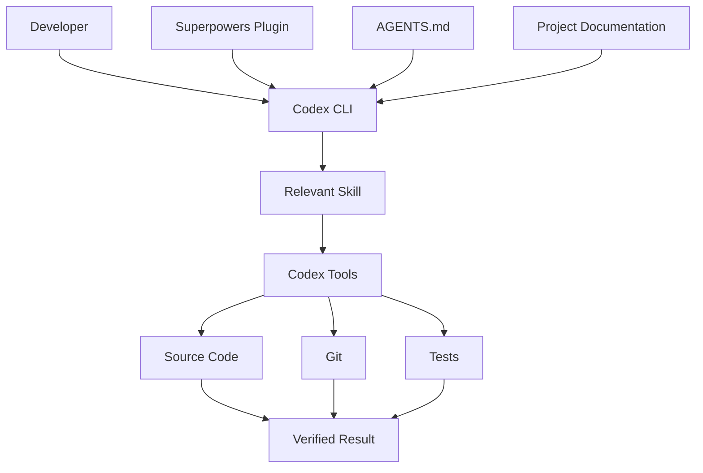
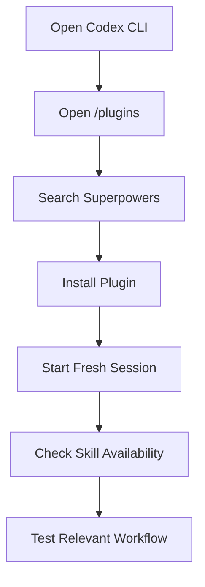
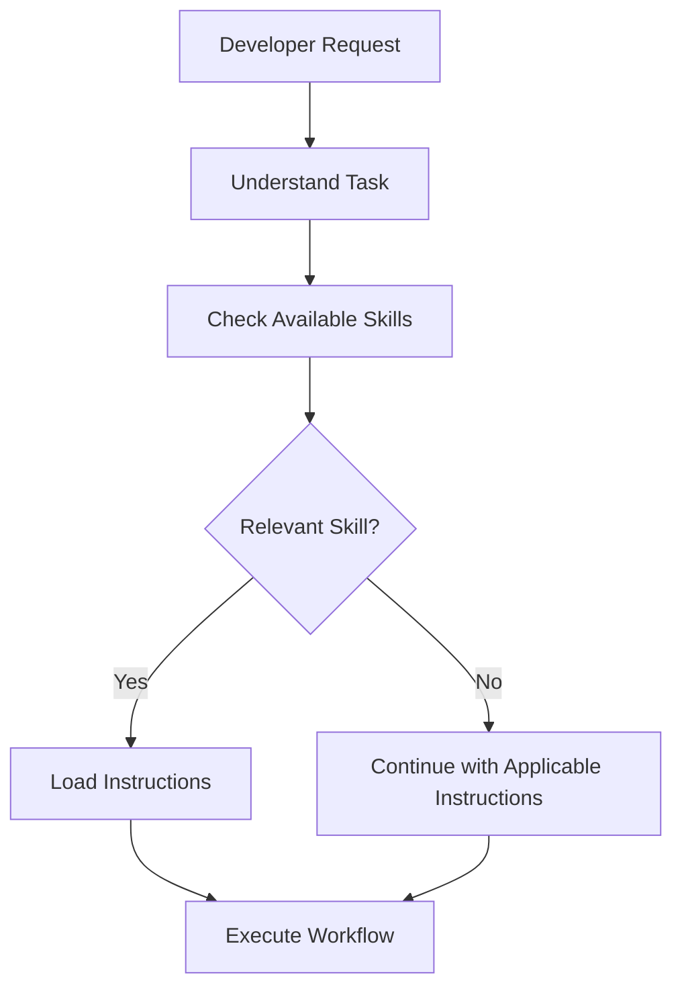
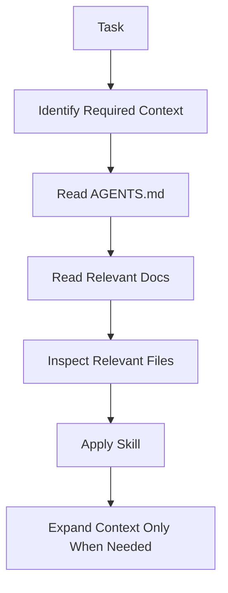
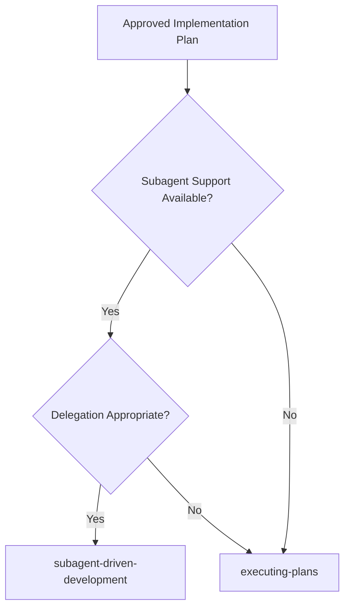
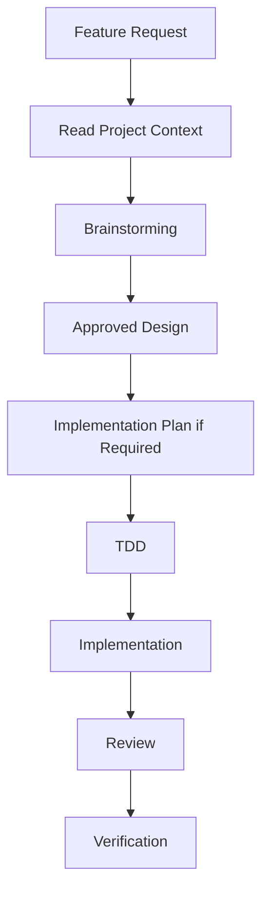

# 07 — Superpowers: Codex Integration

> [!abstract] Lesson Information
> **Repository:** [obra/superpowers](https://github.com/obra/superpowers)
>
> **Category:** Agentic Engineering / Codex CLI / Context Engineering / Plugin Integration
>
> **Difficulty:** Intermediate to Advanced
>
> **Learning Approach:** Theory First
>
> **Prerequisites:** [[01 - Architecture and Core Concepts]], [[02 - Installation and Setup]], [[03 - Skills and Features]], [[06 - Subagent-Driven Development]]
>
> **Primary Goal:** Understand how Superpowers integrates with OpenAI Codex, project instructions, native skills, development tools, and agentic workflows.
>
> **Documentation Reference:** October 20, 2026

---

# 1. Learning Objectives

After completing this lesson, you should be able to:

1. Explain the relationship between Codex CLI and Superpowers.
2. Understand Codex's role as an agent execution environment.
3. Describe how plugins expose reusable skills.
4. Distinguish native Codex capabilities from Superpowers workflows.
5. Understand skill discovery and activation.
6. Integrate `AGENTS.md` with Superpowers.
7. Explain instruction priority and project constraints.
8. Understand Codex session and context management.
9. Identify security boundaries and tool permissions.
10. Evaluate subagent compatibility.
11. Design efficient prompts for Superpowers.
12. Troubleshoot installation and activation problems.
13. Apply the integration to Android, Laravel, and Next.js.
14. Understand when not to use Superpowers.

---

# Part I — Integration Fundamentals

## 2. What Is Codex CLI?

**OpenAI Codex CLI** is a coding-agent interface that operates through a terminal. It can assist with reading source code, understanding project architecture, editing files, running permitted terminal commands, executing tests, investigating errors, reviewing changes, and working with Git.

Codex provides the agent execution environment. It is not the same thing as Superpowers.

## 2.1 What Is Superpowers?

Superpowers is an agentic software development methodology implemented through reusable skills and host integrations. It provides structured workflows for brainstorming, planning, test-driven development, debugging, code review, verification, task delegation, and branch completion.

## 2.2 How They Work Together



| Component | Responsibility |
|---|---|
| Developer | Defines goals and approves decisions |
| Codex CLI | Executes agentic development work |
| Superpowers | Provides engineering workflows |
| `AGENTS.md` | Defines project-specific instructions |
| Project documentation | Explains architecture and requirements |
| Tools | Perform file, terminal, and Git operations |
| Tests | Provide correctness evidence |

> [!important] Core Mental Model
> **Codex is the execution environment. Superpowers is the methodology. `AGENTS.md` defines project constraints.**

---

# Part II — The Integration Architecture

## 3. Understanding the Layers

A useful conceptual model has five layers:

```text
LAYER 1 — DEVELOPER INTENT
    Requirements / Constraints / Approvals

LAYER 2 — PROJECT INSTRUCTIONS
    AGENTS.md / Architecture documentation / Coding standards

LAYER 3 — ENGINEERING METHODOLOGY
    Superpowers skills / Planning / TDD / Debugging / Review

LAYER 4 — AGENT EXECUTION
    Codex CLI / Session context / Tool orchestration

LAYER 5 — DEVELOPMENT ENVIRONMENT
    Source code / Git / Build tools / Tests / Databases
```

These layers describe responsibilities, not a literal Codex internal implementation.

### 3.1 Why Separation Matters

Suppose you ask, "Implement task filtering in my Android project."

- **Developer intent:** What should the feature accomplish?
- **Project instructions:** Which architecture and conventions must be followed?
- **Superpowers:** Which development process should be used?
- **Codex:** Which tools and files are needed?
- **Development environment:** Does the implementation build and work?

---

# Part III — Official Plugin Installation

## 4. Installing Superpowers in Codex CLI

The official Superpowers README documents installation through the Codex plugin marketplace.

### Step 1 — Open Codex

In PowerShell:

```powershell
codex
```

### Step 2 — Open the Plugin Interface

Inside the interactive Codex session:

```text
/plugins
```

### Step 3 — Search

```text
superpowers
```

### Step 4 — Install

Select the available **Install Plugin** action.

### Step 5 — Start a Fresh Session

Start a new session after installation so the current plugin and skill configuration can be discovered.

### 4.1 Installation Flow



### 4.2 Important Distinction

| Activity | Meaning |
|---|---|
| Cloning repository | Downloads source files |
| Installing plugin | Registers plugin through the host |
| Discovering skill | Makes skill available to the agent |
| Activating skill | Applies instructions to a relevant task |
| Verifying behavior | Confirms the workflow actually occurred |

Cloning the repository alone does not prove that the plugin is active.

---

# Part IV — Native Codex Skills

## 5. What Are Native Skills?

Codex supports reusable skills containing instructions and optional supporting resources. A typical skill contains a `SKILL.md` file.

```text
example-skill/
├── SKILL.md
├── references/guidelines.md
└── scripts/helper.py
```

Actual supporting files depend on the skill.

### 5.1 SKILL.md

A skill typically contains a name, description, instructions, and optional references to supporting resources.

```yaml
---
name: android-ui-review
description: Review Android XML layouts for consistency, usability, and project conventions.
---
```

The text below the metadata contains workflow instructions. This is an illustrative custom skill, not a built-in Superpowers skill.

### 5.2 Skill Discovery

Codex may select a skill because the developer explicitly requests it, the task matches the skill description, or another applicable workflow directs the agent to use it.



### 5.3 Progressive Disclosure

Progressive disclosure loads information when it becomes relevant instead of placing every skill's full instructions in every session.

Benefits include less irrelevant context, better skill selection, efficient token use, and clearer task focus.

---

# Part V — Plugin vs Skill vs Tool

## 6. Understanding the Differences

| Concept | Meaning | Example |
|---|---|---|
| Plugin | Packaged extension | Superpowers |
| Skill | Reusable workflow | `brainstorming` |
| Tool | Performs an operation | Terminal execution |
| Agent | Reasons and coordinates work | Codex |
| Subagent | Delegated execution context | Task implementer |
| Instruction file | Defines project rules | `AGENTS.md` |

### 6.1 Example

For "Investigate why an API endpoint fails":

- **Skill:** `systematic-debugging`
- **Agent:** Codex
- **Tools:** Source inspection, terminal, tests, and logs
- **Project instructions:** Laravel architecture and security conventions

A skill does not automatically grant additional tool permissions. It guides how available capabilities should be used.

---

# Part VI — AGENTS.md Integration

## 7. What Is AGENTS.md?

`AGENTS.md` is an instruction file used by Codex to understand development conventions and project expectations. It may contain a project overview, architecture rules, technology stack, coding standards, testing commands, scope constraints, documentation references, and workflow requirements.

### 7.1 Example Project Structure

```text
GroupTrack/
├── AGENTS.md
├── app/src/
├── docs/
│   ├── architecture.md
│   ├── schema.md
│   └── features.md
├── build.gradle.kts
└── settings.gradle.kts
```

### 7.2 Division of Responsibilities

**AGENTS.md** defines how this specific project should be developed.

**Superpowers** defines reusable development procedures.

Example: `AGENTS.md` says, "Use Java for application logic and preserve the documented MVP." Superpowers says, "Clarify the feature design before implementation." Together, the agent clarifies the feature and designs a Java solution within the MVP.

---

# Part VII — Instruction Priority

## 8. Can Superpowers Override Project Instructions?

Superpowers does not have unlimited authority. The agent must respect applicable instruction hierarchy and tool permissions.

```text
Host and higher-priority instructions
              ↓
Authorized developer requests
              ↓
Applicable project instructions
              ↓
Relevant skill workflow
              ↓
Implementation decisions
```

This is a simplified mental model, not a complete formal hierarchy.

### 8.1 Example Conflict

Project instruction: "Do not introduce new dependencies without approval."

Agent suggestion: "Install a new state-management library."

The agent should not install it automatically. It must respect the constraint or obtain appropriate approval.

### 8.2 Another Example

Superpowers recommends TDD, and the project already has a configured test framework. Use that framework when appropriate instead of automatically installing a different one.

**Core principle:** Skills should support project requirements, not replace them.

---

# Part VIII — Designing a Good AGENTS.md

## 9. Recommended Sections

A useful project `AGENTS.md` may include project purpose, technology stack, architecture, scope, coding standards, file organization, testing, security, documentation, and change restrictions.

### 9.1 Example

```markdown
# Project Instructions

## Overview
Android application for student group task management.

## Technology
- Android Studio
- Java
- Firebase

## Architecture
Follow the existing project structure.

## Scope
Implement only documented MVP features.

## Coding Standards
- Keep code readable.
- Reuse existing components.
- Avoid unnecessary abstractions.

## Testing
Run relevant unit tests and build checks.

## Change Rules
- Do not add dependencies without approval.
- Do not modify unrelated modules.
- Preserve existing interfaces.

## Documentation
Consult docs/ before architectural changes.
```

### 9.2 Avoid Excessive Instructions

Do not let an instruction file become an unstructured history of every team conversation. Avoid duplicated rules, contradictions, outdated architecture, overly long examples, and unrelated instructions.

Keep essential rules in `AGENTS.md`; place details in referenced documentation.

---

# Part IX — Project Documentation Integration

## 10. How Does Codex Use Documentation?

Documentation provides information the agent cannot safely infer from source alone, such as business rules, feature boundaries, stakeholder requirements, architecture decisions, database relationships, and known limitations.

### 10.1 Documentation Layers

```text
AGENTS.md
    +-- docs/overview.md
    +-- docs/architecture.md
    +-- docs/schema.md
    +-- docs/features.md
    +-- docs/testing.md
```

### 10.2 Context Loading Strategy

1. Read applicable instructions.
2. Identify the requested task.
3. Read relevant documentation.
4. Inspect affected source files.
5. Identify dependencies.
6. Select the appropriate Superpowers workflow.

For an Android UI change, read UI requirements, relevant XML layouts, activities or fragments, and resource conventions. The full database schema may be unnecessary unless data behavior is involved.

---

---

# Part X — Context Engineering

## 11. What Is Context Engineering?

Context engineering provides an agent with the information required to perform a task accurately. It includes selecting instructions, requirements, source files, documentation, prior decisions, tool results, and verification evidence.

### 11.1 Context Quality vs Context Quantity

More context does not automatically produce better results. Too much irrelevant context may increase token use, distract the agent, introduce conflicting information, or make important constraints harder to identify.

### 11.2 Efficient Context Model



### 11.3 Example

For "Fix task card alignment," relevant context may include layout XML, drawable resources, styles, and design conventions. Firebase authentication internals, unrelated database collections, and the entire Git history are usually less relevant.

---

# Part XI — Session Management

## 12. What Is a Codex Session?

A session contains the agent's working conversation context, including requests, instructions, tool results, observations, plans, implementation decisions, and test output.

### 12.1 Session Growth

As development continues, the session accumulates information. Long sessions may process more tokens, make earlier details less accessible, trigger context compaction, or preserve old assumptions.

### 12.2 Recommended Session Boundaries

Consider starting a new session when beginning a separate feature, switching projects, moving from research to implementation, recovering from confusing context, or testing newly installed skills. Do not start a new session merely because a fixed number of messages has been reached.

### 12.3 Persistent Artifacts

Store important decisions in project files rather than only in chat history:

```text
docs/superpowers/specs/
docs/superpowers/plans/
AGENTS.md
docs/architecture.md
```

A fresh session can read these artifacts and recover necessary context.

---

# Part XII — Context Compaction

## 13. What Is Context Compaction?

Context compaction reduces or summarizes earlier conversation information when a session grows large. It helps the agent continue within context limits, but important details can be lost or simplified.

### 13.1 Risks

- Forgotten task progress.
- Lost decisions.
- Repeated implementation.
- Missing review findings.
- Incorrect assumptions.

### 13.2 Recovery Strategy

```text
Session Context -> Compaction -> Read Persistent Plan -> Read Progress Ledger
    -> Inspect Git State -> Resume Correct Task
```

Use durable project artifacts. This is especially important for subagent-driven development; the Superpowers progress ledger helps preserve task status and review decisions across context changes.

---

# Part XIII — Native Codex Capabilities vs Superpowers

## 14. What Does Superpowers Add?

Codex can already assist with software development. Superpowers adds structured procedures for deciding how work should be performed.

| Activity | Codex Capability | Superpowers Contribution |
|---|---|---|
| Read code | Source inspection | Structured discovery workflow |
| Write code | File editing | TDD-first implementation |
| Debug | Inspect and modify | Root-cause methodology |
| Plan | Reason about tasks | Structured implementation planning |
| Review | Analyze changes | Review workflow and quality gates |
| Run tests | Terminal execution | Evidence-based verification |
| Work with Git | Git operations | Worktree and branch completion workflows |

Superpowers does not replace Codex's built-in tools. It organizes their use.

---

# Part XIV — Subagent Compatibility

## 15. Can Codex Run Superpowers Subagents?

This depends on the installed Codex version, available agent capabilities, and configuration. A `subagent-driven-development` skill does not automatically prove that every host supports all required delegation operations.

### 15.1 Capability Checklist

Before using delegated execution, verify:

- Can the host create subagents?
- Can it provide task-specific instructions?
- Can it receive structured reports?
- Can agents access the required files?
- Can workspaces be isolated?
- Can the controller coordinate review?
- Are necessary permissions available?

### 15.2 Fallback Strategy

If delegation is unavailable, the workflow may use `executing-plans` instead.



Do not enable experimental or unfamiliar agent capabilities merely because a skill mentions subagents. Review host documentation and understand the operational implications.

---

# Part XV — Tool Permissions and Security

## 16. What Can Codex Access?

Actual access depends on host configuration, workspace boundaries, sandbox settings, approval requirements, available tools, and user authorization. Superpowers does not bypass these controls.

### 16.1 Security Principles

- Use least-privilege access.
- Inspect unfamiliar scripts.
- Avoid exposing credentials.
- Review destructive commands.
- Preserve Git history.
- Confirm important operations.
- Test third-party integrations in disposable projects.

### 16.2 Common Risks

| Risk | Recommended Control |
|---|---|
| Accidental file deletion | Review destructive commands |
| Secret exposure | Keep credentials outside prompts and commits |
| Unintended database changes | Use development databases |
| Unnecessary dependency installation | Require justification |
| Unreviewed Git operations | Inspect status and diffs |
| Third-party script execution | Review source and permissions |

### 16.3 Git Safety

```powershell
git status
git diff
git log --oneline -5
```

These commands help establish repository state before significant work.

---

# Part XVI — Superpowers Prompt Engineering

## 17. Why Do Prompts Still Matter?

Even with automatic skill discovery, a clear request improves task understanding. Include the goal, relevant context, constraints, expected deliverable, and verification requirements.

### 17.1 Prompt Structure

```text
GOAL
What should be accomplished?

CONTEXT
Which project and modules are involved?

CONSTRAINTS
What must not change?

WORKFLOW
Which process should be followed?

OUTPUT
What should be delivered?

VERIFICATION
How should success be checked?
```

### 17.2 Example — Brainstorming

```text
Read AGENTS.md and the relevant project documentation.
Help me design a task status filter.
Use the Superpowers brainstorming workflow.
Preserve the existing architecture and MVP scope.
Do not modify files yet.
Present the design for approval.
```

### 17.3 Example — Planning

```text
Read the approved design specification.
Use the Superpowers writing-plans workflow.
Create an implementation plan with exact files, interface contracts,
task dependencies, test assertions, and verification commands.
Avoid unrelated changes and unnecessary abstractions.
```

### 17.4 Example — Debugging

```text
Investigate the reported failure using systematic-debugging.
Reproduce it and gather evidence. Identify the root cause before changing code.
Create a regression test, apply a focused fix, and report verification results.
```

### 17.5 Example — Verification

```text
Use verification-before-completion.
Identify and run the relevant tests and build checks.
Read their outputs. Report passed, failed, and unverified checks accurately.
```

These prompts are examples, not special CLI commands.

---

# Part XVII — Skill Selection Workflow

## 18. Which Skill Should Be Used?

| Developer Request | Relevant Skill |
|---|---|
| "Let's design a feature." | `brainstorming` |
| "Create implementation tasks." | `writing-plans` |
| "Implement the approved plan." | `executing-plans` or `subagent-driven-development` |
| "Investigate this error." | `systematic-debugging` |
| "Implement behavior using tests." | `test-driven-development` |
| "Review these changes." | `requesting-code-review` |
| "Evaluate this review feedback." | `receiving-code-review` |
| "Verify the feature." | `verification-before-completion` |
| "Create an isolated branch workspace." | `using-git-worktrees` |
| "Finish this branch." | `finishing-a-development-branch` |

Select skills based on task intent. A single request may require several skills.

---

# Part XVIII — Android Integration

## 19. GroupTrack: Recommended Architecture

```text
GroupTrack/
├── AGENTS.md
├── docs/
│   ├── overview.md
│   ├── architecture.md
│   ├── schema.md
│   ├── features.md
│   ├── coding-standards.md
│   ├── workflow.md
│   └── testing.md
└── app/src/
```

### 19.1 Role of Each Component

- **Codex CLI:** Executes the requested development work.
- **AGENTS.md:** Defines Java, Firebase, project structure, and scope rules.
- **Documentation:** Provides feature requirements and architecture.
- **Superpowers:** Provides design, planning, testing, and review workflows.

### 19.2 Example Task

"Design the task assignment UI."

Expected workflow: read `AGENTS.md`, read relevant feature documentation, inspect existing UI resources, apply brainstorming, clarify requirements, present the design, wait for approval, and implement only when authorized.

### 19.3 Verification

```powershell
.\gradlew.bat assembleDebug
.\gradlew.bat testDebugUnitTest
```

Run the unit test task if configured. Superpowers should reinforce the existing MVP rather than introduce unrelated architecture or dependencies.

---

# Part XIX — Laravel Integration

## 20. GoPasig: Backend Workflow

Example task: "Improve route-based schedule filtering."

Relevant context includes project instructions, routes, controllers, services, models, business rules, and tests.



```powershell
php artisan test
```

Additional checks may include authorization, validation, query behavior, scheduling conflicts, database integrity, and performance.

**Engineering lesson:** Superpowers does not replace Laravel conventions or project-specific business rules.

---

# Part XX — Next.js Integration

## 21. E-Commerce Frontend Workflow

```text
frontend/
├── AGENTS.md
├── app/
├── components/
├── lib/
├── docs/
├── package.json
└── tsconfig.json
```

Example task: "Implement product search UI."

Relevant context includes Next.js App Router structure, frontend components, Laravel API contract, product types, styling conventions, and current testing setup.

Workflow: clarify search requirements, choose a design, define interfaces, write tests, implement UI behavior, verify API integration, run build checks, and review changes.

```powershell
npm run build
npm run lint
```

Run `lint` if configured. Preserve the existing separation between the Next.js frontend and Laravel backend.

---

# Part XXI — Troubleshooting

## 22. Problem: Superpowers Does Not Appear

Possible causes: plugin not installed, unsupported Codex version, discovery issue, installation failure, or no fresh session.

Troubleshoot by checking Codex version, opening the plugin interface, confirming Superpowers is installed, starting a fresh session, checking available skills, and consulting official documentation.

## 23. Problem: Skills Are Available but Not Used

Possible causes include task mismatch, failed selection or loading, conflicting context, or host limitations.

Confirm skill availability, make task intent explicit, request the workflow, observe behavior, and use `diagnosing-superpowers` when available and appropriate.

## 24. Problem: Codex Ignores AGENTS.md

Possible causes include wrong file location, wrong working directory, conflicting instructions, session context, or documentation not being read.

```powershell
Get-Location
Test-Path ".\AGENTS.md"
Get-Content ".\AGENTS.md"
```

Then verify Codex documentation for instruction-file discovery and precedence.

## 25. Problem: The Agent Adds Unnecessary Features

Possible causes include unclear scope, missing non-goals, outdated documentation, broad prompts, or unsupported assumptions.

Define goals, non-goals, constraints, acceptance criteria, and approval gates.

```text
Implement only the documented feature.
Do not add dependencies, modules, or unrelated functionality without approval.
```

## 26. Problem: Excessive Token Usage

Possible causes include large context, repeated file reading, unnecessary subagent delegation, excessive tool output, repeated planning, or overly detailed prompts.

Use focused scopes, read relevant files, preserve decisions in documentation, avoid repeating full context, choose an appropriate execution strategy, and keep reports concise.

---

# Part XXII — Integration Anti-Patterns

## 27. Mistakes to Avoid

| Anti-Pattern | Better Practice |
|---|---|
| Assuming installation means activation | Verify skill usage |
| Treating Superpowers as the execution engine | Understand Codex's role |
| Ignoring AGENTS.md | Read project instructions |
| Loading the entire repository unnecessarily | Use progressive disclosure |
| Starting without design approval | Respect workflow gates |
| Using subagents for trivial tasks | Evaluate delegation overhead |
| Assuming all hosts have identical capabilities | Verify compatibility |
| Running unfamiliar scripts blindly | Inspect permissions and source |
| Claiming tests passed without execution | Require fresh evidence |
| Losing decisions in long sessions | Use persistent artifacts |
| Adding unrelated features | Define scope and non-goals |

---

# Part XXIII — Practical Exercises

## 28. Exercise 1 — Architecture Mapping

Draw a diagram showing the developer, Codex CLI, Superpowers, `AGENTS.md`, project documentation, tools, Git, and tests. Explain each component's responsibility.

## 29. Exercise 2 — AGENTS.md Review

Inspect a practice project's `AGENTS.md`. Identify project purpose, technology stack, architecture rules, scope constraints, coding standards, test commands, and security restrictions. Determine whether important rules are missing or duplicated.

## 30. Exercise 3 — Skill Selection

Identify the relevant skill for designing a dashboard, writing implementation tasks, investigating an API error, reviewing a feature, verifying a build, and finishing a feature branch. Explain each choice.

## 31. Exercise 4 — Context Efficiency

For "Fix the alignment of an Android button," identify relevant files, documentation, unnecessary context, and verification requirements. Explain why reading every project file is inefficient.

## 32. Exercise 5 — Session Recovery

Design a recovery procedure using `AGENTS.md`, approved specification, implementation plan, Git status, progress ledger, and recent test results. Explain how to avoid repeating completed work.

## 33. Exercise 6 — Security Analysis

A third-party skill asks the agent to run an unfamiliar script. Explain what to inspect, which permissions matter, what information could be exposed, why a disposable repository helps, and when approval is required.

## 34. Exercise 7 — Full Integration Design

Choose Android, Laravel, or Next.js. Create a workflow covering request, context, skill selection, discovery, design approval, planning, TDD, review, verification, and completion reporting.

---

# Part XXIV — Knowledge Check

## 35. Review Questions

1. What is Codex CLI?
2. What is Superpowers?
3. How do they work together?
4. What is a plugin?
5. What is a skill?
6. What is the purpose of `SKILL.md`?
7. How are skills discovered?
8. What is progressive disclosure?
9. What is `AGENTS.md`?
10. How does it differ from Superpowers?
11. Why is instruction priority important?
12. What is context engineering?
13. Why can excessive context reduce efficiency?
14. What is session compaction?
15. How do persistent artifacts help recovery?
16. What are Codex's native development capabilities?
17. What does Superpowers add?
18. Why must subagent compatibility be verified?
19. How do tool permissions affect skill execution?
20. What makes a good Superpowers prompt?
21. Why should implementation claims be verified?
22. How should activation failures be diagnosed?
23. Why should project architecture be preserved?
24. When should a new session be started?
25. When is Superpowers unnecessary or excessive?

---

# Part XXV — Key Takeaways

> [!summary] Lesson Summary
> - Codex CLI provides the coding-agent execution environment.
> - Superpowers provides structured software engineering workflows.
> - Plugins package reusable capabilities for supported hosts.
> - Skills describe how tasks should be performed.
> - Tools perform operations within host permissions.
> - `AGENTS.md` defines project-specific development instructions.
> - Project documentation provides architectural and business context.
> - Skill discovery and activation differ from installation.
> - Progressive disclosure reduces irrelevant context.
> - Session management affects efficiency and reliability.
> - Persistent plans and ledgers support recovery.
> - Subagent capabilities depend on host support.
> - Tool permissions remain important security boundaries.
> - Clear prompts improve task understanding.
> - Verification evidence is required for credible completion claims.
> - Superpowers should reinforce existing architecture and scope.

## Final Mental Model

```text
DEVELOPER
    |
    v
CODEX CLI
    +-- PROJECT CONTEXT: AGENTS.md / Architecture Docs / Feature Requirements
    +-- SUPERPOWERS: Brainstorming / Planning / TDD / Debugging / Review / Verification
    +-- EXECUTION TOOLS: Files / Terminal / Git / Test Runner
          |
          v
    VERIFIED IMPLEMENTATION
```

**Remember:** Codex provides the capability to perform software engineering work. Superpowers provides the methodology for organizing that work. Project instructions ensure that methodology is applied to the correct architecture, scope, and requirements.

---

# Part XXVI — Official References

## Superpowers

- [Official Repository](https://github.com/obra/superpowers)
- [Official README](https://github.com/obra/superpowers/blob/main/README.md)
- [Codex Plugin Directory](https://github.com/obra/superpowers/tree/main/.codex-plugin)
- [Skills Directory](https://github.com/obra/superpowers/tree/main/skills)
- [Using Superpowers](https://github.com/obra/superpowers/blob/main/skills/using-superpowers/SKILL.md)
- [Brainstorming](https://github.com/obra/superpowers/blob/main/skills/brainstorming/SKILL.md)
- [Writing Plans](https://github.com/obra/superpowers/blob/main/skills/writing-plans/SKILL.md)
- [Subagent-Driven Development](https://github.com/obra/superpowers/blob/main/skills/subagent-driven-development/SKILL.md)
- [Diagnosing Superpowers](https://github.com/obra/superpowers/blob/main/skills/diagnosing-superpowers/SKILL.md)

## OpenAI Codex

- [Codex Documentation](https://developers.openai.com/codex/)
- [Codex CLI](https://developers.openai.com/codex/cli/)
- [Codex Skills](https://developers.openai.com/codex/skills/)
- [Codex AGENTS.md Guide](https://developers.openai.com/codex/guides/agents-md/)
- [OpenAI Plugin Skills](https://developers.openai.com/plugins/concepts/skills)

## Supporting Documentation

- [Agent Skills Specification](https://agentskills.io/specification)
- [Git Documentation](https://git-scm.com/docs)
- [Git Worktree Documentation](https://git-scm.com/docs/git-worktree)

> [!note] Documentation Accuracy
> The Codex CLI marketplace installation workflow is documented in the official Superpowers README as of October 20, 2026.
>
> Architecture diagrams, prompts, and project structures are educational models, not exact internal implementation diagrams.
>
> Codex capabilities, plugin interfaces, and skill-loading behavior may change between versions. Verify the installed version before relying on specific features.

---

# Part XXVII — Next Lesson

**[[08 - Git Worktrees and Code Review]]**

In the next lesson, we will study Git branches versus worktrees; workspace isolation; worktree lifecycle; safe Git operations; branch naming and coordination; task-level commits; code review; specification compliance and code quality reviews; diffs and review packages; feedback handling; branch review and completion; Android, Laravel, and Next.js examples; and exercises.

**Learning Progression:**

Repository Overview → Architecture and Core Concepts → Installation and Setup → Skills and Features → Brainstorming and Planning → Test-Driven Development and Debugging → Subagent-Driven Development → **Codex Integration** → Git Worktrees and Code Review → Best Practices and Exercises
