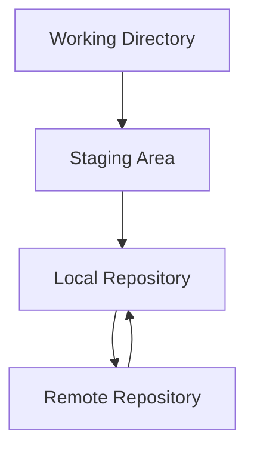
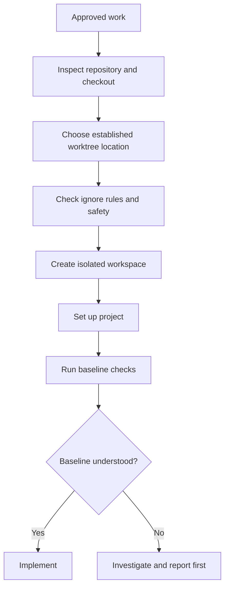
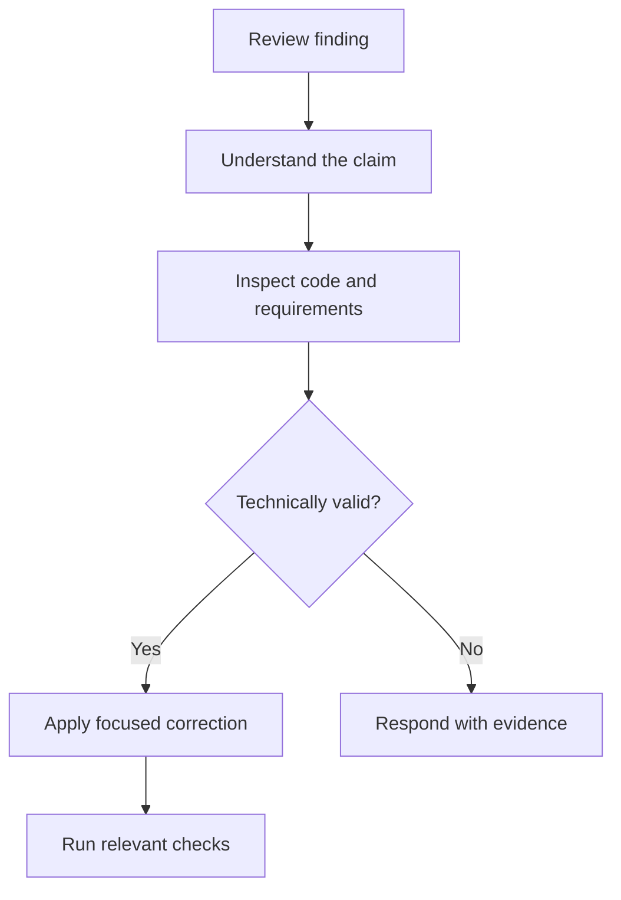
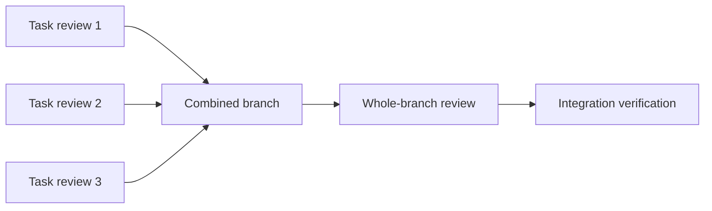

# 08 — Superpowers: Git Worktrees and Code Review

> [!abstract] Lesson Information
> **Repository:** [obra/superpowers](https://github.com/obra/superpowers)
>
> **Category:** Agentic Engineering / Git / Code Review / Development Workflows
>
> **Difficulty:** Intermediate to Advanced
>
> **Learning Approach:** Theory First
>
> **Prerequisites:** [[04 - Brainstorming and Planning]], [[05 - Test-Driven Development and Debugging]], [[06 - Subagent-Driven Development]], [[07 - Codex Integration]]
>
> **Primary Skills:** `using-git-worktrees`, `requesting-code-review`, `receiving-code-review`, `finishing-a-development-branch`
>
> **Supporting Skills:** `verification-before-completion`, `subagent-driven-development`
>
> **Primary Goal:** Understand how Superpowers uses isolated Git workspaces, structured code reviews, evidence-based verification, and controlled branch completion.

---

# 1. Learning Objectives

After this lesson, you should be able to:

1. Explain the difference between Git branches and worktrees.
2. Describe how worktree isolation helps agentic development and where its limits are.
3. Prepare a worktree safely and verify a clean baseline.
4. Use focused commits and diffs to make changes traceable.
5. Distinguish specification compliance from code quality review.
6. Evaluate review feedback using project evidence.
7. Explain why whole-branch review and fresh verification matter.
8. Choose an appropriate branch outcome: merge, pull request, keep, or discard.
9. Recognize risky Git operations and protect uncommitted work.
10. Apply these practices to Android, Laravel, and Next.js projects.

---

# Part I — Git Fundamentals

## 2. What Is Git?

Git is a distributed version control system. It records project history and helps developers track, compare, share, and restore changes. It is especially useful in agentic development because an agent can change several files quickly; Git gives the developer concrete evidence to inspect.



| Term | Meaning |
|---|---|
| Repository | Project and its Git history |
| Working directory | Checked-out files available for editing |
| Staging area | Changes selected for the next commit |
| Commit | Recorded project snapshot |
| Branch | Named reference to a line of development |
| HEAD | Current checkout reference |
| Remote | Another repository, often hosted online |
| Worktree | Additional working directory linked to a repository |

## 3. What Is a Branch?

A branch is a movable reference to a commit. It lets work proceed separately from another branch, so unfinished changes can be reviewed before integration.

```text
main:    A --- B --- C
                       \
feature:                D --- E
```

Typical names include `feature/task-filter`, `fix/schedule-conflict`, and `docs/api-guide`. A clear name communicates the purpose of the work.

## 4. Branches vs Worktrees

A worktree is an additional working directory associated with an existing Git repository. Multiple branches can be checked out in separate directories at the same time.

```text
AndroidStudioProjects/
├── GroupTrack/              main
└── GroupTrack-task-filter/  feature/task-filter
```

| Branch | Worktree |
|---|---|
| Named development reference | Physical working directory |
| Points to a commit | Checks out a branch or commit |
| Separates development history | Separates checked-out files and index |
| Can exist without another directory | Can coexist with other worktrees |

**A branch separates development history; a worktree separates working directories.** They work together. Worktrees still share repository metadata and history, and do not isolate external resources such as databases, ports, or remote services.

---

# Part II — Worktree Preparation

## 5. Why Isolate Development?

Agents may edit files, run tests, generate artifacts, or make commits. A separate worktree can reduce interference with the primary checkout, make the feature diff clearer, and provide a contained place to experiment. It does not automatically make command execution safe or isolate runtime services.

## 6. The `using-git-worktrees` Workflow

The skill is more than a `git worktree add` recipe. Its current guidance includes:

1. Detect whether the current directory is already a linked worktree; account for submodules.
2. Check repository state and established project conventions.
3. Prefer an available native worktree tool where the host provides one.
4. Use the user's established location preference; otherwise check project-local `.worktrees` or `worktrees` conventions.
5. Before creating a worktree, obtain consent unless the user has already specified a preference that covers it.
6. If using a project-local directory, ensure it is ignored by Git before creating the worktree.
7. Set up the project and run applicable baseline checks before implementation.
8. If worktree creation is denied or unavailable, report that and use the current workspace only when appropriate.

This means an agent should not silently create an arbitrary directory. A local worktree folder that is not ignored can appear as untracked content in the parent checkout.



## 7. Baseline Verification

Run relevant checks before changing code. If a test already fails before implementation, that is important context: it may be an existing defect or an environment issue. A baseline helps distinguish it from a regression introduced by the current work.

## 8. Useful Worktree Commands

List worktrees:

```powershell
git worktree list
```

Create a branch and worktree from `main` (example only; first confirm location and authorization):

```powershell
git worktree add -b feature/task-filter ../GroupTrack-task-filter main
```

Attach an existing branch that is not already checked out elsewhere:

```powershell
git worktree add ../GroupTrack-feature feature/task-filter
```

Remove a worktree only after inspecting its state and preserving needed work:

```powershell
git worktree remove ../GroupTrack-task-filter
```

`git worktree prune` removes stale administrative records; it does not replace deliberate removal of active worktrees. Avoid force-removal unless its consequences are understood.

## 9. Inspect Repository State

Before editing, identify changes that may belong to the developer or another task:

```powershell
git status
git diff
git diff --cached
git log --oneline -5
```

Do not assume untracked files or existing edits are disposable or part of the current request.

## 10. Focused Commits and Diffs

Task-level commits make implementation history easier to review and debug. Keep each commit coherent; avoid combining unrelated work. Conventional Commit messages such as `feat: add task status filtering` are an optional convention.

Inspect a diff and changed-file summary:

```powershell
git diff
git diff --stat main...feature/task-filter
git diff --name-only main...feature/task-filter
```

The three-dot comparison shows changes from the merge base to the feature tip. For a multi-commit task, use the full task range rather than reviewing only the last commit. Always confirm the correct base branch and commits for the repository.

---

# Part III — Code Review

## 11. What Code Review Checks

Code review evaluates proposed changes before integration. It should examine the actual diff and relevant surrounding code, not rely only on the implementer's summary.

Two distinct questions matter:

| Review dimension | Main question | Finds |
|---|---|---|
| Specification compliance | Did we build the requested thing? | Missing behavior, contract violations, scope creep |
| Code quality | Did we build it soundly? | Correctness, security, maintainability, performance, testing risks |

A feature can be technically clean but incomplete, or satisfy requirements with a fragile implementation. Both dimensions are needed.

## 12. `requesting-code-review`

The skill helps prepare a useful review request. Superpowers calls for review at meaningful points, including after task work in its subagent workflow, for major features, and before integration. Provide precise context: the approved requirements, changed files or commits, base and head revisions, checks run, and areas needing attention.

Example review brief:

```markdown
## Feature
Task status filtering

## Requirements
- Filter by existing status values.
- Preserve existing task-list behavior.
- Do not add dependencies.

## Changes and verification
- Filtering logic and existing UI control updated.
- Targeted tests and build run; results attached.

## Review focus
- Correctness and empty states
- Scope compliance
- Security and unnecessary complexity
```

A reviewer should receive the actual code range and evidence, not just a claim that the work is complete.

## 13. Review Findings and Severity

Prioritize findings by impact. Resolve serious correctness, data integrity, or security problems before integration. Evaluate less severe maintainability issues in context; a stylistic preference alone may not justify expanding scope.

A useful review asks:

- Are acceptance criteria satisfied?
- Were unapproved features introduced?
- Are validation, authorization, and error paths correct?
- Are tests meaningful and relevant?
- Does the change follow the existing architecture?
- Are performance or data-integrity risks introduced?

Severity labels vary by review workflow; do not treat the illustrative table below as a universal standard.

| Illustrative severity | Example | Response |
|---|---|---|
| Critical | Authorization bypass | Resolve before integration |
| High | Data corruption risk | Resolve before integration |
| Medium | Missing required edge case | Investigate and correct if valid |
| Low | Small maintainability concern | Fix when justified |
| Informational | Optional improvement | Consider separately |

## 14. `receiving-code-review`

Review feedback must be understood and checked against source, tests, requirements, and project constraints. Do not apply a suggestion blindly: a reviewer can misunderstand business rules or recommend an unnecessary abstraction. If a finding is incorrect, explain why with evidence. If valid, make a focused correction, add or update tests where appropriate, and rerun verification.



## 15. Whole-Branch Review

Task-level reviews can miss integration defects. Review the complete branch for cross-task consistency, incompatible assumptions, missing error handling, overall scope, architecture, security, and regression risk. Then run final checks against the integrated branch.



## 16. Verification Before Completion

Match each completion claim to fresh evidence. Identify the check, run it, read its output and exit status, then report what it proves. A successful build does not prove all behavior is correct; a clean working tree does not prove tests pass.

| Claim | Useful evidence |
|---|---|
| Tests pass | Actual test-run output and status |
| Build succeeds | Build output and exit status |
| Lint passes | Actual linter output |
| Bug is fixed | Original failing behavior now passes |
| UI works | Appropriate emulator, device, or browser check |
| Branch is ready | Relevant checks, review disposition, and Git state |

Report failed and unverified checks plainly. Do not claim verification that was not performed.

---

# Part IV — Finishing a Development Branch

## 17. `finishing-a-development-branch`

After implementation, review, and applicable verification, decide what should happen to the branch. The typical choices are:

1. Merge into the target branch.
2. Open a pull request for hosted review and integration.
3. Keep the branch for later work.
4. Discard the work when explicitly decided and safe.

A pull request is a collaboration and review workflow; a merge is the Git integration operation. A pull request may eventually be merged, closed, or left open.

## 18. Keep or Discard

Keep a branch when testing, review, or implementation remains incomplete. Discarding can destroy unique work. Before removing a branch or worktree, inspect commits, tracked changes, and untracked files; preserve anything valuable and confirm the intended outcome. Do not silently delete a developer's work.

Commands that need special care include:

```powershell
git reset --hard
git clean -fd
git branch -D feature/task-filter
git push --force
```

Check status and understand the exact target before any destructive operation. Untracked files may contain important work.

---

# Part V — Project Examples

## 19. Android Java: Task Assignment UI

1. Read the feature requirements and `AGENTS.md`.
2. Inspect Git status and existing layouts/components.
3. Use an isolated worktree if appropriate and approved.
4. Run a baseline Gradle check.
5. Implement only the agreed UI and Java changes.
6. Review resources, project conventions, and scope.
7. Verify:

```powershell
.\gradlew.bat assembleDebug
.\gradlew.bat testDebugUnitTest
```

Run only checks configured for the project, then verify UI behavior on an emulator or device when required. A unit test does not prove the UI works.

## 20. Laravel: Schedule Conflict Fix

Reproduce the failure and trace the route, validation, service, database state, and business rules. Add a regression test, make a focused correction, and inspect authorization, data integrity, concurrency, and query behavior. Run the applicable tests, for example:

```powershell
php artisan test
```

Avoid unrelated dispatch changes and do not run destructive migrations or resets against important data.

## 21. Next.js: Product Search

Confirm the design, inspect existing components and API contracts, implement a focused change, and review empty/loading/error states, TypeScript, accessibility, and responsive behavior. Use the checks configured in `package.json`, for example:

```powershell
npm run build
npm run lint
```

Worktrees isolate files, but may still share development services, ports, or databases.

---

# Part VI — Anti-Patterns and Exercises

## 22. Common Mistakes

- Editing on `main` without considering isolation.
- Creating a local worktree folder that is not ignored.
- Skipping baseline checks and losing a comparison point.
- Combining unrelated changes in one commit.
- Reviewing commit messages instead of the diff.
- Trusting summaries without examining implementation evidence.
- Ignoring specification compliance or whole-branch integration.
- Blindly accepting or silently ignoring review findings.
- Claiming success without fresh verification.
- Automatically deleting branches or force-cleaning a repository.

## 23. Practical Exercises

### Exercise 1 — Branch vs Worktree

Explain what each is, how they relate, and why an agent may use both. Draw a simple diagram.

### Exercise 2 — Inspect a Disposable Repository

Run `git status`, `git branch`, and `git worktree list`. Identify the current branch and workspace. Use a disposable repository only.

### Exercise 3 — Create a Practice Worktree

In a disposable repository with `main`, create a feature worktree, list it, and explain how its working directory differs from the original. Confirm the chosen location and ignore rules first.

### Exercise 4 — Review a Diff

Make a small practice change and inspect `git diff`. Identify added/removed lines, changed files, and any unrelated content.

### Exercise 5 — Specification Review

Requirement: “Add task filtering using existing statuses.” The implementation adds filtering, invents a new status, adds notifications, and misses empty results. List compliance findings.

### Exercise 6 — Evaluate Review Feedback

A reviewer asks for a new service abstraction. Inspect the actual problem, existing architecture, project rules, and scope; decide whether to accept, modify, or reject the suggestion and explain why.

### Exercise 7 — Choose a Branch Outcome

For a verified feature ready for integration, a feature requiring team approval, unfinished testing, and rejected experimental work, choose merge, pull request, keep, or discard. State what must be checked before cleanup.

---

# Part VII — Knowledge Check

## 24. Review Questions

1. What is a Git branch?
2. What is a Git worktree?
3. How do they differ?
4. What does worktree isolation protect, and what does it not isolate?
5. Why run baseline checks?
6. Why should the worktree location follow project conventions?
7. Why ignore a project-local worktree folder?
8. What makes a task-level commit useful?
9. What does a Git diff show?
10. What is specification compliance review?
11. What is code quality review?
12. Why are both dimensions needed?
13. How should feedback be evaluated?
14. Why review the whole branch?
15. What evidence supports a completion claim?
16. How does a pull request differ from a merge?
17. When should a branch be kept?
18. Why are force operations risky?
19. What should be inspected before removing a worktree?
20. What must be verified before branch completion?

---

# Part VIII — Key Takeaways

> [!summary] Lesson Summary
> - Branches separate development history; worktrees separate working directories.
> - Worktrees reduce interference but do not isolate external runtime resources.
> - Follow the current worktree skill: detect the current checkout, honor project conventions, prefer supported native tooling, and get consent before creating a worktree unless the user's established preference covers it.
> - Ignore project-local worktree directories before use and establish a baseline.
> - Focused commits and diffs make work easier to trace and review.
> - Specification compliance asks whether the requested behavior was delivered; code quality asks whether it was implemented soundly.
> - Evaluate reviewer feedback against source, requirements, and tests.
> - Whole-branch review can catch integration problems missed by task reviews.
> - Match completion claims to fresh verification evidence.
> - Choose merge, pull request, keep, or discard deliberately; preserve work before cleanup.
> - Destructive Git commands can lose work and require special care.

## Final Mental Model

```text
APPROVED PLAN
     ↓
INSPECT CHECKOUT AND GIT STATE
     ↓
CHOOSE/CREATE ISOLATED WORKTREE AS AGREED
     ↓
VERIFY BASELINE
     ↓
IMPLEMENT AND TEST
     ↓
REVIEW SPECIFICATION AND CODE QUALITY
     ↓
CORRECT VALID FINDINGS
     ↓
REVIEW WHOLE BRANCH AND VERIFY FRESHLY
     ↓
CHOOSE MERGE / PULL REQUEST / KEEP / DISCARD
```

**Remember:** Worktrees help protect the development workspace. Reviews help evaluate the implementation. Fresh verification makes completion claims credible.

---

# Part IX — Official References

## Superpowers

- [Official Repository](https://github.com/obra/superpowers)
- [Using Git Worktrees](https://github.com/obra/superpowers/blob/main/skills/using-git-worktrees/SKILL.md)
- [Requesting Code Review](https://github.com/obra/superpowers/blob/main/skills/requesting-code-review/SKILL.md)
- [Receiving Code Review](https://github.com/obra/superpowers/blob/main/skills/receiving-code-review/SKILL.md)
- [Finishing a Development Branch](https://github.com/obra/superpowers/blob/main/skills/finishing-a-development-branch/SKILL.md)
- [Subagent-Driven Development](https://github.com/obra/superpowers/blob/main/skills/subagent-driven-development/SKILL.md)
- [Verification Before Completion](https://github.com/obra/superpowers/blob/main/skills/verification-before-completion/SKILL.md)

## Git and GitHub

- [Git Worktree](https://git-scm.com/docs/git-worktree)
- [Git Branch](https://git-scm.com/docs/git-branch)
- [Git Diff](https://git-scm.com/docs/git-diff)
- [Git Merge](https://git-scm.com/docs/git-merge)
- [Git Status](https://git-scm.com/docs/git-status)
- [GitHub: About Pull Requests](https://docs.github.com/en/pull-requests/collaborating-with-pull-requests/proposing-changes-to-your-work-with-pull-requests/about-pull-requests)

## Codex

- [OpenAI Codex Documentation](https://developers.openai.com/codex/)
- [Codex Skills](https://developers.openai.com/codex/skills/)

> [!note] Documentation Scope
> Workflow descriptions refer to the official Superpowers skill files. Diagrams, commands, examples, and project scenarios are educational adaptations. Host tools and skill guidance can change; consult the installed skill before relying on version-specific behavior or performing destructive Git operations.

---

# Part X — Next Lesson

**[[09 - Best Practices and Exercises]]**

The final lesson will synthesize the Superpowers workflow, cover context and scope control, security, verification, common failure modes, Android/Laravel/Next.js scenarios, and a reusable development checklist.

**Learning Progression:**

Repository Overview → Architecture and Core Concepts → Installation and Setup → Skills and Features → Brainstorming and Planning → Test-Driven Development and Debugging → Subagent-Driven Development → Codex Integration → **Git Worktrees and Code Review** → Best Practices and Exercises
