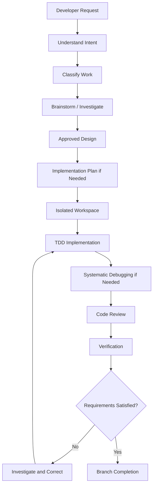
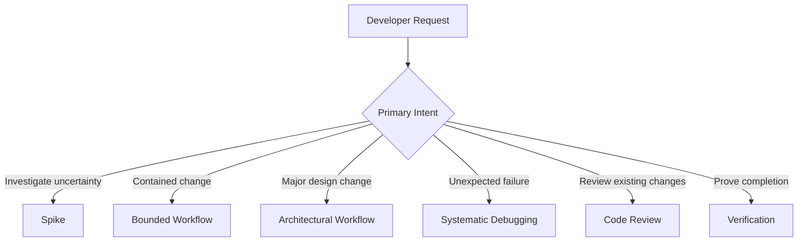
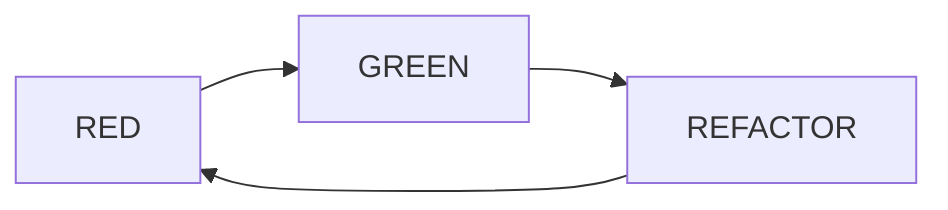
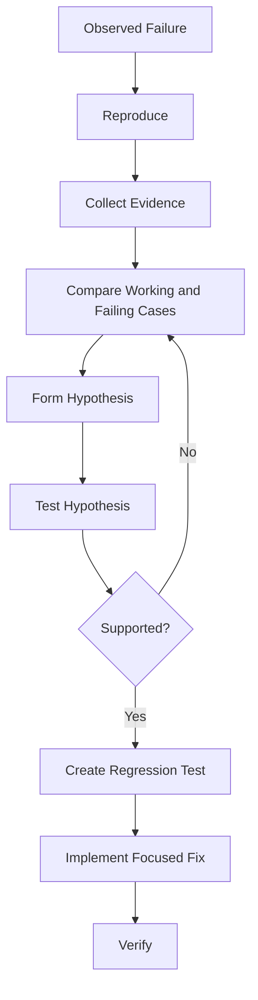
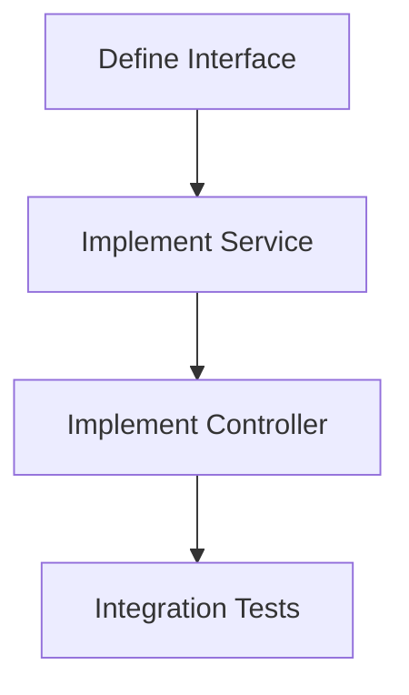
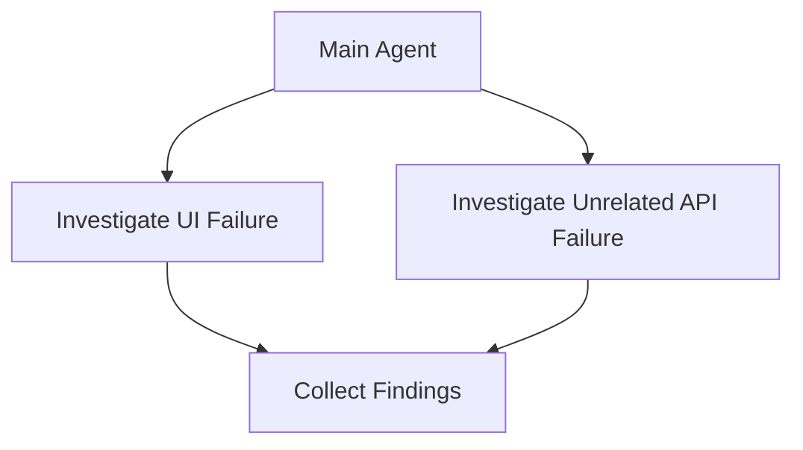
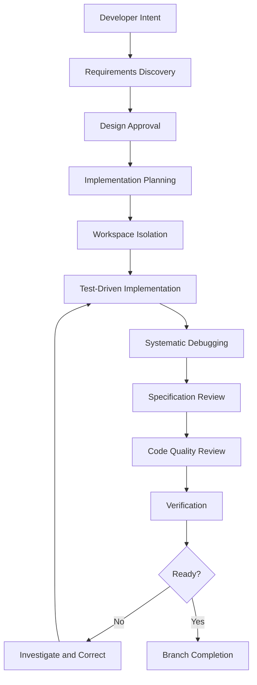

# 09 — Superpowers: Best Practices and Exercises

> [!abstract] Lesson Information
> **Repository:** [obra/superpowers](https://github.com/obra/superpowers)
>
> **Category:** Agentic Engineering / Software Development Workflows / Engineering Best Practices
>
> **Difficulty:** Intermediate to Advanced
>
> **Learning Approach:** Theory First
>
> **Prerequisites:** [[00 - Repository Overview]], [[01 - Architecture and Core Concepts]], [[02 - Installation and Setup]], [[03 - Skills and Features]], [[04 - Brainstorming and Planning]], [[05 - Test-Driven Development and Debugging]], [[06 - Subagent-Driven Development]], [[07 - Codex Integration]], [[08 - Git Worktrees and Code Review]]
>
> **Primary Goal:** Combine the Superpowers methodology into a practical, repeatable, and evidence-based software development workflow.

---

# 1. Learning Objectives

After completing this lesson, you should be able to:

1. Explain the complete Superpowers development lifecycle.
2. Select appropriate skills for different engineering tasks.
3. Apply requirements discovery and scope control.
4. Understand when architectural planning is necessary.
5. Use test-driven development effectively.
6. Investigate bugs using root-cause analysis.
7. Choose between direct execution and delegated agents.
8. Apply Git worktree isolation.
9. Evaluate specification compliance and code quality.
10. Handle review feedback systematically.
11. Verify completion claims with evidence.
12. Optimize context and token usage.
13. Avoid unnecessary complexity and scope creep.
14. Design workflows for Android, Laravel, and Next.js projects.
15. Evaluate readiness to use Superpowers in real development.

---

# Part I — The Complete Superpowers Philosophy

## 2. Core Philosophy

Superpowers promotes a disciplined approach to AI-assisted software engineering. Its purpose is not simply to generate code faster; it helps agents perform development work through structured practices:

- Understand requirements.
- Make deliberate design decisions.
- Plan implementation.
- Write tests before production code.
- Investigate failures systematically.
- Review changes.
- Verify results.
- Manage Git safely.

**Core principle:** The agent should produce software through an accountable engineering process rather than relying on unverified code generation.

## 3. The Complete Development Lifecycle



This is an end-to-end model, not a mandatory checklist for every request. A bounded change may not need a separate plan document. A spike may end with findings rather than implementation. A bug investigation may begin with systematic debugging. Documentation work may need different verification from application code. Fit the workflow to the task.

---

# Part II — Choosing the Right Workflow

## 4. Classify the Work

| Request | Likely Workflow |
|---|---|
| Investigate API feasibility | Spike |
| Fix a button label | Bounded change |
| Add a small existing-list filter | Bounded change |
| Design a new authentication subsystem | Architectural |
| Implement a multi-role dashboard | Architectural |
| Investigate an unexplained error | Systematic debugging |
| Verify an existing implementation | Verification |
| Review a feature branch | Code review |

A small change should not require unnecessary documents, abstractions, or agents. A major architectural change should not begin with immediate code generation.



These classifications can overlap: a feature may need architectural planning, TDD, debugging, review, and verification.

## 5. Match Skills to Intent

| Situation | Relevant Skill |
|---|---|
| Beginning a task | using-superpowers |
| Exploring a feature | brainstorming |
| Writing implementation tasks | writing-plans |
| Executing an approved plan | executing-plans |
| Delegating implementation tasks | subagent-driven-development |
| Investigating independent issues | dispatching-parallel-agents |
| Implementing behavior | test-driven-development |
| Investigating bugs | systematic-debugging |
| Isolating development | using-git-worktrees |
| Requesting review | requesting-code-review |
| Evaluating review feedback | receiving-code-review |
| Proving completion | verification-before-completion |
| Finishing development | finishing-a-development-branch |
| Creating reusable skills | writing-skills |

Select skills based on the developer's intent. Do not invoke unrelated workflows simply because they are available.

---

# Part III — Requirements Engineering

## 6. Understand the Problem Before the Solution

A request often describes a desired feature without explaining the underlying problem.

**Example:** “Add notifications to our task management app.”

Before implementation, clarify:

- What event requires a notification?
- Who should receive it?
- What information should it contain?
- Is real-time delivery required?
- Is it included in the MVP?
- What happens when delivery fails?

The answers can change the design.

### Problem, Requirement, and Solution

| Concept | Example |
|---|---|
| Problem | Students forget assigned deadlines |
| Desired outcome | Students can identify upcoming deadlines |
| Requirement | Display upcoming deadlines in the task list |
| Possible solution | Deadline badges |
| Alternative solution | Calendar view |

The first proposed solution is not necessarily the best one.

## 7. Define Goals, Non-Goals, and Constraints

A strong design explicitly defines scope.

**Goals** describe what the system must accomplish.
**Non-goals** describe what the implementation intentionally excludes.
**Constraints** describe what the implementation must respect.

Example for task status filtering:

**Goals**
- Display tasks matching a selected status.
- Preserve existing task data.
- Show an appropriate empty state.

**Non-goals**
- New task status categories.
- Notifications.
- Analytics.
- Database redesign.

**Constraints**
- Reuse existing architecture.
- Avoid unnecessary dependencies.
- Preserve authorization rules.

Explicit non-goals prevent extra functionality from silently becoming part of the request.

---

# Part IV — Avoiding Overengineering

## 8. Recognize Unnecessary Complexity

Overengineering introduces more complexity than the problem requires. Examples include:

- Creating a microservice for a small helper function.
- Adding a state-management library for one local UI state.
- Introducing multiple abstractions for simple business logic.
- Building a generic framework for one specific feature.
- Adding unrelated functionality during a bug fix.

Warning signs include more architecture than behavior, many new files for a trivial change, dependencies without clear justification, one-use abstractions, unapproved features, and excessive planning for bounded work.

**Better principle:** Choose the smallest complete design that satisfies confirmed requirements.

Simplicity must not remove security, testing, accessibility, or maintainability that the task needs.

---

# Part V — Planning Best Practices

## 9. What Makes an Implementation Plan Useful?

A plan should capture decisions that the implementer cannot safely infer:

- Exact files.
- Required interfaces.
- Data contracts.
- Task dependencies.
- Tests.
- Verification commands.
- Global constraints.

A weak plan says, “Implement product search.”

A stronger plan identifies the target file and interface, case-insensitive matching, behavior for empty queries and no matches, and relevant tests. The plan should guide execution without reproducing the full production implementation.

---

# Part VI — Test-Driven Development

## 10. Use RED-GREEN-REFACTOR



**RED:** Write a test for desired behavior, run it, and confirm the expected failure.
**GREEN:** Implement the minimum behavior needed to pass and run the test again.
**REFACTOR:** Improve the implementation while preserving behavior, then rerun relevant tests.

Good TDD habits:

- Test observable behavior.
- Keep tests focused.
- Include meaningful edge cases.
- Avoid unnecessary mocking.
- Verify expected failures.
- Run relevant regression tests.
- Do not confuse a passing build with passing behavior tests.

---

# Part VII — Debugging Best Practices

## 11. Investigate Before Modifying Code

A bug report is evidence of incorrect behavior, not proof of a particular root cause.

For example, “Laravel returns HTTP 500” could involve database errors, invalid assumptions, missing configuration, null values, authorization exceptions, or service behavior.



If repeated attempted fixes fail, stop and reconsider the underlying assumptions. Do not add speculative patches indefinitely.

---

# Part VIII — Context and Prompting

## 12. Provide Relevant Context

A coding agent needs enough information to implement correctly, but more context is not always better.

Useful context includes applicable AGENTS.md instructions, approved requirements, relevant source files, architecture documentation, existing interfaces, and test conventions.

Unrelated modules, long conversation history, repeated documentation, outdated plans, and unrelated test logs usually add noise.

### Progressive Disclosure

```text
Understand Task
      ↓
Read Project Instructions
      ↓
Read Relevant Documentation
      ↓
Inspect Relevant Files
      ↓
Identify Dependencies
      ↓
Load Additional Context if Needed
```

Introduce detailed information only when it becomes relevant.

## 13. Anatomy of a Strong Development Prompt

A useful prompt includes the goal, context, constraints, workflow, deliverable, and verification expectations.

```text
GOAL:
Describe the required outcome.

CONTEXT:
Identify the project and relevant modules.

CONSTRAINTS:
Define scope and architecture restrictions.

WORKFLOW:
Specify the relevant engineering process.

DELIVERABLE:
Describe the expected output.

VERIFICATION:
Define required checks and reporting.
```

Example:

```text
Read AGENTS.md and the relevant project documentation.

Implement the approved task filtering behavior.
Preserve the documented scope and existing architecture.
Use the relevant Superpowers workflow.
Write a failing test before implementation.
Do not add unnecessary dependencies.
Run relevant tests and build checks.
Report actual verification results.
```

---

# Part IX — Subagents and Parallel Work

## 14. Decide When Delegation Is Worthwhile

Subagents can provide fresh task context, focused execution, independent review, and clear ownership. They also introduce coordination overhead.

**Good candidates**
- Multi-task implementation plans.
- Clearly separated modules.
- Tasks with explicit interfaces.
- Work requiring independent review.

**Poor candidates**
- Renaming one variable.
- Fixing a typo.
- Small UI text changes.
- Tasks requiring constant shared-state coordination.

Use delegation when its quality and isolation benefits justify its cost.

## 15. Understand Dependencies

Subagent-driven development delegates implementation sequentially with task reviews. Parallel delegation is a separate workflow for independent problems.





Parallel work risks shared-file conflicts, dependency violations, inconsistent interfaces, competing Git operations, and difficult integration. Use it only when independence is real.

---

# Part X — Git and Code Review

## 16. Protect the Repository

Before implementation, inspect Git status and preserve uncommitted work. Use feature branches or worktrees when isolation is appropriate. Create focused commits, inspect diffs, avoid destructive commands without authorization, and verify before merging.

Git worktrees provide additional working directories that share repository history. They do not automatically isolate databases, ports, or external services.

## 17. Review Both Requirements and Quality

**Specification compliance:** Did the implementation satisfy the approved requirements?
**Code quality:** Is the implementation correct, maintainable, and appropriately designed?

Review checklist:

- [ ] Required behavior implemented.
- [ ] No unauthorized features added.
- [ ] Existing architecture preserved.
- [ ] Interfaces respected.
- [ ] Error handling appropriate.
- [ ] Security considered.
- [ ] Tests meaningful.
- [ ] No unnecessary dependencies.
- [ ] No unrelated changes.
- [ ] Verification evidence available.

Evaluate findings technically. Do not automatically accept every suggestion or dismiss findings without evidence.

---

# Part XI — Verification, Security, and Efficiency

## 18. Verify Before Claiming Completion

An agent may finish editing files without proving the result works. Claims such as “all tests pass” or “the bug is fixed” need evidence.

| Claim | Evidence |
|---|---|
| Unit tests pass | Actual test output |
| Build succeeds | Build output and exit status |
| API works | Relevant API tests |
| UI works | Appropriate UI verification |
| Bug is fixed | Original failure no longer reproduces |
| Branch is ready | Relevant checks and review status |

A truthful report distinguishes verified and unverified behavior.

## 19. Security and Permissions

Recommended practices:

- Use least-privilege permissions.
- Review unfamiliar scripts.
- Protect secrets.
- Avoid committing credentials.
- Use development environments.
- Inspect dependency changes.
- Review destructive Git operations.
- Require appropriate approval for consequential actions.

A skill's instructions do not grant permission to bypass host security controls.

## 20. Token and Performance Efficiency

Unnecessary cost can come from repeatedly reading files, loading unrelated docs, dispatching unneeded agents, generating oversized reports, repeating completed tasks, redundant tool calls, or losing progress.

Improve efficiency with focused scope, relevant file selection, persistent decisions, concise task briefs, progress ledgers, and appropriate model selection when supported. Do not optimize away necessary testing, review, or verification.

---

# Part XII — Practical Case Studies

## 21. Android: GroupTrack Task Assignment

Clarify who can assign and receive tasks, which fields are required, how status is represented, and what the MVP includes.

Possible plan:

1. Confirm the data model.
2. Write relevant tests.
3. Implement the XML layout.
4. Connect Java logic.
5. Verify behavior.

Example checks, if configured:

```powershell
.\gradlew.bat assembleDebug
.\gradlew.bat testDebugUnitTest
```

Review MVP compliance, UI consistency, resource naming, validation, maintainability, and device behavior. Follow the existing architecture rather than redesigning the project.

## 22. Laravel: Schedule Conflict Validation

Clarify what counts as a conflict, affected resources, existing rules, and invalid-request behavior.

Possible tasks:

1. Write regression tests.
2. Implement conflict validation.
3. Preserve response contracts.
4. Run integration tests.
5. Review database consistency.

Example verification:

```powershell
php artisan test
```

Review business rules, database integrity, authorization, performance, and regression behavior.

## 23. Next.js: Product Search

Clarify searchable fields, API endpoint, pagination, loading states, empty results, and error behavior. Respect the existing frontend/backend boundary and reuse components.

Example checks, if configured:

```powershell
npm run build
npm run lint
```

Review API correctness, TypeScript types, error handling, accessibility, responsiveness, and existing conventions.

---

# Part XIII — Common Failures and Workflow Optimization

## 24. Common Agentic Engineering Failures

| Failure | Root Problem | Prevention |
|---|---|---|
| Wrong feature implemented | Unclear requirements | Brainstorming |
| Excessive functionality | Missing scope boundaries | Define non-goals |
| Unnecessary architecture | Overengineering | Simplicity constraints |
| Fragile implementation | Weak testing | TDD |
| Repeated failed patches | Poor root-cause analysis | Systematic debugging |
| Lost task progress | Context compaction | Persistent ledger |
| Conflicting agent changes | Poor coordination | Dependency analysis |
| Unreviewed defects | Missing quality gate | Code review |
| Unsupported success claims | No verification | Evidence before completion |
| Lost Git changes | Unsafe operations | Worktree and Git safety |
| Excessive token usage | Irrelevant context | Progressive disclosure |

## 25. Optimize Without Removing Essential Work

Balance correctness, maintainability, speed, cost, scope, and risk. Ask:

1. Is this step necessary?
2. Does the task require architectural planning?
3. Can existing components be reused?
4. Are task dependencies clear?
5. Is delegation justified?
6. Are selected tests meaningful?
7. Is context focused?
8. Are review findings actionable?
9. Is verification sufficient?
10. Is the final report evidence-based?

**Principle:** Remove unnecessary overhead, not essential engineering discipline.

---

# Part XIV — Reusable Development Checklists

## 26. Before Implementation

- [ ] Understand the developer's goal.
- [ ] Read applicable project instructions.
- [ ] Inspect relevant documentation.
- [ ] Identify the correct workflow.
- [ ] Clarify important unknowns.
- [ ] Define goals and non-goals.
- [ ] Confirm constraints.
- [ ] Obtain design approval when required.
- [ ] Create a plan when required.
- [ ] Identify task dependencies.

## 27. During Implementation

- [ ] Inspect Git state.
- [ ] Use appropriate workspace isolation.
- [ ] Run baseline checks where applicable.
- [ ] Write meaningful failing tests.
- [ ] Confirm expected RED behavior.
- [ ] Implement complete functionality.
- [ ] Confirm GREEN behavior.
- [ ] Refactor carefully.
- [ ] Run relevant regression tests.
- [ ] Avoid unrelated changes.

## 28. During Review

- [ ] Compare implementation with requirements.
- [ ] Inspect actual diffs.
- [ ] Evaluate code quality.
- [ ] Check security and validation.
- [ ] Identify unnecessary complexity.
- [ ] Evaluate findings technically.
- [ ] Correct valid issues.
- [ ] Rerun affected tests.
- [ ] Review cross-task integration.

## 29. Before Completion

- [ ] Run relevant tests.
- [ ] Run build checks.
- [ ] Run configured lint and type checks.
- [ ] Verify important user workflows.
- [ ] Inspect Git status.
- [ ] Document unresolved findings.
- [ ] Report actual verification evidence.
- [ ] Obtain authorization for integration actions.
- [ ] Preserve important work.

---

# Part XV — Practical Exercises

## 30. Exercise 1 — Workflow Classification

Classify each request and identify an appropriate skill:

1. Investigate whether an Android API supports a feature.
2. Fix a small UI alignment issue.
3. Design a new authentication system.
4. Investigate a Laravel HTTP 500 error.
5. Review a completed Next.js feature.
6. Verify an Android build.
7. Finish an approved feature branch.

Explain your choices.

## 31. Exercise 2 — Requirements Discovery

For “Build a student task dashboard,” write a problem statement, target users, desired outcome, functional and non-functional requirements, goals, non-goals, and constraints. Do not write implementation code.

## 32. Exercise 3 — Architecture Comparison

Compare filtering existing task data with introducing a new filtering service and persistence layer. Evaluate complexity, maintainability, performance, architecture compatibility, and scope. Select the approach justified by the requirements.

## 33. Exercise 4 — Implementation Planning

Write a plan for an approved task-filtering design. Include the goal, architecture, files, interfaces, tests, task dependencies, verification commands, and global constraints.

## 34. Exercise 5 — TDD Design

Create a test matrix for matching results, no matches, empty dataset, mixed statuses, and default filter. Explain which test should be written first.

## 35. Exercise 6 — Debugging Investigation

For “A Laravel schedule endpoint intermittently fails,” prepare a root-cause investigation: reproduction, evidence sources, working/failing comparisons, hypotheses, minimal experiments, and regression strategy. Do not propose speculative fixes.

## 36. Exercise 7 — Subagent Strategy

Given five tasks—define interface, implement repository, implement controller, integrate frontend, run integration tests—identify dependencies, task briefs, review points, sequential order, and possible conflicts.

## 37. Exercise 8 — Git and Review

In a disposable repository, create a branch or worktree, make a small change, inspect the diff, run checks, write a review brief, identify possible findings, and document verification. Do not perform destructive cleanup on an important repository.

## 38. Exercise 9 — Completion Report

Assume unit tests and build passed, lint failed, UI testing was not performed, and one medium-severity finding remains. Write a truthful report and explain whether the branch is ready for integration.

---

# Part XVI — Final Assessment

## 39. Multiple-Choice Questions

1. What is Superpowers' main purpose?
   A. Replace Git · B. Provide structured engineering workflows · C. Replace programming languages · D. Eliminate testing

2. Which skill is most relevant when designing a feature?
   A. brainstorming · B. finishing-a-development-branch · C. verification-before-completion · D. using-git-worktrees

3. What comes first in TDD?
   A. Refactor · B. Deploy · C. Write and run a failing test · D. Merge

4. What is systematic debugging for?
   A. Generate random fixes · B. Identify the root cause · C. Avoid logs · D. Rewrite the app

5. What does a Git worktree provide?
   A. Replace the repository · B. An additional working directory · C. Automatic deployment · D. Eliminate branches

6. Which review checks whether requested behavior was implemented?
   A. Specification compliance · B. Formatting only · C. Dependency installation · D. Branch cleanup

7. What does a successful build alone prove?
   A. Every requirement is satisfied · B. All UI workflows work · C. The build completed successfully · D. No security defects exist

8. When are parallel agents most appropriate?
   A. Same files · B. Independent tasks · C. Unresolved dependencies · D. Every small edit

9. Why are non-goals useful?
   A. Replace tests · B. Prevent scope creep · C. Eliminate requirements · D. Disable review

10. What should happen before claiming a bug is fixed?
    A. Rename branch · B. Generate docs · C. Verify the original failure is resolved · D. Close terminal

### Answer Key

| Question | Answer | Explanation |
|---|---|---|
| 1 | B | Superpowers provides structured development workflows |
| 2 | A | Brainstorming supports requirements and design discovery |
| 3 | C | TDD begins with an observed failing test |
| 4 | B | Debugging focuses on root-cause investigation |
| 5 | B | Worktrees provide additional working directories |
| 6 | A | Specification review checks requirement compliance |
| 7 | C | Build success only establishes the build result |
| 8 | B | Parallelism is suitable for independent tasks |
| 9 | B | Non-goals limit unapproved functionality |
| 10 | C | A fix requires verification evidence |

---

# Part XVII — Capstone Exercise

## 40. Design a Complete Superpowers Workflow

Choose one practice scenario:

- **Android:** Task assignment and status filtering.
- **Laravel:** Schedule conflict validation.
- **Next.js:** Product search and filtering.

Prepare:

1. Problem statement.
2. Requirements.
3. Goals and non-goals.
4. Constraints.
5. Design alternatives.
6. Approved design specification.
7. Implementation plan.
8. Test matrix.
9. Debugging strategy.
10. Git isolation strategy.
11. Code review checklist.
12. Verification plan.
13. Completion report template.

Success criteria:

- Requirements are clear.
- Scope is controlled.
- Design decisions are justified.
- Tasks are actionable.
- Tests cover important behavior.
- Git changes are reviewable.
- Verification criteria are explicit.
- Completion reporting distinguishes verified from unverified work.

---

# Part XVIII — Final Mental Model

## 41. The Superpowers Engineering Loop



### Five Principles to Remember

1. **Understand before implementing.** Do not assume unclear requirements.
2. **Plan proportionally.** Use enough planning for the task's complexity.
3. **Test before claiming correctness.** Use meaningful tests and verification.
4. **Review before integration.** Evaluate requirements and implementation quality.
5. **Preserve developer control.** Respect project constraints, permissions, and approval gates.

---

# Part XIX — Official References

## Superpowers

- [Official Repository](https://github.com/obra/superpowers)
- [Official README](https://github.com/obra/superpowers/blob/main/README.md)
- [Using Superpowers](https://github.com/obra/superpowers/blob/main/skills/using-superpowers/SKILL.md)
- [Brainstorming](https://github.com/obra/superpowers/blob/main/skills/brainstorming/SKILL.md)
- [Writing Plans](https://github.com/obra/superpowers/blob/main/skills/writing-plans/SKILL.md)
- [Executing Plans](https://github.com/obra/superpowers/blob/main/skills/executing-plans/SKILL.md)
- [Test-Driven Development](https://github.com/obra/superpowers/blob/main/skills/test-driven-development/SKILL.md)
- [Systematic Debugging](https://github.com/obra/superpowers/blob/main/skills/systematic-debugging/SKILL.md)
- [Verification Before Completion](https://github.com/obra/superpowers/blob/main/skills/verification-before-completion/SKILL.md)
- [Subagent-Driven Development](https://github.com/obra/superpowers/blob/main/skills/subagent-driven-development/SKILL.md)
- [Dispatching Parallel Agents](https://github.com/obra/superpowers/blob/main/skills/dispatching-parallel-agents/SKILL.md)
- [Using Git Worktrees](https://github.com/obra/superpowers/blob/main/skills/using-git-worktrees/SKILL.md)
- [Requesting Code Review](https://github.com/obra/superpowers/blob/main/skills/requesting-code-review/SKILL.md)
- [Receiving Code Review](https://github.com/obra/superpowers/blob/main/skills/receiving-code-review/SKILL.md)
- [Finishing a Development Branch](https://github.com/obra/superpowers/blob/main/skills/finishing-a-development-branch/SKILL.md)

## Supporting Documentation

- [OpenAI Codex Documentation](https://developers.openai.com/codex/)
- [Codex Skills](https://developers.openai.com/codex/skills/)
- [Agent Skills Specification](https://agentskills.io/specification)
- [Git Documentation](https://git-scm.com/docs)
- [Git Worktree Documentation](https://git-scm.com/docs/git-worktree)
- [Android Testing](https://developer.android.com/training/testing)
- [Laravel Testing](https://laravel.com/docs/testing)
- [Next.js Testing](https://nextjs.org/docs/app/guides/testing)

> [!note] Documentation Scope
> This lesson synthesizes the Superpowers workflows covered in Lessons 00–08.
>
> The diagrams, prompts, exercises, and project scenarios are educational adaptations; they are not evidence that a particular workflow has been executed.
>
> Exact behavior may vary by Superpowers version and coding-agent host. Consult the installed skill instructions when applying these concepts.

---

# Part XX — Series Completion

## 42. Superpowers Learning Roadmap

| Lesson | Topic | Status |
|---|---|---|
| 00 | Repository Overview | Completed |
| 01 | Architecture and Core Concepts | Completed |
| 02 | Installation and Setup | Completed |
| 03 | Skills and Features | Completed |
| 04 | Brainstorming and Planning | Completed |
| 05 | Test-Driven Development and Debugging | Completed |
| 06 | Subagent-Driven Development | Completed |
| 07 | Codex Integration | Completed |
| 08 | Git Worktrees and Code Review | Completed |
| 09 | Best Practices and Exercises | Completed |

## 43. What Comes Next?

After completing the theory lessons:

1. Practice skill selection.
2. Run a small brainstorming exercise.
3. Create an approved design.
4. Write an implementation plan.
5. Implement a small feature with TDD.
6. Investigate a controlled bug.
7. Review a Git diff.
8. Verify the final result.
9. Evaluate what worked and what needs improvement.

**Final takeaway:** Superpowers is most useful when its skills become part of a deliberate development process. The objective is not to use as many skills as possible; it is to use the right engineering practices at the right time.

**End of Superpowers Learning Series.**
