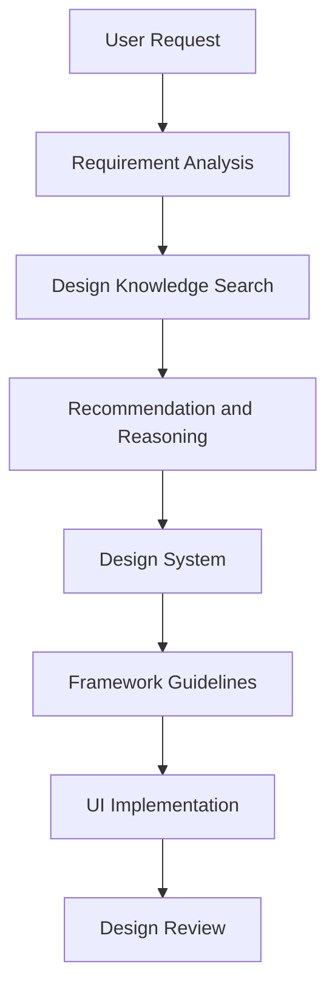
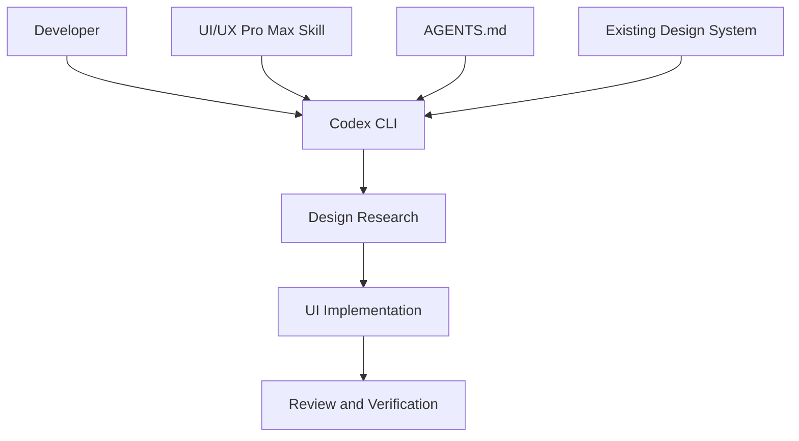

# 00 — UI/UX Pro Max: Repository Overview

> [!abstract] Lesson Information
> **Repository:** [nextlevelbuilder/ui-ux-pro-max-skill](https://github.com/nextlevelbuilder/ui-ux-pro-max-skill)
>
> **Category:** Agentic Engineering / UI/UX Design / Design Systems / AI Skills
>
> **Difficulty:** Beginner to Intermediate
>
> **Learning Approach:** Theory First
>
> **Prerequisites:** Basic understanding of UI/UX, frontend development, and AI coding agents
>
> **Primary Goal:** Understand how UI/UX Pro Max provides design intelligence to AI coding agents and how it supports professional interface development.

---

# 1. Learning Objectives

After completing this lesson, you should understand:

1. What UI/UX Pro Max is.
2. Why the repository was created.
3. What problems it attempts to solve.
4. How it differs from ordinary AI-generated UI.
5. What design intelligence means.
6. How its searchable design knowledge works conceptually.
7. What a design system is.
8. How the skill works with coding agents.
9. Which development platforms it supports.
10. How it can improve real-world UI/UX workflows.
11. Its limitations and appropriate use cases.
12. How it relates to other agentic engineering skills.

---

# 2. What Is UI/UX Pro Max?

**UI/UX Pro Max** is an open-source design intelligence skill developed by NextLevelBuilder.

It provides AI coding assistants with structured design knowledge that can be searched and applied when designing interfaces.

Instead of relying exclusively on the model's general knowledge of visual design, the skill introduces a curated collection of design references.

These include:

- UI design styles.
- Color palettes.
- Typography pairings.
- Product-specific design recommendations.
- Landing page patterns.
- UX guidelines.
- Accessibility guidance.
- Framework-specific development practices.

Its primary purpose is to help AI coding agents make more deliberate and consistent interface design decisions.

## 2.1 The Main Idea

Traditional AI-assisted UI development often follows this pattern:

```text
Developer Prompt
       ↓
AI Model
       ↓
Generated UI Code
       ↓
Developer Reviews Result
```

UI/UX Pro Max introduces an additional design research and reasoning layer.

```text
Developer Prompt
       ↓
Analyze Product Requirements
       ↓
Search Design Knowledge
       ↓
Recommend Design System
       ↓
Apply Framework Guidelines
       ↓
Generate UI Code
       ↓
Review and Refine
```

The goal is to move from arbitrary visual choices toward design decisions supported by relevant references.

---

# 3. Why Does This Repository Exist?

AI coding assistants can generate functional interfaces quickly.

However, generated interfaces may suffer from recurring problems.

Examples include:

- Inconsistent spacing.
- Weak typography hierarchy.
- Generic layouts.
- Poor color contrast.
- Excessive decorative effects.
- Inconsistent component styling.
- Weak mobile responsiveness.
- Missing accessibility considerations.
- Visual choices that do not match the product's identity.

These issues can occur even when the generated code is technically valid.

## 3.1 Functional UI vs Good UI/UX

A functional interface is not automatically a well-designed interface.

Consider a login page.

It might:

- Accept an email.
- Accept a password.
- Submit credentials.
- Display an error.

Technically, the interface works.

But its usability can still be poor if:

- Labels are unclear.
- Error messages are confusing.
- Input fields are too small.
- Keyboard focus is invisible.
- Spacing is inconsistent.
- The mobile layout is difficult to use.

UI/UX Pro Max aims to improve the design decisions surrounding implementation.

---

# 4. What Is Design Intelligence?

Design intelligence refers to using structured design knowledge to guide interface decisions.

In this repository, that knowledge includes searchable design references and recommendation logic.

## 4.1 Design Knowledge Domains

| Domain | Purpose |
|---|---|
| Product type | Understand the kind of application being designed |
| UI style | Establish a consistent visual direction |
| Color palette | Define purposeful color usage |
| Typography | Establish readable text hierarchy |
| Layout patterns | Recommend appropriate page structures |
| UX guidelines | Improve interaction and usability |
| Framework guidelines | Align implementation with the technology stack |

## 4.2 Example

Suppose the developer requests:

"Create a professional fleet management dashboard."

The design process should consider:

**Product type**

Operational dashboard.

**Primary users**

Administrators and fleet personnel.

**Information priority**

Vehicle status, routes, schedules, and alerts.

**Visual direction**

Clear, restrained, information-focused.

**Layout**

Navigation, summary metrics, filters, and data tables.

**Interaction**

Search, filtering, detail inspection, and status feedback.

**Accessibility**

Readable contrast, clear labels, keyboard navigation, and responsive behavior.

These considerations lead to a more purposeful design than selecting colors and components randomly.

---

# 5. How UI/UX Pro Max Works

The repository's design-system generation workflow combines multiple categories of design information.

Conceptually:



## 5.1 Requirement Analysis

The agent identifies relevant information such as:

- Product category.
- Intended users.
- Industry.
- Visual preferences.
- Technology stack.
- Functional requirements.

## 5.2 Design Knowledge Search

The skill searches relevant design reference domains.

For example:

- Suitable visual styles.
- Color systems.
- Typography.
- Layout patterns.
- UX recommendations.

## 5.3 Recommendation and Reasoning

The tool combines relevant findings into a proposed design direction.

The developer should still review whether those recommendations match the product requirements.

## 5.4 Design System Generation

The selected direction becomes a reusable design specification.

## 5.5 Implementation

The coding agent applies the specification using the project's actual framework and components.

---

# 6. Understanding Design Systems

A design system is a collection of reusable design decisions, rules, and components that support consistency across an application.

A design system may define:

- Colors.
- Typography.
- Spacing.
- Border radii.
- Shadows.
- Component states.
- Layout conventions.
- Responsive behavior.
- Accessibility requirements.

## 6.1 Example Design Tokens

```css
:root {
  --color-primary: #0b1629;
  --color-accent: #ff7448;
  --color-background: #f3f6fa;
  --color-text: #0b1629;

  --spacing-sm: 0.5rem;
  --spacing-md: 1rem;
  --spacing-lg: 1.5rem;

  --radius-sm: 0.375rem;
  --radius-md: 0.75rem;
}
```

These values are an illustrative design-system example.

## 6.2 Why Use Design Tokens?

Without tokens:

```css
.card {
  border-radius: 12px;
}

.modal {
  border-radius: 10px;
}

.button {
  border-radius: 14px;
}
```

With tokens:

```css
.card,
.modal,
.button {
  border-radius: var(--radius-md);
}
```

Tokens allow a team to maintain consistent design decisions.

However, components do not need identical values when their purposes genuinely differ.

---

# 7. UI Styles

A UI style defines the visual character of an interface.

Examples include:

- Minimalist.
- Editorial.
- Corporate.
- Dashboard-focused.
- Brutalist.
- Glassmorphism.
- Neumorphism.
- Material-inspired design.

Different styles are appropriate for different products.

## 7.1 Example Comparison

| Style | Characteristics | Potential Use |
|---|---|---|
| Minimalist | Restrained decoration, clear hierarchy | Professional websites |
| Corporate | Structured layouts, predictable components | Business platforms |
| Editorial | Typography-led composition | Portfolios and publications |
| Dashboard-focused | High information density, structured data | Admin systems |
| Glassmorphism | Translucent surfaces and layering | Selected decorative interfaces |
| Brutalist | Bold typography and unconventional composition | Experimental creative websites |

### Important

A design style should not be selected purely because it is visually impressive.

It must support the product's users, content, and interaction requirements.

---

# 8. Color Systems

Color is more than decoration.

It communicates:

- Hierarchy.
- Brand identity.
- Interactive states.
- Status.
- Emphasis.
- Relationships between elements.

## 8.1 Semantic Colors

A design system may distinguish:

| Role | Meaning |
|---|---|
| Primary | Main brand or interface color |
| Accent | Selected emphasis |
| Background | Main surface |
| Surface | Cards and containers |
| Text | Primary readable content |
| Muted | Secondary content |
| Success | Successful operation |
| Warning | Caution |
| Error | Failure or invalid input |

## 8.2 Accessibility

Color decisions should consider contrast and readability.

Do not communicate important information using color alone.

For example, a failed form field should include an explanatory message rather than relying only on a red border.

---

# 9. Typography Systems

Typography affects both appearance and usability.

A typography system should define:

- Font families.
- Heading hierarchy.
- Body text.
- Font weights.
- Line heights.
- Letter spacing.
- Responsive scaling.

## 9.1 Example Hierarchy

```text
Page Title
    ↓
Section Heading
    ↓
Card Heading
    ↓
Body Text
    ↓
Supporting Caption
```

## 9.2 Common Mistakes

- Too many font families.
- Inconsistent heading sizes.
- Small body text.
- Poor line spacing.
- Weak visual hierarchy.
- Decorative fonts used for long paragraphs.

### Principle

Typography should make information easier to scan and understand.

---

# 10. UX Guidelines

User experience design focuses on how people interact with an application.

Important considerations include:

**Clarity**

Can users understand what each control does?

**Consistency**

Do similar elements behave similarly?

**Feedback**

Does the interface communicate the result of an action?

**Error Prevention**

Does the interface help users avoid mistakes?

**Accessibility**

Can people with different needs use the interface?

**Responsiveness**

Does the interface remain usable across screen sizes?

## 10.1 Example

A form submission should communicate whether:

- Submission is in progress.
- Submission succeeded.
- Validation failed.
- The user needs to correct something.

A visually attractive button without appropriate feedback may still create a poor experience.

---

# 11. Framework-Specific Guidelines

UI/UX Pro Max includes guidance for multiple development stacks.

Its purpose is to connect design recommendations with implementation practices.

Examples of relevant technologies include:

- React.
- Next.js.
- Tailwind CSS.
- HTML and CSS.
- Vue.
- Mobile development frameworks.

Supported stack coverage can change between releases.

## 11.1 Why Framework Awareness Matters

A design specification is technology-independent in principle.

However, implementation details vary.

For example:

**Next.js**

May use reusable React components and CSS or Tailwind utilities.

**Laravel with Blade**

May use Blade components and shared layouts.

**Android**

May use XML layouts and platform UI resources.

The same visual principles can be applied through different technical implementations.

---

# 12. AI Coding Agent Integration

UI/UX Pro Max is intended to be used with AI coding assistants.

The repository documents support for multiple agent environments, including Codex CLI.

## 12.1 Relationship Between the Components



### Codex CLI

Executes development tasks.

### UI/UX Pro Max

Provides design-oriented knowledge and workflow guidance.

### AGENTS.md

Defines project-specific instructions and constraints.

### Existing Design System

Provides established brand and component rules.

### Important

The skill should not override a project's established identity simply because its recommendation engine suggests a different style.

---

# 13. Repository Structure

The GitHub repository includes areas such as:

```text
ui-ux-pro-max-skill/
├── .claude-plugin/
├── .claude/
├── cli/
├── docs/
├── gallery/
├── scripts/
├── src/
│   └── ui-ux-pro-max/
├── stack/
├── README.md
└── skill.json
```

This is a simplified representation of the repository's major areas.

## 13.1 Important Components

| Component | Purpose |
|---|---|
| `src/ui-ux-pro-max/` | Core source assets for the skill |
| `cli/` | Installation and generation tooling |
| `scripts/` | Supporting scripts |
| `stack/` | Framework-related resources |
| `docs/` | Project documentation |
| `gallery/` | Design examples and demonstrations |
| `README.md` | Primary project introduction |

The repository uses a template-based installation architecture. Platform-specific integration files can be generated by its CLI.

---

# 14. Basic vs Premium

The repository distinguishes between its open-source basic version and a separate premium offering.

## 14.1 Basic Version

The open-source version provides core design intelligence, searchable references, framework guidance, and design-system generation.

## 14.2 Premium Version

The premium offering advertises additional capabilities for broader brand identity work, asset creation, and enterprise design systems.

### Important

For learning UI/UX principles and integrating design guidance into coding workflows, the open-source repository provides a useful starting point.

The premium offering is not required for this course.

---

# 15. Installation Overview

The repository recommends installation through its CLI.

The documented commands include:

```powershell
npm install -g ui-ux-pro-max-cli
```

Then initialize for the supported AI platform:

```powershell
uipro init --ai <platform>
```

Replace `<platform>` with the actual supported platform identifier from the current documentation.

We will study the exact Codex-specific installation procedure in Lesson 02.

### Important

Installing the skill and applying its recommendations are separate steps.

Installation alone does not guarantee that every generated interface follows a consistent design system.

---

# 16. Real-World Use Cases

## 16.1 Software Startup Website

A design intelligence workflow can help define:

- Brand-consistent layout patterns.
- Typography hierarchy.
- Component styling.
- Responsive navigation.
- Contact forms.
- Service cards.

## 16.2 Fleet Management Dashboard

Potential applications include:

- Operational dashboards.
- Route management interfaces.
- Schedule tables.
- Vehicle status displays.
- Administrative forms.

## 16.3 E-Commerce Platform

Potential applications include:

- Product cards.
- Search and filtering.
- Product detail pages.
- Shopping cart interfaces.
- Customer dashboards.
- Administrative inventory views.

## 16.4 Android Application

Potential applications include:

- Welcome screens.
- Sign-in forms.
- Registration forms.
- Task lists.
- Assignment interfaces.
- Status indicators.

The design guidance should be adapted to the platform rather than copied directly from a web interface.

---

# 17. UI/UX Pro Max vs Superpowers

These repositories serve different purposes.

| Superpowers | UI/UX Pro Max |
|---|---|
| Software engineering methodology | Design intelligence |
| Requirements and planning | Design recommendations |
| Test-driven development | Visual design systems |
| Debugging | Typography and color guidance |
| Code review | UX and accessibility guidance |
| Verification | Interface design evaluation |

## 17.1 Can They Work Together?

Yes, conceptually.

For example:

```text
Developer Request
       ↓
Superpowers Brainstorming
       ↓
Approved UI Requirements
       ↓
UI/UX Pro Max Design Research
       ↓
Design System
       ↓
Superpowers Implementation Planning
       ↓
UI Implementation
       ↓
Review and Verification
```

However, using both does not guarantee that their workflows automatically coordinate.

The developer should define clear responsibilities and resolve any conflicting instructions.

---

# 18. Advantages

Potential benefits include:

- More structured design decisions.
- Reusable design systems.
- Faster access to design references.
- Better consistency across screens.
- Framework-aware recommendations.
- Reduced reliance on arbitrary styling.
- More deliberate accessibility checks.
- Easier collaboration between design and development.

---

# 19. Limitations

UI/UX Pro Max is a design assistance tool, not a replacement for professional design judgment.

Its recommendations may:

- Conflict with existing branding.
- Be unsuitable for specific users.
- Require accessibility verification.
- Need adjustment for platform conventions.
- Introduce unnecessary visual complexity.
- Produce designs that require manual refinement.

### Important

A generated design system is a starting point.

It should be reviewed against the actual product requirements and existing design decisions.

---

# 20. Practical Exercises

## Exercise 1 — Design Intelligence

Explain the difference between:

1. Generating UI directly from a prompt.
2. Generating UI after consulting structured design references.

## Exercise 2 — Product Analysis

Choose a fleet management dashboard.

Identify:

- Target users.
- Primary tasks.
- Information hierarchy.
- Suitable layout patterns.
- Accessibility considerations.

## Exercise 3 — Design Tokens

Create a hypothetical design system with:

- Primary color.
- Background color.
- Text color.
- Spacing scale.
- Border radius scale.
- Typography hierarchy.

## Exercise 4 — UX Evaluation

Inspect a login interface.

Evaluate:

- Label clarity.
- Form validation.
- Loading feedback.
- Error messages.
- Keyboard accessibility.
- Mobile responsiveness.

## Exercise 5 — Workflow Design

Explain how Superpowers and UI/UX Pro Max could work together to develop a new dashboard without introducing unnecessary features.

---

# 21. Knowledge Check

1. What is UI/UX Pro Max?
2. What problem does it attempt to solve?
3. What is design intelligence?
4. What are design knowledge domains?
5. What is a design system?
6. What are design tokens?
7. Why is typography hierarchy important?
8. Why should color communicate meaning?
9. What is the difference between UI and UX?
10. Why does framework-specific guidance matter?
11. What role does Codex CLI play?
12. What role does `AGENTS.md` play?
13. How does UI/UX Pro Max differ from Superpowers?
14. Why should generated designs be reviewed?
15. Why is a design recommendation not automatically a requirement?

---

# 22. Key Takeaways

> [!summary]
> - UI/UX Pro Max is an open-source design intelligence skill for AI coding assistants.
> - It provides searchable design knowledge and recommendations.
> - Its design-system workflow combines product, style, color, typography, and layout information.
> - Design systems help maintain visual consistency.
> - UX guidelines improve interaction quality.
> - Framework-specific guidance connects design decisions to implementation.
> - Codex CLI can serve as the coding agent that applies the skill.
> - Existing branding and project instructions should take priority over arbitrary style recommendations.
> - UI/UX Pro Max and Superpowers can complement each other.
> - Generated interfaces still require human review, accessibility checks, and testing.

---

# 23. Official References

## UI/UX Pro Max

- [Official GitHub Repository](https://github.com/nextlevelbuilder/ui-ux-pro-max-skill)
- [README](https://github.com/nextlevelbuilder/ui-ux-pro-max-skill/blob/main/README.md)
- [Core Source Directory](https://github.com/nextlevelbuilder/ui-ux-pro-max-skill/tree/main/src/ui-ux-pro-max)
- [CLI Directory](https://github.com/nextlevelbuilder/ui-ux-pro-max-skill/tree/main/cli)
- [Documentation Directory](https://github.com/nextlevelbuilder/ui-ux-pro-max-skill/tree/main/docs)

## Supporting Documentation

- [OpenAI Codex Documentation](https://developers.openai.com/codex/)
- [Agent Skills Specification](https://agentskills.io/specification)
- [WCAG Accessibility Guidelines](https://www.w3.org/WAI/standards-guidelines/wcag/)
- [Material Design](https://m3.material.io/)
- [Next.js Documentation](https://nextjs.org/docs)
- [Tailwind CSS Documentation](https://tailwindcss.com/docs)

---

# 24. Next Lesson

**[[01 - Architecture and Core Concepts]]**

In the next lesson, we will study:

1. Internal repository architecture.
2. Skill entry points and instructions.
3. CLI and template generation.
4. Search engine architecture.
5. Design knowledge datasets.
6. Recommendation and reasoning workflow.
7. Design-system generation pipeline.
8. Platform-specific integration.
9. Data flow between components.
10. Exercises and official references.

**End of Lesson 00 — Repository Overview.**
