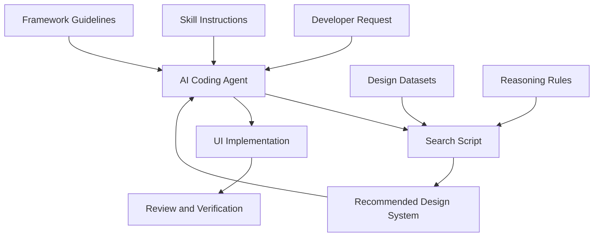
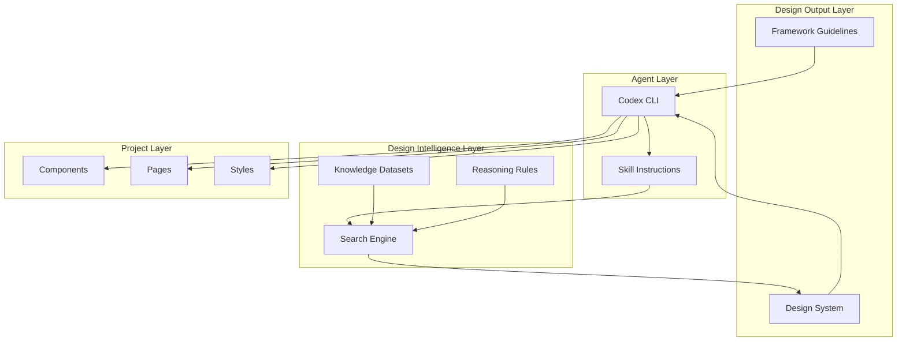
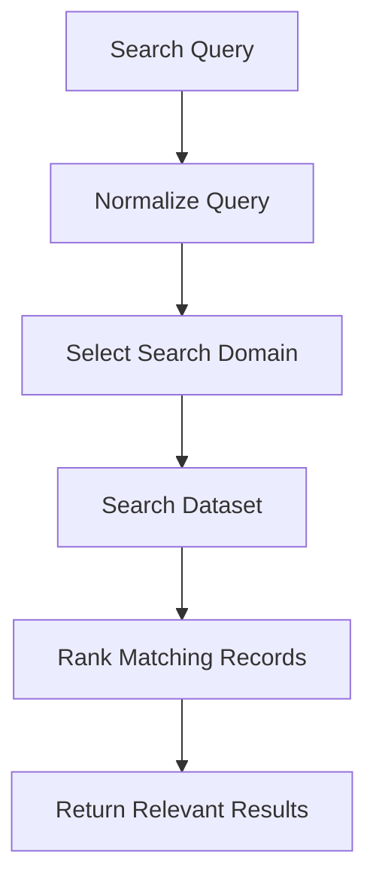
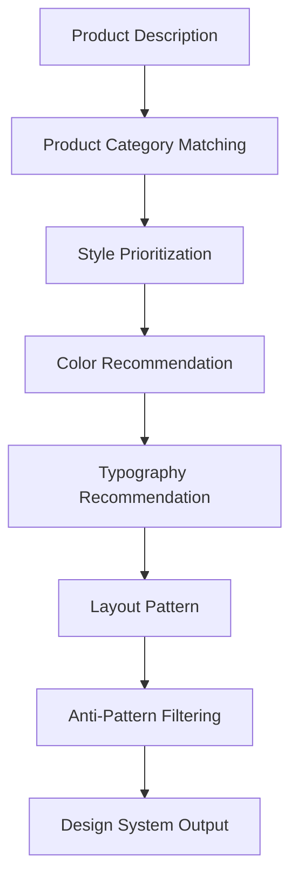
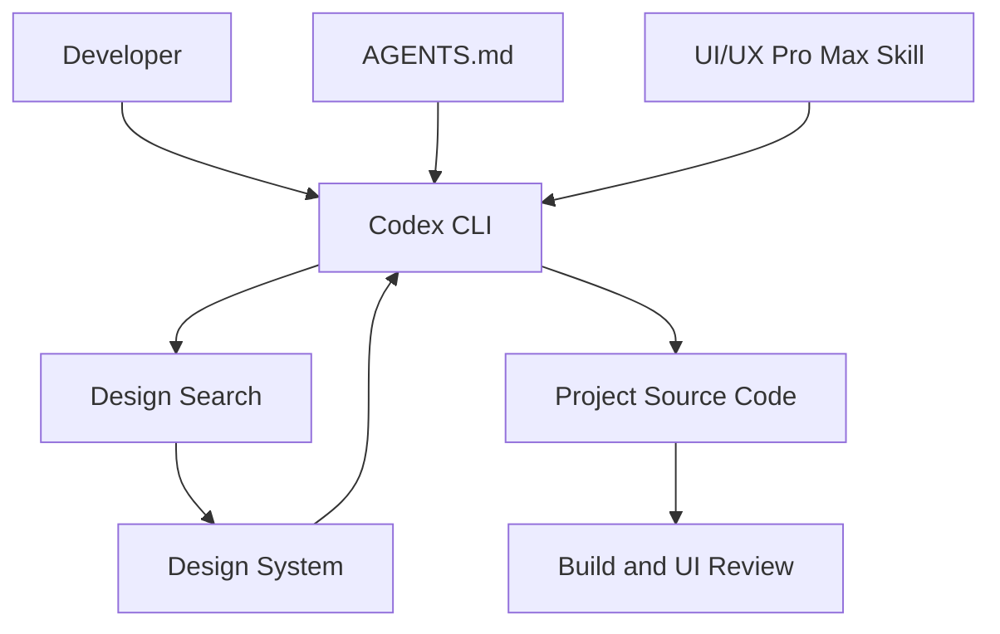
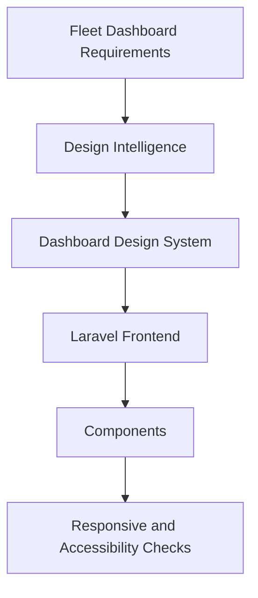

# 01 — UI/UX Pro Max: Architecture and Core Concepts

> [!abstract] Lesson Information
> **Repository:** [nextlevelbuilder/ui-ux-pro-max-skill](https://github.com/nextlevelbuilder/ui-ux-pro-max-skill)
>
> **Category:** Agentic Engineering / UI/UX Design / Design Intelligence / Skill Architecture
>
> **Difficulty:** Intermediate
>
> **Learning Approach:** Theory First
>
> **Prerequisites:** [[00 - Repository Overview]]
>
> **Primary Goal:** Understand the internal architecture of UI/UX Pro Max, including its skill instructions, design knowledge datasets, search engine, recommendation logic, design-system generator, CLI, and integration with AI coding agents.

---

# 1. Learning Objectives

After completing this lesson, you should be able to:

1. Explain the overall architecture of UI/UX Pro Max.
2. Identify the responsibilities of its major components.
3. Understand the difference between the skill, CLI, search engine, and datasets.
4. Explain how the `SKILL.md` file guides an AI coding agent.
5. Understand how searchable design knowledge is organized.
6. Explain how BM25-based retrieval works conceptually.
7. Describe the design-system generation pipeline.
8. Understand the role of product-specific reasoning rules.
9. Distinguish recommendations from implementation decisions.
10. Explain how the skill integrates with Codex CLI.
11. Understand the role of framework-specific guidelines.
12. Recognize the architecture's limitations.
13. Apply the concepts to real development projects.

---

# Part I — Architecture Overview

## 2. Understanding the System

UI/UX Pro Max is not simply a collection of CSS templates.

It combines several components that work together to guide AI-assisted interface development.

These include:

- Skill instructions.
- Design reference datasets.
- Search scripts.
- Ranking logic.
- Product-specific reasoning rules.
- Design-system generation.
- Framework-specific guidance.
- Platform installation tooling.

Its purpose is to help a coding agent move from a broad UI request to a more structured design recommendation.

## 2.1 High-Level Architecture



### Important Distinction

The AI coding agent and the design intelligence engine have different responsibilities.

**The design intelligence engine** searches structured references and produces recommendations.

**The AI coding agent** interprets those recommendations and implements the interface.

The search engine does not independently build an entire working application.

---

# Part II — Major Architectural Layers

## 3. Layered Architecture

We can understand UI/UX Pro Max through six conceptual layers.

| Layer | Responsibility |
|---|---|
| 1. Agent integration | Connects the skill to Codex and other assistants |
| 2. Skill instructions | Defines the design workflow |
| 3. Search and retrieval | Finds relevant design references |
| 4. Reasoning and recommendation | Combines product-specific design decisions |
| 5. Design-system output | Produces reusable design guidance |
| 6. Implementation guidance | Helps translate design into framework-specific code |

These layers are a conceptual model for studying the repository, not necessarily six independent software services.

## 3.1 Architecture Diagram



---

# Part III — Repository Structure

## 4. Understanding the Repository

The repository contains several important directories.

A simplified structure is:

```text
ui-ux-pro-max-skill/
├── .claude-plugin/
├── .claude/
│   └── skills/
├── .github/
├── cli/
├── docs/
├── gallery/
├── preview/
├── projects/
├── scripts/
├── src/
│   └── ui-ux-pro-max/
├── stack/
├── README.md
└── skill.json
```

## 4.1 Directory Responsibilities

| Directory | Purpose |
|---|---|
| `.claude-plugin/` | Claude plugin integration metadata |
| `.claude/skills/` | Skill integration for Claude environments |
| `cli/` | Installation and platform setup tooling |
| `docs/` | Documentation |
| `gallery/` | Visual design examples |
| `preview/` | Preview-related resources |
| `projects/` | Project-related resources and examples |
| `scripts/` | Supporting scripts |
| `src/ui-ux-pro-max/` | Core skill assets |
| `stack/` | Framework-specific design guidance |
| `skill.json` | Skill metadata |

### Important

The source repository and the installed skill directory are not necessarily identical.

The CLI may generate or copy platform-specific files into the appropriate location for the selected coding assistant.

---

# Part IV — The Skill Instruction Layer

## 5. What Is SKILL.md?

A `SKILL.md` file defines instructions that an AI coding agent can use when performing a specialized task.

For UI/UX Pro Max, these instructions guide design-oriented work.

The skill helps the agent understand:

- When to use the design workflow.
- How to search design references.
- How to generate a design system.
- How to apply framework guidelines.
- What quality checks to perform.

## 5.1 Conceptual Structure

```text
SKILL.md
    |
    +-- Skill purpose
    |
    +-- Activation guidance
    |
    +-- Design workflow
    |
    +-- Search commands
    |
    +-- Framework guidance
    |
    +-- Quality checklist
```

This is an educational representation rather than a literal transcription of the file.

## 5.2 Why Is SKILL.md Important?

Without specialized instructions, an AI assistant may generate a design using only its general knowledge.

With the skill available, it can follow a more deliberate process.

```text
Understand Request
      ↓
Read Relevant Skill Guidance
      ↓
Search Design References
      ↓
Generate Design System
      ↓
Implement UI
      ↓
Verify Design Quality
```

### Key Principle

**The skill defines a workflow; it does not replace the coding agent.**

---

# Part V — The Design Knowledge Layer

## 6. What Are Design Datasets?

UI/UX Pro Max maintains structured collections of design information.

The repository documents searchable references for:

- Product categories.
- UI styles.
- Color palettes.
- Typography pairings.
- Landing-page patterns.
- Chart types.
- UX guidelines.
- Icons.
- Framework-specific practices.

## 6.1 Current Documented Catalog

The repository's v2.0 README describes the following catalog:

| Domain | Documented Coverage |
|---|---|
| Product categories | 192 |
| UI styles | 79 searchable, 50 active |
| Color palettes | 192 |
| Typography pairings | 74 |
| Landing-page patterns | 34 |
| Chart types | 25 |
| UX guidelines | 119 |
| Supported technology stacks | 22 |
| Product-specific reasoning rules | 192 |

These counts describe the documented version and may change as the repository evolves.

## 6.2 Why Structured Datasets Matter

Suppose a developer asks:

"Design a SaaS analytics dashboard."

The search system can retrieve design knowledge related to:

- SaaS products.
- Analytics dashboards.
- Information-dense layouts.
- Data visualization.
- Appropriate typography.
- Dashboard color systems.

This is more focused than searching every possible UI reference.

---

# Part VI — Search Engine Architecture

## 7. What Is the Search Engine?

The search engine retrieves relevant design information based on a query.

The repository documents a Python search script and BM25-based ranking.

The search engine is an information retrieval component.

It is not a visual rendering engine.

## 7.1 Conceptual Search Pipeline



### Example

Query:

```text
minimal SaaS dashboard
```

Possible relevant domains:

- Product.
- Style.
- Color.
- Typography.
- Chart.
- UX.

The search results can help the agent choose an appropriate design direction.

---

# Part VII — Understanding BM25

## 8. What Is BM25?

BM25 is a ranking algorithm used in information retrieval.

It estimates how relevant a document or record is to a search query.

It considers factors such as:

- Matching terms.
- Term frequency.
- How common a term is across records.
- Document length.

## 8.1 Simplified Example

Query:

```text
minimal dashboard
```

Imagine three design records.

| Record | Description |
|---|---|
| A | Minimal dashboard with clean navigation |
| B | Editorial landing page with large typography |
| C | Dashboard with dense analytics widgets |

Record A is likely a strong match because it contains both important concepts.

Record C may also be relevant because it matches the dashboard requirement.

Record B is less relevant to the full query.

## 8.2 Important Limitation

BM25 primarily measures textual relevance.

It does not independently determine whether a design is aesthetically successful or suitable for every user.

A highly ranked design recommendation still needs to be evaluated against the product requirements.

---

# Part VIII — Search Domains

## 9. Domain-Specific Retrieval

The search script supports domain-oriented queries.

The repository documents commands such as:

```powershell
python scripts/search.py "glassmorphism" --domain style
```

```powershell
python scripts/search.py "elegant serif" --domain typography
```

```powershell
python scripts/search.py "dashboard" --domain chart
```

```powershell
python scripts/search.py "error summary validation" --domain ux
```

These commands illustrate the documented interface. Actual paths depend on where the skill is installed.

## 9.1 Why Search by Domain?

A broad query may return multiple types of information.

A domain-specific query narrows the search.

For example:

**Style search**

Finds visual design directions.

**Typography search**

Finds font combinations.

**Chart search**

Finds data visualization recommendations.

**UX search**

Finds interaction and usability guidance.

### Key Principle

**Domain-specific search improves focus and reduces irrelevant design context.**

---

# Part IX — Product-Specific Reasoning Rules

## 10. What Is the Reasoning Engine?

The repository documents a reasoning engine that combines search results with product-specific design rules.

Its purpose is to produce a more coherent design recommendation.

The README describes rules that consider:

- Product type.
- Recommended layout pattern.
- Style priority.
- Color mood.
- Typography mood.
- Key effects.
- Anti-patterns.

## 10.1 Example

Suppose the product is:

"Enterprise fleet management dashboard."

Possible design requirements include:

- High information clarity.
- Readable tables.
- Clear operational statuses.
- Restrained decorative effects.
- Efficient navigation.

The reasoning process should prioritize these needs over purely decorative trends.

## 10.2 Reasoning Pipeline



### Important

The engine combines predefined rules and retrieved knowledge.

Its output should not be treated as an unquestionable design authority.

---

# Part X — Design-System Generation

## 11. What Is the Design-System Generator?

The design-system generator combines multiple design domains into a single recommended specification.

The repository describes a multi-domain process covering:

1. Product type.
2. UI style.
3. Color palette.
4. Landing-page pattern.
5. Typography.

It then applies reasoning rules to produce a consolidated recommendation.

## 11.1 Design-System Output

A generated design system may include:

```text
Design System
├── Product Category
├── Recommended Pattern
├── Visual Style
├── Color Palette
├── Typography
├── Effects and Interactions
├── Anti-Patterns
└── Pre-Delivery Checklist
```

## 11.2 Example

For a software startup website:

**Pattern**

Hero → Capabilities → Work → Team → Contact.

**Style**

Minimal corporate.

**Colors**

Existing brand palette.

**Typography**

Readable sans-serif hierarchy.

**Effects**

Subtle transitions.

**Anti-patterns**

Unnecessary gradients, excessive animation, and decorative elements that distract from the content.

**Quality checks**

Responsive layout, accessible contrast, clear focus states, and usable forms.

This example is an educational adaptation, not an actual generator result.

---

# Part XI — Design Recommendations vs Project Constraints

## 12. Which Rules Should Take Priority?

A generated design recommendation is not automatically a project requirement.

Suppose a project already has:

- An approved brand palette.
- A typography system.
- A component library.
- Established spacing conventions.

The agent should not replace these simply because a recommendation engine suggests another style.

## 12.1 Decision Hierarchy

```text
Confirmed Project Requirements
          ↓
Existing Brand and Design System
          ↓
Platform and Accessibility Requirements
          ↓
Relevant Skill Recommendations
          ↓
Implementation Decisions
```

This is a recommended design decision hierarchy, not a formal instruction-precedence hierarchy for every coding-agent host.

## 12.2 Example

Existing brand:

```css
:root {
  --brand-primary: #0b1629;
  --brand-accent: #ff7448;
  --brand-secondary: #46c7dc;
  --brand-background: #f3f6fa;
}
```

The design skill recommends a different palette.

What should happen?

The agent should preserve the established brand unless the developer explicitly requests a redesign.

It may still use the skill to improve:

- Layout.
- Spacing.
- Typography.
- Accessibility.
- Component consistency.

---

# Part XII — Framework-Specific Guidance

## 13. What Is Stack-Aware Design?

A design system describes what an interface should look and behave like.

Framework-specific guidance describes how to implement that design appropriately.

For example:

| Technology | Implementation Considerations |
|---|---|
| React | Component reuse and state |
| Next.js | App structure and rendering |
| Tailwind CSS | Utility classes and design tokens |
| Laravel | Blade, Livewire, or Inertia conventions |
| React Native | Native mobile interactions |
| Flutter | Widget composition |
| Jetpack Compose | Declarative Android UI |
| SwiftUI | Declarative Apple UI |

## 13.1 Important Android Distinction

The repository documents Jetpack Compose guidance for Android.

An existing Android Java project using XML layouts is a different implementation environment.

General principles such as spacing, hierarchy, accessibility, and color can still apply.

However, Jetpack Compose code should not be copied directly into a Java/XML application.

---

# Part XIII — The CLI Layer

## 14. What Does the CLI Do?

The CLI handles installation and platform-specific setup.

The documented package is:

```text
ui-ux-pro-max-cli
```

The command it provides is:

```text
uipro
```

## 14.1 Example Installation

```powershell
npm install -g ui-ux-pro-max-cli
```

## 14.2 Codex Initialization

```powershell
uipro init --ai codex
```

The command prepares the skill for Codex.

It does not generate an application UI by itself.

## 14.3 CLI vs Search Script

| CLI | Search Script |
|---|---|
| Installs and manages skill assets | Retrieves design knowledge |
| Handles platform setup | Supports design queries |
| Uses `uipro` commands | Uses Python commands |
| Prepares the environment | Produces recommendations |

### Important

**Installation tooling and design intelligence are separate responsibilities.**

---

# Part XIV — Codex Integration Architecture

## 15. How Does Codex Use the Skill?

Codex is the coding agent.

UI/UX Pro Max provides specialized design guidance.

The developer provides requirements and constraints.

## 15.1 Integration Diagram



## 15.2 Responsibility Breakdown

**Developer**

Defines the desired outcome.

**AGENTS.md**

Documents project-specific instructions.

**UI/UX Pro Max**

Provides design intelligence.

**Codex**

Reads instructions, uses tools, and edits code.

**Project**

Contains the actual implementation.

## 15.3 Example Workflow

Developer request:

"Improve the responsive layout of our existing dashboard without changing its visual identity."

Expected reasoning:

1. Read project instructions.
2. Inspect existing components.
3. Identify layout problems.
4. Consult relevant UX and responsive design guidance.
5. Preserve the brand system.
6. Modify only necessary files.
7. Verify the result at relevant viewport sizes.

---

# Part XV — Search and Implementation Are Different Stages

## 16. Why This Distinction Matters

A design search may recommend:

- A sidebar layout.
- A specific typography hierarchy.
- A restrained color palette.
- A set of responsive breakpoints.

But those recommendations do not automatically become code.

The agent must still determine:

- Which files to edit.
- Which components to reuse.
- Which design tokens already exist.
- Which CSS rules conflict.
- Which behaviors need testing.

## 16.1 Example

Recommendation:

"Use a two-column responsive dashboard."

Possible implementation:

```tsx
export function DashboardLayout() {
  return (
    <div className="grid grid-cols-1 gap-6 lg:grid-cols-[240px_1fr]">
      <aside>Navigation</aside>
      <main>Dashboard content</main>
    </div>
  );
}
```

This code is an illustrative Next.js/React layout, not generated output from the repository.

### Important

The final implementation must be adapted to the existing application structure.

---

# Part XVI — Design System Persistence

## 17. Why Save Design Decisions?

Without persistent documentation, an AI agent may generate inconsistent designs across separate sessions.

For example:

**Session 1**

Uses one spacing scale.

**Session 2**

Introduces a different spacing scale.

**Session 3**

Changes the button radius.

A persistent design system reduces this inconsistency.

## 17.1 Conceptual Structure

```text
Project/
├── AGENTS.md
├── docs/
│   └── design-system/
│       ├── foundations.md
│       ├── typography.md
│       ├── colors.md
│       ├── components.md
│       └── responsive-rules.md
└── src/
```

This is a recommended organizational example, not a claim about the repository's exact generated files.

## 17.2 Benefits

- Consistency across pages.
- Easier design reviews.
- Reduced repeated decisions.
- Better collaboration.
- Clearer instructions for coding agents.

---

# Part XVII — Design Quality Gates

## 18. What Happens Before Delivery?

A design should be evaluated before being considered complete.

The repository's documented checklist emphasizes concerns such as:

- Readable contrast.
- Keyboard focus.
- Reduced-motion preferences.
- Responsive behavior.
- Text wrapping.
- Accessible icon controls.
- Appropriate interaction feedback.

## 18.1 Example Checklist

- [ ] Existing brand colors preserved.
- [ ] Typography hierarchy is clear.
- [ ] Spacing is consistent.
- [ ] Interactive elements are identifiable.
- [ ] Keyboard focus is visible.
- [ ] Forms have meaningful labels.
- [ ] Errors are understandable.
- [ ] Mobile layouts remain usable.
- [ ] Long text does not break the layout.
- [ ] Reduced-motion preferences are respected.
- [ ] No unnecessary visual effects were introduced.

### Important

A generated checklist is not proof that the interface passed accessibility testing.

Actual testing and inspection are still necessary.

---

# Part XVIII — Architecture Limitations

## 19. What Can the System Not Guarantee?

UI/UX Pro Max cannot independently guarantee:

- Excellent visual design.
- Accessibility compliance.
- Correct frontend behavior.
- Brand consistency.
- Good user research.
- Cross-device compatibility.
- Performance.
- User satisfaction.

It provides design references and workflow guidance.

## 19.1 Retrieval Limitations

Search results depend on the available datasets and query wording.

## 19.2 Recommendation Limitations

Product-specific rules may not reflect every project's unique requirements.

## 19.3 Implementation Limitations

The coding agent may misinterpret a recommendation or apply it incorrectly.

## 19.4 Verification Limitations

A visually plausible implementation may still contain interaction and accessibility defects.

---

# Part XIX — Practical Architecture Case Studies

## 20. Case Study A — Software Startup Website

### Objective

Improve an existing startup website while preserving its established identity.

### Workflow

```text
Existing Brand Rules
        ↓
Inspect Current Website
        ↓
Search Relevant Design Guidance
        ↓
Identify Layout Improvements
        ↓
Update Components
        ↓
Verify Responsive Behavior
```

### Important Considerations

- Do not replace approved colors.
- Avoid unnecessary decorative effects.
- Preserve existing content.
- Improve information hierarchy.
- Check mobile layouts.
- Keep interactions accessible.

---

## 21. Case Study B — Fleet Management Dashboard

### Objective

Improve an administrative dashboard for route and schedule monitoring.

### Relevant Design Domains

- Dashboard layouts.
- Data visualization.
- Status indicators.
- Navigation.
- Tables.
- Forms.
- Responsive behavior.

### Architecture



### Important Considerations

Operational clarity should take priority over decorative design.

---

## 22. Case Study C — Next.js E-Commerce

### Objective

Create consistent product management screens.

### Relevant Components

- Sidebar.
- Product table.
- Filters.
- Search.
- Status indicators.
- Forms.
- Confirmation dialogs.

### Design-System Benefits

A shared design system can help ensure that product, inventory, and administrative pages use consistent:

- Spacing.
- Typography.
- Button styling.
- Form controls.
- Table patterns.
- Responsive behavior.

---

# Part XX — Common Misconceptions

## 23. Misconception 1

"UI/UX Pro Max is a complete frontend framework."

**Correction:** It is a design intelligence skill, not a replacement for React, Next.js, Laravel, or another framework.

## 23.1 Misconception 2

"The CLI generates a complete website."

**Correction:** The CLI primarily installs and manages skill assets. The coding agent handles application implementation.

## 23.2 Misconception 3

"BM25 understands visual aesthetics."

**Correction:** BM25 ranks text relevance. Design suitability requires additional reasoning and evaluation.

## 23.3 Misconception 4

"The recommended design system must always be followed."

**Correction:** Existing project requirements and established design decisions should be respected.

## 23.5 Misconception 5

"A visually attractive interface is automatically accessible."

**Correction:** Accessibility requires appropriate semantics, interactions, contrast, and testing.

---

# Part XXI — Practical Exercises

## 24. Exercise 1 — Architecture Mapping

Draw a diagram showing the relationships between:

1. Developer.
2. Codex CLI.
3. `SKILL.md`.
4. Search engine.
5. Design datasets.
6. Reasoning rules.
7. Design-system output.
8. Application code.

Explain the responsibility of each component.

---

## 25. Exercise 2 — Search Domain Selection

For each request, identify the most relevant design domain.

1. "Find a clean dashboard style."
2. "Choose readable font pairings."
3. "Improve form error messages."
4. "Select a suitable analytics chart."
5. "Improve icon button accessibility."

---

## 26. Exercise 3 — Recommendation Evaluation

Scenario:

An existing project uses a dark navy brand palette.

The design engine recommends a bright green primary palette.

Explain:

- Whether the recommendation should be applied.
- Which project constraints matter.
- What improvements can still be adopted.
- How to communicate the decision to the developer.

---

## 27. Exercise 4 — Framework Adaptation

A design recommendation specifies a responsive card grid.

Explain how the same design principle could be implemented using:

1. Next.js and Tailwind CSS.
2. Laravel Blade.
3. Android XML layouts.

Focus on architecture rather than writing complete code.

---

## 28. Exercise 5 — Quality Review

Prepare a checklist for evaluating a generated dashboard.

Include:

- Visual consistency.
- Information hierarchy.
- Accessibility.
- Responsiveness.
- Component reuse.
- Error handling.
- Performance considerations.

---

# Part XXII — Knowledge Check

## 29. Review Questions

1. What is the primary purpose of UI/UX Pro Max?
2. What are its major architectural layers?
3. What is the role of `SKILL.md`?
4. What is the role of the CLI?
5. What is the role of the search engine?
6. What are design datasets?
7. What is BM25?
8. Why is domain-specific search useful?
9. What are product-specific reasoning rules?
10. What information can a design-system generator produce?
11. Why should recommendations be reviewed?
12. How does Codex interact with the skill?
13. What is the role of `AGENTS.md`?
14. Why should existing design tokens be preserved?
15. What is framework-specific guidance?
16. Why is Android XML different from Jetpack Compose?
17. Why should design decisions be documented?
18. What is a design quality gate?
19. What are the limitations of design retrieval?
20. Why is UI verification still necessary?

---

# Part XXIII — Key Takeaways

> [!summary] Lesson Summary
> - UI/UX Pro Max combines skill instructions, searchable design references, reasoning rules, and framework guidance.
> - The AI coding agent remains responsible for implementation.
> - `SKILL.md` defines how the agent should use the design workflow.
> - The CLI prepares the skill for supported coding assistants.
> - The search engine retrieves relevant design knowledge.
> - BM25 helps rank textual matches.
> - Product-specific reasoning rules combine recommendations.
> - The design-system generator produces structured visual guidance.
> - Existing project requirements should take priority over arbitrary design suggestions.
> - Framework-specific guidelines help translate design decisions into code.
> - Persistent design systems improve consistency.
> - Accessibility and responsive behavior still require verification.

## Final Mental Model

```text
DEVELOPER REQUIREMENTS
          |
          v
AI CODING AGENT
          |
          v
SKILL INSTRUCTIONS
          |
          v
DESIGN KNOWLEDGE SEARCH
          |
          v
PRODUCT-SPECIFIC REASONING
          |
          v
DESIGN SYSTEM RECOMMENDATION
          |
          v
PROJECT CONSTRAINT VALIDATION
          |
          v
FRAMEWORK-SPECIFIC IMPLEMENTATION
          |
          v
UI/UX REVIEW AND VERIFICATION
```

**Remember:**

UI/UX Pro Max provides design intelligence.

Codex provides implementation capabilities.

Your project requirements determine what should actually be built.

---

# Part XXIV — Official References

## UI/UX Pro Max

- [Official Repository](https://github.com/nextlevelbuilder/ui-ux-pro-max-skill)
- [README](https://github.com/nextlevelbuilder/ui-ux-pro-max-skill/blob/main/README.md)
- [Core Skill Source](https://github.com/nextlevelbuilder/ui-ux-pro-max-skill/tree/main/src/ui-ux-pro-max)
- [CLI Directory](https://github.com/nextlevelbuilder/ui-ux-pro-max-skill/tree/main/cli)
- [Scripts Directory](https://github.com/nextlevelbuilder/ui-ux-pro-max-skill/tree/main/scripts)
- [Stack Guidelines](https://github.com/nextlevelbuilder/ui-ux-pro-max-skill/tree/main/stack)
- [Documentation](https://github.com/nextlevelbuilder/ui-ux-pro-max-skill/tree/main/docs)

## Supporting References

- [OpenAI Codex Documentation](https://developers.openai.com/codex/)
- [Agent Skills Specification](https://agentskills.io/specification)
- [WCAG Guidelines](https://www.w3.org/WAI/standards-guidelines/wcag/)
- [Next.js Documentation](https://nextjs.org/docs)
- [Tailwind CSS Documentation](https://tailwindcss.com/docs)

> [!note] Documentation Scope
> This lesson explains the repository's documented architecture and provides educational diagrams, examples, and conceptual models.
>
> Exact source organization, dataset counts, installation paths, and supported platforms may change between releases. Consult the current repository and installed skill files when implementing.

---

# Part XXV — Next Lesson

**[[02 - Installation and Codex Integration]]**

Topics:

1. Installation prerequisites.
2. Node.js and Python requirements.
3. CLI installation.
4. Project-local vs global installation.
5. Codex-specific initialization.
6. Generated skill directory.
7. Skill discovery and activation.
8. Running design searches.
9. Generating a first design system.
10. Updating and uninstalling.
11. Troubleshooting Windows PowerShell.
12. Practical exercises and official references.

**End of Lesson 01 — Architecture and Core Concepts.**
