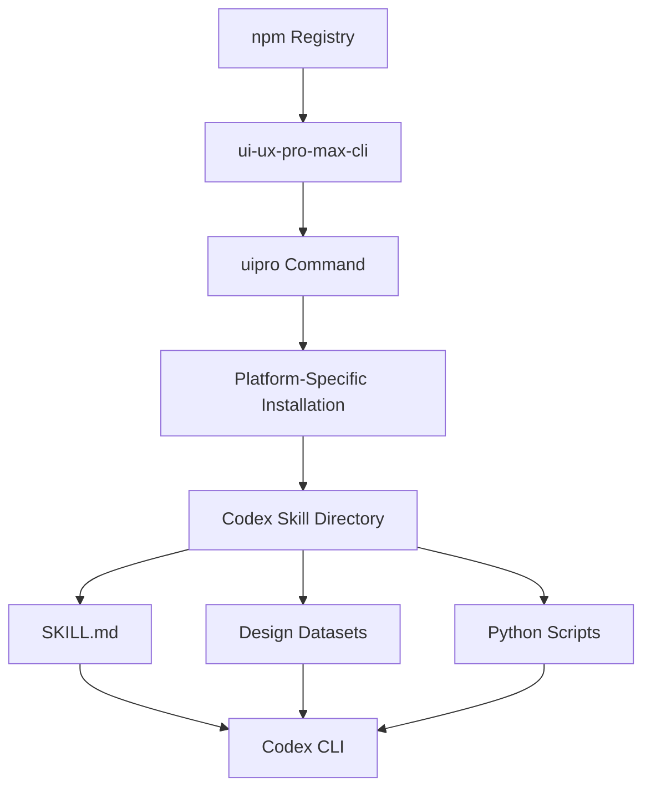
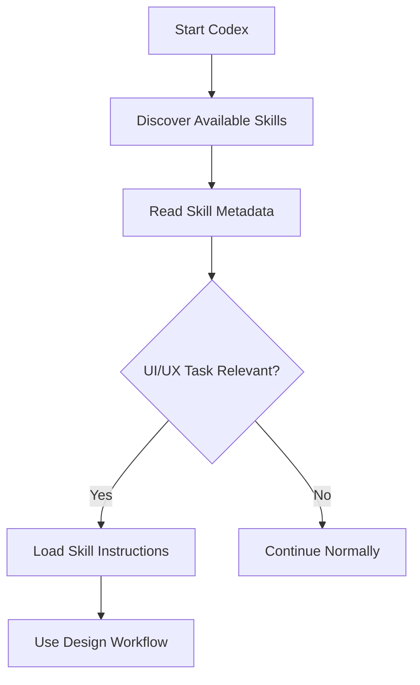
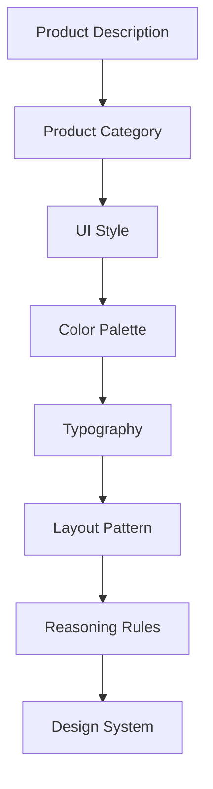

# 02 — UI/UX Pro Max: Installation and Codex Integration

> [!abstract] Lesson Information
> **Repository:** [nextlevelbuilder/ui-ux-pro-max-skill](https://github.com/nextlevelbuilder/ui-ux-pro-max-skill)
>
> **Category:** Agentic Engineering / AI Skills / Codex CLI / Development Environment
>
> **Difficulty:** Beginner to Intermediate
>
> **Learning Approach:** Theory First, with Windows PowerShell examples
>
> **Prerequisites:** [[00 - Repository Overview]], [[01 - Architecture and Core Concepts]]
>
> **Primary Goal:** Understand how to install, configure, verify, update, and safely use UI/UX Pro Max with Codex CLI.

---

# 1. Learning Objectives

After completing this lesson, you should be able to:

1. Identify the prerequisites for UI/UX Pro Max.
2. Explain the difference between the npm package and the installed skill.
3. Understand how the uipro CLI works.
4. Distinguish project-local and global installation.
5. Install the skill for Codex CLI.
6. Understand where the skill files are stored.
7. Verify that Codex can discover the skill.
8. Understand automatic skill activation.
9. Run design knowledge searches.
10. Generate a design-system recommendation.
11. Update installed skill files.
12. Uninstall the skill safely.
13. Troubleshoot common Windows installation problems.
14. Integrate the skill with AGENTS.md and existing project design systems.

---

# Part I — Understanding the Installation Architecture

## 2. What Are We Installing?

UI/UX Pro Max consists of multiple components.

**CLI package** — the installation and management tool.

**Skill files** — the instructions, datasets, and scripts that the AI coding agent uses.

**Codex CLI** — the AI coding agent that reads the skill and performs development tasks.

## 2.1 Architecture



Installing the npm package does not automatically mean the skill has been installed into every project. The CLI package provides the uipro command; the initialization command installs the appropriate skill assets.

---

# Part II — Prerequisites

## 3. Required Development Tools

| Tool | Purpose |
|---|---|
| Node.js | Runs npm and the installation CLI |
| npm | Installs the CLI package |
| Python 3 | Executes design search scripts |
| Codex CLI | AI coding agent |
| PowerShell | Terminal environment |
| Git | Optional for inspecting repository changes |

The repository states that its Python search scripts use the standard library and do not require installing additional Python packages.

## 4. Verify Node.js

```powershell
node --version
```

Example output:

```text
v22.x.x
```

The exact version depends on your installation. Node.js provides the runtime needed to execute the npm-distributed CLI.

## 5. Verify npm

```powershell
npm --version
Get-Command npm
```

If npm is not recognized, verify that Node.js is installed correctly and available through the system PATH.

## 6. Verify Python

On Windows, try:

```powershell
python --version
```

Or use the Python launcher:

```powershell
py --version
```

The repository's Linux/macOS examples use python3. On Windows, python or py may be more appropriate. The search scripts require Python 3, but the repository documentation says no separate pip installation is required.

## 7. Verify Codex CLI

```powershell
codex --version
Get-Command codex
```

This checks whether the codex command is available. UI/UX Pro Max does not replace Codex; it provides specialized design instructions and reference material that Codex can use.

---

# Part III — Installing the CLI

## 8. Official CLI Package

The repository documents this npm package:

`ui-ux-pro-max-cli`

The installed executable is:

`uipro`

Install it globally:

```powershell
npm install -g ui-ux-pro-max-cli
```

| Part | Meaning |
|---|---|
| npm | Node package manager |
| install | Install a package |
| -g | Install globally |
| ui-ux-pro-max-cli | Package name |

A globally installed CLI is not the same thing as a globally installed Codex skill. The first makes the uipro command available; the second determines where skill assets are placed.

## 9. Verify CLI Installation

```powershell
uipro --help
```

The repository documents commands such as:

```text
uipro init
uipro update
uipro versions
uipro uninstall
```

If uipro is not recognized, check the npm installation and PATH configuration.

---

# Part IV — Project-Local Installation

## 10. What Is Project-Local Installation?

A project-local installation places the skill files inside a specific project. An illustrative structure is:

```text
my-project/
├── .codex/
│   └── skills/
│       └── ui-ux-pro-max/
├── src/
├── package.json
└── AGENTS.md
```

The exact generated contents depend on the installed CLI version.

Advantages:

- The skill is associated with one project.
- Different projects can use different skill versions.
- Project-specific customization is easier.
- Installation changes can be reviewed through Git.

Potential disadvantages:

- Skill files may be duplicated across projects.
- Updates may need to be applied separately.
- Generated files may increase repository size.

## 11. Install for Codex

Navigate to the intended project:

```powershell
Set-Location C:\Projects\my-project
```

Then run the documented Codex initialization command:

```powershell
uipro init --ai codex
```

Conceptually, the CLI selects the Codex target, loads bundled skill templates, creates or copies the files, and places them where Codex can discover them.

Run the command from the intended project directory; otherwise, the skill may be installed into a different project.

---

# Part V — Global Installation

## 12. What Is Global Skill Installation?

A global installation makes a skill available across multiple projects through a shared skill directory.

```text
User Environment
├── Global Codex Configuration
│   └── Skills
│       └── ui-ux-pro-max
├── Project A
├── Project B
└── Project C
```

Benefits include shared availability, less repeated setup, and easier use across projects. A global update can affect multiple workflows, and projects may have different design rules.

## 13. Global Codex Installation Considerations

The repository documents a --global option for supported targets, but does not provide a dedicated global Codex example in the same section. Inspect the current CLI help before relying on a global Codex command:

```powershell
uipro init --help
```

A possible command pattern is:

```powershell
uipro init --ai codex --global
```

Treat this as a command to confirm against the installed CLI, not as a verified Codex-specific global installation procedure. For a predictable first setup, use the documented project-local command:

```powershell
uipro init --ai codex
```

---

# Part VI — Project-Local vs Global

## 14. Installation Comparison

| Factor | Project-Local | Global |
|---|---|---|
| Scope | One project | Multiple projects |
| Isolation | Higher | Lower |
| Setup repetition | Per project | Shared |
| Version flexibility | Easier to isolate | Shared version |
| Project customization | Convenient | Requires care |
| First-time learning | Recommended | Optional |

For a first practical experiment, use a disposable practice project. It is easier to inspect generated files, understand discovery, test searches, and remove the installation safely.

---

# Part VII — Previewing Installation Changes

## 15. Dry-Run Mode

The repository documents a dry-run option:

```powershell
uipro init --dry-run
```

For a Codex-specific setup, inspect the supported command options first. If the installed version supports combining these options, preview the Codex installation:

```powershell
uipro init --ai codex --dry-run
```

A dry run helps identify which files will be created, which directories will be modified, whether existing files are affected, and whether the correct platform is selected. Review the preview before applying changes to an important repository.

---

# Part VIII — Codex Skill Discovery

## 16. How Does Codex Find Skills?

Codex supports reusable skills that provide task-specific instructions. A skill generally contains a SKILL.md file with metadata and instructions. It may also include scripts, references, data files, templates, or other supporting resources.

Illustrative structure:

```text
ui-ux-pro-max/
├── SKILL.md
├── scripts/
├── data/
└── references/
```

Inspect the generated directory to see the actual contents.

## 17. Skill Discovery Workflow



The repository describes automatic activation for supported coding agents, including Codex CLI. Actual activation depends on the installed files, Codex configuration, and request context.

---

# Part IX — Verifying the Installation

## 18. Inspect Generated Files

After initializing the skill, inspect the project:

```powershell
Get-ChildItem -Force
Get-ChildItem .codex -Recurse
```

Look for SKILL.md, search scripts, design datasets, and supporting references. Do not assume installation succeeded solely because the CLI returned without an obvious error.

## 19. Test Skill Discovery in Codex

Start Codex from the intended project:

```powershell
codex
```

Then ask:

```text
List the available project skills relevant to UI/UX design.

Confirm whether ui-ux-pro-max is available.

Do not modify any project files.
```

This tests whether Codex can discover the skill. Inspecting the skill directory provides additional confirmation.

---

# Part X — Automatic Activation

## 20. How Does Automatic Activation Work?

The repository documents automatic skill activation for supported agents when a request relates to UI/UX work.

Examples:

`Design a responsive SaaS dashboard.`

`Improve the visual hierarchy of my existing landing page.`

The agent may identify UI/UX Pro Max as relevant and load its instructions.

Possible reasons activation may fail:

- The skill was not installed.
- The installation path is incorrect.
- Codex did not discover the skill.
- The request does not clearly match the skill.
- The current session has not refreshed its skill inventory.
- The installed skill is incomplete.

An explicit request can make the intended workflow clear:

```text
Use the ui-ux-pro-max skill to analyze the design
requirements for a fleet management dashboard.

Generate design recommendations only.

Do not modify source code.
```

---

# Part XI — Running the Search Engine

## 21. Understanding the Search Script

The repository provides a Python-based design search script. Its responsibilities include searching design datasets, ranking relevant results, returning design references, and generating design-system recommendations.

The README shows examples using the Claude installation path. For Codex, use the actual path generated by your installation.

## 22. Search UI Styles

Assuming the Codex installation created the expected project-local skill directory:

```powershell
python .codex/skills/ui-ux-pro-max/scripts/search.py "minimal dashboard" --domain style
```

This searches style references; it does not create UI components.

## 23. Search Typography

```powershell
python .codex/skills/ui-ux-pro-max/scripts/search.py "modern professional sans serif" --domain typography
```

This searches typography references. Results depend on the installed dataset.

## 24. Search UX Guidelines

```powershell
python .codex/skills/ui-ux-pro-max/scripts/search.py "form validation error messages" --domain ux
```

This searches UX guidance that may help with form errors, validation feedback, user guidance, and interaction clarity.

---

# Part XII — Design-System Generation

## 25. What Is Design-System Generation?

The design-system generator combines multiple reference domains into a recommended design direction. It may provide a visual style, color palette, typography, page structure, effects, anti-patterns, and a quality checklist.



## 26. Generate a Design System

Assuming the search script exists at the shown Codex path:

```powershell
python .codex/skills/ui-ux-pro-max/scripts/search.py "fleet management dashboard" --design-system -p "Fleet Dashboard"
```

| Argument | Meaning |
|---|---|
| Search phrase | Product description |
| --design-system | Request design-system generation |
| -p | Project name |

The README also documents Markdown output:

```powershell
python .codex/skills/ui-ux-pro-max/scripts/search.py "software agency website" --design-system -f markdown
```

Generating a design system does not mean recommendations should overwrite an existing brand system. Review them first.

---

# Part XIII — Codex Integration with AGENTS.md

## 27. Why Is AGENTS.md Important?

AGENTS.md provides project-specific instructions. UI/UX Pro Max provides general design knowledge. They serve different purposes.

Example project rules:

```markdown
# UI Design Rules

- Preserve the existing brand palette.
- Reuse existing components.
- Do not introduce gradients.
- Avoid unnecessary animation.
- Maintain responsive layouts.
- Follow accessibility best practices.
- Do not add new dependencies without approval.
```

UI/UX Pro Max can still help with layout, typography hierarchy, spacing, consistency, accessibility, and interaction feedback.

```text
Project Requirements
        ↓
AGENTS.md
        ↓
Existing Design System
        ↓
UI/UX Pro Max Recommendations
        ↓
Codex Implementation
        ↓
Verification
```

This is a recommended decision workflow, not a replacement for Codex's instruction hierarchy.

---

# Part XIV — Working with Existing Projects

## 28. Recommended Integration Strategy

Before using the skill on an existing project:

1. Inspect the current design system.
2. Identify established colors and typography.
3. Review existing components.
4. Read AGENTS.md.
5. Define the requested change.
6. Consult relevant skill guidance.
7. Preserve approved visual decisions.
8. Implement only necessary changes.
9. Verify responsiveness and accessibility.

Example prompt:

```text
Read AGENTS.md and inspect the current UI.

Use ui-ux-pro-max to identify improvements to
spacing, alignment, and visual hierarchy.

Preserve the existing brand colors, typography,
components, and overall visual direction.

Do not redesign unrelated sections.

Do not modify files until the proposed changes
have been reviewed.
```

---

# Part XV — Updating UI/UX Pro Max

## 29. CLI Updates

The repository documents:

```powershell
uipro update
```

This refreshes installed skill files from the installed CLI package. Updating the skill files and updating the npm CLI package are separate operations.

Update the CLI package:

```powershell
npm update -g ui-ux-pro-max-cli
```

Refresh skill files from the appropriate project:

```powershell
uipro update
```

For global installations, the repository also documents:

```powershell
uipro update --global
```

Before updating, inspect the installed version, check local customizations, review affected files, preserve modifications, use Git to inspect generated changes, and verify the skill afterward. Do not assume updates preserve manual modifications to generated files.

---

# Part XVI — Checking Available Versions

## 30. Version Inspection

```powershell
uipro versions
```

This lists available versions according to the CLI. Skill updates may change datasets, search behavior, recommendations, framework guidelines, installation structure, or command options. For reproducible workflows, record the version used.

---

# Part XVII — Uninstallation

## 31. Removing the Skill

The repository documents:

```powershell
uipro uninstall
uipro uninstall --ai codex
```

Before uninstalling:

1. Confirm the correct project.
2. Inspect the files that may be removed.
3. Preserve custom modifications.
4. Review the CLI's current uninstall behavior.

Uninstalling the skill is different from uninstalling Codex CLI.

---

# Part XVIII — Windows PowerShell Troubleshooting

## 32. npm Is Not Recognized

Possible causes include missing Node.js, an incorrect PATH, or a terminal session that needs restarting.

```powershell
Get-Command npm
```

## 33. uipro Is Not Recognized

Possible causes include a failed CLI installation, a missing npm global binary directory in PATH, or a PowerShell session that has not refreshed.

```powershell
npm list -g --depth=0
Get-Command uipro
```

Do not repeatedly reinstall without first inspecting the error.

## 34. Python Is Not Recognized

Try the Python launcher:

```powershell
py --version
py .codex/skills/ui-ux-pro-max/scripts/search.py "dashboard" --domain style
```

If neither python nor py works, install Python through an official distribution and verify PATH.

## 35. Codex Does Not Detect the Skill

Check the installation target, project directory, presence of SKILL.md, supported skill directory, Codex session state, and installed CLI version. Restarting Codex may help after installing a new skill.

Do not assume the skill is active merely because uipro is installed.

## 36. Search Script Cannot Be Found

The actual installation path may differ from the example. Inspect generated files:

```powershell
Get-ChildItem .codex -Recurse -Filter search.py
```

Use the returned path.

## 37. Design Recommendations Ignore Branding

This is usually a workflow or context problem, not an installation problem. Possible causes include missing brand rules, unread project instructions, an overly broad request, or treating recommendations as mandatory.

```text
Use the UI/UX Pro Max skill for layout and UX analysis.

The existing brand system is authoritative.

Do not replace the color palette, typography,
or visual identity.

Recommend changes before implementing them.
```

---

# Part XIX — Security and Safety

## 38. Installing Third-Party Skills

A skill repository contains instructions and sometimes executable scripts. Before installing or running third-party tooling:

- Inspect the repository.
- Review relevant installation scripts.
- Understand which files will be created.
- Avoid unnecessary administrator privileges.
- Do not expose credentials.
- Use a practice project when learning.
- Review generated changes.

A skill is not automatically trustworthy simply because it is popular or open source.

---

# Part XX — Recommended Learning Environment

## 39. Practice Project

A small disposable project is ideal for the first practical test.

```text
ui-ux-practice/
├── AGENTS.md
├── .codex/
│   └── skills/
│       └── ui-ux-pro-max/
├── docs/
└── src/
```

This is illustrative. The actual files should be created by the relevant tools when practical setup begins.

### Suggested First Experiment

Generate a design-system recommendation for a professional software development agency website. Do not generate production UI immediately. First inspect the recommended style, colors, typography, layout pattern, accessibility guidance, and anti-patterns. Then compare them with an existing brand identity.

---

# Part XXI — Practical Exercises

## 40. Exercise 1 — Prerequisite Verification

Explain the purpose of these commands and which component depends on each:

```powershell
node --version
npm --version
python --version
codex --version
```

## 41. Exercise 2 — Installation Architecture

Draw a diagram showing npm, ui-ux-pro-max-cli, uipro, the Codex skill directory, SKILL.md, Python search scripts, design datasets, and Codex CLI.

## 42. Exercise 3 — Local vs Global

Compare project-local and global installation. Explain which is suitable for a disposable practice project, shared team repository, multiple personal projects, and a project requiring a specific skill version.

## 43. Exercise 4 — Skill Verification

Prepare a checklist to confirm UI/UX Pro Max is available to Codex. Include CLI installation, generated files, SKILL.md, search script, skill discovery, and a successful design query.

## 44. Exercise 5 — Design Search

Choose three queries: one for UI style, one for typography, and one for UX guidance. Explain what each should retrieve.

## 45. Exercise 6 — Design System Review

Suppose the generator recommends a new primary color, typography pairing, landing-page layout, and subtle hover interactions, but the project has an approved brand identity. Decide which recommendations can be adopted and which need approval.

## 46. Exercise 7 — Troubleshooting

Scenario: uipro works, but Codex cannot find the skill. List diagnostic steps in the correct order.

---

# Part XXII — Knowledge Check

## 47. Review Questions

1. What is the npm package name?
2. What command does the package install?
3. What does uipro init do?
4. What is the documented Codex initialization command?
5. Why is Python required?
6. Does the search script require external Python packages?
7. What is project-local installation?
8. What is global installation?
9. Why is project-local installation useful for learning?
10. What is the role of SKILL.md?
11. How does Codex discover skills?
12. What is automatic activation?
13. How can skill discovery be verified?
14. What is a domain-specific search?
15. What does --design-system request?
16. Why should generated recommendations be reviewed?
17. What does uipro update do?
18. What does uipro uninstall do?
19. Why should third-party scripts be inspected?
20. Why must existing project design rules be preserved?

---

# Part XXIII — Key Takeaways

> [!summary] Lesson Summary
> - UI/UX Pro Max uses an npm-distributed CLI.
> - The npm package is ui-ux-pro-max-cli.
> - The executable is uipro.
> - uipro init --ai codex is the documented Codex initialization command.
> - Python 3 is required for design search scripts.
> - The Python search scripts use the standard library.
> - Project-local installation isolates skill files to one project.
> - Global installation provides shared availability where supported.
> - SKILL.md contains the skill's instructions.
> - Codex can discover and use installed skills for relevant tasks.
> - Search scripts retrieve design knowledge.
> - Design-system generation produces recommendations, not finished application code.
> - AGENTS.md provides project-specific constraints.
> - Updating the CLI and refreshing skill files are separate operations.
> - Third-party skills should be reviewed before execution.
> - Installation should be verified before relying on the skill.

---

# Part XXIV — Final Mental Model

```text
WINDOWS DEVELOPMENT ENVIRONMENT
             |
             v
      NODE.JS + NPM
             |
             v
   UI-UX-PRO-MAX-CLI
             |
             v
         UIPRO INIT
             |
             v
     CODEX SKILL FILES
             |
             +-- SKILL.MD
             +-- DATASETS
             +-- SEARCH SCRIPTS
             |
             v
          CODEX CLI
             |
             v
       UI/UX REQUEST
             |
             v
       DESIGN SEARCH
             |
             v
     DESIGN SYSTEM OUTPUT
             |
             v
   PROJECT RULES VALIDATION
             |
             v
       UI IMPLEMENTATION
             |
             v
         VERIFICATION
```

**Remember:**

Installing the CLI gives you the management tool.

Initializing the skill gives Codex access to its design knowledge.

Using the skill correctly requires clear requirements, project constraints, and verification.

---

# Part XXV — Official References

## UI/UX Pro Max

- [Official GitHub Repository](https://github.com/nextlevelbuilder/ui-ux-pro-max-skill)
- [README — Installation](https://github.com/nextlevelbuilder/ui-ux-pro-max-skill#installation)
- [README — Usage](https://github.com/nextlevelbuilder/ui-ux-pro-max-skill#usage)
- [CLI Source](https://github.com/nextlevelbuilder/ui-ux-pro-max-skill/tree/main/cli)
- [Core Skill Source](https://github.com/nextlevelbuilder/ui-ux-pro-max-skill/tree/main/src/ui-ux-pro-max)

## Supporting Documentation

- [OpenAI Codex Documentation](https://developers.openai.com/codex/)
- [Codex Skills](https://developers.openai.com/codex/skills/)
- [Agent Skills Specification](https://agentskills.io/specification)
- [Node.js](https://nodejs.org/)
- [Python](https://www.python.org/)

> [!note] Version Awareness
> This lesson follows the repository's documented CLI installation approach.
>
> The commands and generated paths should be verified against the installed CLI version before use. In particular, the global Codex installation option should be confirmed through CLI help rather than assumed.

---

# Part XXVI — Next Lesson

**[[03 - Design Intelligence and Search Engine]]**

Topics:

1. Search engine architecture.
2. Dataset organization.
3. BM25 ranking fundamentals.
4. Query processing.
5. Domain-specific search.
6. Product-category matching.
7. Style retrieval.
8. Typography retrieval.
9. Color palette retrieval.
10. UX guideline retrieval.
11. Search result interpretation.
12. Search quality and limitations.
13. Practical exercises.
14. Official references.

**End of Lesson 02 — Installation and Codex Integration.**