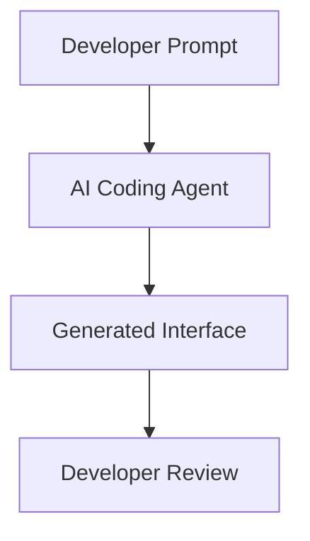
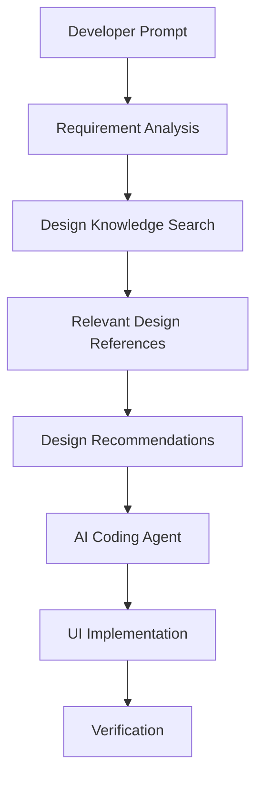
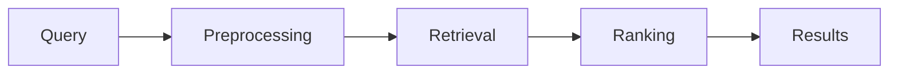
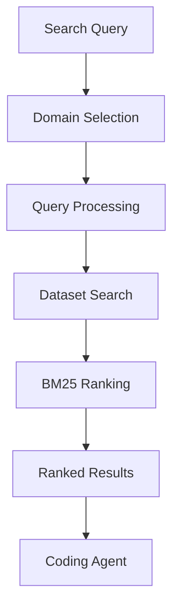
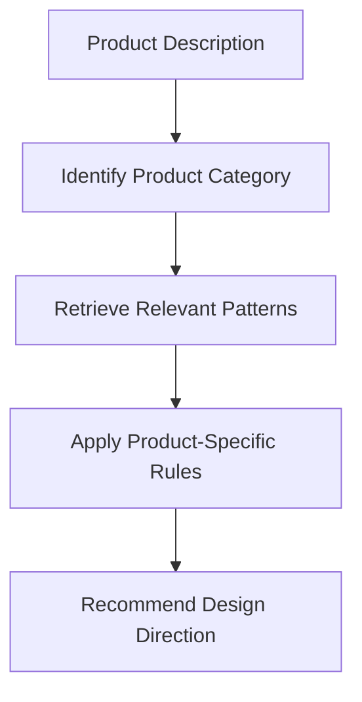
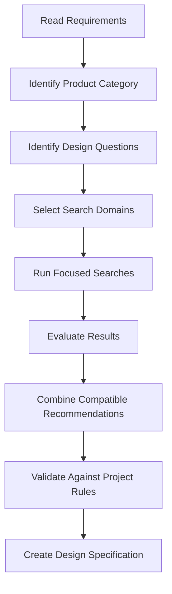
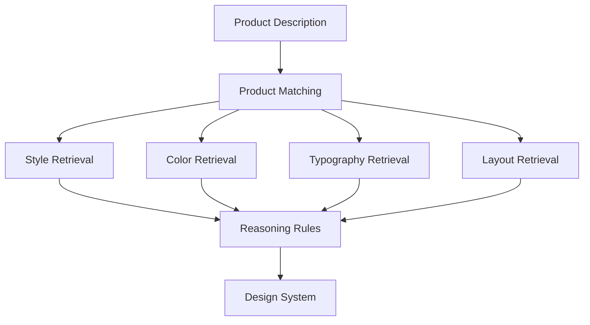

# 03 — UI/UX Pro Max: Design Intelligence and Search Engine

> [!abstract] Lesson Information
> **Repository:** [nextlevelbuilder/ui-ux-pro-max-skill](https://github.com/nextlevelbuilder/ui-ux-pro-max-skill)
>
> **Category:** Agentic Engineering / Information Retrieval / Design Intelligence / UI/UX
>
> **Difficulty:** Intermediate
>
> **Learning Approach:** Theory First
>
> **Prerequisites:** [[00 - Repository Overview]], [[01 - Architecture and Core Concepts]], [[02 - Installation and Codex Integration]]
>
> **Primary Goal:** Understand how UI/UX Pro Max searches, ranks, and retrieves design knowledge, and how coding agents use the results to make informed interface design decisions.

---

# 1. Learning Objectives

After completing this lesson, you should be able to:

1. Define design intelligence.
2. Explain the role of a design knowledge base.
3. Understand the search engine architecture.
4. Explain information retrieval.
5. Understand query processing and normalization.
6. Explain BM25 ranking.
7. Understand term frequency and inverse document frequency.
8. Differentiate keyword search from semantic search.
9. Identify the repository's major search domains.
10. Explain product-category matching.
11. Understand how design search results are ranked.
12. Interpret search results critically.
13. Explain how retrieval supports design-system generation.
14. Recognize limitations such as ambiguous queries and irrelevant matches.
15. Apply the concepts to Android, Laravel, and Next.js UI projects.

---

# Part I — Introduction to Design Intelligence

## 2. What Is Design Intelligence?

**Design intelligence** refers to the use of organized design knowledge, retrieval techniques, and decision rules to support interface design.

In UI/UX Pro Max, design intelligence helps an AI coding agent answer questions such as:

- Which visual style fits the product?
- What layout pattern supports the intended workflow?
- Which typography system is appropriate?
- Which color relationships should be considered?
- What UX guidelines apply?
- Which design choices should be avoided?

Rather than generating a design entirely from general model knowledge, the agent can consult structured references.

## 2.1 Traditional AI UI Generation



The agent may rely on patterns learned during training.

This can produce useful results, but design choices may be inconsistent or insufficiently grounded in the product's requirements.

## 2.2 Retrieval-Augmented UI Design



The search results provide additional context for design decisions.

> [!important]
> Retrieval improves access to relevant information. It does not automatically guarantee good design.

---

# Part II — Understanding Information Retrieval

## 3. What Is Information Retrieval?

Information retrieval is the process of finding relevant information from a collection of documents or records.

Examples include:

- Searching a website.
- Finding documentation.
- Retrieving code examples.
- Searching a knowledge base.
- Finding relevant UI styles.

UI/UX Pro Max applies information retrieval to design knowledge.

## 3.1 Basic Components

A search system generally contains:

| Component | Responsibility |
|---|---|
| Query | Describes the information needed |
| Corpus | Collection of searchable records |
| Preprocessing | Prepares text for matching |
| Retrieval | Finds candidate records |
| Ranking | Orders results by estimated relevance |
| Output | Presents matching records |

## 3.2 Conceptual Pipeline



### Example

Query:

```text
minimal dashboard
```

The search system looks for records associated with concepts such as minimal interfaces and dashboard design.

Relevant records are then ranked and returned.

---

# Part III — The Design Knowledge Base

## 4. What Is a Knowledge Base?

A knowledge base is a structured collection of information that can be searched or referenced.

In UI/UX Pro Max, the knowledge base contains design-related records.

Examples include:

- Product categories.
- Visual styles.
- Color palettes.
- Typography pairings.
- Landing-page patterns.
- Chart recommendations.
- UX guidelines.
- Framework-specific rules.

## 4.1 Why Structured Records Matter

Consider two ways of storing design information.

### Unstructured Notes

```text
Minimalism looks clean.
Dashboards should be readable.
Some products use serif fonts.
```

These notes provide information but lack consistent organization.

### Structured Records

| Product | Style | Typography | Layout |
|---|---|---|---|
| SaaS dashboard | Minimal | Sans-serif | Sidebar + content |
| Creative portfolio | Editorial | Display + body | Project showcase |
| E-commerce | Clean commercial | Sans-serif | Product grid |

Structured records make it easier to search and compare design recommendations.

### Important

The table is an educational example, not a reproduction of the repository's dataset.

---

# Part IV — Dataset Organization

## 5. Search Domains

A **search domain** is a category of information within the design knowledge base.

The repository documents domain-specific searches for several categories.

| Domain | Purpose | Example Query |
|---|---|---|
| Product | Match product types | `SaaS dashboard` |
| Style | Find visual styles | `minimal professional` |
| Color | Find palette recommendations | `technology startup` |
| Typography | Find font pairings | `modern sans serif` |
| Landing | Find page patterns | `software agency` |
| Chart | Find visualization types | `performance analytics` |
| UX | Find usability guidelines | `form validation` |
| Icons | Find icon-related guidance | `navigation icons` |

The precise domain identifiers and options should be confirmed using the installed script's help.

## 5.1 Domain-Specific Retrieval

A query can be narrowed to one design domain.

For example:

```powershell
python scripts/search.py "minimal dashboard" --domain style
```

This searches for style-related information.

Another example:

```powershell
python scripts/search.py "form validation" --domain ux
```

This searches for UX-related guidance.

### Why Is This Useful?

A general query might retrieve information from several unrelated categories.

Domain filtering reduces the search space.

---

# Part V — Search Engine Architecture

## 6. How Does the Search Engine Work?

The repository documents a Python-based search system using BM25-style ranking.

Conceptually, the search engine performs the following steps:

1. Receive a query.
2. Identify the requested domain.
3. Prepare the query for matching.
4. Search the relevant dataset.
5. Calculate relevance scores.
6. Rank matching records.
7. Return the highest-ranked results.

## 6.1 Architecture Diagram



This diagram is a conceptual representation of the documented search workflow, not a line-by-line implementation trace.

---

# Part VI — Query Processing

## 7. What Is Query Processing?

Query processing prepares a user's search phrase for retrieval.

For example:

```text
Modern Professional SaaS Dashboard
```

A search system may normalize this into:

```text
modern professional saas dashboard
```

Common preprocessing techniques include:

- Lowercasing.
- Tokenization.
- Whitespace normalization.
- Punctuation handling.
- Stop-word handling.
- Keyword extraction.

Not every search engine uses every technique.

## 7.1 Tokenization

Tokenization divides text into searchable units.

Example:

```text
responsive admin dashboard
```

Tokens:

```text
responsive
admin
dashboard
```

These tokens can be compared with indexed records.

## 7.2 Why Query Wording Matters

Compare:

**Query A**

```text
nice UI
```

**Query B**

```text
minimal enterprise dashboard with dense data tables
```

Query B provides more useful context.

It identifies:

- Visual style.
- Product category.
- Information density.
- Interface pattern.

### Key Principle

**More specific queries often produce more relevant design references.**

However, overly restrictive wording may exclude useful alternatives.

---

# Part VII — Understanding BM25

## 8. What Is BM25?

**BM25**, commonly associated with the Okapi BM25 ranking model, is an information retrieval algorithm.

It estimates the relevance of a document to a query.

BM25 considers:

1. Term frequency.
2. Inverse document frequency.
3. Document length.
4. Query-term matching.

The repository describes BM25-based search as part of its design knowledge retrieval approach.

---

## 9. Term Frequency

**Term Frequency (TF)** describes how often a term appears in a document.

Suppose the query is:

```text
dashboard
```

Three hypothetical records contain:

| Record | Occurrences of “dashboard” |
|---|---:|
| A | 3 |
| B | 1 |
| C | 0 |

Record A contains the term most frequently.

However, frequency alone is not enough to determine relevance.

Repeated terms can occur in irrelevant content.

BM25 accounts for diminishing returns from repeated occurrences.

---

## 10. Inverse Document Frequency

**Inverse Document Frequency (IDF)** measures how informative a term is across a collection.

A term appearing in almost every document provides relatively little distinguishing information.

A rarer term may be more useful.

For example:

```text
design
```

might appear in many records.

But:

```text
fleet dashboard
```

may contain more specific terms.

## 10.1 Simplified Interpretation

| Term | Frequency Across Corpus | Potential Distinguishing Value |
|---|---|---|
| Design | Very common | Lower |
| Dashboard | Moderately common | Medium |
| Fleet | Less common | Higher |

Actual BM25 relevance depends on the complete query, corpus, and ranking implementation.

---

# Part VIII — BM25 Formula

## 11. Mathematical Model

A common BM25 scoring formula is:

\[
\operatorname{BM25}(D,Q)
=
\sum_{q_i \in Q}
\operatorname{IDF}(q_i)
\cdot
\frac{
f(q_i,D)(k_1+1)
}{
f(q_i,D)+k_1\left(1-b+b\frac{|D|}{\operatorname{avgdl}}\right)
}
\]

Where:

| Symbol | Meaning |
|---|---|
| \(D\) | Document being evaluated |
| \(Q\) | Search query |
| \(q_i\) | Query term |
| \(f(q_i,D)\) | Frequency of the term in the document |
| \(\operatorname{IDF}(q_i)\) | Inverse document frequency |
| \(|D|\) | Document length |
| \(\operatorname{avgdl}\) | Average document length |
| \(k_1\) | Term-frequency saturation parameter |
| \(b\) | Document-length normalization parameter |

Typical textbook examples use values around:

\[
k_1 = 1.2
\]

\[
b = 0.75
\]

These are illustrative BM25 parameters, not verified configuration values for UI/UX Pro Max.

## 11.1 Why Document Length Matters

Consider:

**Document A**

A short record containing:

```text
minimal dashboard
```

**Document B**

A long article mentioning those terms once among hundreds of unrelated words.

BM25 can account for document length so that a short, focused record is not automatically disadvantaged.

---

# Part IX — Keyword Search vs Semantic Search

## 12. What Is Keyword Search?

Keyword search matches words or related textual representations.

BM25 is commonly used for lexical retrieval.

Example:

```text
minimal dashboard
```

It can rank records containing those terms.

## 12.1 What Is Semantic Search?

Semantic search attempts to match meaning rather than relying primarily on exact words.

For example:

```text
clean admin interface
```

may be semantically related to:

```text
minimal management dashboard
```

even though the wording differs.

## 12.2 Comparison

| Feature | BM25 / Lexical Retrieval | Semantic Retrieval |
|---|---|---|
| Primary matching | Terms | Meaning representations |
| Typical implementation | Text ranking | Embeddings and vector similarity |
| Exact terminology | Often strong | Depends on model |
| Synonym handling | Limited without expansion | Often stronger |
| Infrastructure | Can be lightweight | May require embedding models |
| Explainability | Relatively straightforward | Often less transparent |

### Important

The documented UI/UX Pro Max search system uses BM25-style retrieval.

Do not assume it includes a vector database or embedding model unless the installed version explicitly provides one.

---

# Part X — Product-Category Matching

## 13. Why Product Type Matters

The same visual style may not work equally well for every application.

Compare:

- Hospital dashboard.
- Creative portfolio.
- Banking application.
- Gaming website.
- Fleet management platform.

Each has different user goals.

## 13.1 Example

A fleet management dashboard prioritizes:

- Operational visibility.
- Status clarity.
- Efficient navigation.
- Readable tables.
- Useful filtering.

A creative portfolio may prioritize:

- Visual storytelling.
- Large imagery.
- Editorial typography.
- Project presentation.

The design intelligence workflow should consider these differences.

## 13.2 Product Matching Pipeline



---

# Part XI — Style Retrieval

## 14. What Is Style Retrieval?

Style retrieval identifies visual design directions related to a query.

Examples:

```text
minimal
```

```text
editorial
```

```text
corporate
```

```text
brutalist
```

```text
glassmorphism
```

## 14.1 Choosing a Style

A style should be evaluated against:

1. Product purpose.
2. Target users.
3. Existing brand identity.
4. Content requirements.
5. Accessibility.
6. Maintainability.

### Example

A software development startup may benefit from a restrained corporate or minimalist style.

However, if the brand already has a defined visual identity, the skill should help refine that identity rather than replace it.

---

# Part XII — Color Palette Retrieval

## 15. Why Search for Color Palettes?

Color palette recommendations help establish visual consistency.

They can provide starting points for:

- Primary colors.
- Accent colors.
- Backgrounds.
- Surfaces.
- Text.
- Status indicators.

## 15.1 Example

For a technology company, a recommendation might emphasize:

- Professional primary color.
- Restrained accent.
- Neutral backgrounds.
- High-contrast text.

But the exact colors should be selected based on brand requirements and accessibility.

## 15.2 Important Constraint

**Existing approved brand colors should not be replaced automatically.**

Search results are references, not mandatory design decisions.

---

# Part XIII — Typography Retrieval

## 16. Why Typography Matters

Typography affects:

- Readability.
- Hierarchy.
- Brand personality.
- Scannability.
- Visual rhythm.
- Accessibility.

A typography search may return recommendations for:

- Display headings.
- Section headings.
- Body text.
- Captions.
- Font pairings.

## 16.1 Example Query

```powershell
python scripts/search.py "modern professional sans serif" --domain typography
```

## 16.2 Evaluation Criteria

When reviewing typography recommendations, consider:

- Legibility.
- Available font weights.
- Language support.
- Performance.
- Licensing.
- Existing brand conventions.
- Mobile readability.

---

# Part XIV — UX Guideline Retrieval

## 17. Why Search UX Guidelines?

Visual design alone does not guarantee usability.

UX guideline retrieval helps identify interaction concerns.

Examples include:

- Form validation.
- Error messages.
- Keyboard navigation.
- Focus indicators.
- Loading states.
- Responsive behavior.
- Accessible controls.

## 17.1 Example Query

```powershell
python scripts/search.py "form validation error messages" --domain ux
```

## 17.2 Example Application

Suppose a registration form contains:

- Email.
- Password.
- Confirm password.
- Submit button.

Relevant UX considerations include:

- Clear labels.
- Appropriate validation.
- Helpful error messages.
- Visible focus states.
- Submission feedback.
- Accessible form structure.

---

# Part XV — Chart Retrieval

## 18. Choosing the Right Visualization

A chart should match the type of information being presented.

| Data Goal | Possible Visualization |
|---|---|
| Compare categories | Bar chart |
| Show trends over time | Line chart |
| Show parts of a whole | Pie or stacked bar chart |
| Show relationships | Scatter plot |
| Show distributions | Histogram |

These are general visualization guidelines.

The appropriate chart depends on the actual data.

## 18.1 Example

A fleet dashboard might display:

**Trips per day**

Line chart.

**Trips by route**

Bar chart.

**Vehicle status**

Status cards or a compact categorical visualization.

### Important

Not every metric requires a chart.

Sometimes a simple number, table, or status label communicates the information more clearly.

---

# Part XVI — Search Results and Ranking

## 19. What Does a Search Result Represent?

A result represents a record that the retrieval system estimates to be relevant.

It does not necessarily mean:

- The recommendation is the best possible design.
- The style matches existing branding.
- The recommendation is accessible.
- The implementation will be technically correct.

## 19.1 Search Result Evaluation

Evaluate results using:

| Criterion | Question |
|---|---|
| Relevance | Does it address the actual request? |
| Product fit | Does it suit the product category? |
| Brand fit | Does it respect established identity? |
| UX suitability | Does it improve usability? |
| Accessibility | Can it be implemented accessibly? |
| Feasibility | Is it realistic within the stack? |
| Complexity | Does it introduce unnecessary overhead? |

---

# Part XVII — Search Quality Problems

## 20. Ambiguous Queries

Example:

```text
modern UI
```

Problem:

The query lacks product context.

Improvement:

```text
modern inventory management dashboard with dense data tables
```

---

## 21. Overly Specific Queries

Example:

```text
minimal dark navy dashboard with exactly four cards,
a 240px sidebar, rounded buttons, and orange highlights
```

Problem:

The query may overconstrain retrieval.

A better approach is to search broader design concepts and enforce exact project constraints separately.

---

## 22. Irrelevant Matches

A search result may contain matching keywords but still be unsuitable.

For example:

A visually dramatic landing-page style might rank for a query containing “modern,” but it may not suit an operational dashboard.

### Solution

Evaluate results against the product's actual tasks.

---

## 23. Missing Knowledge

The dataset may not contain a record for every niche product or interaction pattern.

In that case:

- Search related categories.
- Use established design principles.
- Consult official framework guidance.
- Preserve project requirements.
- Avoid inventing unsupported recommendations.

---

# Part XVIII — Search Strategy for Coding Agents

## 24. Recommended Search Workflow



## 24.1 Step 1 — Read Requirements

Understand:

- Product purpose.
- Users.
- Features.
- Existing UI.
- Brand constraints.
- Technology stack.

## 24.2 Step 2 — Identify Design Questions

Examples:

- Which layout fits the dashboard?
- How should information be grouped?
- Which typography hierarchy works?
- What UX guidelines apply?

## 24.3 Step 3 — Search Relevant Domains

Avoid searching every domain when only one is needed.

## 24.4 Step 4 — Evaluate Results

Discard recommendations that conflict with established requirements.

## 24.5 Step 5 — Produce a Design Specification

Document the selected decisions before implementation.

---

# Part XIX — Search Efficiency

## 25. Why Efficient Search Matters

An AI agent can waste time and context by repeatedly searching the same information.

Examples of inefficient behavior:

- Running many nearly identical queries.
- Searching unrelated domains.
- Repeating successful searches without reason.
- Copying entire result sets into context.
- Ignoring previous decisions.

## 25.1 Better Practices

- Define the design question first.
- Search only relevant domains.
- Use specific but not overly restrictive queries.
- Preserve selected recommendations.
- Avoid redundant searches.
- Reuse established design decisions.

### Principle

**Search should reduce uncertainty, not create unnecessary complexity.**

---

# Part XX — Search and Design-System Generation

## 26. How Retrieval Supports Design Systems

The design-system generator combines information from multiple design domains.

Conceptually:



## 26.1 Example Output Structure

```text
Design System
├── Product Type
├── Visual Direction
├── Layout Pattern
├── Color System
├── Typography
├── Interaction Guidance
├── Anti-Patterns
└── Quality Checklist
```

This is an educational representation.

Actual output fields depend on the installed repository version.

---

# Part XXI — Case Study: HarayaForge Website

## 27. Scenario

A software development startup wants to improve its website's visual consistency.

Existing brand decisions include:

- Forge Navy.
- Ember Orange.
- Digital Cyan.
- Cloud White.
- Minimal visual direction.
- No unnecessary gradients.

## 27.1 Appropriate Search Questions

Instead of asking the skill to redesign the entire brand, search for:

- Minimal software agency layouts.
- Professional typography hierarchy.
- Responsive service-card grids.
- Accessible contact forms.
- Navigation usability.

## 27.2 Recommended Workflow

```text
Existing Brand Rules
       ↓
Identify UI Problems
       ↓
Search Relevant Design Domains
       ↓
Evaluate Recommendations
       ↓
Preserve Brand Identity
       ↓
Implement Focused Improvements
       ↓
Verify Responsiveness
```

### Engineering Lesson

The design intelligence system should support established brand decisions rather than override them.

---

# Part XXII — Case Study: GoPasig Dashboard

## 28. Scenario

A Laravel-based fleet management system needs a clear administrative dashboard.

## 28.1 Relevant Design Domains

**Product**

Operational dashboard.

**Style**

Professional, restrained, information-focused.

**Chart**

Route performance and trip trends.

**UX**

Filtering, tables, loading states, error feedback.

**Typography**

Readable information hierarchy.

## 28.2 Important Design Questions

- Which information should appear first?
- How should route status be communicated?
- Which metrics require charts?
- How should schedules be filtered?
- How should mobile layouts behave?

### Engineering Lesson

Operational dashboards should prioritize information clarity over visual decoration.

---

# Part XXIII — Case Study: Next.js E-Commerce

## 29. Scenario

A Next.js frontend needs consistent product listing and inventory screens.

## 29.1 Search Strategy

Search for:

- E-commerce product grid patterns.
- Product filtering UX.
- Inventory table patterns.
- Form validation.
- Responsive navigation.

## 29.2 Design Decisions

The agent should determine:

- Card structure.
- Information hierarchy.
- Filter behavior.
- Loading states.
- Empty states.
- Responsive layout.

## 29.3 Implementation Boundary

The design skill provides guidance.

Next.js components implement the frontend.

Laravel handles the backend API.

PostgreSQL stores application data.

### Engineering Lesson

Design intelligence should improve the existing architecture rather than introduce unrelated technologies.

---

# Part XXIV — Practical Exercises

## 30. Exercise 1 — Query Improvement

Rewrite the following vague queries:

1. `nice website`
2. `good dashboard`
3. `modern font`
4. `better form`
5. `cool colors`

Make each query specific enough for useful design retrieval.

---

## 31. Exercise 2 — Domain Selection

Identify the most appropriate domain for each question.

| Question | Your Answer |
|---|---|
| Which font pairing fits a software agency? | |
| How should form errors appear? | |
| Which chart shows monthly trends? | |
| Which visual style suits a portfolio? | |
| Which colors fit a healthcare dashboard? | |

---

## 32. Exercise 3 — BM25 Reasoning

Query:

```text
minimal dashboard
```

Hypothetical records:

**A**

```text
Minimal dashboard with clear navigation and simple cards.
```

**B**

```text
Creative portfolio with editorial typography.
```

**C**

```text
Analytics dashboard with dense data tables.
```

Questions:

1. Which record is likely most relevant?
2. Why might record C still be useful?
3. Why is record B less relevant?
4. Why is textual relevance not enough to select a design?

---

## 33. Exercise 4 — Product Matching

Choose one product:

- Fleet management dashboard.
- Student task manager.
- E-commerce admin panel.

Identify:

1. Primary users.
2. Main tasks.
3. Relevant design domains.
4. Recommended layout characteristics.
5. Accessibility concerns.

---

## 34. Exercise 5 — Search Result Evaluation

Imagine the skill recommends a glassmorphism-heavy dashboard.

Your project requires:

- High readability.
- Dense tables.
- Fast navigation.
- Minimal decoration.

Explain whether the recommendation should be adopted.

Justify your decision using product requirements.

---

## 35. Exercise 6 — Design Search Strategy

Create a search plan for a software agency website.

Include:

- Product query.
- Style query.
- Typography query.
- UX query.
- Layout query.

Explain what each search should contribute.

---

# Part XXV — Knowledge Check

## 36. Review Questions

1. What is design intelligence?
2. What is information retrieval?
3. What is a corpus?
4. What is a search domain?
5. What is query processing?
6. What is tokenization?
7. What is BM25?
8. What is term frequency?
9. What is inverse document frequency?
10. Why does document length matter?
11. How does BM25 differ from semantic search?
12. Why is product-category matching important?
13. What is style retrieval?
14. What is typography retrieval?
15. What is UX guideline retrieval?
16. Why should search results be evaluated?
17. What makes a query ambiguous?
18. Why can overly specific queries be problematic?
19. How does retrieval support design-system generation?
20. Why should existing brand rules take priority?
21. How can repeated searches waste context?
22. What is the difference between retrieval and implementation?
23. Can BM25 guarantee a good design?
24. Why are accessibility checks still necessary?
25. How can design search support existing projects?

---

# Part XXVI — Key Takeaways

> [!summary]
> - UI/UX Pro Max uses structured design knowledge to support AI-assisted interface development.
> - Information retrieval finds relevant records from searchable datasets.
> - Search domains organize knowledge into focused categories.
> - Query processing prepares search terms for matching.
> - BM25 ranks results using textual relevance signals.
> - Term frequency and inverse document frequency are important BM25 concepts.
> - Keyword search and semantic search are different approaches.
> - Product-category matching helps contextualize recommendations.
> - Design results should be evaluated against actual user needs.
> - Search results do not automatically become implementation requirements.
> - Existing brand and architecture constraints should be preserved.
> - Focused searches reduce irrelevant context.
> - Retrieval contributes to design-system generation.
> - Coding agents remain responsible for implementation.
> - Accessibility and responsive behavior require verification.

---

# Part XXVII — Final Mental Model

```text
DEVELOPER REQUEST
        |
        v
REQUIREMENT ANALYSIS
        |
        v
PRODUCT IDENTIFICATION
        |
        v
SEARCH DOMAIN SELECTION
        |
        v
QUERY PROCESSING
        |
        v
DESIGN DATASET RETRIEVAL
        |
        v
BM25 RELEVANCE RANKING
        |
        v
SEARCH RESULT EVALUATION
        |
        v
PRODUCT-SPECIFIC REASONING
        |
        v
DESIGN SYSTEM RECOMMENDATION
        |
        v
PROJECT CONSTRAINT VALIDATION
        |
        v
UI IMPLEMENTATION
        |
        v
DESIGN VERIFICATION
```

**Remember:**

The search engine finds relevant design knowledge.

The reasoning layer combines recommendations.

The coding agent applies the design.

The developer and project requirements determine what is appropriate.

---

# Part XXVIII — Official References

## UI/UX Pro Max

- [Official GitHub Repository](https://github.com/nextlevelbuilder/ui-ux-pro-max-skill)
- [README](https://github.com/nextlevelbuilder/ui-ux-pro-max-skill/blob/main/README.md)
- [Core Skill Source](https://github.com/nextlevelbuilder/ui-ux-pro-max-skill/tree/main/src/ui-ux-pro-max)
- [Search Scripts](https://github.com/nextlevelbuilder/ui-ux-pro-max-skill/tree/main/src/ui-ux-pro-max/scripts)
- [Design Datasets](https://github.com/nextlevelbuilder/ui-ux-pro-max-skill/tree/main/src/ui-ux-pro-max/data)

## Supporting References

- [Introduction to Information Retrieval — Stanford](https://nlp.stanford.edu/IR-book/)
- [BM25 Overview — Stanford IR Book](https://nlp.stanford.edu/IR-book/html/htmledition/okapi-bm25-a-non-binary-model-1.html)
- [OpenAI Codex Documentation](https://developers.openai.com/codex/)
- [WCAG Accessibility Guidelines](https://www.w3.org/WAI/standards-guidelines/wcag/)

> [!note] Documentation Scope
> This lesson combines the repository's documented search capabilities with general information retrieval theory.
>
> The BM25 formula, conceptual diagrams, and hypothetical examples explain the underlying principles. They do not establish the exact parameters or internal implementation details of every repository version.

---

# Part XXIX — Next Lesson

**[[04 - UI Styles and Visual Design Principles]]**

Topics:

1. UI style taxonomy.
2. Minimalism.
3. Corporate and enterprise design.
4. Editorial design.
5. Brutalism.
6. Glassmorphism.
7. Neumorphism.
8. Material-inspired interfaces.
9. Visual hierarchy.
10. Composition and spacing.
11. Consistency and restraint.
12. Style selection by product type.
13. Avoiding generic AI-generated aesthetics.
14. Android, Laravel, and Next.js examples.
15. Practical exercises.
16. Official references.

**End of Lesson 03 — Design Intelligence and Search Engine.**
