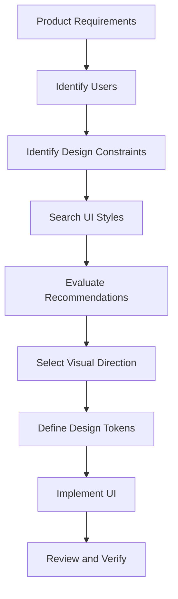

# 04 — UI/UX Pro Max: UI Styles and Visual Design Principles

> [!abstract] Lesson Information
> **Repository:** [nextlevelbuilder/ui-ux-pro-max-skill](https://github.com/nextlevelbuilder/ui-ux-pro-max-skill)
>
> **Category:** UI/UX Design / Visual Design / Design Intelligence / Agentic Engineering
>
> **Difficulty:** Beginner to Intermediate
>
> **Learning Approach:** Theory First
>
> **Prerequisites:** [[00 - Repository Overview]], [[01 - Architecture and Core Concepts]], [[02 - Installation and Codex Integration]], [[03 - Design Intelligence and Search Engine]]
>
> **Primary Goal:** Understand different UI styles, fundamental visual design principles, and how to select appropriate design directions using UI/UX Pro Max without sacrificing usability, accessibility, or brand consistency.

---

# 1. Learning Objectives

After completing this lesson, you should be able to:

1. Define UI style and visual design language.
2. Distinguish visual aesthetics from usability.
3. Identify common interface design styles.
4. Explain minimalism, corporate design, editorial design, brutalism, glassmorphism, and neumorphism.
5. Understand visual hierarchy.
6. Apply alignment, proximity, repetition, and contrast.
7. Explain layout composition and grid systems.
8. Understand whitespace and spacing systems.
9. Select styles according to product type and user needs.
10. Recognize visual design anti-patterns.
11. Avoid generic AI-generated interface aesthetics.
12. Preserve an established brand identity.
13. Understand how UI/UX Pro Max retrieves style recommendations.
14. Evaluate style recommendations critically.
15. Apply visual design principles to Android, Laravel, and Next.js projects.

---

# Part I — Understanding UI Styles

## 2. What Is a UI Style?

A **UI style** is a collection of visual characteristics that define how an interface looks and feels. It influences typography, color, spacing, composition, borders, shadows, imagery, component appearance, motion, and visual hierarchy. A style creates consistency across an interface: minimalist interfaces tend to use restrained colors and purposeful whitespace, while editorial interfaces often emphasize expressive typography and image-led composition.

## 2.1 UI Style vs Design System

| UI Style | Design System |
|---|---|
| Defines visual direction | Defines reusable design rules |
| Expresses personality | Supports consistency |
| Describes aesthetic choices | Specifies tokens and components |
| Can be conceptual | Should be actionable |
| Influences implementation | Guides implementation |

**Example:** Minimal corporate is a style. A navy/off-white palette, sans-serif typography, spacing scale, moderate radius, and consistent button states make that direction actionable as a design system.

**Key principle:** A UI style describes visual character; a design system translates it into repeatable decisions.

---

# Part II — UI vs UX

## 3. Visual Design Is Not the Entire User Experience

**User Interface (UI)** focuses on presentation and interactive elements. **User Experience (UX)** considers the broader experience of completing tasks.

A dashboard may have attractive cards, modern typography, beautiful charts, and smooth transitions, yet still frustrate users when important actions are hard to find, navigation is confusing, status labels are unclear, errors provide no explanation, or forms require unnecessary steps.

> [!important] A visually impressive interface is not automatically usable.
> Good design must support the user's goals.

---

# Part III — UI Style Taxonomy

## 4. Common UI Styles

The repository provides searchable style references. For learning, common styles can be grouped like this:

| Style | Primary Characteristics | Typical Use |
|---|---|---|
| Minimalism | Simplicity, whitespace, restraint | Professional websites |
| Corporate | Structure, consistency, clarity | Business systems |
| Editorial | Typography, storytelling, composition | Portfolios and publications |
| Brutalism | Bold contrast, unconventional layouts | Experimental websites |
| Glassmorphism | Transparency, layering, blur | Selected decorative interfaces |
| Neumorphism | Soft surface-like controls | Limited visual concepts |
| Material-inspired | Structured components and interaction states | Web and mobile apps |
| Dashboard-focused | Information density and hierarchy | Administrative systems |
| Bento layout | Grouped content panels | Landing pages and showcases |
| Dark interface | Dark surfaces and controlled contrast | Developer tools and selected products |

These broad categories are not mutually exclusive. A product can combine compatible characteristics from multiple styles.

---

# Part IV — Minimalist Design

## 5. What Is Minimalism?

Minimalist design emphasizes essential content and reduces unnecessary decoration. Common characteristics include clear hierarchy, limited colors, consistent spacing, restrained effects, simple shapes, and purposeful whitespace.

```text
+---------------------------------------+
| LOGO                      NAVIGATION   |
+---------------------------------------+
|          Clear Primary Heading        |
|          Supporting Description       |
|          [ Primary Action ]            |
+---------------------------------------+
|          Supporting Content            |
+---------------------------------------+
```

### Advantages

- Easy to scan and less distracting.
- Keeps attention on content.
- Often easier to maintain and adapt to screens.

### Risks

Minimalism can remove useful information: icon-only navigation without labels, low-contrast text, excessive empty space, hidden actions, or unclear interactive elements.

**Principle:** Minimalism should remove unnecessary complexity, not essential usability.

---

# Part V — Corporate and Enterprise Design

## 6. What Is Corporate UI Design?

Corporate design emphasizes professionalism, clarity, consistency, and predictable interactions. It is common in business management systems, enterprise applications, administrative dashboards, financial platforms, and internal productivity tools.

Characteristics include structured grids, consistent components, readable typography, clear navigation, controlled color, and predictable interaction patterns.

```text
+--------------------------------------------------+
| Header                                           |
+------------+-------------------------------------+
| Sidebar    | Page Title                          |
| Dashboard  | [Metric] [Metric] [Metric]           |
| Routes     | [Chart / Summary]                   |
| Schedules  | [Data Table]                        |
+------------+-------------------------------------+
```

It supports complex workflows and information-heavy systems, but can look generic or dense when spacing and hierarchy are weak. Corporate design does not require identical interfaces: brand identity can still appear in typography, color, and layout details.

---

# Part VI — Editorial Design

## 7. What Is Editorial UI Design?

Editorial design borrows from magazines, publications, and visual storytelling. It often uses large typography, distinctive headings, strong image composition, asymmetrical layouts, intentional whitespace, and content-led hierarchy.

```text
+---------------------------------------+
| BRAND                         MENU    |
| A BOLD EDITORIAL HEADLINE              |
| Supporting introduction               |
| [Large Project Image]                 |
| Project Title                         |
+---------------------------------------+
```

It suits creative portfolios, architecture and photography sites, publications, and brand storytelling. Large type can dominate small screens, asymmetric layouts can be harder to maintain, and decorative composition can distract from functional tasks. Editorial design works best when visual storytelling supports the content.

---

# Part VII — Brutalism

## 8. What Is Brutalist UI Design?

Brutalist web design uses intentionally unconventional visual elements such as strong contrast, bold typography, sharp borders, exposed layout structures, unusual compositions, and minimal decorative polish.

It can create a strong and memorable identity, but may reduce readability, confuse navigation, create inconsistent interaction expectations, or harm accessibility if implemented carelessly. It can suit selected creative or experimental products; it is often a poor fit when people must complete complex operational tasks efficiently.

---

# Part VIII — Glassmorphism

## 9. What Is Glassmorphism?

Glassmorphism creates translucent surfaces layered over backgrounds through transparency, blur, subtle borders, depth, and soft shadows.

```css
.glass-panel {
  background: rgba(255, 255, 255, 0.72);
  backdrop-filter: blur(12px);
  border: 1px solid rgba(255, 255, 255, 0.35);
  border-radius: 16px;
}
```

This is illustrative. Risks include insufficient contrast, clutter, performance overhead, inconsistent appearance across backgrounds, and poor readability over imagery. Do not use it merely because it looks modern; evaluate it against the interface and accessibility requirements.

---

# Part IX — Neumorphism

## 10. What Is Neumorphism?

Neumorphism uses subtle highlights and shadows to make elements appear raised from or recessed into a surface.

```css
.neumorphic-card {
  background: #e8edf2;
  border-radius: 16px;
  box-shadow: 6px 6px 12px #c9d0d8, -6px -6px 12px #ffffff;
}
```

It can provide a soft, distinctive surface treatment, but may weaken affordances and contrast or make control states difficult to distinguish. Do not rely on shadows alone to communicate that an element is interactive.

---

# Part X — Material-Inspired Design

## 11. What Is Material Design?

Material Design is Google's design system for consistent digital interfaces. It provides guidance on components, typography, color, motion, layout, accessibility, and interaction states. It shows how visual rules connect to component behavior; Android platform conventions are especially relevant.

A Java/XML Android app can use Material Design principles without Jetpack Compose. Implementation technology and design language are separate concerns.

---

# Part XI — Dashboard-Focused Design

## 12. What Is Dashboard Design?

Dashboard design organizes information to support monitoring and decisions. It emphasizes hierarchy, data visualization, filtering, navigation, status clarity, and efficient scanning.

A good dashboard helps answer:

1. What is happening?
2. What requires attention?
3. What changed?
4. What action can the user take?

Common mistakes include too many KPI cards, decorative charts without purpose, excessive colors, unclear status labels, unreadable tables, and weak responsive behavior.

**Principle:** Operational clarity should take priority over decorative complexity.

---

# Part XII — Visual Hierarchy

## 13. What Is Visual Hierarchy?

Visual hierarchy determines the order in which people notice and understand interface elements. It helps identify primary and secondary information, important actions, and supporting details.

Techniques include size, weight, contrast, position, spacing, grouping, and alignment.

```text
PAGE TITLE — large, prominent text
Section Heading — medium emphasis
Body content — regular readable text
Supporting caption — smaller, lower emphasis
```

When every element has similar size and weight, users cannot tell what matters. A clear heading, supporting text, and prominent primary action establish a readable order.

---

# Part XIII — Gestalt Principles

## 14. What Are Gestalt Principles?

Gestalt principles describe how people perceive and organize visual information.

- **Proximity:** Nearby elements are perceived as related.
- **Similarity:** Similar-looking elements are perceived as a group.
- **Continuity:** People tend to follow continuous visual paths.
- **Figure-ground:** People distinguish foreground elements from their background.
- **Common region:** Elements inside a shared container are perceived as grouped.

A form label belongs close to its input; related settings should be grouped; and primary actions should look distinct from secondary actions.

---

# Part XIV — Alignment

## 15. Why Alignment Matters

Alignment creates order and helps people scan. Poor alignment can make a simple interface feel cluttered.

```text
Weak:       Heading / indented description / offset button
Consistent: Heading / description / button share an edge
```

Use consistent content edges, align related elements, avoid arbitrary offsets, keep card padding consistent, align form controls, and preserve rhythm. Not every element must be left-aligned; composition should be intentional and consistent.

---

# Part XV — Whitespace and Spacing

## 16. What Is Whitespace?

Whitespace is the space around and between interface elements; it need not be white. It separates groups, improves readability, establishes hierarchy, reduces clutter, and creates rhythm.

An illustrative scale:

| Token | Value |
|---|---:|
| XS | 4px |
| SM | 8px |
| MD | 16px |
| LG | 24px |
| XL | 32px |
| 2XL | 48px |

A reusable scale avoids arbitrary values such as 17px, 23px, and 19px in similar cards. Design tokens make spacing easier to maintain.

---

# Part XVI — Grid Systems

## 17. What Is a Grid System?

A grid organizes content into rows and columns, supporting alignment, consistent spacing, responsive layouts, and predictable component placement.

```text
Desktop:  [ Card 1 ][ Card 2 ][ Card 3 ]
Tablet:   [ Card 1 ][ Card 2 ]
          [ Card 3 ]
Mobile:   [ Card 1 ]
          [ Card 2 ]
          [ Card 3 ]
```

```css
.card-grid {
  display: grid;
  grid-template-columns: repeat(3, minmax(0, 1fr));
  gap: 1.5rem;
}

@media (max-width: 900px) {
  .card-grid { grid-template-columns: repeat(2, minmax(0, 1fr)); }
}

@media (max-width: 600px) {
  .card-grid { grid-template-columns: 1fr; }
}
```

Select responsive breakpoints based on actual content behavior, not only device labels.

---

# Part XVII — Contrast

## 18. What Is Visual Contrast?

Contrast is the difference between visual elements. It helps distinguish text from backgrounds, primary from secondary actions, active from inactive states, and headings from body content. Contrast can be expressed through color, size, weight, shape, and space.

WCAG AA commonly requires text contrast of at least 4.5:1 for normal text and 3:1 for large text, with exceptions in the standard. Check actual foreground/background combinations; an attractive color is not necessarily readable.

---

# Part XVIII — Consistency

## 19. Why Consistency Matters

Consistency helps users predict behavior. Primary buttons should share a visual language; fields should have consistent dimensions; cards should follow spacing rules; navigation and status indicators should behave consistently.

A shared button component can define size, padding, typography, radius, focus, disabled, and loading states. Unexplained differences between pages can confuse users. Consistency reduces the number of patterns people must learn.

---

# Part XIX — Design Psychology

## 20. Understanding User Perception

- **Cognitive load:** Mental effort required to understand and use an interface.
- **Recognition over recall:** Make options visible instead of requiring users to remember them.
- **Hick's Law:** Decision time tends to rise with the number and complexity of choices.
- **Fitts's Law:** Target size and distance affect the time needed to reach a target.

Use clear labels, group related controls, avoid needless choices, make important targets easy to reach, provide feedback, and reduce unnecessary steps. These principles guide design; they are not rigid formulas. Context and user testing matter.

---

# Part XX — Avoiding Generic AI-Generated UI

## 21. What Makes an Interface Feel Generic?

AI-generated interfaces can repeat the same patterns regardless of product: needless gradients, glow effects, floating decoration, generic cards, too many accent colors, gratuitous animation, oversized hero sections, or weak hierarchy. These elements are not inherently wrong; they need a purpose.

Instead of asking “How can this look more futuristic?”, ask:

- What must users accomplish?
- Which information matters most?
- What choices support the brand?
- What can be simplified?
- Is every effect justified?
- Does the layout work on mobile?

Design restraint means limiting needless complexity: use a clear accent, consistent type, purposeful spacing, reusable components, and functional motion. Distinctive design comes from intentional decisions, not more effects.

---

# Part XXI — Selecting the Right Style

## 22. Style Selection Framework

Choose a style based on product category, users, tasks, information density, brand identity, accessibility, technical constraints, and maintenance needs.

| Product | Suitable Starting Direction | Main Priority |
|---|---|---|
| Software agency | Minimal / corporate | Brand clarity |
| Fleet management | Dashboard / enterprise | Operational visibility |
| E-commerce | Clean commercial | Product discovery |
| Student task manager | Minimal productivity | Task clarity |
| Creative portfolio | Editorial | Visual storytelling |
| Internal admin system | Structured enterprise | Workflow efficiency |

These are starting recommendations, not universal rules.

---

# Part XXII — Using UI/UX Pro Max for Style Selection

## 23. Design Search Workflow

The skill can retrieve relevant visual styles from its design knowledge base. Example queries:

```powershell
python scripts/search.py "minimal software agency" --domain style
python scripts/search.py "enterprise dashboard" --domain style
```

The actual script path depends on installation. Do not automatically apply the highest-ranked result; evaluate fit against the project.



---

# Part XXIII — Case Study: HarayaForge

## 24. Software Startup Website

A software development startup website communicates brand identity, services, technical capabilities, team, and contact options.

Existing direction: minimal, professional, brand-focused, flat colors, restrained accents, no needless gradients.

Priorities:

- **Hierarchy:** Clear section headings and supporting text.
- **Spacing:** Consistent content widths and section rhythm.
- **Typography:** Readable headings and body text.
- **Components:** Reusable cards, buttons, and forms.
- **Responsive design:** Adapt without crowding.
- **Restraint:** Avoid unnecessary decoration.

The skill should refine an existing identity rather than replace it.

---

# Part XXIV — Case Study: GoPasig

## 25. Fleet Management Dashboard

An operational dashboard monitors routes, buses, and schedules. A structured enterprise/dashboard direction can prioritize status visibility, navigation, readable tables, appropriate charts, useful filtering, and consistent spacing.

Avoid excessive decoration, ambiguous status colors, too many KPI cards, ungrouped dense layouts, and controls hidden behind unclear icons. For operational systems, visual design should improve decision-making speed and clarity.

---

# Part XXV — Case Study: Next.js E-Commerce

## 26. E-Commerce Interface

A product catalog and administrative inventory system needs product hierarchy, search/filtering, clear calls to action, consistent cards, accessible forms, and responsive grids.

Different areas may need different layout patterns while sharing the same design system.

---

# Part XXVI — Case Study: Android GroupTrack

## 27. Student Project Management Application

A minimal productivity interface can prioritize clear task lists, readable status labels, simple navigation, accessible controls, consistent spacing, and platform-appropriate interactions.

A Java/XML Android application should follow its existing architecture. Do not introduce Jetpack Compose merely because a design reference uses it. Design guidance should adapt to the project, not force a technology migration.

---

# Part XXVII — Practical Exercises

## 28. Exercise 1 — Style Identification

Identify the likely style: (1) large type and image-led storytelling; (2) translucent panels and blur; (3) structured navigation and dense tables; (4) strong borders and unconventional composition; (5) simple type and restrained decoration. Explain your answers.

## 29. Exercise 2 — Style Selection

Choose a software agency website, fleet dashboard, e-commerce storefront, or student task manager. Define users, tasks, style, hierarchy, color, typography, layout, and anti-patterns.

## 30. Exercise 3 — Visual Hierarchy

Plan a dashboard with a page title, three KPI cards, one chart, one data table, and a primary action. Explain the order users should encounter them.

## 31. Exercise 4 — Spacing System

Create a scale with at least six values. Explain its application to cards, forms, navigation, section spacing, and responsive layouts.

## 32. Exercise 5 — UI Critique

A dashboard has five accent colors, unrelated radii, inconsistent card padding, low-contrast labels, and excessive animation. Identify problems and propose focused improvements without redesigning everything.

## 33. Exercise 6 — Style Search

Write queries for a professional startup website, enterprise dashboard, and mobile productivity app. Explain why each query should retrieve relevant references.

## 34. Exercise 7 — Brand Preservation

An established project has approved colors, typography, button components, and card patterns, but the skill recommends a different direction. Explain what to preserve, what can still be adopted, what needs approval, and how to control scope.

---

# Part XXVIII — Knowledge Check

## 35. Review Questions

1. What is a UI style?
2. How is a UI style different from a design system?
3. What is the difference between UI and UX?
4. What characterizes minimalist design?
5. What characterizes corporate design?
6. What characterizes editorial design?
7. What is brutalist UI design?
8. What is glassmorphism?
9. What is neumorphism?
10. Why can decorative styles create accessibility risks?
11. What is visual hierarchy?
12. What are Gestalt principles?
13. Why is alignment important?
14. What is whitespace?
15. Why use a spacing scale?
16. What is a grid system?
17. Why is contrast important?
18. What is design consistency?
19. What is cognitive load?
20. What is recognition over recall?
21. What is Hick's Law?
22. What is Fitts's Law?
23. What makes AI-generated UI feel generic?
24. Why is design restraint useful?
25. How should a UI style be selected?
26. Why should existing brand identity be preserved?
27. How does UI/UX Pro Max support style selection?
28. Why should the highest-ranked style not always be applied?
29. What style characteristics suit operational dashboards?
30. Why should UI implementation follow the existing technology stack?

---

# Part XXIX — Key Takeaways

> [!summary]
> - UI style defines an interface's visual character; design systems turn decisions into reusable rules.
> - UI appearance and UX quality are related but different.
> - Minimalism, corporate, editorial, brutalist, glassmorphic, and neumorphic directions each have tradeoffs.
> - Hierarchy, alignment, proximity, contrast, whitespace, grids, and consistency organize an interface.
> - Design psychology can inform decisions, but context and user testing still matter.
> - Generic AI aesthetics often come from unnecessary decoration.
> - Select styles for product requirements, not trend alone.
> - UI/UX Pro Max provides references, not mandatory decisions.
> - Preserve established brand identity and architecture.

---

# Part XXX — Final Mental Model

```text
PRODUCT REQUIREMENTS
         |
         v
TARGET USERS AND TASKS
         |
         v
EXISTING BRAND IDENTITY
         |
         v
UI STYLE RESEARCH
         |
         v
STYLE SELECTION
         |
         v
VISUAL HIERARCHY
         |
         v
TYPOGRAPHY + COLOR + SPACING
         |
         v
LAYOUT AND COMPONENT SYSTEM
         |
         v
RESPONSIVE IMPLEMENTATION
         |
         v
ACCESSIBILITY AND UX REVIEW
```

**Remember:** A good UI style is not simply the most attractive visual direction. It is the one that best supports the product, its users, and its established identity.

---

# Part XXXI — Official References

## UI/UX Pro Max

- [Official Repository](https://github.com/nextlevelbuilder/ui-ux-pro-max-skill)
- [README](https://github.com/nextlevelbuilder/ui-ux-pro-max-skill/blob/main/README.md)
- [Core Skill Source](https://github.com/nextlevelbuilder/ui-ux-pro-max-skill/tree/main/src/ui-ux-pro-max)
- [Design Datasets](https://github.com/nextlevelbuilder/ui-ux-pro-max-skill/tree/main/src/ui-ux-pro-max/data)

## Visual Design and Accessibility

- [Material Design 3](https://m3.material.io/)
- [WCAG 2.2](https://www.w3.org/TR/WCAG22/)
- [W3C Web Accessibility Initiative](https://www.w3.org/WAI/)
- [Nielsen Norman Group](https://www.nngroup.com/)
- [Apple Human Interface Guidelines](https://developer.apple.com/design/human-interface-guidelines/)
- [IBM Carbon Design System](https://carbondesignsystem.com/)

> [!note] Documentation Scope
> This lesson combines general visual design theory with the UI/UX Pro Max repository's documented style-search capabilities. Style classifications, examples, and diagrams are educational interpretations, not an exact reproduction of every repository style record.

---

# Part XXXII — Next Lesson

**[[05 - Color Systems and Typography]]**

Topics:

1. Color theory fundamentals.
2. Color psychology and context.
3. Brand color systems.
4. Semantic color tokens.
5. Light and dark themes.
6. Contrast and accessibility.
7. Typography anatomy.
8. Font classifications.
9. Font pairing principles.
10. Typography scales.
11. Responsive typography.
12. Design token implementation.
13. Color and typography search in UI/UX Pro Max.
14. Android, Laravel, and Next.js examples.
15. Practical exercises and official references.

**End of Lesson 04 — UI Styles and Visual Design Principles.**
