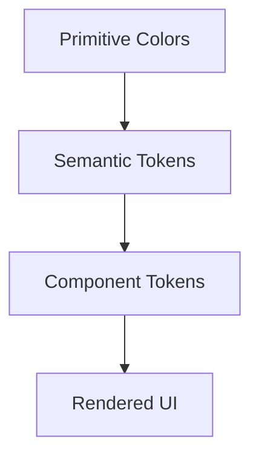
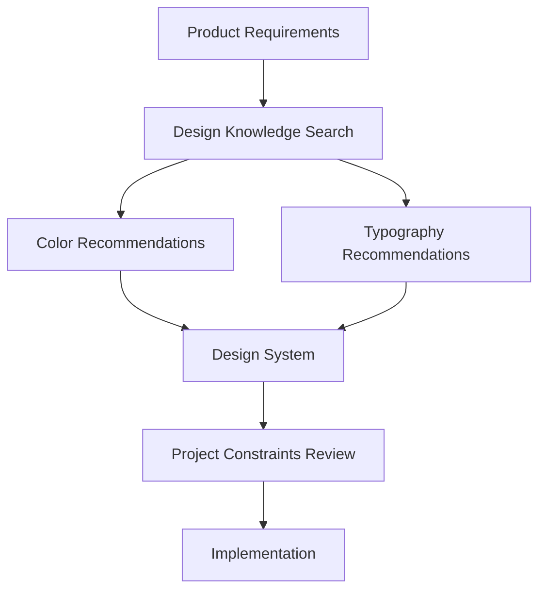

# 05 — UI/UX Pro Max: Color Systems and Typography

> [!abstract] Lesson Information
> **Repository:** [nextlevelbuilder/ui-ux-pro-max-skill](https://github.com/nextlevelbuilder/ui-ux-pro-max-skill)
>
> **Category:** UI/UX Design / Visual Design / Design Systems / Accessibility
>
> **Difficulty:** Beginner to Intermediate
>
> **Learning Approach:** Theory First
>
> **Prerequisites:** [[00 - Repository Overview]], [[01 - Architecture and Core Concepts]], [[02 - Installation and Codex Integration]], [[03 - Design Intelligence and Search Engine]], [[04 - UI Styles and Visual Design Principles]]
>
> **Primary Goal:** Understand color theory, semantic color systems, typography principles, accessibility contrast, and reusable design tokens, including how UI/UX Pro Max supports color and typography selection.

---

# 1. Learning Objectives

After completing this lesson, you should be able to:

1. Explain fundamental color theory.
2. Understand hue, saturation, and lightness.
3. Distinguish brand colors from semantic colors.
4. Explain common color harmonies.
5. Understand color usage in interface design.
6. Create a consistent color palette.
7. Explain accessibility contrast ratios.
8. Understand light and dark themes.
9. Define design tokens.
10. Explain typography anatomy and font classifications.
11. Select appropriate font pairings.
12. Establish a typography hierarchy.
13. Create a responsive type scale.
14. Apply color and typography principles across different technology stacks.
15. Evaluate UI/UX Pro Max recommendations against existing brand requirements.

---

# Part I — Understanding Color Theory

## 2. What Is Color Theory?

**Color theory** is the study of how colors relate to one another and how they can be combined to communicate meaning.

In interface design, color supports:

- Brand identity.
- Information hierarchy.
- Readability.
- Interaction feedback.
- Navigation.
- Status communication.
- Visual consistency.

Color is not simply decoration. It helps users understand the interface.

### Example

An administrative dashboard may use color to communicate primary actions, selected navigation, successful operations, warnings, errors, and neutral information. Color should not be the only way important status is conveyed.

---

# Part II — Color Properties

## 3. Hue, Saturation, and Lightness

**Hue** is the basic color family, such as red, orange, green, or blue.

**Saturation** is color intensity. Highly saturated colors appear vivid; low-saturation colors appear muted.

**Lightness** describes how light or dark a color appears.

### HSL Example

```css
.example {
  color: hsl(210 80% 45%);
}
```

Here, 210 represents hue, 80% saturation, and 45% lightness.

HSL can make it easier to reason about shades in one color family: a darker primary shade, a lighter background, a muted accent, or a hover state. However, equal HSL lightness values do not guarantee equal perceived brightness or accessible contrast.

---

# Part III — Color Models

## 4. Common Color Models

| Model | Description | Typical Use |
|---|---|---|
| HEX | Hexadecimal RGB notation | CSS and design tokens |
| RGB | Red, green, blue channels | Digital displays |
| HSL | Hue, saturation, lightness | Color adjustment |
| HSV | Hue, saturation, value | Color pickers |
| OKLCH | Perceptual lightness, chroma, hue | Modern color-system design |

### HEX

```css
color: #0b1629;
```

### RGB

```css
color: rgb(11 22 41);
```

### HSL

```css
color: hsl(218 58% 10%);
```

### OKLCH

```css
color: oklch(0.5 0.12 240);
```

OKLCH provides more perceptually meaningful lightness and chroma controls for constructing color variations. These models represent and adjust colors; they do not automatically determine whether a palette is appropriate or accessible.

---

# Part IV — Color Harmonies

## 5. What Are Color Harmonies?

Color harmonies describe relationships between colors. Common approaches include monochromatic, analogous, complementary, split-complementary, and triadic palettes.

### Monochromatic

Uses variations of one hue, such as dark navy, medium navy, light navy, and pale navy. Useful for restrained interfaces.

### Analogous

Uses neighboring hues, such as blue, cyan, and green. This can produce a cohesive direction.

### Complementary

Uses opposing hues on a color wheel, such as blue and orange. This can create strong emphasis.

### Triadic

Uses three approximately evenly spaced hues. This can create variety but requires careful balance.

Harmony does not guarantee usability. Contrast, brand fit, and semantic meaning matter as well.

---

# Part V — Color Psychology

## 6. How Colors Influence Perception

Colors can create associations, but meanings depend on culture, context, and personal experience.

| Color | Possible Associations |
|---|---|
| Blue | Stability, professionalism |
| Green | Growth, success |
| Orange | Energy, warmth |
| Red | Urgency, warning |
| Purple | Creativity |
| Black | Formality, sophistication |
| White | Simplicity, openness |

These are tendencies, not universal psychological rules.

A healthcare interface should not automatically use green just because it is associated with health. Consider brand identity, audience, product context, readability, and accessibility.

---

# Part VI — Brand Colors vs Semantic Colors

## 7. What Are Brand Colors?

Brand colors communicate an organization's visual identity, such as a primary brand color, secondary brand color, accent, or brand background.

## 7.1 What Are Semantic Colors?

Semantic colors communicate functional meaning, such as success, warning, error, information, disabled, or selected states.

| Brand Color | Semantic Color |
|---|---|
| Expresses identity | Expresses meaning |
| Used in brand elements | Used in interface states |
| May be visually distinctive | Should be predictable |
| Often relatively stable | Must remain understandable across themes |

A brand accent should not automatically be used as an error color. Define brand and semantic roles separately.

---

# Part VII — Building a Color System

## 8. Color System Layers

A mature color system often has three layers:

1. **Primitive tokens:** raw color values.
2. **Semantic tokens:** colors assigned to interface roles.
3. **Component tokens:** colors assigned to specific component elements.



### Example

```css
:root {
  /* Primitive tokens */
  --navy-900: #0b1629;
  --orange-500: #ff7448;
  --white-100: #f3f6fa;

  /* Semantic tokens */
  --color-text-primary: var(--navy-900);
  --color-page-background: var(--white-100);
  --color-brand-accent: var(--orange-500);

  /* Component tokens */
  --button-primary-background: var(--navy-900);
  --button-primary-text: #ffffff;
}
```

This illustrates token organization. Test actual foreground/background combinations for contrast.

---

# Part VIII — The 60–30–10 Principle

## 9. Understanding Visual Color Balance

The 60–30–10 principle is a common design heuristic. It suggests an approximate balance of:

- 60% dominant color.
- 30% supporting color.
- 10% accent color.

For a light business dashboard, the dominant area might be a neutral background, supporting colors might be surfaces and text, and accent colors might highlight brand elements and important actions.

This is not an accessibility standard or strict mathematical rule. Information-heavy interfaces may need a different distribution. The useful principle is intentional color balance.

---

# Part IX — Accessibility and Contrast

## 10. What Is Color Contrast?

Contrast describes the difference in relative luminance between two colors. For text, sufficient contrast improves readability. The WCAG contrast ratio ranges from 1:1 to 21:1.

### WCAG 2.2 AA Contrast Minimum

| Content | Minimum Contrast |
|---|---:|
| Normal text | 4.5:1 |
| Large text | 3:1 |
| Visual information needed to identify UI components or graphical objects, where applicable | 3:1 |

WCAG has exceptions and additional conditions. These thresholds are success criteria, not a substitute for considering real rendering, focus, states, and user settings.

## 10.1 Large Text Definition

For WCAG contrast criteria, large-scale text generally means at least 18pt regular or 14pt bold. These are typographic points, not CSS pixels; W3C explains that 14pt and 18pt are approximately 18.5px and 24px respectively.

## 10.2 Contrast Formula

```text
(L1 + 0.05) / (L2 + 0.05)
```

L1 is the lighter relative luminance and L2 the darker relative luminance.

## 10.3 Important Principle

A visually attractive color combination may still fail accessibility requirements. Check actual foreground-background combinations. Thin or unusual fonts can also appear fainter in practice, so exceeding the minimum can improve readability.

---

# Part X — Color Should Not Be the Only Signal

## 11. Accessible Status Communication

Weak status display:

```text
Green
Red
Yellow
```

Without labels, the meaning may be unclear. Prefer text labels and, where helpful, icons:

```text
● Active
● Inactive
● Maintenance
```

Some users have difficulty distinguishing certain colors, use high-contrast settings, view interfaces in bright environments, or use assistive technology.

**Use color to reinforce meaning, not as the only carrier of meaning.**

---

# Part XI — Light and Dark Themes

## 12. What Is a Theme?

A theme defines an interface's appearance under a set of conditions. Common themes include light, dark, and high contrast.

A light theme often uses light backgrounds, dark text, subtle borders, and controlled accents. A dark theme often uses dark backgrounds, light text, muted surfaces, and carefully controlled highlights.

## 12.1 Why Dark Mode Is Not Color Inversion

Simply inverting every color can make shadows ineffective, accents too intense, borders disappear, or status colors lose contrast. Dark themes need intentional semantic mappings.

---

# Part XII — Theme Tokens

## 13. CSS Theme Example

```css
:root {
  --background: #f3f6fa;
  --surface: #ffffff;
  --text-primary: #0b1629;
  --border: #d5dce5;
}

[data-theme="dark"] {
  --background: #101827;
  --surface: #1a2536;
  --text-primary: #f3f6fa;
  --border: #354255;
}
```

Component usage:

```css
.card {
  background: var(--surface);
  color: var(--text-primary);
  border: 1px solid var(--border);
}
```

The component references semantic tokens and does not need to know whether the active theme is light or dark. Example values still need contrast testing.

---

# Part XIII — Introduction to Typography

## 14. What Is Typography?

Typography is the arrangement and presentation of text. It influences readability, hierarchy, visual identity, scannability, information density, and user comprehension. Most applications communicate heavily through text, making typography a central part of interface design.

---

# Part XIV — Typography Anatomy

## 15. Important Typography Terms

| Term | Meaning |
|---|---|
| Typeface | Overall design family of letterforms |
| Font | Specific implementation or style of a typeface |
| Font weight | Thickness of strokes |
| Font size | Size of rendered text |
| Line height | Vertical spacing between lines |
| Letter spacing | Space between characters |
| Baseline | Line on which most characters sit |
| X-height | Height of lowercase x |
| Ascender | Portion extending above x-height |
| Descender | Portion extending below baseline |

Two fonts set to the same CSS size can look different because they have different x-heights, character widths, stroke contrast, and readability. Evaluate typography visually and functionally.

---

# Part XV — Font Classifications

## 16. Common Font Categories

**Serif:** Letterforms with decorative strokes or terminals; often used in editorial design, publications, and formal branding.

**Sans-serif:** Letterforms without traditional serif strokes; common in dashboards, web applications, mobile interfaces, and business websites.

**Monospace:** Characters generally occupy equal horizontal width; common in code editors, technical documentation, and terminal interfaces.

**Display:** Fonts designed for prominent headings or expressive branding; often less suitable for long paragraphs.

---

# Part XVI — Font Pairing

## 17. What Is Font Pairing?

Font pairing is the selection of typefaces that work together. A typical system may use one font for headings and another for body text, but a single typeface with different weights and sizes is often sufficient.

Choose fonts that:

1. Have complementary visual characteristics.
2. Provide clear hierarchy.
3. Remain readable.
4. Support required languages.
5. Have suitable weights.
6. Fit the brand.
7. Avoid unnecessary complexity.

| Heading | Body | Possible Direction |
|---|---|---|
| Inter | Inter | Minimal and consistent |
| Poppins | Inter | Modern and approachable |
| Playfair Display | Inter | Editorial |
| Manrope | Manrope | Contemporary and restrained |
| Merriweather | Source Sans 3 | Publication-oriented |

These are illustrative pairings, not guaranteed UI/UX Pro Max search results.

---

# Part XVII — Typography Hierarchy

## 18. What Is a Type Scale?

A type scale defines a consistent set of font sizes.

| Role | Size | Weight |
|---|---:|---|
| Display | 48px | 700 |
| H1 | 36px | 700 |
| H2 | 30px | 600 |
| H3 | 24px | 600 |
| Body Large | 18px | 400 |
| Body | 16px | 400 |
| Caption | 14px | 400 |

These are example values. A consistent scale improves hierarchy, visual rhythm, maintenance, and design consistency.

---

# Part XVIII — Modular Type Scales

## 19. What Is a Modular Scale?

A modular scale generates sizes using a ratio:

```text
Sₙ = S₀ × rⁿ
```

S₀ is the base size, r is the scale ratio, and n is the scale step.

For a 16px base and a 1.25 ratio:

| Step | Approximate Size |
|---|---:|
| 0 | 16px |
| 1 | 20px |
| 2 | 25px |
| 3 | 31.25px |
| 4 | 39.06px |

A modular scale is a starting point, not a requirement. Adjust sizes for actual content and screen constraints.

---

# Part XIX — Responsive Typography

## 20. Why Typography Must Be Responsive

A heading that works on desktop may overwhelm a mobile screen. Responsive typography adapts to available space.

### CSS clamp()

```css
.hero-title {
  font-size: clamp(2rem, 4vw, 3.5rem);
}
```

The browser selects a value between the minimum and maximum. Fluid typography should still be tested for zoom, wrapping, and readability.

---

# Part XX — Line Height and Readability

## 21. What Is Line Height?

Line height controls vertical spacing between text lines.

```css
.body-text {
  font-size: 1rem;
  line-height: 1.6;
}
```

Body text often benefits from more generous line spacing than large display headings. Display headings may use tighter line height; paragraphs may use more generous spacing; data tables may use compact but readable spacing. There is no single correct value for every font.

---

# Part XXI — Text Width and Readability

## 22. Why Line Length Matters

Very long lines can make it difficult to track the next line; very short lines can create excessive wrapping. Approximately 45–75 characters per line is a common starting point for paragraph content, depending on context.

```css
.article-content {
  max-width: 65ch;
}
```

The ch unit relates to the width of the 0 glyph in the current font. It is not an exact character-count guarantee.

---

# Part XXII — Design Tokens for Typography

## 23. CSS Typography Tokens

```css
:root {
  --font-sans: "Inter", Arial, sans-serif;

  --text-xs: 0.75rem;
  --text-sm: 0.875rem;
  --text-base: 1rem;
  --text-lg: 1.125rem;
  --text-xl: 1.25rem;
  --text-2xl: 1.5rem;
  --text-3xl: 1.875rem;

  --leading-tight: 1.2;
  --leading-normal: 1.5;
  --leading-relaxed: 1.7;
}
```

### Component Example

```css
.page-title {
  font-family: var(--font-sans);
  font-size: var(--text-3xl);
  line-height: var(--leading-tight);
  font-weight: 700;
}

.body-text {
  font-family: var(--font-sans);
  font-size: var(--text-base);
  line-height: var(--leading-relaxed);
}
```

---

# Part XXIII — Using UI/UX Pro Max

## 24. Color Search

The repository supports domain-specific design searches. Use the actual script path from the installed skill:

```powershell
python scripts/search.py "technology startup" --domain color
```

## 24.1 Typography Search

```powershell
python scripts/search.py "professional sans serif" --domain typography
```

## 24.2 Design-System Generation

The design-system workflow combines product, style, color, typography, and layout recommendations.



Evaluate results against existing brand decisions.

---

# Part XXIV — Case Study: HarayaForge

## 25. Existing Brand Identity

HarayaForge uses an established palette:

| Role | Color | HEX |
|---|---|---|
| Forge Navy | Primary structure | #0B1629 |
| Ember Orange | Primary accent | #FF7448 |
| Digital Cyan | Secondary accent | #46C7DC |
| Cloud White | Light background | #F3F6FA |

### Design Direction

- Minimal.
- Professional.
- Flat solid colors.
- Restrained accents.
- No unnecessary gradients.
- Strong typography hierarchy.

### Recommended Token Structure

```css
:root {
  --forge-navy: #0b1629;
  --ember-orange: #ff7448;
  --digital-cyan: #46c7dc;
  --cloud-white: #f3f6fa;

  --color-primary: var(--forge-navy);
  --color-accent: var(--ember-orange);
  --color-secondary-accent: var(--digital-cyan);
  --color-background: var(--cloud-white);

  --color-text-primary: var(--forge-navy);
}
```

The existing palette remains authoritative. UI/UX Pro Max can help improve color-role assignment, typography pairing, contrast, responsive hierarchy, and component consistency. It should not automatically replace the brand colors.

---

# Part XXV — Case Study: GoPasig

## 26. Fleet Management Dashboard

A fleet dashboard needs a functional color system.

| Status | Meaning |
|---|---|
| Active | Vehicle currently operating |
| Inactive | Vehicle not operating |
| Maintenance | Vehicle unavailable due to maintenance |
| Warning | Operational issue requiring attention |

Status meanings should remain consistent across dashboard cards, data tables, route details, vehicle information, and reports. Keep labels visible and understandable.

---

# Part XXVI — Case Study: Next.js E-Commerce

## 27. Typography and Color Architecture

A Next.js application can centralize design tokens:

```css
:root {
  --color-background: #ffffff;
  --color-text: #111827;
  --color-border: #e5e7eb;

  --font-body: "Inter", sans-serif;
}
```

Benefits include shared styling across pages, consistent admin and customer interfaces, easier theme changes, and less duplicated CSS.

A design system can support different role-based layouts without forcing every page to use the same structure.

---

# Part XXVII — Case Study: Android GroupTrack

## 28. Android Color Resources

In an Android Java/XML project, colors can be defined in resource files:

```xml
<resources>
    <color name="primary">#0B1629</color>
    <color name="accent">#FF7448</color>
    <color name="background">#F3F6FA</color>
</resources>
```

These are illustrative colors, not an instruction to change a project's current palette.

Android XML layouts can use text appearances, theme attributes, dimension resources, and font resources. Follow the existing Android architecture; do not migrate to Jetpack Compose merely to apply typography or color guidance.

---

# Part XXVIII — Common Mistakes

## 29. Color Mistakes

- Too many accent colors.
- Inconsistent semantic meanings.
- Low-contrast text.
- Using color alone for status.
- Ignoring dark-theme requirements.
- Replacing brand colors without approval.

## 29.1 Typography Mistakes

- Too many font families.
- Inconsistent font sizes.
- Poor line height.
- Very long paragraphs.
- Tiny supporting text.
- Weak heading hierarchy.
- Excessive font weights.
- Ignoring mobile wrapping.

## 29.2 Design-System Mistakes

- Hardcoding colors repeatedly.
- Duplicating typography values.
- Creating unnecessary tokens.
- Using unclear token names.
- Mixing primitive and semantic roles.
- Failing to document decisions.

---

# Part XXIX — Practical Exercises

## 30. Exercise 1 — Color Roles

Create a color-role table for a hypothetical software dashboard. Include primary, accent, background, surface, text, border, success, warning, and error. Explain each role.

## 31. Exercise 2 — Contrast Evaluation

Choose three foreground/background combinations. For each, identify both colors, calculate or check the contrast ratio, determine whether it meets the relevant WCAG threshold, and suggest an adjustment if needed.

## 32. Exercise 3 — Typography System

Create a hierarchy containing Display, H1, H2, H3, Body, and Caption. Specify font family, size, weight, and line height.

## 33. Exercise 4 — Font Pairing

Compare Inter + Inter, Poppins + Inter, and Playfair Display + Inter. Explain which might fit a SaaS dashboard, software startup, and editorial portfolio.

## 34. Exercise 5 — Responsive Typography

Design a responsive heading scale for mobile, tablet, and desktop. Explain how to prevent oversized headings and awkward wrapping.

## 35. Exercise 6 — Design Tokens

Create a CSS token system containing primitive colors, semantic colors, typography sizes, line heights, and spacing values. Explain why each layer exists.

## 36. Exercise 7 — Brand Preservation

UI/UX Pro Max recommends a purple palette for an existing navy-and-orange brand. Explain why it should not automatically replace the brand, which insights might still be useful, how to document the final decision, and how to communicate constraints to Codex.

---

# Part XXX — Knowledge Check

## 37. Review Questions

1. What is color theory?
2. What is hue?
3. What is saturation?
4. What is lightness?
5. How does HSL differ from RGB?
6. What is OKLCH?
7. What is color harmony?
8. What is a monochromatic palette?
9. What is a complementary palette?
10. Why is color psychology context-dependent?
11. What is a brand color?
12. What is a semantic color?
13. What is a primitive token?
14. What is a component token?
15. What is the 60–30–10 principle?
16. What is a contrast ratio?
17. What are common WCAG AA text thresholds?
18. Why should color not be the only status indicator?
19. Why is dark mode not simple color inversion?
20. What is typography?
21. What is a typeface?
22. What is x-height?
23. What is font pairing?
24. What is a type scale?
25. What is a modular scale?
26. What is responsive typography?
27. What does CSS clamp() do?
28. Why is line height important?
29. Why should paragraph width be controlled?
30. How does UI/UX Pro Max support color and typography decisions?

---

# Part XXXI — Key Takeaways

> [!summary]
> - Color communicates identity, hierarchy, and functional meaning.
> - Hue, saturation, and lightness describe important color properties.
> - Color harmony helps create cohesive palettes but does not guarantee usability.
> - Brand colors and semantic colors have different responsibilities.
> - Primitive, semantic, and component tokens support maintainable design systems.
> - Accessibility contrast must be checked using actual color combinations.
> - Color should reinforce meaning rather than communicate it alone.
> - Light and dark themes require intentional color mapping.
> - Typography strongly affects readability and hierarchy.
> - Font pairing should be purposeful and restrained.
> - Type scales improve consistency.
> - Responsive typography adapts hierarchy to available space.
> - Line height and line length affect readability.
> - UI/UX Pro Max provides searchable color and typography recommendations.
> - Existing brand identity should remain authoritative unless redesign is explicitly requested.

---

# Part XXXII — Final Mental Model

```text
PRODUCT REQUIREMENTS
         |
         v
EXISTING BRAND IDENTITY
         |
         v
COLOR AND TYPOGRAPHY RESEARCH
         |
         v
PRIMITIVE DESIGN TOKENS
         |
         v
SEMANTIC DESIGN TOKENS
         |
         v
COMPONENT STYLES
         |
         v
RESPONSIVE IMPLEMENTATION
         |
         v
ACCESSIBILITY VERIFICATION
         |
         v
CONSISTENT USER INTERFACE
```

A professional interface does not need many colors or fonts. It needs a purposeful visual system that supports readability, usability, and brand consistency.

---

# Part XXXIII — Official References

## UI/UX Pro Max

- [Official GitHub Repository](https://github.com/nextlevelbuilder/ui-ux-pro-max-skill)
- [README](https://github.com/nextlevelbuilder/ui-ux-pro-max-skill/blob/main/README.md)
- [Design Datasets](https://github.com/nextlevelbuilder/ui-ux-pro-max-skill/tree/main/src/ui-ux-pro-max/data)
- [Search Scripts](https://github.com/nextlevelbuilder/ui-ux-pro-max-skill/tree/main/src/ui-ux-pro-max/scripts)

## Color and Accessibility

- [WCAG 2.2](https://www.w3.org/TR/WCAG22/)
- [WCAG Understanding Contrast Minimum](https://www.w3.org/WAI/WCAG22/Understanding/contrast-minimum.html)
- [WCAG Understanding Non-text Contrast](https://www.w3.org/WAI/WCAG22/Understanding/non-text-contrast.html)
- [MDN CSS Color](https://developer.mozilla.org/en-US/docs/Web/CSS/color_value)
- [MDN OKLCH](https://developer.mozilla.org/en-US/docs/Web/CSS/color_value/oklch)

## Typography

- [Material Design Typography](https://m3.material.io/styles/typography/overview)
- [Google Fonts](https://fonts.google.com/)
- [MDN CSS Typography](https://developer.mozilla.org/en-US/docs/Learn_web_development/Core/Text_styling/Fundamentals)
- [MDN CSS clamp()](https://developer.mozilla.org/en-US/docs/Web/CSS/clamp)

> [!note] Documentation Scope
> This lesson combines general color and typography theory with the UI/UX Pro Max repository's documented design-search capabilities.
>
> Example palettes, CSS values, and font pairings are educational examples, not necessarily direct outputs from the repository's search engine.

---

# Part XXXIV — Next Lesson

**[[06 - Design System Generation]]**

Topics:

1. Design-system generation architecture.
2. Multi-domain search pipeline.
3. Product-specific reasoning.
4. Design-system recommendations.
5. Master design systems.
6. Page-specific design overrides.
7. Design token organization.
8. Component specifications.
9. Design-system documentation.
10. Brand consistency.
11. Codex workflow integration.
12. Versioning and maintenance.
13. Android, Laravel, and Next.js examples.
14. Practical exercises.
15. Official references.

**End of Lesson 05 — Color Systems and Typography.**