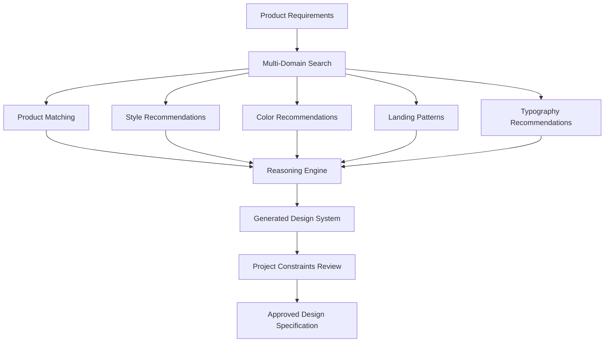
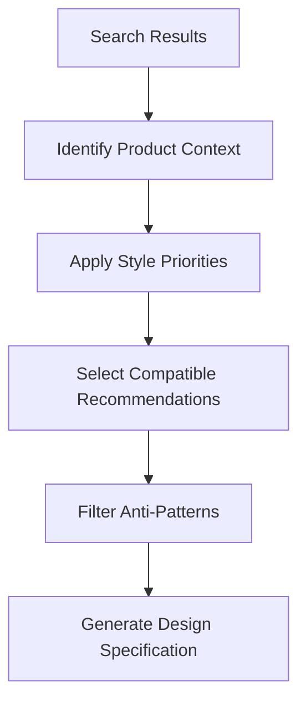
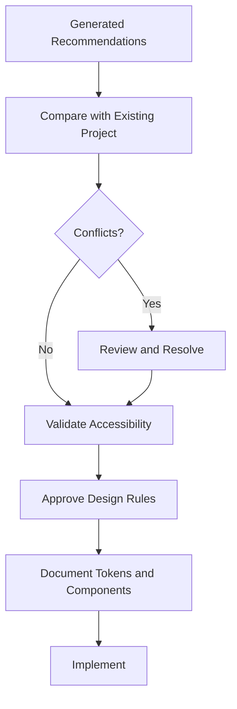
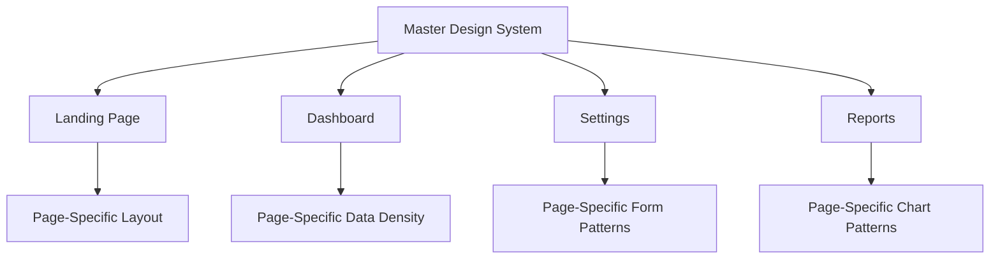
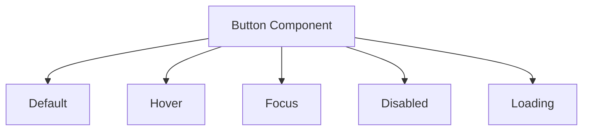
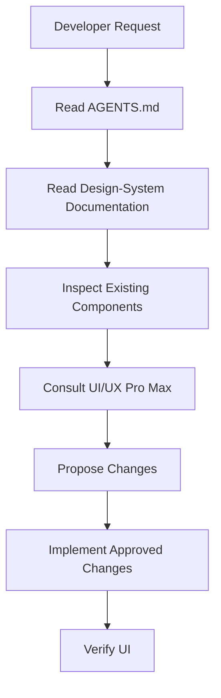
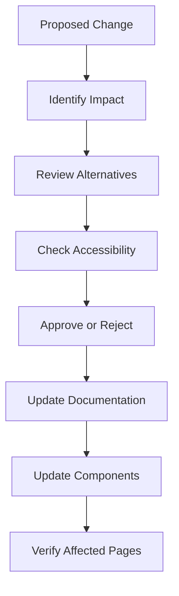
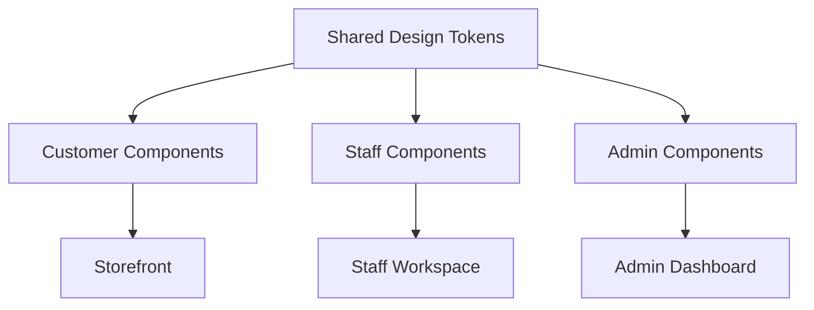

# 06 — UI/UX Pro Max: Design System Generation

> [!abstract] Lesson Information
> **Repository:** [nextlevelbuilder/ui-ux-pro-max-skill](https://github.com/nextlevelbuilder/ui-ux-pro-max-skill)
>
> **Category:** Agentic Engineering / Design Systems / UI/UX Architecture
>
> **Difficulty:** Intermediate
>
> **Learning Approach:** Theory First
>
> **Prerequisites:** [[05 - Color Systems and Typography]]
>
> **Primary Goal:** Understand how UI/UX Pro Max generates design recommendations and how developers transform those recommendations into consistent, reusable, maintainable design systems.

---

# 1. Learning Objectives

After completing this lesson, you should be able to:

1. Define a design system and distinguish it from a style guide.
2. Explain the UI/UX Pro Max design-system generation pipeline.
3. Understand multi-domain design retrieval.
4. Explain product-specific reasoning and anti-pattern filtering.
5. Interpret generated design-system recommendations.
6. Distinguish generated recommendations from approved project rules.
7. Design a master design system.
8. Understand page-specific overrides.
9. Organize primitive, semantic, and component tokens.
10. Define reusable component specifications.
11. Document design decisions for AI coding agents.
12. Integrate design-system guidance with Codex and `AGENTS.md`.
13. Apply design-system concepts across Next.js, Laravel, and Android.
14. Understand versioning, governance, and maintenance.
15. Recognize common design-system implementation mistakes.

---

# Part I — Understanding Design Systems

## 2. What Is a Design System?

A **design system** is a collection of reusable standards, components, design decisions, and guidelines that help teams build consistent interfaces.

A complete design system may contain:

- Design principles.
- Color tokens.
- Typography tokens.
- Spacing rules.
- Layout conventions.
- Component specifications.
- Interaction states.
- Accessibility guidelines.
- Responsive behavior.
- Documentation.

A design system is more than a collection of attractive UI examples.

It defines how interfaces should be built and maintained.

## 2.1 Design System vs Style Guide vs Component Library

| Concept | Primary Purpose |
|---|---|
| Style guide | Defines visual presentation rules |
| Component library | Provides reusable UI components |
| Design system | Connects design principles, tokens, components, behaviors, and governance |

### Example

A style guide might say:

"Primary buttons use navy backgrounds."

A component library might provide:

```tsx
<Button variant="primary">
  Save Changes
</Button>
```

A design system explains:

- When to use primary buttons.
- Which colors and dimensions they use.
- How they behave when disabled.
- What their focus state looks like.
- How loading is communicated.
- How they adapt across platforms.

> [!important]
> A design system defines both visual consistency and interaction consistency.

---

# Part II — UI/UX Pro Max Design-System Generator

## 3. What Does the Generator Do?

UI/UX Pro Max includes a design-system generator that analyzes product descriptions and combines recommendations from several design knowledge domains.

The repository's documented pipeline consists of:

1. User request.
2. Multi-domain search.
3. Product-specific reasoning.
4. Design-system output.

The generator produces a recommended design direction.

It does not automatically establish an approved organizational design system.

## 3.1 Architecture



### Important Distinction

The final two stages—project review and approval—are recommended engineering practices added to the repository's generation workflow.

They are necessary when working with established brands or production applications.

---

# Part III — Multi-Domain Retrieval

## 4. What Is Multi-Domain Search?

Multi-domain search retrieves information from multiple design knowledge categories.

The repository documents five primary searches in its generation pipeline.

| Domain | Purpose |
|---|---|
| Product type | Identify the product category |
| UI style | Recommend visual characteristics |
| Color | Recommend a palette |
| Landing pattern | Recommend page structure |
| Typography | Recommend font pairings |

These results are combined through the reasoning engine.

## 4.1 Example

User request:

"Create a professional website for a software development agency."

The generator may investigate:

**Product type**

Software agency or professional service.

**Style**

Minimal, corporate, or another relevant direction.

**Color**

Palette suitable for the product category.

**Landing pattern**

Hero, capabilities, work, trust signals, and contact.

**Typography**

Readable headings and body text.

The combined recommendations form a starting design specification.

---

# Part IV — Product-Specific Reasoning

## 5. What Is the Reasoning Engine?

The reasoning engine helps connect design recommendations to product requirements.

According to the repository documentation, it considers:

- Product-category rules.
- Style priorities.
- BM25-ranked matches.
- Industry-specific anti-patterns.
- JSON-based decision rules.

## 5.1 Why Is Reasoning Necessary?

Without product-specific reasoning, a search engine might retrieve individually relevant results that do not work well together.

For example:

- An editorial typography recommendation.
- A highly decorative visual style.
- A dense enterprise dashboard layout.

Each result may be relevant to part of the query, but the combination may be inconsistent.

Reasoning rules help prioritize a coherent direction.

## 5.2 Conceptual Pipeline



### Key Principle

A good design system is a coordinated set of decisions, not a random collection of popular styles.

---

# Part V — Understanding Generated Output

## 6. What Does UI/UX Pro Max Generate?

The repository's example design-system output includes:

| Section | Description |
|---|---|
| Pattern | Recommended page structure |
| Style | Visual design direction |
| Colors | Primary, secondary, CTA, background, and text colors |
| Typography | Font pairing and visual mood |
| Key effects | Recommended interactions and visual effects |
| Anti-patterns | Design decisions to avoid |
| Pre-delivery checklist | Quality and accessibility considerations |

## 6.1 Example Output Structure

```text
RECOMMENDED DESIGN SYSTEM
│
├── PATTERN
│   ├── Page structure
│   ├── CTA placement
│   └── Content sequence
│
├── STYLE
│   ├── Visual characteristics
│   └── Product suitability
│
├── COLORS
│   ├── Primary
│   ├── Secondary
│   ├── CTA
│   ├── Background
│   └── Text
│
├── TYPOGRAPHY
│   ├── Heading font
│   └── Body font
│
├── KEY EFFECTS
│
├── ANTI-PATTERNS
│
└── PRE-DELIVERY CHECKLIST
```

This is a simplified educational representation of the documented output.

---

# Part VI — Generating a Design System

## 7. Design-System Command

The repository documents the following command pattern:

```powershell
python scripts/search.py "software agency website" --design-system -p "Agency Website"
```

The `scripts/search.py` path must be adjusted to the actual installed skill directory.

## 7.1 Markdown Output

```powershell
python scripts/search.py "software agency website" --design-system -f markdown
```

The `-f markdown` option requests Markdown-formatted output.

This is particularly useful when documenting design decisions in Obsidian or a project repository.

## 7.2 Command Responsibilities

| Argument | Responsibility |
|---|---|
| Product description | Defines the design context |
| `--design-system` | Requests a combined design recommendation |
| `-p` | Supplies a project name |
| `-f markdown` | Requests Markdown output |

## 7.3 Important Limitation

The output is a recommendation.

Before implementation, it should be checked against:

- Existing branding.
- Functional requirements.
- Accessibility standards.
- Technical constraints.
- Component architecture.
- Project scope.

---

# Part VII — Generated vs Approved Design Systems

## 8. Two Different Artifacts

An important engineering distinction is the difference between a **generated recommendation** and an **approved design system**.

### Generated Recommendation

Produced from a design intelligence workflow.

It may suggest:

- Colors.
- Fonts.
- Layouts.
- Effects.
- Interaction patterns.

### Approved Design System

Reviewed and accepted for use in the project.

It reflects:

- Existing branding.
- User requirements.
- Platform conventions.
- Accessibility decisions.
- Technical feasibility.

## 8.1 Approval Workflow



> [!important]
> Never treat generated colors, typography, or layout recommendations as permission to replace an existing brand identity.

---

# Part VIII — Master Design Systems

## 9. What Is a Master Design System?

A **master design system** defines the foundational rules shared across an application.

It acts as the single source of truth for recurring design decisions.

Examples:

- Brand colors.
- Typography families.
- Spacing scale.
- Border radii.
- Elevation rules.
- Component variants.
- Accessibility conventions.

## 9.1 Conceptual Structure

```text
Master Design System
├── Foundations
│   ├── Colors
│   ├── Typography
│   ├── Spacing
│   ├── Radius
│   └── Elevation
│
├── Components
│   ├── Buttons
│   ├── Inputs
│   ├── Cards
│   ├── Tables
│   └── Navigation
│
├── Patterns
│   ├── Forms
│   ├── Dashboards
│   └── Responsive Layouts
│
└── Guidelines
    ├── Accessibility
    ├── Interaction
    └── Content
```

This is a recommended project architecture, not a claim about the exact output directory generated by UI/UX Pro Max.

---

# Part IX — Page-Specific Overrides

## 10. Why Do Pages Need Overrides?

Different pages may have different functional needs.

For example:

**Landing page**

Marketing-oriented layout.

**Dashboard**

Information-dense layout.

**Settings page**

Form-oriented layout.

**Reports page**

Data visualization and tables.

They should share the same design foundations without being forced into identical layouts.

## 10.1 Inheritance Model



## 10.2 Example

Master rule:

```text
All primary buttons use the approved primary button style.
```

Dashboard override:

```text
Dashboard action groups may use compact spacing.
```

The dashboard changes its layout density without inventing a new primary button design.

## 10.3 Override Boundaries

A page override may reasonably change:

- Layout composition.
- Content density.
- Grid structure.
- Section arrangement.
- Page-specific component placement.

A page override should not casually change:

- Brand colors.
- Global typography.
- Core button semantics.
- Accessibility requirements.
- Navigation behavior.

### Key Principle

**Page-level flexibility should not destroy system-wide consistency.**

---

# Part X — Design Tokens

## 11. What Are Design Tokens?

Design tokens are named values representing reusable design decisions.

Examples:

```text
color.primary
color.background
spacing.md
radius.card
font.body
```

They separate design meaning from hardcoded implementation values.

## 11.1 Token Layers

A maintainable system often distinguishes:

1. Primitive tokens.
2. Semantic tokens.
3. Component tokens.

### Primitive Tokens

Raw values.

```css
:root {
  --navy-900: #0b1629;
  --orange-500: #ff7448;
  --white-100: #f3f6fa;
}
```

### Semantic Tokens

Interface roles.

```css
:root {
  --color-text-primary: var(--navy-900);
  --color-page-background: var(--white-100);
  --color-brand-accent: var(--orange-500);
}
```

### Component Tokens

Component-specific mappings.

```css
:root {
  --button-primary-background: var(--navy-900);
  --button-primary-text: #ffffff;
}
```

## 11.2 Why Tokens Matter

Without tokens, developers may repeatedly hardcode values.

With tokens, design changes become easier to coordinate.

For example, changing the background token updates every component that references it.

---

# Part XI — Token Naming

## 12. Good Token Names

Good token names communicate purpose.

Examples:

```text
color.text.primary
color.surface.default
color.border.subtle
spacing.section
radius.card
```

Weak names:

```text
blue1
niceOrange
bigSpacing
buttonColor2
```

## 12.1 Naming Principles

Use names that are:

- Consistent.
- Meaningful.
- Reusable.
- Easy to understand.
- Independent of arbitrary page locations.

### Important

Avoid creating dozens of tokens for values that are used only once and have no meaningful reusable role.

---

# Part XII — Component Specifications

## 13. What Is a Component Specification?

A component specification defines how a reusable UI element should look and behave.

For example, a button specification may include:

- Purpose.
- Variants.
- Dimensions.
- Typography.
- Colors.
- States.
- Accessibility requirements.
- Responsive behavior.

## 13.1 Example Button Specification

| Property | Specification |
|---|---|
| Component | Button |
| Variants | Primary, secondary, destructive |
| Sizes | Small, medium, large |
| States | Default, hover, focus, disabled, loading |
| Accessibility | Keyboard operable, visible focus |
| Text | Clear action label |
| Responsive behavior | Avoid clipping or unusably small targets |

## 13.2 Component State Model



### Important

A component is not complete simply because its default appearance looks correct.

Its interaction states must also be considered.

---

# Part XIII — Design Patterns

## 14. Components vs Patterns

A **component** is a reusable UI element.

A **pattern** describes how components work together to support a task.

Examples:

| Component | Pattern |
|---|---|
| Input | Registration form |
| Card | KPI dashboard |
| Button | Confirmation flow |
| Table | Searchable inventory |
| Navigation item | Application sidebar |

## 14.1 Example: Form Pattern

A form pattern may specify:

- Label placement.
- Required-field indicators.
- Validation timing.
- Error messages.
- Submission feedback.
- Loading states.
- Success confirmation.

This ensures consistency beyond individual component appearance.

---

# Part XIV — Responsive Design Specifications

## 15. Why Responsive Rules Belong in a Design System

Responsive design should not be handled independently on every page.

A design system can define:

- Content widths.
- Grid behavior.
- Navigation changes.
- Component stacking.
- Typography scaling.
- Spacing adjustments.

## 15.1 Example

```text
Desktop
├── Sidebar navigation
├── Multi-column dashboard
└── Full data table

Tablet
├── Compact navigation
├── Two-column cards
└── Scrollable data table when necessary

Mobile
├── Simplified navigation
├── Single-column cards
└── Task-appropriate table alternative
```

## 15.2 Important

Responsive design should be based on content needs.

A mobile interface should not automatically hide essential information simply to make the layout look cleaner.

---

# Part XV — Accessibility in Design Systems

## 16. Accessibility as a Shared Rule

Accessibility requirements should be included in the master design system.

Examples:

- Sufficient contrast.
- Visible keyboard focus.
- Meaningful labels.
- Accessible error feedback.
- Appropriate interaction targets.
- Reduced-motion support.
- Responsive text wrapping.

## 16.1 Why Centralize Accessibility?

If every developer independently decides how focus states should look, the application may become inconsistent.

A shared specification helps establish predictable behavior.

## 16.2 Example

```css
.button:focus-visible {
  outline: 3px solid var(--color-focus);
  outline-offset: 2px;
}
```

The focus token must be selected to provide sufficient visibility against relevant backgrounds.

### Important

Documented accessibility rules still require implementation testing.

---

# Part XVI — Design-System Documentation

## 17. Why Document the Design System?

Without documentation, design decisions may be lost between development sessions.

This is especially important when using AI coding agents.

An agent may otherwise:

- Introduce new colors.
- Change typography.
- Duplicate components.
- Create inconsistent spacing.
- Add unnecessary effects.

## 17.1 Suggested Documentation Structure

```text
docs/
└── design-system/
    ├── README.md
    ├── foundations.md
    ├── colors.md
    ├── typography.md
    ├── spacing.md
    ├── components.md
    ├── responsive.md
    ├── accessibility.md
    └── decisions.md
```

This is a suggested project structure.

It is not a required UI/UX Pro Max installation structure.

## 17.2 What Should README.md Contain?

A design-system README should explain:

- Purpose.
- Scope.
- Approved visual direction.
- Documentation links.
- How components should be reused.
- How design changes are proposed.
- Who approves major changes.

---

# Part XVII — Design Decisions and ADRs

## 18. What Is a Design Decision Record?

A design decision record documents why a particular design choice was made.

It is similar in purpose to an Architecture Decision Record.

## 18.1 Example

```markdown
# DDR-001 — Primary Button Style

## Context

The application requires a consistent primary action style.

## Decision

Use the approved brand primary color for primary buttons.

## Rationale

Maintains visual consistency and clear action hierarchy.

## Alternatives Considered

Using the accent color for all buttons.

## Consequences

Existing components must follow the approved button specification.
```

## 18.2 Benefits

- Reduces repeated debates.
- Preserves context.
- Helps future developers.
- Guides AI coding agents.
- Supports controlled design changes.

---

# Part XVIII — Codex Integration

## 19. How Should Codex Use a Design System?

Codex should treat the approved project design system as a source of project-specific guidance.

UI/UX Pro Max can provide additional recommendations.

The implementation should reconcile both.

## 19.1 Workflow



## 19.2 Example AGENTS.md Guidance

```markdown
# UI/UX Rules

- Read docs/design-system/README.md before UI changes.
- Preserve approved colors and typography.
- Reuse existing components.
- Follow established spacing tokens.
- Do not introduce new UI libraries without approval.
- Avoid unnecessary visual effects.
- Keep layouts responsive.
- Verify accessibility-related interaction states.
- Do not redesign unrelated pages.
```

### Important

`AGENTS.md` should point to the authoritative documentation rather than duplicating an entire design system.

This reduces conflicting instructions.

---

# Part XIX — Master Design System vs Page Overrides in Codex

## 20. Example Workflow

Developer request:

"Improve the reports page without changing the overall application design."

Codex should:

1. Read the master design system.
2. Inspect the reports page.
3. Identify the specific problem.
4. Search relevant UI/UX guidance.
5. Preserve shared components.
6. Apply page-specific layout improvements.
7. Verify consistency.

## 20.1 Example Prompt

```text
Read AGENTS.md and the existing design-system documentation.

Use UI/UX Pro Max to review the Reports page.

Preserve the approved brand palette, typography,
spacing tokens, and shared components.

Focus only on information hierarchy, chart layout,
responsive behavior, and accessibility.

Propose the changes before modifying source files.
```

---

# Part XX — Design-System Versioning

## 21. Why Version a Design System?

A design system evolves as the product changes.

Possible changes include:

- New component variants.
- Updated typography.
- Revised spacing.
- Accessibility improvements.
- Deprecated components.

Versioning helps teams understand these changes.

## 21.1 Example

```text
Design System v1.0
├── Colors
├── Typography
├── Spacing
└── Buttons

Design System v1.1
├── Existing foundations
├── New form states
└── Improved focus indicators
```

## 21.2 Semantic Versioning as a Convention

A team may choose:

| Change Type | Example |
|---|---|
| Major | Breaking component API changes |
| Minor | New backward-compatible component |
| Patch | Small correction |

This is a recommended governance convention, not a required UI/UX Pro Max feature.

---

# Part XXI — Design-System Governance

## 22. What Is Governance?

Governance defines how design-system changes are proposed, reviewed, and approved.

Without governance, developers may independently modify shared rules.

## 22.1 Simple Governance Workflow



## 22.2 Recommended Rules

- Avoid unnecessary new components.
- Reuse existing patterns.
- Document major changes.
- Review changes that affect multiple pages.
- Test accessibility.
- Keep implementation and documentation synchronized.

---

# Part XXII — Case Study: HarayaForge

## 23. Startup Website Design System

### Existing Brand Foundations

| Token | Value |
|---|---|
| Forge Navy | `#0B1629` |
| Ember Orange | `#FF7448` |
| Digital Cyan | `#46C7DC` |
| Cloud White | `#F3F6FA` |

### Visual Direction

- Minimal.
- Professional.
- Flat solid colors.
- Restrained accents.
- No unnecessary gradients.

## 23.1 Master Design System

```text
HarayaForge Design System
├── Brand Colors
├── Typography
├── Spacing
├── Buttons
├── Cards
├── Navigation
├── Forms
└── Responsive Rules
```

## 23.2 Page-Specific Patterns

**Home**

Hero, capabilities preview, company introduction.

**Capabilities**

Service grid and technical information.

**Team**

Member cards and shared principles.

**Contact**

Accessible contact form.

Each page has a different content structure but shares the same visual foundation.

### Engineering Lesson

Use UI/UX Pro Max to improve page composition without replacing approved brand decisions.

---

# Part XXIII — Case Study: GoPasig

## 24. Fleet Management Design System

### Shared Foundations

- Consistent typography.
- Standard spacing.
- Reusable status labels.
- Common navigation.
- Shared form components.

### Page Patterns

| Page | Specialized Pattern |
|---|---|
| Dashboard | KPI cards and operational summaries |
| Routes | Route lists and map controls |
| Schedules | Tables and scheduling forms |
| Drivers | Management tables and status indicators |
| Reports | Filters and data visualizations |

## 24.1 Example Component Inventory

```text
Components
├── AppSidebar
├── PageHeader
├── StatusBadge
├── DataTable
├── FilterBar
├── MetricCard
├── FormField
└── ConfirmationDialog
```

These are proposed conceptual component names, not claims about existing project files.

### Engineering Lesson

A shared design system reduces inconsistencies between administrative modules.

---

# Part XXIV — Case Study: Next.js E-Commerce

## 25. Shared Design System Across Roles

An e-commerce platform may contain:

- Customer pages.
- Staff pages.
- Admin pages.

These interfaces serve different tasks.

However, they can share foundational design rules.

## 25.1 Architecture



## 25.2 Example

Customer pages may use product cards.

Admin pages may use inventory tables.

Both can share:

- Button styles.
- Typography.
- Form controls.
- Status colors.
- Spacing conventions.

### Engineering Lesson

Different role-based layouts do not require separate, incompatible design systems.

---

# Part XXV — Case Study: Android GroupTrack

## 26. Android Java/XML Design System

For an Android application using Java and XML, design foundations may be stored in Android resources.

Examples:

```text
res/
├── values/
│   ├── colors.xml
│   ├── dimens.xml
│   ├── styles.xml
│   └── themes.xml
└── layout/
```

## 26.1 Example

```xml
<resources>
    <dimen name="spacing_small">8dp</dimen>
    <dimen name="spacing_medium">16dp</dimen>
    <dimen name="spacing_large">24dp</dimen>
</resources>
```

This is an illustrative resource definition.

## 26.2 Important Distinction

The repository documents Android guidance for Jetpack Compose.

General design principles can still apply to Java/XML projects, but implementation guidance must be adapted to the actual technology.

### Engineering Lesson

A design system should fit the existing application architecture.

Do not migrate frameworks merely to follow a design recommendation.

---

# Part XXVI — Common Mistakes

## 27. Treating Generated Output as Final

A generated design system should be reviewed before adoption.

## 27.1 Duplicating Tokens

Creating multiple tokens for the same purpose can make the system difficult to maintain.

## 27.2 Too Many Component Variants

Excessive variants increase complexity.

Create variants only when they represent meaningful differences.

## 27.3 Ignoring Interaction States

A component specification should include focus, disabled, loading, and error behavior where relevant.

## 27.4 Overriding Global Rules Per Page

Frequent exceptions weaken consistency.

## 27.5 Documentation Drift

Documentation becomes unreliable when it no longer matches the implementation.

## 27.6 Overengineering

A small MVP does not need an enterprise-scale design-system package.

Start with the rules and components the project actually uses.

---

# Part XXVII — Practical Exercises

## 28. Exercise 1 — Design-System Architecture

Create a conceptual design system containing:

1. Foundations.
2. Tokens.
3. Components.
4. Patterns.
5. Accessibility guidelines.
6. Documentation.

Explain the responsibility of each layer.

---

## 29. Exercise 2 — Generated vs Approved

Scenario:

A generator recommends a new palette for an existing branded application.

Explain:

- Which recommendations require approval.
- Which existing decisions should be preserved.
- How to document the final decision.
- How Codex should be instructed.

---

## 30. Exercise 3 — Master and Page Overrides

Design a master system for an admin application.

Then define page-specific patterns for:

- Dashboard.
- Reports.
- Settings.

Identify which rules are shared and which are page-specific.

---

## 31. Exercise 4 — Token Design

Create:

- Five primitive color tokens.
- Five semantic tokens.
- Three component tokens.
- Six spacing tokens.
- Four typography tokens.

Explain why each token exists.

---

## 32. Exercise 5 — Component Specification

Write a specification for a reusable button.

Include:

- Variants.
- Sizes.
- States.
- Accessibility.
- Responsive behavior.
- Usage guidelines.

---

## 33. Exercise 6 — Codex Workflow

Create a prompt that instructs Codex to:

1. Read existing design documentation.
2. Inspect components.
3. Consult UI/UX Pro Max.
4. Recommend improvements.
5. Preserve existing branding.
6. Avoid unnecessary dependencies.
7. Wait for approval before implementation.

---

## 34. Exercise 7 — Change Impact

Scenario:

A team wants to change the global border radius used by cards.

Identify:

- Affected components.
- Affected pages.
- Documentation changes.
- Testing requirements.
- Potential risks.

---

# Part XXVIII — Knowledge Check

## 35. Review Questions

1. What is a design system?
2. How does it differ from a style guide?
3. How does it differ from a component library?
4. What is multi-domain retrieval?
5. What are the five primary design domains used by the generator?
6. What is product-specific reasoning?
7. Why are anti-patterns important?
8. What does the generator produce?
9. What is the difference between generated and approved design systems?
10. What is a master design system?
11. Why are page-specific overrides useful?
12. What are primitive tokens?
13. What are semantic tokens?
14. What are component tokens?
15. Why does token naming matter?
16. What is a component specification?
17. What is the difference between a component and a pattern?
18. Why should responsive rules be shared?
19. Why should accessibility be centralized?
20. Why is design documentation important?
21. What is a design decision record?
22. How should Codex use `AGENTS.md`?
23. Why should design systems be versioned?
24. What is design-system governance?
25. Why should small projects avoid overengineering?

---

# Part XXIX — Key Takeaways

> [!summary]
> - UI/UX Pro Max generates design recommendations using multi-domain retrieval and product-specific reasoning.
> - The documented pipeline combines product matching, styles, colors, landing patterns, and typography.
> - Generated output includes recommended patterns, visual styles, colors, typography, effects, anti-patterns, and quality checks.
> - Generated recommendations are not automatically approved project rules.
> - A master design system defines shared foundations.
> - Page-specific overrides allow different layouts without breaking consistency.
> - Design tokens separate reusable design meaning from hardcoded values.
> - Component specifications should define appearance and behavior.
> - Accessibility should be included in shared design rules.
> - Documentation helps coding agents preserve consistency.
> - `AGENTS.md` should reference authoritative design documentation.
> - Design-system changes require impact analysis and verification.
> - Small projects should use appropriately sized design systems.

---

# Part XXX — Final Mental Model

```text
PRODUCT REQUIREMENTS
         |
         v
MULTI-DOMAIN DESIGN SEARCH
         |
         v
PRODUCT-SPECIFIC REASONING
         |
         v
GENERATED DESIGN RECOMMENDATIONS
         |
         v
PROJECT AND BRAND REVIEW
         |
         v
APPROVED MASTER DESIGN SYSTEM
         |
         +-- FOUNDATIONS
         |
         +-- DESIGN TOKENS
         |
         +-- COMPONENTS
         |
         +-- PATTERNS
         |
         +-- PAGE-SPECIFIC OVERRIDES
         |
         v
CODEX IMPLEMENTATION
         |
         v
RESPONSIVE AND ACCESSIBILITY TESTING
         |
         v
MAINTAINABLE USER INTERFACE
```

**Remember:**

A design-system generator helps you make decisions.

A documented design system preserves those decisions.

A coding agent implements them.

Verification determines whether the implementation meets the requirements.

---

# Part XXXI — Official References

## UI/UX Pro Max

- [Official GitHub Repository](https://github.com/nextlevelbuilder/ui-ux-pro-max-skill)
- [README — Design System Generation](https://github.com/nextlevelbuilder/ui-ux-pro-max-skill#intelligent-design-system-generation)
- [Core Skill Source](https://github.com/nextlevelbuilder/ui-ux-pro-max-skill/tree/main/src/ui-ux-pro-max)
- [Design Datasets](https://github.com/nextlevelbuilder/ui-ux-pro-max-skill/tree/main/src/ui-ux-pro-max/data)

## Design Systems

- [W3C Design Tokens Community Group](https://www.w3.org/community/design-tokens/)
- [Design Tokens Format Module](https://www.designtokens.org/tr/drafts/format/)
- [Material Design 3](https://m3.material.io/)
- [IBM Carbon Design System](https://carbondesignsystem.com/)
- [Shopify Polaris](https://polaris.shopify.com/)

## Development and Accessibility

- [OpenAI Codex Documentation](https://developers.openai.com/codex/)
- [WCAG 2.2](https://www.w3.org/TR/WCAG22/)
- [MDN CSS Custom Properties](https://developer.mozilla.org/en-US/docs/Web/CSS/Using_CSS_custom_properties)

> [!note] Documentation Scope
> The repository documents its design-system generation pipeline and recommendation categories.
>
> Master design systems, page-specific overrides, token architecture, governance, and design decision records are broader engineering practices explained in this lesson. They should not be assumed to be built-in persistence or management features of every UI/UX Pro Max installation.
>
> The open-source Basic version provides design-system generation. The repository describes additional enterprise-scale design-token capabilities separately under its Premium offering.

---

# Part XXXII — Next Lesson

**[[07 - UX Guidelines and Accessibility]]**

Topics:

1. UX principles and usability heuristics.
2. User-centered design.
3. Information architecture.
4. Navigation patterns.
5. Form design and validation.
6. Error handling and feedback.
7. Accessibility fundamentals.
8. WCAG principles.
9. Keyboard navigation.
10. Focus management.
11. Screen-reader semantics.
12. Responsive text and overflow.
13. Motion and reduced-motion preferences.
14. UX anti-patterns.
15. UI/UX Pro Max guideline retrieval.
16. Android, Laravel, and Next.js examples.
17. Practical exercises and official references.

**End of Lesson 06 — Design System Generation.**
