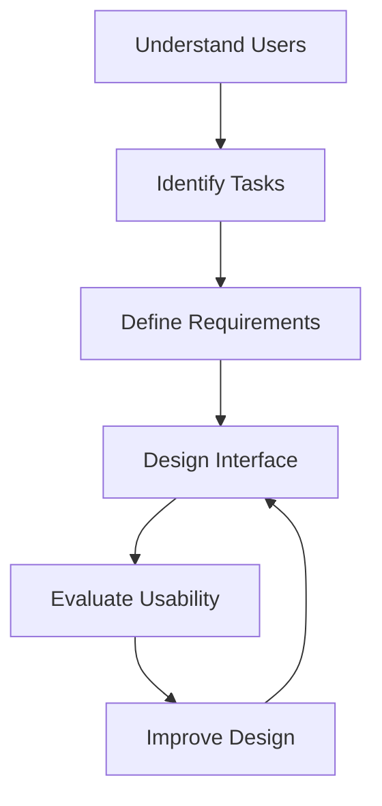
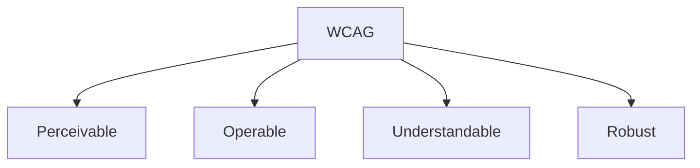
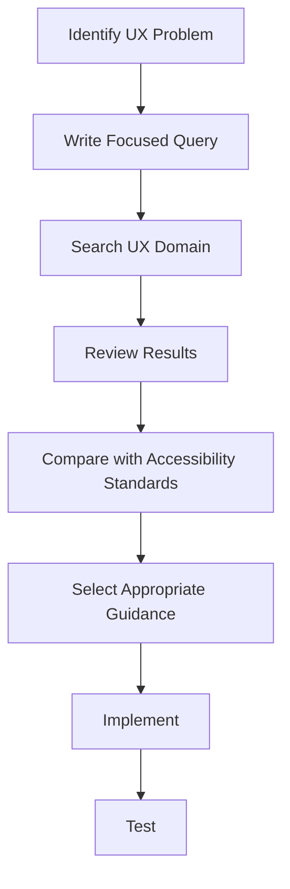
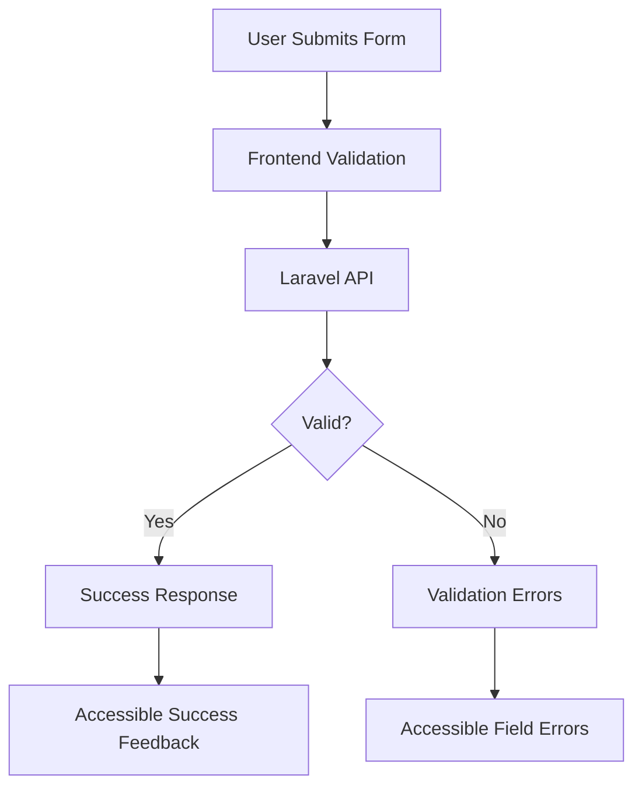

# 07 — UI/UX Pro Max: UX Guidelines and Accessibility

> [!abstract] Lesson Information
> **Repository:** [nextlevelbuilder/ui-ux-pro-max-skill](https://github.com/nextlevelbuilder/ui-ux-pro-max-skill)
>
> **Category:** Agentic Engineering / User Experience / Accessibility / Human-Computer Interaction
>
> **Difficulty:** Intermediate
>
> **Learning Approach:** Theory First
>
> **Prerequisites:** [[04 - UI Styles and Visual Design Principles]], [[05 - Color Systems and Typography]], [[06 - Design System Generation]]
>
> **Primary Goal:** Understand how to create interfaces that are usable, accessible, predictable, and inclusive, and how to apply UI/UX Pro Max guidance during AI-assisted development.

---

# 1. Learning Objectives

After completing this lesson, you should be able to:

1. Define usability and accessibility.
2. Explain user-centered design.
3. Understand Nielsen's usability heuristics.
4. Design understandable information architecture.
5. Evaluate navigation patterns.
6. Apply effective form-design principles.
7. Design loading, success, empty, and error states.
8. Understand WCAG 2.2 and its four principles.
9. Explain keyboard navigation and focus management.
10. Understand screen-reader semantics.
11. Recognize accessible component patterns.
12. Explain responsive accessibility.
13. Respect reduced-motion preferences.
14. Identify common UX anti-patterns.
15. Use UI/UX Pro Max to retrieve relevant UX guidance.
16. Integrate accessibility requirements into Codex workflows.
17. Apply these principles to Android, Laravel, and Next.js applications.

---

# Part I — Understanding User Experience

## 2. What Is User Experience?

**User Experience (UX)** refers to the overall experience a person has when interacting with a product, system, or service.

It includes:

- Ease of use.
- Clarity.
- Efficiency.
- Accessibility.
- Learnability.
- Error recovery.
- Satisfaction.
- Task completion.

UX is not limited to visual appearance. A beautiful interface can still provide a poor experience if users struggle to complete their tasks.

## 2.1 UI vs UX vs Accessibility

| Concept | Main Question |
|---|---|
| UI | How is the interface presented? |
| UX | How effectively can users accomplish their goals? |
| Accessibility | Can people with different abilities and assistive technologies use it? |

These areas overlap. An accessible interface can improve usability for many users, including people who do not identify as having a disability.

---

# Part II — User-Centered Design

## 3. What Is User-Centered Design?

User-centered design places users, their needs, and their contexts at the center of the design process. Instead of beginning with visual effects, begin with user goals.

## 3.1 Core Questions

Before designing a screen, ask:

1. Who will use this screen?
2. What task are they trying to complete?
3. What information do they need?
4. What decisions must they make?
5. What could go wrong?
6. How will they know the task succeeded?

## 3.2 Conceptual Process



### Example: Fleet Management

An administrator may need to identify buses requiring attention. Prioritize vehicle status, route assignment, relevant alerts, filtering, and available actions. Decorative charts should not obscure those tasks.

---

# Part III — Usability

## 4. What Is Usability?

Usability describes how effectively, efficiently, and satisfactorily users can achieve goals in a particular context.

**Effectiveness:** Can the user complete the task?

**Efficiency:** How much time and effort does the task require?

**Learnability:** Can a new user understand the interface?

**Error tolerance:** Can users avoid or recover from mistakes?

**Satisfaction:** Does the interaction feel understandable and manageable?

## 4.1 Example

Interface A requires navigating through five unrelated screens to edit a schedule. Interface B provides a clear schedule list with an accessible edit action. Interface B may be more efficient if its editing workflow is equally understandable and reliable.

---

# Part IV — Nielsen's 10 Usability Heuristics

## 5. Introduction

Jakob Nielsen's ten usability heuristics are widely used principles for evaluating interface usability. They are general guidelines rather than strict implementation rules.

## 5.1 The Ten Heuristics

| # | Heuristic | Meaning |
|---|---|---|
| 1 | Visibility of system status | Keep users informed |
| 2 | Match between system and real world | Use familiar language |
| 3 | User control and freedom | Support cancellation and recovery |
| 4 | Consistency and standards | Follow predictable conventions |
| 5 | Error prevention | Reduce avoidable mistakes |
| 6 | Recognition rather than recall | Make information visible |
| 7 | Flexibility and efficiency | Support different experience levels |
| 8 | Aesthetic and minimalist design | Avoid irrelevant information |
| 9 | Help users recover from errors | Explain problems and solutions |
| 10 | Help and documentation | Provide useful assistance |

---

## 6. Visibility of System Status

Users should understand what the application is doing.

Examples:

- Loading indicator.
- Upload progress.
- Save confirmation.
- Network status.
- Submission result.

A weak interface leaves the user wondering after clicking Save. A better interface shows a loading state followed by confirmation:

```text
Saving...
       ↓
Changes saved successfully
```

**Feedback should match the importance and duration of the operation.**

## 7. Match Between System and Real World

Use language familiar to users. A commuter-facing application can use “Bus stop,” “Estimated arrival,” “Route,” and “Current location.” Avoid internal database terminology such as `route_variant_stop_id` unless users need that technical detail.

## 8. User Control and Freedom

Users should recover from accidental actions through Cancel, Back, Undo, Close, or Edit. Confirm consequential actions when needed. For irreversible actions, explain the consequences clearly.

## 9. Consistency and Standards

The same action should behave predictably throughout the application. Search fields, primary buttons, navigation labels, and status indicators should follow consistent patterns. A trash icon should not mean Archive elsewhere without a clear distinction.

## 10. Error Prevention

Preventing an error is generally better than only explaining it afterward. Validate required fields, use suitable controls, show constraints before submission, and prevent accidental duplicate submissions. When a disabled control is not self-explanatory, tell users why it is unavailable.

## 11. Recognition Rather Than Recall

Users should not need to memorize information between screens. Provide visible navigation, clear labels, contextual help, selected filters, and understandable breadcrumbs. A schedule form should show the selected bus and route.

## 12. Flexibility and Efficiency

Support efficient workflows with search, filters, keyboard shortcuts, saved preferences, and appropriate bulk actions. Advanced features should not make basic workflows confusing.

## 13. Aesthetic and Minimalist Design

Visible elements should have a purpose. Avoid unnecessary cards, decorative graphics, repeated labels, irrelevant metrics, and competing primary actions. Minimalism does not mean removing useful information.

## 14. Error Recognition and Recovery

Good error messages explain what went wrong, where it occurred, and what the user can do next.

Weak:

```text
Error 422
```

Better:

```text
Please enter a valid email address.
```

Technical diagnostics can be logged separately for developers.

## 15. Help and Documentation

Tooltips, help articles, field descriptions, onboarding, or contextual documentation may be useful. Help should be accessible and relevant to the user's task.

---

# Part V — Information Architecture

## 16. What Is Information Architecture?

**Information Architecture (IA)** organizes and labels information so users can find and understand it. It includes navigation structure, content hierarchy, categorization, labels, and relationships between pages.

```text
Admin Application
├── Dashboard
├── Fleet
│   ├── Buses
│   └── Drivers
├── Operations
│   ├── Routes
│   └── Schedules
├── Reports
└── Settings
```

This is an illustrative structure.

### IA Principles

- Group related functions.
- Use understandable labels.
- Avoid unnecessary nesting.
- Keep important destinations discoverable.
- Reflect the user's mental model.

---

# Part VI — Navigation Design

## 17. Common Navigation Patterns

| Pattern | Suitable Context |
|---|---|
| Top navigation | Marketing websites |
| Sidebar | Administrative applications |
| Bottom navigation | Mobile apps with a few primary destinations |
| Tabs | Related content within a page |
| Breadcrumbs | Hierarchical content |
| Search | Large collections of information |

### Navigation Anti-Patterns

- Too many top-level destinations.
- Ambiguous icon-only controls.
- Inconsistent labels.
- Hidden essential features.
- Unclear active states.
- Navigation that changes unpredictably.

### Navigation Accessibility

Support keyboard interaction, visible focus, meaningful labels, correct semantic structure, and a clear current-page indication.

---

# Part VII — Form Design

## 18. Why Forms Matter

Forms support registration, login, contact, schedule creation, inventory management, and profile editing. Poor forms create errors and frustration.

### Form Design Principles

1. Use visible labels.
2. Group related fields.
3. Indicate required information clearly.
4. Provide useful instructions.
5. Use appropriate input types.
6. Show validation feedback.
7. Preserve entered data when possible.
8. Make submission status clear.

## 19. Labels vs Placeholders

A placeholder should not replace a visible label.

Weak:

```text
[ Enter email... ]
```

Better:

```text
Email address
[ Enter your email address ]
```

Placeholder text can disappear after typing; visible labels provide persistent context.

## 20. Form Validation

Validation may occur during input, after leaving a field, during submission, or on the server. Timing should fit the field and workflow.

```text
Email address
[ example@email ]

Please enter a valid email address.
```

A useful message identifies the field and explains the correction. Frontend validation improves usability; backend validation protects data integrity and enforces application rules. **Never rely exclusively on client-side validation for security or data integrity.**

---

# Part VIII — Feedback States

## 21. Common Interface States

A complete interface considers more than its default appearance.

| State | Purpose |
|---|---|
| Loading | Operation is in progress |
| Success | Operation completed |
| Error | Operation failed |
| Empty | No content is available |
| Disabled | Action is unavailable |
| Offline | Connectivity is unavailable |
| Pending | Waiting for a process or decision |

## 22. Loading States

Use a spinner for short waits, skeletons for predictable structures, and progress indicators for measurable operations. Do not show fake progress percentages when actual progress is unknown.

## 23. Empty States

Explain why no content appears and suggest an appropriate next step.

Weak:

```text
No data
```

Better:

```text
No schedules found.

Try adjusting your filters or create a new schedule.
```

## 24. Error States

Errors should be clear, relevant, recoverable where possible, accessible, and non-technical for general users.

```text
Unable to load schedules.

Check your connection and try again.
```

Avoid exposing stack traces or internal server details to end users.

---

# Part IX — Accessibility Fundamentals

## 25. What Is Accessibility?

Digital accessibility means designing and implementing products so people with disabilities can perceive, understand, navigate, and interact with them. It can involve vision, hearing, mobility, cognition, speech, and assistive technologies.

Accessibility also helps in temporary or situational contexts: using a phone in bright sunlight, navigating without a mouse, viewing content on a small screen, or using enlarged text.

---

# Part X — WCAG 2.2

## 26. What Is WCAG?

The **Web Content Accessibility Guidelines (WCAG)** are international recommendations published by the World Wide Web Consortium. WCAG 2.2 organizes accessibility around four principles, known as **POUR**:

1. Perceivable.
2. Operable.
3. Understandable.
4. Robust.



## 27. Perceivable

Present information in ways users can perceive: text alternatives for meaningful images, captions for applicable media, sufficient contrast, resizable text, and meaningful structure. Do not communicate a bus status only with green or red; include a text label.

## 28. Operable

Users must be able to operate controls through keyboard navigation, visible focus, appropriate target sizes, and menus/dialogs without keyboard traps.

## 29. Understandable

Use clear labels, predictable navigation, helpful errors, consistent behavior, and appropriate instructions.

## 30. Robust

Content should work reliably across browsers, devices, and assistive technologies. Use semantic HTML, valid relationships, correct accessibility attributes, and appropriate state announcements.

---

# Part XI — Keyboard Accessibility

## 31. Why Keyboard Navigation Matters

Some users navigate without a mouse.

| Key | Typical Purpose |
|---|---|
| Tab | Move to next focusable element |
| Shift + Tab | Move to previous focusable element |
| Enter | Activate appropriate controls |
| Space | Activate buttons or toggle certain controls |
| Escape | Close supported dialogs or menus |
| Arrow keys | Navigate within certain composite widgets |

Exact behavior depends on the component pattern.

## 32. Focus Indicators

Keyboard users need to know which element currently has focus.

```css
button:focus-visible,
a:focus-visible,
input:focus-visible {
  outline: 3px solid #2563eb;
  outline-offset: 3px;
}
```

Evaluate the indicator against its actual background and accessibility requirements.

Anti-pattern:

```css
*:focus {
  outline: none;
}
```

Removing focus indicators without an accessible replacement makes keyboard navigation difficult.

---

# Part XII — Focus Management

## 33. What Is Focus Management?

Focus management determines where keyboard focus moves when the interface changes, for example when opening or closing a dialog, submitting a form, showing validation errors, or navigating between views.

When a modal opens, focus should move into it; keyboard interaction should remain appropriate; users should be able to close it; and focus should generally return to the triggering control after it closes. Follow the relevant accessible dialog pattern.

---

# Part XIII — Semantic HTML

## 34. Why Semantic HTML Matters

Semantic HTML communicates the purpose and structure of content to browsers and assistive technologies.

```html
<header>
  <nav aria-label="Main navigation">
    <a href="/">Home</a>
    <a href="/services">Services</a>
  </nav>
</header>

<main>
  <h1>Our Services</h1>
  <p>Explore our development capabilities.</p>
</main>
```

### Native Elements First

Prefer:

```html
<button type="button">Save</button>
```

Over:

```html
<div onclick="save()">Save</div>
```

Native buttons already support important interaction semantics and keyboard behavior.

---

# Part XIV — ARIA

## 35. What Is ARIA?

**Accessible Rich Internet Applications (ARIA)** provides attributes for describing accessibility semantics when native HTML alone is insufficient. Examples include `aria-label`, `aria-labelledby`, `aria-describedby`, `aria-expanded`, and `aria-live`.

```html
<button
  type="button"
  aria-expanded="false"
  aria-controls="navigation-menu"
>
  Menu
</button>
```

Update `aria-expanded` when the menu state changes. ARIA does not automatically add keyboard behavior; prefer native semantic HTML whenever possible.

---

# Part XV — Screen Readers

## 36. What Is a Screen Reader?

A screen reader is assistive technology that presents digital content through speech or other supported output. Examples include NVDA, JAWS, VoiceOver, and TalkBack. Screen readers rely on accessible structure and semantics.

Important considerations: meaningful headings, labeled controls, descriptive links, alternative text, accessible errors, and correct state announcements.

Weak link text: `Click here`.

Better: `View route schedules`.

Descriptive links provide clearer context.

---

# Part XVI — Accessible Images and Icons

## 37. Image Alternative Text

Meaningful images should have appropriate text alternatives.

```html

```

Decorative images generally use empty alternative text:

```html

```

### Icon Buttons

Icon-only buttons require accessible names.

```html
<button type="button" aria-label="Open settings">
  <svg aria-hidden="true" viewBox="0 0 24 24">
    <!-- Icon artwork -->
  </svg>
</button>
```

---

# Part XVII — Responsive Accessibility

## 38. Accessibility Across Screen Sizes

Responsive design should preserve functionality as screen space changes. Check text wrapping, zoom, navigation, touch targets, table overflow, form readability, and content order.

Common problems include tiny buttons, clipped mobile text, page-wide horizontal scrolling, hidden essential controls, and fixed-height containers that cut off text.

### WCAG Reflow

WCAG includes reflow requirements for many content types. Content should adapt without losing information or functionality. Some content, such as certain tables or maps, may legitimately need two-dimensional layout.

---

# Part XVIII — Motion and Animation

## 39. Motion in UX

Motion can communicate state changes, navigation, progress, or relationships between elements. Unnecessary motion can distract or cause discomfort.

### Reduced Motion

```css
@media (prefers-reduced-motion: reduce) {
  .animated-element {
    animation: none;
    transition: none;
  }
}
```

Reduced-motion support should preserve essential information and functionality. Do not remove meaningful feedback without an alternative.

---

# Part XIX — UX Anti-Patterns

## 40. Common UX Mistakes

- **Hidden essential actions:** Important functionality is difficult to discover.
- **Ambiguous icons:** Users cannot determine meaning.
- **Excessive confirmations:** Routine actions require unnecessary approval.
- **Poor errors:** Messages do not explain what happened.
- **Inconsistent navigation:** Controls change behavior across pages.
- **Decorative overload:** Effects compete with important content.
- **Inaccessible forms:** Inputs lack labels or error associations.
- **Unclear loading:** Users cannot tell whether work is still processing.
- **Unexpected layout shifts:** Content moves unexpectedly while loading.
- **Unnecessary complexity:** Features do not support user goals.

---

# Part XX — UI/UX Pro Max UX Search

## 41. Retrieving UX Guidelines

The repository provides a searchable UX knowledge domain.

```powershell
python scripts/search.py "form validation error messages" --domain ux
python scripts/search.py "keyboard navigation focus" --domain ux
```

Adjust the script path to the installed skill location.



Search results provide guidance; they do not replace WCAG, platform guidelines, or accessibility testing.

---

# Part XXI — Integrating UX Guidance with Codex

## 42. Recommended Agentic Workflow

When asking Codex to improve an interface:

1. Read project requirements.
2. Inspect the current UI.
3. Read design-system documentation.
4. Identify usability issues.
5. Search relevant UX guidelines.
6. Propose focused changes.
7. Implement approved improvements.
8. Test keyboard interactions.
9. Review accessibility.
10. Confirm the original workflow still functions.

### Example Prompt

```text
Read AGENTS.md and the existing design-system documentation.

Inspect the registration form.

Use the UI/UX Pro Max skill to identify improvements
to labels, validation feedback, focus states,
loading behavior, and accessibility.

Preserve existing branding and component conventions.

Do not introduce new dependencies.

Provide an implementation plan before changing files.
```

---

# Part XXII — Accessibility Testing

## 43. Automated vs Manual Testing

Accessibility evaluation should combine automated and manual methods.

| Testing Type | What It Helps Identify |
|---|---|
| Automated checks | Detectable markup and contrast issues |
| Keyboard testing | Focus order and keyboard operation |
| Screen-reader testing | Accessible names and announcements |
| Zoom and reflow testing | Responsive content issues |
| Manual usability review | Clarity and workflow problems |

### Automated Tools

Common examples include axe-core, Lighthouse, Accessibility Insights, and browser developer tools. Automated checks cannot detect every accessibility issue.

### Manual Checklist

- Can users navigate with a keyboard?
- Is focus visible?
- Are controls labeled?
- Are errors understandable?
- Does content remain usable when zoomed?
- Are status changes communicated?
- Can dialogs be operated correctly?
- Does the interface work with a screen reader?

---

# Part XXIII — Case Study: HarayaForge

## 44. Software Agency Website

### UX Priorities

- Clear navigation.
- Understandable service descriptions.
- Accessible contact form.
- Consistent calls to action.
- Responsive layouts.
- Readable typography.

### Example Improvements

**Hero:** Clear heading and meaningful primary action.

**Capabilities:** Descriptive service cards with consistent structure.

**Team:** Readable member information.

**Contact:** Visible labels, validation feedback, and submission status.

**Engineering lesson:** Visual consistency and usability should reinforce each other.

---

# Part XXIV — Case Study: GoPasig

## 45. Fleet Management and Commuter Experience

### Administrator UX

- Clear vehicle status.
- Searchable records.
- Accessible filters.
- Understandable scheduling errors.
- Confirmation for consequential actions.

### Commuter UX

- Understandable route information.
- Clear ETA presentation.
- Loading and unavailable-data states.
- Accessible map alternatives.
- Readable bus-stop information.

A map alone may not provide sufficient information for every user. Provide meaningful textual information where appropriate.

---

# Part XXV — Case Study: Next.js and Laravel

## 46. E-Commerce Application

### Next.js Frontend

Responsible for semantic interface structure, accessible forms, keyboard interactions, loading and error presentation, and responsive layouts.

### Laravel Backend

Responsible for server-side validation, authorization, data integrity, and reliable error responses.



Frontend and backend responsibilities must work together to provide a reliable user experience.

---

# Part XXVI — Case Study: Android GroupTrack

## 47. Android Accessibility

For Android Java/XML applications, consider:

- Meaningful content descriptions.
- Accessible text sizes.
- Appropriate touch targets.
- Logical focus order.
- Readable status labels.
- Clear navigation.
- TalkBack compatibility.

```xml
<ImageButton
    android:layout_width="48dp"
    android:layout_height="48dp"
    android:contentDescription="@string/open_settings"
    android:src="@drawable/ic_settings" />
```

This is illustrative; actual attributes and constraints depend on the project. Use Android accessibility conventions for the existing Java/XML architecture. Do not introduce a new framework just to implement accessibility improvements.

---

# Part XXVII — Practical Exercises

## 48. Exercise 1 — Usability Heuristics

Choose an application you use regularly. Identify two examples of good usability, two potential problems, the Nielsen heuristics involved, and possible improvements.

## 49. Exercise 2 — Information Architecture

Design a navigation hierarchy for a fleet management system with Dashboard, Vehicles, Drivers, Routes, Schedules, and Reports. Explain your grouping decisions.

## 50. Exercise 3 — Form Evaluation

Review a hypothetical registration form. Evaluate labels, required fields, validation, errors, loading states, and keyboard accessibility. Propose improvements.

## 51. Exercise 4 — Accessibility Audit

Create an accessibility checklist for a dashboard with sidebar, KPI cards, data table, filters, and modal dialog. Include keyboard, screen-reader, contrast, and responsive checks.

## 52. Exercise 5 — UX Search Queries

Write five focused UX search queries for form validation, keyboard navigation, empty states, loading feedback, and responsive tables. Explain each query's purpose.

## 53. Exercise 6 — Codex Prompt Engineering

Write a Codex prompt instructing the agent to inspect the existing UI, read project design rules, consult UI/UX Pro Max, identify accessibility issues, propose changes, preserve existing components, avoid unnecessary dependencies, and verify improvements.

---

# Part XXVIII — Knowledge Check

## 54. Review Questions

1. What is UX?
2. How does UX differ from UI?
3. What is accessibility?
4. What is user-centered design?
5. What is usability?
6. What are Nielsen's ten heuristics?
7. Why is system-status visibility important?
8. What is recognition rather than recall?
9. What is information architecture?
10. What makes navigation understandable?
11. Why should forms use visible labels?
12. What is the difference between frontend and backend validation?
13. What are loading states?
14. What are empty states?
15. What makes an error message useful?
16. What is WCAG?
17. What does POUR stand for?
18. Why is keyboard navigation important?
19. What is focus management?
20. Why should semantic HTML be preferred?
21. What is ARIA?
22. What is a screen reader?
23. Why do icon buttons need accessible names?
24. What is responsive accessibility?
25. What is reduced-motion support?
26. What are common UX anti-patterns?
27. How does UI/UX Pro Max support UX research?
28. Why are automated accessibility tests insufficient on their own?
29. How should Codex apply UX recommendations?
30. Why must accessibility be verified after implementation?

---

# Part XXIX — Key Takeaways

> [!summary]
> - UX focuses on helping users accomplish goals effectively.
> - Accessibility is a fundamental part of interface quality.
> - User-centered design begins with actual tasks and needs.
> - Nielsen's heuristics provide useful usability evaluation principles.
> - Information architecture helps users find relevant functionality.
> - Navigation should be predictable and understandable.
> - Forms require visible labels and useful validation feedback.
> - Loading, success, error, and empty states are part of the interface.
> - WCAG 2.2 uses the POUR principles.
> - Keyboard navigation and visible focus are essential.
> - Semantic HTML provides important accessibility foundations.
> - ARIA supplements native semantics when needed.
> - Responsive design must preserve functionality.
> - Motion should respect user preferences.
> - UI/UX Pro Max can retrieve relevant UX guidance.
> - Codex should implement focused improvements without unnecessary redesign.
> - Accessibility requires automated and manual verification.

---

# Part XXX — Final Mental Model

```text
USER GOALS
    |
    v
USER-CENTERED DESIGN
    |
    v
INFORMATION ARCHITECTURE
    |
    v
NAVIGATION AND TASK FLOWS
    |
    v
FORM AND INTERACTION DESIGN
    |
    v
UX GUIDELINE RETRIEVAL
    |
    v
ACCESSIBILITY REQUIREMENTS
    |
    v
CODEX IMPLEMENTATION
    |
    v
AUTOMATED AND MANUAL TESTING
    |
    v
USABLE AND ACCESSIBLE INTERFACE
```

**Remember:**

A successful interface is not defined only by its appearance.

It should allow users to understand information, complete tasks, recover from errors, and interact with the system using different devices and input methods.

---

# Part XXXI — Official References

## UI/UX Pro Max

- [Official GitHub Repository](https://github.com/nextlevelbuilder/ui-ux-pro-max-skill)
- [README](https://github.com/nextlevelbuilder/ui-ux-pro-max-skill/blob/main/README.md)
- [Core Skill Source](https://github.com/nextlevelbuilder/ui-ux-pro-max-skill/tree/main/src/ui-ux-pro-max)

## Usability

- [Nielsen Norman Group — 10 Usability Heuristics](https://www.nngroup.com/articles/ten-usability-heuristics/)
- [Nielsen Norman Group — Information Architecture](https://www.nngroup.com/articles/information-architecture-ia/)
- [ISO 9241-210 Overview](https://www.iso.org/standard/77520.html)

## Accessibility

- [WCAG 2.2](https://www.w3.org/TR/WCAG22/)
- [W3C WAI](https://www.w3.org/WAI/)
- [WAI-ARIA Authoring Practices Guide](https://www.w3.org/WAI/ARIA/apg/)
- [W3C Understanding Keyboard](https://www.w3.org/WAI/WCAG22/Understanding/keyboard.html)
- [W3C Understanding Focus Visible](https://www.w3.org/WAI/WCAG22/Understanding/focus-visible.html)
- [MDN Accessibility](https://developer.mozilla.org/en-US/docs/Web/Accessibility)
- [Android Accessibility](https://developer.android.com/guide/topics/ui/accessibility)

> [!note] Documentation Scope
> This lesson combines the UI/UX Pro Max repository's documented UX guideline search with established usability and accessibility principles.
>
> WCAG, Nielsen's heuristics, and platform accessibility documentation are independent references. They should be used directly when verifying requirements rather than assuming the skill's recommendations guarantee compliance.

---

# Part XXXII — Next Lesson

**[[08 - Responsive Design and Components]]**

Topics:

1. Responsive design fundamentals.
2. Mobile-first development.
3. Fluid and adaptive layouts.
4. CSS Grid and Flexbox.
5. Breakpoint strategies.
6. Responsive typography and spacing.
7. Component architecture.
8. Component variants and states.
9. Responsive navigation.
10. Tables, forms, and dashboards.
11. Touch targets and accessibility.
12. Component reuse and consistency.
13. UI/UX Pro Max responsive guidance.
14. Android, Laravel, and Next.js examples.
15. Practical exercises.
16. Official references.

**End of Lesson 07 — UX Guidelines and Accessibility.**
