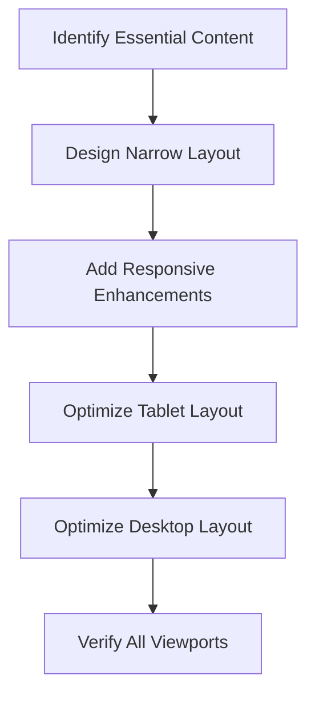
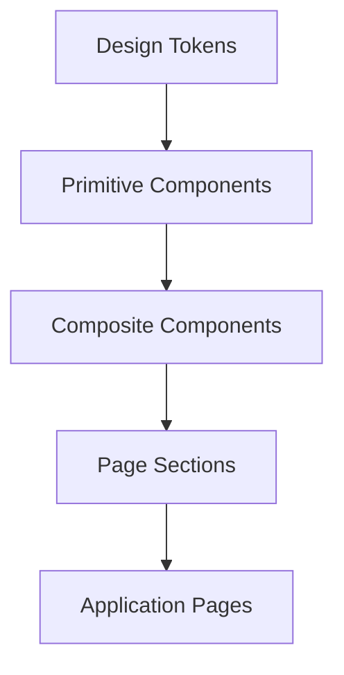
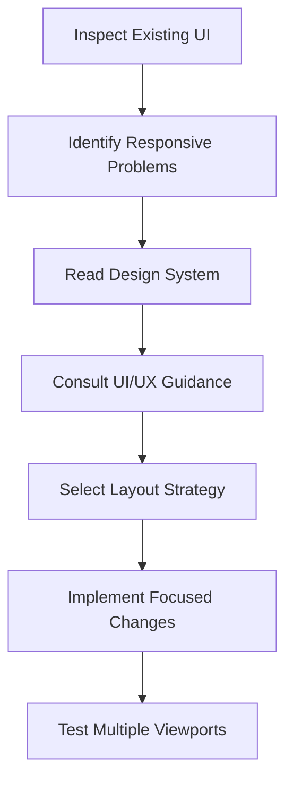

# 08 — UI/UX Pro Max: Responsive Design and Components

> [!abstract] Lesson Information
> **Repository:** [nextlevelbuilder/ui-ux-pro-max-skill](https://github.com/nextlevelbuilder/ui-ux-pro-max-skill)
>
> **Category:** UI/UX Engineering / Responsive Design / Component Architecture / Agentic Engineering
>
> **Difficulty:** Intermediate
>
> **Learning Approach:** Theory First
>
> **Prerequisites:** [[06 - Design System Generation]], [[07 - UX Guidelines and Accessibility]]
>
> **Primary Goal:** Understand how to design and implement responsive interfaces using reusable components, consistent design systems, and accessibility principles.

---

# 1. Learning Objectives

After completing this lesson, you should be able to:

1. Explain responsive web design.
2. Differentiate responsive and adaptive layouts.
3. Understand mobile-first design.
4. Explain fluid grids and flexible units.
5. Select content-driven breakpoints.
6. Understand CSS Flexbox and Grid.
7. Use container queries conceptually.
8. Explain responsive typography and spacing.
9. Design responsive navigation patterns.
10. Handle tables, forms, and dashboards across screen sizes.
11. Define reusable UI components.
12. Distinguish component variants from states.
13. Explain component composition.
14. Understand component accessibility requirements.
15. Avoid unnecessary component abstractions.
16. Apply responsive guidance from UI/UX Pro Max.
17. Integrate responsive design decisions into Codex workflows.
18. Apply the principles to Next.js, Laravel, and Android.

---

# Part I — Responsive Design Fundamentals

## 2. What Is Responsive Web Design?

**Responsive Web Design (RWD)** is an approach where an interface adapts to different viewport sizes and available space.

A responsive interface should remain:

- Readable.
- Usable.
- Navigable.
- Visually organized.
- Functionally complete.

Responsive design is not simply shrinking desktop content. It involves reorganizing information and interactions to suit the available space.

### Responsive Layout Example

```text
Desktop
+------------------------------------------------------+
| Header                                               |
+------------+-----------------------------------------+
| Sidebar    | Main Content                            |
|            |                                         |
|            | [Card] [Card] [Card]                   |
|            |                                         |
|            | [Chart]              [Summary]          |
+------------+-----------------------------------------+

Mobile
+---------------------------+
| Header                    |
+---------------------------+
| Navigation                |
+---------------------------+
| Main Content              |
|                           |
| [Card]                    |
| [Card]                    |
| [Card]                    |
|                           |
| [Chart]                   |
| [Summary]                 |
+---------------------------+
```

The content remains available, but its arrangement changes.

---

# Part II — Responsive vs Adaptive Design

## 3. What Is Adaptive Design?

Adaptive design uses layouts tailored to particular device or viewport categories. Responsive design generally uses flexible rules that continuously adapt to available space.

| Responsive | Adaptive |
|---|---|
| Fluid behavior | Often uses predefined layouts |
| Flexible sizing | More discrete layout variations |
| Content-driven changes | Device or viewport category changes |
| Common in modern web development | Useful for selected specialized experiences |

These approaches can coexist. A responsive website may still have distinct navigation patterns at particular breakpoints.

---

# Part III — Mobile-First Design

## 4. What Is Mobile-First?

Mobile-first design begins with the smallest practical layout and progressively enhances it for larger screens.

Instead of starting with a desktop interface and removing elements, begin with essential content.

### Mobile-First Workflow



### CSS Example

```css
.card-grid {
  display: grid;
  grid-template-columns: 1fr;
  gap: 1rem;
}

@media (min-width: 48rem) {
  .card-grid {
    grid-template-columns: repeat(2, minmax(0, 1fr));
  }
}

@media (min-width: 75rem) {
  .card-grid {
    grid-template-columns: repeat(3, minmax(0, 1fr));
  }
}
```

This is an illustrative breakpoint strategy, not a universal requirement.

**Key principle:** Mobile-first means prioritizing essential functionality, not removing useful features from mobile users.

---

# Part IV — Fluid Layouts

## 5. What Is a Fluid Layout?

A fluid layout adjusts dimensions based on available space.

| Unit | Purpose |
|---|---|
| % | Relative to containing dimensions |
| rem | Relative to root font size |
| em | Relative to font sizing context |
| vw | Relative to viewport width |
| vh | Relative to viewport height |
| fr | Fraction of available grid space |
| ch | Relative to the width of the 0 glyph |

### Example

```css
.page-container {
  width: min(100% - 2rem, 72rem);
  margin-inline: auto;
}
```

This creates a flexible content container with a maximum width. Fixed-width layouts can overflow smaller screens; fluid layouts help content adapt naturally.

---

# Part V — Breakpoint Strategies

## 6. What Is a Breakpoint?

A breakpoint is a condition at which layout rules change.

```css
@media (min-width: 768px) {
  .sidebar {
    display: block;
  }
}
```

### Content-Driven Breakpoints

Introduce a breakpoint when the current layout stops working well. For example:

- Cards become too narrow.
- Navigation no longer fits.
- Text becomes difficult to read.
- Tables overflow.
- Forms feel crowded.

A common mistake is choosing breakpoints solely because a device has a familiar width. Device sizes change; content behavior is a more reliable criterion.

---

# Part VI — CSS Flexbox

## 7. What Is Flexbox?

Flexbox is a CSS layout system for arranging items along one primary axis. It is useful for navigation, button groups, toolbars, form controls, and small component layouts.

### Example

```css
.toolbar {
  display: flex;
  align-items: center;
  justify-content: space-between;
  gap: 1rem;
  flex-wrap: wrap;
}
```

| Property | Purpose |
|---|---|
| display: flex | Enables flex layout |
| flex-direction | Defines main axis |
| justify-content | Aligns along main axis |
| align-items | Aligns along cross axis |
| gap | Controls spacing |
| flex-wrap | Allows wrapping |
| flex | Controls item growth and shrinkage |

Use Flexbox when the layout is primarily one-dimensional.

---

# Part VII — CSS Grid

## 8. What Is CSS Grid?

CSS Grid is a two-dimensional layout system for managing rows and columns. It is useful for dashboard layouts, card grids, page structures, product catalogs, and complex content arrangements.

### Example

```css
.product-grid {
  display: grid;
  grid-template-columns:
    repeat(auto-fit, minmax(min(100%, 16rem), 1fr));
  gap: 1.5rem;
}
```

This allows the number of columns to adapt to available width.

| Scenario | Preferred Starting Point |
|---|---|
| Navigation bar | Flexbox |
| Button group | Flexbox |
| Product cards | Grid |
| Dashboard panels | Grid |
| Form field row | Flexbox or Grid |
| Full page layout | Grid |

Neither is universally better. Choose according to the layout's structure.

---

# Part VIII — Container Queries

## 9. What Are Container Queries?

Container queries allow components to respond to the size of their containing element rather than only the viewport. This is useful when the same component appears in different contexts.

### Example

```css
.card-container {
  container-type: inline-size;
}

.profile-card {
  display: grid;
  gap: 1rem;
}

@container (min-width: 30rem) {
  .profile-card {
    grid-template-columns: auto 1fr;
  }
}
```

A card may appear in a narrow sidebar, a wide dashboard, or a full-width section. Viewport queries alone may not reflect the space actually available to the card.

Container queries can improve component independence, but introduce them only when they solve a real layout problem.

---

# Part IX — Responsive Typography

## 10. Typography Across Screen Sizes

Responsive typography maintains readability and hierarchy. Consider font size, line height, line length, text wrapping, zoom, and content density.

### CSS clamp()

```css
.hero-title {
  font-size: clamp(2rem, 4vw, 3.75rem);
  line-height: 1.1;
}
```

This creates a fluid size within defined limits.

Important considerations:

- Avoid headings that overflow.
- Preserve readable body text.
- Test long words and translations.
- Do not prevent text resizing.
- Check zoom behavior.

---

# Part X — Responsive Spacing

## 11. Why Spacing Must Adapt

Desktop layouts often have more available space. Mobile layouts may need tighter spacing while preserving comfortable interaction areas.

```css
.section {
  padding-block: clamp(3rem, 6vw, 6rem);
}

.card {
  padding: clamp(1rem, 2vw, 1.5rem);
}
```

Responsive spacing should not reduce touch targets below accessible sizes.

---

# Part XI — Responsive Navigation

## 12. Navigation Patterns

Common approaches include:

**Desktop:** top navigation, sidebar, or multi-column menus.

**Mobile:** collapsible navigation, bottom navigation, or compact menus.

Regardless of screen size:

- Important destinations remain accessible.
- Controls have clear labels.
- Keyboard behavior works.
- Focus remains visible.
- Active navigation is understandable.

Hiding navigation items on mobile without another way to access them is an anti-pattern.

**Principle:** Responsive navigation changes presentation, not the user's ability to access features.

---

# Part XII — Responsive Tables

## 13. Why Tables Are Challenging

Tables often contain more columns than fit on a narrow screen. Common strategies include:

1. Horizontal scrolling.
2. Priority columns.
3. Row-detail expansion.
4. Alternative card presentation.
5. Responsive filtering.

### Horizontal Scroll Example

```css
.table-wrapper {
  overflow-x: auto;
}

.data-table {
  min-width: 48rem;
}
```

This can preserve table relationships when a compact card layout would lose important context.

Do not automatically convert every table into cards. Some data is easier to compare in a tabular structure.

---

# Part XIII — Responsive Forms

## 14. Form Layout Principles

Forms should maintain visible labels, logical field order, appropriate spacing, readable validation, and accessible controls.

### Example

```css
.form-grid {
  display: grid;
  grid-template-columns: 1fr;
  gap: 1rem;
}

@media (min-width: 48rem) {
  .form-grid {
    grid-template-columns: repeat(2, minmax(0, 1fr));
  }
}
```

Fields that are logically related may share a row on larger screens. Narrow layouts should avoid cramped input fields.

---

# Part XIV — Responsive Dashboards

## 15. Dashboard Design Challenges

Dashboards often contain KPI cards, charts, filters, tables, navigation, and status indicators. A responsive dashboard should prioritize important information rather than simply shrink every chart and table.

```text
Desktop:
+------------------------------------------+
| KPI 1 | KPI 2 | KPI 3 | KPI 4            |
+------------------------------------------+
| Main Chart           | Secondary Summary |
+------------------------------------------+
| Data Table                               |
+------------------------------------------+

Mobile:
+----------------------+
| KPI 1                |
+----------------------+
| KPI 2                |
+----------------------+
| KPI 3                |
+----------------------+
| KPI 4                |
+----------------------+
| Main Chart           |
+----------------------+
| Secondary Summary    |
+----------------------+
| Data Table           |
+----------------------+
```

Preserve operational meaning. Do not simply shrink dense content.

---

# Part XV — Understanding UI Components

## 16. What Is a UI Component?

A UI component is a reusable part of an interface, such as a button, input, card, modal, table, navigation item, status badge, or dropdown. Components help standardize presentation and behavior.



This is a conceptual architecture.

---

# Part XVI — Primitive vs Composite Components

## 17. Primitive Components

Primitive components provide basic interface elements, such as a button, input, badge, or checkbox.

## 17.1 Composite Components

Composite components combine smaller elements, such as a search bar, filter toolbar, login form, KPI card, or data table with controls.

```text
FilterToolbar
├── SearchInput
├── StatusSelect
├── DateFilter
└── ResetButton
```

Composition encourages reuse without forcing every component to become highly configurable.

---

# Part XVII — Component Variants

## 18. What Is a Component Variant?

A variant is an intentional version of a component.

```text
Button
├── Primary
├── Secondary
└── Destructive
```

Sizes can also be variants:

```text
Button
├── Small
├── Medium
└── Large
```

Variants reduce inconsistent one-off styles. Too many variants increase complexity. Create them when they represent meaningful, recurring needs.

---

# Part XVIII — Component States

## 19. What Is a Component State?

A state describes the current condition of a component: default, hover, focus, active, disabled, loading, error, or selected.

| Variant | State |
|---|---|
| Defines intended appearance or purpose | Describes current interaction condition |
| Primary button | Loading |
| Secondary button | Disabled |
| Destructive button | Focused |

A primary button can simultaneously be the primary variant, medium size, and loading state. These properties are related but distinct.

---

# Part XIX — Component Composition

## 20. What Is Component Composition?

Composition builds complex interfaces by combining smaller components.

```text
DashboardPage
├── PageHeader
├── FilterToolbar
├── MetricsGrid
│   ├── MetricCard
│   ├── MetricCard
│   └── MetricCard
├── ChartPanel
└── DataTable
```

Benefits include easier maintenance, consistent styling, clear responsibilities, reduced duplication, and focused testing.

Excessive abstraction can create too many files, hard-to-follow relationships, unnecessary props, difficult debugging, and overengineering.

**Principle:** Extract a reusable component when it represents a meaningful repeated pattern or isolated responsibility.

---

# Part XX — Component Accessibility

## 21. Accessibility Requirements

Reusable components should support accessibility by default.

**Button:** keyboard activation, visible focus, and an accessible name.

**Input:** associated label, error description, and appropriate input type.

**Modal:** dialog semantics, focus management, and keyboard support.

**Navigation:** meaningful links, current-page indication, and logical focus order.

A single inaccessible shared component can cause problems across many pages. An accessible shared component can improve multiple screens at once.

---

# Part XXI — Design Tokens and Components

## 22. Connecting Tokens to Components

Components should reference shared design tokens.

```css
:root {
  --color-primary: #0b1629;
  --color-surface: #ffffff;
  --radius-card: 12px;
  --spacing-md: 16px;
}

.card {
  background: var(--color-surface);
  border-radius: var(--radius-card);
  padding: var(--spacing-md);
}

.button-primary {
  background: var(--color-primary);
}
```

This illustrates token reuse. Contrast and interaction states still need verification.

---

# Part XXII — UI/UX Pro Max Responsive Guidance

## 23. How the Skill Supports Responsive Design

UI/UX Pro Max provides design knowledge and framework-specific guidance that can help agents evaluate responsive behavior. Combine product requirements, design-system rules, UX guidelines, framework conventions, and existing code structure.

Example search:

```powershell
python scripts/search.py "responsive navigation" --domain ux
```

Adjust the path to the actual installed skill.

### Recommended Workflow



---

# Part XXIII — Codex Integration

## 24. Responsive UI Workflow with Codex

Before modifying a responsive interface, Codex should:

1. Read AGENTS.md.
2. Read design-system documentation.
3. Inspect relevant components.
4. Identify existing layout conventions.
5. Determine the responsive problem.
6. Propose a focused implementation.
7. Preserve existing functionality.
8. Implement changes.
9. Verify responsive behavior.
10. Report remaining limitations.

### Example Prompt

```text
Read AGENTS.md and the current design-system documentation.

Inspect the existing dashboard layout and shared components.

Use UI/UX Pro Max guidance to identify responsive
layout improvements.

Preserve the existing visual design and component structure.

Focus on:
- Mobile layout
- Tablet layout
- Card alignment
- Table overflow
- Navigation accessibility

Do not introduce unnecessary dependencies or redesign
unrelated pages.

Propose the implementation plan before editing files.
```

---

# Part XXIV — Case Study: HarayaForge

## 25. Responsive Startup Website

The website should present a hero, services, capabilities, team, and contact form.

Consider how hero text and imagery adapt without crowding, capability cards use a flexible grid, team information remains readable, and contact fields stay accessible.

```text
Desktop:
[Hero Text]       [Hero Image]

Mobile:
[Hero Text]
[Hero Image]
```

Responsive improvements should preserve the established brand and visual direction.

---

# Part XXV — Case Study: GoPasig

## 26. Fleet Management Dashboard

**Desktop:** sidebar navigation, KPI grid, map, and operational tables.

**Mobile:** compact navigation, stacked summaries, accessible map controls, and appropriately handled tables.

Maps, charts, and tables should remain functional on smaller screens. Do not remove critical operational information just to reduce visual density.

---

# Part XXVI — Case Study: Next.js E-Commerce

## 27. Responsive Product Catalog

- Product cards use responsive grids.
- Filters provide accessible controls.
- Important product details remain visible.
- Admin pages use a suitable table strategy.

Illustrative component organization:

```text
components/
├── ui/
│   ├── Button.tsx
│   ├── Input.tsx
│   └── Card.tsx
├── products/
│   ├── ProductCard.tsx
│   ├── ProductGrid.tsx
│   └── ProductFilters.tsx
└── layout/
    ├── Header.tsx
    └── Sidebar.tsx
```

This is an example, not a required Next.js structure.

---

# Part XXVII — Case Study: Android GroupTrack

## 28. Responsive Android Interfaces

Android applications must account for different screen sizes, orientation, font scaling, system insets, touch targets, and available screen space.

Relevant Android layout tools include ConstraintLayout, LinearLayout, FrameLayout, resource qualifiers, and dimension resources.

```xml
<LinearLayout
    xmlns:android="http://schemas.android.com/apk/res/android"
    android:layout_width="match_parent"
    android:layout_height="wrap_content"
    android:orientation="vertical"
    android:padding="16dp">

    <!-- Child views -->

</LinearLayout>
```

Android responsive design is not identical to CSS responsive design. Use platform-appropriate layout mechanisms.

---

# Part XXVIII — Common Mistakes

## 29. Responsive Design Mistakes

- Fixed widths causing overflow.
- Arbitrary breakpoints.
- Hidden essential functionality.
- Unreadable mobile tables.
- Oversized headings.
- Poor touch targets.
- Inconsistent spacing.
- Untested zoom behavior.

## 29.1 Component Architecture Mistakes

- Duplicating components.
- Excessive abstraction.
- Too many variants.
- Missing interaction states.
- Inaccessible shared components.
- Hardcoded styling.
- Unnecessary UI libraries.
- Rebuilding existing components without reason.

---

# Part XXIX — Practical Exercises

## 30. Exercise 1 — Responsive Layout

Design a responsive dashboard with a sidebar, four KPI cards, one chart, and one table. Describe behavior on narrow, medium, and wide screens.

## 31. Exercise 2 — Breakpoint Selection

Given a three-column card grid, explain when it should become two columns and one column, why content width matters, and how to test transitions.

## 32. Exercise 3 — Flexbox vs Grid

Choose Flexbox or Grid for a navigation toolbar, product catalog, dashboard layout, button group, and service-card section. Explain each choice.

## 33. Exercise 4 — Component Inventory

Create a component inventory for a student productivity application. Include primitive, composite, and page-level components; identify which should be reusable.

## 34. Exercise 5 — Component States

Define relevant states for a button, input, dropdown, modal, and navigation item. Explain how each state communicates feedback.

## 35. Exercise 6 — Accessibility

Create a responsive navigation checklist including keyboard operation, focus indicators, accessible labels, mobile interaction, and active states.

## 36. Exercise 7 — Codex Prompt

Write a Codex prompt requesting a responsive improvement to an existing page while preserving brand identity, existing components, functionality, architecture, and accessibility.

---

# Part XXX — Knowledge Check

## 37. Review Questions

1. What is responsive web design?
2. How does responsive design differ from adaptive design?
3. What is mobile-first development?
4. What is a fluid layout?
5. What is a breakpoint?
6. Why should breakpoints be content-driven?
7. What is Flexbox?
8. What is CSS Grid?
9. When should Flexbox be preferred?
10. When should Grid be preferred?
11. What are container queries?
12. Why is responsive typography important?
13. What does CSS clamp() do?
14. Why should spacing adapt?
15. What is responsive navigation?
16. Why are tables difficult on mobile?
17. What is a UI component?
18. What is a primitive component?
19. What is a composite component?
20. What is a component variant?
21. What is a component state?
22. What is component composition?
23. Why should components use design tokens?
24. Why is component accessibility important?
25. What is component overengineering?
26. How can UI/UX Pro Max support responsive design?
27. How should Codex approach responsive improvements?
28. Why should existing architecture be preserved?
29. How does Android responsive design differ from CSS?
30. Why is viewport testing necessary?

---

# Part XXXI — Key Takeaways

> [!summary]
> - Responsive design adapts interfaces to available space.
> - Mobile-first development begins with essential content.
> - Fluid layouts reduce dependence on fixed dimensions.
> - Breakpoints should respond to content needs.
> - Flexbox is useful for one-dimensional layouts.
> - Grid is useful for two-dimensional layouts.
> - Container queries support reusable responsive components.
> - Typography and spacing should adapt without sacrificing readability.
> - Navigation must remain accessible across screen sizes.
> - Tables require task-appropriate responsive strategies.
> - Components support consistency and reuse.
> - Variants and states describe different component concerns.
> - Component composition helps manage complexity.
> - Accessibility should be built into shared components.
> - Design tokens connect components to the design system.
> - UI/UX Pro Max provides guidance that must be evaluated in context.
> - Codex should preserve existing architecture and functionality.
> - Avoid unnecessary abstractions and dependencies.

---

# Part XXXII — Final Mental Model

```text
PRODUCT REQUIREMENTS
         |
         v
DESIGN SYSTEM
         |
         v
RESPONSIVE LAYOUT STRATEGY
         |
         +-- MOBILE-FIRST
         |
         +-- FLUID SIZING
         |
         +-- CONTENT-DRIVEN BREAKPOINTS
         |
         +-- GRID / FLEXBOX
         |
         v
REUSABLE COMPONENTS
         |
         +-- VARIANTS
         |
         +-- STATES
         |
         +-- ACCESSIBILITY
         |
         v
FRAMEWORK IMPLEMENTATION
         |
         v
MULTI-VIEWPORT VERIFICATION
         |
         v
CONSISTENT RESPONSIVE UI
```

Responsive design is not about fitting everything into a smaller screen. It is about preserving clarity, usability, and functionality as available space changes.

---

# Part XXXIII — Official References

## UI/UX Pro Max

- [Official GitHub Repository](https://github.com/nextlevelbuilder/ui-ux-pro-max-skill)
- [README](https://github.com/nextlevelbuilder/ui-ux-pro-max-skill/blob/main/README.md)

## Responsive Web Design

- [MDN Responsive Design](https://developer.mozilla.org/en-US/docs/Learn_web_development/Core/CSS_layout/Responsive_Design)
- [MDN CSS Flexbox](https://developer.mozilla.org/en-US/docs/Web/CSS/CSS_flexible_box_layout)
- [MDN CSS Grid](https://developer.mozilla.org/en-US/docs/Web/CSS/CSS_grid_layout)
- [MDN Container Queries](https://developer.mozilla.org/en-US/docs/Web/CSS/CSS_containment/Container_size_and_style_queries)
- [MDN CSS clamp()](https://developer.mozilla.org/en-US/docs/Web/CSS/clamp)

## Accessibility and Platforms

- [WCAG 2.2](https://www.w3.org/TR/WCAG22/)
- [WAI-ARIA Authoring Practices](https://www.w3.org/WAI/ARIA/apg/)
- [Next.js Documentation](https://nextjs.org/docs)
- [Android Adaptive Layouts](https://developer.android.com/develop/ui/views/layout/responsive-adaptive-design-with-views)

> [!note] Documentation Scope
> This lesson combines general responsive design and component architecture principles with the UI/UX Pro Max repository's design-guidance capabilities.
>
> The example component structures, CSS patterns, and diagrams are educational illustrations rather than mandatory repository-generated output.

---

# Part XXXIV — Next Lesson

**[[09 - Framework-Specific Implementation]]**

Topics:

1. Framework-specific design guidance.
2. UI/UX Pro Max stack searches.
3. HTML/CSS implementation.
4. React component architecture.
5. Next.js App Router integration.
6. Tailwind CSS implementation.
7. Laravel Blade integration.
8. Android implementation considerations.
9. Design token mapping.
10. Accessibility across frameworks.
11. Codex implementation workflows.
12. Avoiding unnecessary dependencies.
13. Cross-framework design consistency.
14. Practical exercises.
15. Official references.

**End of Lesson 08 — Responsive Design and Components.**