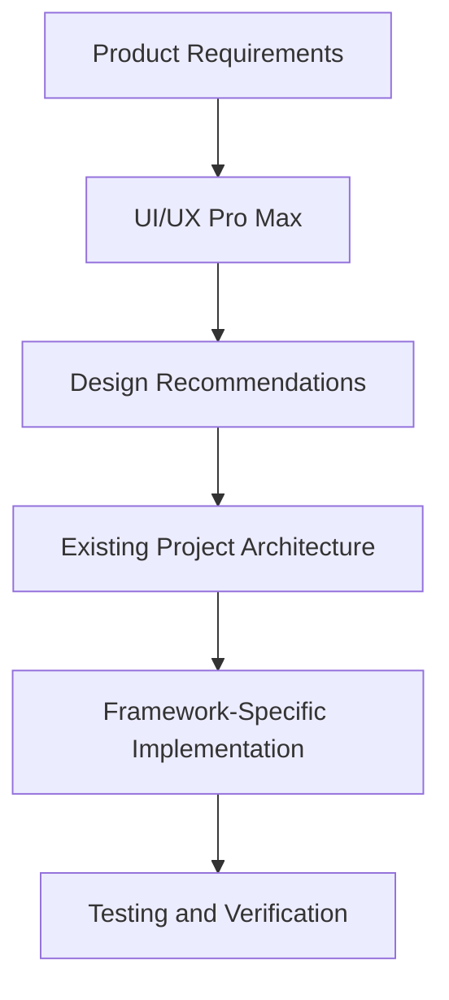
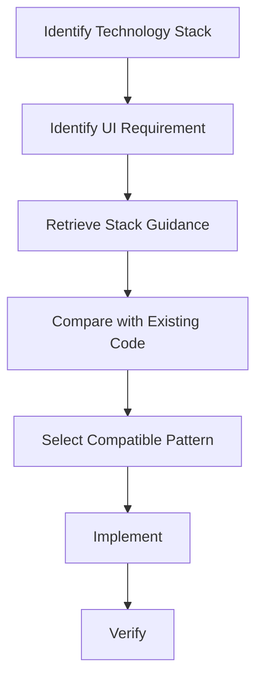
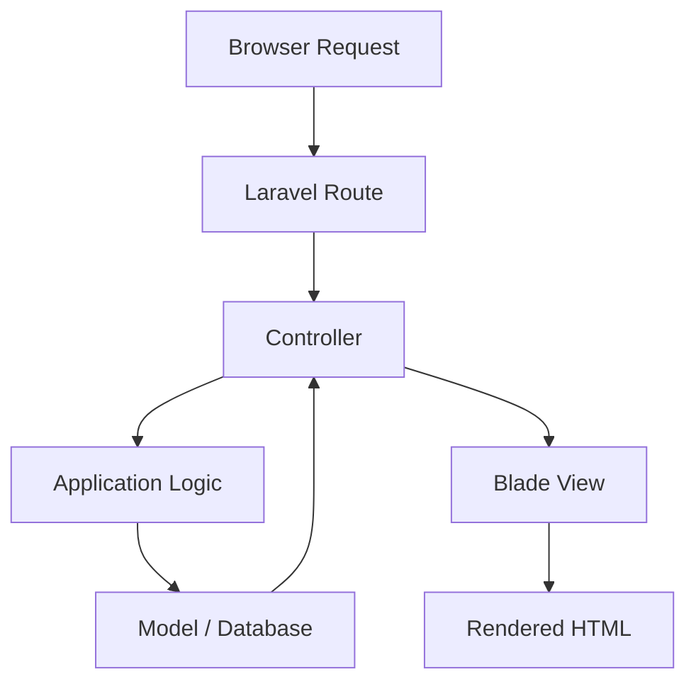
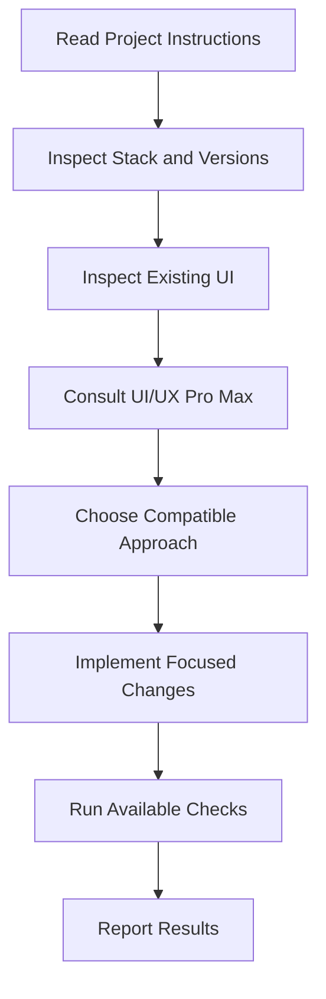
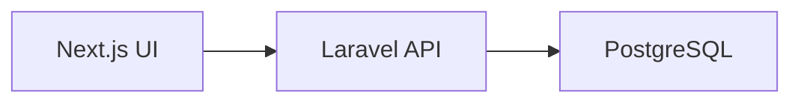

# 09 — UI/UX Pro Max: Framework-Specific Implementation

> [!abstract] Lesson Information
> **Repository:** [nextlevelbuilder/ui-ux-pro-max-skill](https://github.com/nextlevelbuilder/ui-ux-pro-max-skill)
>
> **Category:** Agentic Engineering / Frontend Development / Framework Integration / UI Architecture
>
> **Difficulty:** Intermediate
>
> **Learning Approach:** Theory First
>
> **Prerequisites:** [[06 - Design System Generation]], [[07 - UX Guidelines and Accessibility]], [[08 - Responsive Design and Components]]
>
> **Primary Goal:** Understand how to translate UI/UX Pro Max recommendations into maintainable, accessible, framework-appropriate implementations without unnecessary dependencies or architectural changes.

---

# 1. Learning Objectives

After completing this lesson, you should be able to:

1. Explain framework-specific UI implementation.
2. Understand how UI/UX Pro Max provides stack-related guidance.
3. Distinguish design recommendations from implementation instructions.
4. Apply design systems to HTML and CSS.
5. Understand React component implementation.
6. Explain Next.js App Router integration.
7. Apply Tailwind CSS while preserving design consistency.
8. Understand Laravel Blade UI architecture.
9. Adapt design guidance to Android Java/XML.
10. Map design tokens across frameworks.
11. Preserve accessibility across technology stacks.
12. Understand component reuse and separation of concerns.
13. Avoid unnecessary UI libraries and dependencies.
14. Design controlled Codex implementation workflows.
15. Verify responsive behavior and functional correctness.
16. Recognize common framework-specific UI mistakes.

---

# Part I — Framework-Specific UI Engineering

## 2. What Is Framework-Specific Implementation?

Framework-specific implementation means translating design requirements into code using the conventions and capabilities of a particular technology stack.

A design recommendation may specify:

- Colors.
- Typography.
- Spacing.
- Layout.
- Components.
- Interaction states.
- Accessibility behavior.

The framework determines how those requirements are implemented.

## 2.1 Example

Requirement:

"Create a responsive card grid."

Possible implementations:

| Technology | Typical Approach |
|---|---|
| HTML/CSS | CSS Grid |
| React | Reusable component with CSS |
| Next.js | React component within App Router |
| Tailwind CSS | Utility classes |
| Laravel Blade | Blade component and CSS |
| Android Java/XML | Android layout resources |

The design objective remains similar.

The implementation mechanisms differ.

---

# Part II — Design Intelligence vs Implementation

## 3. Two Different Responsibilities

UI/UX Pro Max helps an agent identify relevant design guidance.

The development framework provides the mechanisms used to implement it.



## 3.1 Important Distinction

A recommendation to use a particular visual style does not require adopting a new framework.

For example:

- A Material-inspired design does not automatically require Jetpack Compose.
- A component-based layout does not automatically require React.
- A Tailwind example does not mean every project should install Tailwind.
- A modern dashboard does not require a large component library.

> [!important]
> **Design requirements should adapt to the project's architecture, not force unnecessary architectural changes.**

---

# Part III — UI/UX Pro Max Stack Guidance

## 4. Framework-Specific Guidance

The repository includes stack-oriented guidance to help coding agents apply design recommendations using relevant framework conventions.

Examples of documented stack categories include:

- HTML and Tailwind.
- React.
- Next.js.
- Vue.
- Svelte.
- Flutter.
- SwiftUI.
- Jetpack Compose.

The exact available stack identifiers should be checked against the installed repository version.

## 4.1 Stack Search Concept

A stack-specific search asks:

"How should this design concern be handled in this technology?"

Examples:

- Responsive layout in React.
- Image optimization in Next.js.
- Accessible forms in HTML.
- Component styling in Tailwind.
- Navigation patterns in Jetpack Compose.

## 4.2 Conceptual Workflow



### Important

The repository's guidance may not directly cover every framework used by a project.

General design principles can still be adapted using the framework's official documentation.

---

# Part IV — HTML and CSS

## 5. Implementing Design Systems with HTML/CSS

HTML provides semantic structure.

CSS provides presentation and layout.

JavaScript can provide interactive behavior where needed.

## 5.1 Example Structure

```html
<section class="services" aria-labelledby="services-title">
  <div class="container">
    <h2 id="services-title">Our Services</h2>

    <div class="service-grid">
      <article class="service-card">
        <h3>Web Development</h3>
        <p>Custom web applications for businesses.</p>
      </article>
    </div>
  </div>
</section>
```

## 5.2 CSS Implementation

```css
:root {
  --color-background: #f3f6fa;
  --color-text: #0b1629;
  --spacing-md: 1rem;
  --spacing-lg: 1.5rem;
}

.container {
  width: min(100% - 2rem, 72rem);
  margin-inline: auto;
}

.service-grid {
  display: grid;
  grid-template-columns:
    repeat(auto-fit, minmax(min(100%, 17rem), 1fr));
  gap: var(--spacing-lg);
}

.service-card {
  padding: var(--spacing-lg);
  background: var(--color-background);
  color: var(--color-text);
}
```

## 5.3 Advantages

- Minimal dependencies.
- Direct control over markup.
- Easy to inspect.
- Suitable for small websites.

## 5.4 Limitations

Larger applications may need more structured component reuse and state management.

---

# Part V — React

## 6. React Component Architecture

React builds interfaces using reusable components.

Components describe UI based on props and state.

## 6.1 Example

```tsx
type ServiceCardProps = {
  title: string;
  description: string;
};

export function ServiceCard({
  title,
  description,
}: ServiceCardProps) {
  return (
    <article className="service-card">
      <h3>{title}</h3>
      <p>{description}</p>
    </article>
  );
}
```

## 6.2 Why Components Matter

Reusable components improve:

- Consistency.
- Maintainability.
- Testability.
- Separation of responsibilities.

## 6.3 Component Composition

```text
ServicesSection
├── SectionHeading
└── ServiceGrid
    ├── ServiceCard
    ├── ServiceCard
    └── ServiceCard
```

### Important

Not every HTML element needs to become a separate React component.

Extract components when they represent meaningful responsibilities or reusable patterns.

---

# Part VI — React State and Interaction

## 7. Visual States vs Application State

A design system defines how states should appear.

React manages when those states are active.

Example:

```tsx
import { useState } from "react";

export function SaveButton() {
  const [isSaving, setIsSaving] = useState(false);

  async function handleSave() {
    setIsSaving(true);

    try {
      // Perform the save operation.
    } finally {
      setIsSaving(false);
    }
  }

  return (
    <button
      type="button"
      disabled={isSaving}
      onClick={handleSave}
    >
      {isSaving ? "Saving..." : "Save"}
    </button>
  );
}
```

This illustrates state handling. The save operation itself is intentionally omitted.

## 7.1 Key Principle

The visual design and application behavior must remain synchronized.

A loading indicator should represent a real loading operation.

---

# Part VII — Next.js App Router

## 8. What Is the App Router?

Next.js App Router uses file-based routing with layouts, pages, and special route files.

It supports React Server Components and Client Components.

## 8.1 Example Structure

```text
app/
├── layout.tsx
├── page.tsx
├── (auth)/
│   ├── login/
│   │   └── page.tsx
│   └── register/
│       └── page.tsx
└── admin/
    ├── layout.tsx
    └── dashboard/
        └── page.tsx
```

## 8.2 UI Responsibilities

**Layouts**

Shared page shells and navigation.

**Pages**

Route-specific content.

**Components**

Reusable interface elements.

**Styles**

Design tokens and presentation rules.

---

# Part VIII — Server and Client Components

## 9. Understanding Component Boundaries

In the Next.js App Router, components are Server Components by default unless a client boundary is introduced.

Client Components are needed for certain browser-side interactions.

Examples:

- `useState`.
- `useEffect`.
- Browser event handling.
- Interactive controls requiring client-side state.

## 9.1 Example Client Component

```tsx
"use client";

import { useState } from "react";

export function ExpandableDetails() {
  const [expanded, setExpanded] = useState(false);

  return (
    <section>
      <button
        type="button"
        aria-expanded={expanded}
        onClick={() => setExpanded(!expanded)}
      >
        Details
      </button>

      {expanded && (
        <p>Additional information appears here.</p>
      )}
    </section>
  );
}
```

## 9.2 Important

Do not mark every component with `"use client"` unnecessarily.

Keep client-side boundaries focused on components that need interactivity.

---

# Part IX — Next.js Image and Font Handling

## 10. Image Optimization

Next.js provides an Image component.

Example:

```tsx
import Image from "next/image";

export function HeroImage() {
  return (
    <Image
      src="/images/hero.webp"
      alt="Team collaborating on a software project"
      width={800}
      height={600}
    />
  );
}
```

## 10.1 Benefits

Depending on configuration, the component can help with:

- Image sizing.
- Responsive delivery.
- Loading behavior.
- Layout stability.

## 10.2 Font Optimization

Next.js also provides `next/font`.

Example:

```tsx
import { Inter } from "next/font/google";

export const inter = Inter({
  subsets: ["latin"],
});
```

### Important

Font selection should follow the approved design system.

Do not replace an existing font simply because a generated recommendation suggests another one.

---

# Part X — Tailwind CSS

## 11. What Is Tailwind CSS?

Tailwind CSS is a utility-first CSS framework.

It provides classes for common styling operations.

Example:

```html
<div class="grid grid-cols-1 gap-6 md:grid-cols-2 lg:grid-cols-3">
  <!-- Cards -->
</div>
```

## 11.1 Benefits

- Consistent utility vocabulary.
- Rapid styling.
- Responsive modifiers.
- Reusable patterns through components.

## 11.2 Risks

- Long class lists.
- Inconsistent arbitrary values.
- Duplicated styling.
- Unclear component boundaries.

### Important

Tailwind should support a design system, not replace design thinking.

---

# Part XI — Tailwind and Design Tokens

## 12. Centralizing Design Values

The method for configuring design tokens depends on the installed Tailwind version.

For example, Tailwind CSS v4 supports CSS-first theme configuration.

```css
@import "tailwindcss";

@theme {
  --color-forge-navy: #0b1629;
  --color-ember-orange: #ff7448;
  --color-cloud-white: #f3f6fa;
}
```

This example is specific to Tailwind v4 conventions.

Tailwind v3 commonly uses configuration through `tailwind.config.js` or `tailwind.config.ts`.

## 12.1 Engineering Lesson

Before asking Codex to modify Tailwind configuration:

1. Identify the installed version.
2. Inspect the existing configuration.
3. Preserve current design tokens.
4. Follow the correct version's documentation.

---

# Part XII — Laravel Blade

## 13. What Is Blade?

Blade is Laravel's templating engine.

It allows developers to build reusable server-rendered views and components.

## 13.1 Example Structure

```text
resources/
└── views/
    ├── layouts/
    │   └── app.blade.php
    ├── components/
    │   ├── button.blade.php
    │   └── card.blade.php
    └── dashboard/
        └── index.blade.php
```

## 13.2 Blade Component Example

```blade
<button
    type="{{ $type ?? 'button' }}"
    {{ $attributes->class(['btn', 'btn-primary']) }}
>
    {{ $slot }}
</button>
```

This is an illustrative component template.

## 13.3 Usage

```blade
<x-button type="submit">
    Save Changes
</x-button>
```

### Engineering Lesson

Blade components can provide consistency without requiring a JavaScript frontend framework.

---

# Part XIII — Laravel MVC Separation

## 14. UI Architecture and MVC

In Laravel:

**Model**

Represents application data and relationships.

**View**

Presents information.

**Controller**

Coordinates requests and responses.

## 14.1 Conceptual Flow



## 14.2 Important Principle

A visual redesign should not unnecessarily modify business logic.

For example, improving a scheduling form should not automatically change scheduling rules.

---

# Part XIV — Livewire and Alpine.js

## 15. Progressive Interactivity

Laravel applications may use Livewire and Alpine.js for interactive behavior.

### Livewire

Supports reactive UI interactions with Laravel-based server-side components.

### Alpine.js

Provides lightweight JavaScript behavior in HTML.

## 15.1 Example Alpine Component

```html
<div x-data="{ open: false }">
  <button
    type="button"
    x-on:click="open = !open"
    x-bind:aria-expanded="open.toString()"
  >
    Toggle details
  </button>

  <div x-show="open">
    Additional details
  </div>
</div>
```

This illustrates simple behavior; production use also requires appropriate visibility, focus, and accessibility handling.

## 15.2 Important

Do not introduce React into an existing Laravel application solely to implement a small dropdown or modal.

Use the existing architecture when it adequately supports the requirement.

---

# Part XV — Android Java/XML

## 16. Adapting UI Guidance to Android

Android UI implementation differs from web implementation.

Common Android Java/XML elements include:

- Activities.
- Fragments.
- XML layouts.
- Resource files.
- View binding.
- Android UI widgets.

## 16.1 Example Structure

```text
app/
└── src/
    └── main/
        ├── java/
        │   └── com/example/app/
        │       └── MainActivity.java
        └── res/
            ├── layout/
            ├── drawable/
            ├── values/
            └── mipmap/
```

## 16.2 Design Resources

Android can centralize design values through:

- `colors.xml`.
- `dimens.xml`.
- `styles.xml`.
- `themes.xml`.
- Font resources.
- Drawable resources.

---

# Part XVI — Android Layout Example

## 17. XML Implementation

```xml
<LinearLayout
    xmlns:android="http://schemas.android.com/apk/res/android"
    android:layout_width="match_parent"
    android:layout_height="wrap_content"
    android:orientation="vertical"
    android:padding="16dp">

    <TextView
        android:layout_width="match_parent"
        android:layout_height="wrap_content"
        android:text="@string/welcome_title"
        android:textSize="24sp" />

    <Button
        android:layout_width="match_parent"
        android:layout_height="wrap_content"
        android:text="@string/get_started" />

</LinearLayout>
```

## 17.1 Important Concepts

- Use `dp` for layout dimensions.
- Use `sp` for text sizing.
- Prefer string resources.
- Support accessibility.
- Test different screen sizes.

## 17.2 Compose vs XML

UI/UX Pro Max may provide Jetpack Compose-specific guidance.

However, an existing Java/XML project should adapt general design principles without automatically migrating to Compose.

---

# Part XVII — Cross-Framework Design Tokens

## 18. One Design Language, Different Implementations

A design system may be shared conceptually across web and mobile applications.

However, implementation values may differ.

## 18.1 Example

| Design Concept | Web | Android |
|---|---|---|
| Primary color | CSS custom property | Color resource |
| Spacing | `rem` or `px` | `dp` |
| Text size | `rem` | `sp` |
| Radius | CSS `border-radius` | Drawable or shape |
| Component | React/Blade component | Android View/layout |

## 18.2 Important

Cross-platform consistency does not require identical implementation code.

It requires consistent design intent and appropriate platform behavior.

---

# Part XVIII — Accessibility Across Frameworks

## 19. Shared Accessibility Principles

Regardless of framework:

- Controls need meaningful labels.
- Focus behavior should be predictable.
- Status feedback should be understandable.
- Text should remain readable.
- Interaction targets should be usable.
- Color should not be the only signal.

## 19.1 Framework Differences

| Platform | Accessibility Mechanisms |
|---|---|
| HTML | Semantic elements and ARIA |
| React | Accessible JSX and component behavior |
| Next.js | React accessibility plus routing considerations |
| Blade | Semantic rendered HTML |
| Android | Content descriptions, focus behavior, accessibility APIs |

### Important

Accessibility must be verified in the actual rendered application.

---

# Part XIX — Dependency Discipline

## 20. Avoiding Unnecessary Libraries

AI coding agents may suggest new dependencies because they simplify implementation.

However, every dependency introduces considerations such as:

- Maintenance.
- Compatibility.
- Bundle size.
- Security updates.
- Learning overhead.
- Architectural complexity.

## 20.1 Decision Framework

Before adding a UI library, ask:

1. Does the project already have a suitable solution?
2. Is the feature complex enough to justify a dependency?
3. Is the library compatible with the current framework?
4. Is it actively maintained?
5. Does it support accessibility?
6. Does it fit the project scope?

## 20.2 Example

A simple card grid usually does not require a new component library.

A complex, accessible data grid may justify evaluating an established solution.

---

# Part XX — Codex Framework Awareness

## 21. Why Codex Must Inspect the Project

Before implementing UI changes, Codex should identify:

- Framework.
- Framework version.
- Styling approach.
- Component structure.
- Routing conventions.
- Existing dependencies.
- Design-system documentation.
- Testing setup.

## 21.1 Workflow



---

# Part XXI — Example Codex Prompt

## 22. Controlled UI Implementation

```text
Read AGENTS.md and the relevant project documentation.

Inspect the existing framework, versions, routing,
component structure, styling conventions, and dependencies.

Use UI/UX Pro Max to identify suitable UI/UX guidance.

Implement the requested UI improvement using the
existing technology stack.

Requirements:
- Preserve approved design tokens.
- Reuse existing components.
- Follow framework conventions.
- Maintain accessibility.
- Support responsive layouts.
- Avoid unrelated changes.
- Do not introduce new dependencies without approval.

Before implementation:
1. Explain the current structure.
2. Identify the relevant files.
3. Propose a focused plan.

After implementation:
1. Run available checks.
2. Report modified files.
3. Report remaining limitations.
```

---

# Part XXII — Case Study: HarayaForge

## 23. Software Startup Website

### Design Requirements

- Professional.
- Minimal.
- Responsive.
- Consistent branding.
- Flat solid colors.
- No unnecessary gradients.

### Implementation Considerations

A suitable framework-specific approach should:

- Preserve brand tokens.
- Reuse service cards.
- Maintain responsive grids.
- Keep the contact form accessible.
- Avoid unnecessary animation libraries.

### Engineering Lesson

UI/UX Pro Max should refine the implementation while preserving the existing brand identity.

---

# Part XXIII — Case Study: GoPasig

## 24. Laravel Fleet Management

### Existing Stack Context

- Laravel.
- Blade.
- Tailwind CSS.
- Livewire/Alpine where applicable.
- Google Maps integration.

### UI Priorities

- Dashboard clarity.
- Route and schedule management.
- Consistent forms.
- Readable tables.
- Map accessibility.
- Operational status feedback.

### Engineering Lesson

Use framework-appropriate Blade and Laravel patterns rather than introducing an unrelated frontend architecture.

---

# Part XXIV — Case Study: Next.js E-Commerce

## 25. Next.js Frontend + Laravel Backend

### Architecture



### Frontend Responsibilities

- Rendering.
- Navigation.
- Forms.
- UI state.
- Accessibility.
- Responsive layouts.

### Backend Responsibilities

- Authentication and authorization.
- Validation.
- Business rules.
- Database operations.
- API responses.

### Engineering Lesson

A UI improvement should respect the frontend/backend separation.

Do not move backend business logic into frontend components.

---

# Part XXV — Case Study: GroupTrack

## 26. Android Java/XML Project

### Project Constraints

- Android Studio.
- Java.
- XML layouts.
- Firebase.
- Defined MVP scope.

### UI Implementation Principles

- Preserve existing architecture.
- Use Android resources.
- Follow accessible layout conventions.
- Avoid unnecessary libraries.
- Build only required screens.
- Verify on emulator and physical device.

### Engineering Lesson

The correct implementation is the one that satisfies the project requirements with appropriate complexity.

---

# Part XXVI — Common Mistakes

## 27. Framework-Specific Anti-Patterns

### Framework Migration Without Need

Replacing a working stack merely to implement a design.

### Unnecessary Dependencies

Installing a library for a simple layout.

### Duplicated Components

Rebuilding existing components instead of reusing them.

### Incorrect Framework Version Guidance

Applying Tailwind v4 configuration to a Tailwind v3 project.

### Poor Separation of Concerns

Mixing business logic into presentation components.

### Inaccessible Custom Controls

Creating custom elements without keyboard or semantic support.

### Excessive Client-Side JavaScript

Using client-side state where server-rendered content is sufficient.

### Design-System Drift

Introducing inconsistent colors, spacing, or typography.

---

# Part XXVII — Practical Exercises

## 28. Exercise 1 — Framework Mapping

Choose one UI requirement:

"Create a responsive dashboard card."

Explain how you would implement it in:

1. HTML/CSS.
2. React.
3. Next.js.
4. Laravel Blade.
5. Android Java/XML.

---

## 29. Exercise 2 — Component Architecture

Design a reusable component structure for an e-commerce frontend.

Include:

- Product cards.
- Filters.
- Buttons.
- Forms.
- Layout components.

Explain which components should be shared.

---

## 30. Exercise 3 — Dependency Evaluation

Scenario:

Codex recommends installing a new UI library to build a basic contact form.

Evaluate whether the dependency is necessary.

Consider:

- Existing tools.
- Accessibility.
- Maintenance.
- Project scope.

---

## 31. Exercise 4 — Framework Version Awareness

Compare the conceptual differences between:

- Tailwind v3 configuration.
- Tailwind v4 configuration.

Explain why Codex must inspect the installed version before editing configuration.

---

## 32. Exercise 5 — Android Adaptation

A UI/UX recommendation uses Jetpack Compose.

Your project uses Java/XML.

Explain how you would preserve:

- Visual hierarchy.
- Spacing.
- Typography.
- Accessibility.
- Component consistency.

Without migrating the project.

---

## 33. Exercise 6 — Codex Prompt

Write a Codex prompt requesting a UI improvement in an existing Laravel project.

Require:

- Architecture inspection.
- Design-system review.
- Minimal changes.
- No unnecessary dependencies.
- Accessibility checks.
- Verification.

---

# Part XXVIII — Knowledge Check

## 34. Review Questions

1. What is framework-specific implementation?
2. How does design guidance differ from implementation guidance?
3. Why should existing architecture be preserved?
4. What is semantic HTML?
5. What is React component composition?
6. What is the Next.js App Router?
7. What is a Server Component?
8. What is a Client Component?
9. When is `"use client"` necessary?
10. What does `next/image` provide?
11. What is `next/font`?
12. What is Tailwind CSS?
13. Why do Tailwind versions matter?
14. What is Laravel Blade?
15. What is a Blade component?
16. How does MVC separation support maintainability?
17. What is Livewire?
18. What is Alpine.js?
19. How are Android design resources organized?
20. Why are `dp` and `sp` used?
21. How do design tokens differ across platforms?
22. Why must accessibility be tested in the rendered interface?
23. What are the risks of unnecessary dependencies?
24. Why should Codex inspect the existing project first?
25. What should an implementation report contain?

---

# Part XXIX — Key Takeaways

> [!summary]
> - UI/UX Pro Max provides design intelligence and stack-oriented guidance.
> - Framework-specific implementation translates design requirements into compatible code.
> - Existing project architecture should guide implementation.
> - HTML provides semantic structure.
> - React supports component-based interfaces.
> - Next.js adds routing and server/client component considerations.
> - Tailwind supports utility-based styling but must follow version-specific conventions.
> - Laravel Blade supports reusable server-rendered components.
> - Android Java/XML uses platform-specific resources and layouts.
> - Cross-platform design consistency does not require identical code.
> - Accessibility principles apply across frameworks.
> - Dependencies should be justified.
> - Codex should inspect the stack before editing.
> - Focused implementation reduces regressions and unnecessary complexity.

---

# Part XXX — Final Mental Model

```text
PRODUCT REQUIREMENTS
         |
         v
UI/UX PRO MAX GUIDANCE
         |
         v
APPROVED DESIGN SYSTEM
         |
         v
EXISTING PROJECT ARCHITECTURE
         |
         v
FRAMEWORK-SPECIFIC IMPLEMENTATION
         |
         +-- HTML / CSS
         |
         +-- REACT
         |
         +-- NEXT.JS
         |
         +-- TAILWIND
         |
         +-- LARAVEL BLADE
         |
         +-- ANDROID JAVA/XML
         |
         v
ACCESSIBILITY AND RESPONSIVENESS
         |
         v
TESTING AND VERIFICATION
         |
         v
MAINTAINABLE USER INTERFACE
```

**Remember:**

A design skill recommends what the interface should achieve.

The framework determines how it should be implemented.

The existing architecture determines what changes are appropriate.

Testing verifies whether the result actually works.

---

# Part XXXI — Official References

## UI/UX Pro Max

- [Official GitHub Repository](https://github.com/nextlevelbuilder/ui-ux-pro-max-skill)
- [README](https://github.com/nextlevelbuilder/ui-ux-pro-max-skill/blob/main/README.md)

## Web Frameworks

- [React Documentation](https://react.dev/)
- [Next.js Documentation](https://nextjs.org/docs)
- [Next.js App Router](https://nextjs.org/docs/app)
- [Next.js Image Component](https://nextjs.org/docs/app/api-reference/components/image)
- [Next.js Font Optimization](https://nextjs.org/docs/app/getting-started/fonts)
- [Tailwind CSS Documentation](https://tailwindcss.com/docs)
- [Laravel Documentation](https://laravel.com/docs)
- [Laravel Blade](https://laravel.com/docs/blade)
- [Livewire Documentation](https://livewire.laravel.com/docs)
- [Alpine.js Documentation](https://alpinejs.dev/)

## Android and Accessibility

- [Android Developers](https://developer.android.com/)
- [Android Views and Layouts](https://developer.android.com/develop/ui/views/layout/declaring-layout)
- [Android Accessibility](https://developer.android.com/guide/topics/ui/accessibility)
- [WCAG 2.2](https://www.w3.org/TR/WCAG22/)
- [MDN Web Accessibility](https://developer.mozilla.org/en-US/docs/Web/Accessibility)

> [!note] Documentation Scope
> This lesson combines the repository's stack-oriented guidance with established framework-specific development practices.
>
> Laravel Blade and Android Java/XML examples demonstrate how to adapt general design guidance to technologies that may not have dedicated stack rules in the installed version of UI/UX Pro Max.
>
> Code snippets are educational examples and have not been executed against the user's projects.

---

# Part XXXII — Next Lesson

**[[10 - Design System Persistence and Customization]]**

Topics:

1. Design-system persistence.
2. Saving generated recommendations.
3. Master design-system files.
4. Page-specific override files.
5. Design-system customization.
6. Brand preservation.
7. Token overrides.
8. Design-system documentation.
9. Version control and Git.
10. Change impact analysis.
11. Design-system drift prevention.
12. Codex context engineering.
13. Multi-page consistency.
14. Android, Laravel, and Next.js examples.
15. Practical exercises.
16. Official references.

**End of Lesson 09 — Framework-Specific Implementation.**
