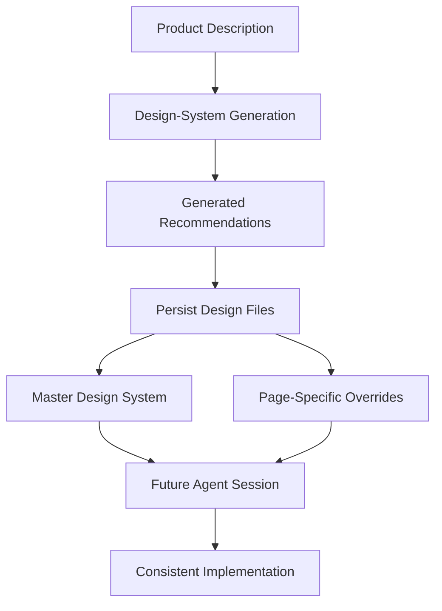
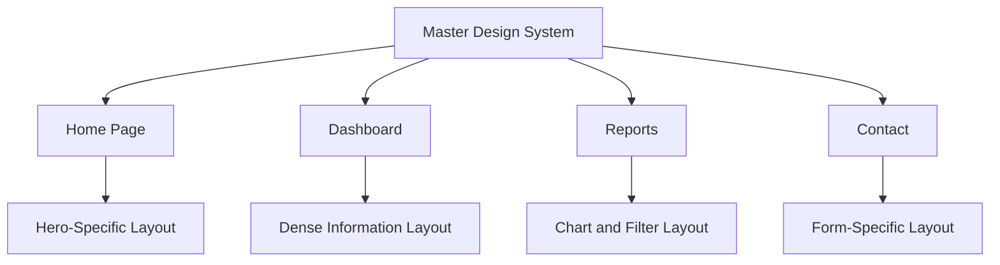
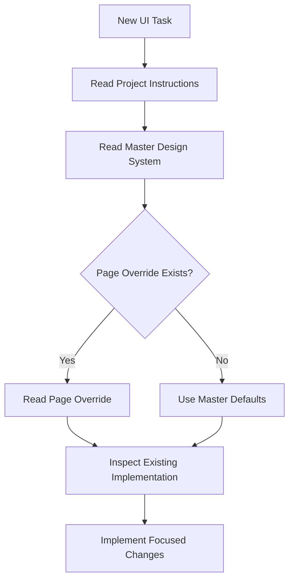
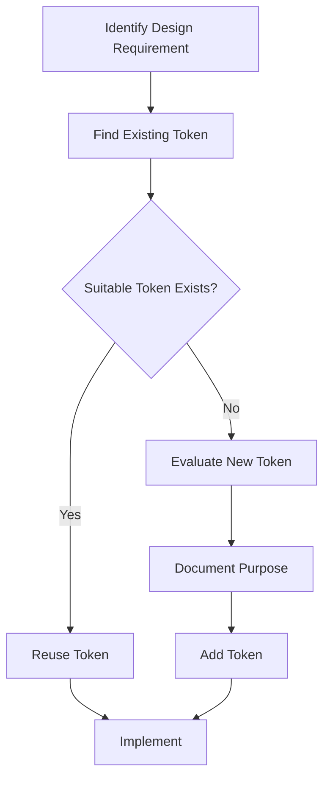
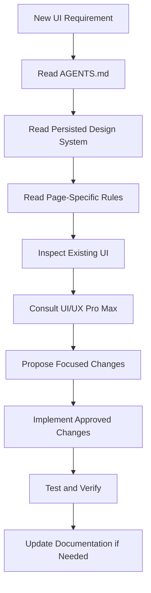
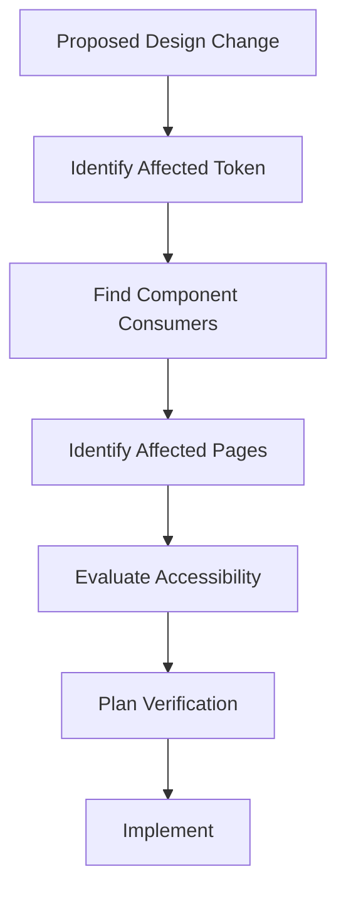

# 10 — UI/UX Pro Max: Design System Persistence and Customization

> [!abstract] Lesson Information
> **Repository:** [nextlevelbuilder/ui-ux-pro-max-skill](https://github.com/nextlevelbuilder/ui-ux-pro-max-skill)
>
> **Category:** Agentic Engineering / Design Systems / Context Engineering / Configuration Management
>
> **Difficulty:** Intermediate to Advanced
>
> **Learning Approach:** Theory First
>
> **Prerequisites:** [[06 - Design System Generation]], [[08 - Responsive Design and Components]], [[09 - Framework-Specific Implementation]]
>
> **Primary Goal:** Understand how to preserve, customize, version, and maintain design-system decisions across pages, repositories, and AI-assisted development sessions.

---

# 1. Learning Objectives

After completing this lesson, you should be able to:

1. Define design-system persistence.
2. Explain why generated recommendations should be saved.
3. Understand the repository's documented persistence workflow.
4. Distinguish master rules from page-specific overrides.
5. Explain how design-system files are organized.
6. Understand how an AI agent should retrieve existing design context.
7. Customize recommendations without losing consistency.
8. Preserve established brand identity.
9. Understand token-level customization.
10. Explain design-system inheritance.
11. Identify conflicting design instructions.
12. Apply Git version control to design documentation.
13. Understand change impact analysis.
14. Prevent design-system drift.
15. Integrate persistent design context with Codex and `AGENTS.md`.
16. Apply persistence concepts to Next.js, Laravel, and Android.
17. Design a maintainable workflow without overengineering.

---

# Part I — Understanding Persistence

## 2. What Is Design-System Persistence?

**Design-system persistence** means storing design decisions in durable files so they can be reused across development sessions.

Without persistence, recommendations may exist only in chat history, temporary AI context, terminal output, or developer memory. Those are not reliable substitutes for project documentation.

With persistence, approved decisions become part of the repository.

### Example

Without persistence:

```text
Session 1: AI recommends navy buttons.
Session 2: AI recommends purple buttons.
Session 3: AI recommends green buttons.
```

With persistence:

```text
Project Design System: Primary buttons use the approved navy token.
Session 1 → Reads design system.
Session 2 → Reads design system.
Session 3 → Reads design system.
```

The second approach reduces unnecessary visual changes.

---

# Part II — Why Persistence Matters in Agentic Development

## 3. AI Context Is Not the Same as Project State

An AI coding agent may have limited or changing conversational context. It should not be expected to remember every earlier design decision. Project files provide more durable guidance.

### Benefits

- Consistency between sessions.
- Better collaboration.
- Reduced repeated decisions.
- Easier onboarding.
- Traceable changes.
- Clearer instructions for AI agents.
- Less design-system drift.

> [!important]
> Important design decisions should exist in version-controlled project files, not exclusively in conversation history.

---

# Part III — UI/UX Pro Max Persistence Workflow

## 4. Repository Persistence Capability

UI/UX Pro Max documents a persistence workflow for generated design systems. Its generation command supports writing output to project files. The documented model includes a master design-system file, page-specific design-system files, and retrieval of existing decisions for later implementation.

The exact flags and output paths depend on the installed repository version.



### Example Command Pattern

```powershell
python scripts/search.py "professional software agency website" --design-system -p "Agency Website" --persist
```

The path assumes execution from the appropriate skill directory. Check the installed version's README or help output before running commands.

> [!important]
> Persistence saves recommendations. It does not mean they have been reviewed, approved, or implemented.

---

# Part IV — Master Design System

## 5. What Is the Master File?

The master design system defines global decisions such as product direction, brand palette, typography, spacing, layout, component conventions, accessibility rules, and anti-patterns.

```text
MASTER DESIGN SYSTEM
├── Product Identity
├── Visual Direction
├── Color Palette
├── Typography
├── Spacing
├── Components
├── Responsive Principles
├── Accessibility
└── Anti-Patterns
```

### Example Master Documentation

```markdown
# Master Design System

## Brand Direction
Professional, minimal, and accessible.

## Colors
- Primary: Forge Navy
- Accent: Ember Orange
- Secondary Accent: Digital Cyan
- Background: Cloud White

## Typography
Use the approved typography scale.

## Components
Reuse existing buttons, cards, forms, and navigation.

## Constraints
- No unnecessary gradients.
- No decorative effects without a purpose.
- Preserve responsive behavior.
- Maintain accessible interaction states.
```

This is illustrative, not a verbatim generator output.

---

# Part V — Page-Specific Overrides

## 6. What Are Page Overrides?

Page-specific overrides describe requirements unique to a page: homepage hero composition, dashboard information density, report charts, contact form arrangement, or product catalog grid.



### Example Override

```markdown
# Dashboard Page Design

## Inherited Rules
Use the master palette, typography, spacing scale, and shared components.

## Page-Specific Rules
- Prioritize operational information.
- Use compact KPI cards.
- Provide responsive data tables.
- Keep important filters visible.
- Preserve accessible status labels.
```

Page-specific overrides should generally change page composition rather than redefine the brand.

---

# Part VI — Design-System Inheritance

## 7. Understanding Inheritance

Inheritance means a page receives default rules from a shared source. A page-specific rule may override a shared default when an exception is justified.

Example: the master uses a standard card radius; the reports page uses it for chart panels. No override is needed. A full-screen map flush with the viewport might justify a square edge.

### Recommended Priority

1. Accessibility and non-negotiable requirements.
2. Approved product and brand constraints.
3. Master design-system rules.
4. Approved page-specific exceptions.
5. Generated recommendations.
6. Unspecified implementation preferences.

This is a recommended project policy, not a claim about the generator's internal precedence algorithm.

---

# Part VII — Retrieval Before Regeneration

## 8. Why Existing Design Files Should Be Read First

Generating a new design system for every page can produce inconsistent results.

Weak workflow:

```text
Home → palette A
About → palette B
Contact → palette C
```

Better workflow:

```text
Generate and approve master design system
                 ↓
           Save to repository
                 ↓
        Home / About / Contact
```



**Key principle:** Retrieve existing design context before generating new design decisions.

---

# Part VIII — Customization

## 9. What Is Design-System Customization?

Customization adapts generated recommendations to real project requirements: use approved brand colors, select an existing font, adjust spacing for data-heavy pages, remove needless effects, or refine component variants.

| Generated Recommendation | Customized Decision |
|---|---|
| Generic color palette | Approved brand palette |
| Suggested font pairing | Existing brand typography |
| Marketing-oriented layout | Task-oriented dashboard |
| Decorative animations | Restrained interactions |
| General component styling | Project-specific reusable components |

Customize intentionally and document approved changes. Avoid random page-by-page value changes.

---

# Part IX — Brand Preservation

## 10. Why Existing Branding Takes Priority

Generated recommendations should be evaluated against an established visual identity.

### Example: HarayaForge

| Token | HEX |
|---|---|
| Forge Navy | `#0B1629` |
| Ember Orange | `#FF7448` |
| Digital Cyan | `#46C7DC` |
| Cloud White | `#F3F6FA` |

Constraints: minimal, professional, solid colors, restrained accents, and no unnecessary gradients.

If a new recommendation conflicts, retain approved colors while considering useful guidance about distribution, typography, spacing, layout, accessibility, and feedback.

A brand color is not automatically accessible for every text/background combination. Reconcile brand and accessibility through appropriate color roles and verify contrast.

---

# Part X — Token Customization

## 11. Why Customize Tokens Instead of Individual Components?

Tokens centralize design decisions.

Without tokens:

```css
.card { border-radius: 12px; }
.dialog { border-radius: 12px; }
.panel { border-radius: 12px; }
```

With tokens:

```css
:root {
  --radius-surface: 12px;
}

.card,
.dialog,
.panel {
  border-radius: var(--radius-surface);
}
```

### Benefits

- Easier global updates.
- Reduced duplication.
- Consistent appearance.
- Better maintainability.

### Token Customization Process



---

# Part XI — Avoiding Unnecessary Overrides

## 12. The Problem with Excessive Exceptions

Too many overrides make a design system hard to maintain.

```text
Home button: 12px radius
About button: 10px radius
Contact button: 14px radius
Dashboard button: 8px radius
```

Unless these differences serve a documented purpose, they introduce inconsistency.

Define standard component variants instead:

```text
Button
├── Primary
├── Secondary
└── Destructive
```

Pages should select approved variants instead of inventing new ones.

---

# Part XII — File Organization

## 13. Suggested Project Documentation Structure

```text
project/
├── AGENTS.md
├── docs/
│   └── design-system/
│       ├── README.md
│       ├── master.md
│       ├── foundations/
│       │   ├── colors.md
│       │   ├── typography.md
│       │   └── spacing.md
│       ├── components/
│       │   ├── buttons.md
│       │   ├── forms.md
│       │   └── cards.md
│       └── pages/
│           ├── home.md
│           ├── dashboard.md
│           └── contact.md
└── src/
```

This is a suggested structure, not necessarily the exact output of the UI/UX Pro Max persistence command.

### Keep Documentation Proportional

A small project may need only `docs/design-system.md`. Do not create extensive structures unless the project needs them.

---

# Part XIII — Source of Truth

## 14. What Is a Single Source of Truth?

A single source of truth is the authoritative location for a particular decision.

| Decision | Source of Truth |
|---|---|
| Brand colors | Approved design-system documentation |
| Component behavior | Component specification |
| Business rules | Functional requirements |
| Architecture | Architecture documentation |
| Agent workflow | `AGENTS.md` |
| Actual implementation | Source code |

Documentation describes intended behavior; source code shows implementation. When they disagree, investigate rather than assuming either is automatically correct.

---

# Part XIV — Codex Context Engineering

## 15. Why Persistence Helps Codex

Repository documentation can provide Codex with project purpose, design decisions, component conventions, technical constraints, and scope boundaries, reducing unnecessary redesign.

### Example `AGENTS.md`

```markdown
# UI/UX Development Rules

Before modifying UI files:

1. Read docs/design-system/master.md.
2. Read the relevant page-specific documentation.
3. Inspect existing components.
4. Preserve approved brand colors and typography.
5. Reuse existing design tokens.
6. Follow established responsive patterns.
7. Do not add UI libraries without approval.
8. Avoid redesigning unrelated pages.
9. Verify accessibility and functionality.

UI/UX Pro Max recommendations are advisory.
Approved project documentation takes precedence.
```

`AGENTS.md` should reference detailed design documentation rather than duplicate every rule, reducing conflicting copies.

---

# Part XV — Persistent Agentic Workflow

## 16. End-to-End Process



If a change introduces an approved component or rule, update the documentation so future sessions do not follow outdated guidance.

---

# Part XVI — Git Version Control

## 17. Why Use Git?

Git provides a history of design-system documentation, supporting traceability, collaboration, review, rollback, and comparison.

```powershell
git status
git diff
git add docs/design-system
git commit -m "docs: update design system guidelines"
```

These are illustrative, not commands executed in this repository.

Generally commit approved design-system files, component specifications, decision records, and related implementation changes. Avoid temporary outputs unless they are intentionally part of project documentation.

---

# Part XVII — Change Impact Analysis

## 18. What Is Change Impact Analysis?

Change impact analysis evaluates which project parts may be affected by a proposed change. A global button token, for example, may affect login, registration, dashboard, settings, and contact forms.



| Change | Possible Impact |
|---|---|
| Primary color | Buttons, links, navigation |
| Body font | Text wrapping, layout |
| Spacing scale | Cards, forms, sections |
| Border radius | Buttons, cards, dialogs |
| Navigation component | Multiple pages |
| Table density | Dashboard and reports |

Even a small token change can have broad effects.

---

# Part XVIII — Design-System Drift

## 19. What Is Design-System Drift?

Design-system drift occurs when implementation gradually diverges from approved rules. Causes include hardcoded values, unreviewed AI changes, duplicate components, unnecessary overrides, outdated documentation, and inconsistent conventions.

Example approved token:

```css
--spacing-card: 1.5rem;
```

But pages use `20px`, `28px`, and `17px` without a clear reason.

### Prevention

- Reuse tokens.
- Review UI changes.
- Inspect shared components.
- Keep documentation current.
- Test affected pages.
- Avoid arbitrary values.

---

# Part XIX — Design-System Audits

## 20. What Is a Design-System Audit?

An audit checks whether implementation follows approved rules.

| Category | Questions |
|---|---|
| Colors | Are approved tokens used? |
| Typography | Is the type scale consistent? |
| Spacing | Are standard values reused? |
| Components | Are shared components reused? |
| Responsive | Do layouts adapt correctly? |
| Accessibility | Are required interaction behaviors supported? |
| Documentation | Do files reflect current decisions? |

An audit should identify compliant elements, inconsistencies, risks, and recommended corrections. It should not automatically trigger a complete redesign.

---

# Part XX — Multi-Page Consistency

## 21. Why Multi-Page Consistency Matters

Users should not feel that each page belongs to a different application. Shared elements such as buttons, navigation, forms, status labels, typography, and spacing should behave predictably.

```text
Master Design System
       ├── Home
       ├── Capabilities
       ├── Team
       └── Contact
```

Each page has its own content but follows the same approved foundations.

---

# Part XXI — Multi-Repository Considerations

## 22. Shared Design Systems Across Projects

Organizations may maintain a marketing site, customer portal, admin dashboard, and mobile application. These products can share brand principles while using different platform implementations.

Shared branding does not require identical components on every platform. A web button and Android button may express the same design intent through different implementation mechanisms.

Avoid premature centralization. A small team may only need documented conventions. Introduce shared packages when reuse and maintenance needs justify them.

---

# Part XXII — Case Study: HarayaForge

## 23. Persistent Startup Design System

### Master Foundations

```text
HarayaForge
├── Brand Identity
├── Color Tokens
├── Typography
├── Spacing
├── Buttons
├── Cards
├── Forms
└── Responsive Guidelines
```

### Page Overrides

- **Home:** Hero composition and introductory sections.
- **Capabilities:** Service-card layout.
- **Team:** Personnel cards and principles.
- **Contact:** Form arrangement and feedback states.

Generated recommendations should not introduce gradients or unrelated styles that conflict with the approved brand.

**Engineering lesson:** Persistence lets future Codex sessions preserve the same visual identity.

---

# Part XXIII — Case Study: GoPasig

## 24. Laravel Fleet Management

### Shared Design Rules

- Consistent navigation.
- Standard data tables.
- Reusable forms.
- Status labels.
- Dashboard spacing.
- Accessible interaction states.

| Page | Unique Concern |
|---|---|
| Dashboard | Operational overview |
| Routes | Map and route information |
| Schedules | Scheduling controls |
| Drivers | Driver records |
| Reports | Data visualization |

A design-system update should not accidentally change business rules, authorization, or scheduling logic.

---

# Part XXIV — Case Study: Next.js E-Commerce

## 25. Role-Based UI Consistency

A Next.js application may contain customer, staff, and admin pages. Roles can use different layouts while sharing foundations.

```text
Design System
├── Shared Tokens
├── Shared Components
├── Customer Patterns
├── Staff Patterns
└── Admin Patterns
```

Use role-specific patterns while preserving common tokens and accessible component behavior.

---

# Part XXV — Case Study: Android GroupTrack

## 26. Android Java/XML Persistence

An Android application can preserve visual decisions through resources and documentation, such as `colors.xml`, `dimens.xml`, `themes.xml`, shared drawables, layout conventions, and design-system Markdown.

Do not assume UI/UX Pro Max automatically generates Android XML resources. Translate recommendations into the existing architecture. A small Android MVP can use a lightweight design system without introducing a complex theming framework.

---

# Part XXVI — Common Mistakes

## 27. Persistence and Customization Anti-Patterns

- **Regenerating the whole system for every page:** Creates inconsistent recommendations.
- **Treating generated output as approved:** Ignores brand and project requirements.
- **Excessive page overrides:** Weakens consistency.
- **Duplicated documentation:** Creates conflicting sources of truth.
- **Unnecessary tokens:** Makes the system harder to understand.
- **Ignoring Git history:** Reduces traceability.
- **Failing to update documentation:** Creates documentation drift.
- **Overengineering:** Adds unnecessary files, packages, and processes.
- **Unverified agent changes:** Lets unintended differences accumulate.

---

# Part XXVII — Practical Exercises

## 28. Exercise 1 — Persistence Architecture

Design a simple documentation structure for a three-page application. Include a master design system, homepage rules, dashboard rules, and contact-page rules. Explain which decisions belong in each file.

## 29. Exercise 2 — Brand Customization

A generated design system recommends purple as the primary color, but the brand uses navy and orange. Explain what to preserve, which recommendations may still help, how to document the result, and how to communicate constraints to Codex.

## 30. Exercise 3 — Override Evaluation

Evaluate these proposals:

1. Dashboard uses denser card spacing.
2. Contact page changes all button colors.
3. Reports page uses a specialized chart layout.
4. Homepage uses a different font without approval.

Classify which may be justified and which require reconsideration.

## 31. Exercise 4 — Change Impact

The master typography scale changes. Identify affected components and pages, responsive risks, accessibility considerations, and required verification.

## 32. Exercise 5 — Codex Context

Write an `AGENTS.md` section instructing Codex to read the master design system and page rules, inspect existing components, preserve branding, avoid needless dependencies, and update documentation when approved rules change.

## 33. Exercise 6 — Design-System Audit

Create a checklist for colors, typography, spacing, components, responsive behavior, accessibility, and documentation consistency. Use it to evaluate a hypothetical application.

## 34. Exercise 7 — Git Workflow

Explain how Git helps track design-system changes. Include status inspection, diff review, focused commits, and rollback considerations.

---

# Part XXVIII — Knowledge Check

## 35. Review Questions

1. What is design-system persistence?
2. Why should generated recommendations be saved?
3. How does persistence support agentic development?
4. What is a master design system?
5. What is a page-specific override?
6. What is design-system inheritance?
7. Why should existing files be read before regeneration?
8. What is design-system customization?
9. Why should existing branding be preserved?
10. Why are design tokens useful?
11. What makes an override unnecessary?
12. What is a source of truth?
13. How should `AGENTS.md` reference design documentation?
14. What is change impact analysis?
15. Why can typography changes affect layouts?
16. What is design-system drift?
17. How can drift be prevented?
18. What is a design-system audit?
19. How does Git support design-system maintenance?
20. Why should documentation changes be version-controlled?
21. How can multiple pages share design foundations?
22. What are the risks of duplicated documentation?
23. Why should small projects avoid excessive governance?
24. How can Laravel projects preserve UI consistency?
25. How can Android Java/XML projects preserve design decisions?

---

# Part XXIX — Key Takeaways

> [!summary]
> - Persistence turns temporary design recommendations into durable project knowledge.
> - AI agents should read existing design files before generating new recommendations.
> - A master design system defines global rules; page overrides handle justified exceptions.
> - Generated recommendations require project review.
> - Approved brand decisions should remain authoritative.
> - Design tokens centralize reusable values.
> - Excessive overrides increase maintenance complexity.
> - `AGENTS.md` should reference authoritative design documentation.
> - Git provides traceability for design-system changes.
> - Change impact analysis helps prevent regressions.
> - Design-system drift occurs when implementation diverges from approved rules.
> - Audits help identify inconsistencies.
> - Multi-page consistency improves usability and maintainability.
> - Documentation structures should match project complexity.
> - Persistent design context improves Codex workflows.

---

# Part XXX — Final Mental Model

```text
PRODUCT REQUIREMENTS
         |
         v
GENERATED DESIGN RECOMMENDATIONS
         |
         v
REVIEW AND CUSTOMIZATION
         |
         v
APPROVED MASTER DESIGN SYSTEM
         |
         v
PERSISTED PROJECT FILES
         |
         +-- GLOBAL DESIGN RULES
         |
         +-- PAGE-SPECIFIC OVERRIDES
         |
         +-- COMPONENT SPECIFICATIONS
         |
         v
CODEX CONTEXT RETRIEVAL
         |
         v
FRAMEWORK IMPLEMENTATION
         |
         v
VERIFICATION AND DESIGN AUDIT
         |
         v
GIT VERSION CONTROL
         |
         v
CONSISTENT LONG-TERM UI
```

**Remember:**

Generating a design system helps establish a direction.

Persisting it preserves that direction.

Customizing it makes it appropriate for the product.

Maintaining it keeps the interface consistent over time.

---

# Part XXXI — Official References

## UI/UX Pro Max

- [Official GitHub Repository](https://github.com/nextlevelbuilder/ui-ux-pro-max-skill)
- [README](https://github.com/nextlevelbuilder/ui-ux-pro-max-skill/blob/main/README.md)
- [Core Skill Source](https://github.com/nextlevelbuilder/ui-ux-pro-max-skill/tree/main/src/ui-ux-pro-max)

## Design Systems

- [W3C Design Tokens Community Group](https://www.w3.org/community/design-tokens/)
- [Design Tokens Format Module](https://www.designtokens.org/tr/drafts/format/)
- [Material Design 3](https://m3.material.io/)
- [IBM Carbon Design System](https://carbondesignsystem.com/)

## Version Control and Development

- [Git Documentation](https://git-scm.com/doc)
- [OpenAI Codex Documentation](https://developers.openai.com/codex/)
- [Next.js Documentation](https://nextjs.org/docs)
- [Laravel Documentation](https://laravel.com/docs)
- [Android Developers](https://developer.android.com/)

> [!note] Documentation Scope
> This lesson combines the UI/UX Pro Max repository's documented design-system persistence concepts with broader software engineering practices.
>
> Suggested folder structures, governance policies, design decision records, and change impact workflows are educational recommendations rather than mandatory repository features.
>
> Verify CLI flags and generated file structures against the installed repository version before execution.

---

# Part XXXII — Next Lesson

**[[11 - Agentic UI UX Workflow and Prompt Engineering]]**

Topics:

1. Agentic UI/UX development lifecycle.
2. Context engineering for design tasks.
3. UI/UX Pro Max skill invocation.
4. Design intelligence retrieval.
5. Structured UI prompts.
6. Requirement decomposition.
7. Design-system-first implementation.
8. Plan-before-code workflows.
9. Iterative UI refinement.
10. Screenshot-based evaluation.
11. Accessibility and responsive verification.
12. Preventing unnecessary redesign.
13. Scope control and dependency discipline.
14. Codex workflow integration.
15. Android, Laravel, and Next.js examples.
16. Practical exercises.
17. Official references.

**End of Lesson 10 — Design System Persistence and Customization.**
