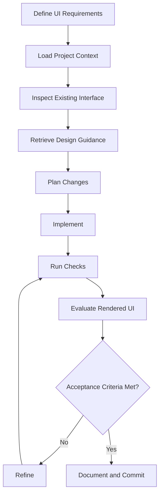
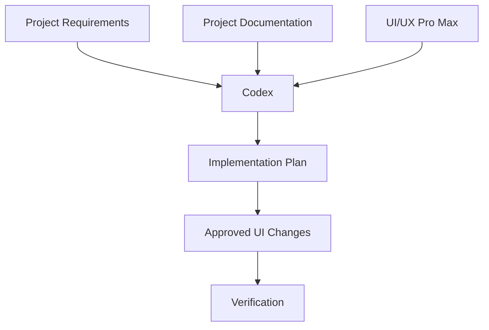
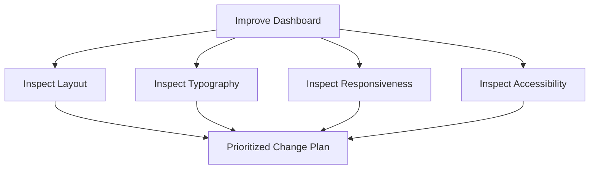
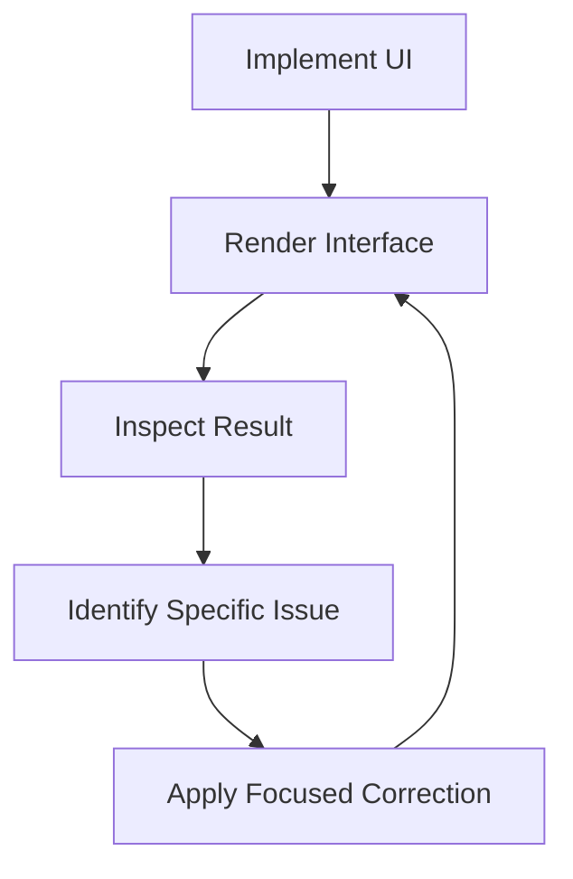
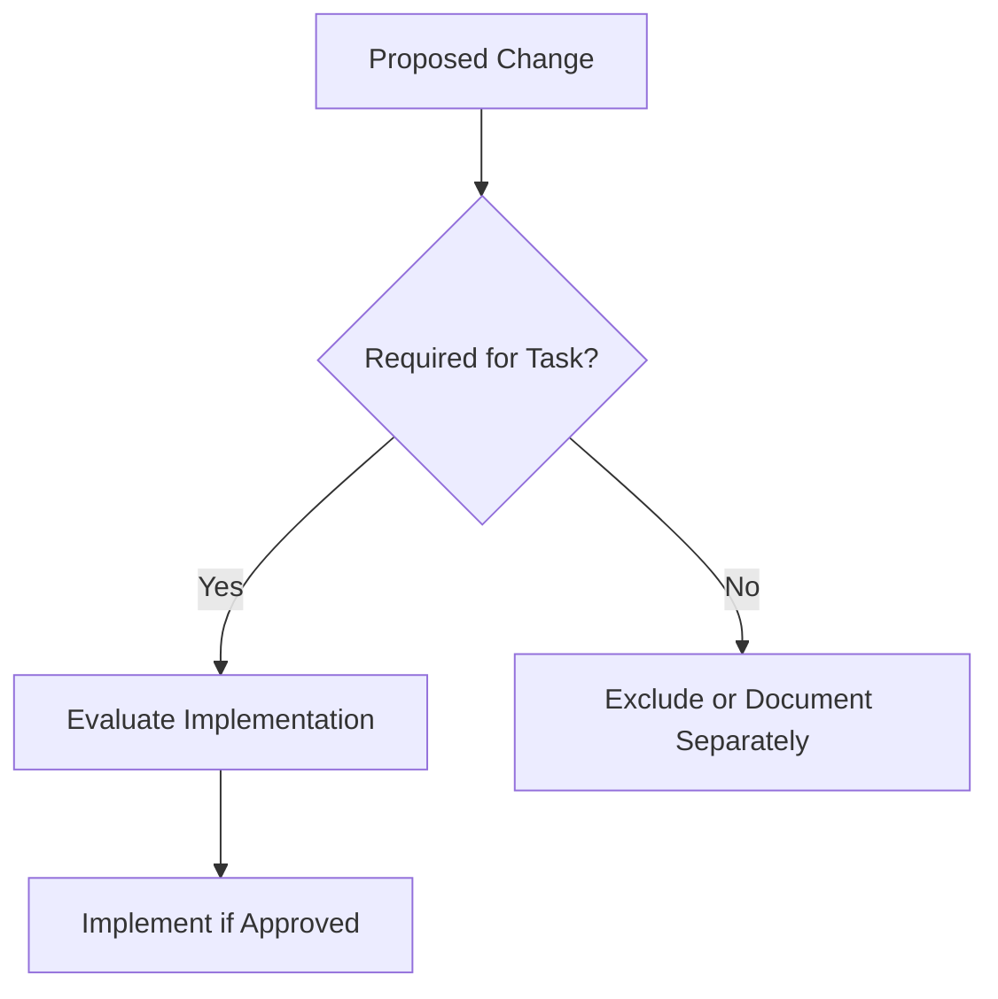
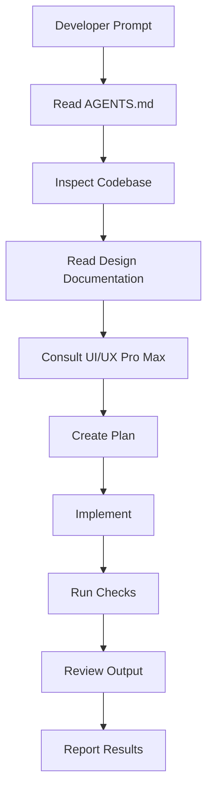

# 11 — UI/UX Pro Max: Agentic UI/UX Workflow and Prompt Engineering

> [!abstract] Lesson Information
> **Repository:** [nextlevelbuilder/ui-ux-pro-max-skill](https://github.com/nextlevelbuilder/ui-ux-pro-max-skill)
>
> **Category:** Agentic Engineering / Prompt Engineering / UI/UX Workflow / Context Engineering
>
> **Difficulty:** Intermediate to Advanced
>
> **Learning Approach:** Theory First
>
> **Prerequisites:** [[06 - Design System Generation]], [[07 - UX Guidelines and Accessibility]], [[08 - Responsive Design and Components]], [[09 - Framework-Specific Implementation]], [[10 - Design System Persistence and Customization]]
>
> **Primary Goal:** Understand how to orchestrate AI coding agents and UI/UX Pro Max to plan, implement, evaluate, and refine user interfaces while preserving requirements, design consistency, accessibility, and architectural integrity.

---

# 1. Learning Objectives

After completing this lesson, you should be able to:

1. Explain agentic UI/UX development.
2. Distinguish prompt engineering from context engineering.
3. Understand the role of UI/UX Pro Max in agentic workflows.
4. Structure UI implementation requests.
5. Define requirements and acceptance criteria.
6. Apply design-system-first development.
7. Use plan-before-code workflows.
8. Separate design recommendations from implementation authority.
9. Understand iterative UI refinement.
10. Evaluate screenshots and rendered interfaces.
11. Apply responsive and accessibility verification.
12. Prevent unnecessary redesign.
13. Control scope and dependencies.
14. Manage UI changes across multiple pages.
15. Use Codex with project documentation.
16. Apply the workflow to Next.js, Laravel, and Android.
17. Recognize common agentic UI development mistakes.

---

# Part I — Understanding Agentic UI/UX Development

## 2. What Is Agentic UI/UX Development?

Agentic UI/UX development is a workflow where an AI coding agent assists with multiple stages of interface development:

- Understanding requirements.
- Inspecting the existing codebase.
- Researching design patterns.
- Planning changes.
- Implementing components.
- Running checks.
- Reviewing output.
- Refining the interface.

The agent is not merely generating a code snippet. It participates in a structured development process.

### Traditional vs Agentic Workflow

| Traditional Workflow | Agentic Workflow |
|---|---|
| Developer manually researches patterns | Agent assists with design research |
| Developer writes implementation | Agent may implement approved changes |
| Developer checks output | Agent may run available checks |
| Developer identifies issues | Agent assists with analysis |
| Developer decides what to ship | Developer retains decision authority |

Agentic development does not eliminate engineering responsibility. The developer still owns requirements, approvals, quality, and final decisions.

---

# Part II — The Agentic UI/UX Lifecycle

## 3. End-to-End Workflow



This is a recommended engineering workflow. The precise actions available to an agent depend on its tools and permissions.

Without structure, AI-assisted UI work may produce unnecessary redesign, inconsistent colors, duplicate components, unrelated code changes, untested responsive layouts, accessibility regressions, or unnecessary dependencies. A defined workflow helps prevent these problems.

---

# Part III — Prompt Engineering vs Context Engineering

## 4. What Is Prompt Engineering?

Prompt engineering is writing instructions that clearly communicate the desired task.

```text
Improve the responsiveness of the dashboard cards.

Preserve the existing design system.
Do not modify backend logic.
```

## 4.1 What Is Context Engineering?

Context engineering supplies relevant information so an agent can understand the task and environment. Examples include AGENTS.md, architecture documentation, design-system files, functional requirements, existing components, relevant screenshots, framework versions, and coding standards.

| Prompt Engineering | Context Engineering |
|---|---|
| Defines the immediate task | Provides the operating context |
| Usually task-specific | Often reusable |
| Communicates expected output | Communicates project rules |
| Guides current actions | Helps prevent repeated mistakes |

**Key principle:** A clear prompt tells the agent what to do. Good context tells the agent how to do it appropriately.

---

# Part IV — Context Layers

## 5. Understanding Agent Context

A UI coding agent may need several categories of context:

```text
AGENT CONTEXT
│
├── Product Context
│   ├── Purpose
│   ├── Users
│   └── Requirements
│
├── Architecture Context
│   ├── Framework
│   ├── Folder Structure
│   └── Existing Components
│
├── Design Context
│   ├── Brand
│   ├── Tokens
│   └── Component Rules
│
├── Task Context
│   ├── Requested Change
│   ├── Scope
│   └── Acceptance Criteria
│
└── Verification Context
    ├── Tests
    ├── Build Commands
    └── Review Criteria
```

More context is not always better. Irrelevant documentation may distract the agent or introduce conflicting instructions. Provide information relevant to the current task.

---

# Part V — The Role of UI/UX Pro Max

## 6. Where the Skill Fits

UI/UX Pro Max provides searchable design knowledge that an agent can consult. Its documented capabilities include:

- Design-system generation.
- Style recommendations.
- Color and typography recommendations.
- UX guideline searches.
- Stack-specific implementation guidance.
- Design-system persistence.



The skill is a design-intelligence resource. It should not override approved project requirements.

---

# Part VI — Structured UI Prompts

## 7. Anatomy of a Good UI Prompt

A strong UI prompt usually includes context, objective, scope, constraints, design requirements, implementation expectations, acceptance criteria, and verification instructions.

```text
CONTEXT
What project is this?

OBJECTIVE
What should improve?

SCOPE
Which files or screens are involved?

CONSTRAINTS
What must remain unchanged?

DESIGN REQUIREMENTS
What visual or UX rules apply?

ACCEPTANCE CRITERIA
How will success be evaluated?

VERIFICATION
What checks should be performed?
```

---

# Part VII — Weak vs Strong Prompts

## 8. Weak Prompt

```text
Make my dashboard modern.
```

Problems:

- Ambiguous objective.
- No scope.
- No design constraints.
- No acceptance criteria.
- Encourages unnecessary redesign.

### Stronger Prompt

```text
Inspect the existing admin dashboard.

Improve card alignment, spacing consistency,
and mobile responsiveness.

Preserve:
- Current brand colors
- Typography
- Existing components
- Navigation structure
- Backend functionality

Use UI/UX Pro Max guidance where relevant.

Do not introduce new dependencies.

Provide a plan before implementation.

After implementation, verify desktop and mobile layouts.
```

This gives the agent a clearer target.

---

# Part VIII — Requirement Decomposition

## 9. Why Decompose UI Tasks?

Large UI requests can contain independent concerns. “Improve the dashboard” might involve card alignment, typography hierarchy, navigation, chart responsiveness, table overflow, or loading states. Each may require different changes.



Decomposition does not mean implementing every possible improvement. Prioritize only changes that serve the requested objective.

---

# Part IX — Acceptance Criteria

## 10. What Are Acceptance Criteria?

Acceptance criteria define observable conditions that determine whether a task is complete.

For “Improve the responsiveness of a four-card section,” criteria might include:

- Four cards appear in the approved desktop arrangement.
- Cards adapt appropriately on narrower screens.
- No horizontal page overflow occurs.
- Text remains readable.
- Existing colors and typography remain unchanged.
- No unrelated components are modified.

Acceptance criteria reduce ambiguity and provide a basis for testing.

---

# Part X — Design-System-First Development

## 11. Why Read the Design System First?

Without design-system context, an agent may invent new styling. Begin by identifying approved rules.

```text
1. Read AGENTS.md
2. Read design-system documentation
3. Read relevant page-specific rules
4. Inspect existing components
5. Consult UI/UX Pro Max
6. Propose changes
7. Implement
8. Verify
```

Existing design decisions should be preserved unless the task explicitly requests their modification.

---

# Part XI — Plan Before Code

## 12. What Is Plan-Before-Code?

Plan-before-code means reviewing intended changes before implementation. A useful plan identifies the current problem, relevant files, proposed approach, expected impact, risks, and verification strategy.

```text
Problem:
Service cards are crowded on narrow screens.

Relevant files:
- Service section component
- Shared card styles

Proposed changes:
- Adjust grid behavior
- Refine spacing
- Preserve visual styling

Risks:
- Text wrapping changes
- Uneven card heights

Verification:
- Narrow viewport
- Medium viewport
- Wide viewport
```

Planning reduces the likelihood of unnecessary modifications.

---

# Part XII — Iterative UI Refinement

## 13. What Is Iterative Refinement?

Iterative refinement improves an interface through repeated evaluation and targeted changes.



Example: cards are too close together, so first increase the grid gap. If headings then wrap awkwardly, adjust content width or typography within approved constraints.

Each iteration should address a specific observed problem. Avoid redesigning unrelated elements during refinement.

---

# Part XIII — Screenshot-Based Evaluation

## 14. Why Screenshots Help

Screenshots provide visual evidence of the rendered interface. They can reveal misalignment, overflow, crowded spacing, weak hierarchy, inconsistent component sizes, and unexpected wrapping.

```text
Capture UI
    ↓
Compare with requirements
    ↓
Identify visible issues
    ↓
Describe exact changes
    ↓
Implement corrections
    ↓
Capture again
```

A screenshot cannot fully verify keyboard interaction, screen-reader behavior, dynamic loading, form validation, backend correctness, or interactive state transitions. Screenshots are useful evidence, but not complete testing.

---

# Part XIV — Responsive Verification

## 15. Why Multiple Viewports Matter

A UI may appear correct on one screen size but fail on another. Common issues include overflow, cropped content, navigation collisions, oversized headings, unusable tables, and small touch targets.

Test narrow mobile, wider mobile, tablet, and desktop viewports. Choose exact widths based on users and supported devices.

### Verification Checklist

- No unintended horizontal overflow.
- Navigation remains usable.
- Text wraps appropriately.
- Important content remains visible.
- Components maintain readable spacing.
- Forms remain operable.

---

# Part XV — Accessibility Verification

## 16. Accessibility as an Acceptance Requirement

Accessibility should be considered during planning, implementation, and verification.

Key areas include contrast, keyboard navigation, focus visibility, semantic labels, form errors, dialog behavior, responsive text, and reduced motion.

| Layer | Example |
|---|---|
| Static analysis | Accessibility linting |
| Automated testing | axe-based checks |
| Manual interaction | Keyboard navigation |
| Assistive technology | Screen-reader testing |
| Visual review | Contrast and layout |

Automated checks cannot prove complete accessibility.

---

# Part XVI — Preventing Unnecessary Redesign

## 17. Why Agents May Over-Redesign

Broad prompts may make a small improvement sound like permission for a full visual redesign.

For example, “Fix the spacing” could prompt unwanted new colors, typography, navigation, component libraries, or animations.

A focused constraint:

```text
Improve spacing and alignment only.

Do not modify:
- Color palette
- Typography
- Component variants
- Content
- Navigation
- Business logic
```

**Principle:** A focused UI task should produce a focused code change.

---

# Part XVII — Scope Control

## 18. What Is Scope Control?

Scope control prevents unrelated changes from entering a task.

For “Make the contact form responsive,” in-scope changes might include form grid, field widths, spacing, and responsive behavior. Out of scope might include authentication redesign, database schema changes, a new dashboard, or a new UI framework.



---

# Part XVIII — Dependency Discipline

## 19. Why Avoid Unnecessary Dependencies?

Every new dependency can add maintenance, compatibility, bundle-size, security, and learning costs.

Before adding a library, ask:

1. Can existing tools solve the problem?
2. Is the requirement complex enough?
3. Does the library fit the architecture?
4. Is accessibility supported?
5. Is it actively maintained?
6. Is the addition within scope?

---

# Part XIX — Codex Workflow Integration

## 20. Recommended Codex Process



Codex should not assume framework version, styling library, component structure, design-token names, or existing tests. Establish those from the repository.

---

# Part XX — Prompt Template: New UI Screen

## 21. Screen Creation Prompt

```text
Read AGENTS.md and relevant project documentation.

Task:
Create the [SCREEN NAME] UI.

Context:
- Framework: [FRAMEWORK]
- Existing design system: [PATH]
- Relevant components: [PATHS]

Requirements:
- [REQUIREMENT 1]
- [REQUIREMENT 2]
- [REQUIREMENT 3]

Constraints:
- Preserve existing architecture.
- Reuse shared components.
- Follow approved design tokens.
- Maintain accessibility.
- Support required screen sizes.
- Do not add dependencies without approval.

Use UI/UX Pro Max guidance where relevant.

Before implementation:
Provide a focused plan.

After implementation:
Run available checks and report the results.
```

---

# Part XXI — Prompt Template: UI Refinement

## 22. Existing UI Improvement

```text
Inspect the existing [PAGE NAME] UI.

Problem:
[DESCRIBE SPECIFIC ISSUE]

Goal:
[DESCRIBE DESIRED IMPROVEMENT]

Preserve:
- Existing colors
- Typography
- Content
- Components
- Navigation
- Business logic

Use UI/UX Pro Max to evaluate relevant UX principles.

Make only changes necessary to address the problem.

Verify responsive behavior and accessibility.

Report modified files and remaining limitations.
```

---

# Part XXII — Prompt Template: Screenshot Review

## 23. Visual Evaluation Prompt

```text
Review the provided screenshot of [PAGE NAME].

Compare it against:
- Existing design-system documentation
- Responsive requirements
- Accessibility principles
- Requested UI behavior

Identify:
1. Alignment issues
2. Spacing inconsistencies
3. Typography hierarchy problems
4. Responsive risks
5. Accessibility concerns visible from the screenshot

Do not implement changes yet.

Provide a prioritized list of focused improvements.
```

---

# Part XXIII — Prompt Template: Accessibility Audit

## 24. Accessibility Review Prompt

```text
Read AGENTS.md and inspect the [COMPONENT/PAGE].

Evaluate:
- Semantic structure
- Accessible labels
- Keyboard operation
- Focus visibility
- Form errors
- Contrast
- Responsive text
- Motion preferences

Consult UI/UX Pro Max UX guidance where relevant.

Do not claim WCAG compliance based only on static inspection.

Report:
1. Confirmed issues
2. Potential issues requiring runtime testing
3. Recommended corrections
4. Verification steps
```

---

# Part XXIV — Multi-Page UI Workflows

## 25. Coordinating Changes Across Pages

Some UI tasks affect multiple pages, such as updating a shared button, changing navigation, adjusting typography, or modifying spacing tokens.

```text
Identify shared component
         ↓
Find affected pages
         ↓
Review design-system rules
         ↓
Plan shared change
         ↓
Implement once
         ↓
Verify affected pages
```

A shared component change may have a wider impact than a page-specific change. Perform change-impact analysis before implementation.

---

# Part XXV — Case Study: HarayaForge

## 26. Startup Website Refinement

**Scenario:** The capabilities cards look crowded on mobile.

Appropriate workflow:

1. Read brand documentation.
2. Inspect the capabilities section.
3. Identify layout constraints.
4. Consult responsive guidance.
5. Propose spacing and grid improvements.
6. Preserve colors and typography.
7. Implement focused changes.
8. Verify mobile and desktop layouts.

### Example Prompt

```text
Improve the mobile responsiveness of the
HarayaForge Capabilities section.

Preserve:
- Forge Navy
- Ember Orange
- Digital Cyan
- Cloud White
- Existing typography
- Flat, minimal visual direction

Focus only on:
- Card alignment
- Grid behavior
- Spacing
- Text wrapping

Do not add gradients, unnecessary effects,
or new UI libraries.

Provide a plan before implementation.
```

---

# Part XXVI — Case Study: GoPasig

## 27. Fleet Management Dashboard

**Scenario:** The schedule-management table is difficult to use on mobile.

Workflow:

1. Inspect the existing table.
2. Identify essential columns.
3. Review responsive patterns.
4. Preserve scheduling functionality.
5. Select an appropriate mobile strategy.
6. Implement.
7. Verify filters and actions.

UI changes should not alter scheduling validation or dispatch business rules unless explicitly required.

---

# Part XXVII — Case Study: Next.js E-Commerce

## 28. Product Catalog

**Scenario:** Product cards have inconsistent heights and spacing.

Workflow:

1. Inspect product components.
2. Read design tokens.
3. Identify duplicated styles.
4. Select a consistent grid strategy.
5. Preserve product-data behavior.
6. Implement shared styling.
7. Verify responsive layouts.

Do not modify Laravel API logic for a purely visual frontend issue.

---

# Part XXVIII — Case Study: Android GroupTrack

## 29. Android Java/XML UI Development

**Scenario:** Create a sign-in screen using the existing project architecture.

Workflow:

1. Read AGENTS.md.
2. Inspect Android resource structure.
3. Review existing UI conventions.
4. Consult relevant design guidance.
5. Plan XML layout and resources.
6. Implement within the defined MVP scope.
7. Preview the layout.
8. Verify on emulator or device.

Avoid unnecessary UI libraries and framework migration. Keep the implementation compatible with Java/XML and the documented MVP.

---

# Part XXIX — Common Mistakes

## 30. Agentic UI/UX Anti-Patterns

| Anti-pattern | Problem |
|---|---|
| Vague prompts | The agent cannot identify scope |
| Missing context | The agent invents architecture or design conventions |
| Skipping inspection | Existing components may be duplicated |
| Skipping planning | Unnecessary changes become more likely |
| Over-redesign | A small request becomes a full visual redesign |
| Ignoring accessibility | The UI looks right but is difficult to operate |
| No runtime verification | Code compiles, but rendered UI may be broken |
| Excessive dependencies | Simple tasks introduce unnecessary libraries |
| Documentation drift | Approved design decisions are not updated |
| Unsupported completion claims | The agent claims checks it did not run |

---

# Part XXX — Practical Exercises

## 31. Exercise 1 — Prompt Improvement

Rewrite “Make my website look better.” Include context, objective, scope, constraints, acceptance criteria, and verification.

## 32. Exercise 2 — Context Engineering

Design a context package for a Codex UI task containing project overview, architecture documentation, design system, relevant components, task requirements, and testing instructions. Explain each item.

## 33. Exercise 3 — Requirement Decomposition

For “Improve the dashboard UX,” list possible issues, then select only three improvements that provide the greatest value. Explain your priorities.

## 34. Exercise 4 — Acceptance Criteria

Write acceptance criteria for “Make the contact form responsive,” covering layout, accessibility, validation, functional preservation, and testing.

## 35. Exercise 5 — Screenshot Evaluation

Imagine a mobile screenshot where cards overlap, headings wrap awkwardly, buttons are too close, and navigation is difficult to find. Identify the problems, likely causes, focused corrections, and verification steps.

## 36. Exercise 6 — Scope Control

Classify each change as in or out of scope for a card-alignment task: adjust grid gap, replace palette, fix card width, add an animation library, improve text wrapping, redesign navigation. Explain your decisions.

## 37. Exercise 7 — Codex Workflow

Write a complete prompt for creating an Android Java/XML screen. Require existing-architecture inspection, design-system review, MVP-scope preservation, no unnecessary dependencies, plan-before-code, and UI verification.

---

# Part XXXI — Knowledge Check

## 38. Review Questions

1. What is agentic UI/UX development?
2. How does it differ from simple AI code generation?
3. What is prompt engineering?
4. What is context engineering?
5. Why is context selection important?
6. What role does UI/UX Pro Max play?
7. What makes a UI prompt well structured?
8. Why are vague prompts risky?
9. What is requirement decomposition?
10. What are acceptance criteria?
11. What is design-system-first development?
12. Why should agents plan before coding?
13. What is iterative refinement?
14. Why are screenshots useful?
15. What can screenshots not verify?
16. Why is responsive testing necessary?
17. Why are automated accessibility checks insufficient?
18. What is scope control?
19. Why should unrelated changes be avoided?
20. What are the risks of unnecessary dependencies?
21. Why should Codex inspect framework versions?
22. What should a UI implementation report contain?
23. Why is change-impact analysis important?
24. How should shared component changes be verified?
25. What is an unsupported completion claim?

---

# Part XXXII — Key Takeaways

> [!summary]
> - Agentic UI/UX development combines planning, implementation, evaluation, and refinement.
> - Prompt engineering defines the immediate task.
> - Context engineering supplies reusable project knowledge.
> - UI/UX Pro Max provides design intelligence, not unlimited implementation authority.
> - Structured prompts reduce ambiguity.
> - Acceptance criteria define observable success.
> - Design-system-first workflows preserve consistency.
> - Plan-before-code reduces unnecessary changes.
> - Iterative refinement should address specific observed problems.
> - Screenshots support visual review but cannot replace functional testing.
> - Responsive and accessibility verification are essential.
> - Scope control prevents unrelated redesign.
> - Dependencies should be justified.
> - Codex should inspect existing architecture before implementation.
> - Shared changes require impact analysis.
> - Verification claims must reflect checks actually performed.

---

# Part XXXIII — Final Mental Model

```text
USER REQUIREMENTS
         |
         v
STRUCTURED PROMPT
         |
         v
PROJECT CONTEXT
         |
         +-- AGENTS.md
         |
         +-- ARCHITECTURE
         |
         +-- DESIGN SYSTEM
         |
         +-- EXISTING CODE
         |
         v
UI/UX PRO MAX GUIDANCE
         |
         v
IMPLEMENTATION PLAN
         |
         v
FOCUSED CODE CHANGES
         |
         v
BUILD AND FUNCTIONAL CHECKS
         |
         v
VISUAL AND ACCESSIBILITY REVIEW
         |
         v
ITERATIVE REFINEMENT
         |
         v
DOCUMENTED RESULT
```

A good AI coding workflow is not measured by how much code the agent generates. It is measured by how accurately changes satisfy requirements while preserving quality, consistency, and maintainability.

---

# Part XXXIV — Official References

## UI/UX Pro Max

- [Official GitHub Repository](https://github.com/nextlevelbuilder/ui-ux-pro-max-skill)
- [README](https://github.com/nextlevelbuilder/ui-ux-pro-max-skill/blob/main/README.md)

## Codex and Agentic Development

- [OpenAI Codex Documentation](https://developers.openai.com/codex/)
- [Codex AGENTS.md Guide](https://developers.openai.com/codex/guides/agents-md)
- [OpenAI Prompt Engineering Guide](https://platform.openai.com/docs/guides/prompt-engineering)

## UI/UX and Accessibility

- [Nielsen Norman Group — Usability Heuristics](https://www.nngroup.com/articles/ten-usability-heuristics/)
- [WCAG 2.2](https://www.w3.org/TR/WCAG22/)
- [WAI-ARIA Authoring Practices](https://www.w3.org/WAI/ARIA/apg/)
- [MDN Responsive Design](https://developer.mozilla.org/en-US/docs/Learn_web_development/Core/CSS_layout/Responsive_Design)

## Framework Documentation

- [React](https://react.dev/)
- [Next.js](https://nextjs.org/docs)
- [Laravel](https://laravel.com/docs)
- [Android Developers](https://developer.android.com/)

> [!note] Documentation Scope
> This lesson combines the UI/UX Pro Max repository's design intelligence capabilities with broader prompt engineering, context engineering, and software development practices.
>
> The example prompts, workflows, and diagrams are recommended educational patterns rather than mandatory built-in features of the skill.
>
> No project files were modified or tests executed as part of this theory lesson.

---

# Part XXXV — Next Lesson

**[[12 - Best Practices and Practical Exercises]]**

Topics:

1. End-to-end UI/UX Pro Max best practices.
2. Repository workflow review.
3. Design intelligence strategy.
4. Design-system quality.
5. Prompt engineering checklist.
6. Context engineering checklist.
7. Responsive and accessibility standards.
8. Component reuse and architecture.
9. UI testing strategy.
10. Performance considerations.
11. Common mistakes and anti-patterns.
12. Practical exercises.
13. Capstone-style UI/UX scenarios.
14. Agentic development maturity.
15. Final learning assessment.
16. Official references.

**End of Lesson 11 — Agentic UI/UX Workflow and Prompt Engineering.**