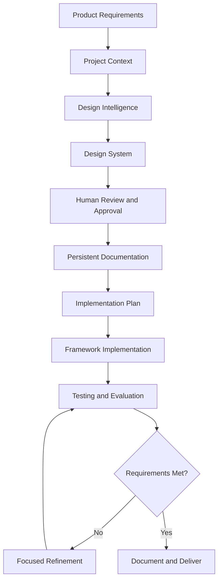
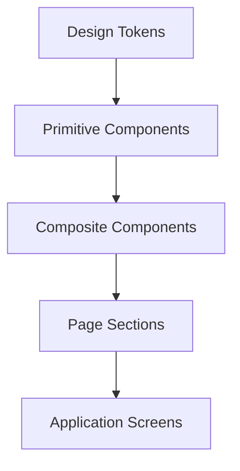
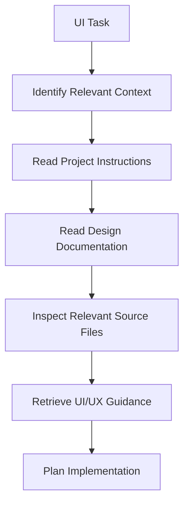
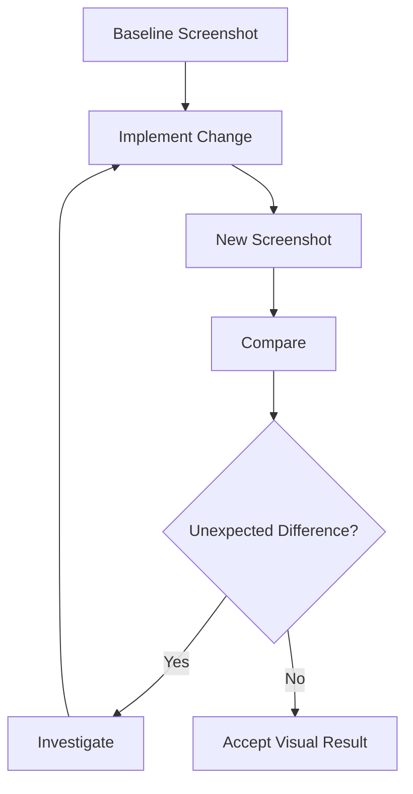
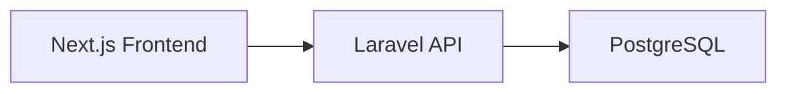

# 12 — UI/UX Pro Max: Best Practices and Practical Exercises

> [!abstract] Lesson Information
> **Repository:** [nextlevelbuilder/ui-ux-pro-max-skill](https://github.com/nextlevelbuilder/ui-ux-pro-max-skill)
>
> **Category:** Agentic Engineering / UI/UX Quality Assurance / Design Systems / Practical Application
>
> **Difficulty:** Intermediate to Advanced
>
> **Learning Approach:** Theory First
>
> **Prerequisites:** Lessons 00–11
>
> **Lesson Type:** Final Integration and Evaluation
>
> **Primary Goal:** Consolidate the complete UI/UX Pro Max learning roadmap into a repeatable, quality-focused agentic UI/UX development process.

---

# 1. Learning Objectives

After completing this lesson, you should be able to:

1. Explain the complete UI/UX Pro Max workflow.
2. Select appropriate design intelligence searches.
3. Evaluate generated design recommendations.
4. Establish and preserve an approved design system.
5. Apply usability and accessibility standards.
6. Design responsive layouts and reusable components.
7. Integrate recommendations into existing frameworks.
8. Write structured Codex prompts.
9. Apply context engineering.
10. Control task scope and dependencies.
11. Perform visual and functional verification.
12. Identify design-system drift.
13. Evaluate UI performance.
14. Prioritize UI/UX issues.
15. Conduct a structured design review.
16. Assess agentic UI development maturity.
17. Apply the workflow to realistic projects.
18. Define measurable completion criteria.

---

# Part I — Complete Roadmap Review

## 2. What We Have Learned

| Lesson | Topic | Core Competency |
|---|---|---|
| 00 | Repository Overview | Understand the skill |
| 01 | Architecture and Core Concepts | Understand design intelligence |
| 02 | Installation and Codex Integration | Understand setup and invocation |
| 03 | Design Intelligence and Search Engine | Retrieve relevant guidance |
| 04 | UI Styles and Visual Design Principles | Evaluate visual direction |
| 05 | Color Systems and Typography | Build visual foundations |
| 06 | Design System Generation | Generate cohesive recommendations |
| 07 | UX Guidelines and Accessibility | Design usable interfaces |
| 08 | Responsive Design and Components | Build adaptable components |
| 09 | Framework-Specific Implementation | Translate design into code |
| 10 | Design System Persistence and Customization | Preserve decisions |
| 11 | Agentic UI/UX Workflow and Prompt Engineering | Coordinate AI-assisted development |
| 12 | Best Practices and Practical Exercises | Integrate and evaluate |

## 2.1 The Complete Mental Model



> [!important] Fundamental Principle
> UI/UX Pro Max supports design decision-making. It does not replace product requirements, user research, engineering judgment, accessibility standards, or runtime testing.

---

# Part II — Design Intelligence Best Practices

## 3. Search With a Specific Purpose

Design intelligence is most useful when the question is clear.

### Weak Query

```text
Make a good website.
```

### Better Query

```text
Professional software development agency,
minimal visual style, responsive service cards,
accessible contact form.
```

The second query communicates more relevant context.

## 3.1 Search Categories

Different questions require different knowledge.

| Design Concern | Appropriate Guidance |
|---|---|
| Overall product direction | Design-system generation |
| Visual identity | Style guidance |
| Color selection | Color recommendations |
| Typography | Typography recommendations |
| Form usability | UX guidelines |
| Responsive behavior | UX and implementation guidance |
| Framework conventions | Stack-specific guidance |

## 3.2 Search Strategy

A practical sequence is:

1. Define the product and its users.
2. Identify the current design problem.
3. Determine which knowledge category is relevant.
4. Retrieve recommendations.
5. Compare recommendations with existing requirements.
6. Select only applicable guidance.

## 3.3 Avoid Excessive Searching

Repeatedly generating new recommendations for the same design problem may create conflicting options.

Stop searching when sufficient evidence exists to make a justified decision.

---

# Part III — Evaluating Generated Recommendations

## 4. AI Recommendations Are Proposals

A generated design system may suggest:

- A visual style.
- A palette.
- Typography.
- Layout patterns.
- Components.
- UX principles.

These suggestions must be evaluated.

## 4.1 Evaluation Questions

Ask:

- Does this match the product's purpose?
- Does it serve the target users?
- Does it preserve approved branding?
- Is it accessible?
- Is it technically feasible?
- Is it compatible with the existing framework?
- Does it introduce unnecessary complexity?

## 4.2 Recommendation Decision Table

| Recommendation | Decision | Reason |
|---|---|---|
| Improve text hierarchy | Accept | Increases clarity |
| Replace approved brand palette | Reject | Conflicts with brand |
| Add responsive grid | Accept | Solves layout issue |
| Install animation library | Defer | No demonstrated need |
| Add accessible error feedback | Accept | Improves usability |

### Engineering Lesson

Good design intelligence requires selection, not blind adoption.

---

# Part IV — Design-System Best Practices

## 5. Establish an Approved Source of Truth

A design system should document decisions that need to remain consistent.

Common foundations:

- Brand identity.
- Color roles.
- Typography.
- Spacing.
- Border radii.
- Components.
- Responsive patterns.
- Accessibility rules.

## 5.1 Recommended Hierarchy

```text
Approved Product Requirements
           |
           v
Master Design System
           |
           v
Component Specifications
           |
           v
Page-Specific Requirements
           |
           v
Implemented UI
```

Page-specific requirements should remain compatible with the approved global rules unless an exception has been authorized.

## 5.2 Keep the System Proportional

A small application may need only a concise Markdown design-system file.

A large application may need component specifications, token definitions, and page-level guidance.

Do not create a complex design-system infrastructure before the project requires it.

---

# Part V — Design Tokens

## 6. Use Semantic Tokens

Semantic tokens describe the role of a value rather than only its appearance.

### Primitive Tokens

```css
:root {
  --navy-900: #0b1629;
  --orange-500: #ff7448;
  --cyan-400: #46c7dc;
  --cloud-100: #f3f6fa;
}
```

### Semantic Tokens

```css
:root {
  --color-background: var(--cloud-100);
  --color-text-primary: var(--navy-900);
  --color-brand-accent: var(--orange-500);
  --color-secondary-accent: var(--cyan-400);
}
```

These are illustrative tokens.

## 6.1 Why Semantic Tokens Matter

A component should usually request a design role, such as `--color-text-primary`, instead of directly depending on a particular color value.

This makes controlled design changes easier.

## 6.2 Common Mistakes

- Hardcoding arbitrary colors.
- Duplicating spacing values.
- Creating excessive tokens.
- Changing tokens without impact analysis.
- Assuming a brand color is accessible in every context.

---

# Part VI — Visual Design Quality

## 7. Visual Hierarchy

A clear visual hierarchy helps users distinguish:

1. Primary information.
2. Secondary information.
3. Supporting details.
4. Available actions.

Common tools include:

- Typography.
- Spacing.
- Alignment.
- Contrast.
- Grouping.
- Position.

## 7.1 Design Review Questions

- Is the main purpose immediately understandable?
- Is the primary action identifiable?
- Is related content grouped?
- Is important information easy to scan?
- Are decorative elements competing with functional content?

### Important

Visual simplicity should not come at the cost of missing information.

---

# Part VII — Usability Best Practices

## 8. Design Around User Tasks

The interface should support the user's intended outcome.

Examples:

**Commuter**

Find the correct route and understand bus arrival information.

**Administrator**

Identify operational issues and manage records.

**Customer**

Find products and complete a purchase.

**Student**

View assignments and understand project responsibilities.

## 8.1 Usability Checklist

- Clear navigation.
- Understandable labels.
- Visible system status.
- Predictable actions.
- Error prevention.
- Useful recovery options.
- Minimal unnecessary steps.
- Accessible feedback.

## 8.2 Avoid Decorative-First Design

A visually impressive dashboard may still be ineffective if essential actions are difficult to find.

Prioritize usability before decorative refinement.

---

# Part VIII — Accessibility Best Practices

## 9. Accessibility Is a Quality Requirement

Accessibility should be considered during:

- Planning.
- Component design.
- Implementation.
- Testing.
- Review.

## 9.1 WCAG Principles

**POUR**

| Principle | Main Concern |
|---|---|
| Perceivable | Users can perceive information |
| Operable | Users can operate controls |
| Understandable | Users can understand content and behavior |
| Robust | Content works with assistive technologies |

## 9.2 Accessibility Checklist

- Meaningful accessible names.
- Semantic structure.
- Keyboard operation.
- Visible focus.
- Sufficient contrast.
- Clear validation messages.
- Accessible status feedback.
- Text resizing.
- Responsive reflow.
- Reduced-motion support where appropriate.

## 9.3 Important Contrast Criteria

For WCAG 2.2 Level AA, common requirements include:

- **4.5:1** for normal text.
- **3:1** for qualifying large text.
- **3:1** for applicable non-text UI components and graphical objects.

Specific exceptions and applicability rules are defined in WCAG.

## 9.4 Touch Targets

WCAG 2.2 Level AA includes a minimum target-size criterion of **24 × 24 CSS pixels**, subject to exceptions.

Larger targets are often preferable for comfortable touch interaction.

## 9.5 Testing Principle

Automated accessibility tools help identify certain issues, but cannot establish complete accessibility on their own.

Manual and assistive-technology testing remain necessary.

---

# Part IX — Responsive Design Best Practices

## 10. Responsive Design Is Functional Adaptation

Responsive design is not simply reducing component dimensions.

It should preserve:

- Information.
- Navigation.
- Readability.
- Interaction.
- Task completion.

## 10.1 Recommended Approach

1. Identify essential content.
2. Design the narrow layout.
3. Introduce flexible sizing.
4. Add content-driven breakpoints.
5. Verify medium and wide layouts.
6. Test text resizing and zoom.
7. Check interaction targets.

## 10.2 Responsive Review Matrix

| Area | Narrow Screen | Wide Screen |
|---|---|---|
| Navigation | Compact and accessible | Expanded where appropriate |
| Cards | Stacked or reduced columns | Multi-column grid |
| Forms | Usually single-column | Grouped fields when useful |
| Tables | Scroll or alternative presentation | Full table |
| Typography | Readable and wrapping | Controlled line length |
| Charts | Adapted dimensions | More available detail |

---

# Part X — Component Architecture

## 11. Reuse Meaningful Patterns

Reusable components help maintain consistency.

Examples:

- Button.
- Input.
- Card.
- Status badge.
- Modal.
- Navigation item.
- Data table.

## 11.1 Component Layers



## 11.2 When to Extract a Component

Consider extraction when:

- The pattern repeats.
- It has a clear responsibility.
- It needs consistent behavior.
- It benefits from isolated testing.

Avoid extraction when it adds complexity without meaningful reuse.

## 11.3 Component Quality Questions

- Does it have a clear purpose?
- Are its props understandable?
- Are its states complete?
- Does it support accessibility?
- Does it follow the design system?
- Is it easy to maintain?

---

# Part XI — Framework Integration

## 12. Respect Existing Technology Choices

The same design intent may require different implementations.

| Framework | Implementation Considerations |
|---|---|
| HTML/CSS | Semantic markup and styles |
| React | Components, props, and state |
| Next.js | App Router and client boundaries |
| Tailwind CSS | Utility classes and theme conventions |
| Laravel Blade | Server-rendered components |
| Android Java/XML | Resources and native layouts |

## 12.1 Framework Discipline

Before implementing changes:

1. Identify the framework.
2. Check its version.
3. Inspect existing components.
4. Read architecture documentation.
5. Reuse available tools.
6. Avoid unnecessary migrations.

### Example

A Java/XML Android application should not be migrated to Jetpack Compose merely because an AI-generated example uses Compose.

---

# Part XII — Prompt Engineering Best Practices

## 13. Structure UI Requests

A strong UI implementation prompt should include:

| Section | Purpose |
|---|---|
| Context | Describe the project |
| Objective | Define the improvement |
| Scope | Identify affected areas |
| Constraints | Preserve existing decisions |
| Design requirements | Define appearance and behavior |
| Acceptance criteria | Establish completion conditions |
| Verification | Specify checks |

## 13.1 Reusable Prompt Template

```text
Read AGENTS.md and relevant project documentation.

PROJECT:
[Project description]

TASK:
[Specific UI requirement]

SCOPE:
[Relevant pages or components]

DESIGN REQUIREMENTS:
[Approved visual and UX rules]

CONSTRAINTS:
- Preserve existing architecture.
- Reuse current components.
- Follow approved design tokens.
- Maintain accessibility.
- Avoid unnecessary dependencies.
- Do not modify unrelated functionality.

Use UI/UX Pro Max guidance where relevant.

Before implementation:
1. Inspect the current structure.
2. Identify affected files.
3. Propose a focused plan.

After implementation:
1. Run available checks.
2. Review responsive behavior.
3. Report changed files.
4. Explain remaining limitations.
```

---

# Part XIII — Context Engineering Best Practices

## 14. Provide Relevant Project Knowledge

Useful context may include:

- `AGENTS.md`.
- Project overview.
- Architecture documentation.
- Design system.
- Component inventory.
- Functional requirements.
- Acceptance criteria.
- Existing screenshots.

## 14.1 Context Selection



## 14.2 Avoid Context Overload

Do not load unrelated documentation simply because it exists.

Use focused context that directly supports the task.

---

# Part XIV — Scope and Dependency Control

## 15. Prevent Overengineering

AI coding agents may propose broad architectural changes for small UI problems.

Examples:

- New state-management libraries.
- New animation packages.
- New component frameworks.
- Unnecessary folder structures.
- Full redesigns.

## 15.1 Decision Framework

Before approving a change, ask:

1. Is it required?
2. Does an existing solution already work?
3. Does it improve maintainability?
4. Does it introduce risk?
5. Is it within the approved scope?

## 15.2 Example

**Requested:** Improve card spacing.

**Appropriate:** Adjust existing grid and spacing rules.

**Usually inappropriate:** Replace the component library and rewrite the page architecture.

---

# Part XV — UI Testing Strategy

## 16. Different Tests Answer Different Questions

| Test | Main Question |
|---|---|
| Build | Does the project compile or bundle? |
| Unit | Does isolated logic behave correctly? |
| Component | Does the component behave correctly? |
| Integration | Do connected parts work together? |
| End-to-end | Can users complete a workflow? |
| Visual | Does the interface render as intended? |
| Accessibility | Can users operate the interface accessibly? |
| Responsive | Does the layout work across supported sizes? |

## 16.1 Verification Pyramid

```text
        End-to-End
      Integration Tests
    Component / Unit Tests
  Static Analysis / Build Checks
```

This is a conceptual representation.

Visual and accessibility verification complement these testing layers rather than fitting neatly into one level.

## 16.2 Important

A successful build does not prove that the interface is usable.

A screenshot does not prove that interactive functionality works.

A passing accessibility scan does not prove complete WCAG conformance.

---

# Part XVI — Visual Regression and Screenshot Review

## 17. What Is Visual Regression?

Visual regression occurs when a UI change unintentionally alters the rendered appearance.

Examples:

- Button width changes.
- Text wraps differently.
- Cards become misaligned.
- Navigation overflows.
- Modal positioning breaks.

## 17.1 Review Workflow



## 17.2 Screenshot Limitations

Screenshots cannot fully evaluate:

- Keyboard interactions.
- Screen-reader output.
- Network errors.
- Loading transitions.
- Authentication.
- Data validation.

Combine visual review with functional checks.

---

# Part XVII — Performance Considerations

## 18. UI Quality Includes Performance

A visually polished interface can still feel poor if it loads or responds slowly.

Relevant concerns include:

- Image size.
- JavaScript bundle size.
- Font loading.
- Layout shifts.
- Excessive animations.
- Unnecessary rendering.
- Slow API responses.

## 18.1 Core Web Vitals

Common web performance metrics include:

**Largest Contentful Paint (LCP)**

Measures loading performance for the largest visible content element.

**Interaction to Next Paint (INP)**

Measures interaction responsiveness.

**Cumulative Layout Shift (CLS)**

Measures unexpected layout movement.

## 18.2 Common Good Thresholds

| Metric | Good Threshold |
|---|---|
| LCP | 2.5 seconds or less |
| INP | 200 milliseconds or less |
| CLS | 0.1 or less |

These are commonly used Core Web Vitals thresholds, evaluated using appropriate measurement methodology.

## 18.3 Practical Considerations

- Optimize meaningful images.
- Avoid unnecessary client-side JavaScript.
- Reserve space for media.
- Use appropriate loading strategies.
- Keep interactions responsive.

---

# Part XVIII — Prioritizing UI/UX Issues

## 19. Not All Issues Have Equal Importance

A useful prioritization model considers:

- User impact.
- Frequency.
- Severity.
- Implementation effort.
- Risk.

## 19.1 Example

| Issue | Impact | Priority |
|---|---|---|
| Login button inaccessible by keyboard | High | Critical |
| Checkout form fails on mobile | High | Critical |
| Dashboard table overflows | Medium–High | High |
| Minor card spacing inconsistency | Low | Low |
| Decorative animation feels excessive | Context-dependent | Evaluate |

## 19.2 Recommended Priority Order

1. Blocked critical workflows.
2. Accessibility barriers.
3. Functional defects.
4. Major responsive problems.
5. Usability problems.
6. Visual inconsistencies.
7. Optional polish.

This order may be adjusted based on the actual product and users.

---

# Part XIX — Quality Review Framework

## 20. Seven Quality Dimensions

A practical UI/UX evaluation can examine seven areas:

1. Functional correctness.
2. Usability.
3. Accessibility.
4. Responsive behavior.
5. Visual consistency.
6. Performance.
7. Maintainability.

## 20.1 Evaluation Scorecard

Use a scale from **0 to 4**.

| Score | Interpretation |
|---|---|
| 0 | Not addressed |
| 1 | Major problems |
| 2 | Partially satisfactory |
| 3 | Meets expectations |
| 4 | Strong implementation with evidence |

### Scorecard Template

| Dimension | Score | Evidence |
|---|---:|---|
| Functional correctness | /4 | Tests and workflows |
| Usability | /4 | Task review |
| Accessibility | /4 | Manual and automated checks |
| Responsiveness | /4 | Viewport testing |
| Visual consistency | /4 | Design-system audit |
| Performance | /4 | Measurements |
| Maintainability | /4 | Code review |
| **Total** | **/28** | |

## 20.2 Important

This scorecard is an educational assessment tool, not an official UI/UX Pro Max scoring system.

A high total does not excuse a critical accessibility or functional defect.

---

# Part XX — Capstone Scenario 1: HarayaForge

## 21. Software Startup Website

### Problem

A startup website needs a professional, consistent, accessible interface.

### Product Requirements

- Hero section.
- Service presentation.
- Capabilities.
- Team.
- Contact form.
- Responsive design.

### Design Constraints

- Forge Navy `#0B1629`.
- Ember Orange `#FF7448`.
- Digital Cyan `#46C7DC`.
- Cloud White `#F3F6FA`.
- Minimal, flat visual direction.
- No unnecessary gradients.

## 21.1 Agentic Workflow

```text
Read project context
        ↓
Read brand design system
        ↓
Retrieve relevant UI/UX guidance
        ↓
Plan page layout
        ↓
Implement shared components
        ↓
Verify responsiveness
        ↓
Audit accessibility
        ↓
Review visual consistency
```

## 21.2 Acceptance Criteria

- Approved colors are preserved.
- Typography is consistent.
- Service cards are responsive.
- Contact form has visible labels.
- Navigation is accessible.
- No unnecessary dependencies are introduced.
- Existing functionality remains intact.

## 21.3 Exercise

Create a theoretical implementation plan for the Capabilities page.

Identify:

1. Required components.
2. Relevant design tokens.
3. Responsive behavior.
4. Accessibility requirements.
5. Verification steps.

---

# Part XXI — Capstone Scenario 2: GoPasig

## 22. Fleet Management and ETA Interface

### Problem

Commuters and administrators need clear transportation information.

### Main User Groups

- Commuters.
- Drivers.
- Administrators.
- Fleet managers.

## 22.1 Commuter UX Requirements

- Readable route information.
- Understandable bus location.
- Clear ETA presentation.
- Loading and unavailable-data states.
- Accessible map-related information.

## 22.2 Admin UX Requirements

- Operational dashboard.
- Route management.
- Schedule management.
- Vehicle status.
- Reports.
- Clear validation feedback.

## 22.3 UI/UX Risks

| Risk | Possible Mitigation |
|---|---|
| ETA appears more precise than it is | Communicate estimate status |
| Map information is inaccessible | Provide meaningful textual alternatives |
| Schedule errors are unclear | Explain validation conflicts |
| Tables overflow on mobile | Use responsive table strategies |
| Operational status uses color alone | Add readable labels |

## 22.4 Exercise

Design a theoretical accessibility and responsive review for the commuter dashboard.

Include:

- Map.
- ETA.
- Route selection.
- Loading states.
- Offline behavior.

---

# Part XXII — Capstone Scenario 3: Next.js E-Commerce

## 23. Role-Based E-Commerce Application

### Architecture



### UI Roles

- Customer.
- Staff.
- Administrator.

## 23.1 Shared Components

- Buttons.
- Inputs.
- Cards.
- Status indicators.
- Dialogs.

## 23.2 Role-Specific Patterns

**Customer**

Product discovery and checkout.

**Staff**

Operational tasks and record updates.

**Administrator**

Management dashboards and reporting.

## 23.3 Engineering Constraints

- Preserve frontend/backend separation.
- Follow existing Next.js conventions.
- Reuse design tokens.
- Avoid unnecessary client components.
- Keep authorization enforced by the backend.

## 23.4 Exercise

Create a component inventory for the customer product catalog.

Explain which components should be shared with staff and admin pages.

---

# Part XXIII — Capstone Scenario 4: GroupTrack

## 24. Android Java/XML Application

### Project Context

A student project-management application with a defined MVP.

### Relevant Constraints

- Android Studio.
- Java.
- XML layouts.
- Firebase.
- Limited MVP scope.
- No unnecessary libraries.

## 24.1 UI Priorities

- Clear onboarding.
- Accessible sign-in and registration.
- Consistent navigation.
- Understandable task information.
- Appropriate touch targets.
- Readable text.

## 24.2 Agentic Workflow

1. Read `AGENTS.md`.
2. Inspect existing Android resources.
3. Identify the requested screen.
4. Review approved design rules.
5. Plan the XML layout.
6. Implement only the required UI.
7. Preview and run the screen.
8. Verify accessibility and behavior.

## 24.3 Exercise

Create a theoretical UI specification for the sign-in screen.

Include:

- Screen purpose.
- Required components.
- Component states.
- Accessibility.
- Validation feedback.
- Verification criteria.

---

# Part XXIV — Practical Exercise Set

## 25. Exercise 1 — Design Intelligence Strategy

A client requests a website for a small healthcare appointment service.

Define:

1. Product context.
2. User goals.
3. Relevant design searches.
4. Accessibility concerns.
5. Design-system review criteria.

Do not implement the website.

---

## 26. Exercise 2 — Design-System Evaluation

A generated design system includes:

- Three accent colors.
- Two heading fonts.
- Animated backgrounds.
- Multiple button variants.
- Dense dashboard cards.

Evaluate whether each recommendation is justified for a minimal administrative application.

---

## 27. Exercise 3 — Responsive Architecture

Design a responsive layout for:

- Sidebar.
- Four KPI cards.
- Search and filters.
- Data table.
- Detail panel.

Explain behavior across narrow, medium, and wide viewports.

---

## 28. Exercise 4 — Accessibility Review

Evaluate a hypothetical form with:

- Placeholder-only labels.
- Low-contrast helper text.
- No visible focus.
- Generic error messages.
- Icon-only submit button.

Identify the problems and propose corrections.

---

## 29. Exercise 5 — Component Architecture

Design a reusable component hierarchy for a scheduling dashboard.

Separate:

- Primitive components.
- Composite components.
- Page sections.

Avoid unnecessary abstraction.

---

## 30. Exercise 6 — Prompt Engineering

Rewrite:

```text
Make my dashboard look professional.
```

Into a structured Codex prompt containing:

- Context.
- Objective.
- Scope.
- Constraints.
- Acceptance criteria.
- Verification.

---

## 31. Exercise 7 — Change Impact Analysis

Scenario:

A shared button component receives a new size and spacing rule.

Explain:

1. Which pages may be affected.
2. What tests should run.
3. What accessibility concerns should be checked.
4. How Git helps review the change.

---

## 32. Exercise 8 — Design-System Drift

A project contains:

- Five slightly different card styles.
- Three button radius values.
- Hardcoded colors.
- Duplicate form inputs.

Propose a focused cleanup strategy.

Avoid recommending a complete rewrite.

---

## 33. Exercise 9 — Screenshot Review

A screenshot shows:

- Crowded cards.
- Uneven spacing.
- Inconsistent heading sizes.
- A button partially outside its container.

Write a prioritized improvement plan.

Separate confirmed visible problems from issues requiring runtime testing.

---

## 34. Exercise 10 — Final Agentic Workflow

Create a complete workflow for developing one new application screen.

Include:

1. Requirement definition.
2. Context loading.
3. UI/UX guidance retrieval.
4. Design-system review.
5. Planning.
6. Implementation.
7. Testing.
8. Visual review.
9. Accessibility review.
10. Documentation.

---

# Part XXV — Final Assessment

## 35. Knowledge Assessment

Answer the following without relying on AI-generated explanations.

### Design Intelligence

1. What problem does UI/UX Pro Max solve?
2. How does design intelligence differ from implementation?
3. Why should recommendations be evaluated?

### Design Systems

4. What is a design system?
5. What are design tokens?
6. What is design-system persistence?
7. What are page-specific overrides?
8. What is design-system drift?

### UX and Accessibility

9. What is usability?
10. What does WCAG POUR mean?
11. Why is keyboard navigation important?
12. Why should forms use visible labels?
13. Why are screenshots insufficient for accessibility testing?

### Responsive Design

14. What is mobile-first design?
15. When should CSS Grid be used?
16. What are content-driven breakpoints?
17. What are container queries?

### Framework Integration

18. Why should existing architecture be preserved?
19. How do React components support reuse?
20. Why do Tailwind versions matter?
21. How can Android XML resources preserve design consistency?

### Agentic Engineering

22. What is context engineering?
23. What makes a UI prompt effective?
24. Why use plan-before-code?
25. What are acceptance criteria?
26. Why is scope control important?
27. What should an implementation report contain?

### Quality Assurance

28. What is visual regression?
29. What are Core Web Vitals?
30. Why must functional, responsive, and accessibility checks be combined?

---

# Part XXVI — Agentic UI/UX Maturity Model

## 36. Five Maturity Levels

This is a proposed educational maturity model, not an official certification framework.

| Level | Description |
|---|---|
| 1 — Ad Hoc | Uses vague prompts and accepts output without review |
| 2 — Guided | Provides requirements and some design constraints |
| 3 — Structured | Uses project documentation, design systems, and plans |
| 4 — Verified | Performs functional, responsive, and accessibility checks |
| 5 — Managed | Maintains persistent design context, change impact reviews, and repeatable quality processes |

## 36.1 Level 1 — Ad Hoc

Typical behavior:

```text
Make this UI modern.
```

Little context or verification.

## 36.2 Level 2 — Guided

The developer provides:

- Specific objective.
- Visual preferences.
- Some constraints.

## 36.3 Level 3 — Structured

The workflow includes:

- `AGENTS.md`.
- Design-system documentation.
- Clear scope.
- Acceptance criteria.
- Implementation plan.

## 36.4 Level 4 — Verified

The workflow includes:

- Build checks.
- Functional testing.
- Responsive review.
- Accessibility evaluation.
- Visual comparison.

## 36.5 Level 5 — Managed

The workflow additionally includes:

- Version-controlled design decisions.
- Shared component governance.
- Change impact analysis.
- Documentation maintenance.
- Repeatable evaluation.

### Important

Higher maturity should not mean more bureaucracy.

The goal is appropriate process for the project's size and risk.

---

# Part XXVII — Final Project Evaluation Template

## 37. Evaluation Record

```markdown
# UI/UX Final Evaluation

## Project
[Project name]

## Screen or Feature
[Name]

## Requirements
[List approved requirements]

## Design-System Compliance
[Findings]

## Usability
[Findings]

## Accessibility
[Findings]

## Responsiveness
[Findings]

## Functional Verification
[Tests performed]

## Performance
[Measurements, if applicable]

## Code Maintainability
[Findings]

## Known Issues
[Remaining limitations]

## Final Decision
[Accepted / Needs Revision]

## Evidence
[Screenshots, test results, review notes]
```

## 37.1 Evidence-Based Completion

A task should not be marked complete solely because code was generated.

Completion should be supported by relevant evidence.

---

# Part XXVIII — Final Best Practices Checklist

## 38. Before Implementation

- [ ] Requirements are understood.
- [ ] Target users are identified.
- [ ] Existing architecture is inspected.
- [ ] Framework versions are known.
- [ ] Design-system documentation is reviewed.
- [ ] Relevant UI/UX guidance is retrieved.
- [ ] Scope is defined.
- [ ] Acceptance criteria are documented.
- [ ] Dependencies are justified.
- [ ] Implementation plan is reviewed.

## 38.1 During Implementation

- [ ] Existing components are reused.
- [ ] Approved design tokens are preserved.
- [ ] Semantic and accessible patterns are followed.
- [ ] Responsive behavior is considered.
- [ ] Business logic is not changed unnecessarily.
- [ ] Changes remain within scope.
- [ ] Unnecessary dependencies are avoided.

## 38.2 After Implementation

- [ ] Build checks are performed.
- [ ] Relevant functionality is tested.
- [ ] Responsive layouts are reviewed.
- [ ] Keyboard interaction is verified.
- [ ] Accessibility issues are assessed.
- [ ] Screenshots are compared where useful.
- [ ] Performance concerns are evaluated.
- [ ] Documentation is updated when necessary.
- [ ] Changes are reviewed before commit.
- [ ] Remaining limitations are reported.

---

# Part XXIX — Common Failure Patterns

## 39. Mistakes to Avoid

| Anti-Pattern | Better Approach |
|---|---|
| Vague UI prompt | Define objective and acceptance criteria |
| Blindly accept generated design | Review against requirements |
| Regenerate styling for every page | Reuse persisted design system |
| Hardcode arbitrary values | Use approved tokens |
| Duplicate components | Reuse meaningful patterns |
| Introduce unnecessary libraries | Evaluate existing capabilities |
| Redesign unrelated pages | Enforce scope |
| Ignore keyboard interaction | Perform manual accessibility testing |
| Test only desktop | Verify multiple viewports |
| Assume build success means UX success | Combine different test types |
| Ignore documentation | Maintain project context |
| Claim unperformed tests passed | Report only verified results |

---

# Part XXX — Final Mental Model

```text
                  PRODUCT GOALS
                       |
                       v
                 USER REQUIREMENTS
                       |
                       v
                 PROJECT CONTEXT
                       |
                       v
                UI/UX PRO MAX
                       |
                       v
              DESIGN INTELLIGENCE
                       |
                       v
              DESIGN SYSTEM REVIEW
                       |
                       v
               APPROVED DESIGN RULES
                       |
                       v
                 CODEX PLANNING
                       |
                       v
              FOCUSED IMPLEMENTATION
                       |
                       v
              MULTI-LAYER VERIFICATION
                       |
          +------------+------------+
          |            |            |
          v            v            v
       FUNCTIONAL   ACCESSIBLE   RESPONSIVE
          |            |            |
          +------------+------------+
                       |
                       v
                QUALITY REVIEW
                       |
                       v
              DOCUMENTED DELIVERY
```

> [!important] Final Principle
> **The goal of agentic UI/UX engineering is not to generate the most visually impressive interface. It is to deliver the most appropriate interface for the product, its users, its requirements, and its technical constraints.**

---

# Part XXXI — Official References

## UI/UX Pro Max

- [Official GitHub Repository](https://github.com/nextlevelbuilder/ui-ux-pro-max-skill)
- [Repository README](https://github.com/nextlevelbuilder/ui-ux-pro-max-skill/blob/main/README.md)

## Agentic Engineering

- [OpenAI Codex Documentation](https://developers.openai.com/codex/)
- [Codex AGENTS.md Guide](https://developers.openai.com/codex/guides/agents-md)

## UI/UX

- [Nielsen Norman Group — Usability Heuristics](https://www.nngroup.com/articles/ten-usability-heuristics/)
- [W3C WCAG 2.2](https://www.w3.org/TR/WCAG22/)
- [WAI-ARIA Authoring Practices](https://www.w3.org/WAI/ARIA/apg/)
- [MDN Responsive Design](https://developer.mozilla.org/en-US/docs/Learn_web_development/Core/CSS_layout/Responsive_Design)

## Design Systems

- [Material Design 3](https://m3.material.io/)
- [IBM Carbon Design System](https://carbondesignsystem.com/)
- [Design Tokens Community Group](https://www.w3.org/community/design-tokens/)

## Performance

- [web.dev — Core Web Vitals](https://web.dev/articles/vitals)
- [web.dev — Largest Contentful Paint](https://web.dev/articles/lcp)
- [web.dev — Interaction to Next Paint](https://web.dev/articles/inp)
- [web.dev — Cumulative Layout Shift](https://web.dev/articles/cls)

## Frameworks

- [React](https://react.dev/)
- [Next.js](https://nextjs.org/docs)
- [Tailwind CSS](https://tailwindcss.com/docs)
- [Laravel](https://laravel.com/docs)
- [Android Developers](https://developer.android.com/)

> [!note] Documentation Scope
> This final lesson integrates UI/UX Pro Max capabilities with general software engineering, accessibility, design-system maintenance, performance, and agentic development practices.
>
> The evaluation scorecard, maturity model, and capstone scenarios are educational frameworks, not official repository features.
>
> All exercises are theoretical. No project implementation, runtime tests, or repository modifications were performed.

---

# Part XXXII — Roadmap Completion

## 40. UI/UX Pro Max Learning Roadmap

- [x] 00 — Repository Overview
- [x] 01 — Architecture and Core Concepts
- [x] 02 — Installation and Codex Integration
- [x] 03 — Design Intelligence and Search Engine
- [x] 04 — UI Styles and Visual Design Principles
- [x] 05 — Color Systems and Typography
- [x] 06 — Design System Generation
- [x] 07 — UX Guidelines and Accessibility
- [x] 08 — Responsive Design and Components
- [x] 09 — Framework-Specific Implementation
- [x] 10 — Design System Persistence and Customization
- [x] 11 — Agentic UI/UX Workflow and Prompt Engineering
- [x] 12 — Best Practices and Practical Exercises

**Theory Curriculum Status: Complete**

## 40.1 Recommended Next Learning Stage

The next stage is practical application:

**Phase 1 — Environment Verification**

Confirm that the skill is installed and accessible to the coding agent.

**Phase 2 — Design Intelligence Practice**

Practice focused searches and review generated recommendations.

**Phase 3 — Design-System Creation**

Generate and customize a design system for an existing project.

**Phase 4 — Controlled Implementation**

Apply the approved design system to one screen or component.

**Phase 5 — Verification**

Review functionality, accessibility, responsiveness, and consistency.

**Phase 6 — Retrospective**

Document what worked, what failed, and what should improve.

---

**End of Lesson 12 — Best Practices and Practical Exercises.**

**End of UI/UX Pro Max Theory Roadmap.**
