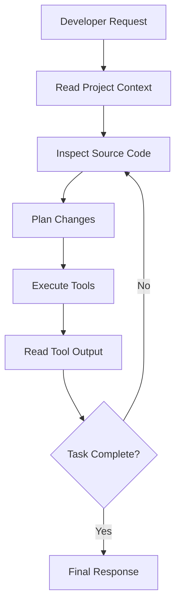
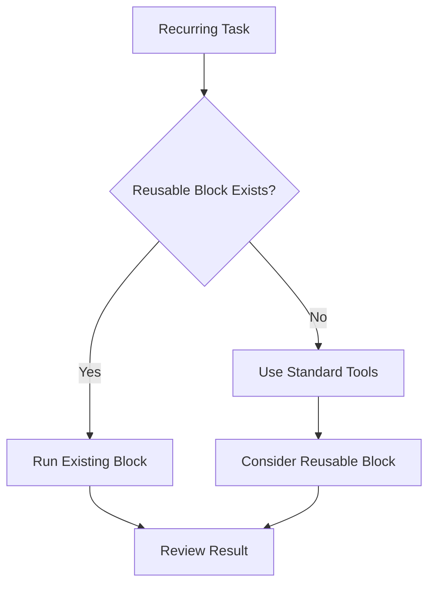
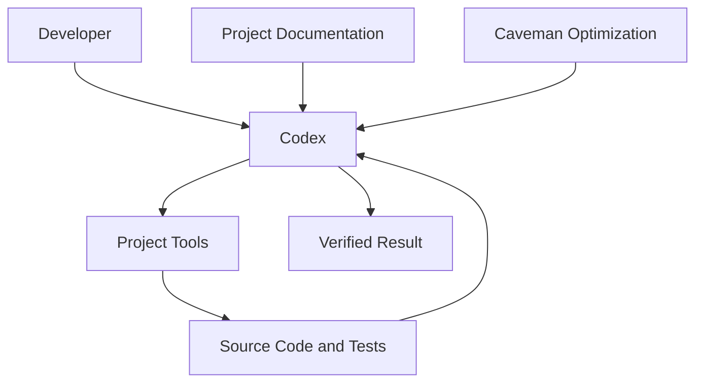
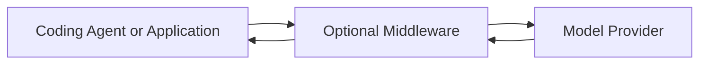
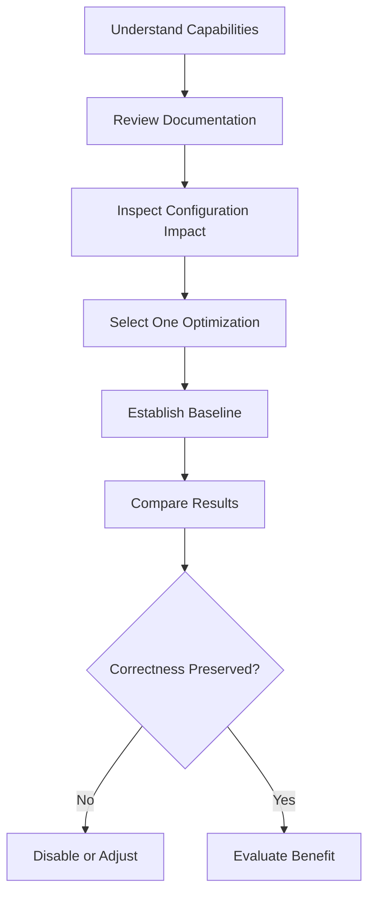

# 00 — Caveman: Repository Overview and Purpose

> [!abstract] Lesson Information
> **Repository:** [JuliusBrussee/caveman](https://github.com/JuliusBrussee/caveman)
>
> **Category:** Agentic Engineering / Token Optimization / AI Coding Agents / Context Engineering
>
> **Difficulty:** Beginner to Intermediate
>
> **Learning Approach:** Theory First
>
> **Prerequisites:** Basic familiarity with AI coding agents, terminal commands, Git, and context engineering
>
> **Primary Goal:** Understand what Caveman is, why it exists, how its main capabilities work conceptually, and when token optimization is beneficial or potentially harmful.

> [!note] Source Check
> Repository details in this note were checked against the Caveman README and installation guide on 2026-10-21. The project changes frequently; verify current documentation before installing or enabling integrations.

---

# 1. Learning Objectives

After completing this lesson, you should be able to:

1. Explain the purpose of the Caveman repository.
2. Define tokens and token efficiency.
3. Distinguish input tokens from output tokens.
4. Understand why AI coding agents consume substantial context.
5. Identify Caveman's six major capabilities.
6. Distinguish skill-based optimization from broader toolkit functionality.
7. Explain how output compression differs from input compression.
8. Understand model routing and reusable scripts.
9. Interpret token-saving benchmark claims critically.
10. Identify potential information-loss risks.
11. Understand Caveman's relationship with Codex.
12. Evaluate whether the toolkit fits a development workflow.
13. Recognize security and configuration considerations.
14. Explain why optimization must preserve correctness.

---

# Part I — Introduction to Caveman

## 2. What Is Caveman?

**Caveman** is an open-source toolkit designed to reduce unnecessary token consumption in AI coding-agent workflows.

Its central idea is:

> Communicate and process information efficiently without sacrificing the information needed to solve a task correctly.

The current README describes several optimization capabilities:

- Concise agent responses.
- Compressed tool output.
- Model and reasoning-effort selection.
- Reusable scripts, called Blocks.
- Token-usage analysis and workflow suggestions.
- Compressed web content.
- Optional middleware integrations.

Caveman provides a skill-only option as well as a broader toolkit installation. The full installer detects supported coding agents and uses their native integration methods.

## 2.1 The Problem Caveman Addresses

A coding agent working on a large application may repeatedly:

1. Read project documentation.
2. Inspect source files.
3. Execute commands.
4. Read terminal output.
5. Analyze errors.
6. Explain its decisions.
7. Repeat the process.

Every step may consume tokens. Some tokens contain essential information; others may be repetitive explanations, irrelevant logs, or redundant data. Caveman attempts to reduce that overhead.

---

# Part II — Understanding Tokens

## 3. What Is a Token?

A token is a unit of text representation processed by a language model. Tokens are not identical to words. Depending on the tokenizer, text may be divided into whole words, word fragments, punctuation, whitespace-related segments, or parts of code.

Example input:

```text
The application failed because the database connection timed out.
```

A tokenizer converts the text into model-readable tokens. The exact count depends on the model's tokenizer.

Tokens affect context-window usage, API billing where applicable, available conversation history, tool-output processing, and model workload.

Token reduction does not always translate directly into lower subscription costs. For subscription-based coding agents, the benefit may instead appear through usage limits, context efficiency, or reduced processing overhead.

---

# Part III — Input and Output Tokens

## 4. Input Tokens

Input tokens represent information supplied to the model, including user prompts, system instructions, repository documentation, source code, terminal output, test results, and tool responses.

## 4.1 Output Tokens

Output tokens represent information generated by the model, including explanations, implementation plans, code, summaries, tool-call arguments, and final responses.

| Category | Example | Optimization Opportunity |
|---|---|---|
| Input | Large build log | Extract relevant failures |
| Input | Repetitive JSON | Summarize structure |
| Input | Long web page | Extract relevant content |
| Output | Verbose explanation | Use concise wording |
| Output | Repeated script | Reuse an existing script |
| Output | Unnecessary narration | Remove redundant commentary |

Input and output optimization solve different problems. A tool that shortens final responses does not necessarily reduce tokens used to read source files.

---

# Part IV — Why Coding Agents Consume Many Tokens

## 5. The Agentic Development Loop



Token consumption can occur throughout this loop.

For example, a Codex agent debugging Laravel may run php artisan test and receive extensive output. Only a small portion may contain the failure. A useful compression step might preserve the summary, failed test names, error messages, and file locations.

Reducing information is useful only when the removed information is not needed. If compression hides the cause of a failure, optimization becomes counterproductive.

---

# Part V — Caveman's Six Major Capabilities

## 6. Overview

The current README describes six major capability areas. It calls them six parts or “rocks.”

| Capability | Main Function | Optimization Target |
|---|---|---|
| Say Less / Output | Encourage concise agent responses | Output tokens |
| Read Less / Input | Compress supported tool output | Input tokens |
| Auto / Routing | Select a model and effort for an ask | Model usage and cost |
| Blocks / Scripts | Reuse executable scripts in code mode | Repeated tool work |
| Waste Fixes | Analyze and improve token-use patterns | Workflow overhead |
| Browse | Compress retrieved web content | Web-related input |

Caveman also documents optional integrations such as middleware. These areas have different implementations and limitations; they are not one identical optimization mechanism.

---

# Part VI — Say Less

## 7. What Is Say Less?

Say Less encourages coding agents to communicate concisely. The goal is to remove unnecessary wording while preserving essential information.

Verbose:

```text
I have carefully examined the error message and determined
that the database connection is failing because the
configured database server cannot be reached.
```

Concise:

```text
Database server unreachable. Check connection settings
and confirm the server is running.
```

The second response communicates the essential diagnosis more efficiently.

## 7.1 Information That Must Remain

Concise responses should preserve:

- Technical meaning.
- Commands.
- Paths.
- Error messages.
- Numerical values.
- Safety warnings.
- Critical conditions.

Do not simplify production-migration warnings, security implications, destructive commands, ambiguous debugging conclusions, or instructions where precision is essential.

**Key principle:** Shorter is better only when the necessary meaning remains intact.

---

# Part VII — Read Less

## 8. What Is Read Less?

Read Less focuses on reducing the amount of supported tool output an agent must process. Potential inputs include logs, JSON, CSV, YAML, HTML, and test output. The current README reports that original data remains available locally for retrieval when more detail is needed.

Example original output:

```text
Test 1 passed
Test 2 passed
Test 3 passed
Test 4 failed
Expected: 200
Actual: 500
Test 5 passed
```

Possible summary:

```text
5 tests: 4 passed, 1 failed.
Test 4: expected 200, received 500.
```

Benefits include less irrelevant context, faster identification of important information, more context for other tasks, and potential token savings.

Compression may hide relevant warnings, earlier errors, failure sequences, timestamps, or context around an exception. Keep original output retrievable for deeper debugging.

---

# Part VIII — Auto

## 9. What Is Auto?

Auto is Caveman's model-routing capability. It attempts to select an appropriate model and reasoning effort for a request.

| Task | Possible Requirement |
|---|---|
| Rename a variable | Relatively simple reasoning |
| Explain a compiler error | Moderate reasoning |
| Investigate concurrency bugs | More complex reasoning |
| Analyze architecture tradeoffs | Deeper reasoning |

The principle is that different tasks may not require identical model resources.

Potential benefits include reduced usage cost, faster completion for simpler tasks, and better allocation of more capable models.

Model routing can make mistakes: a task that initially appears simple may require deeper investigation. The current README says Auto requires account sign-in; before enabling it, review what account setup and provider information it uses. Verify current provider and privacy details in the project's documentation.

---

# Part IX — Blocks

## 10. What Are Blocks?

Blocks are reusable scripts intended to reduce repeated agent work. Instead of writing the same utility script during each session, an agent can reuse an existing block.

Examples of recurring work:

- Summarize test results.
- Inspect JSON.
- Extract the first error.
- Check HTTP responses.
- Search source definitions.

The current README lists bundled examples including json-peek, jsonl-stats, test-summary, first-error, wait-for, grep-defs, http-json, and replace-in-file.



Reusable scripts reduce repeated scripting and can produce consistent output. But scripts may become outdated, assume the wrong environment, hide information, or behave differently across projects. Review and test them like other project code.

---

# Part X — Waste Fixes

## 11. What Are Waste Fixes?

Waste Fixes aim to identify unnecessary token use in agent workflows, such as repeatedly reading the same files, excessive response verbosity, processing unnecessary output, recreating utility scripts, or inefficient context handling.

General workflow:

```text
Observe usage
      ↓
Identify repeated overhead
      ↓
Evaluate possible optimization
      ↓
Apply controlled change
      ↓
Measure the result
```

Optimization should be evidence-based. Do not remove useful context simply because it consumes tokens. Current README describes token-learning and prompt-cache-warming capabilities; it marks these features as not yet measured in its feature table.

---

# Part XI — Browse

## 12. What Is Browse?

Browse is Caveman's web-content compression capability. It attempts to reduce large retrieved pages into smaller representations suitable for agent processing.

A web page may contain navigation menus, repeated links, promotional sections, main documentation, and footer content. A targeted extraction may help when the agent only needs the main documentation.

Compression can be problematic when a task depends on exact HTML structure, full page content, hidden or dynamic interactions, detailed tables, or complete legal or technical wording.

**Engineering lesson:** Compressed browsing can help targeted retrieval, but not every web task benefits from compression. The README publishes different outcomes by page type, including cases where small forms lose efficiency or require more tokens.

---

# Part XII — Skill vs Full Toolkit

## 13. Understanding Integration Scope

Caveman supports different levels of integration.

**Skill-only integration** provides the Caveman skill and response-style guidance. The current README provides a skill-only installation using npx skills add JuliusBrussee/caveman -g; it notes that Codex can invoke the skill with $caveman when it does not activate automatically.

**Full toolkit integration** offers broader capabilities, including supported output/input processing, model routing, Blocks, commands, and agent-specific integrations. The unified installer detects supported agents and uses their native installation paths.

| Aspect | Skill Only | Full Toolkit |
|---|---|---|
| Concise response guidance | Yes | Yes |
| Tool-output compression | Not inherently | Available in supported integrations |
| Model routing | No | Available |
| Reusable Blocks | Not inherently | Available |
| Setup complexity | Lower | Higher |
| Configuration impact | More limited | Potentially broader |

Installing a skill is not equivalent to enabling every Caveman feature. Consult current README and INSTALL.md for version-specific behavior.

---

# Part XIII — Caveman and Codex

## 14. How Caveman Relates to Codex

Codex is an AI coding agent. Caveman is a toolkit intended to optimize selected aspects of coding-agent communication and tool use.

| Tool | Primary Responsibility |
|---|---|
| Codex | Understand and perform coding tasks |
| Caveman | Reduce selected token and workflow overhead |
| Git | Track code changes |
| AGENTS.md | Provide project instructions |
| Tests | Verify implementation behavior |



This is conceptual. Full-toolkit integrations may add hooks, routing, commands, or optional middleware depending on the host and chosen install options.

Caveman should not be assumed to improve Codex's reasoning accuracy. Its goal is efficiency; accuracy must still be verified independently.

---

# Part XIV — Understanding Middleware and Proxies

## 15. What Is Middleware?

Middleware is software that processes information between parts of an application. It may receive requests, forward them, transform outputs, or apply routing rules.



The Caveman README documents optional middleware integrations and an opt-in caveman-shrink MCP middleware setting in the installer. Do not assume middleware or a proxy is required for skill-only use.

Before enabling middleware:

1. Read its documentation.
2. Understand what data passes through it.
3. Review credential handling.
4. Check local configuration changes.
5. Understand how to disable it.
6. Evaluate whether the additional functionality is necessary.

---

# Part XV — Understanding Benchmark Claims

## 16. Why Benchmarks Matter

Optimization projects publish measurements to describe token or cost effects. These measurements can be useful, but their setup and limitations matter.

### Current README Examples

| Capability / Measurement | Reported Result |
|---|---:|
| Read Less session comparison | 33.2% fewer input tokens across six tested data types |
| Auto comparison | 54% lower cost than Opus 5.5 at xhigh in an interim 85-task run |
| Blocks test-summary example | 397 to 76 tokens read back |
| Say Less example | 63 to 20 response tokens for the same fix |
| Browse example | 121 tokens vs 15,704 for a specific 200-row table snapshot |

These are current repository-published figures checked on 2026-10-21. They are not independent measurements from this lesson.

### Qualifications

The README discloses important limitations:

- Read Less results vary by file type; HTML showed worse session usage in the published run.
- The Read Less session measurement is from an earlier engine and a small test set.
- Auto's 85-task run is interim, and the score gap is too small at that sample size to establish equivalence confidently.
- Auto savings depend on baseline model and effort.
- Some capabilities, including Waste Fixes, are marked not yet measured.
- Browse results depend on page shape; small forms can lose efficiency.

Do not assume:

```text
Published savings = guaranteed personal savings
```

Actual outcomes depend on agent, model, task type, context size, tool usage, subscription or API billing model, and configuration.

---

# Part XVI — Token Efficiency vs Correctness

## 17. The Fundamental Tradeoff

Token optimization should preserve correctness.

Approach A uses fewer tokens but omits a critical error.  
Approach B uses more tokens but identifies the root cause correctly.

Approach B is preferable.

```text
Useful Optimization
=
Reduced Unnecessary Processing
+
Preserved Essential Information
+
Verified Correctness
```

This is a conceptual model, not a benchmark formula.

Prioritize correctness, safety and security, completeness of essential information, maintainability, and then efficiency.

---

# Part XVII — Caveman vs Context Engineering

## 18. Related but Different Concepts

Context engineering focuses on giving the agent the right information. Caveman focuses on reducing unnecessary token and workflow overhead.

| Context Engineering | Caveman |
|---|---|
| Select relevant project files | Compress selected input |
| Define agent instructions | Reduce unnecessary output |
| Maintain architecture documentation | Analyze token overhead |
| Preserve requirements | Optimize repeated workflows |
| Structure task context | Support model routing |

Good context engineering reduces irrelevant information before it enters a workflow. Caveman may further reduce overhead in supported parts. Neither replaces the other.

---

# Part XVIII — Practical Project Scenarios

## 19. Laravel

A Laravel project generates long test logs.

Potential optimization:

- Summarize test results.
- Preserve failed assertions.
- Retain file paths and error messages.
- Retrieve full logs when needed.

**Risk:** A compressed summary may omit relevant exception context.

## 20. Next.js

A Next.js application produces lengthy build output.

Potential optimization:

- Identify build status.
- Extract errors.
- Highlight important warnings.

**Risk:** Warnings about configuration or runtime behavior may matter even when the build succeeds.

## 21. Android Studio

An Android project generates extensive Gradle output.

Potential optimization:

- Identify the failing task.
- Preserve compiler diagnostics.
- Highlight dependency errors.

**Risk:** The root cause may appear earlier in the log than the final failure summary.

## 22. Repository Inspection

For a large repository, inspect relevant directories first, search for symbols, read targeted file ranges, and avoid repeatedly dumping entire files.

Efficient repository navigation is valuable even without installing a specialized optimization toolkit.

---

# Part XIX — Risks and Limitations

## 23. Potential Risks

**Information loss:** Compression may remove relevant details.

**Incorrect model routing:** A task may receive insufficient reasoning resources.

**Configuration complexity:** Full-toolkit integration may introduce additional settings.

**Integration and dependency risk:** External packages and middleware require maintenance and security review.

**Benchmark misinterpretation:** Published savings may not generalize to all workloads.

**Debugging complexity:** Additional middleware can make failures harder to isolate.

**Overoptimization:** Reducing tokens becomes counterproductive if it harms task quality.

---

# Part XX — When Caveman May Be Useful

## 24. Suitable Scenarios

Caveman may be worth evaluating when:

- Agent responses are unnecessarily verbose.
- Tool output frequently contains irrelevant data.
- Tasks repeatedly generate similar scripts.
- API token costs are measurable.
- Large logs regularly consume context.
- You want to compare optimized and unoptimized workflows.

Benefits may be limited when sessions are already concise, tool output is small, a task needs complete source material, detailed educational explanations are needed, or integration complexity outweighs potential savings.

For theory-heavy lessons, highly compressed responses may reduce educational value. Adapt conciseness to the task.

---

# Part XXI — Safe Evaluation Strategy

## 25. Evaluate Before Adopting



Possible metrics include input tokens, output tokens, API cost, task completion time, test results, accuracy, retries, and information-retrieval quality.

Optimization should be reversible. Before changing an existing coding-agent configuration, document the baseline and understand the rollback procedure.

---

# Part XXII — Practical Exercises

## 26. Exercise 1 — Token Classification

Classify as input or output tokens:

1. User prompt.
2. Source file content.
3. Agent explanation.
4. Build log.
5. Generated code.
6. Test result returned by a tool.

Explain your answers.

## 27. Exercise 2 — Compression Evaluation

Original:

```text
12 tests executed.
Test A passed.
Test B passed.
Test C failed.
Expected status 200.
Actual status 500.
Remaining 9 tests passed.
```

Create a concise summary and identify which information must remain.

## 28. Exercise 3 — Capability Mapping

Match each problem to the most relevant Caveman capability:

1. Excessively verbose agent responses.
2. Repeated test-summary scripts.
3. Large JSON tool output.
4. Choosing reasoning effort.
5. Identifying recurring token overhead.
6. Oversized web-page responses.

## 29. Exercise 4 — Benchmark Analysis

A tool claims 40% fewer tokens. What additional information is needed before adoption? Consider task accuracy, benchmark methodology, runtime, cost model, information loss, and workload similarity.

## 30. Exercise 5 — Codex Integration Assessment

Assume an existing Codex setup is functioning correctly. Explain why its configuration should be inspected before installing a toolkit that modifies agent integration. Identify compatibility and rollback concerns.

## 31. Exercise 6 — Optimization Tradeoffs

A compressed Gradle log reports only “BUILD FAILED.” Explain why this is insufficient for debugging and which information should be preserved.

## 32. Exercise 7 — Project Selection

Choose a Laravel, Next.js, or Android project. Identify three realistic sources of unnecessary token usage and propose a theoretical optimization for each.

---

# Part XXIII — Knowledge Check

## 33. Review Questions

1. What is Caveman?
2. What problem does it attempt to solve?
3. What is a token?
4. What is the difference between input and output tokens?
5. Why do coding agents consume large amounts of context?
6. What is Say Less?
7. What is Read Less?
8. What is Auto?
9. What are Blocks?
10. What are Waste Fixes?
11. What is Browse?
12. What is the difference between skill-only and full-toolkit integration?
13. What is middleware?
14. Why should middleware configuration be reviewed?
15. What are the risks of tool-output compression?
16. Why can model routing fail?
17. Why should benchmarks be interpreted critically?
18. How does Caveman relate to context engineering?
19. When is token optimization useful?
20. When can token optimization become counterproductive?
21. Why should original debugging information remain accessible?
22. Why should correctness take priority over token savings?
23. How can token savings be measured?
24. Why is rollback important?
25. How could Caveman complement a Codex workflow?

---

# Part XXIV — Key Takeaways

> [!summary]
> - Caveman is an open-source toolkit for AI coding-agent efficiency.
> - It aims to reduce unnecessary token consumption.
> - Input and output tokens require different optimization strategies.
> - Say Less focuses on concise responses.
> - Read Less focuses on compressed tool output.
> - Auto attempts to select models and reasoning effort.
> - Blocks promote reusable scripts.
> - Waste Fixes identify inefficient usage.
> - Browse compresses web content.
> - Skill-only integration differs from full-toolkit integration.
> - Middleware and host integrations introduce configuration considerations.
> - Benchmark savings depend on the workload.
> - Compression can hide important information.
> - Token efficiency does not guarantee better reasoning.
> - Context engineering and token optimization complement each other.
> - Correctness, security, and maintainability take priority over minimizing tokens.

---

# Part XXV — Final Mental Model

```text
                AI CODING TASK
                       |
                       v
                CODING AGENT
                       |
          +------------+------------+
          |                         |
          v                         v
      INPUT TOKENS             OUTPUT TOKENS
          |                         |
          v                         v
       READ LESS                  SAY LESS
          |                         |
          +------------+------------+
                       |
                       v
               OTHER OPTIMIZATIONS
                       |
            +----------+----------+
            |          |          |
            v          v          v
           AUTO      BLOCKS    WASTE FIXES
                       |
                       v
                 BROWSE SUPPORT
                       |
                       v
                QUALITY CHECKS
                       |
                       v
            EFFICIENT, CORRECT WORK
```

The goal is not to minimize every token. The goal is to eliminate unnecessary overhead while retaining information needed for correct, safe, and maintainable software development.

---

# Part XXVI — Official References

## Caveman

- [Official GitHub Repository](https://github.com/JuliusBrussee/caveman)
- [README](https://github.com/JuliusBrussee/caveman/blob/main/README.md)
- [Installation Documentation](https://github.com/JuliusBrussee/caveman/blob/main/INSTALL.md)
- [Security Policy](https://github.com/JuliusBrussee/caveman/blob/main/SECURITY.md)
- [Project Documentation](https://docs.caveman.so/caveman)

## AI Coding Agents

- [OpenAI Codex Documentation](https://developers.openai.com/codex/)
- [Codex AGENTS.md Guide](https://developers.openai.com/codex/guides/agents-md)

## Development Fundamentals

- [Git Documentation](https://git-scm.com/doc)
- [Node.js Documentation](https://nodejs.org/en/docs)

> [!note] Documentation Scope
> This lesson reflects the Caveman README and installation guide as checked on 2026-10-21, together with general concepts from AI coding-agent engineering.
>
> The diagrams, exercises, and example workflows are educational illustrations, not exact representations of every internal implementation detail.
>
> Performance figures are project-published results with workload-specific caveats; they have not been independently reproduced here.
>
> No installation, configuration changes, or runtime benchmarks were performed for this theory lesson.

---

# Part XXVII — Next Lesson

**[[01 - Architecture and Core Concepts]]**

Topics:

1. High-level Caveman architecture.
2. Skill layer vs toolkit layer.
3. Agent integration mechanisms.
4. Request and response processing.
5. Tool-output compression pipeline.
6. Model routing concepts.
7. Reusable Blocks architecture.
8. Local and external data boundaries.
9. Configuration and feature controls.
10. Error handling and fallback.
11. Security and privacy considerations.
12. Codex integration architecture.
13. Practical architecture diagrams.
14. Exercises and review questions.
15. Official references.

**End of Lesson 00 — Repository Overview and Purpose.**