# 01 — Caveman: Architecture and Core Concepts

> [!abstract] Lesson Information
> **Repository:** [JuliusBrussee/caveman](https://github.com/JuliusBrussee/caveman)
>
> **Category:** Agentic Engineering / System Architecture / Token Optimization / Coding-Agent Integration
>
> **Difficulty:** Intermediate
>
> **Learning Approach:** Theory First
>
> **Prerequisites:** [[00 - Repository Overview and Purpose]]
>
> **Primary Goal:** Understand the major architectural components of Caveman, how they interact with AI coding agents, and how optimization affects information flow, configuration, reliability, and security.

---

# 1. Learning Objectives

After completing this lesson, you should be able to:

1. Explain Caveman's high-level architecture.
2. Distinguish its skill, toolkit, proxy, and integration layers.
3. Identify the responsibilities of its six capabilities.
4. Understand agent-to-model communication.
5. Explain input and output token optimization.
6. Understand tool-output compression.
7. Explain model routing and reasoning-effort selection.
8. Understand reusable Blocks.
9. Describe the purpose of local usage analysis.
10. Understand compressed web retrieval.
11. Identify relevant repository directories.
12. Explain configuration and feature controls.
13. Understand error handling and fallback strategies.
14. Evaluate security and privacy boundaries.
15. Compare skill-only and full-toolkit integration.
16. Apply the architectural concepts to Codex.
17. Recognize the limitations of token optimization.

---

# Part I — Architectural Overview

## 2. What Is Caveman's Architecture?

Caveman is not simply a prompt that asks an AI to answer briefly.

Its broader toolkit combines several optimization mechanisms around coding-agent workflows.

At a high level, the architecture can be understood through four conceptual layers:

1. **Agent integration layer** — connects Caveman to supported coding agents.
2. **Instruction layer** — controls concise response behavior.
3. **Optimization layer** — processes tool output, routing decisions, scripts, and web content.
4. **Management layer** — handles configuration, diagnostics, and usage analysis.

These are conceptual architectural groupings used for learning, not necessarily the repository's exact internal module names.

## 2.1 High-Level Architecture

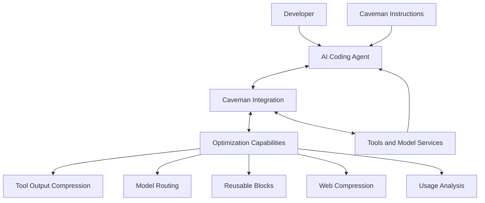

## 2.2 Architectural Principle

Caveman attempts to improve the efficiency of information moving through an agent workflow.

It is not a replacement for:

- The coding agent.
- The language model.
- The project's source code.
- The development environment.
- Software testing.
- Human engineering judgment.

---

# Part II — The Agent Layer

## 3. What Is an AI Coding Agent?

An AI coding agent is software that combines a language model with tools for software development.

Typical capabilities include:

- Reading files.
- Searching repositories.
- Executing commands.
- Editing source code.
- Running tests.
- Reporting results.

Examples of coding-agent environments include Codex and Claude Code.

## 3.1 Standard Agent Workflow

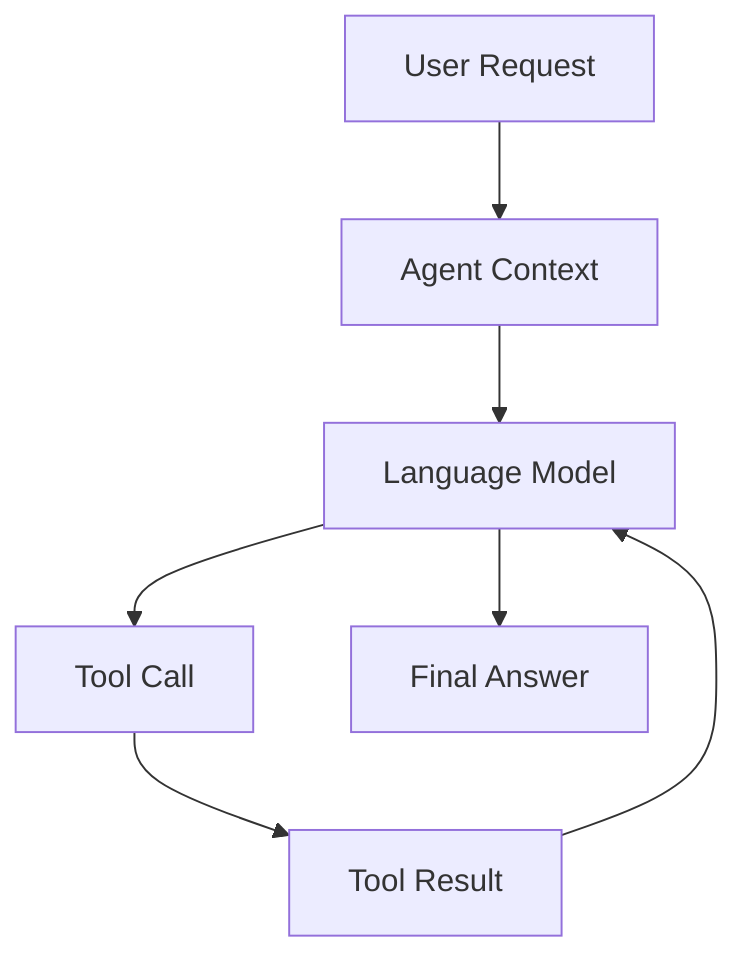

## 3.2 Where Tokens Are Consumed

The model processes context containing:

- Instructions.
- User messages.
- Source code.
- Tool responses.
- Previous conversation content.

The model also generates output.

Both input and output can contribute to usage and cost, depending on the provider and plan.

## 3.3 Caveman's Role

Caveman targets selected areas of this workflow.

For example:

- Reduce unnecessary final-response text.
- Compress supported tool output.
- Route eligible requests to suitable models.
- Reuse existing scripts.
- Reduce unnecessary web content.

---

# Part III — The Instruction Layer

## 4. Skill-Based Integration

The simplest form of Caveman is its response-style skill.

A skill provides instructions that influence how the agent communicates.

## 4.1 Conceptual Flow

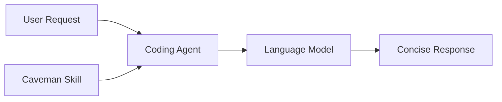

## 4.2 Responsibilities

The instruction layer focuses on:

- Answer-first communication.
- Removing unnecessary wording.
- Preserving technical meaning.
- Keeping code and commands exact.
- Avoiding redundant narration.

## 4.3 What It Does Not Automatically Provide

A response-style skill alone does not inherently provide:

- Full tool-output compression.
- Model-routing infrastructure.
- Proxy-based processing.
- Usage analytics.
- Reusable script execution.

Those capabilities belong to the broader toolkit.

## 4.4 Why This Distinction Matters

A developer may only want concise responses.

Installing the full toolkit for that purpose could introduce unnecessary complexity.

> [!important]
> Choose the smallest integration that solves the actual problem.

---

# Part IV — The Integration Layer

## 5. Why Integration Is Necessary

Different coding agents have different:

- Configuration formats.
- Tool systems.
- Session behavior.
- Authentication mechanisms.
- Model-selection capabilities.

Caveman must integrate with those environments to provide functionality beyond simple response instructions.

## 5.1 Conceptual Responsibilities

An integration may need to:

1. Identify the coding agent.
2. Determine supported capabilities.
3. Configure appropriate hooks or connections.
4. Route eligible operations through optimization components.
5. Preserve normal agent functionality.

## 5.2 Repository Evidence

The repository includes directories associated with integrations and agent support, including:

```text
.codex/
agents/
hooks/
integrations/
installer/
mcp/
plugins/
skills/
```

These names indicate areas worth investigating during source-code study.

Directory names alone do not establish the exact runtime behavior of each integration.

---

# Part V — Proxy Architecture

## 6. What Is a Proxy?

A proxy is an intermediary component that processes communication between systems.

In an AI workflow, a proxy may sit between an agent and an upstream service.

## 6.1 Conceptual Request Flow

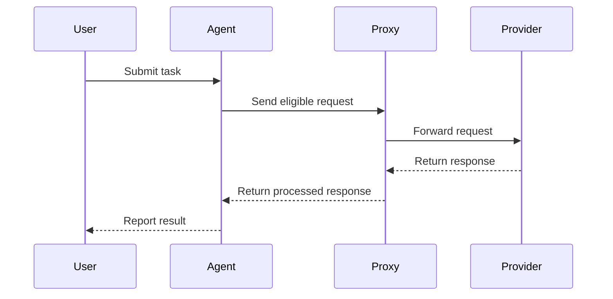

This is a conceptual illustration, not a verified trace of every Caveman integration.

## 6.2 Possible Proxy Responsibilities

Depending on the implementation, a proxy may support:

- Request forwarding.
- Model routing.
- Usage accounting.
- Response transformation.
- Error handling.
- Compatibility with agent protocols.

## 6.3 Why a Proxy Can Be Useful

A proxy can centralize functionality that would otherwise require modifications inside every coding agent.

However, the proxy becomes another component that must work correctly.

---

# Part VI — Proxy Tradeoffs

## 7. Benefits and Costs

| Benefit | Tradeoff |
|---|---|
| Centralized processing | Additional system component |
| Shared optimization logic | Configuration complexity |
| Model routing | Routing errors are possible |
| Usage tracking | Additional data-handling considerations |
| Consistent integration | Compatibility requirements |

## 7.1 Reliability Concerns

Potential failures include:

- Proxy unavailable.
- Incorrect upstream configuration.
- Authentication failure.
- Unsupported request format.
- Network interruption.
- Incompatible model behavior.

## 7.2 Engineering Principle

A performance optimization should not create an unacceptable reliability risk.

Before adopting a proxy, understand how to restore the original agent configuration.

---

# Part VII — The Optimization Layer

## 8. Caveman's Six Capabilities

The README identifies six major optimization areas.

| Capability | Architectural Responsibility |
|---|---|
| Say Less | Response instruction optimization |
| Read Less | Tool-output compression |
| Auto | Model and effort routing |
| Blocks | Reusable script workflows |
| Waste Fixes | Usage analysis and overhead reduction |
| Browse | Web-content compression |

These capabilities target different stages of an agent workflow.

## 8.1 Conceptual Relationship

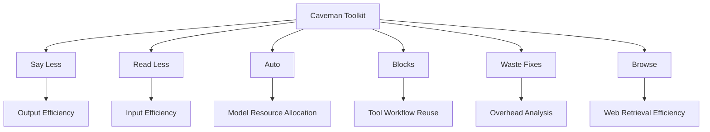

---

# Part VIII — Say Less Architecture

## 9. Output-Side Optimization

Say Less operates primarily through instructions about how the agent should communicate.

Its goal is to reduce unnecessary output tokens.

## 9.1 Example

Verbose:

```text
I have finished examining the source files and
have identified that the issue appears to be
caused by an undefined variable.
```

Concise:

```text
Undefined variable causes the error.
```

## 9.2 Important Constraints

The repository emphasizes preserving:

- Code.
- Commands.
- File paths.
- Error messages.
- Negations.
- Numbers.
- Units.
- Important warnings.

## 9.3 Why Preserve Negations?

Compare:

```text
Do not delete the database.
```

and:

```text
Delete the database.
```

Removing one word completely changes the instruction.

This demonstrates why compression must be meaning-aware.

## 9.4 Architectural Limitation

Say Less primarily affects generated communication.

It does not automatically reduce the amount of repository content the model reads.

---

# Part IX — Read Less Architecture

## 10. Input-Side Optimization

Read Less focuses on compressing selected tool results before the model consumes them.

Typical data includes:

- Logs.
- Test output.
- JSON.
- CSV.
- YAML.

## 10.1 Conceptual Pipeline

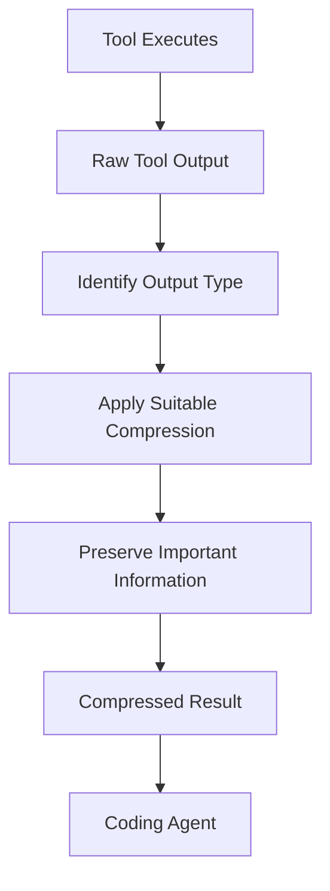

The exact internal classification and transformation algorithms require source-level inspection.

## 10.2 Example: Test Output

Original:

```text
PASS UserTest::test_login
PASS UserTest::test_logout
FAIL UserTest::test_registration

Expected status: 201
Actual status: 500

PASS ProductTest::test_list
```

Compressed:

```text
4 tests: 3 passed, 1 failed.

FAIL UserTest::test_registration
Expected 201; actual 500.
```

This is an educational example, not literal Caveman output.

## 10.3 Important Principle

A good compressor removes noise while retaining diagnostic value.

---

# Part X — Original Data Preservation

## 11. Why Raw Output Matters

Compression can discard information that later becomes relevant.

For example:

A test summary may identify the failed test but omit an earlier warning explaining the failure.

The repository states that original content remains available on disk for retrieval.

## 11.1 Conceptual Recovery Flow

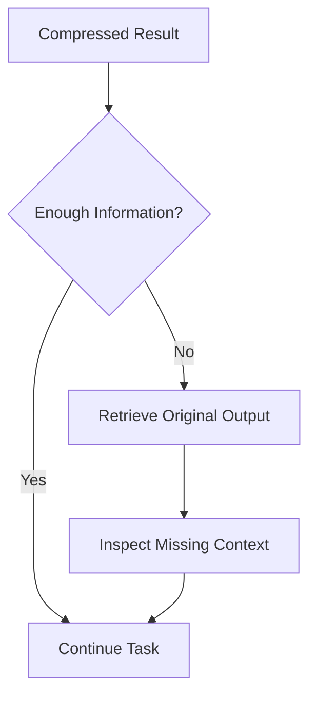

## 11.2 Engineering Implication

Compression should be reversible from the developer's perspective whenever full diagnostic information is required.

## 11.3 What to Verify Later

During hands-on testing, investigate:

- Where original outputs are stored.
- How they are retrieved.
- Whether retention is configurable.
- Whether sensitive information is stored.
- Whether files are cleaned up.

Do not assume these details without inspecting the implementation.

---

# Part XI — Model Routing Architecture

## 12. What Is Model Routing?

Model routing is the process of selecting a model or reasoning-effort level for a request.

Caveman's Auto capability attempts to choose an appropriate combination.

## 12.1 Conceptual Flow

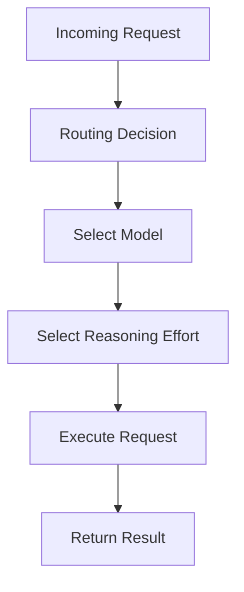

## 12.2 Why Route Requests?

Not every coding task requires identical reasoning resources.

Examples:

| Task | Potential Complexity |
|---|---|
| Rename a CSS class | Low |
| Explain a syntax error | Low to moderate |
| Refactor authentication flow | Moderate to high |
| Analyze distributed concurrency | High |

These are illustrative categories, not a description of Caveman's exact routing classifier.

## 12.3 Important Limitation

Task complexity is difficult to predict perfectly.

A seemingly simple task may contain hidden dependencies.

Therefore, automatic routing must be evaluated for both cost and correctness.

---

# Part XII — Routing and Authentication

## 13. Why Authentication Matters

Model routing may involve:

- Existing agent authentication.
- Provider-specific credentials.
- Account-linked routing features.
- Optional additional providers.

The repository documents that Auto requires a Caveman account.

It also documents optional provider configuration.

## 13.1 Trust Boundaries

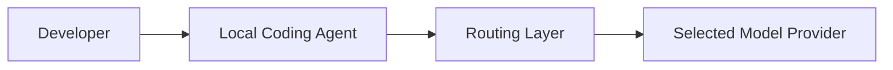

## 13.2 Questions to Ask

Before enabling routing:

1. Which service receives request content?
2. Which credentials are used?
3. Does routing change the selected provider?
4. What information is sent for routing decisions?
5. How are failures handled?
6. Can routing be disabled?

## 13.3 Important

Never assume that all model-routing decisions remain entirely local.

Read the relevant privacy and routing documentation before enabling external services.

---

# Part XIII — Blocks Architecture

## 14. What Are Reusable Blocks?

Blocks provide reusable scripts for recurring agent operations.

The concept is similar to creating small, tested development utilities.

## 14.1 The Problem

An agent may repeatedly generate a script to summarize test results.

That creates unnecessary work.

## 14.2 Reuse Workflow

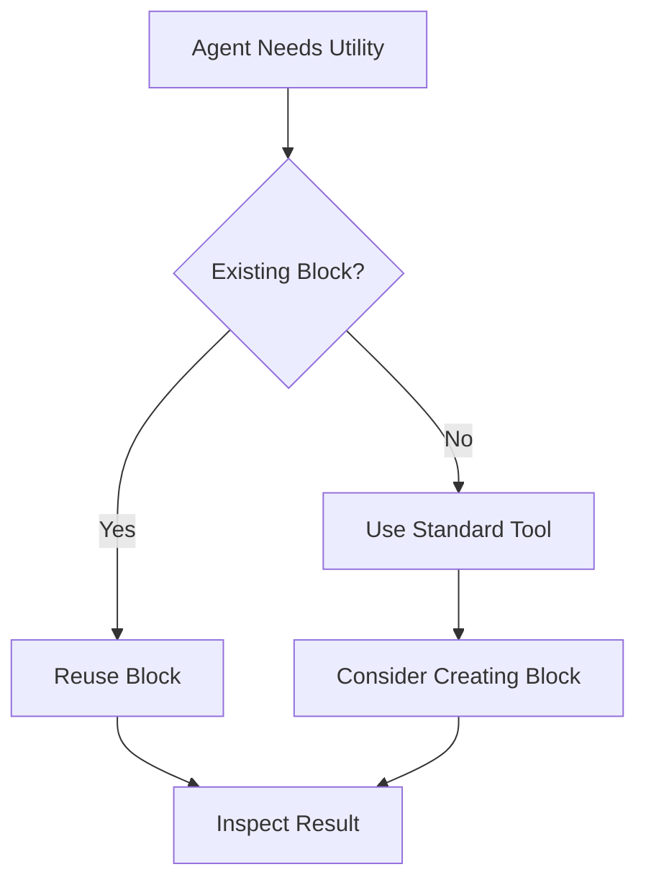

## 14.3 Repository-Documented Examples

The README lists reusable Blocks including:

- `json-peek`
- `jsonl-stats`
- `test-summary`
- `first-error`
- `wait-for`
- `grep-defs`
- `http-json`
- `replace-in-file`

## 14.4 Architectural Benefit

Blocks can reduce:

- Repeated script generation.
- Repeated debugging utilities.
- Inconsistent output formats.

## 14.5 Architectural Risk

A reusable script may be inappropriate for a different project or environment.

Treat reusable scripts as executable code requiring review.

---

# Part XIV — Blocks and Repository Context

## 15. Why Repository Integration Matters

Reusable scripts are more useful when agents can discover them.

A repository may document available utilities through agent instructions.

For example:

```markdown
# Available Project Utilities

Use the existing test-summary utility
when reviewing supported test output.

Inspect its behavior before relying on it.
```

This is an illustrative instruction.

## 15.1 Relationship with AGENTS.md

`AGENTS.md` can provide:

- Available tools.
- Tool usage conventions.
- Project constraints.
- Testing instructions.

## 15.2 Important

A script being available does not mean the agent should always use it.

The tool must fit the current task.

---

# Part XV — Waste Fixes Architecture

## 16. Usage Analysis

Waste Fixes focus on identifying repeated or unnecessary token consumption.

The repository documents commands for examining usage and applying selected improvements.

## 16.1 Conceptual Analysis Flow

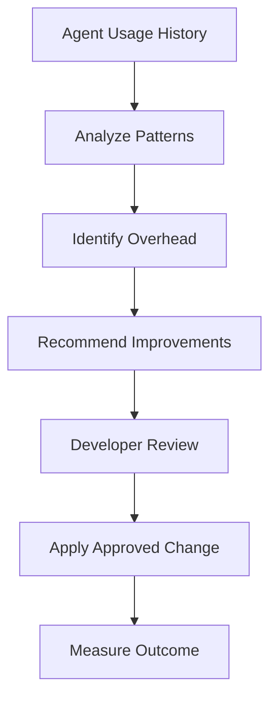

## 16.2 Potential Inefficiencies

Examples:

- Repeated full-file reads.
- Excessive tool output.
- Repeated utility scripts.
- Unnecessarily verbose responses.
- Poor context selection.

## 16.3 Important

The repository's usage-analysis capabilities should not be assumed to automatically identify every form of inefficiency.

Their effectiveness depends on available data and implemented analysis rules.

---

# Part XVI — Prompt Caching

## 17. What Is Prompt Caching?

Prompt caching is a provider feature that may allow repeated prompt content to be processed more efficiently.

It can reduce costs or latency under supported conditions.

## 17.1 Conceptual Example

A coding agent repeatedly sends:

```text
System instructions
Project instructions
Conversation context
New user request
```

Some stable portions may qualify for caching.

## 17.2 Caveman's Warm-Cache Feature

The repository describes a capability intended to keep eligible prompt caches warm during pauses.

This feature is provider-dependent.

## 17.3 Important Considerations

- Cache behavior varies by provider.
- Cache retention is not permanent.
- Warming may itself involve requests.
- Benefits depend on usage patterns.
- The feature may not help every workflow.

The repository indicates that this optimization had not yet received comprehensive measurement at the time described in its README.

---

# Part XVII — Browse Architecture

## 18. Compressed Web Retrieval

Browse focuses on reducing web content before it reaches the agent.

## 18.1 Conceptual Pipeline

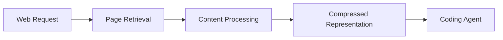

## 18.2 Why Web Content Can Be Large

Pages may include:

- Navigation.
- Scripts.
- Styles.
- Repeated links.
- Tables.
- Footer content.
- Main documentation.

An agent may need only a subset.

## 18.3 Limitations

Compression may be inappropriate when the task requires:

- Exact source markup.
- Complete tables.
- Interactive behavior.
- Full legal wording.
- Detailed page structure.

## 18.4 Engineering Principle

The best representation depends on the task.

A compressed summary is useful for quick information retrieval.

Full source content may be necessary for debugging or auditing.

---

# Part XVIII — Repository Structure

## 19. Important Directories

The repository contains several directories relevant to its architecture.

| Directory | Likely Area of Responsibility |
|---|---|
| `agents/` | Agent-related resources |
| `skills/` | Skill definitions |
| `proxy/` | Proxy functionality |
| `engine/` | Optimization engine code |
| `integrations/` | Integration support |
| `hooks/` | Hook-related mechanisms |
| `mcp/` | MCP-related functionality |
| `browse/` | Web-content processing |
| `shrink/` | Compression-related functionality |
| `installer/` | Installation logic |
| `commands/` | Command implementations or definitions |
| `benchmarks/` | Benchmark resources |
| `evals/` | Evaluation resources |
| `tests/` | Test code |
| `docs/` | Documentation |

These are high-level interpretations based on the repository layout.

The exact responsibility of each directory should be verified by reading its contents.

## 19.1 Why Source Structure Matters

Architecture documentation should be grounded in actual source files.

A directory name alone does not prove:

- Execution order.
- Internal APIs.
- Data flow.
- Storage format.
- Security guarantees.

---

# Part XIX — Configuration Architecture

## 20. Feature Controls

Caveman documents controls for inspecting and enabling or disabling functionality.

Examples from the README:

```powershell
caveman status
```

```powershell
caveman on browse
```

```powershell
caveman off browse
```

These are documentation examples, not commands executed in this lesson.

## 20.1 Why Feature Controls Matter

Different developers may want different optimizations.

For example:

- Concise responses only.
- Compression without routing.
- Blocks without web compression.
- Full integration for benchmarking.

## 20.2 Configuration Principle

Enable only the functionality that has a demonstrated benefit for the workflow.

---

# Part XX — Diagnostics and Observability

## 21. What Is Observability?

Observability is the ability to understand system behavior through available evidence.

Relevant information may include:

- Active features.
- Errors.
- Usage statistics.
- Routing behavior.
- Compression results.
- Agent compatibility.

## 21.1 Documented Commands

```powershell
caveman status
caveman stats
caveman doctor
```

## 21.2 Why Diagnostics Matter

When an agent behaves unexpectedly, the developer needs to distinguish:

- Agent problem.
- Model problem.
- Proxy problem.
- Compression problem.
- Configuration problem.

Without diagnostics, optimization layers can make debugging harder.

---

# Part XXI — Error Handling and Fallback

## 22. Why Fallback Matters

An optimization should not make normal development impossible when it fails.

## 22.1 Recommended Reliability Model

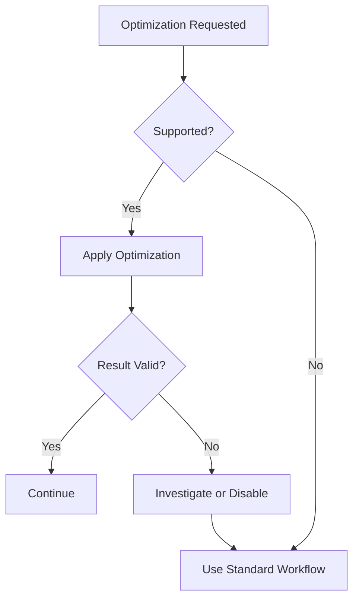

This diagram represents a recommended design principle, not a verified internal Caveman fallback algorithm.

## 22.2 Failure Scenarios

### Compression Failure

Use original output when necessary.

### Routing Failure

Restore an appropriate model configuration.

### Proxy Failure

Investigate connectivity and integration settings.

### Script Failure

Inspect the script and use standard tools.

## 22.3 Important

Do not assume Caveman automatically falls back in every failure scenario.

Verify actual behavior during testing.

---

# Part XXII — Security Architecture

## 23. Security Boundaries

Caveman may interact with:

- Agent configuration.
- Model requests.
- Tool output.
- Local files.
- Authentication settings.
- Usage history.

These are potentially sensitive surfaces.

## 23.1 Security Review Questions

1. What configuration files are modified?
2. What permissions are required?
3. Which data remains local?
4. Which data may leave the machine?
5. How are credentials handled?
6. Are logs retained?
7. How are updates delivered?
8. Can the integration be disabled cleanly?

## 23.2 Important

Open-source availability makes inspection possible, but does not automatically establish security.

Security requires reviewing the actual implementation and deployment configuration.

---

# Part XXIII — Privacy and Data Boundaries

## 24. Local vs External Processing

Some operations may be performed locally.

Others may involve external providers.

## 24.1 Conceptual Boundaries

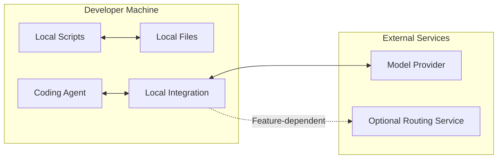

## 24.2 Privacy Principle

Before enabling a feature, understand whether it changes where project information is processed.

Avoid assuming that every component operates entirely offline.

---

# Part XXIV — Caveman and MCP

## 25. What Is MCP?

MCP stands for Model Context Protocol.

It is a protocol used to connect AI applications with external tools and data sources.

## 25.1 Why It Is Relevant

The Caveman repository includes an `mcp/` directory.

This suggests MCP-related functionality is part of the codebase.

However, the existence of this directory does not mean every Caveman capability is an MCP server or MCP tool.

## 25.2 Conceptual Comparison

| Concept | Primary Role |
|---|---|
| Skill | Provides instructions |
| MCP | Standardizes tool and resource integration |
| Proxy | Intermediates communication |
| Block | Reusable executable utility |
| Agent | Coordinates reasoning and tools |

These mechanisms can coexist.

They are not interchangeable.

---

# Part XXV — Codex Integration Architecture

## 26. Conceptual Codex Workflow

A Codex setup may involve:

- Codex CLI.
- Project documentation.
- Agent instructions.
- Development tools.
- Optional Caveman integration.

## 26.1 Conceptual Diagram

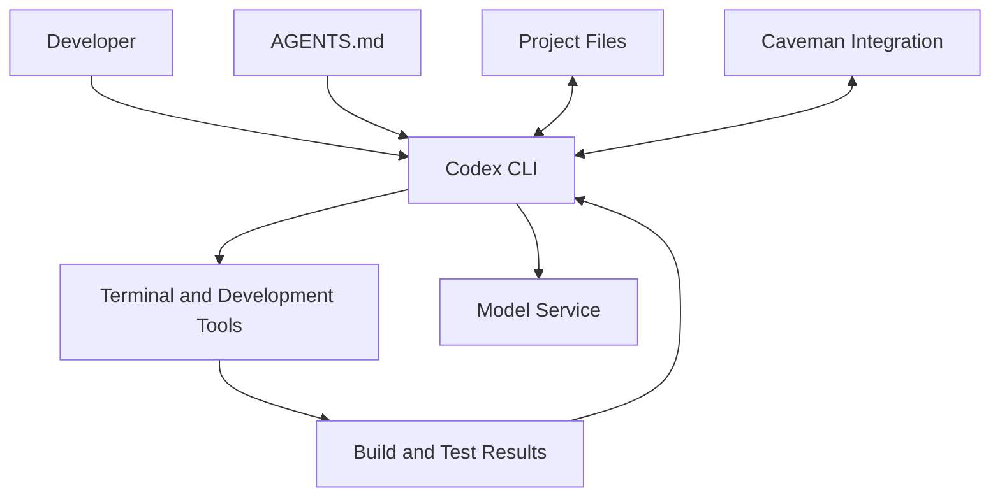

Actual request routing may differ depending on how Caveman is installed.

## 26.2 Example Workflow

A developer asks Codex to debug a Next.js build.

Possible stages:

1. Codex reads relevant project instructions.
2. Codex runs the build command.
3. The tool returns output.
4. A supported compression mechanism reduces irrelevant text.
5. Codex analyzes the result.
6. Codex requests original output if needed.
7. Codex proposes or implements a correction.
8. Tests verify the change.

## 26.3 Important

The compression layer must not be allowed to conceal errors needed for accurate diagnosis.

---

# Part XXVI — Project-Specific Architecture Examples

## 27. Laravel Project

Potential Caveman use cases:

- PHPUnit or Pest output.
- Composer diagnostics.
- Laravel logs.
- JSON API responses.

### Architectural Concern

Preserve stack traces and relevant exception context.

---

## 28. Next.js Project

Potential use cases:

- Build logs.
- Lint output.
- Test results.
- Large JSON responses.

### Architectural Concern

Do not hide important warnings or configuration problems.

---

## 29. Android Project

Potential use cases:

- Gradle output.
- Compiler diagnostics.
- Test results.
- Repeated inspection utilities.

### Architectural Concern

Preserve failing task names, relevant errors, and dependency-resolution details.

---

# Part XXVII — Architecture Evaluation

## 30. How to Evaluate Caveman's Architecture

Use the following dimensions.

| Dimension | Evaluation Question |
|---|---|
| Modularity | Can features be enabled independently? |
| Compatibility | Does it support the existing agent? |
| Reliability | What happens when optimization fails? |
| Security | What data and credentials are exposed? |
| Privacy | Which operations involve external services? |
| Performance | Does it reduce meaningful overhead? |
| Correctness | Are task outcomes preserved? |
| Observability | Can behavior be diagnosed? |
| Maintainability | Is the integration manageable? |
| Reversibility | Can changes be undone? |

## 30.1 Important

An optimization that saves tokens but creates frequent failures may not provide a net benefit.

---

# Part XXVIII — Architecture Anti-Patterns

## 31. Common Mistakes

### Treating the Skill as the Full Toolkit

The response-style skill does not automatically provide every optimization.

### Assuming All Features Use the Proxy

Different capabilities may use different integration mechanisms.

### Assuming Compression Is Lossless

Summaries can omit important information.

### Assuming Auto Always Selects the Best Model

Routing decisions are imperfect.

### Assuming All Data Remains Local

Some features may involve external services.

### Ignoring Configuration Changes

Agent integration may modify local settings.

### Enabling Everything Immediately

This makes it harder to identify which feature causes a problem.

### Trusting Benchmark Numbers Without Context

Results depend on workloads and measurement methods.

---

# Part XXIX — Practical Exercises

## 32. Exercise 1 — Architecture Mapping

Draw a diagram containing:

- Developer.
- Coding agent.
- Caveman integration.
- Model provider.
- Terminal tools.
- Project files.

Label which connections are conceptual.

---

## 33. Exercise 2 — Skill vs Toolkit

Explain why a developer might choose:

1. Skill-only integration.
2. Full-toolkit integration.
3. No Caveman integration.

Consider complexity, benefits, and risks.

---

## 34. Exercise 3 — Compression Pipeline

Design a theoretical compression pipeline for Laravel test output.

Identify:

- Input.
- Classification.
- Compression.
- Preserved details.
- Recovery of original output.

---

## 35. Exercise 4 — Model Routing

Consider three tasks:

1. Rename a variable.
2. Debug a database transaction issue.
3. Analyze a distributed system.

Explain why they may require different reasoning resources.

Identify the risks of automatic routing.

---

## 36. Exercise 5 — Blocks

Identify three recurring development tasks that might benefit from reusable scripts.

Explain how each script should be tested.

---

## 37. Exercise 6 — Security Review

Prepare a checklist for evaluating a proxy-based coding-agent integration.

Include:

- Credentials.
- Request data.
- Logging.
- Configuration changes.
- Network dependencies.
- Rollback.

---

## 38. Exercise 7 — Architecture Comparison

Compare these two workflows:

**Workflow A**

Codex runs commands and reads raw output.

**Workflow B**

Codex runs commands and receives compressed output.

Explain the benefits and risks of each.

---

# Part XXX — Knowledge Check

## 39. Review Questions

1. What are Caveman's major architectural layers?
2. What does the agent layer do?
3. What is skill-based integration?
4. How does a skill differ from a proxy?
5. What is the purpose of the integration layer?
6. What is a proxy?
7. Why can a proxy introduce reliability risks?
8. What is Say Less?
9. What is Read Less?
10. What is tool-output compression?
11. Why should original output remain available?
12. What is model routing?
13. Why can automatic routing make mistakes?
14. What are reusable Blocks?
15. How can Blocks reduce repeated work?
16. What are Waste Fixes?
17. What is prompt caching?
18. What is compressed web retrieval?
19. What is observability?
20. Why are diagnostics important?
21. What is fallback behavior?
22. What are security trust boundaries?
23. How does MCP differ from a skill?
24. Why should Codex configuration be inspected before integration?
25. What determines whether an optimization is successful?

---

# Part XXXI — Key Takeaways

> [!summary]
> - Caveman combines instruction-based and toolkit-based optimization.
> - Its major capabilities target different parts of agent workflows.
> - Say Less reduces unnecessary response text.
> - Read Less compresses selected tool output.
> - Auto selects models and reasoning effort.
> - Blocks promote reusable scripts.
> - Waste Fixes analyze usage overhead.
> - Browse compresses web content.
> - Proxy-based integration introduces additional system boundaries.
> - Not every feature necessarily uses the same integration mechanism.
> - Original information may be needed for debugging.
> - Automatic routing can make incorrect decisions.
> - Security and privacy depend on actual configuration.
> - Diagnostics and rollback are important.
> - Token savings must be evaluated alongside correctness.
> - Architecture should be inspected before installation.

---

# Part XXXII — Final Mental Model

```text
                    DEVELOPER
                        |
                        v
                   CODING AGENT
                        |
          +-------------+-------------+
          |                           |
          v                           v
    SKILL INSTRUCTIONS         TOOLKIT INTEGRATION
          |                           |
          v                           v
       SAY LESS                 OPTIMIZATION LAYER
                                      |
                       +--------------+--------------+
                       |              |              |
                       v              v              v
                   READ LESS         AUTO           BLOCKS
                       |              |              |
                       +--------------+--------------+
                                      |
                             WASTE FIXES / BROWSE
                                      |
                                      v
                              DEVELOPMENT WORKFLOW
                                      |
                                      v
                             CORRECTNESS VERIFICATION
```

**Remember:**

Caveman's architectural purpose is to reduce selected forms of agent overhead.

Its success depends on preserving essential information, maintaining compatibility, and ensuring that optimized workflows remain correct.

---

# Part XXXIII — Official References

## Caveman

- [Official Repository](https://github.com/JuliusBrussee/caveman)
- [README](https://github.com/JuliusBrussee/caveman/blob/main/README.md)
- [Installation Guide](https://github.com/JuliusBrussee/caveman/blob/main/INSTALL.md)
- [Security Policy](https://github.com/JuliusBrussee/caveman/blob/main/SECURITY.md)
- [Documentation](https://docs.caveman.so/caveman)

## Architecture and Integration

- [Model Context Protocol](https://modelcontextprotocol.io/)
- [OpenAI Codex Documentation](https://developers.openai.com/codex/)
- [Codex AGENTS.md Guide](https://developers.openai.com/codex/guides/agents-md)

## Software Engineering

- [Git Documentation](https://git-scm.com/doc)
- [Node.js Documentation](https://nodejs.org/en/docs)

> [!note] Documentation Scope
> This lesson uses the Caveman repository's documented capabilities and visible directory structure as its factual foundation.
>
> The architectural diagrams are conceptual teaching models. They should not be interpreted as verified internal call graphs.
>
> Exact proxy internals, compression algorithms, storage mechanisms, authentication flows, and fallback behavior require deeper source-code inspection.
>
> No installation, configuration changes, or benchmarks were performed during this lesson.

---

# Part XXXIV — Next Lesson

**[[02 - Installation and Codex Integration]]**

Topics:

1. Installation prerequisites.
2. Windows and PowerShell environment checks.
3. Node.js and npm requirements.
4. Skill-only installation.
5. Full-toolkit installation.
6. Codex CLI compatibility.
7. Installation architecture.
8. Existing configuration inspection.
9. Backup and rollback planning.
10. Feature activation and deactivation.
11. Status and diagnostic commands.
12. Common installation errors.
13. Security considerations.
14. Verification checklist.
15. Practical exercises.
16. Official references.

**End of Lesson 01 — Architecture and Core Concepts.**
