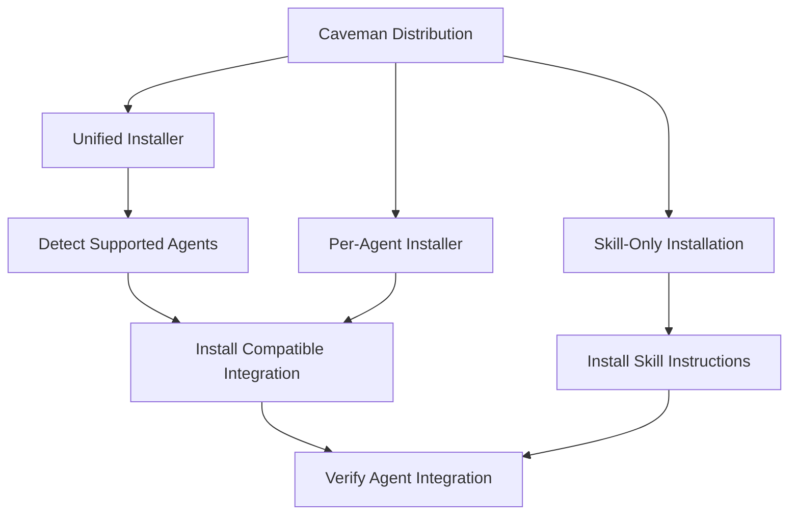
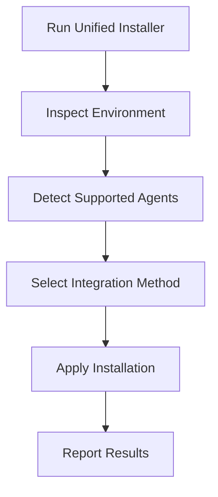
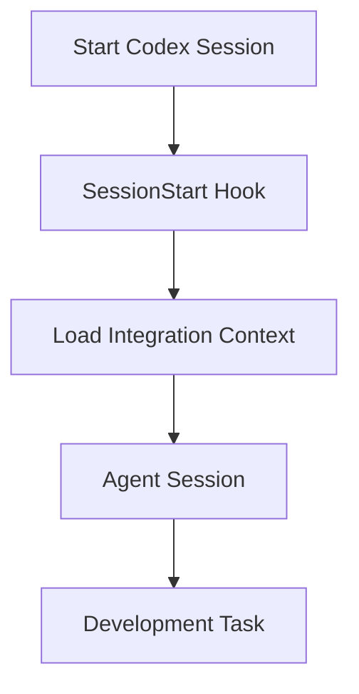
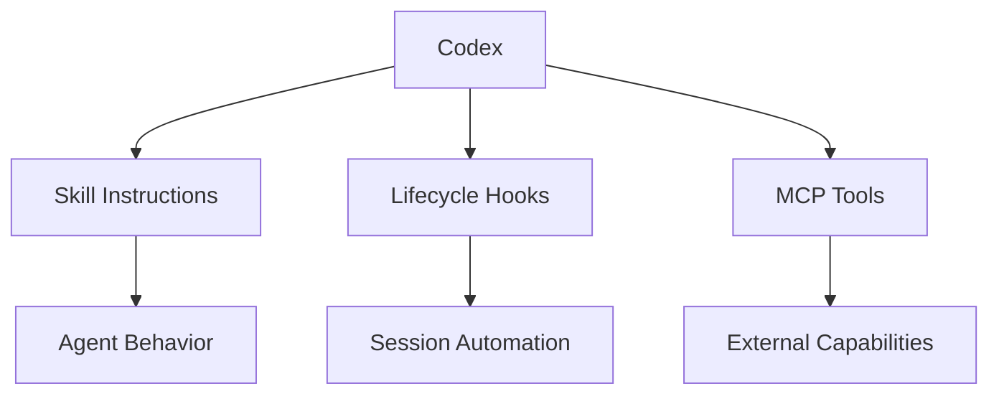
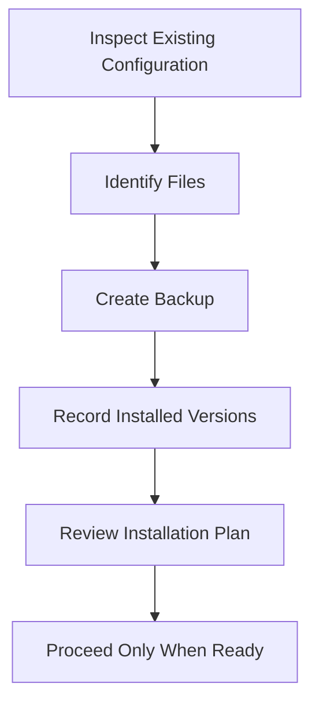
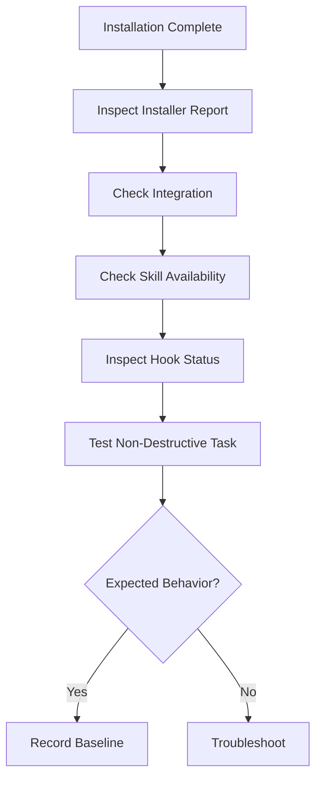
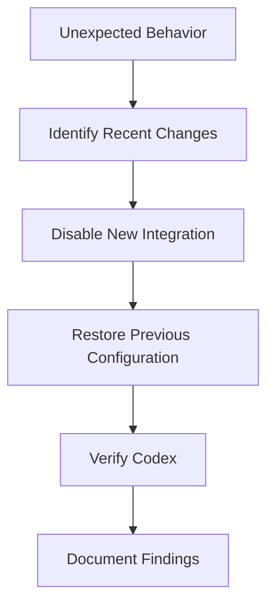

# 02 — Caveman: Installation and Codex Integration

> [!abstract] Lesson Information
> **Repository:** [JuliusBrussee/caveman](https://github.com/JuliusBrussee/caveman)
>
> **Category:** Agentic Engineering / Developer Tooling / Installation Architecture / Codex Integration
>
> **Difficulty:** Intermediate
>
> **Learning Approach:** Theory First
>
> **Prerequisites:** [[00 - Repository Overview and Purpose]], [[01 - Architecture and Core Concepts]]
>
> **Primary Goal:** Understand how Caveman can be installed and integrated with Codex CLI on Windows, how to evaluate its installation options, and how to verify and reverse configuration changes safely.
>
> **Reference Version:** Installation documentation referencing `v4.0.1`. Always verify the latest release before practical installation.

---

# 1. Learning Objectives

After completing this lesson, you should be able to:

1. Identify Caveman's installation prerequisites.
2. Explain the difference between unified and per-agent installation.
3. Distinguish skill-only and full-toolkit integration.
4. Understand how Caveman detects supported coding agents.
5. Explain the Codex-specific installation path.
6. Understand Codex skill activation.
7. Explain the role of session-start hooks.
8. Understand why configuration inspection matters.
9. Evaluate installation commands before execution.
10. Explain package version pinning.
11. Understand Windows and PowerShell considerations.
12. Plan configuration backups.
13. Interpret installation diagnostics.
14. Identify common compatibility problems.
15. Understand MCP shrink integration as an optional feature.
16. Design a verification strategy.
17. Explain rollback and recovery.
18. Assess installation security risks.

---

# Part I — Installation Overview

## 2. How Caveman Is Distributed

Caveman supports several installation approaches: a unified installer, per-agent installation, skill-only installation, additional toolkit capabilities, and optional integration features. These options provide different functionality and configuration impact.



Installing a skill and installing a complete optimization toolkit are not equivalent; the integration method determines which capabilities are available.

---

# Part II — Installation Prerequisites

## 3. Windows Development Environment

| Tool | Purpose |
|---|---|
| Windows | Operating system |
| PowerShell | Terminal and scripting |
| Node.js | JavaScript runtime |
| npm/npx | Package execution |
| Git | Repository management |
| Codex CLI | AI coding agent |
| VS Code | Development environment |

Not every installation option requires all these tools directly.

### Node.js Requirement

The Caveman README identifies **Node.js 22.13 or newer** for its current CLI installation approach. The documented command is:

```powershell
npx @caveman-ai/cli@latest
```

This executes a package through npm's package runner; it is not read-only.

A package may depend on runtime features unavailable in older Node.js versions. Incompatibility can cause installation failure, unsupported syntax, missing runtime APIs, or package issues. Check the runtime requirement before installation.

---

# Part III — Environment Inspection

## 4. Why Inspect Before Installing?

A working development environment may already have Codex skills, agent instructions, hooks, MCP configuration, and custom settings. An installer may add or modify integration files, so understand the current state first.

### Read-Only Environment Checks

```powershell
node --version
npm --version
npx --version
git --version
codex --version
```

These commands report versions; they do not install Caveman.

### Check Command Availability

```powershell
Get-Command node
Get-Command npm
Get-Command npx
Get-Command git
Get-Command codex
```

Windows may contain multiple installations of a tool. The selected executable depends on command resolution and environment configuration.

---

# Part IV — Understanding npx

## 5. What Is npx?

`npx` is a package execution mechanism associated with npm. It can run commands provided by packages.

```powershell
npx @caveman-ai/cli@latest
```

`@latest` is a moving version reference: the resolved package may differ over time.

### Version Pinning

A pinned version is more reproducible:

```powershell
npx some-package@1.2.3
```

This is a generic example, not a claim that a particular Caveman CLI version is available under that number.

Pinning improves reproducibility, troubleshooting, predictable behavior, and change-history clarity.

---

# Part V — Unified Installation

## 6. What Is the Unified Installer?

The unified installer attempts to detect supported coding agents and apply their corresponding installation procedures. The Caveman guide describes support for Codex, Claude Code, Cursor, Gemini CLI, and other supported environments.



It can be convenient and support multiple agents, but may make broader changes and add more components to inspect. If evaluating Caveman specifically for Codex, understand the Codex-only path before choosing the unified installer.

---

# Part VI — Windows PowerShell Installer

## 7. Repository-Documented PowerShell Command

The installation guide includes a Windows PowerShell installer referencing a release tag:

```powershell
irm https://raw.githubusercontent.com/JuliusBrussee/caveman/v4.0.1/install.ps1 | iex
```

`irm` aliases `Invoke-RestMethod`; `iex` aliases `Invoke-Expression`. The pipeline retrieves remote script content and executes it.

### Why This Requires Care

This executes code from a remote source. Review the script and its intended changes before running it.

### Safer Review-First Pattern

```powershell
Invoke-WebRequest `
  -Uri "https://raw.githubusercontent.com/JuliusBrussee/caveman/v4.0.1/install.ps1" `
  -OutFile ".\install.ps1"
```

Inspect it:

```powershell
Get-Content .\install.ps1
code .\install.ps1
```

Downloading does not prove a script is safe. Review its behavior, source, dependencies, and permissions.

---

# Part VII — Dry-Run Installation

## 8. What Is a Dry Run?

A dry run previews intended actions without applying the full operation. The repository documents a `--dry-run` option.

It can help identify detected agents, planned integrations, intended actions, and possible configuration changes. Behavior depends on implementation; do not assume there are no external reads, temporary files, or side effects unless verified.

Recommended sequence:

```text
Read documentation → Inspect installer → Understand options
→ Review dry-run output → Approve intended changes → Install
```

---

# Part VIII — Per-Agent Installation

## 9. Why Install for One Agent?

Per-agent setup limits the intended scope. A developer who uses only Codex may not need configuration changes for every supported agent.

### Codex-Specific Command

The guide documents:

```powershell
npx -y github:JuliusBrussee/caveman -- --only codex
```

This is an installation command; do not execute it during theory study. `--only codex` requests the Codex integration, while the installer determines the corresponding files and setup steps.

The example does not pin a specific commit or tag. For reproducibility, review release-specific instructions and supported version syntax.

---

# Part IX — Skill-Only Installation

## 10. What Is Skill-Only Integration?

Skill-only installation focuses on adding Caveman's instructions to the coding agent. The guide documents:

```powershell
npx skills add JuliusBrussee/caveman -a codex -g
```

- `skills add` installs an agent skill.
- `JuliusBrussee/caveman` identifies the source.
- `-a codex` selects Codex.
- `-g` requests user-level installation.

User-level skills are intended to be available across projects. Project-level skills are associated with one workspace. Skill-only setup is lighter and does not inherently enable the entire Caveman optimization toolkit.

---

# Part X — Codex Skill Invocation

## 11. How Codex Invokes Skills

The guide notes that Codex uses the `$` prefix for skill invocation:

```text
$caveman
```

This differs from agents that use slash-command syntax. Skill invocation affects agent behavior but does not automatically prove proxy-based optimization is active.

```text
Developer opens Codex
         ↓
Invokes Caveman skill
         ↓
Codex loads relevant instructions
         ↓
Codex follows concise-response guidance
```

---

# Part XI — Codex Session Hooks

## 12. What Is a Session Hook?

A session hook runs at a defined point in an agent lifecycle. Caveman's guide documents a Codex start-of-session hook.



The guide notes Codex may require trusting the hook once through `/hooks`.

Before approval, inspect its purpose, command, permissions, source, and expected output. Do not approve an unfamiliar hook without understanding what it executes.

---

# Part XII — Skills vs Hooks vs MCP

## 13. Three Different Integration Mechanisms

| Mechanism | Primary Purpose |
|---|---|
| Skill | Provides reusable agent instructions |
| Hook | Responds to lifecycle events |
| MCP | Connects agents to tools and resources |



These mechanisms are complementary, not interchangeable.

---

# Part XIII — Optional MCP Shrink Integration

## 14. What Is MCP Shrink?

The Caveman guide documents an optional MCP-related compression integration. The installer references:

```text
--with-mcp-shrink
```

The feature is opt-in. Conceptually, MCP-related compression can reduce tool-result content presented to an agent.

Before enabling it, investigate which tools are affected, how responses are transformed, whether original data is retained, how errors are handled, and whether sensitive data is stored. Do not assume all MCP responses can be safely compressed.

---

# Part XIV — Existing Codex Configuration

## 15. Why Configuration Inspection Matters

A developer may already have custom Codex settings, project instructions, skills, MCP servers, hooks, and authentication configuration. A new integration can interact with existing settings.

```text
Codex Environment
├── Global Settings
├── Project Instructions
├── Skills
├── Hooks
├── MCP Integrations
└── Authentication
```

This is a conceptual inventory, not an exact filesystem layout. Inspect configuration for the installed Codex version; do not assume every machine uses identical paths or formats.

---

# Part XV — Backup Strategy

## 16. Why Backups Matter

An installer may add or modify configuration files. A backup helps restore the previous state.

### Recommended Backup Contents

- Relevant configuration files.
- Existing skill definitions.
- Hook configuration.
- MCP configuration.
- Installed version information.



Backups may contain credentials or sensitive data. Store them securely and do not commit them to Git.

---

# Part XVI — Configuration Safety

## 17. Avoid Overwriting Existing Workflows

A functioning Codex environment may already have custom instructions. Preserve existing settings unless a deliberate change is required.

Before installation, ask:

1. What files will be created?
2. What files will be modified?
3. Are existing hooks preserved?
4. Are MCP entries changed?
5. Are skills installed globally?
6. Can changes be reversed?
7. Is a backup available?

Installation convenience should not replace configuration awareness.

---

# Part XVII — npm Compatibility

## 18. npm 12 Considerations

The installation guide documents a compatibility consideration for npm 12 and Git-based package execution. Some direct Git package installations require explicit opt-in; the guide describes `--allow-git=root` for applicable npm 12 commands.

A command that worked with older npm may fail with a newer version. The repository states newer installer versions account for this behavior.

If installation fails:

1. Check npm version.
2. Read the exact error.
3. Compare the command with current documentation.
4. Avoid blindly changing system-wide security settings.
5. Prefer documented compatibility options.

---

# Part XVIII — Installation Verification

## 19. What Does Successful Installation Mean?

Verify multiple levels:

| Category | Question |
|---|---|
| Package | Was the expected version installed? |
| Integration | Was Codex detected correctly? |
| Skill | Can Codex find the skill? |
| Hook | Is the expected hook present and trusted? |
| CLI | Are relevant commands available? |
| Functionality | Does the feature behave as expected? |
| Stability | Does ordinary Codex usage still work? |



---

# Part XIX — Caveman CLI Diagnostics

## 20. Documented Commands

```powershell
caveman status
caveman doctor
caveman stats
```

**Status** inspects active integration or feature state. **Doctor** checks supported configuration or environment problems. **Stats** inspects available usage information.

Exact output depends on version and available data. These commands do not prove every optimization works correctly.

---

# Part XX — Testing Skill Behavior

## 21. Simple Behavioral Verification

After a skill-only installation, a developer can compare responses.

### Baseline Request

```text
Explain why a React component re-renders
when an inline object is passed as a prop.
```

### Skill-Assisted Request

```text
$caveman

Explain why a React component re-renders
when an inline object is passed as a prop.
```

Compare correctness, completeness, clarity, token usage if measurable, and whether important technical details were preserved. A shorter response is not automatically better; it must remain accurate.

---

# Part XXI — Testing Tool-Output Compression

## 22. Controlled Evaluation

Evaluate compression with repeatable inputs such as a known test log, sample JSON response, or fixed build output.

```text
Original Output → Record Important Information → Apply Compression
→ Compare Result → Check Information Retention → Measure Token Difference
```

Measure both token reduction and information retention.

---

# Part XXII — Troubleshooting Installation

## 23. Common Failure Categories

| Problem | Possible Cause |
|---|---|
| `node` not recognized | Missing installation or PATH issue |
| `npx` not recognized | npm installation or PATH issue |
| Git package error | npm compatibility restriction |
| Codex not detected | Agent installation or detection issue |
| Skill not available | Incorrect installation scope |
| Hook inactive | Hook not trusted or unsupported |
| CLI command unavailable | Package installation or PATH issue |
| Feature not working | Configuration or compatibility issue |

Diagnose one layer at a time. Do not repeatedly reinstall everything without understanding the failure.

---

# Part XXIII — Windows-Specific Considerations

## 24. PowerShell Execution Policy

PowerShell execution-policy controls can affect script launching. Do not disable protections globally just to make an installer work. Read the error, review the script, follow official documentation, and use an appropriate approved execution method.

### PATH Considerations

A newly installed executable may not appear in an already-open terminal; refresh the terminal environment if needed.

### File Permissions

Configuration directories may require appropriate filesystem permissions. Avoid elevated privileges unless genuinely required and understood.

---

# Part XXIV — Rollback Planning

## 25. What Is Rollback?

Rollback restores the previous working configuration.

Identify files created or modified, packages installed, hooks and skills added, and configuration values changed.



Do not assume deleting one folder reverses every installer action. Review the installation report and uninstall instructions.

---

# Part XXV — Security Review

## 26. Installation Security Checklist

- [ ] Verify repository ownership.
- [ ] Review installation documentation.
- [ ] Inspect remote scripts.
- [ ] Prefer pinned releases.
- [ ] Understand required permissions.
- [ ] Identify modified configuration files.
- [ ] Review hooks.
- [ ] Review external service connections.
- [ ] Protect authentication credentials.
- [ ] Understand rollback.
- [ ] Avoid unnecessary elevated privileges.

Hooks may execute automatically during an agent lifecycle and deserve review like other executable code. A proxy may process requests containing project information; understand its data flow before enabling it.

---

# Part XXVI — Installation Decision Framework

## 27. Which Installation Path Should You Choose?

| Requirement | Appropriate Path to Evaluate |
|---|---|
| Concise Codex responses | Skill-only |
| Codex-specific integration | Per-agent installer |
| Multiple coding agents | Unified installer |
| Tool-output compression | Relevant toolkit capability |
| Model routing | Auto setup |
| MCP output compression | Optional MCP shrink |
| No demonstrated optimization need | Keep existing setup |

For an existing Codex environment:

1. Understand the current setup.
2. Review skill-only functionality.
3. Evaluate whether it provides value.
4. Identify remaining inefficiencies.
5. Consider additional capabilities individually.
6. Measure results before expanding integration.

Start with the least invasive option that meets the requirement.

---

# Part XXVII — Example: Codex on Windows

## 28. Hypothetical Environment

```text
Windows
├── PowerShell
├── Git
├── Node.js
├── npm
├── Codex CLI
├── VS Code
└── Existing Projects
```

The developer wants to evaluate Caveman without disrupting current workflows.

### Theoretical Evaluation Plan

1. **Inspect:** Check versions and existing configuration.
2. **Document:** Record current skills, hooks, and relevant settings.
3. **Review:** Inspect Caveman's installation methods.
4. **Select:** Choose skill-only or targeted integration.
5. **Verify:** Test a simple, non-destructive task.
6. **Compare:** Evaluate response quality and token usage.
7. **Decide:** Retain, adjust, or remove the integration.

---

# Part XXVIII — Practical Exercises

## 29. Exercise 1 — Environment Readiness

Create a Windows checklist covering Node.js, npm, Git, Codex, PowerShell, and configuration backup. Explain why each item matters.

## 30. Exercise 2 — Installation Comparison

Compare unified, Codex-only, and skill-only installation by scope, complexity, features, configuration impact, and rollback difficulty.

## 31. Exercise 3 — Command Analysis

Explain:

```powershell
npx skills add JuliusBrussee/caveman -a codex -g
```

Identify which part selects Codex and which part specifies installation scope.

## 32. Exercise 4 — Hook Security

A third-party installer adds a session-start hook. Explain what to inspect before trusting it.

## 33. Exercise 5 — npm Compatibility

An installation fails with an npm Git-package restriction. Describe a troubleshooting approach that preserves security controls.

## 34. Exercise 6 — Verification Plan

Design a test to determine whether the Caveman skill produces shorter but equally correct explanations. Define the baseline, test prompt, measurement, and acceptance criteria.

## 35. Exercise 7 — Rollback Strategy

Codex behaves unexpectedly after installation. Write a recovery plan that avoids deleting unrelated project files.

## 36. Exercise 8 — Integration Decision

A developer wants only shorter responses. Should they install the entire toolkit immediately? Explain a proportionate approach and its limitations.

---

# Part XXIX — Knowledge Check

## 37. Review Questions

1. What installation methods does Caveman document?
2. What is a unified installer?
3. What is per-agent installation?
4. What is skill-only installation?
5. Why should Node.js versions be checked?
6. What does `npx` do?
7. What does `@latest` mean?
8. Why is version pinning useful?
9. What does `--only codex` request?
10. What does `-g` mean in the documented skill command?
11. How does Codex invoke Caveman skills?
12. What is a session-start hook?
13. Why might a hook require trust?
14. What is MCP shrink?
15. Why is MCP shrink optional?
16. Why inspect existing Codex configuration?
17. Why create backups?
18. What is a dry run?
19. What are the limitations of dry runs?
20. What does `caveman doctor` help investigate?
21. Why should verification include behavioral testing?
22. What is rollback?
23. Why should remote installation scripts be reviewed?
24. Why can npm versions affect installation?
25. What determines the most appropriate installation path?

---

# Part XXX — Key Takeaways

> [!summary]
> - Caveman provides unified, per-agent, and skill-only installation approaches.
> - The README identifies Node.js 22.13+ for its current CLI approach.
> - Codex supports a targeted installation path.
> - Skill-only integration is less extensive than the full toolkit.
> - Codex uses `$caveman` for explicit skill invocation.
> - The Codex integration may include a session-start hook.
> - Hooks should be reviewed before being trusted.
> - MCP shrink is optional.
> - npm versions may affect Git-based package execution.
> - Inspect existing configuration before installation.
> - Review remote scripts rather than executing them blindly.
> - Version pinning improves reproducibility.
> - Backups and rollback plans reduce configuration risk.
> - Successful installation requires verification.
> - Evaluate token savings alongside correctness.
> - The least invasive suitable installation is often the best starting point.

---

# Part XXXI — Final Mental Model

```text
          EXISTING CODEX ENVIRONMENT
                      |
                      v
              INSPECT AND DOCUMENT
                      |
                      v
              REVIEW CAVEMAN OPTIONS
                      |
           +----------+----------+
           |          |          |
           v          v          v
       SKILL ONLY   CODEX ONLY   UNIFIED
           |          |          |
           +----------+----------+
                      |
                      v
              REVIEW CHANGES
                      |
                      v
               BACKUP CONFIG
                      |
                      v
             CONTROLLED INSTALL
                      |
                      v
                VERIFICATION
                      |
                      v
             QUALITY COMPARISON
                      |
                      v
              RETAIN OR ROLLBACK
```

**Remember:** Installation is not the objective. The objective is a stable, secure, and measurable improvement to the development workflow.

---

# Part XXXII — Official References

## Caveman

- [Official Repository](https://github.com/JuliusBrussee/caveman)
- [Installation Guide](https://github.com/JuliusBrussee/caveman/blob/main/INSTALL.md)
- [README](https://github.com/JuliusBrussee/caveman/blob/main/README.md)
- [Security Policy](https://github.com/JuliusBrussee/caveman/blob/main/SECURITY.md)

## Codex

- [OpenAI Codex Documentation](https://developers.openai.com/codex/)
- [Codex Skills](https://developers.openai.com/codex/skills)
- [Codex Configuration](https://developers.openai.com/codex/config-basic)
- [Codex AGENTS.md Guide](https://developers.openai.com/codex/guides/agents-md)

## Development Tools

- [Node.js](https://nodejs.org/)
- [npm Documentation](https://docs.npmjs.com/)
- [Git Documentation](https://git-scm.com/doc)
- [PowerShell Documentation](https://learn.microsoft.com/powershell/)

> [!note] Documentation Scope
> This lesson uses the Caveman README and installation guide as references for installation methods, commands, and compatibility considerations.
>
> The diagrams and evaluation procedures are educational recommendations rather than exact internal installer traces.
>
> Commands are shown for study only. No installation, configuration modification, or runtime verification was performed.
>
> Installation commands and supported versions may change. Recheck the current official documentation before practical use.

---

# Part XXXIII — Next Lesson

**[[03 - Token Economics and Optimization]]**

Topics:

1. Tokenization fundamentals.
2. Input and output token economics.
3. Context-window management.
4. Cached tokens.
5. API billing versus subscription usage.
6. Cost modeling.
7. Compression ratios.
8. Measuring token savings.
9. Benchmark methodology.
10. Quality-preserving optimization.
11. Latency and throughput.
12. Model-routing economics.
13. Agentic workflow cost analysis.
14. Laravel, Next.js, and Android examples.
15. Practical exercises.
16. Official references.

**End of Lesson 02 — Installation and Codex Integration.**
