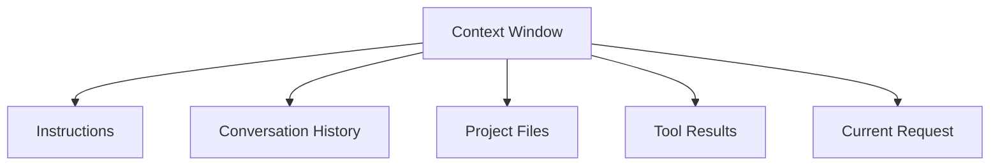
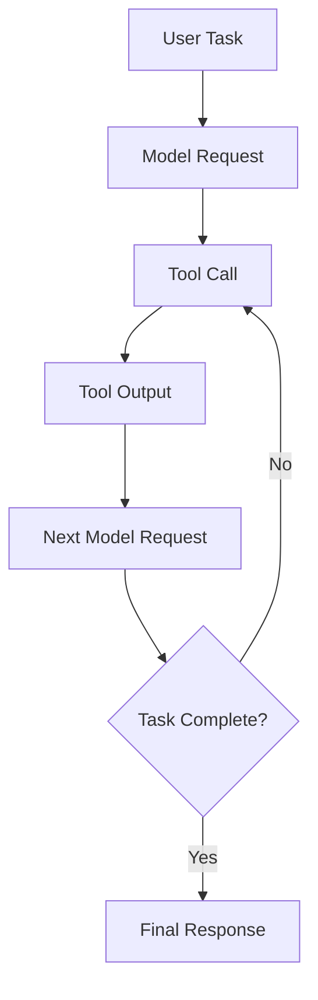
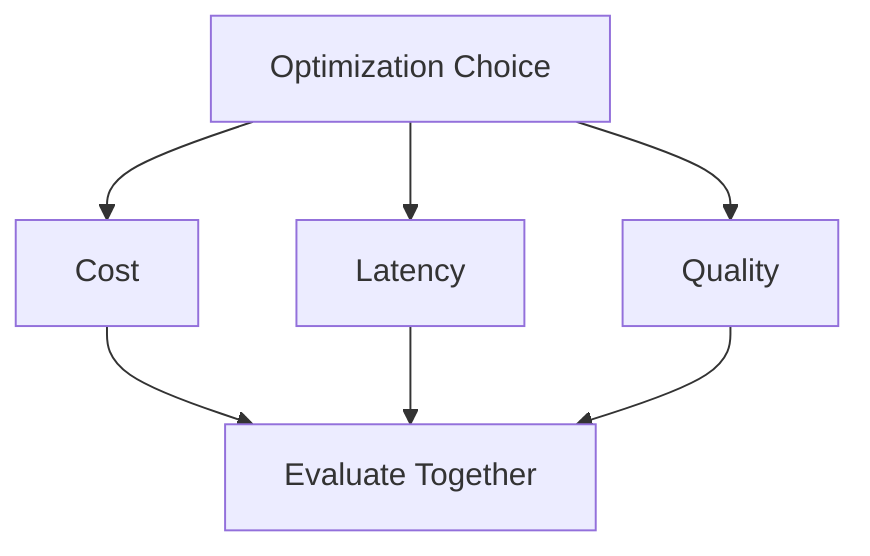
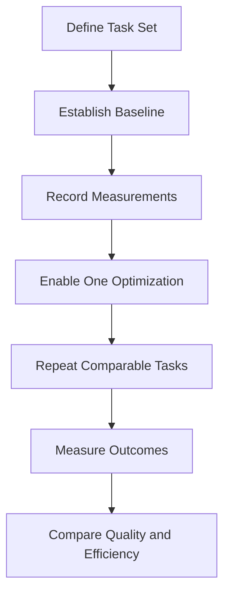
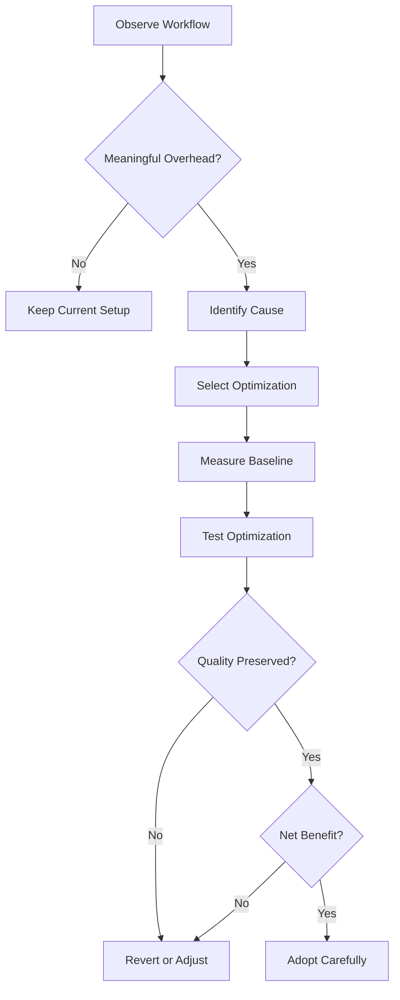
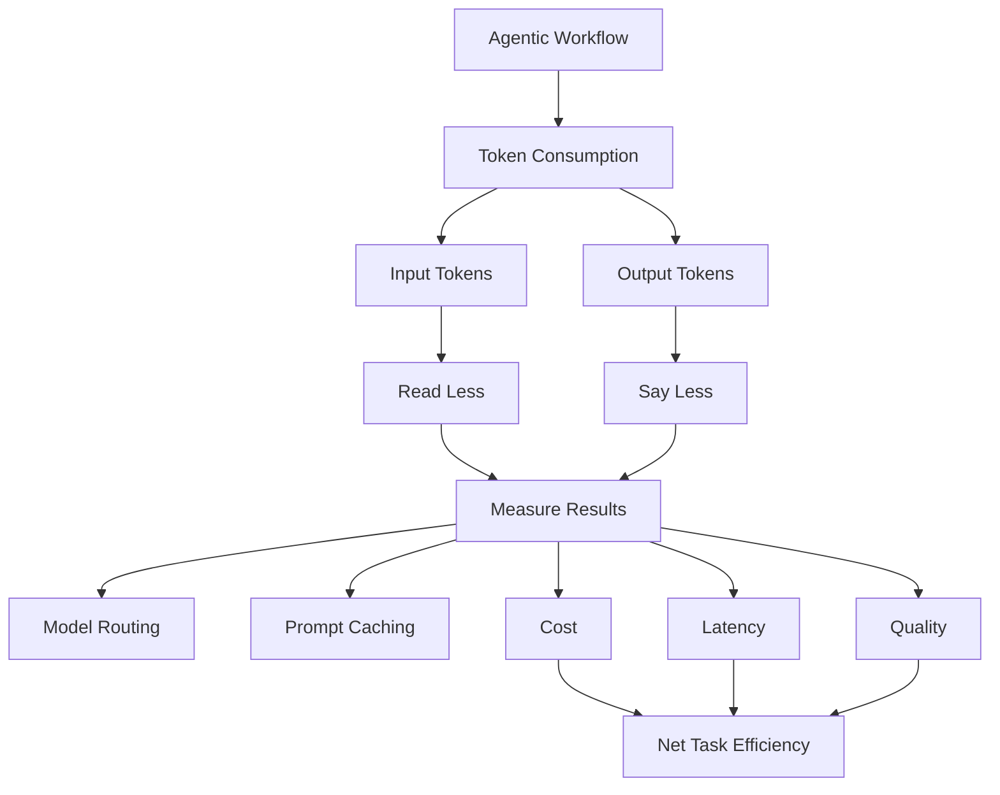

# 03 — Caveman: Token Economics and Optimization

> [!abstract] Lesson Information
> **Repository:** [JuliusBrussee/caveman](https://github.com/JuliusBrussee/caveman)
>
> **Category:** Agentic Engineering / Token Economics / Context Optimization / Cost Analysis
>
> **Difficulty:** Intermediate to Advanced
>
> **Learning Approach:** Theory First
>
> **Prerequisites:** [[00 - Repository Overview and Purpose]], [[01 - Architecture and Core Concepts]], [[02 - Installation and Codex Integration]]
>
> **Primary Goal:** Understand how tokens, context windows, caching, model selection, and compression affect the cost, performance, and reliability of AI coding-agent workflows.

> [!note] Source Check
> Caveman capability examples were checked against its README on 2026-10-21. OpenAI pricing and prompt-caching behavior can change; the pricing numbers in this lesson are hypothetical unless explicitly labeled as repository-reported measurements.

---

# 1. Learning Objectives

After completing this lesson, you should be able to:

1. Explain tokenization and token accounting.
2. Distinguish input, output, cached, and reasoning tokens.
3. Understand context-window limitations.
4. Calculate token consumption across agentic workflows.
5. Estimate token-based API costs.
6. Understand prompt caching.
7. Calculate compression ratios and token savings.
8. Distinguish token efficiency from cost efficiency.
9. Understand model-routing economics.
10. Evaluate latency and throughput.
11. Design meaningful optimization benchmarks.
12. Identify hidden optimization costs.
13. Compare optimized and unoptimized workflows.
14. Understand how Caveman targets token overhead.
15. Apply token economics to Laravel, Next.js, and Android development.
16. Define quality-preserving optimization criteria.
17. Recognize situations where compression is counterproductive.

---

# Part I — Foundations of Token Economics

## 2. What Is Token Economics?

**Token economics** is the study of how token consumption affects the resources required to operate language models and AI agents.

These resources may include:

- API costs.
- Context-window capacity.
- Processing time.
- Available usage quotas.
- Computational workload.
- Agent efficiency.

Token economics is especially important for coding agents because they repeatedly exchange information with models and tools.

### Fundamental Principle

An efficient coding agent uses enough information to complete a task correctly without repeatedly processing unnecessary information.

This is different from minimizing token counts at all costs.

---

# Part II — Understanding Tokenization

## 3. What Is Tokenization?

Tokenization converts text into smaller units that a language model can process.

A token may represent a complete word, part of a word, punctuation, whitespace-related patterns, code symbols, or numerical fragments.

### Conceptual Example

```text
The application failed.
```

The model's tokenizer converts this text into token identifiers. The exact number depends on the tokenizer.

### Tokens Are Not Words

A tokenizer may split ordinary words and programming identifiers differently. For example, an identifier such as getUserAuthenticationConfiguration() may be divided into multiple pieces.

Coding agents often process source code, stack traces, JSON, SQL, file paths, and documentation. Token usage depends on both text volume and structure.

> [!important]
> Character count, word count, and token count are related but not interchangeable measurements.

---

# Part III — Categories of Tokens

## 4. Input Tokens

Input tokens are tokens supplied to the model, such as user requests, system instructions, project documentation, source code, tool results, and previous conversation context.

## 4.1 Output Tokens

Output tokens are generated by the model, such as explanations, plans, code, tool-call arguments, and summaries.

## 4.2 Cached Input Tokens

Some model providers support prompt caching. Eligible input that matches previously processed content may receive special cached-input treatment. Depending on the provider, this can affect cost or latency.

## 4.3 Reasoning Tokens

Some reasoning models use internal reasoning tokens. These may contribute to output-token usage or other provider-specific accounting. The precise reporting and billing behavior depends on the model and API.

| Token Type | Description | Typical Source |
|---|---|---|
| Input | Content sent to the model | Prompts and tool results |
| Output | Content generated by the model | Code and explanations |
| Cached input | Reused eligible prompt content | Stable prompt prefixes |
| Reasoning | Internal model reasoning usage | Supported reasoning models |

---

# Part IV — Context Windows

## 5. What Is a Context Window?

A **context window** is the amount of tokenized information a model can process within its supported context limit. It may include instructions, conversation history, project context, tool responses, the current request, and generated content, subject to model-specific rules.



If an agent consumes too much context, it may remove older content, summarize previous information, reload files, or compact conversation state. These processes can add overhead or lose details.

### Context Capacity Example

Assume a hypothetical model supports a 128,000-token context window.

| Content | Tokens |
|---|---:|
| Instructions | 8,000 |
| Project documentation | 15,000 |
| Source code | 40,000 |
| Tool output | 25,000 |
| Conversation history | 20,000 |
| **Total** | **108,000** |

Remaining theoretical capacity:

```text
128,000 - 108,000 = 20,000 tokens
```

This simplified example does not account for every model-specific reservation or accounting rule.

Reducing irrelevant tool output can preserve context capacity for useful reasoning and source inspection.

---

# Part V — The Agentic Token Consumption Cycle

## 6. Why Agentic Workflows Consume More Tokens

A traditional chatbot may respond to one question. A coding agent often performs multiple reasoning and tool-use cycles.



### Example

Codex receives: “Fix the failing authentication test.”

It may read project instructions, inspect authentication code, run tests, read test output, inspect database configuration, modify code, rerun tests, and summarize results.

Each model request may include accumulated context.

### The Compounding Effect

A large tool result may influence several subsequent model requests if it remains active in context. One unnecessarily large response can create repeated processing overhead.

---

# Part VI — Measuring Token Consumption

## 7. Basic Token Accounting

For a simple request:

```text
T_total = T_input + T_output
```

Where T_input is input tokens and T_output is output tokens.

For a multi-step agent:

```text
T_session = Σ (T_input,i + T_output,i), for i = 1 to n
```

Here, n is the number of model requests.

### Worked Example

| Request | Input | Output |
|---|---:|---:|
| 1 | 8,000 | 1,000 |
| 2 | 12,000 | 1,500 |
| 3 | 15,000 | 2,000 |
| **Total** | **35,000** | **4,500** |

```text
35,000 + 4,500 = 39,500 tokens
```

This is total usage across requests, not the maximum simultaneous context size. A session can consume more total tokens than the model context window because it makes multiple requests.

---

# Part VII — API Token Pricing

## 8. How Token-Based Pricing Works

Many model APIs price usage according to token categories. Input and output may have different rates. Some providers also offer separate cached-input rates.

Let:

- I = input tokens.
- O = output tokens.
- P_I = price per million input tokens.
- P_O = price per million output tokens.

Then:

```text
C = (I / 1,000,000 × P_I) + (O / 1,000,000 × P_O)
```

### Hypothetical Pricing Example

Assume input costs $2 per million tokens, output costs $8 per million tokens, with 500,000 input tokens and 100,000 output tokens.

Input cost:

```text
(500,000 / 1,000,000) × $2 = $1.00
```

Output cost:

```text
(100,000 / 1,000,000) × $8 = $0.80
```

Total cost: **$1.80**.

> [!note]
> These prices are hypothetical teaching values, not current prices for any specific model. Check the provider's live pricing page before making a real estimate.

---

# Part VIII — Cached Token Economics

## 9. Cost Modeling With Prompt Caching

When cached-input pricing is available, distinguish uncached and cached input.

Let I_U be uncached input, I_C cached input, O output, and P_U, P_C, and P_O the respective rates.

```text
C = (I_U × P_U + I_C × P_C + O × P_O) / 1,000,000
```

### Example

| Category | Tokens | Hypothetical Price / 1M |
|---|---:|---:|
| Uncached input | 200,000 | $2.00 |
| Cached input | 300,000 | $0.50 |
| Output | 50,000 | $8.00 |

```text
C = 0.2($2) + 0.3($0.50) + 0.05($8)
C = $0.40 + $0.15 + $0.40
C = $0.95
```

Two workflows can use the same total input tokens but have different costs if their cache-hit patterns differ. Fewer tokens do not always mean proportionally lower cost.

---

# Part IX — Prompt Caching Fundamentals

## 10. How Prompt Caching Works Conceptually

Prompt caching can reuse eligible portions of previously processed input. A stable prompt prefix may look like:

```text
System Instructions
Project Instructions
Stable Documentation
--------------------
New User Request
New Tool Results
```

Provider rules determine whether content qualifies and how it is billed.

Potential cache-friendly practices:

- Keep stable instructions consistent.
- Avoid unnecessary changes to shared prompt prefixes.
- Separate stable context from frequently changing task data.
- Follow provider-supported caching mechanisms.

Caching behavior varies across providers, models, APIs, request formats, and retention periods. Do not assume every repeated prompt is automatically cached.

---

# Part X — Caveman and Cache Warming

## 11. What Is Cache Warming?

Cache warming attempts to keep eligible cached content available for future requests. Caveman describes a warm-cache capability among its optimization features.

If a future request reuses a cached prefix, processing may become cheaper or faster under supported conditions. A warming operation may itself consume resources, so the benefit depends on whether future reuse offsets that overhead.

```text
Net Benefit = Savings From Future Reuse - Warming Cost
```

The repository's current status and measurements should be checked before assuming this feature saves resources in a particular workflow.

---

# Part XI — Compression Ratios

## 12. What Is a Compression Ratio?

A compression ratio compares original size with compressed size.

```text
R = T_original / T_compressed
```

### Example

Original tool output: 10,000 tokens.  
Compressed output: 2,500 tokens.

```text
R = 10,000 / 2,500 = 4
```

This is a **4:1 compression ratio**. It says the compressed output is one-quarter the original token count; it does not establish whether important information was preserved.

---

# Part XII — Token Savings Percentage

## 13. Calculating Token Reduction

```text
S = ((T_original - T_compressed) / T_original) × 100
```

### Example

Original: 8,000 tokens. Compressed: 3,000 tokens.

```text
S = ((8,000 - 3,000) / 8,000) × 100 = 62.5%
```

The reduction is 62.5%. That does not mean total session usage fell by 62.5%; the session also includes instructions, other tool results, model responses, and repeated requests.

---

# Part XIII — Tool Savings vs Session Savings

## 14. Why Local Savings Can Be Misleading

Assume a session consumes 100,000 tokens. One log uses 20,000 tokens and compression reduces it to 5,000.

```text
Log savings = 20,000 - 5,000 = 15,000 tokens
Session reduction = 15,000 / 100,000 = 15%
```

| Metric | Result |
|---|---:|
| Original log | 20,000 |
| Compressed log | 5,000 |
| Log reduction | 75% |
| Original session | 100,000 |
| New session | 85,000 |
| Session reduction | 15% |

This assumes the compressed result appears once and all other usage stays unchanged. Real agent workflows may have additional effects from repeated context processing.

---

# Part XIV — Input Optimization

## 15. Why Input Optimization Matters

Coding agents often consume substantial input from repository files, build logs, test output, documentation, web pages, and API responses.

Read Less targets supported tool-output formats. Its goal is to preserve useful information while reducing unnecessary content.

Example:

```text
PASS test_login
PASS test_logout
PASS test_profile
FAIL test_registration

Expected: 201
Actual: 500

PASS test_permissions
```

Possible concise summary:

```text
5 tests: 4 passed, 1 failed.
test_registration: expected 201, received 500.
```

For debugging, the output may also need file paths, exception types, stack traces, warnings, and failure context. Evaluate compression against the actual task.

---

# Part XV — Output Optimization

## 16. Why Output Optimization Matters

Agents may produce unnecessary narration by repeating the user's request, describing obvious steps, restating completed actions, or adding excessive introductions.

Say Less encourages concise communication.

Verbose:

```text
I have completed the requested changes to the
application's navigation component. I also checked
the relevant files and confirmed that the changes
were made successfully.
```

Concise:

```text
Updated the navigation component.
Relevant checks passed.
```

The concise statement is appropriate only if the checks actually ran. Always distinguish implemented, tested, untested, partially verified, and blocked work.

---

# Part XVI — Model Routing Economics

## 17. Why Different Models Have Different Costs

Models may differ in input and output pricing, latency, reasoning capabilities, context limits, and tool compatibility.

Caveman's Auto capability attempts to select models and reasoning effort according to the task. The economic idea is to avoid using unnecessarily expensive resources for simple tasks.

| Task | Possible Strategy |
|---|---|
| Rename a CSS class | Lower-cost model |
| Explain a simple syntax error | Moderate resources |
| Analyze complex concurrency | Stronger reasoning |
| Review security-sensitive architecture | Careful, higher-quality analysis |

This illustrates the principle, not Caveman's exact routing rules. Verify current Auto requirements and provider behavior in the Caveman documentation.

---

# Part XVII — Model Routing Cost Example

## 18. Hypothetical Comparison

Assume two models:

| Model | Hypothetical Cost / Request |
|---|---:|
| Model A | $0.01 |
| Model B | $0.08 |

There are 100 tasks. Without routing, every task uses Model B:

```text
100 × $0.08 = $8.00
```

With routing, 70 tasks use Model A and 30 use Model B:

```text
70 × $0.01 + 30 × $0.08 = $3.10
Savings = $8.00 - $3.10 = $4.90
Savings percentage = ($4.90 / $8.00) × 100 = 61.25%
```

This assumes both strategies complete tasks with equivalent quality. If cheaper routing causes more failures or retries, actual savings may be smaller.

---

# Part XVIII — The Hidden Cost of Retries

## 19. Why Retries Matter

An optimization may reduce the cost of an individual request but increase the number of requests needed to finish a task.

Example:

- Strategy A: one successful request costs $0.08.
- Strategy B: each cheaper request costs $0.02, but needs five attempts.

```text
5 × $0.02 = $0.10
```

Strategy B costs more overall.

A better metric is:

```text
Cost Per Successful Task = Total Workflow Cost / Successfully Completed Tasks
```

The goal is not the cheapest individual request; it is efficient and correct task completion.

---

# Part XIX — Latency and Throughput

## 20. What Is Latency?

Latency is the time required for a request or operation to produce a result.

## 20.1 What Is Throughput?

Throughput measures how much work a system processes over time. For language models, it may be expressed in tokens per second.

Compression may reduce model input but add preprocessing. Routing may choose a faster model but introduce overhead or retries.

Conceptually:

```text
T_total = T_preprocessing + T_model + T_tools + T_postprocessing
```

Real operations may overlap, so this is a simplified sequential model.

---

# Part XX — Cost vs Latency vs Quality

## 21. The Optimization Tradeoff



An optimization may improve one dimension while affecting another:

- Compression reduces input but adds preprocessing.
- Model routing reduces cost but may reduce accuracy.
- More context improves diagnosis but increases token usage.

Evaluate correctness, total task cost, completion time, retry count, and information preservation together.

---

# Part XXI — Benchmarking Fundamentals

## 22. What Is a Benchmark?

A benchmark is a controlled measurement used to compare systems or strategies, such as an agent without optimization versus the agent with one selected optimization.



If the task, model, and environment all change simultaneously, it becomes difficult to identify the cause of an observed improvement.

## 23. Recommended Measurements

| Metric | Purpose |
|---|---|
| Input tokens | Measure consumed context |
| Output tokens | Measure generated content |
| Cached input | Measure caching effects |
| Total cost | Evaluate API expenditure |
| Completion time | Evaluate speed |
| Retry count | Identify hidden overhead |
| Test pass rate | Evaluate correctness |
| Information retention | Evaluate compression quality |
| Context compactions | Observe context pressure |

Example values below are illustrative:

| Metric | Baseline | Optimized |
|---|---:|---:|
| Input tokens | 100,000 | 72,000 |
| Output tokens | 12,000 | 9,000 |
| Task completion | Pass | Pass |
| Retries | 1 | 1 |
| Time | 8 min | 7 min |

Equivalent quality and repeated trials are needed before drawing strong conclusions.

---

# Part XXII — Compression Quality Evaluation

## 24. How to Measure Information Preservation

Token savings alone are insufficient. A compressed result should preserve the facts needed for the task.

For a test log, verify that it retains test counts, failed test names, expected and actual results, relevant error messages, important file locations, access to necessary stack traces, and warnings that may matter.

Poor compression:

```text
Database error.
```

Better compression:

```text
Database connection refused at localhost:5432.
```

The second keeps useful diagnostic detail.

---

# Part XXIII — Reported Caveman Benchmarks

## 25. Understanding Repository Claims

Caveman's README reports measurements for selected capabilities, including Read Less input-token reductions, Auto routing cost comparisons, Blocks reducing repeated script overhead, and Say Less reducing response length.

When interpreting a claim, ask:

1. What tasks were tested?
2. Which model was used?
3. How many trials were performed?
4. Was correctness measured?
5. Were failed trials included?
6. Was caching controlled?
7. Were retries counted?
8. Were results independently reproduced?

Project-reported benchmarks are useful starting points, not guaranteed results for an individual Codex workflow. Treat each result as evidence specific to its methodology and conditions.

---

# Part XXIV — Laravel Scenario

## 26. Optimizing Laravel Test Output

Suppose Codex executes php artisan test. The output includes test names, passing assertions, failed assertions, exception messages, and stack traces.

Potential optimization: compress repetitive passing-test output while preserving failures.

Keep failed test names, expected and actual values, exception types, relevant stack traces, and source locations.

Compare tokens consumed, root-cause identification, retries, and final test result. A smaller summary is not useful if it prevents diagnosis.

---

# Part XXV — Next.js Scenario

## 27. Optimizing Build Output

Suppose Codex executes npm run build. Output may include compilation progress, warnings, errors, route summaries, and performance information.

Potential optimization: remove repetitive progress output while preserving build status, compilation errors, important warnings, and file paths.

A successful build can still contain warnings requiring attention. Compression should not treat every warning as irrelevant.

---

# Part XXVI — Android Scenario

## 28. Optimizing Gradle Output

Suppose Codex executes the Android Gradle wrapper. Output may include task execution, dependency resolution, compiler messages, warnings, and failures.

Keep the failing task, error message, dependency coordinates, file and line numbers, and relevant configuration warnings.

Poor summary:

```text
BUILD FAILED
```

Better summary:

```text
BUILD FAILED

Task: :app:compileDebugJavaWithJavac
Cause: Cannot find symbol in MainActivity.java.
```

The second gives more useful diagnostic context.

---

# Part XXVII — Cost Modeling for Codex

## 29. Subscription vs API Usage

Codex can be accessed through different product and billing arrangements. Token economics may have different practical effects depending on the arrangement.

**API-based usage:** Token counts may directly affect usage charges.

**Subscription-based usage:** The relationship between token counts and user-facing cost may be indirect. Efficiency may help with context pressure, usage limits, or unnecessary operations.

Do not assume a 30% token reduction produces a 30% reduction in subscription fees. Subscription pricing is not necessarily proportional to an individual's token usage.

---

# Part XXVIII — Optimization Decision Framework

## 30. When Should You Optimize?

Ask:

1. Is there a measurable problem?
2. What causes the overhead?
3. Can simpler workflow changes solve it?
4. Is a specialized tool necessary?
5. What are the risks?
6. How will success be measured?



---

# Part XXIX — Common Optimization Mistakes

## 31. Anti-Patterns

| Mistake | Why It Fails |
|---|---|
| Optimize before measuring | No evidence of benefit |
| Remove too much context | Important information is lost |
| Compare different tasks | Results are not comparable |
| Ignore retries | Underestimates true cost |
| Ignore caching | Misinterprets pricing |
| Trust one benchmark | Results may be unstable |
| Use cheaper models for everything | Quality may decline |
| Compress critical errors | Debugging becomes harder |
| Focus only on tokens | Ignores time and correctness |
| Enable every feature at once | Makes attribution difficult |

---

# Part XXX — Practical Exercises

## 32. Exercise 1 — Token Accounting

| Request | Input | Output |
|---|---:|---:|
| 1 | 5,000 | 800 |
| 2 | 9,000 | 1,200 |
| 3 | 14,000 | 1,500 |
| 4 | 18,000 | 2,000 |

Calculate total input, total output, and total session tokens.

## 33. Exercise 2 — API Cost

Assume hypothetical pricing of $3 per million input tokens and $12 per million output tokens. A session uses 250,000 input tokens and 40,000 output tokens. Calculate total cost.

## 34. Exercise 3 — Compression Ratio

A build log has 16,000 tokens and compression reduces it to 4,000. Calculate the compression ratio and percentage reduction.

## 35. Exercise 4 — Session Savings

A session uses 120,000 tokens. A compressed tool result saves 18,000. Assuming other usage is unchanged, calculate the new session total and percentage reduction.

## 36. Exercise 5 — Prompt Caching

Explain why two sessions with identical total input-token counts may have different costs. Include cached and uncached input.

## 37. Exercise 6 — Model Routing

A workflow has 60 simple and 20 complex tasks. Hypothetical costs: $0.02 per simple-model task and $0.10 per advanced-model task. Calculate the cost when every task uses the advanced model, then when simple tasks use the simple model and complex tasks use the advanced model. Explain why the cheaper result is not automatically better.

## 38. Exercise 7 — Benchmark Design

Design a controlled comparison between Codex without and with Caveman compression. Define the task set, measurements, quality checks, acceptance criteria, and limitations.

## 39. Exercise 8 — Information Retention

A compressed error log removes the database host and port. Explain why this is problematic and propose a better compression strategy.

## 40. Exercise 9 — Project Application

Choose a Laravel, Next.js, or Android project. Identify three potential sources of token overhead and explain how you would measure each before optimizing.

## 41. Exercise 10 — Optimization Recommendation

A developer uses Codex for small tasks and rarely encounters large tool output. Is a full optimization toolkit necessarily beneficial? Consider installation complexity, measurable savings, reliability, maintenance, and workflow needs.

---

# Part XXXI — Knowledge Check

## 42. Review Questions

1. What is token economics?
2. Why are tokens different from words?
3. What are input tokens?
4. What are output tokens?
5. What are cached input tokens?
6. What are reasoning tokens?
7. What is a context window?
8. Why do agentic workflows consume repeated context?
9. How do you calculate total session tokens?
10. How do API providers commonly price tokens?
11. What is prompt caching?
12. Why can caching reduce costs?
13. What is cache warming?
14. What is a compression ratio?
15. How do you calculate percentage token savings?
16. Why are tool-level and session-level savings different?
17. What does Say Less optimize?
18. What does Read Less optimize?
19. What is model routing?
20. Why can cheaper models increase total costs?
21. What is cost per successful task?
22. What is latency?
23. What is throughput?
24. Why are benchmarks important?
25. Why should benchmark tasks be comparable?
26. What is information retention?
27. Why can compression harm debugging?
28. How does subscription usage differ from API billing?
29. Why should optimizations be evaluated individually?
30. What makes an optimization successful?

---

# Part XXXII — Key Takeaways

> [!summary]
> - Token economics concerns resources consumed by model interactions.
> - Input and output tokens have different roles and may have different prices.
> - Cached input may receive different pricing.
> - Context windows limit how much information a model can process at once.
> - Agentic workflows repeatedly consume context across multiple requests.
> - Tool-output compression can reduce unnecessary input.
> - Concise responses can reduce output.
> - Compression ratio and percentage savings are different measurements.
> - Tool-level savings do not equal session-level savings.
> - Model routing may reduce cost but can introduce quality risks.
> - Retries can eliminate apparent savings.
> - Latency, cost, and correctness must be evaluated together.
> - Benchmarks require controlled conditions.
> - Information retention is essential.
> - Subscription savings are not necessarily proportional to token savings.
> - Optimization should be evidence-based and reversible.

---

# Part XXXIII — Final Mental Model



> [!important] Final Principle
> **The most efficient coding-agent workflow is not necessarily the one using the fewest tokens. It is the one that completes the required task correctly with the least unnecessary resource consumption.**

---

# Part XXXIV — Official References

## Caveman

- [Official Repository](https://github.com/JuliusBrussee/caveman)
- [README](https://github.com/JuliusBrussee/caveman/blob/main/README.md)
- [Installation Guide](https://github.com/JuliusBrussee/caveman/blob/main/INSTALL.md)

## OpenAI

- [OpenAI Tokenizer](https://platform.openai.com/tokenizer)
- [OpenAI API Pricing](https://openai.com/api/pricing/)
- [OpenAI Prompt Caching](https://developers.openai.com/api/docs/guides/prompt-caching)
- [OpenAI Reasoning Models](https://developers.openai.com/api/docs/guides/reasoning)
- [OpenAI Codex Documentation](https://developers.openai.com/codex/)

## General Development

- [Node.js Documentation](https://nodejs.org/en/docs)
- [Git Documentation](https://git-scm.com/doc)

> [!note] Documentation Scope
> This lesson explains general token economics and Caveman's documented optimization goals.
>
> All numerical pricing examples are hypothetical unless explicitly identified as repository-reported measurements.
>
> Model pricing, caching policies, and usage limits may change.
>
> No benchmarks, API requests, or token measurements were performed during this theory lesson.

---

# Part XXXV — Next Lesson

**[[04 - Say Less - Output Token Optimization]]**

Topics:

1. Say Less architecture.
2. Concise response principles.
3. Instruction-based optimization.
4. Technical information preservation.
5. Code and command integrity.
6. Error-message preservation.
7. Response verbosity control.
8. Codex integration.
9. Output-token measurement.
10. Quality evaluation.
11. Common failure patterns.
12. Laravel, Next.js, and Android examples.
13. Practical exercises.
14. Official references.

**End of Lesson 03 — Token Economics and Optimization.**