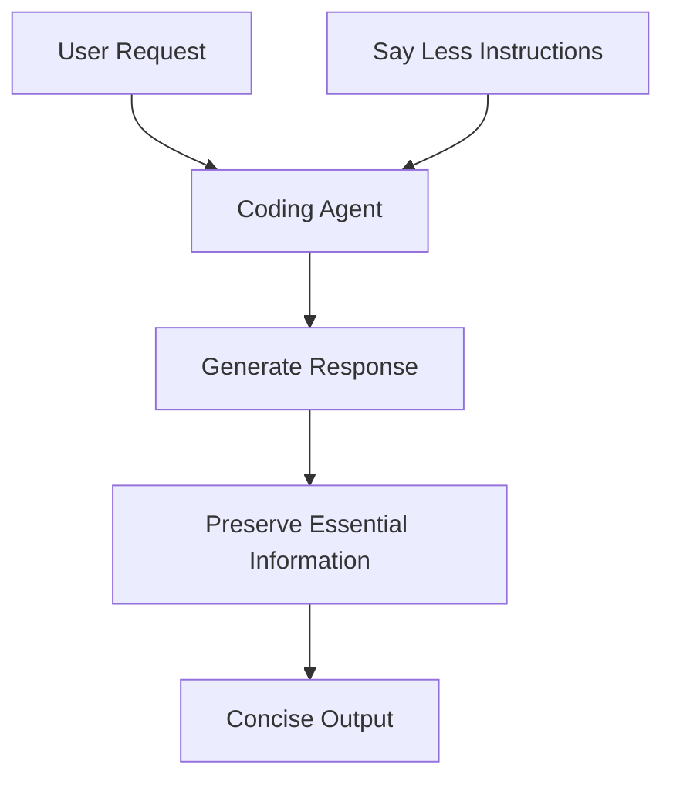
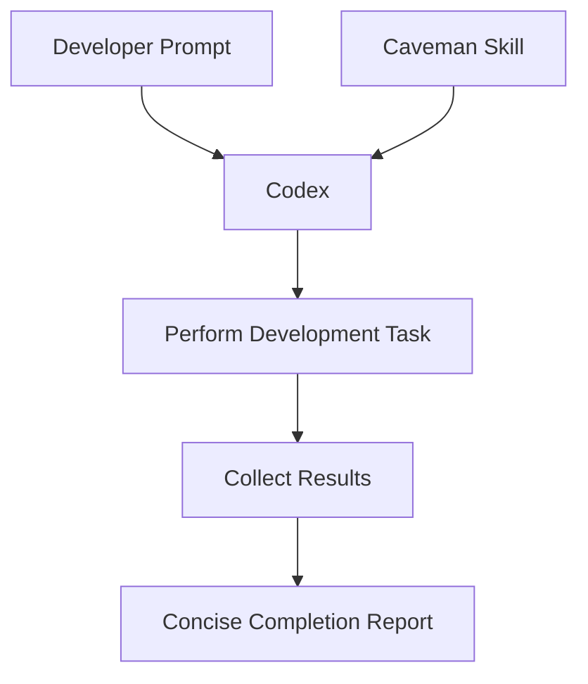
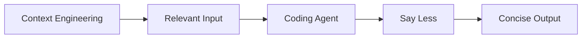

# 04 — Caveman: Say Less — Output Token Optimization

> [!abstract] Lesson Information
> **Repository:** [JuliusBrussee/caveman](https://github.com/JuliusBrussee/caveman)
>
> **Category:** Agentic Engineering / Output Optimization / Prompt Engineering / AI Coding Agents
>
> **Difficulty:** Intermediate
>
> **Learning Approach:** Theory First
>
> **Prerequisites:**
> - [[00 - Repository Overview and Purpose]]
> - [[01 - Architecture and Core Concepts]]
> - [[02 - Installation and Codex Integration]]
> - [[03 - Token Economics and Optimization]]
>
> **Primary Goal:** Understand how Caveman's Say Less capability reduces unnecessary output tokens while preserving technical accuracy, essential context, and actionable information.

---

# 1. Learning Objectives

After completing this lesson, you should be able to:

1. Explain the purpose of Say Less.
2. Distinguish concise communication from incomplete communication.
3. Understand instruction-based output optimization.
4. Identify unnecessary response verbosity.
5. Preserve essential technical details.
6. Recognize information-loss risks.
7. Understand response-structure optimization.
8. Explain the relationship between Say Less and Codex skills.
9. Apply concise reporting principles.
10. Preserve commands, file paths, and error messages.
11. Distinguish facts from assumptions.
12. Understand how verbosity affects token usage.
13. Measure output-token savings.
14. Evaluate response quality.
15. Apply Say Less principles to coding-agent workflows.
16. Recognize situations where detailed responses are necessary.
17. Design a controlled comparison between verbose and concise outputs.

---

# Part I — Understanding Say Less

## 2. What Is Say Less?

**Say Less** is Caveman's output-token optimization capability.

It encourages coding agents to communicate using fewer unnecessary words while preserving the information required to understand and act on a result.

The central idea is:

> Communicate the necessary information with the least unnecessary explanation.

Say Less is not intended to make an agent less capable or less accurate.

Its purpose is to reduce redundant communication.

## 2.1 Example

Verbose:

```text
I have successfully completed the requested modification
to the application's navigation component. The navigation
component has now been updated to include the additional
button that you requested.
```

Concise:

```text
Added the requested navigation button.
```

Both communicate the same basic completion status.

The second uses less text.

## 2.2 Important Distinction

Say Less focuses primarily on **generated output**.

It does not automatically reduce the source code, logs, or documentation that the model reads.

Those are input-side concerns.

---

# Part II — Why Agent Responses Become Verbose

## 3. Sources of Unnecessary Output

AI coding agents may generate excessive text because they:

- Repeat the user's request.
- Explain obvious operations.
- Narrate every action.
- Restate the same conclusion.
- Use unnecessary introductory phrases.
- Include redundant summaries.
- Provide details unrelated to the requested task.

## 3.1 Example

User request:

```text
Fix the login button alignment.
```

Verbose response:

```text
I understand that you would like me to improve
the alignment of the login button.

I will carefully inspect the current layout
and identify the issue.

After inspecting the layout, I will make
the necessary adjustments.
```

This response contains substantial narration but little useful information.

## 3.2 Better Communication

```text
I'll inspect the login layout and adjust the button alignment.
```

This is shorter while preserving the intended action.

## 3.3 Important

A progress message should not claim that work is complete before it has actually been performed.

---

# Part III — Output Token Economics

## 4. Why Output Tokens Matter

Output tokens may affect:

- API costs.
- Generation latency.
- Available usage.
- Conversation length.
- Information density.

For many APIs, output tokens have a different price from input tokens.

## 4.1 Basic Formula

Let:

- \(O_B\) = baseline output tokens.
- \(O_C\) = concise output tokens.

Then:

\[
S = \frac{O_B - O_C}{O_B}\times100
\]

Where \(S\) is the percentage reduction.

## 4.2 Worked Example

Baseline response:

400 tokens.

Concise response:

120 tokens.

\[
S = \frac{400-120}{400}\times100
\]

\[
S = 70\%
\]

The concise response uses **70% fewer output tokens**.

## 4.3 Important

This does not mean total session token consumption decreased by 70%.

Input tokens and other generated output remain part of total usage.

---

# Part IV — Instruction-Based Optimization

## 5. How Say Less Works Conceptually

Say Less uses agent instructions to influence response style.

The agent is encouraged to:

1. Prioritize the answer.
2. Remove unnecessary narration.
3. Preserve essential details.
4. Avoid redundant explanations.
5. Report results clearly.

## 5.1 Conceptual Architecture



This is a conceptual diagram rather than a verified internal execution trace.

## 5.2 Why Instructions Matter

Language models respond to instructions about:

- Format.
- Tone.
- Detail.
- Structure.
- Constraints.

Say Less applies this principle specifically to output efficiency.

---

# Part V — Concise vs Incomplete Responses

## 6. What Makes a Response Concise?

A concise response communicates the essential information without unnecessary words.

An incomplete response omits information needed for understanding or action.

## 6.1 Comparison

| Response | Evaluation |
|---|---|
| `Fixed.` | Often too vague |
| `Fixed login validation.` | Better |
| `Fixed login validation; tests pass.` | Useful if tests actually passed |
| `Fixed login validation; tests not run.` | Transparent when untested |

## 6.2 Example

User:

```text
Why does my Laravel login return 419?
```

Too short:

```text
CSRF issue.
```

Better:

```text
HTTP 419 commonly indicates a session or CSRF-token mismatch.
Check the form token, session configuration, and cookies.
```

The second response provides actionable information.

## 6.3 Fundamental Principle

**Conciseness should remove redundancy, not necessary explanation.**

---

# Part VI — Information Preservation

## 7. What Must Be Preserved?

Say Less should preserve information that affects:

- Correctness.
- Safety.
- Execution.
- Diagnosis.
- User decisions.

## 7.1 Critical Information Categories

| Category | Example |
|---|---|
| Commands | `php artisan migrate` |
| File paths | `app/Http/Controllers/AuthController.php` |
| Error messages | `SQLSTATE[HY000]` |
| Numbers | Port `5432` |
| Units | `500 ms` |
| Negations | `Do not delete` |
| Preconditions | `Only after backup` |
| Limitations | `Tests not executed` |
| Security warnings | `Do not expose credentials` |

## 7.2 Why Preservation Matters

Removing a small detail can change the technical meaning.

Example:

```text
Do not run the migration in production.
```

Incorrect compression:

```text
Run the migration in production.
```

The removed negation reverses the instruction.

---

# Part VII — Code Integrity

## 8. Code Should Not Be Arbitrarily Compressed

Source code is different from explanatory prose.

Removing apparently unnecessary characters may:

- Break syntax.
- Change behavior.
- Remove required imports.
- Alter string values.
- Remove important comments.

## 8.1 Example

Original:

```javascript
if (!user.isAuthenticated) {
  return redirect("/login");
}
```

Incorrect simplification:

```javascript
if (user.isAuthenticated) {
  return redirect("/login");
}
```

The condition now means the opposite.

## 8.2 Engineering Principle

Do not modify executable code solely to reduce response tokens unless the user specifically requests a code refactor.

## 8.3 Appropriate Optimization

Instead of reproducing an entire file, an agent may provide:

- A focused code snippet.
- The changed file path.
- A concise summary.

The actual source code should remain correct and complete.

---

# Part VIII — Command Integrity

## 9. Commands Require Exactness

Terminal commands often contain:

- Flags.
- Paths.
- Quotes.
- Environment variables.
- Operators.

These details may be essential.

## 9.1 Example

```powershell
php artisan migrate --force
```

The `--force` flag changes execution behavior.

An agent should not remove or introduce such flags merely to shorten a command.

## 9.2 Recommended Approach

Keep commands exact.

Reduce the surrounding explanation instead.

### Verbose

```text
You can now proceed to execute the following
command inside your terminal window.
```

### Concise

```text
Run:
```

The command itself should remain unchanged.

---

# Part IX — Error-Message Preservation

## 10. Why Errors Should Remain Precise

Error messages often contain the information needed to identify a failure.

For example:

```text
SQLSTATE[08006] [7] connection to server at
"127.0.0.1", port 5432 failed: Connection refused
```

Overcompressed:

```text
Database error.
```

Better summary:

```text
PostgreSQL connection refused at 127.0.0.1:5432.
```

## 10.1 Preserve Relevant Context

Useful diagnostic details include:

- Error type.
- File.
- Line number.
- Host.
- Port.
- Expected and actual values.

## 10.2 When Full Errors Are Necessary

Use the complete error when:

- Exact wording matters.
- The user is debugging.
- Multiple causes are possible.
- A summary could be misleading.

---

# Part X — Response Structure Optimization

## 11. Structure Can Reduce Verbosity

A response may become shorter simply by organizing information better.

## 11.1 Verbose Structure

```text
I updated the login page.

I also updated the form validation.

Additionally, I checked the relevant components.

Finally, I ran the tests.
```

## 11.2 Concise Structure

```text
Updated:
- Login layout
- Form validation

Verification:
- Relevant tests passed
```

This is appropriate only when the listed work and verification actually occurred.

## 11.3 When Lists Help

Lists are useful for:

- Changed files.
- Completed tasks.
- Errors.
- Verification results.
- Remaining issues.

However, a single sentence is often better when the information is simple.

---

# Part XI — Answer-First Communication

## 12. What Is Answer-First Writing?

Answer-first writing presents the main result before supporting details.

## 12.1 Example

Question:

```text
Can I use PostgreSQL with Laravel?
```

Less efficient:

```text
Laravel is a popular PHP framework that provides
several database integrations and supports
different relational database systems.
```

Better:

```text
Yes. Laravel supports PostgreSQL through its database configuration and PHP's PostgreSQL driver.
```

## 12.2 Why It Works

The reader immediately receives the requested information.

Additional details can follow when necessary.

---

# Part XII — Progress Narration

## 13. Avoid Excessive Narration

Agentic coding workflows may involve many tool calls.

Narrating every routine action can create unnecessary output.

## 13.1 Excessive Narration

```text
I am opening the file.

I am reading the component.

I am examining the CSS.

I am now checking the layout.

I am preparing to make a change.
```

## 13.2 Better Progress Reporting

```text
Inspecting the component and its layout styles.
```

## 13.3 When Detailed Progress Is Appropriate

Detailed progress may be useful when:

- Work is long-running.
- A significant decision is required.
- An operation has risks.
- The user requested step-by-step reporting.
- The task is blocked.

The objective is to eliminate unnecessary narration, not all progress communication.

---

# Part XIII — Completion Reports

## 14. What Should an Agent Report?

A good completion report answers:

1. What changed?
2. Was it verified?
3. Are there limitations?
4. Does the user need to do anything?

## 14.1 Example

```text
Updated the login form alignment and spacing.

Verification: Build passed.
Remaining: Mobile layout not yet tested.
```

## 14.2 Why This Is Effective

It is:

- Concise.
- Specific.
- Actionable.
- Transparent.

## 14.3 Avoid Unsupported Claims

Never report:

```text
All tests passed.
```

unless the tests were actually executed and passed.

---

# Part XIV — Say Less and Codex

## 15. Integration with Codex

The Caveman installation documentation describes a Codex-compatible skill.

For explicit invocation, it documents:

```text
$caveman
```

## 15.1 Conceptual Workflow



## 15.2 Example Prompt

```text
$caveman

Inspect the existing login screen and improve
button alignment.

Preserve functionality and architecture.

Report:
- Changed files
- Verification performed
- Remaining issues
```

This is a theoretical example.

No Codex command was executed.

---

# Part XV — Say Less vs AGENTS.md

## 16. Different Responsibilities

`AGENTS.md` contains project-level instructions.

Say Less influences response efficiency.

## 16.1 Comparison

| AGENTS.md | Say Less |
|---|---|
| Project architecture | Concise communication |
| Coding conventions | Reduced narration |
| Testing requirements | Efficient reporting |
| Scope constraints | Information preservation |
| Repository workflows | Response structure |

## 16.2 How They Work Together

A project may require:

```text
Always run relevant tests before reporting completion.
```

Say Less should not override that requirement.

It should instead encourage a concise report of the actual test results.

---

# Part XVI — Say Less and Context Engineering

## 17. Relationship to Context Engineering

Context engineering focuses on supplying relevant information.

Say Less focuses on generating efficient responses.

## 17.1 Comparison



## 17.2 Important

Say Less cannot compensate for missing project context.

A concise response based on incorrect assumptions remains incorrect.

---

# Part XVII — Measuring Output Optimization

## 18. Benchmark Design

To evaluate Say Less, compare responses to identical tasks.

## 18.1 Recommended Method

1. Select a fixed prompt.
2. Use the same model.
3. Record baseline output.
4. Apply Say Less.
5. Record optimized output.
6. Compare token counts.
7. Evaluate correctness.
8. Repeat across several tasks.

## 18.2 Metrics

| Metric | Purpose |
|---|---|
| Output tokens | Measure verbosity |
| Correctness | Preserve technical accuracy |
| Completeness | Preserve required information |
| Clarity | Maintain readability |
| Actionability | Support next steps |
| Unsupported claims | Detect false reporting |

---

# Part XVIII — Example Benchmark

## 19. Hypothetical Results

| Task | Baseline Tokens | Say Less Tokens |
|---|---:|---:|
| Explain error | 300 | 140 |
| Report code changes | 250 | 90 |
| Summarize tests | 180 | 75 |
| Explain command | 220 | 120 |
| **Total** | **950** | **425** |

Savings:

\[
S=\frac{950-425}{950}\times100
\]

\[
S\approx55.26\%
\]

## 19.1 Interpretation

The optimized responses use approximately 55.26% fewer output tokens.

This is beneficial only if the required information remains accurate and complete.

## 19.2 Important

These are hypothetical values, not measured Caveman benchmark results.

---

# Part XIX — Quality-Preserving Compression

## 20. Evaluation Checklist

A concise technical response should preserve:

- [ ] Correct answer.
- [ ] Essential explanation.
- [ ] Exact commands.
- [ ] Important file paths.
- [ ] Error details.
- [ ] Numerical values.
- [ ] Safety conditions.
- [ ] Verification status.
- [ ] Known limitations.
- [ ] Required next actions.

## 20.1 Failure Conditions

Compression fails when it:

- Changes technical meaning.
- Removes important warnings.
- Introduces ambiguity.
- Hides uncertainty.
- Omits requested details.
- Misrepresents completed work.

---

# Part XX — When Not to Use Aggressive Conciseness

## 21. Tasks Requiring Detailed Explanations

Not every task benefits from extremely short responses.

Examples:

- Learning programming concepts.
- Understanding system architecture.
- Reviewing security implications.
- Studying complex algorithms.
- Investigating difficult bugs.
- Preparing technical documentation.

## 21.1 Example

Question:

```text
Explain how Laravel middleware works,
including request lifecycle and examples.
```

A one-sentence answer would not satisfy the request.

## 21.2 Important Principle

**Response length should follow the task's information requirements.**

Say Less should eliminate redundancy, not educational depth.

---

# Part XXI — Laravel Scenario

## 22. Concise Laravel Debugging Reports

### Task

Fix a login validation issue.

### Verbose Report

```text
I examined the authentication controller and
found that the validation rules were not
correctly applied to the incoming request.

I updated the controller and made the
necessary changes to the validation logic.
```

### Concise Report

```text
Updated login validation in AuthController.

Verification: Authentication tests passed.
```

The verification line is valid only if those tests were actually run successfully.

## 22.1 Important

The response should still mention:

- Relevant files.
- Important behavior changes.
- Test results.
- Remaining risks.

---

# Part XXII — Next.js Scenario

## 23. Concise UI Implementation Reports

### Task

Improve responsive product cards.

### Verbose Report

```text
I made several improvements to the responsive
layout of the product cards to ensure that
they display correctly on different devices.
```

### Concise Report

```text
Updated product-card grid for narrow and wide layouts.
```

## 23.1 Better Verified Report

```text
Updated product-card grid.

Verification:
- Build passed.
- Narrow and wide layouts reviewed.
```

Again, only report checks that were actually performed.

---

# Part XXIII — Android Scenario

## 24. Concise Android Build Reports

### Task

Fix an XML layout issue.

### Verbose Report

```text
I examined the XML layout file and identified
that the view constraints were not configured
correctly. I adjusted the relevant constraints
to improve the layout.
```

### Concise Report

```text
Fixed missing constraints in activity_login.xml.
```

## 24.1 When More Detail Is Necessary

If the build fails:

```text
Updated activity_login.xml.

Build failed:
:app:compileDebugJavaWithJavac

Remaining: Resolve the reported Java compiler error.
```

A concise report should still communicate failure clearly.

---

# Part XXIV — Common Say Less Anti-Patterns

## 25. Mistakes to Avoid

| Anti-Pattern | Problem | Better Approach |
|---|---|---|
| `Fixed.` | Too vague | Name the change |
| Removing warnings | Hides risk | Preserve critical conditions |
| Shortening commands | May change behavior | Keep exact syntax |
| Omitting test status | Hides verification state | Report actual checks |
| Overusing abbreviations | Reduces clarity | Use understandable language |
| Removing error context | Harms debugging | Preserve diagnostic details |
| Overcompressing tutorials | Reduces learning value | Match requested depth |
| Claiming success prematurely | Misrepresents progress | Separate planned and completed work |
| Compressing code blindly | Can introduce defects | Preserve code integrity |
| Treating shorter as better | Ignores quality | Evaluate correctness and usefulness |

---

# Part XXV — Practical Exercises

## 26. Exercise 1 — Remove Redundancy

Rewrite the following response:

```text
I have carefully reviewed the source code
and I have successfully identified the
problem that is causing the application
to display the incorrect value.
```

Requirements:

- Preserve the finding.
- Remove unnecessary narration.
- Do not invent the cause.

---

## 27. Exercise 2 — Preserve Technical Details

Compress:

```text
The PostgreSQL database connection failed
because the application could not connect
to the database server at 127.0.0.1
using port 5432.
```

Preserve:

- Database type.
- Host.
- Port.
- Failure condition.

---

## 28. Exercise 3 — Report Verification

Scenario:

A coding agent updated a React component but did not run tests.

Write a concise completion report.

Do not imply that verification occurred.

---

## 29. Exercise 4 — Compare Responses

Evaluate:

**Response A**

```text
The issue has been fixed.
```

**Response B**

```text
Fixed the missing CSRF token in the login form.
```

Which is more informative?

Explain why.

---

## 30. Exercise 5 — Preserve Warnings

Rewrite:

```text
You should make sure that you create a
database backup before you proceed with
the production migration.
```

Make it concise without weakening the warning.

---

## 31. Exercise 6 — Codex Prompt

Create a Codex prompt that requests:

- Concise completion reports.
- Exact file paths.
- Actual test results.
- Remaining issues.
- No unnecessary narration.

---

## 32. Exercise 7 — Output Measurement

A baseline response contains 600 tokens.

Say Less produces 210 tokens.

Calculate the percentage reduction.

---

## 33. Exercise 8 — Educational Depth

A student asks for a complete explanation of React hooks.

Explain why aggressive response compression may be inappropriate.

Propose a balanced response strategy.

---

## 34. Exercise 9 — Code Integrity

Explain why a code snippet should not be modified solely to reduce token count.

Provide one example of how a small change can alter behavior.

---

## 35. Exercise 10 — Quality Evaluation

Design a five-point rubric for evaluating concise coding-agent responses.

Include:

- Correctness.
- Completeness.
- Clarity.
- Actionability.
- Transparency.

---

# Part XXVI — Knowledge Check

## 36. Review Questions

1. What is Say Less?
2. What does output-token optimization target?
3. Why do AI coding agents produce verbose responses?
4. What is redundant narration?
5. What is answer-first communication?
6. How does concise writing differ from incomplete writing?
7. Why should commands remain exact?
8. Why must negations be preserved?
9. Why should error messages retain diagnostic details?
10. Why should code not be compressed blindly?
11. What is a completion report?
12. What should a completion report contain?
13. Why must test results be reported accurately?
14. How does Say Less relate to Codex?
15. How does Say Less differ from AGENTS.md?
16. How does Say Less relate to context engineering?
17. How do you calculate output-token savings?
18. Why is token reduction alone insufficient?
19. What is information retention?
20. Why can aggressive conciseness harm learning?
21. When should responses be detailed?
22. What is an unsupported completion claim?
23. How can response structure improve efficiency?
24. What are common Say Less anti-patterns?
25. What makes output optimization successful?

---

# Part XXVII — Key Takeaways

> [!summary]
> - Say Less focuses on reducing unnecessary output tokens.
> - It is primarily instruction-based.
> - Concise communication is not the same as incomplete communication.
> - Answer-first writing improves information density.
> - Redundant narration should be minimized.
> - Commands, code, file paths, and error messages must remain accurate.
> - Negations, numbers, and important warnings must be preserved.
> - Completion reports should state what changed and what was verified.
> - Agents must not claim tests passed unless they actually passed.
> - Output-token savings should be measured.
> - Correctness and completeness matter more than raw token reduction.
> - Educational tasks may require detailed explanations.
> - Say Less complements context engineering and project instructions.
> - Response length should match the task's requirements.

---

# Part XXVIII — Final Mental Model

```text
                USER REQUEST
                     |
                     v
                CODING AGENT
                     |
                     v
              GENERATE RESPONSE
                     |
                     v
              SAY LESS PRINCIPLES
                     |
          +----------+----------+
          |          |          |
          v          v          v
       REMOVE     PRESERVE    STRUCTURE
      REDUNDANCY   DETAILS     CLEARLY
          |          |          |
          +----------+----------+
                     |
                     v
               QUALITY CHECK
                     |
          +----------+----------+
          |                     |
          v                     v
      CORRECTNESS           COMPLETENESS
          |                     |
          +----------+----------+
                     |
                     v
              CONCISE RESPONSE
```

> [!important] Final Principle
> **The purpose of Say Less is not to make responses as short as possible. It is to communicate the necessary information clearly, accurately, and efficiently.**

---

# Part XXIX — Official References

## Caveman

- [Official Repository](https://github.com/JuliusBrussee/caveman)
- [README](https://github.com/JuliusBrussee/caveman/blob/main/README.md)
- [Installation Guide](https://github.com/JuliusBrussee/caveman/blob/main/INSTALL.md)

## OpenAI and Codex

- [OpenAI Codex Documentation](https://developers.openai.com/codex/)
- [Codex Skills](https://developers.openai.com/codex/skills)
- [OpenAI API Pricing](https://openai.com/api/pricing/)
- [OpenAI Tokenizer](https://platform.openai.com/tokenizer)

## Technical Writing

- [Google Developer Documentation Style Guide](https://developers.google.com/style)
- [Microsoft Writing Style Guide](https://learn.microsoft.com/style-guide/welcome/)

> [!note] Documentation Scope
> This lesson explains Caveman's documented Say Less capability together with general technical-writing and prompt-engineering principles.
>
> The examples, diagrams, and benchmark figures are educational illustrations unless explicitly stated otherwise.
>
> No Codex commands, installations, or token benchmarks were executed.

---

# Part XXX — Next Lesson

**[[05 - Read Less - Input and Context Compression]]**

Topics:

1. Read Less architecture.
2. Tool-output compression.
3. Log compression.
4. JSON compression.
5. CSV and YAML compression.
6. Error and stack-trace preservation.
7. Raw-output retrieval.
8. Compression quality evaluation.
9. Codex tool integration.
10. Context-window efficiency.
11. Benchmark methodology.
12. Common compression failures.
13. Laravel, Next.js, and Android scenarios.
14. Practical exercises.
15. Official references.

**End of Lesson 04 — Say Less: Output Token Optimization.**
