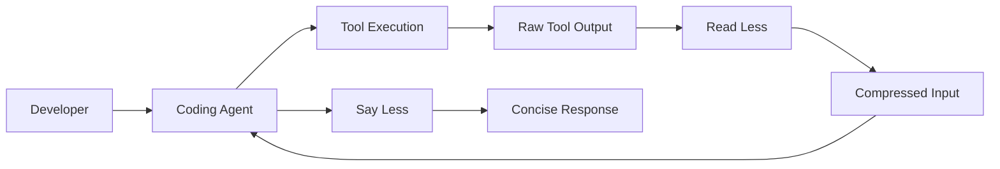
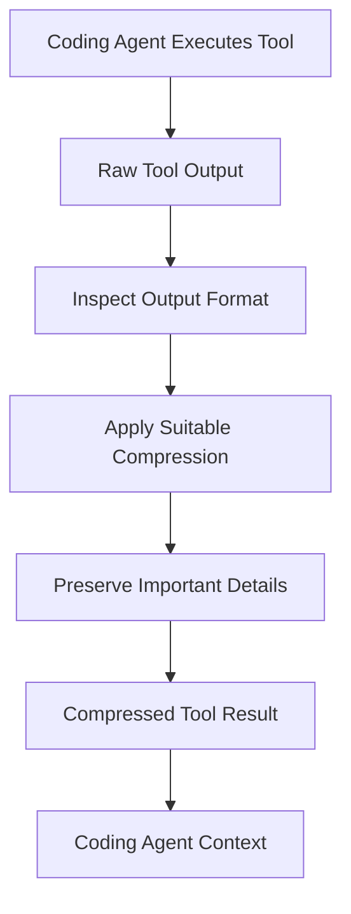
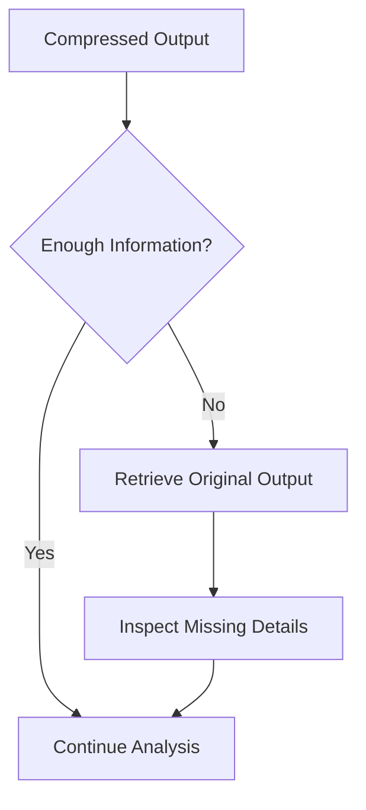
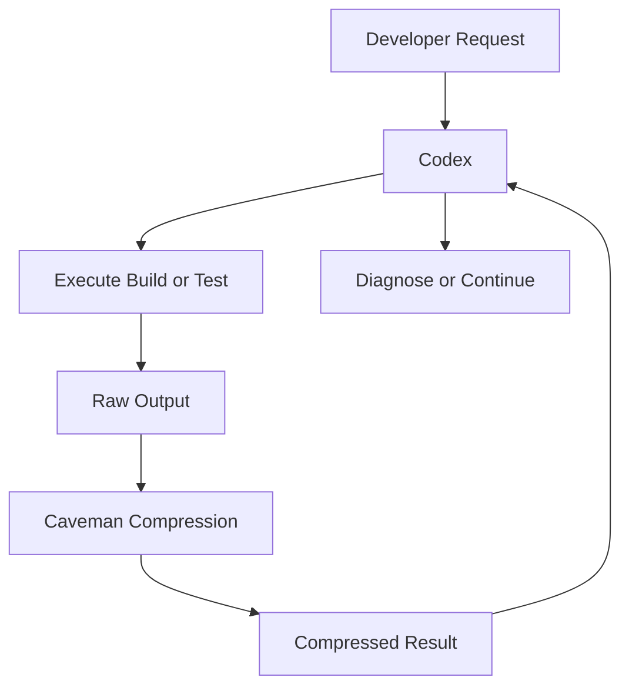
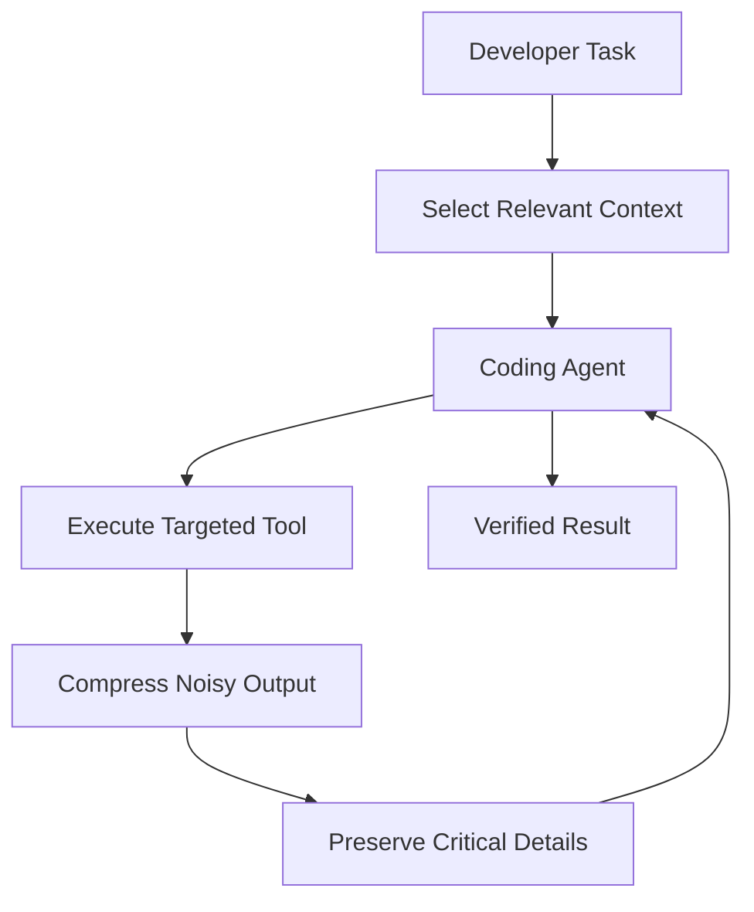

# 05 — Caveman: Read Less — Input and Context Compression

> [!abstract] Lesson Information
> **Repository:** [JuliusBrussee/caveman](https://github.com/JuliusBrussee/caveman)
>
> **Category:** Agentic Engineering / Input Token Optimization / Tool-Output Compression / Context Engineering
>
> **Difficulty:** Intermediate to Advanced
>
> **Learning Approach:** Theory First
>
> **Prerequisites:**
> - [[00 - Repository Overview and Purpose]]
> - [[01 - Architecture and Core Concepts]]
> - [[02 - Installation and Codex Integration]]
> - [[03 - Token Economics and Optimization]]
> - [[04 - Say Less - Output Token Optimization]]
>
> **Primary Goal:** Understand how Caveman reduces unnecessary tool-output tokens, how compression affects an AI coding agent's context, and how to evaluate compression without sacrificing debugging accuracy.

---

# 1. Learning Objectives

After completing this lesson, you should be able to:

1. Explain the purpose of Read Less.
2. Distinguish input compression from output optimization.
3. Understand tool-output compression architecture.
4. Identify compressible and non-compressible information.
5. Explain structured and unstructured compression.
6. Understand log, JSON, CSV, YAML, and test-output compression.
7. Preserve critical errors and diagnostic details.
8. Understand raw-output recovery.
9. Calculate file-level and session-level token savings.
10. Interpret Caveman's published benchmarks.
11. Recognize compression failures and limitations.
12. Explain how compression affects context windows.
13. Understand tool-output handling in agentic workflows.
14. Evaluate compression quality and correctness.
15. Apply these principles to Laravel, Next.js, and Android development.
16. Design a controlled benchmark.
17. Recognize when compression should be disabled.
18. Explain how Read Less complements context engineering.

---

# Part I — Understanding Read Less

## 2. What Is Read Less?

**Read Less** is Caveman's input-token optimization capability. Its purpose is to reduce unnecessary information an AI coding agent receives from supported tool outputs, such as terminal logs, test results, JSON responses, CSV datasets, and YAML documents.

The repository describes Read Less as reducing supported content before the model processes it.

### Central Principle

> Reduce unnecessary information while preserving the details required to complete the task correctly.

This is different from deleting information indiscriminately.

### Example

Original output:

```text
PASS test_login
PASS test_logout
PASS test_profile
FAIL test_registration

Expected: 201
Actual: 500

PASS test_permissions
```

Compressed summary:

```text
5 tests: 4 passed, 1 failed.

FAIL test_registration
Expected: 201
Actual: 500
```

The summary removes repetitive passing-test details while retaining the failure. This is an educational example, not an exact Caveman compressor output.

---

# Part II — Say Less vs Read Less

## 3. Different Optimization Targets

Both features aim to reduce unnecessary tokens, but they operate on different information.

| Feature | Optimization Target | Example |
|---|---|---|
| Say Less | Generated responses | Shorter completion report |
| Read Less | Tool input consumed by the model | Shorter build log |



Read Less does not mean the agent becomes less capable. It attempts to reduce unnecessary context consumption. Compression can reduce capability, however, if it removes information needed for the task.

---

# Part III — Why Tool Outputs Consume Context

## 4. The Agentic Development Loop

AI coding agents frequently execute tools, for example:

```powershell
php artisan test
npm run build
.\gradlew.bat assembleDebug
```

Each command may generate substantial output.

### Common Sources of Noise

- Repeated successful test lines.
- Build progress messages.
- Unnecessary metadata.
- Repetitive stack-trace sections.
- Large JSON objects.
- Repeated CSV rows.
- Verbose YAML configuration.
- Terminal formatting codes.

When tool output enters the model context, it consumes input tokens. If the same information remains in subsequent requests, it can contribute to repeated token usage.

### Example

Suppose a build log contains 20,000 tokens, of which 500 relate to the failure. A suitable compression strategy could reduce irrelevant content. Identifying what is relevant is not always straightforward.

---

# Part IV — Tool-Output Compression Architecture

## 5. Conceptual Processing Pipeline



This is a teaching model, not a verified function-by-function implementation trace.

### Stage 1 — Capture

The system receives output from shell commands, test runners, build tools, or data-processing utilities.

### Stage 2 — Format Recognition

Different formats need different strategies. JSON has a key-value structure; CSV has tabular records; logs have chronological events; test output has pass/fail information.

### Stage 3 — Compression

The system attempts to remove unnecessary information.

### Stage 4 — Information Preservation

Important diagnostic content should remain available.

### Stage 5 — Delivery

The compressed result is provided to the agent for further analysis.

---

# Part V — Structured vs Unstructured Data

## 6. Structured Data

Structured data follows a recognizable schema or format, such as JSON, CSV, or YAML. These formats can often be summarized using known properties.

## 6.1 Unstructured or Semi-Structured Data

Examples include application logs, compiler output, terminal messages, and exception traces. These may require pattern recognition or specialized rules.

| Data Type | Structure | Typical Compression |
|---|---|---|
| JSON | Key-value hierarchy | Schema and relevant values |
| CSV | Rows and columns | Headers, statistics, selected rows |
| YAML | Nested configuration | Relevant sections |
| Logs | Event records | Important events and errors |
| Test output | Test results | Summary and failures |
| HTML | Document structure | Task-dependent extraction |

A compressor should not assume all text can be processed using the same strategy.

---

# Part VI — Log Compression

## 7. What Are Logs?

Logs record events produced by applications and development tools. They may include timestamps, severity levels, messages, component names, and exception details.

```text
10:00:01 INFO Server started
10:00:02 INFO Database connected
10:00:03 INFO Request received
10:00:04 ERROR Query failed
10:00:05 INFO Request completed
```

Possible summary:

```text
1 error detected.

10:00:04 ERROR Query failed
```

The surrounding events may explain the error; an earlier connection warning could be relevant. Preserve enough context for diagnosis.

Useful log information includes severity, relevant timestamps, component names, exception types, preceding events, correlation identifiers, and source locations.

---

# Part VII — JSON Compression

## 8. Why JSON Can Be Expensive

Large JSON responses may contain repeated object keys, nested structures, metadata, arrays, optional fields, and unrelated records.

```json
{
  "users": [
    {"id": 1, "name": "Ana", "status": "active"},
    {"id": 2, "name": "Ben", "status": "active"},
    {"id": 3, "name": "Cara", "status": "inactive"}
  ]
}
```

For a counting task, a possible summary is:

```text
Users: 3
Active: 2
Inactive: 1
```

This is appropriate for counting active users but not when individual records are needed.

| Task | Required Information |
|---|---|
| Count active users | Status totals |
| Find inactive users | IDs and statuses |
| Debug serialization | Exact JSON structure |
| Validate schema | Keys and data types |
| Investigate missing data | Relevant original values |

The same JSON input may require different representations depending on the task.

---

# Part VIII — CSV Compression

## 9. Understanding CSV Data

CSV represents tabular information.

```csv
id,route,status
1,Route A,active
2,Route B,inactive
3,Route C,active
```

A possible summary:

```text
Rows: 3
Columns: id, route, status

Active: 2
Inactive: 1
```

Large datasets may contain thousands of rows. The agent may need column names, row counts, data types, missing values, summary statistics, or selected records.

Statistical summaries cannot replace individual rows when exact records are required. Preserve column meaning, relevant identifiers, units, distinctions between missing values, and exact records needed for the task.

---

# Part IX — YAML Compression

## 10. What Is YAML?

YAML is commonly used for CI/CD workflows, deployment configuration, application settings, and infrastructure definitions.

```yaml
application:
  name: demo
  environment: development

database:
  driver: postgresql
  host: localhost
  port: 5432
```

Possible summary:

```text
Application: demo
Environment: development
Database: PostgreSQL
Host: localhost
Port: 5432
```

YAML may contain nested relationships, references, anchors, environment-specific settings, and significant data types. Flattening configuration can hide relationships or change meaning.

Avoid aggressive compression when debugging indentation, reviewing deployment config, checking exact syntax, validating references, or investigating environment differences.

---

# Part X — Test-Output Compression

## 11. Why Test Output Is a Good Candidate

Successful test suites may produce hundreds of repetitive passing-test lines. The agent often needs totals for passed, failed, and skipped tests, plus failure details.

```text
PASS test_a
PASS test_b
PASS test_c
FAIL test_d
Expected: true
Actual: false
PASS test_e
```

Possible compressed representation:

```text
5 tests: 4 passed, 1 failed.

FAIL test_d
Expected: true
Actual: false
```

Preserve failed test names, expected and actual values, relevant exceptions, file and line numbers, failure categories, and completion status. A runner may stop before all tests finish; do not imply the complete suite passed or failed normally when execution was interrupted.

---

# Part XI — Error and Stack-Trace Preservation

## 12. Why Stack Traces Matter

A stack trace shows the call sequence associated with an error.

```text
RuntimeException: Database unavailable

at DatabaseService.connect(DatabaseService.java:42)
at UserRepository.findUser(UserRepository.java:18)
at LoginController.login(LoginController.java:27)
```

Possible summary:

```text
RuntimeException: Database unavailable

Origin:
DatabaseService.java:42

Call path:
LoginController -> UserRepository -> DatabaseService
```

A summary may omit the original exception, relevant call sequence, source location, nested causes, or suppressed exceptions. For complex failures, retain access to the full stack trace.

---

# Part XII — Raw-Output Recovery

## 13. Why Original Output Must Remain Accessible

Compression is often lossy: information is removed from the representation supplied to the model. The Caveman README states that original outputs remain available on disk and can be retrieved.



During practical evaluation, inspect where raw output is stored, how the agent retrieves it, whether retrieval is automatic or explicit, whether retention has limits, whether sensitive data is stored, and whether files are cleaned up.

> [!important]
> Verify the README's preservation claim against the installed version and actual integration behavior.

---

# Part XIII — Context-Window Efficiency

## 14. How Compression Affects Context

Suppose a hypothetical agent context contains:

| Component | Tokens |
|---|---:|
| Instructions | 8,000 |
| Project files | 30,000 |
| Conversation history | 20,000 |
| Tool output | 25,000 |
| **Total** | **83,000** |

If tool output falls from 25,000 to 5,000 tokens:

\[
8{,}000 + 30{,}000 + 20{,}000 + 5{,}000 = 63{,}000
\]

Reduction: \(83{,}000 - 63{,}000 = 20{,}000\) tokens.

Freed capacity may let the agent retain more relevant source, instructions, or conversation. Actual context behavior depends on the agent and model; compression does not guarantee better reasoning or longer effective memory.

---

# Part XIV — File-Level vs Session-Level Savings

## 15. Two Different Measurements

**File-level savings** measure an individual input. **Session-level savings** measure reduction across a complete workflow.

\[
S = \frac{T_{before} - T_{after}}{T_{before}}\times100
\]

Example: a file shrinks from 20,000 tokens to 400 tokens:

\[
S_{file} = \frac{20{,}000 - 400}{20{,}000}\times100 = 98\%
\]

If the session uses another 100,000 tokens, overall savings may be much smaller.

> [!important]
> A dramatic reduction in one tool result does not imply the same reduction across the entire session.

---

# Part XV — Caveman's Published Read Less Benchmarks

## 16. Repository-Reported Results

The Caveman README reports these measurements for selected test files and complete Claude Code sessions.

| Format | Original File Tokens | Compressed File Tokens | File Reduction | Session Reduction |
|---|---:|---:|---:|---:|
| CSV | 28,041 | 314 | 98.9% | 55.1% |
| Logs | 22,810 | 348 | 98.5% | 50.2% |
| YAML | 20,447 | 178 | 99.1% | 46.2% |
| Test output | 18,806 | 203 | 98.9% | 27.8% |
| JSON | 18,837 | 281 | 98.5% | 26.4% |
| HTML | 21,670 | 21,670 | No file reduction | 9.9% worse |
| **All six** | **130,611** | **22,994** | **82.4%** | **33.2%** |

These are project-reported figures, not measurements performed in this lesson.

### What the Benchmark Demonstrates

File-level reductions are often larger than session-level reductions because sessions include other information.

### Important Limitations

The README notes that:

- Session tests were performed in August 2026 using an older engine.
- The HTML case became worse at the session level.
- Each test file contained a relevant record hidden in substantial noise.
- Real-world results will vary.

The repository reports all 18 tested answers were correct in that evaluation. This does not establish universal correctness.

These results suggest compression can help some noisy inputs. The HTML result shows integration can also increase usage. **Optimization must be measured, not assumed.**

---

# Part XVI — Understanding Compression Failures

## 17. Why Compression Can Fail

Compression may fail when:

- The format is unsupported.
- The output is already concise.
- Important information is removed.
- The task requires exact raw data.
- Compression adds processing overhead.
- The agent needs to retrieve original content repeatedly.

Poor summaries:

```text
Original: Connection refused at 127.0.0.1:5432
Bad summary: Connection error

Original: Expected 200; actual 403
Bad summary: HTTP test failed
```

The summaries remove details needed to distinguish causes. Preserve details that differentiate one failure from another.

---

# Part XVII — When Compression Should Be Disabled

## 18. Cases Requiring Full Information

Aggressive compression may be inappropriate for exact configuration audits, security-sensitive reviews, complex stack-trace analysis, schema validation, source-code inspection, full data reconciliation, tasks requiring every record, or unusual/intermittent failures.

For example, “Find every inconsistent record in this CSV” cannot be answered from a statistical summary. The agent may need all records or deterministic filtering that guarantees complete coverage.

**Select compression according to the task's information requirements.**

---

# Part XVIII — Read Less and Codex Integration

## 19. How It Relates to Codex

Codex can execute development commands and inspect results. Read Less is intended to reduce supported tool-output overhead when the appropriate Caveman integration is active.



The Say Less skill alone does not inherently enable full tool-output compression. Read Less requires the appropriate toolkit integration or explicit compression workflow.

The Caveman README includes:

```powershell
caveman shrink -- pnpm test
```

This demonstrates explicit compression of a command's output. It has not been executed here.

During practical testing, check that Caveman is installed, input compression is enabled, Codex uses the intended integration, relevant commands are compressed, original output is accessible, and task results remain unchanged.

---

# Part XIX — Laravel Scenario

## 20. Compressing Laravel Test Output

Suppose Codex runs:

```powershell
php artisan test
```

Output may contain test names, assertions, failures, stack traces, and summaries. A useful optimization can compress repetitive passing lines while preserving failed test names, exception details, paths, expected/actual values, and test-run status.

Original:

```text
PASS Tests\Feature\Auth\LoginTest
PASS Tests\Feature\Auth\LogoutTest
FAIL Tests\Feature\Auth\RegisterTest

Expected status: 201
Actual status: 422
```

Possible compressed form:

```text
3 tests: 2 passed, 1 failed.

RegisterTest:
Expected 201; actual 422.
```

A 422 response often indicates Laravel validation failure, but the precise cause requires more context. Compression should not replace diagnosis with an unsupported conclusion.

---

# Part XX — Next.js Scenario

## 21. Compressing Build Logs

Suppose Codex runs:

```powershell
npm run build
```

Build output may contain compilation progress, warnings, errors, route information, and build status.

Possible summary:

```text
Build failed.

Error:
Module not found: Can't resolve '@/components/Header'

File:
app/page.tsx
```

Warnings should not automatically be discarded; they may indicate deprecated APIs, configuration issues, runtime problems, or performance concerns. Compare whether Codex identifies the same root cause using raw versus compressed output.

---

# Part XXI — Android Scenario

## 22. Compressing Gradle Output

Suppose Codex runs:

```powershell
.\gradlew.bat assembleDebug
```

A useful summary might be:

```text
BUILD FAILED

Task:
:app:compileDebugJavaWithJavac

Error:
Cannot find symbol

File:
MainActivity.java
```

Keep the full compiler message, file and line number, relevant dependency information, earlier configuration errors, and access to full output. The final Gradle failure line is not always the root cause; the relevant diagnostic may appear earlier.

---

# Part XXII — Read Less and Context Engineering

## 23. How They Complement Each Other

Context engineering selects relevant information. Read Less reduces unnecessary content within supported tool results.

| Context Engineering | Read Less |
|---|---|
| Select relevant files | Compress tool output |
| Search targeted symbols | Summarize noisy logs |
| Limit unnecessary context | Reduce repetitive content |
| Preserve requirements | Preserve diagnostic information |
| Organize agent instructions | Improve input efficiency |



Compression cannot compensate for selecting the wrong files or running irrelevant commands. Efficient context selection should come first.

---

# Part XXIII — Benchmark Methodology

## 24. Designing a Controlled Evaluation

Compare equivalent agent tasks.

### Baseline

Run without compression and record input tokens, output tokens, completion time, retries, and final correctness.

### Optimized Run

Run a comparable task with Read Less enabled. Record the same metrics.

| Metric | Baseline | Optimized |
|---|---:|---:|
| Input tokens | 100,000 | 72,000 |
| Output tokens | 12,000 | 12,500 |
| Completion time | 8 min | 7 min |
| Retries | 1 | 1 |
| Tests | Pass | Pass |

These are hypothetical values. Agents may vary across runs; repeat trials and report variability instead of relying on one result.

---

# Part XXIV — Quality Evaluation

## 25. Information Retention Checklist

For every compressed output, evaluate:

- [ ] Correct failure count.
- [ ] Correct success count.
- [ ] Relevant identifiers preserved.
- [ ] Exact error codes preserved.
- [ ] Important numerical values preserved.
- [ ] Relevant file paths preserved.
- [ ] Important warnings preserved.
- [ ] Necessary relationships preserved.
- [ ] Raw output retrievable.
- [ ] No fabricated information.
- [ ] No unsupported conclusions.

An optimization is acceptable when it reduces meaningful overhead, retains required information, preserves correctness, supports practical recovery, and justifies its complexity.

---

# Part XXV — Common Anti-Patterns

## 26. Mistakes to Avoid

| Anti-Pattern | Problem |
|---|---|
| Compress everything | Some tasks require full data |
| Remove all warnings | Important risks may be hidden |
| Keep only the last error line | Root cause may appear earlier |
| Summarize JSON without task context | Relevant fields may disappear |
| Replace CSV with statistics | Individual records may be required |
| Ignore raw-output recovery | Debugging becomes difficult |
| Measure only file savings | Session effects are missed |
| Ignore retries | Underestimates total cost |
| Assume benchmarks generalize | Real workloads differ |
| Enable every optimization immediately | Makes failures harder to isolate |

---

# Part XXVI — Practical Exercises

## 27. Exercise 1 — Log Compression

Given:

```text
10:00 INFO Server started
10:01 INFO Request received
10:02 WARN Database response slow
10:03 ERROR Database timeout
10:04 INFO Request failed
```

Create a concise summary that preserves diagnostic context. Explain why the warning may matter.

## 28. Exercise 2 — JSON Compression

Given:

```json
{
  "products": [
    {"id": 1, "status": "active"},
    {"id": 2, "status": "inactive"},
    {"id": 3, "status": "active"}
  ]
}
```

Produce (1) a summary for counting active products and (2) a summary identifying inactive products. Explain why the outputs differ.

## 29. Exercise 3 — CSV Analysis

Given:

```csv
id,route,status
1,A,active
2,B,inactive
3,C,active
4,D,inactive
```

Create a compact summary that preserves IDs of inactive records.

## 30. Exercise 4 — Compression Ratio

Original output: 24,000 tokens. Compressed output: 600 tokens. Calculate the compression ratio and percentage reduction.

## 31. Exercise 5 — Session Savings

A session originally consumes 150,000 tokens. Compression saves 30,000 tokens. Assuming no other usage changes, calculate the new total and percentage savings.

## 32. Exercise 6 — Error Preservation

Compress this while preserving all diagnostic details:

```text
SQLSTATE[08006] [7]
Connection refused at 127.0.0.1:5432
```

## 33. Exercise 7 — Laravel Benchmark

Design a benchmark comparing raw and compressed `php artisan test` output. Define baseline, task, token measurements, correctness checks, and acceptance criteria.

## 34. Exercise 8 — Android Build Failure

A compressed Gradle log reports only `BUILD FAILED`. Explain why this is insufficient and list information that should remain.

## 35. Exercise 9 — Compression Decision

For each task, decide whether aggressive compression is appropriate and explain: (1) count successful tests; (2) audit an entire YAML deployment configuration; (3) identify a compiler error; (4) verify every row in a CSV export; (5) summarize repetitive build progress.

## 36. Exercise 10 — Architecture Design

Create a conceptual Read Less pipeline containing tool execution, raw output, format recognition, compression, information preservation, agent consumption, and raw-output recovery. Explain each stage.

---

# Part XXVII — Knowledge Check

## 37. Review Questions

1. What is Read Less?
2. How does it differ from Say Less?
3. Why do tool outputs consume input tokens?
4. What is tool-output compression?
5. What is structured data?
6. What is unstructured data?
7. Why does JSON require task-dependent compression?
8. What information should CSV summaries preserve?
9. Why can YAML compression be risky?
10. Why are test results suitable for compression?
11. Why should failed assertions remain visible?
12. What is a stack trace?
13. Why is raw-output recovery important?
14. How can compression reduce context pressure?
15. What is file-level token reduction?
16. What is session-level token reduction?
17. Why do these measurements differ?
18. What did Caveman's published Read Less benchmark report?
19. Why did the HTML case matter?
20. Why should benchmark claims be interpreted carefully?
21. What are common compression failures?
22. When should compression be disabled?
23. How does Read Less integrate conceptually with Codex?
24. How does it complement context engineering?
25. What makes compression successful?

---

# Part XXVIII — Key Takeaways

> [!summary]
> - Read Less targets unnecessary input tokens from supported tool outputs.
> - It differs from Say Less, which focuses on generated responses.
> - Logs, JSON, CSV, YAML, and tests need different compression strategies.
> - Compression should preserve diagnostic information.
> - Error codes, paths, values, and relevant warnings matter.
> - Structured-data summaries must match the task.
> - Full output may be necessary for debugging.
> - Caveman says original outputs remain available on disk.
> - File-level savings can greatly exceed session-level savings.
> - The repository reports a 33.2% aggregate session-level reduction in its tested suite.
> - One published HTML benchmark performed worse.
> - Real-world results depend on workload and configuration.
> - Evaluate correctness, not only output size.
> - Context engineering and Read Less complement each other.
> - Successful compression removes noise without hiding information the task needs.

---

# Part XXIX — Final Mental Model

```text
                  CODING AGENT
                       |
                       v
                 EXECUTE TOOL
                       |
                       v
                   RAW OUTPUT
                       |
                       v
                   READ LESS
                       |
          +------------+------------+
          |            |            |
          v            v            v
       IDENTIFY     COMPRESS      PRESERVE
        FORMAT        NOISE        DETAILS
          |            |            |
          +------------+------------+
                       |
                       v
                COMPRESSED INPUT
                       |
                       v
                 CODING AGENT
                       |
                       v
              ENOUGH INFORMATION?
                  /         \
                YES          NO
                 |            |
                 v            v
              CONTINUE    RETRIEVE RAW
                 |            |
                 +------------+
                       |
                       v
                VERIFY RESULT
```

> [!important] Final Principle
> **Read Less is successful when the coding agent receives less unnecessary information while retaining everything needed to complete the task correctly.**

---

# Part XXX — Official References

## Caveman

- [Official GitHub Repository](https://github.com/JuliusBrussee/caveman)
- [README — Read Less](https://github.com/JuliusBrussee/caveman#read-less-332-fewer-input-tokens)
- [Installation Guide](https://github.com/JuliusBrussee/caveman/blob/main/INSTALL.md)
- [Benchmarks Directory](https://github.com/JuliusBrussee/caveman/tree/main/benchmarks)
- [Shrink Source Directory](https://github.com/JuliusBrussee/caveman/tree/main/shrink)

## Codex and Token Optimization

- [OpenAI Codex Documentation](https://developers.openai.com/codex/)
- [OpenAI Tokenizer](https://platform.openai.com/tokenizer)
- [OpenAI Prompt Caching](https://platform.openai.com/docs/guides/prompt-caching)

## Data Formats

- [JSON Specification — RFC 8259](https://www.rfc-editor.org/rfc/rfc8259)
- [YAML Specification](https://yaml.org/spec/)
- [CSV Format — RFC 4180](https://www.rfc-editor.org/rfc/rfc4180)

> [!note] Documentation Scope
> This lesson uses the Caveman repository's published Read Less description and benchmark table, together with general software engineering and data-processing principles.
>
> The pipeline diagrams and sample compressed outputs are educational illustrations, not verified internal implementation traces.
>
> Benchmark figures are project-reported and have not been independently reproduced here.
>
> No Caveman installation, Codex integration, or runtime compression test was performed during this lesson.

---

# Part XXXI — Next Lesson

**[[06 - Auto - Model Routing and Reasoning Effort]]**

Topics:

1. Auto architecture.
2. Model routing fundamentals.
3. Reasoning-effort selection.
4. Task complexity estimation.
5. Cost-aware routing.
6. Model-provider integration.
7. Authentication and account requirements.
8. Routing decisions and fallback.
9. Accuracy and reliability tradeoffs.
10. Benchmark methodology.
11. Codex integration.
12. Security and privacy.
13. Practical exercises.
14. Official references.

**End of Lesson 05 — Read Less: Input and Context Compression.**
