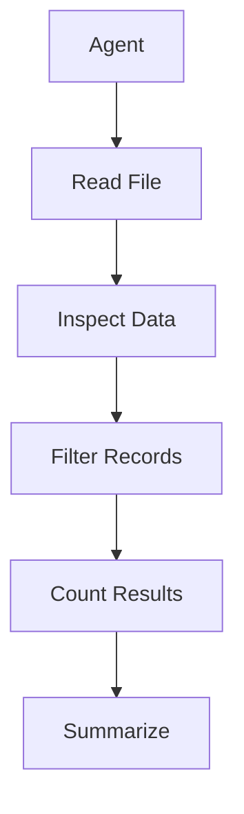
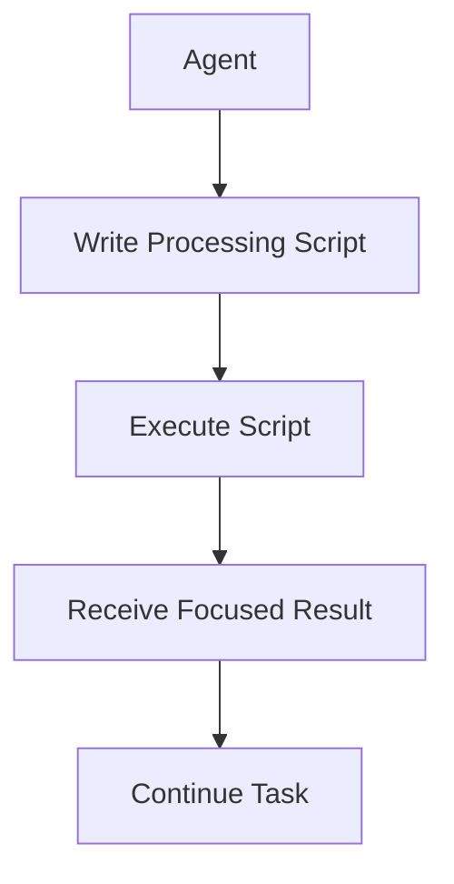
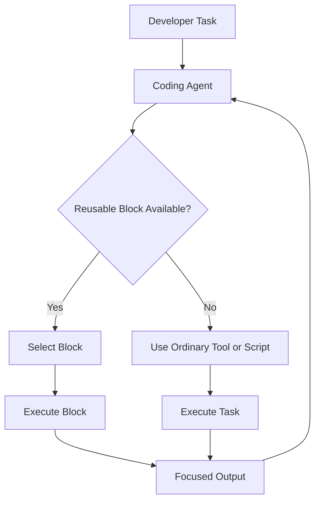
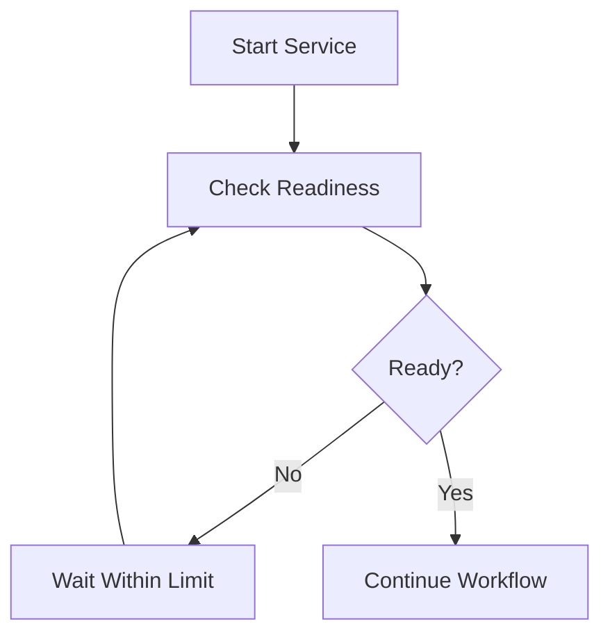
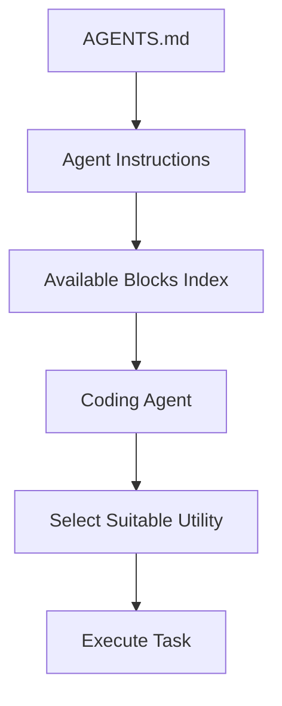
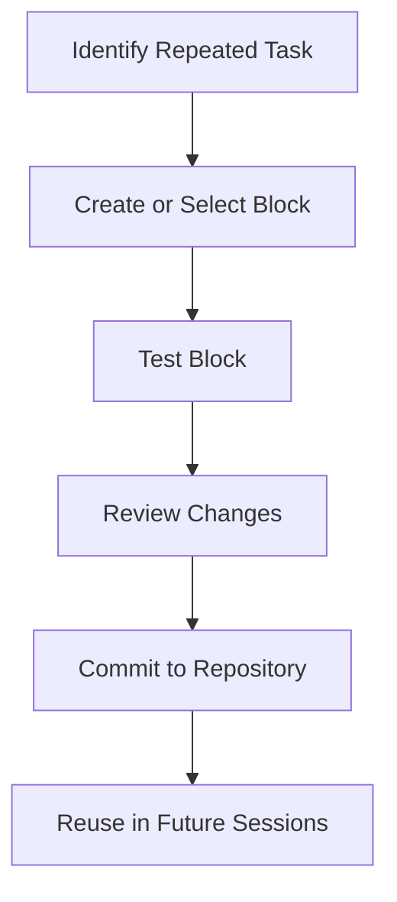

# 07 — Caveman: Blocks — Reusable Agent Scripts

> [!abstract] Lesson Information
> **Repository:** [JuliusBrussee/caveman](https://github.com/JuliusBrussee/caveman)
>
> **Related Project:** [caveman-ai/blocks](https://github.com/caveman-ai/blocks)
>
> **Category:** Agentic Engineering / Code Mode / Script Reuse / Token Optimization
>
> **Difficulty:** Intermediate to Advanced
>
> **Learning Approach:** Theory First
>
> **Prerequisites:**
> - [[00 - Repository Overview and Purpose]]
> - [[01 - Architecture and Core Concepts]]
> - [[02 - Installation and Codex Integration]]
> - [[03 - Token Economics and Optimization]]
> - [[04 - Say Less - Output Token Optimization]]
> - [[05 - Read Less - Input and Context Compression]]
> - [[06 - Auto - Model Routing and Reasoning Effort]]
>
> **Primary Goal:** Understand how reusable scripts reduce repetitive agent work, how Caveman Blocks organizes those scripts, and how to evaluate their efficiency, reliability, and security.

---

# 1. Learning Objectives

After completing this lesson, you should be able to:

1. Explain the purpose of Caveman Blocks.
2. Understand code mode in agentic systems.
3. Identify repetitive script-generation patterns.
4. Distinguish temporary scripts from reusable utilities.
5. Explain the Blocks architecture conceptually.
6. Identify the eight documented built-in Blocks.
7. Understand Blocks discovery and indexing.
8. Explain the purpose of `caveman-blocks scan`.
9. Explain the purpose of `caveman-blocks init`.
10. Understand the relationship between Blocks and `AGENTS.md`.
11. Compare reusable scripts with ordinary terminal commands.
12. Understand when Blocks reduce token consumption.
13. Interpret Caveman's published Blocks benchmarks.
14. Recognize cases where Blocks perform worse.
15. Understand security and trust boundaries.
16. Design appropriate tests for reusable scripts.
17. Apply Blocks concepts to Laravel, Next.js, and Android workflows.
18. Recognize when a reusable script would be unnecessary.

---

# Part I — Introduction to Blocks

## 2. What Are Caveman Blocks?

**Blocks** is Caveman's reusable-script capability.

The idea is simple:

> When an AI coding agent repeatedly writes the same useful script, preserve it as a reusable tool instead of generating it again in future sessions.

A coding agent often performs small automation tasks.

Examples:

- Summarizing test results.
- Inspecting JSON files.
- Finding the first meaningful error.
- Waiting for a service to become available.
- Inspecting source definitions.

Without reusable scripts, an agent may repeatedly generate similar commands or temporary programs.

Blocks aims to reduce that repetition.

## 2.1 The Problem

Imagine Codex receives this request:

```text
Run the tests and summarize failures.
```

The agent may generate a temporary Python script to:

1. Read the test output.
2. Identify failures.
3. Count passing tests.
4. Extract error messages.
5. Print a summary.

In another session, the agent may write nearly the same script again.

## 2.2 The Blocks Approach

Instead of regenerating the script, the agent can use an existing reusable Block when one is appropriate.

Conceptually:

```text
Repeated task
    ↓
Find existing Block
    ↓
Run reusable utility
    ↓
Read focused result
```

## 2.3 Important

Blocks does not mean every terminal command should become a reusable script.

Simple commands may already be efficient.

---

# Part II — Understanding Code Mode

## 3. What Is Code Mode?

**Code mode** is an agentic pattern in which an AI agent writes and executes code to perform several operations rather than issuing many separate tool calls.

For example, instead of manually inspecting hundreds of JSON records, the agent can write a small program that extracts the required information.

## 3.1 Traditional Tool-Call Approach



## 3.2 Code Mode Approach



## 3.3 Why Code Mode Can Help

A single script can:

- Process large datasets.
- Perform repeated transformations.
- Apply deterministic rules.
- Return focused output.

However, code mode has its own costs.

The agent must generate, execute, and potentially debug the script.

---

# Part III — The Temporary Script Problem

## 4. Why Agents Recreate Scripts

Coding agents do not necessarily retain every temporary utility between sessions.

They may repeatedly create:

- JSON inspection scripts.
- Test-output parsers.
- Log filters.
- HTTP response inspectors.
- File-search helpers.

## 4.1 Example

Session A:

```text
Agent creates test_parser.py
Agent runs test_parser.py
Agent finishes task
Temporary script discarded
```

Session B:

```text
Agent needs test summary
Agent creates another parser
Agent runs new parser
Agent finishes task
```

This duplicates effort.

## 4.2 The Economic Problem

Repeated generation may consume:

- Input tokens.
- Output tokens.
- Tool calls.
- Execution time.
- Debugging effort.

## 4.3 The Reuse Principle

If a task occurs frequently and has stable requirements, a reusable utility may be more efficient.

---

# Part IV — Blocks Architecture

## 5. Conceptual Architecture



This diagram illustrates the reusable-script workflow rather than the exact internal implementation.

## 5.1 Core Components

A reusable-script system typically involves:

1. Script storage.
2. Script discovery.
3. Execution.
4. Output handling.
5. Version control.
6. Maintenance.

## 5.2 Caveman's Approach

The Caveman README describes Blocks as preserving reusable scripts in the repository and making them available to coding agents.

It also describes an index that can be introduced into `AGENTS.md`.

## 5.3 Why Repository Storage Matters

Repository-based utilities can be:

- Reviewed.
- Version controlled.
- Shared with teammates.
- Updated.
- Tested.
- Removed when obsolete.

---

# Part V — The Eight Built-In Blocks

## 6. Documented Utilities

Caveman lists eight built-in Blocks.

| Block | Intended Purpose |
|---|---|
| `json-peek` | Inspect JSON data |
| `jsonl-stats` | Summarize JSON Lines data |
| `test-summary` | Summarize test results |
| `first-error` | Identify an early relevant error |
| `wait-for` | Wait for a condition or service |
| `grep-defs` | Find source-code definitions |
| `http-json` | Work with JSON over HTTP |
| `replace-in-file` | Perform file replacements |

These are functional descriptions based on their documented names and purpose. Exact arguments and behavior should be confirmed from the installed version's help or source.

---

# Part VI — JSON Inspection

## 7. Understanding `json-peek`

JSON files may contain large amounts of structured information.

A coding agent may only need a small portion.

Example:

```json
{
  "users": [
    {"id": 1, "status": "active"},
    {"id": 2, "status": "inactive"}
  ]
}
```

Instead of displaying the entire file, a JSON inspection utility may help identify relevant structures or values.

## 7.1 Potential Benefits

- Less output.
- Less repetitive parsing code.
- Faster inspection of familiar formats.

## 7.2 Limitations

A compact JSON inspection result may not be sufficient for:

- Full schema validation.
- Exact serialization debugging.
- Data-integrity audits.

---

# Part VII — JSON Lines Analysis

## 8. Understanding `jsonl-stats`

JSON Lines stores one JSON value per line.

Example:

```jsonl
{"event":"login","status":"success"}
{"event":"login","status":"failed"}
{"event":"logout","status":"success"}
```

A statistics utility may summarize records without displaying every line.

## 8.1 Potential Applications

- Event logs.
- Test results.
- Analytics exports.
- Agent execution histories.

## 8.2 Important

Aggregated statistics cannot replace exact records when individual events matter.

---

# Part VIII — Test Summaries

## 9. Understanding `test-summary`

Test runners can produce substantial output.

A reusable test-summary utility aims to provide a focused representation.

## 9.1 Example

Original:

```text
PASS test_login
PASS test_logout
PASS test_profile
FAIL test_registration
Expected: 201
Actual: 422
```

Conceptual summary:

```text
4 tests: 3 passed, 1 failed.

test_registration
Expected: 201
Actual: 422
```

## 9.2 Benefits

- Reduced repetitive output.
- Faster identification of failures.
- Less need for custom parsing scripts.

## 9.3 Important

The summary must preserve enough information to diagnose the failure.

---

# Part IX — First Error Detection

## 10. Understanding `first-error`

Build tools often produce many messages.

Sometimes the first meaningful error is the most useful starting point.

For example:

```text
INFO Build started
WARN Deprecated configuration
ERROR Cannot resolve module
ERROR Build terminated
```

A first-error utility may help focus attention on the initial failure.

## 10.1 Why This Helps

Later errors can be consequences of an earlier failure.

## 10.2 Limitations

The first reported error is not always the root cause.

Some tools report errors out of order.

A complete investigation may require examining the original output.

---

# Part X — Waiting for Services

## 11. Understanding `wait-for`

Development workflows sometimes depend on services becoming ready.

Examples:

- Local development server.
- Test database.
- Application health endpoint.
- Emulator service.

A reusable wait utility can help avoid repeatedly writing polling logic.

## 11.1 Conceptual Workflow



## 11.2 Important Design Requirements

A reliable wait utility should have:

- A timeout.
- Clear success conditions.
- Meaningful failure output.
- No uncontrolled infinite waiting.

The exact options supported by Caveman's implementation must be checked before use.

---

# Part XI — Source Definition Search

## 12. Understanding `grep-defs`

Coding agents frequently search source files for:

- Functions.
- Classes.
- Methods.
- Interfaces.
- Definitions.

A definition-search utility can standardize this task.

## 12.1 Example

A Java project contains:

```java
public class ProjectRepository {
    public void createProject() {
        // Implementation
    }
}
```

An agent may need to locate the `createProject` definition.

## 12.2 Important Limitation

Text-based searching is not equivalent to language-aware semantic analysis.

Definitions may involve:

- Overloading.
- Generics.
- Generated code.
- Nested declarations.
- Language-specific syntax.

## 12.3 Benchmark Caveat

Caveman's README reports that `grep-defs` used more tokens than a simple `grep -n` comparison in its test.

This is an important reminder:

**A specialized utility is not automatically more efficient than a simple command.**

---

# Part XII — HTTP JSON Inspection

## 13. Understanding `http-json`

Web development often involves inspecting JSON API responses.

Examples:

- Laravel REST APIs.
- Next.js API endpoints.
- Local test services.

A reusable utility may reduce the need to repeatedly write response-inspection code.

## 13.1 Conceptual Example

An API returns:

```json
{
  "status": "success",
  "data": {
    "count": 12
  }
}
```

An agent may only need:

```text
status: success
count: 12
```

## 13.2 Security Considerations

HTTP utilities should be used carefully with:

- Authentication headers.
- Sensitive API responses.
- Private endpoints.
- Untrusted URLs.

Never include credentials in shared scripts or logs.

---

# Part XIII — File Replacement

## 14. Understanding `replace-in-file`

Coding agents frequently perform repetitive text replacements.

A reusable file-replacement utility may make these operations easier to express.

## 14.1 Example

Original:

```javascript
const appTitle = "Old Title";
```

Desired:

```javascript
const appTitle = "New Title";
```

## 14.2 Important Risks

Blind replacement can affect:

- Unrelated code.
- Comments.
- String literals.
- Multiple files.
- Unexpected matches.

## 14.3 Recommended Safeguards

Before adopting a replacement:

1. Inspect the target.
2. Confirm expected matches.
3. Review the diff.
4. Run relevant tests.
5. Revert unintended changes.

For structural refactoring, language-aware tools may be safer than text replacement.

---

# Part XIV — Blocks Discovery

## 15. Why Discovery Matters

A reusable script provides little value if the coding agent cannot find it.

Discovery helps connect repeated tasks with existing utilities.

## 15.1 Documented Command

```powershell
caveman-blocks scan
```

According to the repository, this command examines previous agent activity to identify scripts that agents repeatedly generated.

## 15.2 Intended Purpose

The scan helps answer:

- What scripts are being recreated?
- Which patterns repeat?
- Which operations may deserve reusable utilities?

## 15.3 Privacy Note

The README states that script text does not leave the local machine during this scan.

This is a project claim that should be verified for the version being evaluated.

---

# Part XV — Blocks Initialization

## 16. Documented Command

```powershell
caveman-blocks init
```

The repository describes this command as adding Blocks rules and an index to the repository's `AGENTS.md`.

## 16.1 Why `AGENTS.md`?

`AGENTS.md` can provide coding agents with repository-specific instructions.

For Blocks, it can help the agent discover existing utilities.

## 16.2 Conceptual Relationship



## 16.3 Important

Initialization should be reviewed before modifying existing project instructions.

A tool-generated index must not override:

- Architecture constraints.
- Testing requirements.
- Security policies.
- MVP scope.

---

# Part XVI — Blocks and Context Engineering

## 17. How Blocks Improve Context Efficiency

A coding agent may repeatedly spend tokens describing and generating the same script.

A reusable Block can replace that repeated work with a shorter invocation.

## 17.1 Conceptual Comparison

Without reuse:

```text
Task
  ↓
Generate script
  ↓
Review script
  ↓
Execute script
  ↓
Interpret output
```

With reuse:

```text
Task
  ↓
Find existing Block
  ↓
Execute Block
  ↓
Interpret output
```

## 17.2 Benefits

Potential benefits include:

- Less generated code.
- Fewer repeated instructions.
- More consistent behavior.
- Easier maintenance.

## 17.3 Tradeoff

Reusable utilities introduce their own maintenance responsibilities.

---

# Part XVII — Published Blocks Benchmarks

## 18. Repository-Reported Measurements

Caveman's README includes comparisons of agent-readable output.

| Task | Raw Output Tokens | Existing Agent Approach | Block |
|---|---:|---:|---:|
| Go test output, 326 tests | 10,561 | 397 | 76 — `test-summary` |
| Large JSON inspection | 251,893 | 236 | 227 — `json-peek` |
| Go source-definition search | 3,111 | 250 | 489 — `grep-defs` |

## 18.1 Test Summary Savings

Comparing 397 tokens with 76:

\[
S = \frac{397-76}{397}\times100
\]

\[
S \approx 80.86\%
\]

The Block used approximately 80.9% fewer tokens in that comparison.

## 18.2 JSON Inspection Savings

\[
S = \frac{236-227}{236}\times100
\]

\[
S \approx 3.81\%
\]

This is a much smaller improvement.

## 18.3 Definition Search Regression

\[
\frac{489-250}{250}\times100 = 95.6\%
\]

The Block used approximately 95.6% more tokens than the compared agent approach.

## 18.4 Interpretation

These results show that Blocks can be useful for some repeated tasks but are not universally superior.

The benchmark measures specific comparisons, not guaranteed savings for every workflow.

---

# Part XVIII — Why Reuse Can Reduce Costs

## 19. The Economics of Repeated Script Generation

Assume an agent repeatedly generates a utility.

Let:

- \(G\) = tokens required to generate the script.
- \(R\) = tokens required to invoke the reusable script.
- \(N\) = number of uses.

Without reuse:

\[
T_{\text{without}} = N \times G
\]

With reuse:

\[
T_{\text{with}} = G + N \times R
\]

This simplified model assumes the script is generated once and reused afterward.

## 19.1 Hypothetical Example

Assume:

- Script generation: 600 tokens.
- Reusable invocation: 40 tokens.
- Number of uses: 10.

Without reuse:

\[
10 \times 600 = 6{,}000
\]

With reuse:

\[
600 + 10(40) = 1{,}000
\]

Savings:

\[
6{,}000 - 1{,}000 = 5{,}000
\]

## 19.2 Important

Real workflows also involve:

- Script discovery.
- Execution.
- Output.
- Testing.
- Maintenance.
- Possible failures.

Therefore, this model is illustrative.

---

# Part XIX — The Break-Even Point

## 20. When Does Reuse Become Worthwhile?

A reusable script becomes economically attractive when the cost of creating and maintaining it is offset by repeated use.

Conceptually:

\[
\text{Reuse Benefit}
=
\text{Avoided Repeated Work}
-
\text{Reuse Overhead}
\]

## 20.1 Factors Affecting Break-Even

- Frequency of use.
- Script complexity.
- Reliability.
- Invocation overhead.
- Maintenance effort.
- Output efficiency.

## 20.2 Example

A script used once may not justify being turned into a reusable Block.

A script used dozens of times across sessions may be a stronger candidate.

---

# Part XX — Security Considerations

## 21. Reusable Scripts Execute Code

Blocks are not merely documentation.

They can perform operations in the development environment.

That makes script review important.

## 21.1 Risks

- Unintended file modification.
- Credential exposure.
- Unexpected network requests.
- Destructive operations.
- Dependency vulnerabilities.
- Execution of untrusted code.

## 21.2 Repository Status

The Caveman README describes Blocks as pre-release software and notes that the documented version is Python-based without a sandbox.

This increases the importance of reviewing script behavior and permissions.

## 21.3 Security Principle

> Treat reusable agent scripts as executable development tools, not harmless text snippets.

---

# Part XXI — Testing Reusable Blocks

## 22. Why Blocks Need Tests

A reused script can affect many workflows.

A defect in one shared utility may repeatedly produce incorrect results.

## 22.1 Recommended Tests

### Unit Tests

Verify individual functions.

### Integration Tests

Verify behavior with realistic inputs.

### Edge-Case Tests

Check:

- Empty files.
- Missing fields.
- Invalid JSON.
- Large outputs.
- Unexpected encodings.
- Interrupted commands.

### Regression Tests

Ensure updates do not break previously supported behavior.

---

# Part XXII — Version Control

## 23. Why Git Matters

Repository-local scripts can be managed using Git.

This provides:

- Change history.
- Code review.
- Rollback.
- Team collaboration.

## 23.1 Conceptual Workflow



## 23.2 Important

A reusable script should have a clear purpose and documented assumptions.

Avoid creating a large framework for a simple task.

---

# Part XXIII — Blocks vs Ordinary Commands

## 24. When Is a Block Better?

A Block may be useful when:

- The same script is generated repeatedly.
- The operation has stable requirements.
- Output formatting is important.
- The script is tested and reliable.

## 24.1 When Ordinary Commands Are Better

Simple commands may already solve the problem efficiently.

Examples:

```powershell
git status
```

```powershell
git diff
```

```powershell
npm run build
```

There is little value in wrapping every basic command inside a custom utility.

## 24.2 Decision Rule

**Prefer the simplest reliable tool that satisfies the task.**

---

# Part XXIV — Laravel Scenario

## 25. Reusable Test Summaries

Consider a Laravel project.

A coding agent frequently executes:

```powershell
php artisan test
```

The output may include many test results.

A reusable test-summary utility could reduce repeated parsing work.

## 25.1 Potential Workflow

```text
Run tests
    ↓
Summarize results
    ↓
Inspect failures
    ↓
Fix code
    ↓
Run tests again
```

## 25.2 Important

The summary must preserve relevant failures and provide access to complete diagnostics.

A failed test should not disappear merely because it was surrounded by many passing tests.

---

# Part XXV — Next.js Scenario

## 26. JSON Inspection

Consider a Next.js frontend consuming a Laravel API.

The agent may need to inspect:

- API responses.
- Configuration.
- Product data.
- Validation errors.

A JSON inspection utility may reduce repeated custom scripts.

## 26.1 Example

Task:

```text
Inspect the API response and identify
which products have missing prices.
```

A reusable utility might help inspect the data structure.

However, the agent must still verify that every relevant record was considered.

---

# Part XXVI — Android Scenario

## 27. Build Error Analysis

Consider an Android Java project.

Gradle may produce extensive compiler output.

A reusable error-inspection utility could help identify important failures.

## 27.1 Example

```powershell
.\gradlew.bat assembleDebug
```

The agent may need:

- Failing task.
- Compiler error.
- File path.
- Line number.

## 27.2 Important

The utility should not replace proper Gradle diagnostics or hide earlier causes.

---

# Part XXVII — Blocks and MVP Scope

## 28. Avoid Overengineering

Reusable scripts should solve demonstrated workflow problems.

Do not create Blocks simply because reuse is possible.

## 28.1 Poor Approach

Create a custom script framework for every development command.

## 28.2 Better Approach

1. Observe repeated tasks.
2. Identify actual inefficiencies.
3. Reuse existing utilities when appropriate.
4. Add custom scripts only when justified.
5. Test and maintain them.

## 28.3 Practical Principle

**Reuse is valuable when it reduces complexity, not when it introduces unnecessary complexity.**

---

# Part XXVIII — Benchmarking Blocks

## 29. Evaluation Methodology

Compare a normal agent workflow with a Blocks-enabled workflow.

## 29.1 Baseline

Record:

- Generated script tokens.
- Tool-output tokens.
- Number of tool calls.
- Completion time.
- Correctness.

## 29.2 Optimized Workflow

Run the same task using an appropriate Block.

Record the same metrics.

## 29.3 Example Evaluation Table

| Metric | Baseline | Blocks |
|---|---:|---:|
| Script generation tokens | 500 | 0 |
| Invocation tokens | 20 | 50 |
| Output tokens | 400 | 100 |
| Task correctness | Pass | Pass |
| Completion time | 40 sec | 20 sec |

These values are hypothetical.

## 29.4 Interpretation

A Block is beneficial when it produces a meaningful net improvement while preserving correctness.

---

# Part XXIX — Common Anti-Patterns

## 30. Mistakes to Avoid

| Anti-Pattern | Problem |
|---|---|
| Create Blocks for everything | Unnecessary complexity |
| Reuse untested scripts | Repeated failures |
| Ignore security review | Execution risks |
| Hide important errors | Debugging becomes harder |
| Assume specialized means faster | Simple tools may outperform |
| Modify `AGENTS.md` blindly | Existing instructions may be affected |
| Ignore version control | Changes become difficult to track |
| Keep obsolete Blocks | Discovery becomes noisy |
| Measure only invocation length | Misses total workflow cost |
| Ignore project scope | Encourages overengineering |

---

# Part XXX — Practical Exercises

## 31. Exercise 1 — Identify Repetition

List five tasks a coding agent might repeatedly automate.

Determine which are good candidates for reusable scripts.

---

## 32. Exercise 2 — Code Mode Comparison

Explain the difference between:

1. Multiple independent tool calls.
2. A temporary processing script.
3. A reusable Block.

Discuss their advantages and disadvantages.

---

## 33. Exercise 3 — Block Selection

Choose the most appropriate documented Block for each task:

1. Summarize test failures.
2. Inspect JSON data.
3. Find source definitions.
4. Wait for a local service.
5. Find an early build error.

---

## 34. Exercise 4 — Token Savings

A repeated script costs 700 tokens to generate.

A reusable invocation costs 50 tokens.

The script is used 12 times.

Calculate the theoretical savings if the reusable script is generated once.

Ignore other overhead for this exercise.

---

## 35. Exercise 5 — Benchmark Interpretation

The repository reports:

- `test-summary`: 397 → 76 tokens.
- `grep-defs`: 250 → 489 tokens.

Explain why the results differ.

What should a developer conclude?

---

## 36. Exercise 6 — Security Review

Prepare a checklist for reviewing a reusable file-modification script.

Include:

- Input validation.
- File scope.
- Unexpected replacements.
- Rollback.
- Testing.

---

## 37. Exercise 7 — AGENTS.md Integration

Explain how a Blocks index could help Codex discover reusable utilities.

Discuss why existing project instructions must remain authoritative.

---

## 38. Exercise 8 — Laravel Workflow

Design a reusable test-summary workflow for a Laravel project.

Specify:

- Inputs.
- Outputs.
- Required diagnostic details.
- Failure handling.

---

## 39. Exercise 9 — Android Workflow

Design a workflow for summarizing Gradle build errors.

Explain why the first error may not always be the root cause.

---

## 40. Exercise 10 — Overengineering Assessment

A project has only three development scripts, all already simple and reliable.

Would introducing custom Blocks necessarily improve the workflow?

Explain your reasoning.

---

# Part XXXI — Knowledge Check

## 41. Review Questions

1. What are Caveman Blocks?
2. What is code mode?
3. Why do coding agents recreate scripts?
4. What problem does script reuse solve?
5. What are the eight documented built-in Blocks?
6. What is `json-peek`?
7. What is `jsonl-stats`?
8. What is `test-summary`?
9. What is `first-error`?
10. What is `wait-for`?
11. What is `grep-defs`?
12. What is `http-json`?
13. What is `replace-in-file`?
14. What does `caveman-blocks scan` do?
15. What does `caveman-blocks init` do?
16. Why is `AGENTS.md` relevant?
17. Why should Blocks be version controlled?
18. Why do reusable scripts require testing?
19. What security risks exist?
20. What did Caveman's test-summary benchmark report?
21. Why did `grep-defs` perform worse?
22. How do you calculate reuse savings?
23. What determines the break-even point?
24. When should ordinary commands be preferred?
25. What makes a reusable Block worthwhile?

---

# Part XXXII — Key Takeaways

> [!summary]
> - Blocks preserves reusable scripts for coding agents.
> - Code mode allows agents to process information through scripts.
> - Repeated script generation can waste tokens and time.
> - Repository-local utilities can be reviewed and version controlled.
> - Caveman documents eight built-in Blocks.
> - `caveman-blocks scan` identifies repeated script patterns.
> - `caveman-blocks init` introduces Blocks guidance into `AGENTS.md`.
> - Reusable scripts should have clear purposes.
> - Script reuse can reduce repeated generation overhead.
> - The published `test-summary` comparison improved from 397 to 76 tokens.
> - The published `grep-defs` comparison performed worse than simple grep.
> - Reuse is not automatically more efficient.
> - Blocks are executable tools and require security review.
> - Testing and rollback remain essential.
> - Avoid unnecessary abstractions.
> - Adopt reusable scripts when repeated usage justifies their maintenance.

---

# Part XXXIII — Final Mental Model

```text
                  CODING AGENT
                       |
                       v
                DEVELOPMENT TASK
                       |
                       v
                REPEATED OPERATION?
                   /        \\
                 YES         NO
                  |           |
                  v           v
             FIND BLOCK   USE NORMAL TOOL
                  |
                  v
             BLOCK AVAILABLE?
                /      \\
              YES       NO
               |         |
               v         v
          REVIEW BLOCK  CREATE SCRIPT IF NEEDED
               |         |
               v         v
            EXECUTE    TEST SCRIPT
               |         |
               +----+----+
                    |
                    v
               VERIFY RESULT
                    |
                    v
              MEASURE BENEFIT
```

> [!important] Final Principle
> **A reusable Block is valuable when it eliminates repeated work without sacrificing correctness, security, or simplicity.**

---

# Part XXXIV — Official References

## Caveman

- [Caveman Official Repository](https://github.com/JuliusBrussee/caveman)
- [Caveman README — Blocks](https://github.com/JuliusBrussee/caveman#blocks-code-mode-script-written-once)
- [Caveman Blocks Repository](https://github.com/caveman-ai/blocks)
- [Caveman Installation Guide](https://github.com/JuliusBrussee/caveman/blob/main/INSTALL.md)

## Agentic Engineering

- [OpenAI Codex Documentation](https://developers.openai.com/codex/)
- [Codex AGENTS.md Guide](https://developers.openai.com/codex/guides/agents-md)
- [Anthropic — Code Execution with MCP](https://www.anthropic.com/engineering/code-execution-with-mcp)
- [Git Documentation](https://git-scm.com/doc)

> [!note] Documentation Scope
> This lesson is based on the Caveman repository's published Blocks description and benchmark results.
>
> Conceptual diagrams and sample outputs are educational illustrations.
>
> Exact command arguments, script implementations, and platform compatibility must be verified against the installed version.
>
> The repository currently describes Blocks as pre-release and without a sandbox. Review current release notes before practical use.
>
> No Blocks installation, initialization, script execution, or benchmark was performed during this lesson.

---

# Part XXXV — Next Lesson

**[[08 - Waste Fixes, Caching, and Browse]]**

Topics:

1. Introduction to Waste Fixes.
2. Token waste analysis.
3. `caveman learn`.
4. `caveman learn implement`.
5. Prompt-cache warming.
6. Cache economics.
7. Browser-output compression.
8. `caveman browse`.
9. HTML and structured page extraction.
10. Token savings and benchmark interpretation.
11. Privacy and security.
12. Codex integration.
13. Laravel, Next.js, and Android examples.
14. Practical exercises.
15. Official references.

**End of Lesson 07 — Blocks: Reusable Agent Scripts.**
