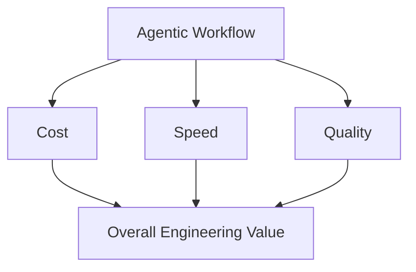
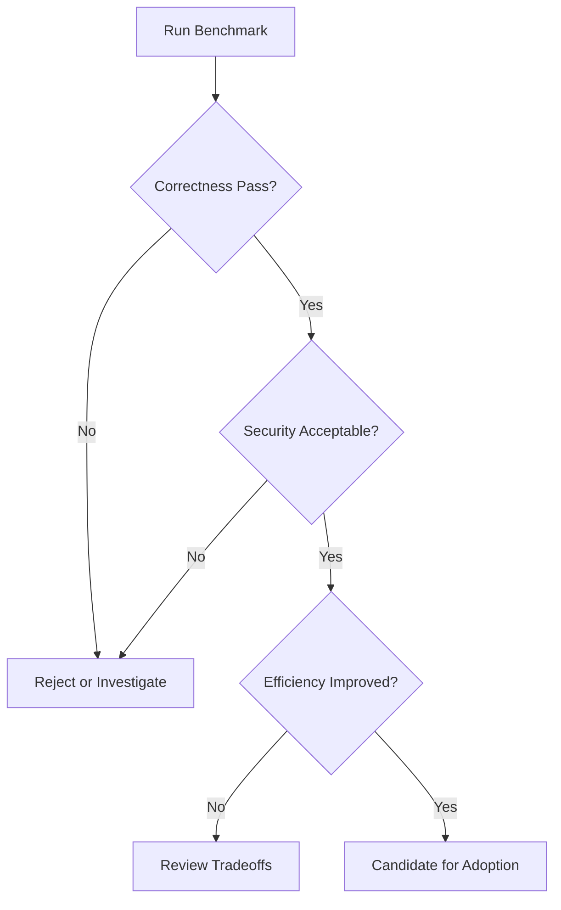
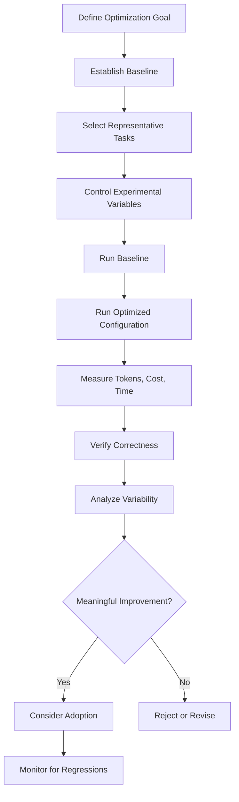

# 10 — Caveman: Benchmarks and Performance Evaluation

> [!abstract] Lesson Information
> **Repository:** [JuliusBrussee/caveman](https://github.com/JuliusBrussee/caveman)
>
> **Category:** Agentic Engineering / AI Benchmarking / Token Economics / Performance Engineering
>
> **Difficulty:** Intermediate to Advanced
>
> **Learning Approach:** Theory First
>
> **Platform Focus:** Codex CLI, Windows PowerShell, Laravel, Next.js, Android
>
> **Prerequisites:**
> - [[03 - Token Economics and Optimization]]
> - [[04 - Say Less - Output Token Optimization]]
> - [[05 - Read Less - Input and Context Compression]]
> - [[06 - Auto - Model Routing and Reasoning Effort]]
> - [[07 - Blocks - Reusable Agent Scripts]]
> - [[08 - Waste Fixes, Caching, and Browse]]
> - [[09 - Configuration, Commands, and Controls]]
>
> **Primary Goal:** Learn how to evaluate Caveman optimizations using controlled experiments, accurate token and cost accounting, statistical reasoning, reproducibility, and quality-preserving acceptance criteria.

---

# 1. Learning Objectives

After completing this lesson, you should be able to:

1. Define benchmarking and performance evaluation.
2. Distinguish optimization claims from measured results.
3. Establish a reproducible baseline.
4. Identify independent, dependent, and controlled variables.
5. Measure input, output, and cached tokens.
6. Calculate token-reduction percentages.
7. Calculate cost per attempt and cost per successful task.
8. Measure latency, throughput, and retries.
9. Interpret Caveman's published benchmark results.
10. Understand the difference between file-level and session-level savings.
11. Explain why token savings do not guarantee financial savings.
12. Identify benchmark contamination and selection bias.
13. Understand statistical uncertainty and sample size.
14. Design paired A/B experiments.
15. Establish correctness and quality gates.
16. Evaluate performance regressions.
17. Compare Caveman features individually and together.
18. Design realistic Laravel, Next.js, and Android benchmark suites.
19. Document experimental findings.
20. Make evidence-based optimization decisions.

---

# Part I — Introduction to Benchmarking

## 2. What Is Benchmarking?

**Benchmarking** is the systematic measurement and comparison of a system's performance under defined conditions.

In agentic engineering, benchmarking helps determine whether an AI-assisted workflow is:

- More efficient.
- Less expensive.
- Faster.
- More reliable.
- Equally or more correct.

A benchmark should answer a specific question.

For example:

> Does enabling Caveman Read Less reduce input-token consumption during Laravel test debugging without reducing the agent's ability to identify the correct failure?

This is more useful than asking:

> Is Caveman faster?

The second question is too broad.

## 2.1 Benchmarking vs Casual Observation

| Casual Observation | Controlled Benchmark |
|---|---|
| "It feels faster." | Measures completion time |
| "It uses fewer tokens." | Records token counts |
| "The result looks correct." | Applies acceptance tests |
| "The tool works better." | Compares equivalent tasks |
| One successful run | Repeated, documented trials |
| Unclear configuration | Reproducible setup |

## 2.2 Core Principle

> An optimization is not proven beneficial simply because it reduces one metric.

A useful benchmark evaluates the complete task outcome.

---

# Part II — The Optimization Triangle

## 3. Cost, Speed, and Quality

Three major dimensions influence the value of an AI coding workflow.

**1. Cost** — How many resources does the workflow consume?

**2. Speed** — How long does the workflow take?

**3. Quality** — Does the result satisfy the task requirements?

## 3.1 Conceptual Relationship



## 3.2 Example

Suppose two configurations produce:

| Metric | Configuration A | Configuration B |
|---|---:|---:|
| Cost | $0.20 | $0.08 |
| Completion time | 3 min | 2 min |
| Correctness | Pass | Fail |

Configuration B is cheaper and faster.

But it fails the task.

Therefore, Configuration B is not a successful optimization for this task.

## 3.3 Quality as a Constraint

For many development tasks, correctness should be a minimum requirement.

Conceptually:

\[
\min(\text{Cost})
\]

subject to:

\[
\text{Correctness} \geq \text{Required Quality Threshold}
\]

This is a constrained optimization problem.

---

# Part III — Establishing a Baseline

## 4. What Is a Baseline?

A **baseline** is the reference configuration against which improvements are measured.

For Caveman, a baseline might be:

- Codex without a particular Caveman optimization.
- A fixed model and reasoning-effort setting.
- Raw tool output.
- Ordinary browser extraction.
- A normal terminal command.

## 4.1 Example

Suppose the task is to diagnose a failing Laravel test.

Baseline workflow:

```text
Codex
  ↓
Run php artisan test
  ↓
Receive ordinary test output
  ↓
Identify failure
  ↓
Explain root cause
```

Experimental workflow:

```text
Codex
  ↓
Run equivalent tests
  ↓
Receive compressed output
  ↓
Identify failure
  ↓
Explain root cause
```

The key difference is the output-compression mechanism.

## 4.2 Why a Baseline Matters

Without a baseline, you cannot reliably attribute changes to the optimization.

## 4.3 Baseline Documentation

Record:

- Date.
- Operating system.
- Tool versions.
- Model configuration.
- Repository commit.
- Enabled features.
- Test commands.
- Acceptance criteria.
- Token measurements.

---

# Part IV — Experimental Variables

## 5. Independent Variables

An **independent variable** is what the experiment deliberately changes.

Example:

```text
Read Less: OFF vs ON
```

## 5.1 Dependent Variables

Dependent variables are the measured outcomes.

Examples:

- Input tokens.
- Completion time.
- Total cost.
- Test success.
- Number of retries.

## 5.2 Controlled Variables

Controlled variables should remain consistent between comparisons.

Examples:

- Same repository state.
- Same task instructions.
- Same test suite.
- Same operating environment.
- Same tool permissions.

## 5.3 Example Table

| Variable Type | Example |
|---|---|
| Independent | Input compression enabled |
| Dependent | Total input tokens |
| Dependent | Debugging accuracy |
| Controlled | Repository commit |
| Controlled | Task requirements |
| Controlled | Model configuration |

## 5.4 Important

If multiple variables change simultaneously, attributing improvements becomes difficult.

---

# Part V — Token Measurement

## 6. Understanding Token Categories

Token usage is not always represented by a single number.

Common categories include:

- Input tokens.
- Output tokens.
- Cached input tokens.
- Reasoning tokens, where reported.
- Tool-related context.

## 6.1 Input Tokens

Information supplied to the model.

Examples:

- Instructions.
- Conversation history.
- Source-code excerpts.
- Tool outputs.

## 6.2 Output Tokens

Information generated by the model.

Examples:

- Responses.
- Generated code.
- Tool-call arguments.

## 6.3 Cached Tokens

Eligible input tokens reused through provider caching.

Cached tokens may have different pricing.

## 6.4 Important

Provider reporting differs.

Avoid assuming every model or coding-agent interface exposes identical usage fields.

---

# Part VI — Token Savings Formula

## 7. Percentage Reduction

The standard formula is:

\[
S =
\frac{T_{\text{baseline}} - T_{\text{optimized}}}
{T_{\text{baseline}}}
\times100
\]

Where:

- \(S\) = percentage savings.
- \(T_{\text{baseline}}\) = baseline token usage.
- \(T_{\text{optimized}}\) = optimized token usage.

## 7.1 Worked Example

Baseline:

\[
T_b = 40{,}000
\]

Optimized:

\[
T_o = 12{,}000
\]

\[
S =
\frac{40{,}000-12{,}000}{40{,}000}
\times100
\]

\[
S=70\%
\]

The optimized workflow used 70% fewer tokens for the measured category.

## 7.2 Negative Savings

Suppose:

\[
T_b=1{,}000
\]

\[
T_o=1{,}300
\]

\[
S =
\frac{1{,}000-1{,}300}{1{,}000}
\times100
\]

\[
S=-30\%
\]

A negative result indicates increased token consumption.

---

# Part VII — Compression Ratio

## 8. What Is a Compression Ratio?

A compression ratio compares the original size with the compressed size.

\[
R=\frac{T_{\text{original}}}{T_{\text{compressed}}}
\]

## 8.1 Example

Original:

\[
T_o=20{,}000
\]

Compressed:

\[
T_c=500
\]

\[
R=\frac{20{,}000}{500}=40
\]

The original representation is 40 times as large.

## 8.2 Difference Between Ratio and Savings

A 40× compression ratio corresponds to:

\[
S =
\left(1-\frac{1}{40}\right)\times100
\]

\[
S=97.5\%
\]

These metrics describe the same reduction in different ways.

---

# Part VIII — File-Level vs Session-Level Measurements

## 9. Why These Measurements Differ

A single tool output is only one component of an agent session.

The full session may include:

- Instructions.
- Project context.
- Source files.
- Conversation history.
- Multiple tool calls.
- Model responses.

## 9.1 Example

| Component | Baseline | Optimized |
|---|---:|---:|
| Instructions | 10,000 | 10,000 |
| Project context | 30,000 | 30,000 |
| Tool output | 40,000 | 4,000 |
| Other context | 20,000 | 20,000 |
| **Total** | **100,000** | **64,000** |

Tool-output reduction:

\[
\frac{40{,}000-4{,}000}{40{,}000}\times100=90\%
\]

Session-level reduction:

\[
\frac{100{,}000-64{,}000}{100{,}000}\times100=36\%
\]

## 9.2 Key Insight

**A 90% reduction in tool-output tokens produces only a 36% reduction in this complete session.**

Both measurements are valid, but they answer different questions.

---

# Part IX — Token Cost Accounting

## 10. Tokens vs Actual Cost

Not all tokens have the same price.

Prices may vary by:

- Model.
- Provider.
- Input vs output.
- Cached vs uncached input.
- Pricing tier.

## 10.1 General Formula

Let:

- \(T_i\) = uncached input tokens.
- \(T_c\) = cached input tokens.
- \(T_o\) = output tokens.
- \(P_i\) = input price per million tokens.
- \(P_c\) = cached input price per million.
- \(P_o\) = output price per million.

Then:

\[
C =
\frac{T_iP_i+T_cP_c+T_oP_o}
{1{,}000{,}000}
\]

This assumes the reported categories are mutually exclusive.

If cached tokens are included in a provider's total input-token count, subtract them appropriately to avoid double-counting.

## 10.2 Hypothetical Example

Assume:

- Uncached input: 100,000 tokens.
- Cached input: 50,000 tokens.
- Output: 20,000 tokens.

Hypothetical rates:

- Input: $2 per million.
- Cached input: $0.50 per million.
- Output: $8 per million.

\[
C =
\frac{
100{,}000(2)+
50{,}000(0.50)+
20{,}000(8)}
{1{,}000{,}000}
\]

\[
C =
0.20+0.025+0.16
\]

\[
C=\$0.385
\]

## 10.3 Important

These are illustrative rates, not current provider pricing.

---

# Part X — Cost per Attempt

## 11. Definition

**Cost per attempt** measures the average expense of running a task once.

\[
C_{\text{attempt}}=
\frac{\text{Total Cost}}
{\text{Total Attempts}}
\]

## 11.1 Example

Total expense:

\[
\$12
\]

Total attempts:

\[
40
\]

\[
C_{\text{attempt}}=\frac{12}{40}
\]

\[
C_{\text{attempt}}=\$0.30
\]

## 11.2 Limitation

This metric does not account for whether attempts succeeded.

A low-cost attempt can still be poor value if it frequently fails.

---

# Part XI — Cost per Successful Task

## 12. Definition

\[
C_{\text{success}}=
\frac{\text{Total Cost}}
{\text{Successful Tasks}}
\]

## 12.1 Example

Configuration A:

- Total cost: $20.
- Successful tasks: 80.

\[
C_A=\frac{20}{80}=\$0.25
\]

Configuration B:

- Total cost: $12.
- Successful tasks: 30.

\[
C_B=\frac{12}{30}=\$0.40
\]

Configuration B is cheaper overall but more expensive per successful task.

## 12.2 Why This Matters

Automatic model routing may reduce the cost of each attempt.

However, additional failures can reduce or eliminate those savings.

## 12.3 Better Interpretation

For development workflows, evaluate:

- Cost per attempt.
- Success rate.
- Cost per successful task.
- Cost of retries.
- Human review effort.

---

# Part XII — Measuring Latency

## 13. What Is Latency?

Latency is the time required to complete an operation.

For agentic workflows, relevant measurements include:

- Time to first response.
- Model execution time.
- Tool execution time.
- End-to-end task completion time.

## 13.1 General Model

\[
T_{\text{total}} =
T_{\text{model}}+
T_{\text{tools}}+
T_{\text{waiting}}+
T_{\text{verification}}
\]

This is a simplified accounting model.

## 13.2 Example

| Stage | Duration |
|---|---:|
| Model processing | 25 sec |
| Tool execution | 40 sec |
| Waiting | 10 sec |
| Verification | 15 sec |
| **Total** | **90 sec** |

## 13.3 Important

Reducing model latency does not necessarily reduce total task duration.

For example, a faster model may generate incorrect code requiring additional debugging.

---

# Part XIII — Throughput

## 14. What Is Throughput?

**Throughput** measures how much useful work is completed per unit of time.

For example:

\[
\text{Throughput}=
\frac{\text{Successful Tasks}}
{\text{Elapsed Time}}
\]

## 14.1 Example

An agent completes 12 successful tasks in 3 hours.

\[
\text{Throughput}=\frac{12}{3}
\]

\[
=4\text{ tasks/hour}
\]

## 14.2 Important

Tasks must be comparable for throughput to be meaningful.

Completing four simple CSS changes is not necessarily equivalent to completing four complex backend fixes.

---

# Part XIV — Retries and Hidden Costs

## 15. Why Retries Matter

A task may require several attempts before it passes verification.

Each attempt can consume:

- Additional tokens.
- Tool execution time.
- Developer attention.
- Compute resources.

## 15.1 Example

Configuration A:

```text
Attempt 1: Success
```

Configuration B:

```text
Attempt 1: Failure
Attempt 2: Failure
Attempt 3: Success
```

Configuration B may appear cheaper per attempt but become more expensive overall.

## 15.2 Recommended Metrics

Record:

- Attempts per task.
- Number of failed attempts.
- Total cost until success.
- Total completion time.
- Final correctness.

---

# Part XV — Caveman's Published Benchmarks

## 16. Overview

Caveman's public repository describes several optimization mechanisms and publishes benchmark comparisons.

These include:

- Say Less.
- Read Less.
- Auto.
- Blocks.
- Browse.

Not all features have equally mature benchmark evidence.

## 16.1 Important

Published benchmarks should be treated as evidence from the project's reported evaluation, not as guaranteed results in your own environment.

---

# Part XVI — Read Less Benchmark

## 17. Reported Measurements

The previously documented Caveman README benchmark includes the following comparisons:

| Format | File-Level Reduction | Session-Level Reduction |
|---|---:|---:|
| CSV | 98.9% | 55.1% |
| Logs | 98.5% | 50.2% |
| YAML | 99.1% | 46.2% |
| Test output | 98.9% | 27.8% |
| JSON | 98.5% | 26.4% |
| HTML | 0% | 9.9% worse |
| **Aggregate** | **82.4%** | **33.2%** |

These are repository-reported results from the earlier documented evaluation, not new measurements.

## 17.1 Interpretation

The results illustrate that structured or repetitive content can be highly compressible.

However, session-level savings are smaller because tool output is only part of the complete workflow.

## 17.2 Important Finding

The HTML case became worse.

This demonstrates that optimization overhead can exceed benefits.

## 17.3 Engineering Lesson

Do not assume every input format benefits equally from compression.

---

# Part XVII — Auto Benchmark

## 18. Reported Measurements

The Caveman README's interim Auto comparison, as documented in the previous lesson, reports:

| Configuration | Tasks Solved | Cost per Try | Median Time |
|---|---:|---:|---:|
| Fixed high-effort baseline | 44.3% | $7.83 | 35.2 min |
| Auto, Claude models only | 43.7% | $3.59 | 15.9 min |
| Auto, additional providers | 42.9% | $3.47 | 16.7 min |

## 18.1 Cost Reduction

For the Claude-only Auto comparison:

\[
S=\frac{7.83-3.59}{7.83}\times100
\]

\[
S\approx54.15\%
\]

## 18.2 Correct Interpretation

The reported cost per try decreased substantially.

The observed task-success percentages were close.

However, the repository describes the benchmark as interim and does not establish statistical equivalence.

## 18.3 Important Limitation

A comparison against a high-effort baseline may show larger savings than a comparison against an already optimized medium-effort baseline.

The baseline strongly influences the result.

---

# Part XVIII — Blocks Benchmark

## 19. Reported Measurements

| Task | Compared Agent Approach | Block |
|---|---:|---:|
| Test summary | 397 tokens | 76 tokens |
| JSON inspection | 236 tokens | 227 tokens |
| Source-definition search | 250 tokens | 489 tokens |

## 19.1 Interpretation

The test-summary Block achieved a substantial reduction.

The JSON inspection Block showed a small reduction.

The source-definition search Block consumed more tokens than the compared approach.

## 19.2 Key Lesson

**Reusable tooling should be evaluated against existing simple tools, not only against inefficient hypothetical alternatives.**

---

# Part XIX — Browse Benchmark

## 20. Reported Measurements

Caveman reports a comparison involving a large table:

| Method | Tokens |
|---|---:|
| Playwright snapshot | 15,704 |
| Caveman Browse | 121 |

Reduction:

\[
\frac{15{,}704-121}{15{,}704}\times100
\approx99.23\%
\]

## 20.1 Important Caveat

The repository also reports worse performance on small forms.

This suggests that content type and size materially affect the outcome.

## 20.2 Correct Evaluation

A benchmark should consider whether the compressed output preserves the information needed to complete the actual browsing task.

---

# Part XX — Statistical Uncertainty

## 21. Why One Result Is Not Enough

AI coding agents may produce different outcomes across repeated runs.

Variability can arise from:

- Model sampling.
- Tool execution.
- Network conditions.
- Repository state.
- Prompt interpretation.
- External dependencies.

## 21.1 Example

Suppose a configuration succeeds in 7 of 10 runs.

Observed success rate:

\[
\hat{p}=\frac{7}{10}=70\%
\]

This does not prove the configuration's true success probability is exactly 70%.

## 21.2 Sample Size Matters

Small samples generally produce greater uncertainty.

A result from 10 tasks is less informative than a well-designed evaluation involving hundreds of representative tasks.

However, larger samples do not automatically eliminate bias.

---

# Part XXI — Confidence Intervals

## 22. What Is a Confidence Interval?

A confidence interval is a statistical procedure that produces a range of plausible parameter values under specified assumptions.

For a binary success outcome, one can estimate uncertainty around the success proportion.

## 22.1 Approximate Standard Error

For a simple independent Bernoulli model:

\[
SE(\hat{p})=
\sqrt{\frac{\hat{p}(1-\hat{p})}{n}}
\]

Where:

- \(\hat{p}\) = observed success rate.
- \(n\) = number of trials.

## 22.2 Example

Suppose:

\[
\hat{p}=0.70
\]

\[
n=100
\]

Then:

\[
SE=
\sqrt{\frac{0.70(0.30)}{100}}
\]

\[
SE\approx0.0458
\]

An approximate normal 95% interval would use:

\[
\hat{p}\pm1.96SE
\]

\[
0.70\pm0.0898
\]

Approximately:

\[
[0.610,\ 0.790]
\]

## 22.3 Important

This is an educational approximation.

For actual binary-outcome analysis, methods such as the Wilson interval are often preferable, particularly with small samples or extreme success rates.

Repeated trials on the same tasks may also violate independence assumptions.

---

# Part XXII — Statistical Significance vs Practical Significance

## 23. Two Different Questions

**Statistical significance:** Is the observed difference distinguishable from random variation under a specified statistical model?

**Practical significance:** Is the difference large enough to matter in real development?

## 23.1 Example

Suppose an optimization saves 0.5% of token usage.

With enough observations, the difference might be statistically detectable.

But the actual financial benefit could be negligible.

## 23.2 Conversely

A 20% cost reduction may be practically important.

However, if it is measured on only three tasks, the evidence may be too weak to generalize.

## 23.3 Engineering Principle

Evaluate both the magnitude of the improvement and the uncertainty around it.

---

# Part XXIII — Paired A/B Testing

## 24. Why Paired Comparisons Help

In a paired experiment, both configurations are evaluated on the same task set.

This helps reduce differences caused by task difficulty.

## 24.1 Example

| Task | Baseline Cost | Optimized Cost |
|---|---:|---:|
| A | $0.30 | $0.20 |
| B | $0.50 | $0.35 |
| C | $0.20 | $0.22 |
| D | $0.60 | $0.40 |

## 24.2 Paired Difference

For each task:

\[
D_i=C_{\text{baseline},i}-C_{\text{optimized},i}
\]

Positive values indicate savings.

Negative values indicate regressions.

## 24.3 Benefits

Paired comparisons help reveal:

- Which tasks benefit.
- Which tasks regress.
- Whether improvements are consistent.
- Whether task type influences outcomes.

## 24.4 Important

Run order should be considered.

If the second run benefits from a warmed cache or modified repository, the comparison may be biased.

---

# Part XXIV — Benchmark Contamination

## 25. What Is Benchmark Contamination?

Benchmark contamination occurs when the experimental conditions are unintentionally influenced by information or changes that should not be present.

## 25.1 Common Examples

### Repository Contamination

The baseline run modifies files.

The optimized run starts from the modified repository.

### Cache Contamination

One configuration benefits from a cache warmed by the other.

### Prompt Contamination

The second run receives hints learned from the first.

### Tool Contamination

Different tool versions are used.

### Human Contamination

A developer intervenes differently between runs.

## 25.2 Prevention

- Reset repository state.
- Document cache conditions.
- Use identical task instructions.
- Record versions.
- Apply consistent intervention rules.
- Randomize or counterbalance run order where feasible.

---

# Part XXV — Reproducibility

## 26. What Makes a Benchmark Reproducible?

A reproducible benchmark allows another evaluator to repeat the procedure under equivalent conditions.

## 26.1 Required Information

Record:

1. Repository URL.
2. Commit hash.
3. Operating system.
4. Model and provider.
5. Agent version.
6. Caveman version.
7. Feature configuration.
8. Task prompt.
9. Test commands.
10. Evaluation criteria.
11. Token accounting method.
12. Cost assumptions.

## 26.2 Example Metadata

```yaml
experiment:
  name: read-less-laravel-tests
  date: YYYY-MM-DD
  platform: windows
  shell: powershell
  agent: codex
  feature: input-compression

baseline:
  compression: disabled

experiment_group:
  compression: enabled

metrics:
  - input_tokens
  - output_tokens
  - completion_time
  - task_success
  - retries
```

This is an illustrative experiment record, not an official Caveman configuration file.

---

# Part XXVI — Correctness Evaluation

## 27. Why Correctness Must Be Measured

A coding agent may generate plausible but incorrect code.

Therefore, benchmarking should include objective checks wherever possible.

## 27.1 Possible Checks

- Automated tests.
- Type checking.
- Build completion.
- Static analysis.
- Integration tests.
- Acceptance criteria.
- Manual review.

## 27.2 Example

Task:

```text
Fix the registration endpoint so valid input
returns HTTP 201.
```

Acceptance criteria:

- Valid registration returns 201.
- Invalid input remains rejected.
- Existing users are handled correctly.
- Relevant tests pass.
- No unrelated changes.

## 27.3 Important

A successful build does not prove all application behavior is correct.

Likewise, passing tests do not guarantee the absence of defects.

---

# Part XXVII — Quality Gates

## 28. What Is a Quality Gate?

A **quality gate** is a condition that must be satisfied before an optimization is accepted.

## 28.1 Example

An optimization is accepted only when:

- Relevant tests pass.
- No critical diagnostics are hidden.
- No new security problems appear.
- Total cost improves meaningfully.
- The workflow remains maintainable.

## 28.2 Conceptual Flow



## 28.3 Important

Some optimizations may be worthwhile even without lower token counts—for example, if they substantially improve reliability.

The decision should reflect the actual engineering goal.

---

# Part XXVIII — Regression Detection

## 29. What Is a Regression?

A regression is a deterioration in behavior or performance after a change.

Examples:

- Increased token usage.
- Slower completion.
- Lower task success.
- Missing diagnostic information.
- More retries.
- Unexpected tool failures.

## 29.1 Example

Baseline:

```text
Input tokens: 10,000
Task success: Pass
```

Optimized:

```text
Input tokens: 7,000
Task success: Fail
```

The token metric improves.

But correctness regresses.

## 29.2 Recommended Response

Investigate the cause before keeping the optimization.

---

# Part XXIX — Evaluating Individual Caveman Features

## 30. Feature-Specific Metrics

| Feature | Primary Metric | Important Secondary Metric |
|---|---|---|
| Say Less | Output tokens | Completeness |
| Read Less | Input tokens | Diagnostic accuracy |
| Auto | Cost per successful task | Success rate |
| Blocks | Repeated-work overhead | Script reliability |
| Waste Fixes | Recurring waste reduction | Regression rate |
| Browse | Page-output tokens | Information preservation |
| Cache warming | Net billed savings | Warming overhead |

## 30.1 Important

Each feature has a different optimization target.

A single metric cannot adequately evaluate all features.

---

# Part XXX — Evaluating Combined Features

## 31. Why Combined Savings Are Complex

Suppose:

- Say Less reduces output tokens.
- Read Less reduces input tokens.
- Auto changes model selection.
- Cache warming changes billing.
- Blocks reduces repeated script generation.

These mechanisms may interact.

## 31.1 Incorrect Approach

```text
20% + 30% + 40% = 90% savings
```

This is generally invalid.

## 31.2 Better Approach

Measure the complete workflow with all selected features enabled.

Compare it against the baseline.

## 31.3 Interaction Effects

Two features may:

- Reinforce each other.
- Overlap.
- Cancel some benefits.
- Introduce additional overhead.

## 31.4 Advanced Experimental Design

A factorial experiment can evaluate combinations of feature settings.

However, the number of combinations grows rapidly.

With \(k\) binary features:

\[
N=2^k
\]

For six features:

\[
N=2^6=64
\]

That is 64 configurations before accounting for repeated trials.

For small projects, testing one feature at a time and then evaluating a chosen combination may be more practical.

---

# Part XXXI — Laravel Benchmark Scenario

## 32. GoPasig: Query Optimization

Consider a Laravel fleet-management application with analytics queries.

### Benchmark Task

```text
Identify and fix an N+1 query problem
without changing the dashboard's results.
```

## 32.1 Baseline

Codex processes ordinary logs and source context.

## 32.2 Experimental Configuration

Codex processes compressed supported tool output.

## 32.3 Metrics

- Input tokens.
- Completion time.
- Number of queries.
- Test success.
- Retries.
- Total cost.

## 32.4 Acceptance Criteria

- The relevant N+1 problem is resolved.
- Dashboard data remains correct.
- Tests pass.
- No unrelated changes.
- Query-count improvement is verified.

## 32.5 Important

Reducing agent token usage is separate from improving application database performance.

Both can be measured, but they are different outcomes.

---

# Part XXXII — Next.js Benchmark Scenario

## 33. E-commerce: Build Failure Diagnosis

Consider a Next.js frontend.

### Benchmark Task

```text
Identify the cause of a TypeScript build failure
and implement the smallest correct fix.
```

## 33.1 Baseline

Run:

```powershell
npm run build
```

The agent receives ordinary output.

## 33.2 Experimental Configuration

The agent receives compressed output.

## 33.3 Acceptance Criteria

- Correct error identified.
- Minimal fix applied.
- Build succeeds.
- No unrelated functionality changes.

## 33.4 Metrics

| Metric | Purpose |
|---|---|
| Input tokens | Compression effectiveness |
| Completion time | Workflow efficiency |
| Number of attempts | Reliability |
| Build result | Correctness |
| Diff size | Scope control |

---

# Part XXXIII — Android Benchmark Scenario

## 34. GroupTrack: Gradle Compilation

Consider an Android Java application.

### Benchmark Task

```text
Identify and resolve a Java compilation error
without introducing new dependencies.
```

## 34.1 Baseline Command

```powershell
.\gradlew.bat assembleDebug
```

## 34.2 Experimental Design

Compare:

- Raw Gradle output.
- Compressed Gradle output.

## 34.3 Acceptance Criteria

- Correct compiler error identified.
- Relevant file and line preserved.
- Build succeeds after the fix.
- No unnecessary dependencies.
- MVP scope maintained.

## 34.4 Important

The benchmark should not reward a solution that bypasses the error by removing required functionality.

---

# Part XXXIV — Designing a Benchmark Suite

## 35. Why Multiple Tasks Are Necessary

A single task cannot represent all development workflows.

A useful benchmark suite should include different task categories.

## 35.1 Example Suite

| ID | Task | Difficulty | Main Metric |
|---|---|---|---|
| T01 | Rename UI label | Low | Output efficiency |
| T02 | Diagnose build error | Moderate | Accuracy |
| T03 | Fix validation | Moderate | Correctness |
| T04 | Inspect large JSON | Moderate | Input efficiency |
| T05 | Resolve N+1 query | High | Correctness and cost |
| T06 | Analyze concurrency bug | High | Reliability |
| T07 | Summarize test suite | Low–Moderate | Compression |
| T08 | Inspect documentation table | Moderate | Browse efficiency |

## 35.2 Task Diversity

Include:

- Frontend tasks.
- Backend tasks.
- Build tasks.
- Debugging tasks.
- Data inspection.
- Complex reasoning.

## 35.3 Important

The suite should reflect the tasks the developer actually performs.

A benchmark optimized for unrelated workloads may provide misleading recommendations.

---

# Part XXXV — Benchmark Reporting

## 36. What Should a Benchmark Report Contain?

A good report should include:

1. Research question.
2. Hypothesis.
3. Environment.
4. Baseline.
5. Experimental configuration.
6. Task set.
7. Metrics.
8. Results.
9. Statistical analysis.
10. Failure analysis.
11. Limitations.
12. Recommendation.

## 36.1 Example Hypothesis

> Enabling Read Less will reduce input-token consumption during repeated Laravel test debugging while maintaining the same rate of correctly identified failures.

## 36.2 Example Result Table

| Metric | Baseline | Optimized | Change |
|---|---:|---:|---:|
| Input tokens | 50,000 | 32,000 | -36% |
| Output tokens | 5,000 | 5,200 | +4% |
| Completion time | 240 sec | 210 sec | -12.5% |
| Successful tasks | 10/10 | 10/10 | No observed change |

These are hypothetical results.

## 36.3 Interpretation

The experimental configuration appears more efficient in this example.

However, a small number of successful tasks does not prove that correctness will remain unchanged across all future tasks.

---

# Part XXXVI — Benchmark Limitations

## 37. Common Sources of Uncertainty

- Small sample sizes.
- Different task complexity.
- Model nondeterminism.
- Network variability.
- Cache effects.
- Tool-version differences.
- Human intervention.
- Incomplete correctness tests.
- Hidden retries.
- Selection bias.

## 37.1 Why Limitations Matter

A benchmark without limitations can encourage overconfidence.

Good engineering reports state what the evidence supports and what remains uncertain.

---

# Part XXXVII — Decision Framework

## 38. Should an Optimization Be Adopted?

Use the following questions:

1. Does it preserve required correctness?
2. Does it reduce meaningful resource usage?
3. Does it improve or preserve completion time?
4. Does it introduce security risks?
5. Does it make troubleshooting harder?
6. Are results reproducible?
7. Is the maintenance cost justified?

## 38.1 Decision Matrix

| Result | Recommended Interpretation |
|---|---|
| Cheaper, faster, equally correct | Strong candidate |
| Cheaper, slower, equally correct | Evaluate priorities |
| More expensive, faster, equally correct | May be worthwhile |
| Cheaper, less correct | Investigate or reject |
| No meaningful improvement | Usually unnecessary |
| Results highly variable | Gather more evidence |

---

# Part XXXVIII — Practical Exercises

## 39. Exercise 1 — Token Reduction

Baseline: 65,000 tokens.

Optimized: 39,000 tokens.

Calculate the percentage reduction.

---

## 40. Exercise 2 — Compression Ratio

Original output: 18,000 tokens.

Compressed output: 300 tokens.

Calculate:

1. Compression ratio.
2. Percentage savings.

---

## 41. Exercise 3 — Cost Accounting

Assume hypothetical rates:

- Uncached input: $2/million.
- Cached input: $0.50/million.
- Output: $8/million.

Usage:

- Uncached input: 120,000.
- Cached input: 80,000.
- Output: 15,000.

Calculate total cost.

---

## 42. Exercise 4 — Cost per Success

Configuration A:

- Total cost: $15.
- Successful tasks: 60.

Configuration B:

- Total cost: $10.
- Successful tasks: 30.

Which has the lower cost per successful task?

---

## 43. Exercise 5 — Paired Benchmark

Given:

| Task | Baseline | Optimized |
|---|---:|---:|
| A | 1,000 | 800 |
| B | 2,000 | 1,500 |
| C | 1,500 | 1,700 |
| D | 3,000 | 2,000 |

Calculate token differences for each task.

Identify the regression.

---

## 44. Exercise 6 — Experimental Variables

Design a Read Less experiment.

Identify:

- Independent variable.
- Dependent variables.
- Controlled variables.

---

## 45. Exercise 7 — Benchmark Contamination

An agent fixes a bug during the baseline run.

The optimized run begins from the already-fixed repository.

Explain why the comparison is invalid.

---

## 46. Exercise 8 — Statistical Interpretation

Configuration A succeeds on 44 of 100 tasks.

Configuration B succeeds on 43 of 100 tasks.

Can you confidently conclude A is better?

Explain why more analysis is necessary.

---

## 47. Exercise 9 — Quality Gates

Create five acceptance criteria for evaluating compressed Gradle output.

---

## 48. Exercise 10 — Combined Optimization

Explain why separate percentage savings from Say Less, Read Less, and Auto cannot simply be added.

---

## 49. Exercise 11 — Laravel Benchmark

Design a benchmark for identifying N+1 queries.

Include:

- Task definition.
- Repository state.
- Metrics.
- Correctness tests.
- Limitations.

---

## 50. Exercise 12 — Final Evaluation

A configuration reduces tokens by 35% but increases average retries from 1 to 3.

What additional information would you need before deciding whether to keep it?

---

# Part XXXIX — Knowledge Check

## 51. Review Questions

1. What is benchmarking?
2. Why is a baseline necessary?
3. What is an independent variable?
4. What is a dependent variable?
5. What is a controlled variable?
6. How do you calculate token savings?
7. What is a compression ratio?
8. Why do file-level and session-level savings differ?
9. What are cached input tokens?
10. Why is token count different from cost?
11. What is cost per attempt?
12. What is cost per successful task?
13. Why do retries matter?
14. What is latency?
15. What is throughput?
16. What did Caveman's Read Less benchmark illustrate?
17. What did its Auto benchmark report?
18. Why did some Blocks comparisons perform worse?
19. Why can Browse increase token usage?
20. What is statistical uncertainty?
21. Why does sample size matter?
22. What is a confidence interval?
23. What is practical significance?
24. What is paired A/B testing?
25. What is benchmark contamination?
26. Why is reproducibility important?
27. What is a quality gate?
28. What is a regression?
29. Why should combined features be evaluated together?
30. What makes an optimization worth adopting?

---

# Part XL — Key Takeaways

> [!summary]
> - Benchmarking measures whether an optimization actually improves a workflow.
> - A reproducible baseline is essential.
> - Change one variable at a time when isolating effects.
> - Measure input, output, and cached tokens separately where possible.
> - Token savings and financial savings are not equivalent.
> - Cost per successful task is often more useful than cost per attempt.
> - Latency should include the complete workflow.
> - Retries can eliminate apparent savings.
> - File-level compression does not equal session-level compression.
> - Caveman's published benchmarks demonstrate both improvements and regressions.
> - Small score differences should not be interpreted as proof of equivalence.
> - Statistical uncertainty and sample size matter.
> - Paired comparisons help control for task difficulty.
> - Repository and cache contamination can invalidate experiments.
> - Correctness must remain a primary acceptance criterion.
> - Optimization features may interact.
> - Real-world adoption should be based on representative tasks.
> - Good benchmark reports include limitations and failure analysis.

---

# Part XLI — Final Mental Model



> [!important] Final Principle
> **A successful agentic optimization reduces the resources required to achieve a verified result—not merely the number of tokens visible in one command or response.**

---

# Part XLII — Official References

## Caveman

- [Official Repository](https://github.com/JuliusBrussee/caveman)
- [README and Published Benchmarks](https://github.com/JuliusBrussee/caveman/blob/main/README.md)
- [Benchmarks Directory](https://github.com/JuliusBrussee/caveman/tree/main/benchmarks)
- [Installation Guide](https://github.com/JuliusBrussee/caveman/blob/main/INSTALL.md)

## OpenAI and Codex

- [OpenAI Codex Documentation](https://developers.openai.com/codex/)
- [OpenAI API Pricing](https://openai.com/api/pricing/)
- [OpenAI Prompt Caching](https://platform.openai.com/docs/guides/prompt-caching)
- [OpenAI Reasoning Guide](https://platform.openai.com/docs/guides/reasoning)

## Benchmarking and Statistics

- [SWE-bench](https://www.swebench.com/)
- [NIST Engineering Statistics Handbook](https://www.itl.nist.gov/div898/handbook/)
- [SciPy Statistical Functions](https://docs.scipy.org/doc/scipy/reference/stats.html)

## Software Engineering

- [Git Documentation](https://git-scm.com/doc)
- [Playwright Documentation](https://playwright.dev/docs/intro)

> [!note] Documentation Scope
> This lesson combines general benchmarking methodology with Caveman benchmark figures previously documented from its public README.
>
> The benchmark numbers are repository-reported and have not been independently reproduced here. They may change between versions.
>
> Hypothetical examples are clearly identified and must not be treated as measured results.
>
> Statistical examples are educational simplifications; production evaluations should use methods appropriate to the experimental design.
>
> No local benchmark, installation, configuration change, or test execution was performed.

---

# Part XLIII — Next Lesson

**[[11 - Security, Privacy, and Tradeoffs]]**

Topics:

1. Security in agentic optimization.
2. Trust boundaries.
3. Local and external data processing.
4. Prompt injection.
5. Tool-output manipulation.
6. Credential and API-key protection.
7. Authentication and provider routing.
8. Reusable script execution risks.
9. Browser content security.
10. Privacy considerations for agent history.
11. Configuration integrity.
12. Supply-chain risks.
13. Compression and diagnostic loss.
14. Security vs efficiency tradeoffs.
15. Threat modeling.
16. Incident response and rollback.
17. Laravel, Next.js, and Android examples.
18. Practical exercises.
19. Official references.

**End of Lesson 10 — Benchmarks and Performance Evaluation.**
