# 01 — Graphify: Knowledge Graph Fundamentals

> [!abstract] Lesson Information
> **Repository:** [Graphify-Labs/graphify](https://github.com/Graphify-Labs/graphify)
>
> **Category:** Agentic Engineering / Graph Theory / Knowledge Graphs / Code Intelligence
>
> **Difficulty:** Beginner to Intermediate
>
> **Learning Approach:** Theory First
>
> **Prerequisite:** [[00 - Repository Overview and Purpose]]
>
> **Primary Goal:** Understand the mathematical and conceptual foundations of knowledge graphs and how graph structures support source-code analysis, dependency tracing, architecture discovery, and AI-assisted development.

---

# Part I — Learning Objectives

After completing this lesson, you should be able to:

1. Define graph theory and knowledge graphs.
2. Explain nodes, edges, and relationships.
3. Distinguish directed and undirected graphs.
4. Understand labeled, weighted, and attributed graphs.
5. Identify paths, cycles, and connected components.
6. Explain breadth-first search and depth-first search.
7. Understand shortest-path algorithms.
8. Interpret node degree and centrality.
9. Explain community detection.
10. Understand graph schemas and relationship types.
11. Distinguish syntax trees, dependency graphs, and knowledge graphs.
12. Understand how source code becomes graph data.
13. Explain graph-assisted context retrieval.
14. Recognize the limitations of static graph analysis.
15. Apply graph concepts to Android, Laravel, and Next.js projects.

---

# Part II — Introduction to Graph Theory

## 1. What Is Graph Theory?

**Graph theory** is a branch of mathematics concerned with objects and the relationships connecting them.

A graph consists of two primary elements:

- **Vertices (nodes):** The objects being represented.
- **Edges:** The relationships between those objects.

A graph is commonly represented as:

\[
G = (V,E)
\]

Where:

- \(G\) = graph.
- \(V\) = set of vertices.
- \(E\) = set of edges.

### Example

Suppose a Laravel application contains:

- `AuthController`
- `AuthService`
- `User`
- `SessionManager`

These components interact with one another.

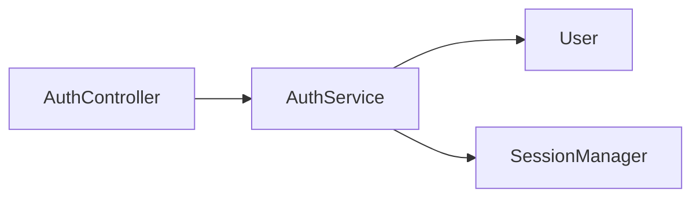

Mathematically:

\[
V = \{A,B,C,D\}
\]

\[
E = \{(A,B),(B,C),(B,D)\}
\]

The graph contains four nodes and three directed edges.

## 1.1 Why Graph Theory Matters in Software Engineering

Software systems are naturally interconnected.

Examples include:

- Classes calling methods.
- Modules importing dependencies.
- Controllers invoking services.
- Services accessing repositories.
- Database tables referencing other tables.
- Frontend components consuming APIs.

Graph theory provides a way to model and analyze these relationships.

---

# Part III — Nodes and Edges

## 2. Understanding Nodes

A **node** represents an entity within a graph.

In a codebase knowledge graph, a node might represent:

- File.
- Class.
- Interface.
- Function.
- Method.
- Module.
- Package.
- Database table.
- Documentation concept.

### Example

```java
public class TaskService {
    public void completeTask() {
        // Implementation
    }
}
```

Possible graph nodes:

```text
TaskService
completeTask
```

The class and method can be represented as separate entities.

## 2.1 Understanding Edges

An **edge** represents a relationship between two nodes.

For example:

```java
TaskService service = new TaskService();
service.completeTask();
```

A graph might represent:

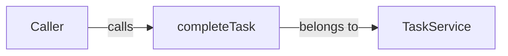

## 2.2 Common Code Relationship Types

| Relationship | Meaning | Example |
|---|---|---|
| `CONTAINS` | One entity contains another | Class contains method |
| `CALLS` | Function invokes another | Controller calls service |
| `IMPORTS` | File imports module | Java imports package |
| `EXTENDS` | Class inherits another | Activity extends AppCompatActivity |
| `IMPLEMENTS` | Class implements interface | Service implements contract |
| `REFERENCES` | Entity refers to another | Method references model |
| `DEPENDS_ON` | Component relies on another | Service depends on repository |
| `FOREIGN_KEY` | Database reference | `orders.user_id` references users |

These are illustrative relationship labels, not a guarantee that Graphify uses these exact internal edge names.

---

# Part IV — Directed and Undirected Graphs

## 3. Directed Graphs

A **directed graph** contains edges with a specific direction.

Example:

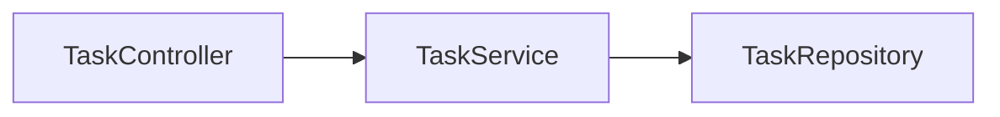

This indicates:

- `TaskController` depends on `TaskService`.
- `TaskService` depends on `TaskRepository`.

It does not imply that the repository depends on the controller.

Mathematically:

\[
(A,B) \neq (B,A)
\]

in general.

## 3.1 Why Direction Matters

Suppose you want to change `TaskRepository`.

You need to identify components that depend on it.

Following incoming dependency edges may reveal:

```text
TaskController
    ↓
TaskService
    ↓
TaskRepository
```

This supports change-impact analysis.

## 3.2 Undirected Graphs

An **undirected graph** contains relationships without an assigned direction.

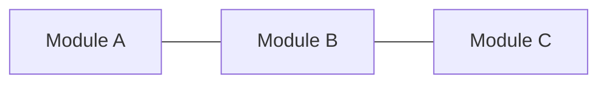

This may be useful when representing general associations or when direction is irrelevant.

## 3.3 Comparison

| Property | Directed | Undirected |
|---|---|---|
| Edge direction | Yes | No |
| Relationship symmetry | Not assumed | Assumed |
| Typical code use | Calls, imports, dependencies | General associations |
| Traversal | Direction-sensitive | Either direction |

Most code dependency graphs naturally use directed relationships.

---

# Part V — Labeled and Attributed Graphs

## 4. Labeled Graphs

A labeled graph attaches meaningful labels to nodes or edges.

Example:

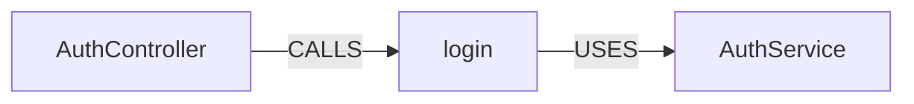

The labels describe what the relationship means.

Without labels, a graph might show connectivity but not explain the type of interaction.

## 4.1 Attributed Graphs

An attributed graph stores additional information about nodes or edges.

Example node:

```json
{
  "id": "AuthService",
  "type": "class",
  "language": "PHP",
  "file": "app/Services/AuthService.php",
  "line": 12
}
```

Possible attributes include:

- Symbol name.
- Entity type.
- Programming language.
- File path.
- Source location.
- Namespace.
- Confidence.
- Extraction method.

This JSON is illustrative.

## 4.2 Why Attributes Matter

A graph query can use metadata to narrow results.

For example:

> Find all classes inside the authentication module.

The query may filter nodes by type and location rather than searching every node indiscriminately.

---

# Part VI — Weighted Graphs

## 5. What Is a Weighted Graph?

A weighted graph assigns a numerical value to an edge.

The value might represent:

- Cost.
- Distance.
- Frequency.
- Strength.
- Latency.
- Confidence.

Example:

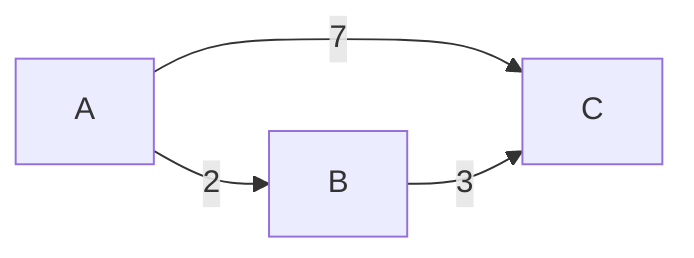

The weights are:

\[
w(A,B)=2
\]

\[
w(A,C)=7
\]

\[
w(B,C)=3
\]

## 5.1 Why Weights Matter

Weighted graphs can support:

- Cost-based pathfinding.
- Prioritization.
- Relationship scoring.
- Influence analysis.

However, an ordinary dependency graph does not necessarily assign weights to edges.

## 5.2 Important Distinction

An edge weight must have a defined meaning.

A weight of `10` is not automatically more important than a weight of `2` unless the graph schema establishes that interpretation.

---

# Part VII — Paths and Cycles

## 6. What Is a Path?

A **path** is a sequence of nodes connected by edges.

Example:

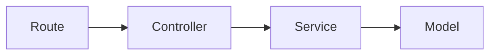

A path from `Route` to `Model` is:

\[
Route \rightarrow Controller \rightarrow Service \rightarrow Model
\]

Its length is three edges.

## 6.1 Why Paths Matter in Codebases

Path tracing can help answer:

- How does a request reach the database?
- How is one class connected to another?
- Which components sit between two modules?
- What dependencies are involved in a feature?

## 6.2 What Is a Cycle?

A cycle is a path that returns to its starting node.

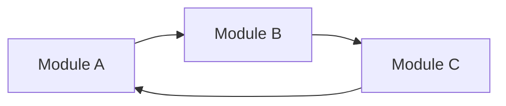

This creates a dependency cycle.

## 6.3 Why Dependency Cycles Matter

Cycles may complicate:

- Testing.
- Initialization.
- Refactoring.
- Module isolation.
- Dependency management.

However, a cycle in a general knowledge graph is not automatically a software design defect.

The meaning depends on the relationship types involved.

---

# Part VIII — Connected Components

## 7. What Is a Connected Component?

A connected component is a group of nodes connected to one another under a defined notion of connectivity.

Example:

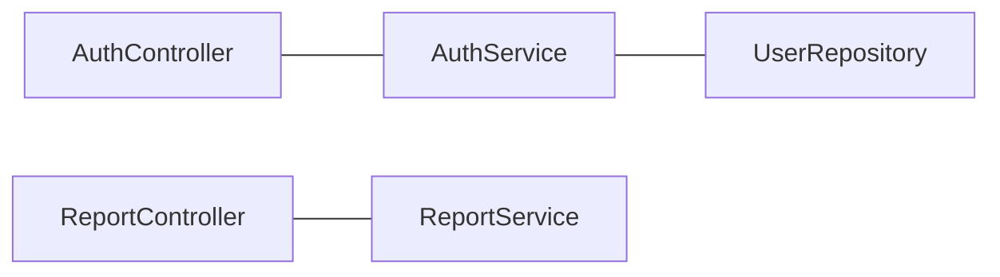

This graph contains two connected components.

Component 1:

```text
AuthController
AuthService
UserRepository
```

Component 2:

```text
ReportController
ReportService
```

## 7.1 Directed Graph Considerations

Directed graphs distinguish:

**Strongly connected components:** Every node is reachable from every other node by following edge directions.

**Weakly connected components:** Nodes are connected when edge directions are ignored.

## 7.2 Software Engineering Application

Connected components may help identify:

- Isolated subsystems.
- Unrelated modules.
- Potential architectural boundaries.
- Disconnected or orphaned code entities.

---

# Part IX — Graph Traversal

## 8. What Is Graph Traversal?

Graph traversal means systematically visiting nodes and edges.

Two fundamental traversal algorithms are:

1. Breadth-First Search (BFS).
2. Depth-First Search (DFS).

Both are essential foundations for graph analysis.

---

# Part X — Breadth-First Search

## 9. What Is BFS?

**Breadth-First Search** explores nodes level by level.

It first visits the starting node, then its immediate neighbors, followed by nodes farther away.

Example:

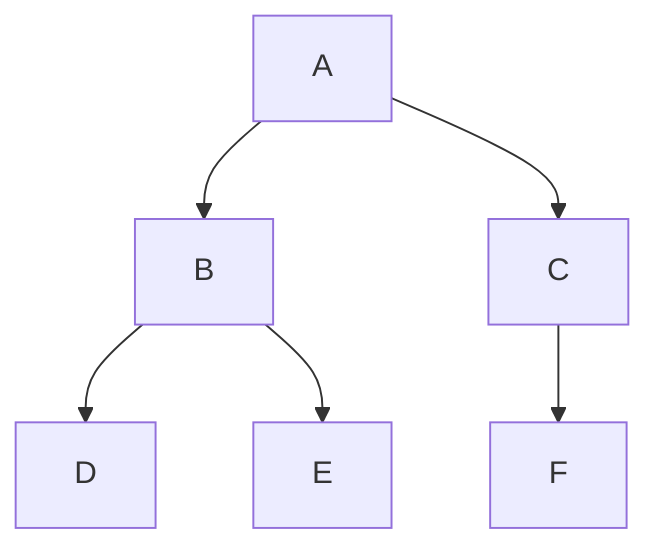

Starting at `A`, one possible BFS order is:

```text
A → B → C → D → E → F
```

The order among nodes at the same level depends on the neighbor ordering.

## 9.1 BFS Algorithm

Conceptual pseudocode:

```text
BFS(graph, start):
    queue = [start]
    visited = {start}

    while queue is not empty:
        node = remove_front(queue)

        process(node)

        for neighbor in graph.neighbors(node):
            if neighbor not in visited:
                visited.add(neighbor)
                queue.add(neighbor)
```

## 9.2 Why BFS Uses a Queue

A queue follows First-In, First-Out behavior.

This causes nodes discovered earlier to be processed first.

## 9.3 BFS Complexity

Using an adjacency-list representation:

\[
O(V+E)
\]

Where:

- \(V\) = number of vertices.
- \(E\) = number of edges.

## 9.4 BFS in Code Intelligence

BFS can help find:

- Nearby dependencies.
- Components within two or three relationship hops.
- Shortest paths in unweighted graphs.
- Immediate architectural neighborhoods.

### Example

Question:

> Which components are within two dependency steps of `ScheduleService`?

BFS is a natural traversal approach.

---

# Part XI — Depth-First Search

## 10. What Is DFS?

**Depth-First Search** explores one branch as deeply as possible before backtracking.

Using the same graph:


One possible DFS order is:

```text
A → B → D → E → C → F
```

## 10.1 DFS Algorithm

```text
DFS(graph, node, visited):
    visited.add(node)
    process(node)

    for neighbor in graph.neighbors(node):
        if neighbor not in visited:
            DFS(graph, neighbor, visited)
```

## 10.2 DFS Complexity

With adjacency lists:

\[
O(V+E)
\]

## 10.3 DFS Applications

DFS is useful for:

- Cycle detection.
- Dependency exploration.
- Connected-component discovery.
- Topological sorting in directed acyclic graphs.
- Exploring complete dependency branches.

## 10.4 BFS vs DFS

| Property | BFS | DFS |
|---|---|---|
| Exploration | Level by level | Branch by branch |
| Typical structure | Queue | Stack or recursion |
| Unweighted shortest path | Yes | Not guaranteed |
| Cycle detection | Possible | Common approach |
| Dependency exploration | Nearby relationships | Deep dependency chains |
| Complexity | \(O(V+E)\) | \(O(V+E)\) |

---

# Part XII — Shortest Paths

## 11. What Is a Shortest Path?

A shortest path is the path with minimum cost between two nodes.

In an unweighted graph, the cost is usually the number of edges.

Example:

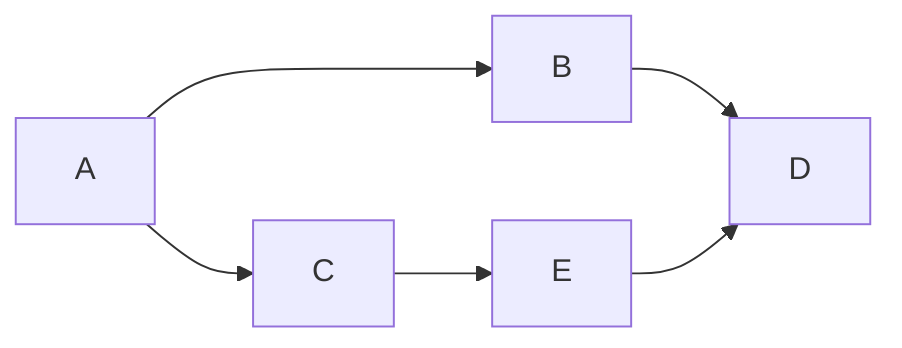

Paths from `A` to `D`:

```text
A → B → D
```

Length:

\[
2
\]

Alternative:

```text
A → C → E → D
```

Length:

\[
3
\]

The first path is shorter.

## 11.1 Common Algorithms

| Algorithm | Typical Use |
|---|---|
| BFS | Unweighted shortest paths |
| Dijkstra | Nonnegative weighted shortest paths |
| Bellman-Ford | Weighted graphs allowing negative edges |
| A* | Heuristic-guided pathfinding |

## 11.2 Why Shortest Paths Matter in Graphify

Graphify provides path-oriented graph queries.

Conceptually, path tracing can reveal how two code concepts are connected.

For example:

```text
ProductForm
    ↓
ProductApiClient
    ↓
ProductEndpoint
    ↓
ProductController
```

These relationships would need to exist in the graph to be traversed.

## 11.3 Important Limitation

A shortest graph path is not necessarily the complete execution path.

The graph may omit dynamic calls or runtime behavior.

---

# Part XIII — Node Degree

## 12. What Is Degree?

Degree measures the number of edges connected to a node.

For undirected graphs:

\[
deg(v)=\text{number of incident edges}
\]

For directed graphs, distinguish:

- In-degree.
- Out-degree.

## 12.1 In-Degree

The number of incoming edges.

\[
deg^{-}(v)
\]

## 12.2 Out-Degree

The number of outgoing edges.

\[
deg^{+}(v)
\]

### Example

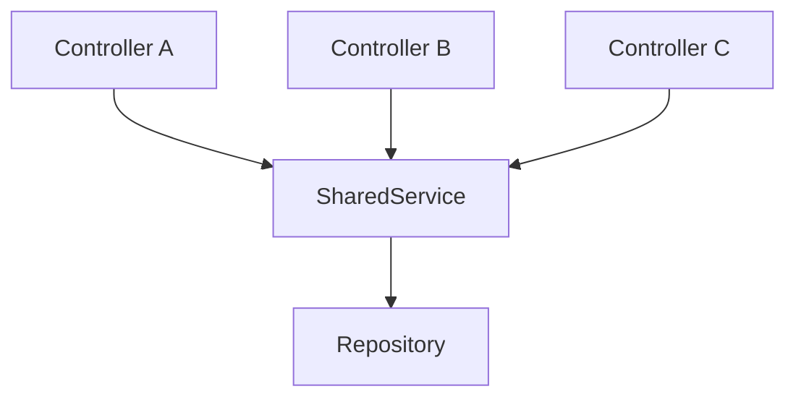

For `SharedService`:

\[
InDegree=3
\]

\[
OutDegree=1
\]

## 12.3 Interpretation

High in-degree may indicate that many components depend on a node.

High out-degree may indicate that a component relies on many others.

The interpretation depends on edge direction and relationship meaning.

---

# Part XIV — Centrality

## 13. What Is Graph Centrality?

Centrality measures how structurally important a node is according to a particular mathematical definition.

Different centrality measures capture different notions of importance.

## 13.1 Degree Centrality

Degree centrality measures direct connectivity.

For a simple undirected graph with \(n\) nodes:

\[
C_D(v)=\frac{deg(v)}{n-1}
\]

Example:

If a node connects to 4 of the other 9 nodes:

\[
C_D(v)=\frac{4}{9}\approx0.444
\]

## 13.2 Betweenness Centrality

Betweenness centrality measures how frequently a node lies on shortest paths between other nodes.

A common unnormalized definition is:

\[
C_B(v)=
\sum_{s\ne v\ne t}
\frac{\sigma_{st}(v)}{\sigma_{st}}
\]

Where:

- \(\sigma_{st}\) = number of shortest paths from \(s\) to \(t\).
- \(\sigma_{st}(v)\) = number of those paths passing through \(v\).

### Example

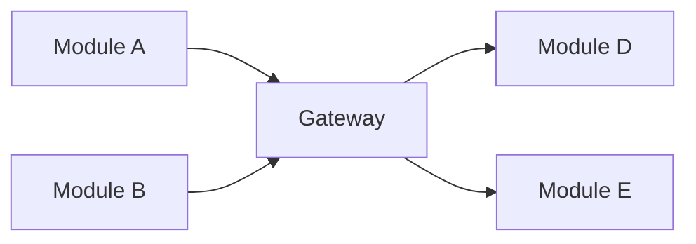

The gateway connects multiple regions of the graph.

It may have high betweenness centrality.

## 13.3 Closeness Centrality

Closeness centrality reflects how near a node is to other reachable nodes.

A basic connected-graph formula is:

\[
C_C(v)=
\frac{n-1}{\sum_{u\ne v}d(v,u)}
\]

Where \(d(v,u)\) is the shortest-path distance.

Disconnected and directed graphs require careful treatment of unreachable nodes and normalization.

## 13.4 PageRank

PageRank assigns importance based on the importance and link structure of neighboring nodes.

It is commonly associated with web graphs but can be applied to other directed networks.

## 13.5 Comparison

| Measure | Main Question |
|---|---|
| Degree | How many direct connections? |
| Betweenness | Does the node bridge paths? |
| Closeness | How near is the node to others? |
| PageRank | How important are its incoming connections? |

## 13.6 Important

Centrality is a structural metric.

It does not automatically measure:

- Code quality.
- Security risk.
- Business importance.
- Maintainability.
- Runtime performance.

---

# Part XV — God Nodes and Architectural Complexity

## 14. What Is a God Node?

A **god node** is an informal term for a highly connected or overly central component.

In software engineering, the related term **God Object** refers to a class that takes on excessive responsibilities.

These concepts are related but not identical.

## 14.1 Example

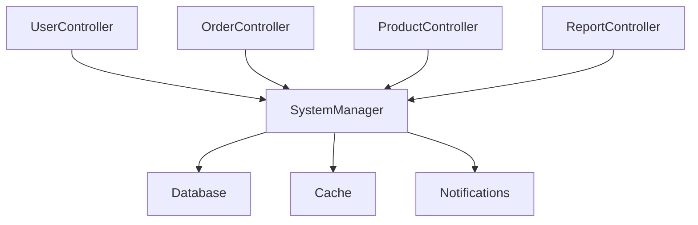

The central component has many relationships.

## 14.2 Why This May Matter

A highly connected component may be:

- Difficult to modify.
- Widely depended upon.
- Expensive to test.
- Sensitive to regressions.

## 14.3 Important Caution

A central component is not automatically poorly designed.

Examples of legitimate central components include:

- Shared interfaces.
- Domain models.
- Framework abstractions.
- Utility services.

Graph metrics provide clues, not final architectural judgments.

---

# Part XVI — Community Detection

## 15. What Is Community Detection?

Community detection identifies groups of nodes that are more strongly connected internally than externally.

In a software graph, these groups may resemble modules or subsystems.

### Example

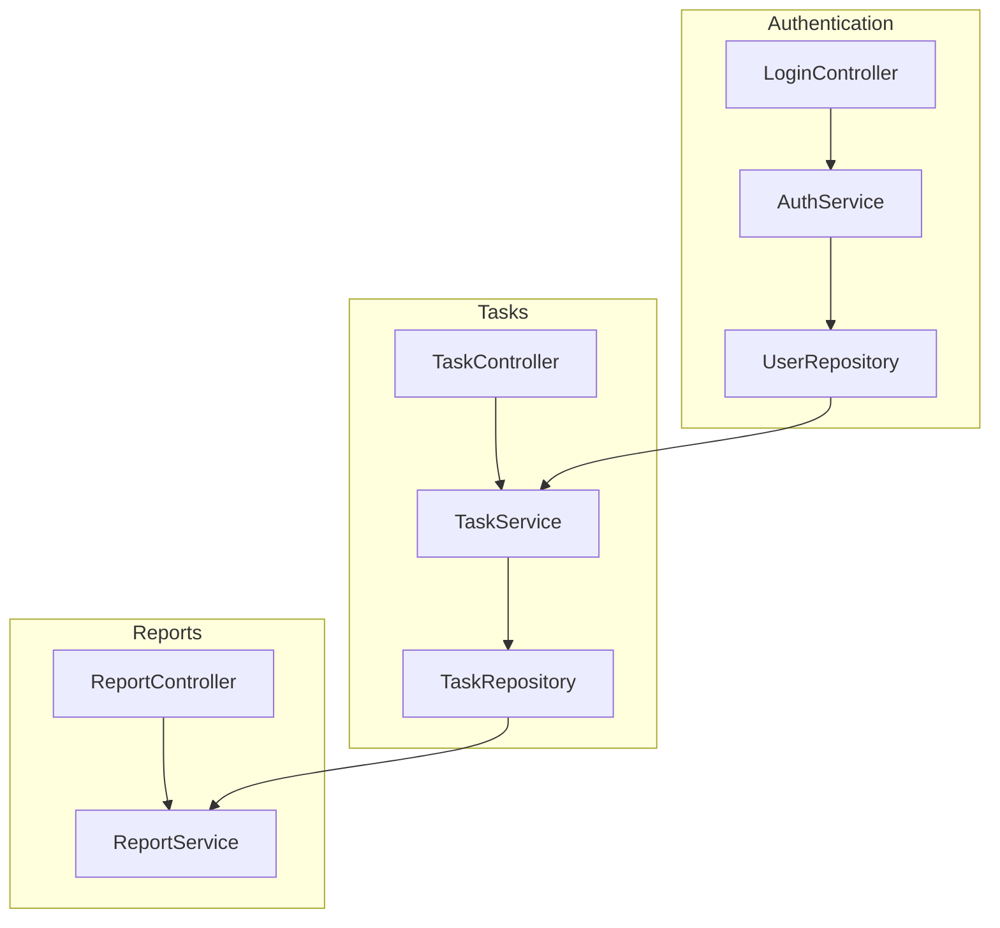

The graph contains three conceptual communities.

## 15.1 Why Communities Matter

Community detection may help identify:

- Subsystems.
- Architectural clusters.
- Related components.
- Unexpected coupling.
- Areas suitable for focused investigation.

## 15.2 Community Detection vs Folder Structure

Folder structure reflects how developers organize files.

Community detection reflects connectivity patterns.

These may differ.

For example:

```text
services/
├── AuthService.java
├── TaskService.java
└── ReportService.java
```

All services are in one folder, but they may belong to different graph communities.

---

# Part XVII — Leiden and Louvain Algorithms

## 16. Louvain Community Detection

Louvain is a community-detection method commonly used to optimize modularity.

It attempts to group nodes so that connections are relatively dense within groups.

## 16.1 Leiden Community Detection

Leiden is another community-detection algorithm designed to address limitations of Louvain, including poorly connected communities.

Graphify's documentation references optional Leiden-based community detection.

## 16.2 Modularity

A common modularity formula for an undirected graph is:

\[
Q=
\frac{1}{2m}
\sum_{i,j}
\left(
 A_{ij}-\frac{k_i k_j}{2m}
\right)
\delta(c_i,c_j)
\]

Where:

- \(A_{ij}\) = adjacency-matrix entry.
- \(k_i\) = degree of node \(i\).
- \(m\) = total number of edges.
- \(c_i\) = community assignment.
- \(\delta(c_i,c_j)\) = 1 when nodes share a community, otherwise 0.

## 16.3 Simplified Interpretation

Higher modularity generally indicates stronger separation between communities under the modularity model.

However, maximizing modularity does not guarantee that communities match meaningful software modules.

## 16.4 Important

Community detection is exploratory.

Its output should be interpreted alongside:

- Source code.
- Architecture documentation.
- Domain boundaries.
- Developer knowledge.

---

# Part XVIII — Graph Schemas

## 17. What Is a Graph Schema?

A graph schema defines the allowed types of nodes, relationships, and properties.

Example conceptual schema:

```text
Node Types:
- File
- Class
- Method
- Function
- Module

Edge Types:
- CONTAINS
- IMPORTS
- CALLS
- EXTENDS
- REFERENCES
```

## 17.1 Why Schemas Matter

Without consistent types, graph queries can become ambiguous.

For example, the name `User` could refer to:

- A class.
- A database table.
- A documentation concept.
- A variable.

A schema helps distinguish them.

## 17.2 Example

```json
{
  "nodes": [
    {
      "id": "class:UserService",
      "type": "Class"
    },
    {
      "id": "method:UserService.createUser",
      "type": "Method"
    }
  ],
  "edges": [
    {
      "source": "class:UserService",
      "target": "method:UserService.createUser",
      "type": "CONTAINS"
    }
  ]
}
```

This is an educational example, not Graphify's verified JSON schema.

---

# Part XIX — Adjacency Lists and Matrices

## 18. Graph Storage Representations

Two common graph representations are:

1. Adjacency lists.
2. Adjacency matrices.

## 18.1 Adjacency List

For:

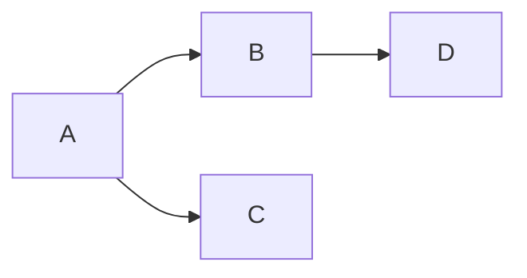

An adjacency list might be:

```text
A: [B, C]
B: [D]
C: []
D: []
```

Advantages:

- Efficient for sparse graphs.
- Convenient for traversal.
- Memory proportional to nodes and edges.

Typical space complexity:

\[
O(V+E)
\]

## 18.2 Adjacency Matrix

The same graph can be represented as:

| | A | B | C | D |
|---|---:|---:|---:|---:|
| A | 0 | 1 | 1 | 0 |
| B | 0 | 0 | 0 | 1 |
| C | 0 | 0 | 0 | 0 |
| D | 0 | 0 | 0 | 0 |

Typical space complexity:

\[
O(V^2)
\]

## 18.3 Comparison

| Property | Adjacency List | Adjacency Matrix |
|---|---|---|
| Sparse graphs | Efficient | More memory |
| Edge existence lookup | Depends on structure | Typically \(O(1)\) |
| Neighbor traversal | Efficient | May scan a full row |
| Memory | \(O(V+E)\) | \(O(V^2)\) |

These are general graph representations; Graphify's internal persistence format should be examined separately.

---

# Part XX — Knowledge Graph vs AST

## 19. Are ASTs and Knowledge Graphs the Same?

No.

An AST describes the syntactic structure of a program.

A knowledge graph can combine entities and relationships across multiple files and information sources.

## 19.1 AST Example

```java
class UserService {
    void saveUser() {}
}
```

Simplified AST:

```text
ClassDeclaration
└── UserService
    └── MethodDeclaration
        └── saveUser
```

## 19.2 Knowledge Graph Example

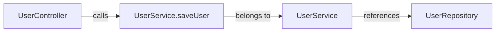

## 19.3 Comparison

| AST | Knowledge Graph |
|---|---|
| Primarily syntax-oriented | Relationship-oriented |
| Often file-scoped | Can span files and modules |
| Represents grammar | Represents entities and relationships |
| Useful for parsing | Useful for architectural navigation |

## 19.4 Relationship Between Them

AST parsing can supply the raw structural information used to construct a code knowledge graph.

---

# Part XXI — Knowledge Graph vs Dependency Graph

## 20. What Is a Dependency Graph?

A dependency graph represents which components depend on other components.

Example:

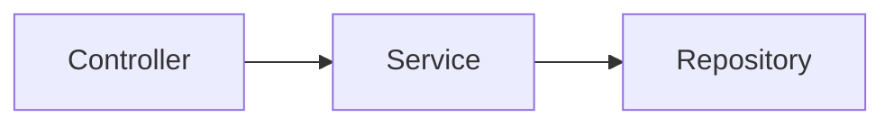

## 20.1 What Makes a Knowledge Graph Broader?

A knowledge graph may represent several relationship types simultaneously.

For example:

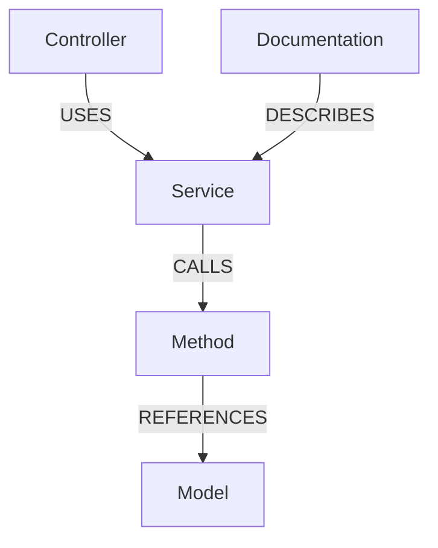

The graph includes both code and documentation relationships.

## 20.2 Important

A dependency graph can be considered a specialized graph representation.

A knowledge graph is often broader in entity types and relationship semantics.

---

# Part XXII — Knowledge Graph vs Vector Database

## 21. Structural Relationships vs Semantic Similarity

A vector database commonly retrieves information based on embedding similarity.

A knowledge graph retrieves information through explicit or inferred relationships.

## 21.1 Example

Question:

> Which classes depend on `ScheduleService`?

Graph traversal is well suited because the question concerns dependencies.

Question:

> Which documentation sections discuss scheduling policies?

Semantic retrieval may be useful because the question concerns meaning.

## 21.2 Comparison

| Feature | Knowledge Graph | Vector Search |
|---|---|---|
| Primary representation | Nodes and edges | Embedding vectors |
| Main strength | Relationship traversal | Semantic similarity |
| Dependency analysis | Strong fit | Indirect |
| Similarity-based discovery | Depends on design | Strong fit |
| Requires embeddings | Not inherently | Usually |
| Supports structural paths | Yes | Not inherently |

## 21.3 Hybrid Retrieval

Some architectures combine graph retrieval and semantic retrieval.

For example:

```mermaid
flowchart TD
    A["Developer Question"] --> B["Query Analysis"]
    B --> C["Graph Retrieval"]
    B --> D["Semantic Retrieval"]
    C --> E["Combined Context"]
    D --> E
    E --> F["Coding Agent"]
```

This is a general architectural pattern, not a claim that Graphify always performs hybrid retrieval.

---

# Part XXIII — From Source Code to Knowledge Graph

## 22. The Graph Construction Pipeline

A code-intelligence system generally needs to:

1. Discover files.
2. Parse source code.
3. Extract entities.
4. Extract relationships.
5. Resolve cross-file references.
6. Construct the graph.
7. Persist graph data.
8. Support queries.

```mermaid
flowchart TD
    A["Source Files"] --> B["File Discovery"]
    B --> C["AST Parsing"]
    C --> D["Entity Extraction"]
    D --> E["Relationship Extraction"]
    E --> F["Cross-File Resolution"]
    F --> G["Knowledge Graph"]
    G --> H["Query and Visualization"]
```

## 22.1 Example

Source:

```java
public class TaskController {
    private TaskService taskService;
}
```

Potential entities:

```text
TaskController
TaskService
```

Potential relationship:

```text
TaskController → references → TaskService
```

The exact extraction depends on parser and resolver capabilities.

---

# Part XXIV — Graph-Assisted Context Engineering

## 23. Why Graphs Help Coding Agents

Coding agents need relevant context.

A graph can help identify relationships before loading source files.

## 23.1 Traditional Workflow

```text
Search repository
Read files
Search additional files
Infer relationships
Implement
```

## 23.2 Graph-Assisted Workflow

```text
Query graph
Identify relevant nodes
Trace dependencies
Read relevant files
Verify findings
Implement
```

## 23.3 Context Reduction Formula

Let:

\[
T_b = \text{baseline exploration tokens}
\]

\[
T_g = \text{graph-assisted exploration tokens}
\]

Then:

\[
Reduction =
\frac{T_b-T_g}{T_b}\times100\%
\]

### Hypothetical Example

\[
T_b=24{,}000
\]

\[
T_g=9{,}000
\]

\[
Reduction=62.5\%
\]

This is an illustrative calculation, not a measured Graphify benchmark.

## 23.4 Important

Graph construction and query overhead should also be included when evaluating total workflow efficiency.

---

# Part XXV — Graph Accuracy and Confidence

## 24. Why Graph Relationships Need Verification

A code knowledge graph is an analysis artifact.

It may contain:

- Correct extracted relationships.
- Inferred relationships.
- Missing edges.
- Ambiguous symbol resolutions.
- Outdated information.

## 24.1 Example

A Laravel service may be resolved through dependency injection.

The source may not contain a direct constructor call to the concrete implementation.

A static analyzer may need additional information to identify the runtime relationship.

## 24.2 Verification Principle

> Use graph relationships to guide investigation, then confirm critical behavior against source code and tests.

---

# Part XXVI — Graph Freshness

## 25. What Is Graph Freshness?

Graph freshness describes how closely the graph reflects the current repository state.

## 25.1 Example

Initial graph:

```text
Controller → OldService
```

After refactoring:

```text
Controller → NewService
```

If the graph is not updated, the agent may continue using obsolete relationships.

## 25.2 Consequences

- Incorrect dependency tracing.
- Missing affected components.
- Misleading architecture reports.
- Wasted context.
- Incorrect refactoring decisions.

## 25.3 Best Practice

Regenerate or refresh graph data when meaningful source changes occur, according to the tool's supported workflow.

---

# Part XXVII — GroupTrack Android Case Study

## 26. Scenario: Task Completion

Consider an Android Java project where a user marks a task as complete.

Conceptual components:

```mermaid
flowchart TD
    A["TaskDetailsActivity"] --> B["TaskViewModel"]
    B --> C["TaskRepository"]
    C --> D["Firebase"]
```

This is an illustrative architecture, not a verified representation of GroupTrack.

## 26.1 Graph Questions

- Which class handles task completion?
- Which repository writes task updates?
- What depends on the task model?
- Which components are related to project progress?
- What could be affected by changing task status handling?

## 26.2 Graph Concepts Applied

| Concept | Application |
|---|---|
| Nodes | Activities, methods, repositories |
| Edges | Calls, references, dependencies |
| BFS | Nearby dependencies |
| DFS | Deep dependency exploration |
| Paths | Task update flow |
| Centrality | Widely referenced services |

## 26.3 Important

The graph does not replace Firebase rules or runtime testing.

---

# Part XXVIII — GoPasig Laravel Case Study

## 27. Scenario: Dispatch Dependencies

Consider a Laravel fleet-management system.

Conceptual graph:

```mermaid
flowchart TD
    A["ScheduleController"] --> B["DispatchService"]
    B --> C["Schedule"]
    B --> D["Bus"]
    B --> E["Driver"]
    B --> F["Trip"]
```

## 27.1 Questions

- Which components depend on dispatch logic?
- Which models are referenced by schedule assignment?
- Is there a highly connected service?
- What modules might be affected by a dispatch refactor?
- Are route and schedule components tightly coupled?

## 27.2 Applying Centrality

A highly connected dispatch service may deserve extra regression testing.

However, its degree alone does not prove poor design.

## 27.3 Applying Path Analysis

A path query may help identify how a schedule-related controller is connected to a trip model.

The path should then be verified against actual code.

---

# Part XXIX — Next.js and Laravel Case Study

## 28. Scenario: Product Creation

Conceptual architecture:

```mermaid
flowchart LR
    A["ProductForm"] --> B["API Client"]
    B --> C["Laravel API"]
    C --> D["ProductController"]
    D --> E["Product"]
```

## 28.1 Graph Challenges

The frontend and backend may be separate repositories.

A static graph built from only the frontend may not know about backend controllers.

## 28.2 Important Concept

Graph scope matters.

A graph can only represent information available to its extraction and enrichment process.

## 28.3 Practical Implication

Cross-repository architecture questions may require:

- Multiple graphs.
- Shared API documentation.
- Manual relationship mapping.
- Additional integration support.

Do not assume Graphify automatically connects every cross-service dependency.

---

# Part XXX — Performance and Scalability

## 29. What Determines Graph Performance?

Graph performance depends on factors such as:

- Number of nodes.
- Number of edges.
- Graph density.
- Query type.
- Storage representation.
- Traversal depth.
- Indexing strategy.

## 29.1 Graph Density

For a simple directed graph without self-loops, density is:

\[
D=\frac{E}{V(V-1)}
\]

Where:

- \(E\) = number of edges.
- \(V\) = number of vertices.

## 29.2 Example

A directed graph has:

\[
V=5
\]

\[
E=8
\]

Then:

\[
D=\frac{8}{5(4)}=0.4
\]

## 29.3 Sparse vs Dense Graphs

**Sparse graph:** Relatively few edges compared with the maximum possible.

**Dense graph:** Many possible connections are present.

Code dependency graphs are often sparse, but this is not guaranteed.

## 29.4 Important

Graph size alone does not determine whether a tool is useful.

Query accuracy, indexing cost, and integration overhead also matter.

---

# Part XXXI — Common Misconceptions

## 30. Misconception 1: A Knowledge Graph Understands Everything

False.

It represents extracted and inferred relationships, not complete runtime truth.

## 30.1 Misconception 2: Every Edge Is Equally Reliable

False.

Relationships may have different origins and confidence levels.

## 30.2 Misconception 3: High Centrality Means Bad Code

False.

Centrality measures structural position, not code quality.

## 30.3 Misconception 4: A Shortest Path Is an Execution Trace

False.

A graph path represents connectivity under the graph's edge semantics.

## 30.4 Misconception 5: Graph Retrieval Eliminates Source Reading

False.

Critical relationships still require verification.

## 30.5 Misconception 6: Graphify Always Saves Tokens

Not necessarily.

Benefits depend on repository complexity, query accuracy, and overhead.

---

# Part XXXII — Practical Exercises

## Exercise 1 — Identify Nodes and Edges

Consider:

```java
class ProjectController {
    ProjectService service;
}
```

Identify two nodes and one possible edge.

## Exercise 2 — Directed Graph

Draw a directed dependency graph containing:

- Controller.
- Service.
- Repository.
- Database.

Explain why the direction matters.

## Exercise 3 — Weighted Graph

Create a four-node weighted graph.

Explain what each weight represents.

## Exercise 4 — Path Finding

Given:

```text
A → B → D
A → C → E → D
```

Identify the shortest unweighted path from `A` to `D`.

## Exercise 5 — BFS

For the graph:

```text
A → B
A → C
B → D
C → E
```

Write one valid BFS order starting from `A`.

## Exercise 6 — DFS

Using the same graph, write one valid DFS order starting from `A`.

## Exercise 7 — Degree

Given:

```text
A → C
B → C
C → D
```

Calculate the in-degree and out-degree of `C`.

## Exercise 8 — Centrality

Explain why a shared authentication service may have high degree centrality.

Does that automatically make it poorly designed?

## Exercise 9 — Community Detection

Design a graph containing authentication, tasks, and reporting modules.

Identify potential communities.

## Exercise 10 — Graph Schema

Define three node types and four edge types for an Android application.

## Exercise 11 — AST vs Graph

Explain how an AST differs from a code knowledge graph.

## Exercise 12 — Dependency Analysis

A repository changes a heavily referenced interface.

Explain how graph traversal may assist impact analysis.

## Exercise 13 — Graph Freshness

Describe a situation where an outdated graph could mislead Codex.

## Exercise 14 — Graph Scope

Explain why a graph of the Next.js frontend may not include Laravel backend relationships.

## Exercise 15 — Final Exercise

Design a conceptual knowledge graph for one of your projects.

Include:

1. At least eight nodes.
2. At least ten directed edges.
3. At least three relationship types.
4. One possible dependency path.
5. One highly connected node.
6. Two potential communities.
7. A description of how Codex could use the graph.

---

# Part XXXIII — Review Questions

1. What is graph theory?
2. What is the mathematical definition of a graph?
3. What is a node?
4. What is an edge?
5. What is a directed graph?
6. What is an undirected graph?
7. What is a labeled graph?
8. What is an attributed graph?
9. What is a weighted graph?
10. What is a path?
11. What is a cycle?
12. What is a connected component?
13. What is BFS?
14. What data structure does BFS typically use?
15. What is DFS?
16. What data structure does DFS typically use?
17. What is the time complexity of BFS with adjacency lists?
18. What is the time complexity of DFS with adjacency lists?
19. Which algorithm finds shortest paths in unweighted graphs?
20. What is node degree?
21. What is in-degree?
22. What is out-degree?
23. What is centrality?
24. What is betweenness centrality?
25. What is community detection?
26. What is modularity?
27. What is a graph schema?
28. What is an adjacency list?
29. What is an adjacency matrix?
30. How does an AST differ from a knowledge graph?
31. How does a dependency graph differ from a broader knowledge graph?
32. How does graph retrieval differ from vector retrieval?
33. Why is graph freshness important?
34. What are the limitations of static graph analysis?
35. How can graph traversal improve context engineering?

---

# Part XXXIV — Key Takeaways

> [!summary]
> - Graph theory studies entities and their relationships.
> - A graph consists of vertices and edges.
> - Directed graphs preserve relationship direction.
> - Labeled graphs describe relationship meaning.
> - Attributed graphs store metadata.
> - Weighted graphs represent numerical relationship properties.
> - Paths describe connectivity.
> - Cycles represent closed sequences of relationships.
> - Connected components identify connected regions.
> - BFS explores level by level.
> - DFS explores branch by branch.
> - BFS finds shortest paths in unweighted graphs.
> - Node degree measures direct connectivity.
> - Centrality measures structural importance according to specific definitions.
> - Community detection identifies densely connected groups.
> - Graph schemas define entity and relationship types.
> - ASTs represent syntax, while knowledge graphs represent broader relationships.
> - Dependency graphs are specialized relationship graphs.
> - Graph retrieval and vector search solve different problems.
> - Knowledge graphs can improve targeted context discovery.
> - Static graphs may omit runtime behavior.
> - Graph freshness and relationship accuracy are essential.
> - Graph findings must be verified against source code and tests.

---

# Part XXXV — Final Mental Model

```mermaid
flowchart TD
    A["Source Code"] --> B["AST Parsing"]
    B --> C["Entity Extraction"]
    C --> D["Relationship Extraction"]
    D --> E["Knowledge Graph"]
    E --> F["Graph Traversal"]
    E --> G["Shortest Paths"]
    E --> H["Centrality"]
    E --> I["Community Detection"]
    F --> J["Codebase Understanding"]
    G --> J
    H --> J
    I --> J
    J --> K["Relevant Context"]
    K --> L["Coding Agent"]
    L --> M["Source Verification and Testing"]
```

> [!important] Final Principle
> **A knowledge graph transforms codebase structure into navigable relationships. Graph algorithms help discover relevant components, but reliable software engineering still requires verifying those relationships against actual source code and runtime behavior.**

---

# Part XXXVI — Official References

## Graphify

- [Official Graphify Repository](https://github.com/Graphify-Labs/graphify)
- [Graphify README](https://github.com/Graphify-Labs/graphify/blob/main/README.md)
- [Graphify Architecture](https://github.com/Graphify-Labs/graphify/blob/main/ARCHITECTURE.md)
- [Graphify Benchmarks](https://github.com/Graphify-Labs/graphify/blob/main/BENCHMARKS.md)

## Graph Theory

- [NetworkX Documentation](https://networkx.org/documentation/stable/)
- [NetworkX Algorithms](https://networkx.org/documentation/stable/reference/algorithms/index.html)
- [NetworkX Centrality](https://networkx.org/documentation/stable/reference/algorithms/centrality.html)
- [NetworkX Community Detection](https://networkx.org/documentation/stable/reference/algorithms/community.html)

## Parsing and Code Intelligence

- [Tree-sitter Documentation](https://tree-sitter.github.io/tree-sitter/)
- [Tree-sitter GitHub Repository](https://github.com/tree-sitter/tree-sitter)

## Community Detection

- [Leiden Algorithm Research Paper](https://www.nature.com/articles/s41598-019-41695-z)

## Agentic Engineering

- [OpenAI Codex Documentation](https://developers.openai.com/codex/)
- [Model Context Protocol](https://modelcontextprotocol.io/)

> [!note] Documentation Scope
> This lesson explains established graph-theory concepts and their applications to code intelligence.
>
> Relationship names, JSON structures, diagrams, and application architectures are illustrative unless explicitly identified as Graphify-specific behavior.
>
> No Graphify installation, graph construction, repository indexing, or code execution was performed.

---

# Part XXXVII — Next Lesson

**[[02 - Architecture and Core Components]]**

Topics:

1. Graphify's high-level architecture.
2. Repository structure.
3. Python package organization.
4. File discovery.
5. Tree-sitter parsing pipeline.
6. Entity extraction.
7. Relationship extraction.
8. Cross-file symbol resolution.
9. Graph construction.
10. Graph storage.
11. Query engine.
12. Graph visualization.
13. Agent skill integration.
14. Optional MCP integration.
15. Architecture tradeoffs.
16. Practical examples.
17. Exercises and review questions.
18. Official references.

**End of Lesson 01 — Knowledge Graph Fundamentals.**
