# 02 — Graphify: Architecture and Core Components

> [!abstract] Lesson Information
> **Repository:** [Graphify-Labs/graphify](https://github.com/Graphify-Labs/graphify)
>
> **Category:** Agentic Engineering / Software Architecture / Code Intelligence / Knowledge Graphs
>
> **Difficulty:** Intermediate to Advanced
>
> **Learning Approach:** Theory First
>
> **Prerequisites:**
> - [[00 - Repository Overview and Purpose]]
> - [[01 - Knowledge Graph Fundamentals]]
>
> **Primary Goal:** Understand Graphify's documented internal architecture, its modular processing pipeline, core Python components, graph construction process, analysis capabilities, output artifacts, and integration with coding agents.

---

# Part I — Learning Objectives

After completing this lesson, you should be able to:

1. Explain Graphify's high-level architecture.
2. Describe its modular pipeline.
3. Identify the responsibilities of core Python modules.
4. Understand file discovery and filtering.
5. Explain source-code extraction using tree-sitter.
6. Understand graph construction with NetworkX.
7. Explain relationship confidence labels.
8. Understand graph clustering and analysis.
9. Describe report generation and graph export.
10. Explain graph validation and security boundaries.
11. Understand semantic caching and optional content ingestion.
12. Explain file watching and graph freshness.
13. Understand the role of the MCP server.
14. Distinguish the CLI, Python library, and agent skill.
15. Evaluate architecture tradeoffs.
16. Apply Graphify concepts to real software projects.

---

# Part II — High-Level Architecture

## 1. Graphify's Architecture

Graphify is implemented primarily as a Python library, with command-line and coding-agent integration layers.

Its official architecture documentation describes a processing pipeline that converts project files into a structured graph, analyzes the graph, and produces reports and exports.

The core pipeline is:

```text
detect()
   ↓
extract()
   ↓
build_graph()
   ↓
cluster()
   ↓
analyze()
   ↓
report()
   ↓
export()
```

Each stage has a distinct responsibility.

## 1.1 Architecture Diagram

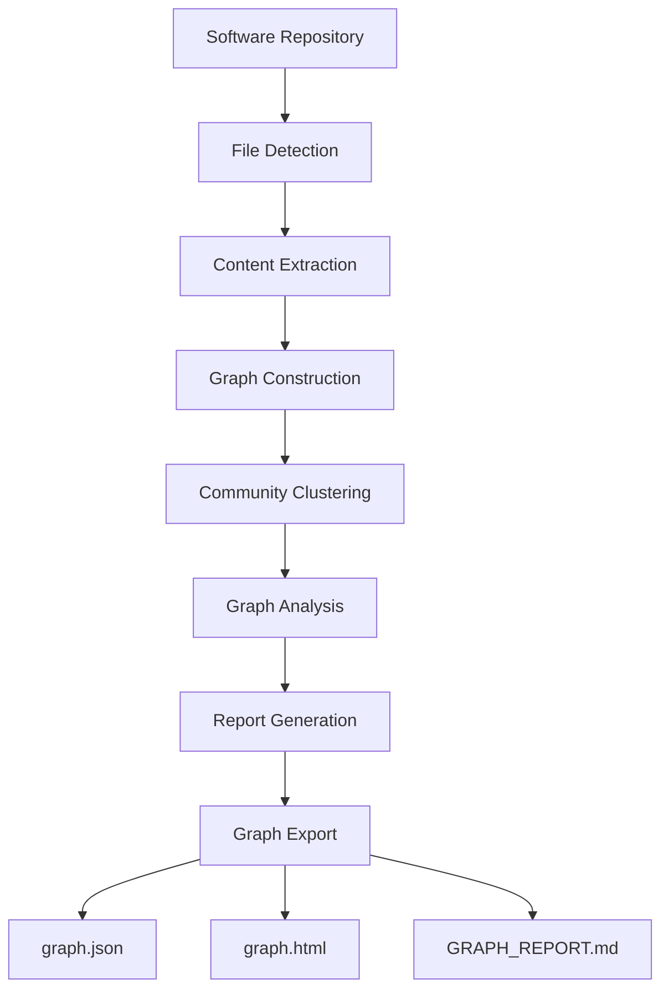

## 1.2 Design Philosophy

The documented architecture emphasizes:

- Separation of responsibilities.
- Small, focused modules.
- Explicit data passing.
- Structured extraction output.
- Graph-based analysis.
- Reusable Python functions.
- Independently testable components.

This resembles a **pipeline architecture**.

## 1.3 What Is Pipeline Architecture?

Pipeline architecture divides processing into sequential stages.

Each stage:

1. Receives input.
2. Performs a specific transformation.
3. Produces output.
4. Passes the result to the next stage.

Example:

```text
Source Files
    ↓
Parsed Entities
    ↓
Graph
    ↓
Analysis
    ↓
Reports
```

### Advantages

- Easier testing.
- Clear responsibilities.
- Modular maintenance.
- Better error isolation.
- Easier extension.

### Limitations

- Intermediate representations must remain compatible.
- Errors in early stages can affect later stages.
- Some workflows may require rebuilding earlier results.
- Pipeline performance depends on multiple components.

---

# Part III — Core Module Overview

## 2. Main Modules

Graphify's official `ARCHITECTURE.md` documents the following modules and responsibilities.

| Module | Primary Responsibility |
|---|---|
| `detect.py` | Discover supported project files |
| `extract.py` | Extract nodes and relationships |
| `build.py` | Construct the NetworkX graph |
| `cluster.py` | Assign graph communities |
| `analyze.py` | Identify important graph patterns |
| `report.py` | Generate Markdown analysis |
| `export.py` | Export graph artifacts |
| `ingest.py` | Ingest external URL content |
| `cache.py` | Manage semantic extraction cache |
| `security.py` | Validate external inputs |
| `validate.py` | Validate extraction data |
| `serve.py` | Provide an MCP server |
| `watch.py` | Detect relevant file changes |
| `benchmark.py` | Evaluate graph retrieval efficiency |

These are documented module responsibilities, not a complete inventory of every file in the package.

---

# Part IV — File Detection

## 3. The detect.py Module

The first major stage is file discovery.

Documented function:

```python
collect_files(root)
```

Input:

```text
Project directory
```

Output:

```text
Filtered list of file paths
```

## 3.1 Why File Detection Matters

A software repository may contain:

- Source code.
- Dependencies.
- Generated files.
- Build artifacts.
- Documentation.
- Images.
- Temporary files.
- Configuration files.

Not every file should be processed in the same way.

### Example

```text
project/
├── app/
├── database/
├── resources/
├── routes/
├── vendor/
├── node_modules/
├── .git/
└── README.md
```

An indexing tool should distinguish relevant project content from potentially unnecessary dependency and generated content.

The exact filtering rules depend on Graphify's implementation and configuration.

## 3.2 Conceptual Detection Algorithm

```python
def discover_files(root):
    files = []

    for path in walk_directory(root):
        if is_supported(path) and not is_excluded(path):
            files.append(path)

    return files
```

This is educational pseudocode, not Graphify's source implementation.

## 3.3 Design Considerations

A file detector should consider:

- Supported extensions.
- Excluded directories.
- File sizes.
- Binary content.
- Symbolic links.
- Duplicate paths.
- Permission errors.

## 3.4 Security Consideration

File discovery should avoid unintentionally indexing sensitive or unrelated content.

Before using a repository-indexing tool, understand its inclusion and exclusion rules.

---

# Part V — Source-Code Extraction

## 4. The extract.py Module

The extraction stage converts supported source files into structured entities and relationships.

Documented function:

```python
extract(path)
```

Input:

```text
Source file path
```

Output:

```python
{
    "nodes": [],
    "edges": []
}
```

## 4.1 What Is Extracted?

Potential nodes include:

- Classes.
- Functions.
- Methods.
- Modules.
- Imports.
- Other supported entities.

Potential relationships include:

- Calls.
- Imports.
- Uses.
- Inheritance.
- References.

## 4.2 Example

Source code:

```java
public class TaskService {
    public void completeTask() {
        updateStatus();
    }
}
```

Conceptual extraction:

```json
{
  "nodes": [
    {
      "id": "TaskService",
      "label": "TaskService"
    },
    {
      "id": "TaskService.completeTask",
      "label": "completeTask"
    }
  ],
  "edges": [
    {
      "source": "TaskService",
      "target": "TaskService.completeTask",
      "relation": "contains",
      "confidence": "EXTRACTED"
    }
  ]
}
```

This is an illustrative extraction, not a verified output for this Java example.

---

# Part VI — Tree-sitter Parsing

## 5. Why Graphify Uses Tree-sitter

Tree-sitter is a parsing system that produces structured syntax trees.

Instead of treating source code as plain text, a parser identifies language constructs.

Example:

```java
class UserService {
    void save() {}
}
```

Simplified syntax tree:

```text
class_declaration
├── identifier: UserService
└── class_body
    └── method_declaration
        └── identifier: save
```

## 5.1 Parsing Workflow

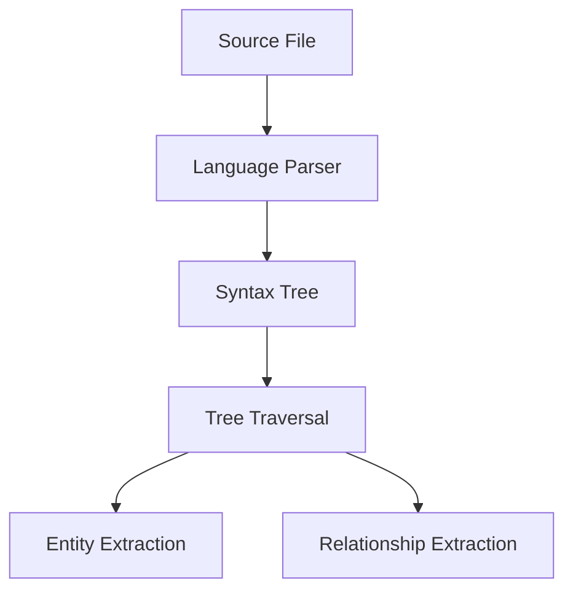

## 5.2 Why Parsing Is Better Than Simple Text Matching

Consider:

```java
// UserService is deprecated
String message = "UserService";
UserService service;
```

A text search finds three occurrences.

A syntax parser can distinguish:

- Comment.
- String literal.
- Type reference.

This makes structural analysis more reliable.

## 5.3 Important Limitation

Syntax parsing is not the same as full semantic understanding.

A parser may identify a method call without knowing which implementation executes at runtime.

---

# Part VII — Cross-File Relationship Resolution

## 6. The Resolution Problem

A source file may reference symbols defined elsewhere.

Example:

```java
import com.example.services.TaskService;

public class TaskController {
    private TaskService service;
}
```

The extractor identifies the reference.

A resolver may attempt to connect that reference to the actual declaration.

## 6.1 Conceptual Resolution

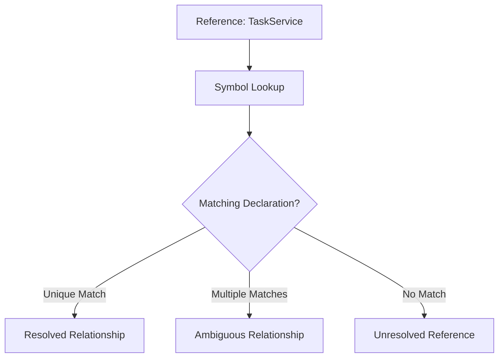

## 6.2 Why Resolution Is Difficult

Consider:

- Duplicate class names.
- Namespaces.
- Dynamic imports.
- Reflection.
- Dependency injection.
- Framework conventions.
- Generated code.

These can make relationships uncertain.

## 6.3 Important

A successful syntax parse does not guarantee successful cross-file resolution.

---

# Part VIII — Relationship Confidence

## 7. Confidence Labels

Graphify's architecture documentation defines three relationship-confidence categories:

| Confidence | Meaning |
|---|---|
| `EXTRACTED` | Explicitly represented in source material |
| `INFERRED` | Derived through analysis or resolution |
| `AMBIGUOUS` | Uncertain relationship requiring review |

## 7.1 Extracted Relationship

Example:

```python
import json
```

The import statement is directly visible.

## 7.2 Inferred Relationship

A relationship may be inferred when a resolver connects a call to a likely declaration.

## 7.3 Ambiguous Relationship

Suppose multiple modules contain a function named:

```text
process()
```

A call to `process()` may not be uniquely resolvable without additional context.

## 7.4 Why Confidence Matters

Coding agents should avoid treating all graph relationships as equally certain.

A good investigation considers:

- Relationship type.
- Confidence label.
- Source location.
- Supporting evidence.

---

# Part IX — Extraction Schema Validation

## 8. The validate.py Module

Graphify documents a validation stage that checks extraction data before graph construction.

Documented function:

```python
validate_extraction(data)
```

## 8.1 Documented Extraction Structure

The architecture documentation describes node records containing fields such as:

```json
{
  "id": "unique_string",
  "label": "human name",
  "source_file": "path",
  "source_location": "L42"
}
```

And edge records containing:

```json
{
  "source": "id_a",
  "target": "id_b",
  "relation": "calls",
  "confidence": "EXTRACTED"
}
```

## 8.2 Why Validation Is Important

Validation can detect:

- Missing fields.
- Invalid identifiers.
- Unsupported relationship labels.
- Invalid confidence values.
- Incorrect data types.

The precise checks should be verified in the source implementation.

## 8.3 Architectural Principle

> Validate intermediate data before allowing it to affect downstream processing.

This reduces the chance that malformed extraction output corrupts graph construction.

---

# Part X — Graph Construction

## 9. The build.py Module

Documented function:

```python
build_graph(extractions)
```

Input:

```text
List of extraction dictionaries
```

Output:

```text
NetworkX graph
```

## 9.1 What Is NetworkX?

NetworkX is a Python library for creating, manipulating, and analyzing graphs.

It provides graph data structures and algorithms.

## 9.2 Conceptual Example

```python
import networkx as nx

graph = nx.Graph()

graph.add_node("TaskController")
graph.add_node("TaskService")

graph.add_edge(
    "TaskController",
    "TaskService",
    relation="uses"
)
```

This demonstrates general NetworkX usage.

It is not copied from Graphify's implementation.

## 9.3 Graph Construction Workflow

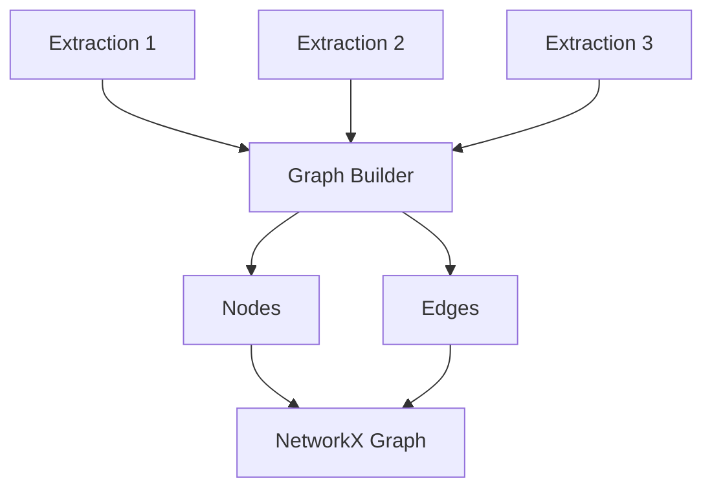

## 9.4 Why a Shared Graph Matters

Individual file extractions may contain disconnected fragments.

Graph construction combines them into a repository-level representation.

## 9.5 Important Technical Detail

The architecture document names `nx.Graph` as the output type.

Because ordinary `nx.Graph` is undirected, the exact handling of directional source relationships should be verified against the implementation and exported schema before assuming that every graph algorithm preserves direction.

---

# Part XI — Community Clustering

## 10. The cluster.py Module

Documented function:

```python
cluster(G)
```

Input:

```text
Graph
```

Output:

```text
Graph with community attributes
```

## 10.1 What Is Clustering?

Clustering groups related nodes based on graph structure.

Example:

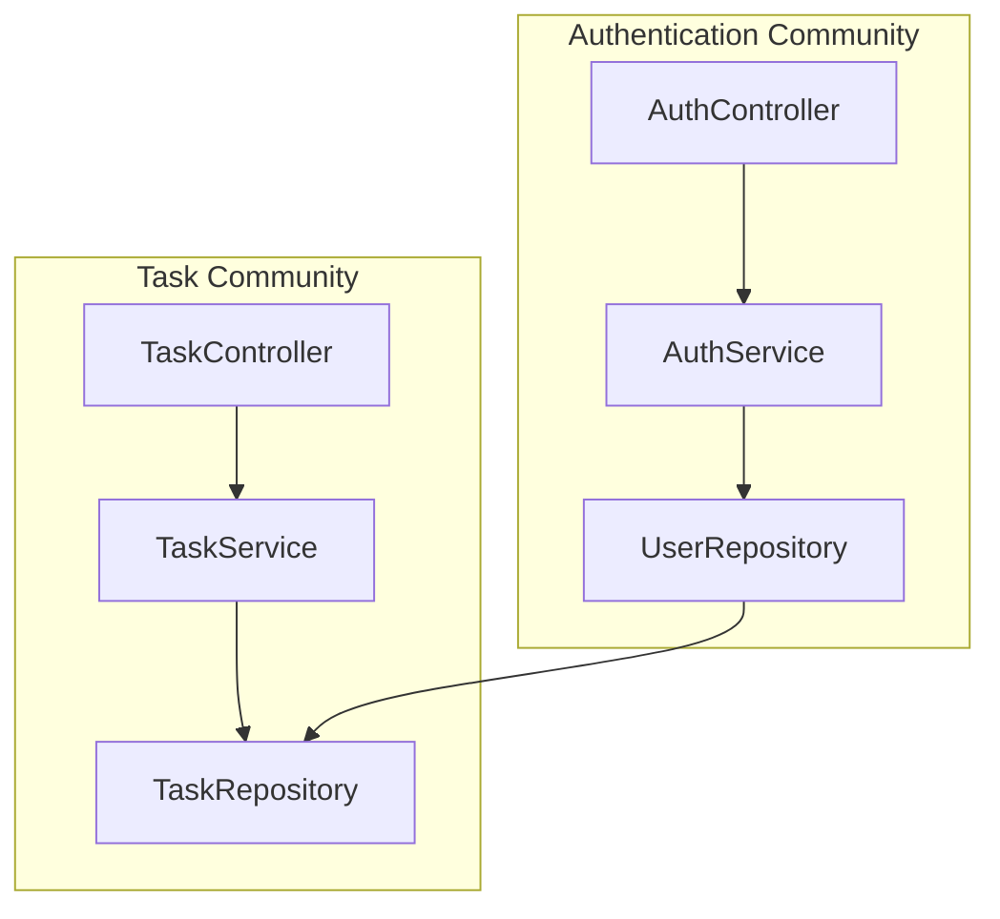

## 10.2 Why Clustering Helps

A repository may contain hundreds or thousands of graph nodes.

Clustering can reveal:

- Closely related components.
- Possible subsystem boundaries.
- Shared services.
- Cross-module coupling.

## 10.3 Important

A detected community is not necessarily an official application module.

Community algorithms discover structural patterns, not guaranteed business-domain boundaries.

---

# Part XII — Graph Analysis

## 11. The analyze.py Module

Documented function:

```python
analyze(G)
```

Output:

```text
Analysis dictionary
```

The official architecture documentation describes analysis categories including:

- God nodes.
- Surprising relationships.
- Suggested questions.

## 11.1 God Nodes

Highly connected concepts may appear as central nodes.

Example:

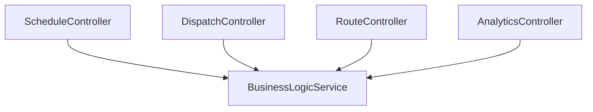

The shared service may be architecturally significant.

## 11.2 Surprising Connections

A graph may reveal connections between components that developers did not expect.

Example:

An analytics component references scheduling logic directly.

Whether this is problematic depends on the intended architecture.

## 11.3 Suggested Questions

A report may recommend further investigation of important nodes or relationships.

## 11.4 Important

Graph analysis provides evidence for investigation.

It does not automatically prove:

- Poor code quality.
- Security vulnerabilities.
- Incorrect architecture.
- Runtime failures.

---

# Part XIII — Report Generation

## 12. The report.py Module

Documented function:

```python
render_report(G, analysis)
```

Input:

```text
Graph and analysis results
```

Output:

```text
Markdown report content
```

## 12.1 Why Markdown?

Markdown is:

- Readable.
- Portable.
- Version-control friendly.
- Easy to inspect.
- Compatible with documentation tools.

## 12.2 GRAPH_REPORT.md

The generated report is intended to summarize important findings.

Examples of useful report content include:

- Important concepts.
- Highly connected nodes.
- Unexpected relationships.
- Suggested architectural questions.

## 12.3 Report vs Graph

The report is a summary.

The graph contains structured relationship data.

A report should not be assumed to contain every node and edge.

---

# Part XIV — Graph Export

## 13. The export.py Module

Documented function:

```python
export(G, out_dir, ...)
```

The architecture documentation identifies export targets including:

- JSON.
- HTML.
- SVG.
- Obsidian vault output.

The README's quickstart highlights three main artifacts.

```text
graphify-out/
├── graph.json
├── graph.html
└── GRAPH_REPORT.md
```

Additional formats depend on the export workflow.

## 13.1 graph.json

Stores graph information in a machine-readable representation.

## 13.2 graph.html

Provides an interactive graph visualization.

## 13.3 GRAPH_REPORT.md

Provides a readable architectural summary.

## 13.4 Graph Version Metadata

The README documents graph metadata fields including:

```text
graph.schema_version
graph.graphify_version
```

These help integrations recognize graph-format compatibility and the generating Graphify version.

## 13.5 Why Versioning Matters

An external tool may expect a particular JSON structure.

If the graph schema changes, the consumer may require an update.

---

# Part XV — Optional Content Ingestion

## 14. The ingest.py Module

Documented function:

```python
ingest(url, ...)
```

The architecture documentation describes this as ingesting a URL into a corpus directory.

## 14.1 Why Ingestion Exists

Software knowledge may exist outside source-code files.

Examples:

- Technical documentation.
- Architecture decisions.
- API references.
- Supporting project materials.

## 14.2 Conceptual Workflow

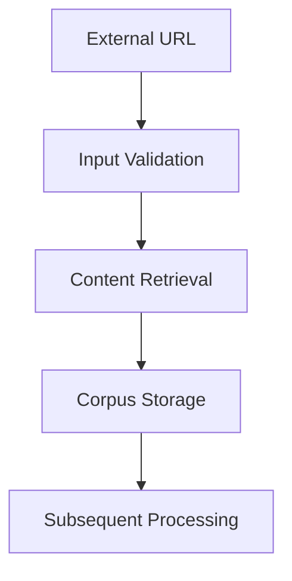

## 14.3 Security Considerations

External content is untrusted.

A secure ingestion process should consider:

- URL validation.
- Redirect behavior.
- File size.
- Timeouts.
- Content type.
- Prompt injection.

The official architecture documentation identifies validation and bounded fetching mechanisms.

---

# Part XVI — Semantic Caching

## 15. The cache.py Module

The architecture documentation identifies:

```python
check_semantic_cache(...)
save_semantic_cache(...)
```

These functions support reuse of previously processed semantic content.

## 15.1 Why Caching Matters

Some document-processing workflows may be more expensive than ordinary AST parsing.

Caching can help avoid repeating equivalent processing.

## 15.2 Conceptual Workflow

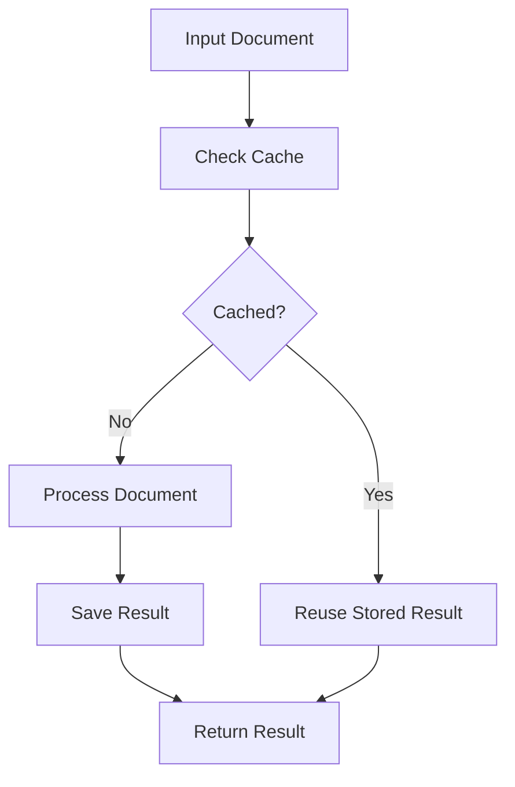

## 15.3 Important

A cache must have an appropriate invalidation strategy.

If source content changes, a stale cached result may no longer be correct.

The exact cache-key and invalidation implementation should be verified in `cache.py`.

---

# Part XVII — Security Validation

## 16. The security.py Module

The architecture documentation identifies several security helpers.

| Helper | Documented Purpose |
|---|---|
| `validate_url()` | Validate supported URL schemes |
| `safe_fetch()` | Bounded content retrieval |
| `safe_fetch_text()` | Bounded text retrieval |
| `validate_graph_path()` | Restrict graph-file paths |
| `sanitize_label()` | Sanitize graph labels |

## 16.1 URL Validation

The documentation describes HTTP and HTTPS URL validation.

It also describes protection against redirects to `file://` destinations.

## 16.2 Bounded Fetching

Size limits and timeouts help reduce uncontrolled resource consumption.

## 16.3 Graph Path Validation

The architecture documentation describes a restriction requiring graph paths to resolve within `graphify-out/`.

## 16.4 Label Sanitization

Graph labels are sanitized to reduce unsafe content in rendered output.

## 16.5 Important

These are documented protections, not a guarantee that every possible security risk has been eliminated.

---

# Part XVIII — File Watching

## 17. The watch.py Module

Documented function:

```python
watch(root, flag_path)
```

The architecture documentation describes watching a directory and writing a flag file when changes are detected.

## 17.1 Why File Watching Matters

A knowledge graph represents a repository at a particular point in time.

When source code changes, the graph may become stale.

## 17.2 Conceptual Workflow

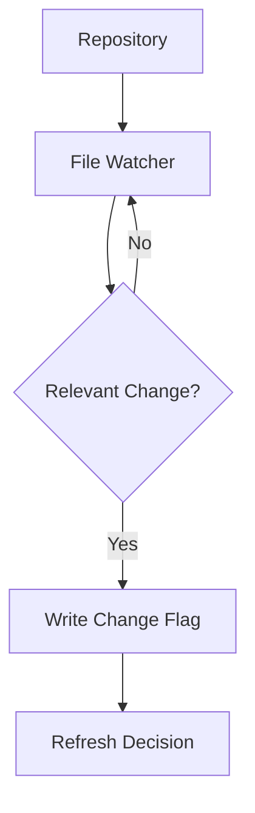

## 17.3 Important Distinction

A change flag is not necessarily the same as automatically rebuilding the entire graph.

The watcher and the process that consumes its signal may have separate responsibilities.

---

# Part XIX — MCP Server

## 18. The serve.py Module

Documented function:

```python
start_server(graph_path)
```

The architecture documentation describes an MCP server using standard input and output.

## 18.1 What Is MCP?

**Model Context Protocol** is a standard for connecting AI applications to external tools and data sources.

An MCP server can expose capabilities that an AI client invokes.

## 18.2 Conceptual Architecture

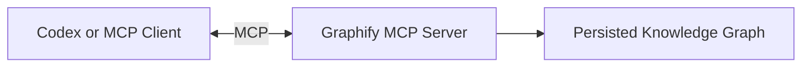

## 18.3 Why This Matters

An agent can potentially access graph capabilities through a tool interface rather than manually interpreting graph files.

## 18.4 Important

MCP integration depends on client support and configuration.

The existence of `serve.py` does not mean every Codex installation is automatically connected to it.

---

# Part XX — CLI, Library, and Skill

## 19. Three Different Interfaces

Graphify can be understood through three architectural layers.

### Python Library

Contains graph-processing functionality.

### Command-Line Interface

Allows developers or scripts to invoke Graphify functionality.

### Agent Skill

Provides coding-assistant instructions for using Graphify effectively.

## 19.1 Conceptual Architecture

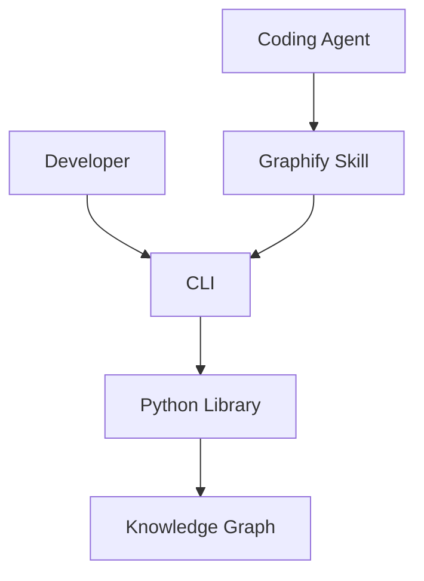

The skill is an orchestration interface; it is not the graph engine itself.

## 19.2 Why This Separation Helps

The Python library can be reused independently of a specific coding assistant.

Different interfaces can share the same underlying graph-processing functionality.

---

# Part XXI — Benchmark Module

## 20. The benchmark.py Module

Documented function:

```python
run_benchmark(graph_path)
```

The architecture documentation describes comparing corpus-token usage against subgraph-token usage.

## 20.1 Purpose

The benchmark helps evaluate whether graph retrieval provides a smaller context representation than broader corpus retrieval.

## 20.2 Conceptual Formula

\[
Reduction =
\frac{T_{\text{corpus}}-T_{\text{subgraph}}}
{T_{\text{corpus}}}
\times100\%
\]

## 20.3 Hypothetical Example

Full corpus:

\[
T_{\text{corpus}}=40{,}000
\]

Relevant subgraph:

\[
T_{\text{subgraph}}=10{,}000
\]

Then:

\[
Reduction=75\%
\]

This is a hypothetical calculation, not a measured Graphify result.

## 20.4 Important

A smaller context is not necessarily better if it omits required information.

Evaluation should include retrieval correctness and final task success.

---

# Part XXII — Data Flow Between Modules

## 21. How Components Communicate

The official architecture documentation describes communication through ordinary Python dictionaries and NetworkX graph objects.

Conceptually:

```text
File Paths
    ↓
Extraction Dictionaries
    ↓
NetworkX Graph
    ↓
Graph with Communities
    ↓
Analysis Dictionary
    ↓
Markdown and Exported Graph
```

## 21.1 Why Explicit Data Flow Helps

Explicit inputs and outputs support:

- Unit testing.
- Debugging.
- Modular replacement.
- Schema validation.
- Easier reasoning about failures.

## 21.2 Important

The architecture document describes a low-side-effect design centered on `graphify-out/`.

This should be interpreted as the project's documented architectural intent, not a blanket claim that every optional command or integration can never modify files elsewhere.

---

# Part XXIII — Error Handling and Failure Boundaries

## 22. Potential Failure Points

| Stage | Example Failure |
|---|---|
| Detection | Unsupported or inaccessible file |
| Extraction | Parser failure |
| Validation | Malformed node or edge |
| Construction | Conflicting graph data |
| Clustering | Algorithm or dependency issue |
| Analysis | Unexpected graph structure |
| Reporting | Invalid output content |
| Export | File write failure |
| Ingestion | Invalid URL or timeout |
| MCP | Client configuration mismatch |

## 22.1 Why Failure Boundaries Matter

A modular architecture helps developers determine where a failure originates.

For example:

If extraction output is malformed, the problem should be investigated before graph analysis.

## 22.2 Debugging Principle

> Diagnose the earliest failing stage rather than attempting to repair its downstream symptoms.

---

# Part XXIV — Extensibility

## 23. Adding a Language Extractor

Graphify's architecture documentation outlines an extension process for adding language support.

The documented steps include:

1. Implement an extractor for the language.
2. Register its file extension.
3. Update detection and watcher extension lists.
4. Add the required tree-sitter dependency.
5. Add test fixtures and language tests.

## 23.1 Conceptual Example

Suppose a new language needs support.

A developer might add:

```python
def extract_example_language(path):
    # Parse syntax.
    # Extract entities.
    # Extract relationships.
    # Return structured data.
    pass
```

This is pseudocode.

## 23.2 Architectural Benefit

New extractors can follow the same output contract.

That reduces the need to redesign the entire graph pipeline for each language.

---

# Part XXV — Testing Architecture

## 24. Graphify's Testing Approach

The architecture documentation describes module-oriented unit tests under:

```text
tests/
```

It documents the test command:

```powershell
pytest tests/ -q
```

## 24.1 Why Module Tests Matter

Each processing stage should be independently verifiable.

Examples:

- Detection returns expected files.
- Extraction produces valid records.
- Validation rejects malformed data.
- Graph construction preserves relationships.
- Reports render expected information.

## 24.2 Test Fixtures

A fixture is a controlled example used in testing.

For example:

```java
class ExampleService {
    void run() {}
}
```

A language extractor test may verify that the class and method are recognized.

## 24.3 Important

Tests establish confidence in documented behavior.

They do not guarantee that every language construct or repository pattern is handled perfectly.

---

# Part XXVI — GroupTrack Android Case Study

## 25. Scenario: Understanding Task Navigation

Consider an Android Java application containing:

```text
tasks/
├── ui/
├── data/
└── model/
```

This is an illustrative structure.

## 25.1 Graphify Pipeline

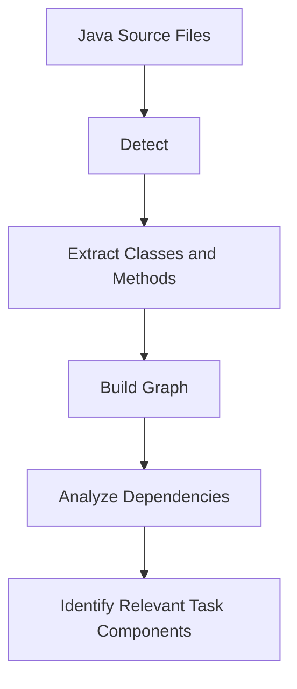

## 25.2 Potential Questions

- Which activity displays tasks?
- Which model represents a task?
- Which methods handle project selection?
- Which repository accesses task data?

## 25.3 Limitation

Static parsing does not replace Android navigation testing or Firebase authorization verification.

---

# Part XXVII — GoPasig Laravel Case Study

## 26. Scenario: Dispatch Architecture

Consider a Laravel application with:

- Controllers.
- Services.
- Models.
- Routes.
- Database migrations.

## 26.1 Conceptual Graph

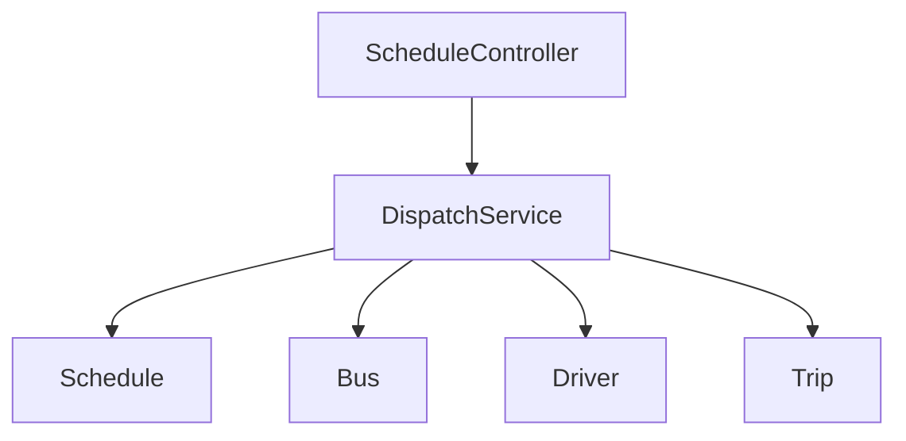

This diagram is illustrative.

## 26.2 Architecture Questions

- Which components depend on dispatch services?
- Which models participate in scheduling?
- What services connect route and trip logic?
- Which components might be affected by refactoring?

## 26.3 Important

Laravel dependency injection and framework conventions may introduce runtime relationships not directly visible through static parsing.

---

# Part XXVIII — Next.js and Laravel Case Study

## 27. Scenario: Product Creation

Consider:

```text
frontend/
└── app/
    └── products/

backend/
├── app/
│   └── Http/Controllers/
└── routes/
    └── api.php
```

## 27.1 Architectural Challenge

Frontend code and backend code may use different languages.

A Next.js component may send an HTTP request to Laravel.

That relationship is not always an explicit source-code dependency.

## 27.2 Graphify's Potential Role

Graphify may help map the structure within each supported codebase.

Cross-boundary API behavior may require additional documentation or manual verification.

## 27.3 Important

A graph should not be assumed to prove the complete behavior of a distributed application.

---

# Part XXIX — Architecture Tradeoffs

## 28. Advantages and Limitations

| Architectural Choice | Advantage | Tradeoff |
|---|---|---|
| Modular pipeline | Clear responsibilities | Intermediate contract maintenance |
| Tree-sitter parsing | Structured syntax extraction | Runtime semantics may be missing |
| NetworkX | Rich graph algorithms | Large graphs may require resource tuning |
| Confidence labels | More transparent relationships | Still requires interpretation |
| Community detection | Reveals structural clusters | Communities may not match business modules |
| JSON export | Portable structured data | Schema compatibility matters |
| HTML visualization | Easier exploration | Large graphs may become visually complex |
| Local-first parsing | Local code analysis | Optional services may use external processing |
| MCP integration | Agent-accessible graph tools | Configuration and trust-boundary complexity |

---

# Part XXX — Common Architecture Misconceptions

## 29. Misconception 1: Graphify Is Only a Visualization Tool

False.

Visualization is one output of a broader extraction and analysis pipeline.

## 29.1 Misconception 2: Tree-sitter Understands Runtime Behavior

False.

Tree-sitter parses syntax; runtime relationships may require additional analysis.

## 29.2 Misconception 3: Every Graph Edge Is Certain

False.

Graphify distinguishes extracted, inferred, and ambiguous relationships.

## 29.4 Misconception 4: Clusters Equal Official Modules

False.

Communities are derived from graph connectivity.

## 29.5 Misconception 5: MCP Is Required for Every Workflow

False.

Graphify also provides a CLI and Python library.

## 29.6 Misconception 6: The Graph Never Needs Updating

False.

Source-code changes can make graph data stale.

---

# Part XXXI — Practical Exercises

## Exercise 1 — Pipeline Identification

Write the seven primary Graphify pipeline stages in order.

Explain the responsibility of each stage.

## Exercise 2 — Module Mapping

Match these modules to their responsibilities:

- `detect.py`
- `extract.py`
- `build.py`
- `cluster.py`
- `analyze.py`
- `report.py`
- `export.py`

## Exercise 3 — Extraction Schema

Create a sample extraction dictionary containing:

- Two nodes.
- One edge.
- Source-file metadata.
- A confidence label.

## Exercise 4 — Confidence Analysis

Explain the difference between:

- `EXTRACTED`
- `INFERRED`
- `AMBIGUOUS`

Give one example of each.

## Exercise 5 — Graph Construction

Explain why separate file-level extraction results must be combined into a repository-level graph.

## Exercise 6 — Community Detection

Draw a conceptual graph containing authentication, task management, and reporting components.

Identify possible communities.

## Exercise 7 — Security

Explain why URL validation and bounded fetching are important when ingesting external content.

## Exercise 8 — Graph Freshness

Explain the role of file watching in a repository that changes frequently.

## Exercise 9 — MCP

Describe how an MCP client could access a persisted Graphify graph.

## Exercise 10 — Testing

Design three unit tests for a hypothetical Java extractor.

## Exercise 11 — Android

Identify which Graphify stages would be involved in mapping Java activities and service classes.

## Exercise 12 — Laravel

Explain why dependency injection can make static relationship resolution difficult.

## Exercise 13 — Next.js

Explain why a frontend API request may not automatically resolve to a Laravel controller.

## Exercise 14 — Benchmarking

Design an experiment comparing full repository reading with graph-assisted retrieval.

## Exercise 15 — Final Architecture Exercise

Draw a complete Graphify architecture diagram containing:

1. Repository input.
2. File detection.
3. Extraction.
4. Validation.
5. Graph construction.
6. Clustering.
7. Analysis.
8. Reporting.
9. Export.
10. CLI or MCP access.

Explain the data passed between each component.

---

# Part XXXII — Knowledge Check

1. What architectural pattern does Graphify use?
2. What is the primary pipeline?
3. What does `detect.py` do?
4. What does `extract.py` produce?
5. Why is tree-sitter useful?
6. What is cross-file resolution?
7. What does `validate.py` enforce?
8. What does `build.py` construct?
9. Why does Graphify use NetworkX?
10. What does `cluster.py` do?
11. What is community detection?
12. What does `analyze.py` identify?
13. What is a god node?
14. What does `report.py` produce?
15. What does `export.py` do?
16. What is `graph.json`?
17. What is `graph.html`?
18. What is `GRAPH_REPORT.md`?
19. Why is graph schema versioning useful?
20. What does `ingest.py` do?
21. What is semantic caching?
22. What does `security.py` validate?
23. Why is input validation important?
24. What does `watch.py` detect?
25. What does `serve.py` provide?
26. What is the difference between the CLI and Python library?
27. What is an agent skill?
28. What does `benchmark.py` evaluate?
29. How can a new language extractor be added?
30. Why is modular testing important?
31. What are Graphify's architectural advantages?
32. What are its limitations?
33. Why do confidence labels matter?
34. Why does graph freshness matter?
35. How does Graphify support context engineering?

---

# Part XXXIII — Key Takeaways

> [!summary]
> - Graphify uses a modular processing pipeline.
> - The main stages are detect, extract, build, cluster, analyze, report, and export.
> - `detect.py` identifies relevant project files.
> - `extract.py` produces structured nodes and edges.
> - Tree-sitter enables syntax-aware extraction.
> - Cross-file resolution connects related concepts.
> - `validate.py` checks extraction contracts.
> - `build.py` constructs a NetworkX graph.
> - `cluster.py` assigns communities.
> - `analyze.py` identifies important graph patterns.
> - `report.py` generates Markdown analysis.
> - `export.py` creates reusable graph artifacts.
> - `ingest.py` supports external content ingestion.
> - `cache.py` supports semantic processing reuse.
> - `security.py` provides input-validation helpers.
> - `watch.py` supports change detection.
> - `serve.py` exposes MCP integration.
> - `benchmark.py` supports retrieval-efficiency evaluation.
> - Confidence labels help distinguish explicit, inferred, and uncertain relationships.
> - Graph results require source-code verification.
> - Modular architecture improves extensibility and testability.

---

# Part XXXIV — Final Mental Model

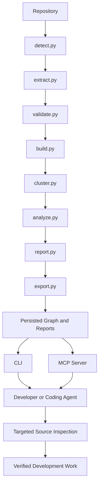

> [!important] Final Principle
> **Graphify separates source discovery, structural extraction, graph construction, analysis, and export into focused components. Understanding these boundaries makes it easier to reason about accuracy, performance, extensibility, and safe integration with coding agents.**

---

# Part XXXV — Official References

## Graphify

- [Graphify Repository](https://github.com/Graphify-Labs/graphify)
- [Graphify Architecture](https://github.com/Graphify-Labs/graphify/blob/main/ARCHITECTURE.md)
- [Graphify README](https://github.com/Graphify-Labs/graphify/blob/main/README.md)
- [Graphify Security Policy](https://github.com/Graphify-Labs/graphify/blob/main/SECURITY.md)
- [Graphify Benchmarks](https://github.com/Graphify-Labs/graphify/blob/main/BENCHMARKS.md)
- [Graphify Documentation](https://docs.graphify.com/)

## Supporting Technologies

- [Tree-sitter Documentation](https://tree-sitter.github.io/tree-sitter/)
- [NetworkX Documentation](https://networkx.org/documentation/stable/)
- [Model Context Protocol](https://modelcontextprotocol.io/)
- [OpenAI Codex Documentation](https://developers.openai.com/codex/)
- [Python Documentation](https://docs.python.org/3/)

> [!note] Documentation Scope
> This lesson is based primarily on Graphify's official `ARCHITECTURE.md` and README, reviewed on October 23, 2026.
>
> Documented function names and module responsibilities are distinguished from conceptual pseudocode, diagrams, and application examples.
>
> No installation, configuration modification, graph generation, or test execution was performed.

---

# Part XXXVI — Next Lesson

**[[03 - Installation and Codex Integration]]**

Topics:

1. Installation prerequisites.
2. Python and package-manager requirements.
3. Windows PowerShell environment checks.
4. Graphify CLI installation.
5. Codex skill registration.
6. Skill invocation.
7. Graph construction workflow.
8. Generated artifacts.
9. Graph querying.
10. Optional MCP integration.
11. Configuration and troubleshooting.
12. Security precautions.
13. Uninstallation and rollback.
14. Practical exercises.
15. Official references.

**End of Lesson 02 — Architecture and Core Components.**
