# 04 — Graphify: AST Parsing and Code Intelligence

> [!abstract] Lesson Information
> **Repository:** [Graphify-Labs/graphify](https://github.com/Graphify-Labs/graphify)
>
> **Category:** Agentic Engineering / Static Analysis / AST Parsing / Code Intelligence
>
> **Difficulty:** Intermediate to Advanced
>
> **Learning Approach:** Theory First
>
> **Prerequisites:**
> - [[00 - Repository Overview and Purpose]]
> - [[01 - Knowledge Graph Fundamentals]]
> - [[02 - Architecture and Core Components]]
> - [[03 - Installation and Codex Integration]]
>
> **Primary Goal:** Understand how source-code parsing, Abstract Syntax Trees, symbol extraction, and relationship resolution work, and how these techniques support Graphify's code knowledge graph.

---

# Part I — Learning Objectives

After completing this lesson, you should be able to:

1. Define Abstract Syntax Trees.
2. Explain the difference between source text, tokens, parse trees, and ASTs.
3. Understand Tree-sitter's role in code analysis.
4. Explain grammar-based parsing.
5. Identify named syntax nodes.
6. Understand AST traversal.
7. Explain class, function, and method extraction.
8. Understand import and reference analysis.
9. Explain symbol tables and scopes.
10. Distinguish parsing from semantic resolution.
11. Explain extracted, inferred, and ambiguous relationships.
12. Understand cross-file symbol resolution.
13. Recognize limitations of static analysis.
14. Understand incremental parsing.
15. Apply parsing concepts to Java, PHP, and TypeScript.
16. Evaluate extraction accuracy.
17. Design a safe code-intelligence workflow for Codex.

---

# Part II — Introduction to Abstract Syntax Trees

## 1. What Is an AST?

An **Abstract Syntax Tree (AST)** is a tree representation of the syntactic structure of source code.

Instead of treating a program as plain text, an AST represents its meaningful programming constructs.

Consider:

```java
public class TaskService {
    public void completeTask() {
        updateStatus();
    }
}
```

A simplified AST might look like:

```text
ClassDeclaration
├── Name: TaskService
└── MethodDeclaration
    ├── Name: completeTask
    └── MethodBody
        └── MethodInvocation
            └── Name: updateStatus
```

This representation allows analysis tools to distinguish a class declaration from a method call.

## 1.1 Why ASTs Matter

A source-code analyzer may need to answer:

- Which classes are declared?
- Which methods belong to a class?
- Which modules are imported?
- Which methods invoke other methods?
- Which interfaces are implemented?
- Which types are referenced?

ASTs make these questions easier to investigate systematically.

## 1.2 ASTs Are Not Execution Traces

An AST represents program syntax.

It does not automatically reveal:

- Which branches execute.
- Which database queries run.
- Which implementation is selected at runtime.
- What values variables contain.
- Whether the program behaves correctly.

> [!important]
> An AST describes **how code is written**, not necessarily **what happens when the code runs**.

---

# Part III — Source Code, Tokens, and Syntax Trees

## 2. The Parsing Pipeline

A programming-language parser transforms source text into structured syntax.

Conceptually:

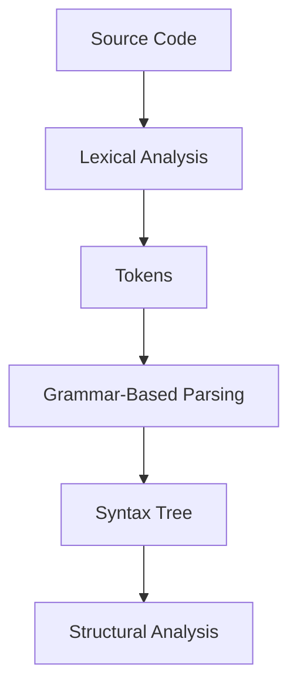

Tree-sitter combines parsing machinery internally; the diagram represents the conceptual stages rather than a literal sequence of public API calls.

## 2.1 Source Code

Example:

```java
int total = price + tax;
```

At this stage, the program is text.

## 2.2 Tokens

A lexer recognizes meaningful units.

Conceptual tokens:

```text
TYPE        int
IDENTIFIER  total
ASSIGN      =
IDENTIFIER  price
PLUS        +
IDENTIFIER  tax
SEMICOLON   ;
```

## 2.3 Syntax Structure

The parser identifies relationships among tokens.

```text
LocalVariableDeclaration
├── Type: int
├── Variable: total
└── Value
    └── BinaryExpression
        ├── Left: price
        ├── Operator: +
        └── Right: tax
```

## 2.4 Concrete Syntax Tree vs AST

A **Concrete Syntax Tree (CST)** generally retains more grammatical detail.

An **AST** usually removes some syntax details to emphasize program structure.

Tree-sitter produces concrete syntax trees that are often used in AST-like analysis.

This distinction matters because not every parser output is technically an abstract syntax tree.

---

# Part IV — Understanding Tree-sitter

## 3. What Is Tree-sitter?

[Tree-sitter](https://tree-sitter.github.io/tree-sitter/) is a parser generator and incremental parsing library.

It provides language-aware syntax trees that can be inspected programmatically.

Tree-sitter is widely used in developer tooling because it supports efficient parsing and editing workflows.

## 3.1 Tree-sitter's Main Responsibilities

Tree-sitter helps with:

- Parsing supported programming languages.
- Producing structured syntax trees.
- Locating declarations.
- Identifying syntax constructs.
- Tracking source positions.
- Recovering useful syntax structure even when code contains errors.
- Updating syntax trees incrementally.

## 3.2 Tree-sitter Architecture

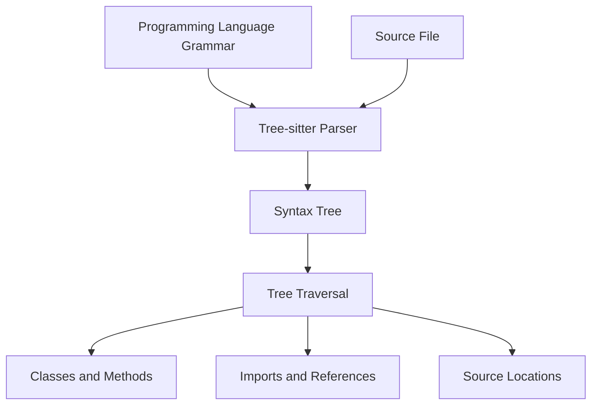

## 3.3 Language Grammars

A language grammar describes valid syntax structures.

Different languages require different grammars.

Examples:

- Java.
- PHP.
- JavaScript.
- TypeScript.
- Python.

A Java grammar understands Java declarations, while a PHP grammar understands PHP syntax.

## 3.4 Important Limitation

Tree-sitter does not automatically provide a complete type checker or language server.

It parses syntax; additional logic is required to resolve semantic relationships.

---

# Part V — Syntax Nodes

## 4. What Is a Syntax Node?

A syntax node represents a construct recognized by the parser.

Example:

```java
class Project {
    void archive() {}
}
```

Possible node categories include:

```text
class_declaration
method_declaration
identifier
class_body
formal_parameters
```

Actual node names depend on the language grammar.

## 4.1 Parent and Child Relationships

Syntax trees are hierarchical.

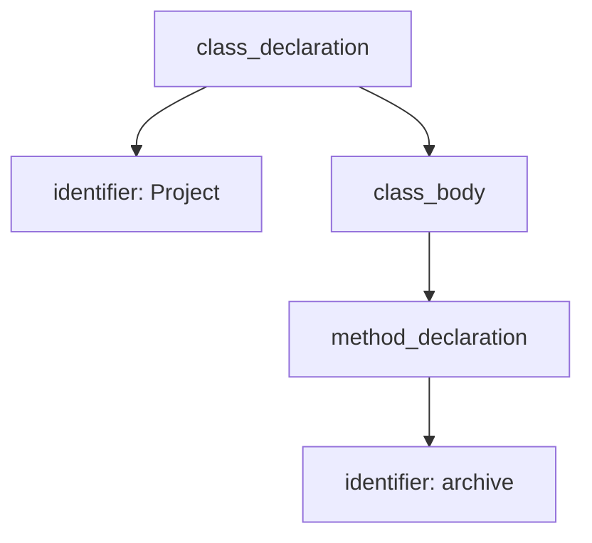

## 4.2 Named and Anonymous Nodes

Tree-sitter distinguishes named syntax nodes from anonymous syntax nodes.

Named nodes generally represent meaningful grammar constructs.

Anonymous nodes often represent punctuation or fixed syntax tokens.

For example:

```java
class Example {}
```

The parser may represent `class_declaration` as a named node and punctuation such as `{` as anonymous nodes.

## 4.3 Why Named Nodes Are Useful

Code-intelligence tools commonly focus on named nodes to extract meaningful program structure.

However, anonymous nodes can still matter when understanding operators, modifiers, or punctuation.

---

# Part VI — Source Locations

## 5. Why Source Positions Matter

Tree-sitter syntax nodes include source positions.

These positions can help identify where a declaration appears.

Example:

```java
public class TaskService {
    public void completeTask() {
    }
}
```

A tool may associate the method with:

```text
File: TaskService.java
Start Line: 2
End Line: 3
```

## 5.1 Why This Helps Codex

Source positions support targeted inspection.

Instead of loading an entire large file, an agent may inspect a specific method and its surrounding context.

## 5.2 Important Detail

Tree-sitter commonly uses zero-based row and column positions internally.

Human-readable reports may convert rows into one-based line numbers.

Tools should handle this conversion consistently.

---

# Part VII — AST Traversal

## 6. What Is Tree Traversal?

Tree traversal means systematically visiting nodes within a syntax tree.

Common approaches include:

- Depth-first traversal.
- Breadth-first traversal.
- Query-based matching.

## 6.1 Depth-First Traversal

Depth-first traversal explores child nodes before moving to sibling branches.

Conceptual pseudocode:

```python
def visit(node):
    process(node)

    for child in node.children:
        visit(child)
```

## 6.2 Example

```text
ClassDeclaration
├── FieldDeclaration
└── MethodDeclaration
    └── MethodInvocation
```

A depth-first traversal may inspect:

1. Class.
2. Field.
3. Method.
4. Invocation.

## 6.3 Why Traversal Matters

An extractor can visit syntax nodes and create graph entities.

For example:

```text
class_declaration
    ↓
Create Class Node

method_declaration
    ↓
Create Method Node

method_invocation
    ↓
Record Possible Call Relationship
```

---

# Part VIII — Tree-sitter Queries

## 7. What Are Tree-sitter Queries?

Tree-sitter provides a query mechanism for matching syntax patterns.

Instead of manually traversing every node, a tool can define patterns describing the constructs it wants.

## 7.1 Conceptual Java Query

```scheme
(class_declaration
  name: (identifier) @class.name)
```

This illustrates a Tree-sitter query that captures a Java class name.

## 7.2 Method Query

```scheme
(method_declaration
  name: (identifier) @method.name)
```

## 7.3 Why Queries Are Useful

Queries can simplify extraction logic for:

- Class declarations.
- Method declarations.
- Imports.
- Function calls.
- Type references.

## 7.4 Important

Query patterns are grammar-specific.

A Java query should not be assumed to work unchanged for PHP or TypeScript.

---

# Part IX — Entity Extraction

## 8. What Is Entity Extraction?

Entity extraction converts recognized source-code constructs into graph nodes.

For example:

```java
public class TaskService {
    public void completeTask() {}
}
```

Possible entities:

```text
TaskService
TaskService.completeTask
```

## 8.1 Extraction Pipeline

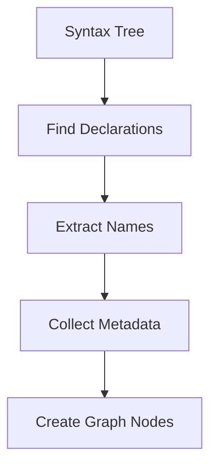

## 8.2 Common Metadata

An extracted entity may contain:

| Field | Purpose |
|---|---|
| ID | Unique identifier |
| Name | Symbol name |
| Type | Class, method, function |
| File | Source file |
| Location | Line or byte range |
| Language | Java, PHP, TypeScript |
| Scope | Namespace or containing class |

## 8.3 Conceptual Example

```json
{
  "id": "java:TaskService.completeTask",
  "name": "completeTask",
  "type": "method",
  "source_file": "TaskService.java",
  "line": 2
}
```

This is an illustrative representation, not Graphify's verified internal schema.

---

# Part X — Relationship Extraction

## 9. What Is Relationship Extraction?

Relationship extraction identifies connections between code entities.

Examples:

- A class contains a method.
- A file imports another module.
- A class extends another class.
- A method invokes another method.
- A function references a variable.

## 9.1 Example

```java
public class TaskController {
    private TaskService service;

    public void finishTask() {
        service.completeTask();
    }
}
```

Conceptual graph:

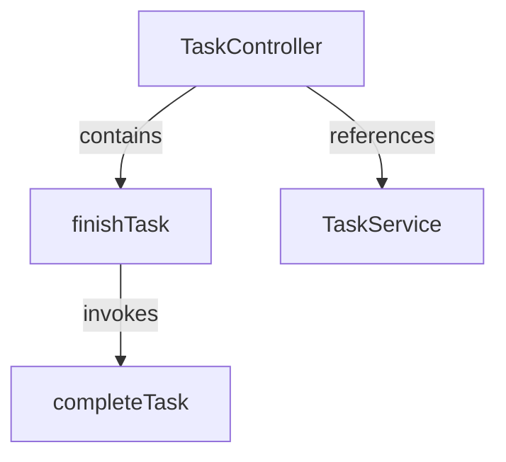

## 9.2 Important Distinction

Recognizing the syntax of a call does not always identify its exact destination.

The parser can recognize:

```java
service.completeTask();
```

But determining which implementation of `completeTask()` executes may require type information.

---

# Part XI — Symbol Tables

## 10. What Is a Symbol Table?

A **symbol table** is a data structure used to record identifiers and information about their declarations.

Conceptual example:

| Symbol | Type | Scope |
|---|---|---|
| `TaskService` | Class | Package |
| `completeTask` | Method | TaskService |
| `service` | Field | TaskController |

## 10.1 Why Symbol Tables Matter

A code analyzer may encounter:

```java
service.completeTask();
```

To understand the call, it needs to determine:

1. What is `service`?
2. What type does it have?
3. Which `completeTask` method belongs to that type?
4. Is the method overridden?
5. Could multiple implementations exist?

## 10.2 Resolution Pipeline

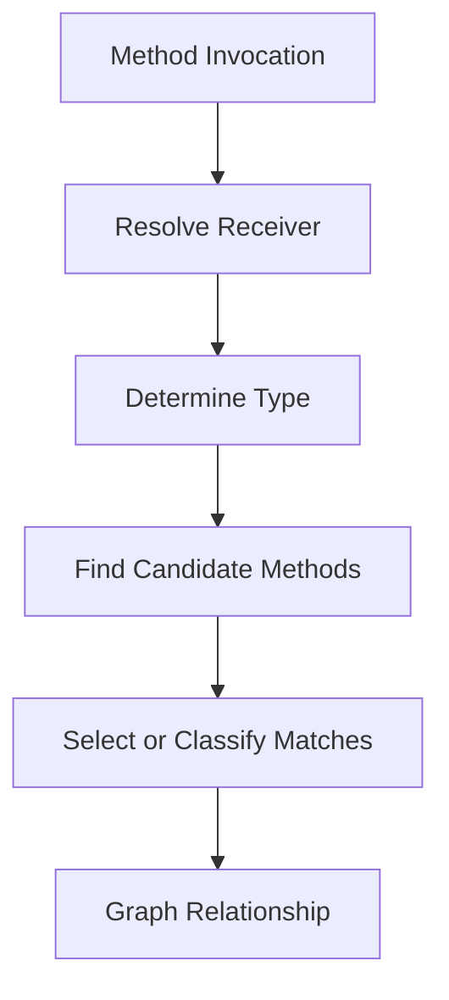

## 10.3 Important

A full compiler or language server may have more semantic information than a lightweight syntax-based extractor.

---

# Part XII — Scope and Namespaces

## 11. What Is Scope?

Scope determines where an identifier can be referenced.

Common scopes include:

- Global scope.
- Module scope.
- Class scope.
- Function scope.
- Block scope.

## 11.1 Example

```java
class Example {
    int value = 10;

    void process() {
        int value = 20;
    }
}
```

The field and local variable share the same name but occupy different scopes.

## 11.2 Why Scope Matters

A parser may identify both declarations.

A resolver must distinguish them.

Otherwise, the graph could incorrectly connect references to the wrong entity.

---

# Part XIII — Cross-File Resolution

## 12. The Cross-File Problem

Modern software projects separate related components across files.

Example:

```text
controllers/
└── TaskController.java

services/
└── TaskService.java
```

The controller references the service.

## 12.1 Conceptual Resolution

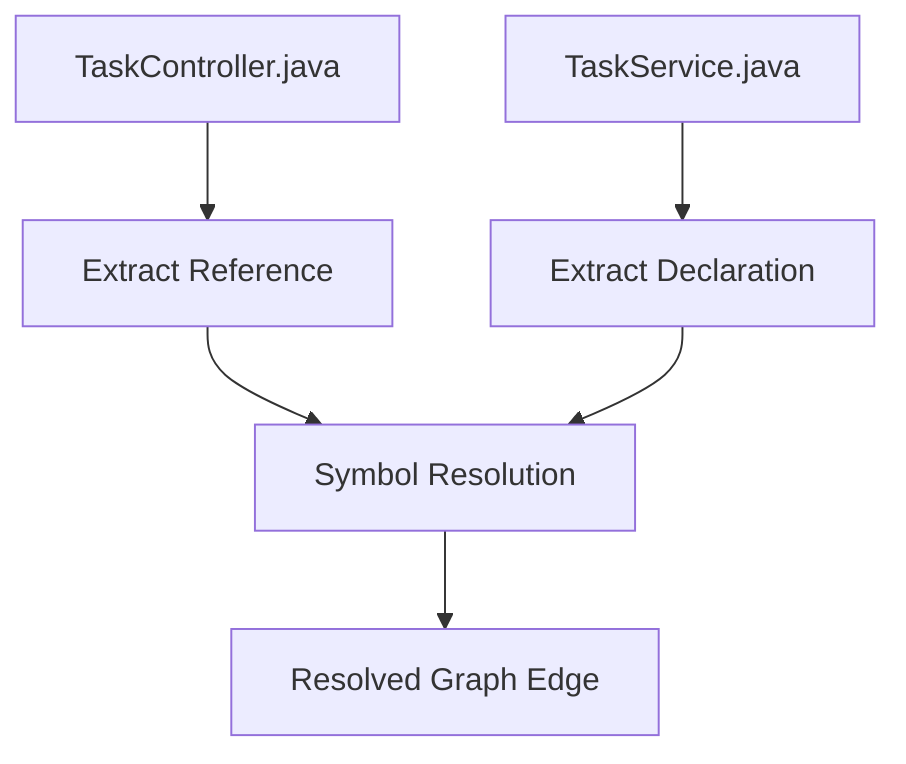

## 12.2 Information Needed

Cross-file resolution may depend on:

- Imports.
- Packages.
- Namespaces.
- Qualified names.
- Module exports.
- Type information.
- Visibility rules.

## 12.3 Important

Cross-file resolution is not guaranteed simply because both files were parsed.

The analyzer must explicitly implement appropriate resolution logic.

---

# Part XIV — Extracted, Inferred, and Ambiguous Edges

## 13. Relationship Confidence

Graphify's architecture documentation distinguishes three confidence categories.

| Confidence | Meaning |
|---|---|
| `EXTRACTED` | Explicitly identified in source |
| `INFERRED` | Derived through analysis |
| `AMBIGUOUS` | Relationship cannot be resolved confidently |

## 13.1 Extracted Example

```java
import com.example.TaskService;
```

The import statement is directly present.

## 13.2 Inferred Example

An analyzer identifies a likely relationship between a method call and a declaration using namespace and type information.

## 13.3 Ambiguous Example

Two classes contain:

```java
void process() {}
```

A reference to `process()` may not uniquely identify one implementation.

## 13.4 Why This Matters

Coding agents should avoid presenting inferred or ambiguous relationships as verified facts.

> [!important]
> Graph confidence is evidence about extraction and resolution, not proof of runtime behavior.

---

# Part XV — Java Parsing

## 14. Java Code Intelligence

Java is strongly typed and commonly uses:

- Packages.
- Imports.
- Classes.
- Interfaces.
- Methods.
- Constructors.
- Inheritance.

These structures provide useful information for static analysis.

## 14.1 Example

```java
package com.example.tasks;

public class TaskService {
    public boolean completeTask(String taskId) {
        return true;
    }
}
```

Potential extracted entities:

```text
Package: com.example.tasks
Class: TaskService
Method: completeTask
Parameter: taskId
```

## 14.2 Inheritance

```java
class BaseActivity {}

class TaskActivity extends BaseActivity {}
```

Possible relationship:

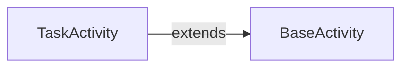

## 14.3 Interface Implementation

```java
interface TaskRepository {
    void save();
}

class FirebaseTaskRepository implements TaskRepository {
    public void save() {}
}
```

Possible relationship:

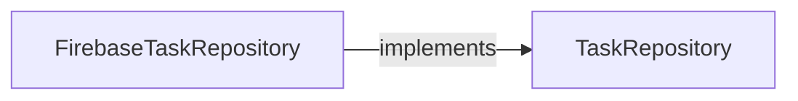

## 14.4 Java Challenges

Even with static typing, difficulties may include:

- Reflection.
- Polymorphism.
- Dependency injection.
- Generated classes.
- Runtime class loading.

---

# Part XVI — Android Code Intelligence

## 15. Applying AST Parsing to Android

Android projects contain multiple kinds of source information.

Examples:

```text
app/
└── src/main/
    ├── java/
    ├── res/
    │   └── layout/
    └── AndroidManifest.xml
```

## 15.1 Java Components

A parser may identify:

- Activities.
- Fragments.
- Repository classes.
- Models.
- Method calls.

## 15.2 XML Resources

Android layouts and manifests contain relationships that are not ordinary Java syntax.

For example:

```xml
<Button
    android:id="@+id/btnSave"
    android:layout_width="wrap_content"
    android:layout_height="wrap_content" />
```

A Java class may reference:

```java
findViewById(R.id.btnSave);
```

Connecting the Java reference to the XML declaration requires resource-aware analysis.

## 15.3 Important Limitation

Do not assume Graphify automatically resolves all Android resource relationships.

Language parsing and framework-specific resource linking are different capabilities.

---

# Part XVII — PHP Parsing

## 16. PHP Code Intelligence

PHP applications commonly contain:

- Namespaces.
- Classes.
- Traits.
- Interfaces.
- Functions.
- Methods.
- Imports.

Example:

```php
<?php

namespace App\Services;

class ScheduleService
{
    public function createSchedule(): void
    {
    }
}
```

Potential entities:

```text
Namespace: App\Services
Class: ScheduleService
Method: createSchedule
```

## 16.1 PHP Imports

```php
use App\Models\Schedule;
```

A parser can recognize the import syntax.

## 16.2 Laravel-Specific Challenges

Laravel commonly uses:

- Dependency injection.
- Service containers.
- Eloquent relationships.
- Facades.
- Route registration.
- Middleware.
- Dynamic methods.

These features may require framework-aware interpretation beyond ordinary syntax parsing.

---

# Part XVIII — Laravel Route Analysis

## 17. Routes and Controllers

Consider:

```php
Route::get('/schedules', [ScheduleController::class, 'index']);
```

A parser may recognize:

- A static method call.
- A string route path.
- A class reference.
- A method name string.

However, mapping this into a complete framework-level route relationship requires Laravel-aware extraction logic.

## 17.1 Conceptual Graph


This diagram represents a possible semantic interpretation, not guaranteed Graphify extraction.

## 17.2 Why This Matters

Static syntax and framework behavior are related but not identical.

An analyzer must know how to interpret framework conventions to produce higher-level architectural relationships.

---

# Part XIX — TypeScript Parsing

## 18. TypeScript Code Intelligence

TypeScript includes constructs such as:

- Interfaces.
- Types.
- Classes.
- Functions.
- Imports.
- Exports.
- Generics.
- Decorators.

Example:

```typescript
interface Product {
  id: number;
  name: string;
}

export function getProductName(product: Product): string {
  return product.name;
}
```

Potential entities:

```text
Interface: Product
Function: getProductName
Type Reference: Product
```

## 18.1 Import Relationships

```typescript
import { getProducts } from "@/lib/api";
```

The parser can identify the import statement.

Resolving `@/lib/api` to a physical file may require interpreting project-specific path aliases.

## 18.2 TypeScript Challenges

- Path aliases.
- Re-exports.
- Dynamic imports.
- Type-only imports.
- Generated types.
- Framework conventions.

---

# Part XX — Next.js Code Intelligence

## 19. Next.js Architecture

Next.js projects may use file-based routing.

Example:

```text
app/
├── layout.tsx
├── page.tsx
└── products/
    └── page.tsx
```

The folder structure carries routing meaning.

## 19.1 AST Parsing vs Framework Semantics

An AST can identify functions and imports inside `page.tsx`.

However, understanding that:

```text
app/products/page.tsx
```

represents a route requires Next.js-specific conventions.

## 19.2 React Components

Example:

```tsx
export default function ProductsPage() {
  return <h1>Products</h1>;
}
```

A parser can identify the function declaration and JSX syntax.

## 19.3 Important

A code graph built from generic syntax parsing may not capture every framework-level relationship.

---

# Part XXI — Dynamic Language Limitations

## 20. Why Dynamic Behavior Is Difficult

Some relationships are determined only during execution.

Example in PHP:

```php
$serviceName = getServiceName();
$service = app($serviceName);
```

The actual service may depend on runtime values.

## 20.1 Reflection

Reflection allows programs to inspect or invoke constructs dynamically.

Example in Java:

```java
Class<?> type = Class.forName(className);
```

The target class depends on the value of `className`.

## 20.2 Dynamic Imports

Example in JavaScript:

```javascript
const module = await import(modulePath);
```

The destination may be unknown during static analysis.

## 20.3 Practical Consequence

Static analysis can be incomplete even when parsing is successful.

---

# Part XXII — Incremental Parsing

## 21. What Is Incremental Parsing?

Incremental parsing updates an existing syntax tree after source-code changes instead of reparsing everything from scratch.

Tree-sitter supports incremental parsing.

## 21.1 Conceptual Workflow

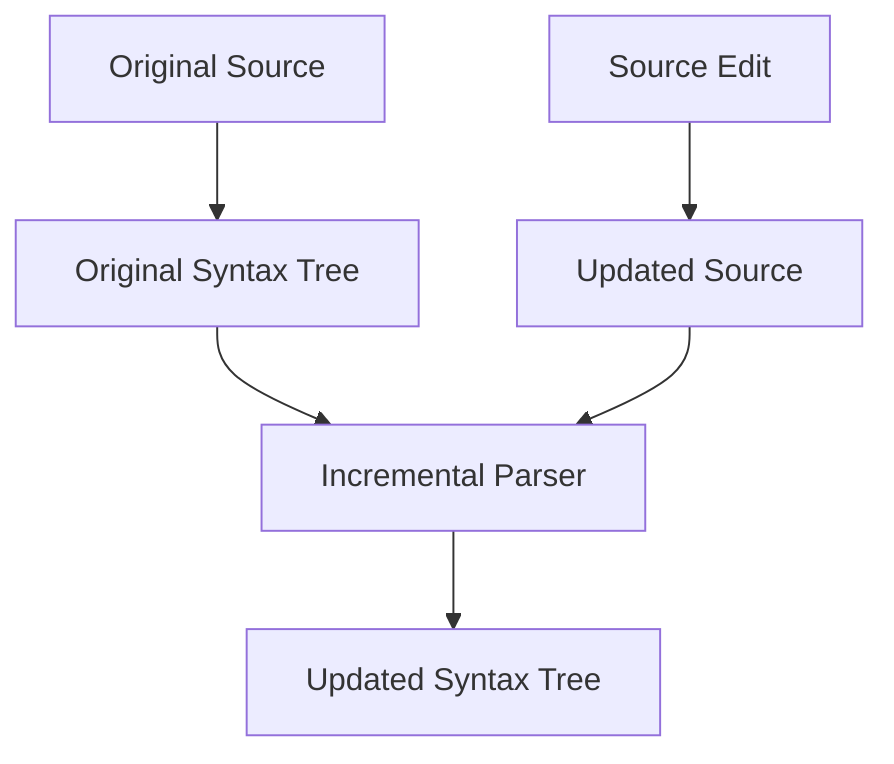

## 21.2 Why It Matters

Incremental parsing is useful in:

- Editors.
- Language tools.
- Interactive development environments.
- Frequently changing source files.

## 21.3 Important Graphify Distinction

Tree-sitter supporting incremental parsing does not automatically mean Graphify incrementally updates every graph edge after each edit.

That behavior depends on Graphify's implementation and indexing workflow.

---

# Part XXIII — Parser Error Recovery

## 22. What Happens With Invalid Code?

Developers frequently work with incomplete source code.

Example:

```java
public class Example {
    public void run(
```

The file is incomplete.

Tree-sitter can still produce a syntax tree containing error information.

## 22.1 Why Error Recovery Matters

A code-intelligence tool may still extract useful declarations from partially written code.

## 22.2 Limitation

Error recovery does not guarantee that extracted relationships are correct.

Malformed code may produce incomplete or misleading syntax structures.

## 22.3 Best Practice

Treat graph data from invalid source files with additional caution.

---

# Part XXIV — Extraction Accuracy

## 23. How Do We Evaluate an Extractor?

An extractor should be evaluated using known test cases.

Important measures include:

- Precision.
- Recall.
- False positives.
- False negatives.

## 23.1 Precision

Precision measures how many reported relationships are correct.

\[
Precision = \frac{TP}{TP+FP}
\]

Where:

- \(TP\) = true positives.
- \(FP\) = false positives.

## 23.2 Recall

Recall measures how many expected relationships were discovered.

\[
Recall = \frac{TP}{TP+FN}
\]

Where:

- \(FN\) = false negatives.

## 23.3 F1 Score

\[
F_1 =
2 \times \frac{Precision \times Recall}
{Precision + Recall}
\]

## 23.4 Hypothetical Example

Suppose an extractor reports 90 relationships.

- 81 are correct.
- 9 are incorrect.
- 19 expected relationships were missed.

Then:

\[
Precision = \frac{81}{90}=0.90
\]

\[
Recall = \frac{81}{100}=0.81
\]

\[
F_1 \approx 0.853
\]

These numbers are hypothetical, not Graphify benchmark results.

---

# Part XXV — Testing Language Extractors

## 24. What Should Be Tested?

A language extractor should be tested against:

- Simple declarations.
- Nested classes.
- Imports.
- Inheritance.
- Interfaces.
- Method calls.
- Duplicate names.
- Namespaces.
- Malformed syntax.
- Cross-file references.

## 24.1 Example Test Fixture

```java
package example;

class UserService {
    void saveUser() {}
}
```

Expected conceptual extraction:

```text
Class: UserService
Method: saveUser
Relationship: UserService contains saveUser
```

## 24.2 Negative Tests

A negative test verifies that something should not be extracted.

Example:

```java
String text = "class FakeService {}";
```

The string literal should not be treated as an actual class declaration.

## 24.3 Why Tests Matter

A parser can successfully parse a file while an extractor still misinterprets its syntax tree.

Parsing correctness and extraction correctness must be evaluated separately.

---

# Part XXVI — Performance Considerations

## 25. What Affects Parsing Performance?

Performance depends on:

- Number of files.
- File sizes.
- Language grammars.
- Syntax complexity.
- Extraction logic.
- Cross-file resolution.
- Graph construction overhead.

## 25.1 Total Processing Time

A simplified model:

\[
T_{\text{total}} =
T_{\text{discovery}} +
T_{\text{parsing}} +
T_{\text{extraction}} +
T_{\text{resolution}} +
T_{\text{graph}}
\]

## 25.2 Hypothetical Example

| Stage | Time |
|---|---:|
| Discovery | 2 seconds |
| Parsing | 12 seconds |
| Extraction | 8 seconds |
| Resolution | 10 seconds |
| Graph construction | 3 seconds |
| Total | 35 seconds |

This is illustrative.

## 25.3 Optimization Principle

Measure the actual bottleneck before attempting optimization.

For example, improving parsing speed provides limited benefit if cross-file resolution dominates total processing time.

---

# Part XXVII — AST Parsing and Context Engineering

## 26. Why ASTs Help AI Coding Agents

A coding agent often needs structural information rather than an entire source file.

For example:

> Which methods belong to `TaskService`?

An AST-based extractor may answer this without requiring the agent to read unrelated implementation details.

## 26.1 Conceptual Workflow

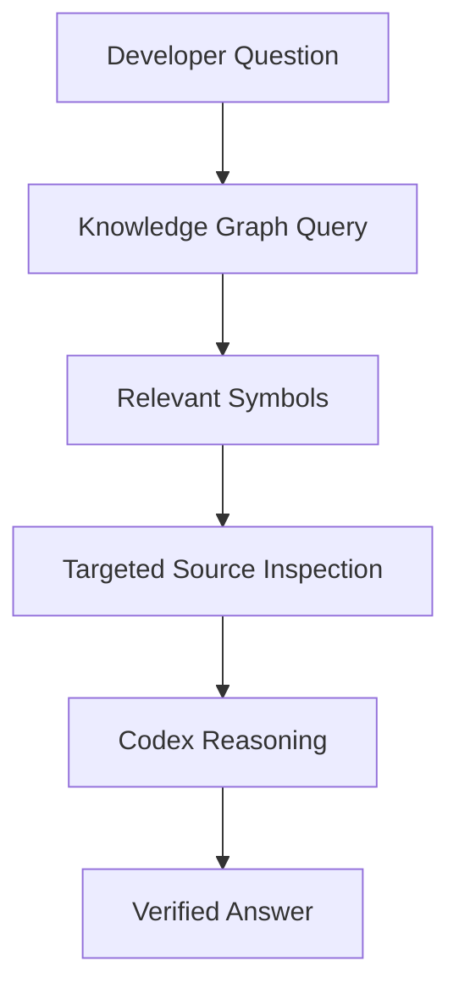

## 26.2 Context Reduction

Suppose a source file contains 1,000 lines.

The relevant method occupies 40 lines.

Targeted retrieval may reduce unnecessary reading.

However, surrounding context may still be required for correctness.

## 26.3 Important

An AST can improve navigation.

It does not eliminate the need to understand business logic.

---

# Part XXVIII — GroupTrack Case Study

## 27. Scenario: Task Completion

Consider an Android application containing:

```text
TaskDetailsActivity.java
TaskRepository.java
Task.java
```

These filenames are illustrative.

## 27.1 Example Task

> Identify the code involved when a user marks a task as completed.

## 27.2 Potential AST Findings

- Activity class declaration.
- Completion-handler method.
- Repository reference.
- Task model reference.

## 27.3 Conceptual Graph

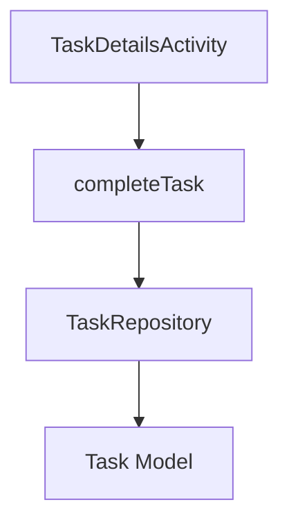

## 27.4 Important Limitations

Static analysis does not establish that:

- The Firebase write succeeds.
- The user has permission.
- The UI refreshes correctly.
- Progress calculations are correct.

Those require separate verification.

---

# Part XXIX — GoPasig Case Study

## 28. Scenario: Laravel Analytics

Consider a Laravel analytics controller with database relationships.

Example:

```php
$trips = Trip::with('driver')->get();
```

A syntax parser can identify the method-call structure.

However, understanding Eloquent eager loading requires Laravel-specific knowledge.

## 28.1 What AST Analysis Can Reveal

- Controller declarations.
- Method declarations.
- Model references.
- Service references.
- Import statements.

## 28.2 What AST Analysis May Not Reveal

- Actual SQL query count.
- Database execution plans.
- Runtime data volume.
- N+1 query behavior in every execution path.

## 28.3 Engineering Principle

Use AST-based graph analysis for architecture discovery.

Use query logging, profiling, and tests for database-performance verification.

---

# Part XXX — E-commerce Case Study

## 29. Scenario: Next.js to Laravel API

Consider a Next.js function:

```typescript
async function createProduct(data: ProductInput) {
  return fetch("/api/products", {
    method: "POST",
    body: JSON.stringify(data)
  });
}
```

And a Laravel route:

```php
Route::post('/products', [ProductController::class, 'store']);
```

## 29.1 Parsing Results

The TypeScript parser can identify:

- Function declaration.
- Fetch call.
- String literals.

The PHP parser can identify:

- Route call.
- Controller class reference.
- Method-name string.

## 29.2 Cross-Stack Resolution

Connecting the frontend request to the Laravel route requires understanding:

- API base URL.
- Routing.
- Proxies.
- Deployment configuration.
- HTTP method.
- Route prefixes.

## 29.3 Important

The presence of matching strings is not proof that the frontend request reaches that backend route.

---

# Part XXXI — Common Misconceptions

## 30. Misconception 1: AST Parsing Is the Same as Compilation

False.

Parsing is one stage of compilation or code analysis.

## 30.1 Misconception 2: Every Method Call Can Be Resolved

False.

Polymorphism and dynamic behavior can introduce ambiguity.

## 30.2 Misconception 3: Tree-sitter Automatically Understands Frameworks

False.

Framework-specific relationships require additional interpretation.

## 30.3 Misconception 4: Every Parsed Relationship Is Correct

False.

Extraction and resolution can introduce errors.

## 30.4 Misconception 5: Incremental Parsing Means Automatic Graph Refresh

False.

Parser capabilities and graph-indexing behavior are separate concerns.

## 30.5 Misconception 6: Static Analysis Replaces Runtime Testing

False.

Static and runtime analysis answer different questions.

---

# Part XXXII — Practical Exercises

## Exercise 1 — AST Identification

Given:

```java
class Student {
    void enroll() {}
}
```

Draw a simplified AST.

## Exercise 2 — Tokens

Identify the tokens in:

```java
int score = 95;
```

## Exercise 3 — Named Nodes

Explain why class declarations are useful named syntax nodes.

## Exercise 4 — Tree Traversal

Write pseudocode for recursively visiting syntax nodes.

## Exercise 5 — Entity Extraction

Identify possible graph nodes from:

```java
class ProjectService {
    void createProject() {}
    void archiveProject() {}
}
```

## Exercise 6 — Relationship Extraction

Identify possible relationships from:

```java
class TaskController {
    TaskService service;
}
```

## Exercise 7 — Symbol Resolution

Explain why two methods named `save()` may create ambiguity.

## Exercise 8 — Java

Draw a conceptual graph for a class implementing an interface.

## Exercise 9 — PHP

Explain how namespaces help resolve class references.

## Exercise 10 — TypeScript

Explain why path aliases may complicate import resolution.

## Exercise 11 — Android

Explain why XML layout references require more than Java AST parsing.

## Exercise 12 — Laravel

Explain why dependency injection can make static analysis difficult.

## Exercise 13 — Next.js

Explain why file-based routing requires framework-specific interpretation.

## Exercise 14 — Extraction Metrics

An extractor reports 50 relationships.

- 45 are correct.
- 5 are incorrect.
- 15 expected relationships were missed.

Calculate precision, recall, and F1 score.

## Exercise 15 — Final Exercise

Design a theoretical extraction workflow for one of your projects.

Include:

1. File discovery.
2. Language selection.
3. Syntax parsing.
4. Entity extraction.
5. Relationship extraction.
6. Symbol resolution.
7. Confidence classification.
8. Graph construction.
9. Validation.
10. Source-code verification.

---

# Part XXXIII — Review Questions

1. What is an AST?
2. What is a Concrete Syntax Tree?
3. How does an AST differ from source text?
4. What are tokens?
5. What is lexical analysis?
6. What is grammar-based parsing?
7. What is Tree-sitter?
8. What is a language grammar?
9. What is a syntax node?
10. What is a named syntax node?
11. What is an anonymous syntax node?
12. What is tree traversal?
13. What is a Tree-sitter query?
14. What is entity extraction?
15. What is relationship extraction?
16. What is a symbol table?
17. What is scope?
18. What is cross-file resolution?
19. What is an extracted relationship?
20. What is an inferred relationship?
21. What is an ambiguous relationship?
22. Why is Java static analysis useful?
23. What complicates Android resource analysis?
24. What complicates Laravel static analysis?
25. What complicates TypeScript import resolution?
26. What is incremental parsing?
27. What is parser error recovery?
28. What is precision?
29. What is recall?
30. What is F1 score?
31. Why should extractors be tested?
32. Why does static analysis miss runtime behavior?
33. How can AST analysis improve context retrieval?
34. Why must graph results be verified?
35. How does AST parsing support Graphify's knowledge graph?

---

# Part XXXIV — Key Takeaways

> [!summary]
> - ASTs represent the syntactic structure of source code.
> - Tree-sitter provides structured, language-aware syntax trees.
> - Parsing differs from semantic analysis.
> - Syntax nodes represent programming constructs.
> - Named nodes are useful for structural extraction.
> - Source positions enable targeted inspection.
> - Tree traversal and queries identify relevant constructs.
> - Entity extraction creates graph nodes.
> - Relationship extraction creates graph edges.
> - Symbol tables help resolve identifiers.
> - Scope affects reference resolution.
> - Cross-file resolution requires additional analysis.
> - Graphify distinguishes extracted, inferred, and ambiguous relationships.
> - Java provides useful static type information.
> - Android resources require framework-aware interpretation.
> - Laravel uses dynamic framework conventions.
> - TypeScript aliases and re-exports complicate resolution.
> - Tree-sitter supports incremental parsing.
> - Extraction accuracy can be evaluated with precision and recall.
> - Static analysis cannot fully replace runtime testing.
> - AST-based code intelligence can improve targeted context retrieval.

---

# Part XXXV — Final Mental Model

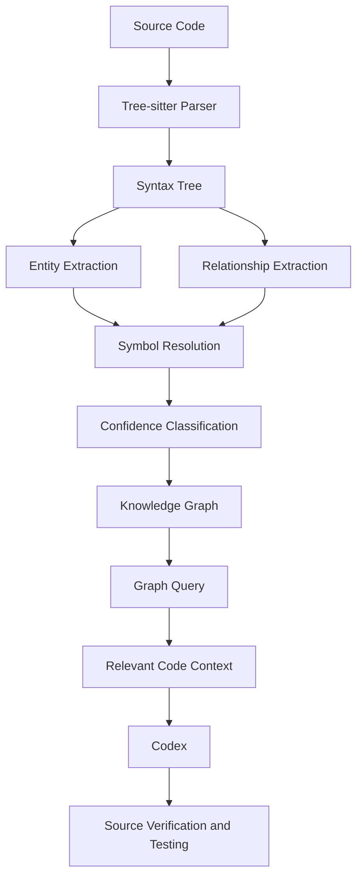

> [!important] Final Principle
> **AST parsing transforms source text into structured syntax. Code intelligence builds on that structure by extracting entities, resolving references, and constructing relationships. The resulting graph improves navigation, but it must not be mistaken for complete knowledge of runtime behavior.**

---

# Part XXXVI — Official References

## Graphify

- [Official Graphify Repository](https://github.com/Graphify-Labs/graphify)
- [Graphify README](https://github.com/Graphify-Labs/graphify/blob/main/README.md)
- [Graphify Architecture](https://github.com/Graphify-Labs/graphify/blob/main/ARCHITECTURE.md)
- [Graphify Source Package](https://github.com/Graphify-Labs/graphify/tree/main/graphify)
- [Graphify Tests](https://github.com/Graphify-Labs/graphify/tree/main/tests)

## Tree-sitter

- [Tree-sitter Official Documentation](https://tree-sitter.github.io/tree-sitter/)
- [Tree-sitter Using Parsers](https://tree-sitter.github.io/tree-sitter/using-parsers/)
- [Tree-sitter Syntax Node Documentation](https://tree-sitter.github.io/tree-sitter/using-parsers/2-basic-parsing.html)
- [Tree-sitter Query Syntax](https://tree-sitter.github.io/tree-sitter/using-parsers/queries/1-syntax.html)
- [Tree-sitter GitHub](https://github.com/tree-sitter/tree-sitter)

## Programming Languages

- [Java Language Specification](https://docs.oracle.com/javase/specs/)
- [PHP Documentation](https://www.php.net/manual/en/)
- [TypeScript Documentation](https://www.typescriptlang.org/docs/)
- [Android Developers](https://developer.android.com/)
- [Laravel Documentation](https://laravel.com/docs)
- [Next.js Documentation](https://nextjs.org/docs)

## Code Quality and Testing

- [Python unittest Documentation](https://docs.python.org/3/library/unittest.html)
- [pytest Documentation](https://docs.pytest.org/)

> [!note] Documentation Scope
> This lesson explains established parsing and static-analysis concepts in the context of Graphify.
>
> The code examples, extracted graph representations, and application diagrams are educational illustrations. They do not guarantee that the current Graphify version supports every described language construct or framework-specific relationship.
>
> No installation, indexing, project modification, or code execution was performed.

---

# Part XXXVII — Next Lesson

**[[05 - Nodes, Edges, and Relationships]]**

Topics:

1. Graph entity modeling.
2. Node identity and uniqueness.
3. Node attributes and metadata.
4. Edge semantics.
5. Directed relationships.
6. Extracted vs inferred vs ambiguous edges.
7. Cross-file relationship resolution.
8. Relationship confidence.
9. Graph normalization.
10. Duplicate entities.
11. Unresolved references.
12. Graph consistency.
13. Schema validation.
14. Java, PHP, and TypeScript examples.
15. Dependency analysis.
16. Practical exercises.
17. Official references.

**End of Lesson 04 — AST Parsing and Code Intelligence.**
