# 05 — Graphify: Nodes, Edges, and Relationships

> [!abstract] Lesson Information
> **Repository:** [Graphify-Labs/graphify](https://github.com/Graphify-Labs/graphify)
>
> **Category:** Agentic Engineering / Knowledge Graphs / Graph Data Modeling / Static Code Analysis
>
> **Difficulty:** Intermediate to Advanced
>
> **Learning Approach:** Theory First
>
> **Prerequisites:**
> - [[00 - Repository Overview and Purpose]]
> - [[01 - Knowledge Graph Fundamentals]]
> - [[02 - Architecture and Core Components]]
> - [[03 - Installation and Codex Integration]]
> - [[04 - AST Parsing and Code Intelligence]]
>
> **Primary Goal:** Understand how source-code entities and relationships are represented in a knowledge graph, how their identities and confidence levels are managed, and how graph consistency affects code intelligence.

---

# Part I — Learning Objectives

After completing this lesson, you should be able to:

1. Explain nodes, edges, and graph attributes.
2. Understand how source-code entities become graph nodes.
3. Design unique identifiers for symbols.
4. Distinguish node identity from display labels.
5. Explain directed and undirected relationships.
6. Understand different edge semantics.
7. Explain extracted, inferred, and ambiguous edges.
8. Understand cross-file relationship resolution.
9. Identify duplicate entities and conflicting references.
10. Explain graph normalization.
11. Understand unresolved references.
12. Explain graph schema validation.
13. Evaluate graph consistency and accuracy.
14. Understand dependency and impact analysis.
15. Apply graph modeling to Android, Laravel, and Next.js projects.
16. Design graph models that support reliable Codex workflows.

---

# Part II — Graph Fundamentals

## 1. What Is a Graph?

A graph is a mathematical structure consisting of:

- **Vertices (nodes)** representing entities.
- **Edges** representing relationships between entities.

A graph is commonly written as:

\[
G=(V,E)
\]

Where:

- \(G\) = graph.
- \(V\) = set of vertices.
- \(E\) = set of edges.

## 1.1 Example

Suppose an application contains:

```text
TaskController
TaskService
TaskRepository
```

And the controller depends on the service, while the service depends on the repository.

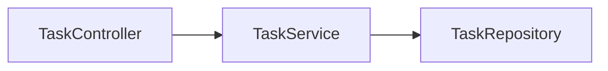

The nodes are:

\[
V=\{Controller,Service,Repository\}
\]

The relationships are:

\[
E=\{(Controller,Service),(Service,Repository)\}
\]

## 1.2 Why Graphs Are Useful for Source Code

Software systems naturally contain relationships.

Examples:

- A class imports another class.
- A method calls another method.
- A controller uses a service.
- A service references a model.
- A module depends on another module.
- A class implements an interface.

A graph provides a structured way to represent these connections.

---

# Part III — Understanding Graph Nodes

## 2. What Is a Node?

A **node** represents an entity within the graph.

In code intelligence, nodes may represent:

- Files.
- Modules.
- Packages.
- Namespaces.
- Classes.
- Interfaces.
- Methods.
- Functions.
- Variables.
- Other supported concepts.

The exact entity types extracted depend on the tool's implementation.

## 2.1 Example

```java
public class TaskService {
    public void completeTask() {}
}
```

Possible nodes:

```text
TaskService
TaskService.completeTask
```

## 2.2 Conceptual Representation

```json
{
  "id": "TaskService",
  "label": "TaskService",
  "type": "class",
  "source_file": "TaskService.java"
}
```

This is an illustrative graph node, not a claim about Graphify's exact serialized schema.

## 2.3 Node Identity vs Node Label

These are different concepts.

**Node identity** determines whether two references represent the same entity.

**Node label** is the human-readable name shown in a graph visualization.

For example:

```text
ID:
java:com.example.tasks.TaskService

Label:
TaskService
```

Two nodes may have the same label but different identities.

---

# Part IV — Unique Node Identification

## 3. Why Unique IDs Matter

Consider:

```text
services/UserService.java
repositories/UserService.java
```

Both files might declare a class named `UserService`.

If the graph uses only the class name as its identifier, the two classes could be incorrectly merged.

## 3.1 Incorrect Identity Strategy

```text
UserService
```

This is insufficient when multiple declarations share a name.

## 3.2 More Precise Identity Strategy

```text
java:com.example.services.UserService
java:com.example.repositories.UserService
```

This uses qualified names to distinguish the entities.

## 3.3 Conceptual Identity Formula

A symbol identifier can be modeled as:

\[
ID=f(Language,Namespace,Container,Symbol,Signature)
\]

For example:

```text
Language: Java
Namespace: com.example.tasks
Container: TaskService
Symbol: completeTask
Signature: (String)
```

Possible ID:

```text
java:com.example.tasks.TaskService.completeTask(String)
```

This is a recommended modeling concept, not Graphify's verified ID-generation algorithm.

---

# Part V — Function and Method Overloading

## 4. Why Method Names May Not Be Unique

Java supports method overloading.

Example:

```java
public class TaskService {
    void updateTask(int id) {}

    void updateTask(String code) {}
}
```

Both methods share the name:

```text
updateTask
```

But their parameter signatures differ.

## 4.1 Correct Conceptual Representation

```text
TaskService.updateTask(int)
TaskService.updateTask(String)
```

## 4.2 Why This Matters

Without signature-aware identification, an analyzer may:

- Merge unrelated methods.
- Create incorrect call relationships.
- Misidentify dependencies.
- Produce misleading graph queries.

## 4.3 Other Languages

Different languages use different symbol-resolution rules.

For example:

- Java supports method overloading.
- PHP relies heavily on namespaces and class scope.
- TypeScript supports function overload signatures and structural typing.

An identity strategy must respect language semantics.

---

# Part VI — Node Attributes

## 5. What Are Node Attributes?

Attributes store additional information about a graph entity.

Example:

```json
{
  "id": "java:TaskService",
  "label": "TaskService",
  "kind": "class",
  "language": "java",
  "source_file": "TaskService.java",
  "source_location": "L12"
}
```

## 5.1 Common Attribute Categories

| Attribute | Purpose |
|---|---|
| `id` | Stable entity identity |
| `label` | Human-readable name |
| `kind` | Entity category |
| `language` | Source language |
| `source_file` | Originating file |
| `source_location` | Position in source |
| `namespace` | Package or namespace |
| `signature` | Method or function signature |
| `community` | Graph cluster assignment |

Not all attributes are necessarily part of Graphify's current implementation.

## 5.2 Why Metadata Matters

Metadata supports:

- Precise source navigation.
- Filtering.
- Querying.
- Graph visualization.
- Confidence assessment.
- Debugging extraction errors.

## 5.3 Provenance

**Provenance** describes where information came from.

For a code graph, provenance might include:

```text
Source file
Line number
Extraction method
Parser version
Indexing timestamp
```

Provenance helps developers verify graph claims.

---

# Part VII — Understanding Graph Edges

## 6. What Is an Edge?

An **edge** represents a relationship between two nodes.

Example:

```text
TaskController uses TaskService
```

Conceptually:

```json
{
  "source": "TaskController",
  "target": "TaskService",
  "relation": "uses"
}
```

## 6.1 Edge Components

An edge commonly includes:

- Source node.
- Target node.
- Relationship type.
- Optional metadata.

## 6.2 Example Diagram

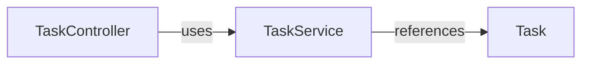

## 6.3 Why Relationship Types Matter

Consider these statements:

```text
TaskController imports TaskService.
TaskController calls TaskService.
TaskController extends TaskService.
```

They express different relationships.

A graph should not treat them as semantically identical.

---

# Part VIII — Relationship Semantics

## 7. Common Code Relationships

| Relationship | Meaning |
|---|---|
| Contains | An entity contains another entity |
| Imports | A module imports another module |
| Calls | A function or method invokes another |
| Extends | A class inherits from another |
| Implements | A class implements an interface |
| References | An entity references another |
| Depends on | One component requires another |

These are general code-graph relationship concepts; the supported labels must be checked against Graphify's current schema.

## 7.1 Contains

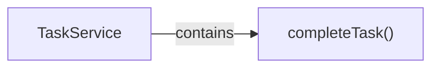

## 7.2 Imports

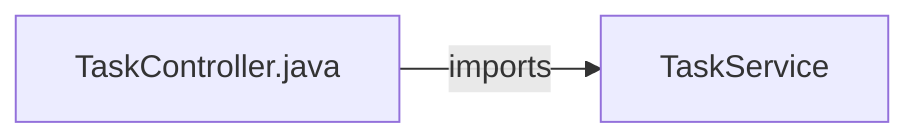

## 7.3 Calls

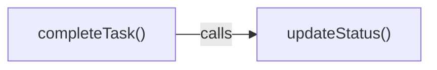

## 7.4 Extends

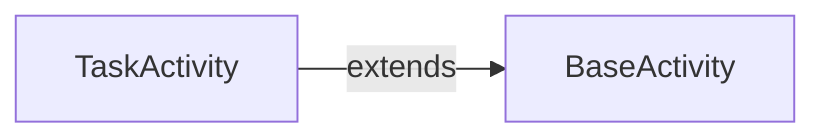

## 7.5 Implements

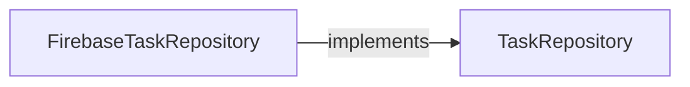

---

# Part IX — Directed vs Undirected Graphs

## 8. What Is a Directed Graph?

A directed graph uses edges with direction.

For example:

```text
A → B
```

This means the relationship points from A to B.

In code analysis:

```text
Controller → Service
```

may mean the controller depends on the service.

The reverse relationship is not automatically true.

## 8.1 Directed Graph Example

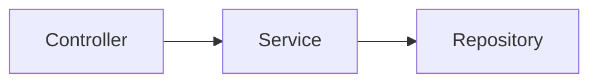

## 8.2 Undirected Graph

An undirected graph represents connections without direction.

```text
A — B
```

This can be useful when analyzing general connectivity or communities.

## 8.3 Why Direction Matters

Consider:

```text
TaskController imports TaskService.
```

This does not mean:

```text
TaskService imports TaskController.
```

Reversing the relationship changes its meaning.

## 8.4 Graphify Architecture Consideration

Graphify's architecture documentation describes using NetworkX graph structures, including `nx.Graph`.

An ordinary `nx.Graph` is undirected.

Therefore, the exact handling of directional code relationships must be verified against the implementation and export format.

Do not assume that every algorithm preserves source-to-target direction.

---

# Part X — Edge Attributes

## 9. What Metadata Can an Edge Contain?

Conceptually:

```json
{
  "source": "TaskController",
  "target": "TaskService",
  "relation": "uses",
  "confidence": "EXTRACTED",
  "source_file": "TaskController.java",
  "source_location": "L18"
}
```

## 9.1 Important Edge Attributes

| Attribute | Purpose |
|---|---|
| Source | Originating entity |
| Target | Referenced entity |
| Relation | Relationship semantics |
| Confidence | Extraction certainty |
| Source location | Supporting evidence |
| Weight | Optional graph-analysis strength |
| Timestamp | Optional extraction freshness |

## 9.2 Why Edge Provenance Matters

Suppose an agent reports:

> TaskController depends on TaskService.

The graph should ideally provide evidence pointing to the relevant source declaration or reference.

This allows the developer to verify the claim.

---

# Part XI — Relationship Confidence

## 10. Extracted, Inferred, and Ambiguous

Graphify's documented architecture identifies three confidence categories:

- `EXTRACTED`
- `INFERRED`
- `AMBIGUOUS`

These categories help distinguish how confidently a relationship was established.

## 10.1 EXTRACTED

The relationship is explicitly represented in source material.

Example:

```java
import com.example.tasks.TaskService;
```

The import is directly visible.

## 10.2 INFERRED

The relationship is derived through additional analysis.

Example:

A resolver connects a method call to a likely declaration using package and type information.

## 10.3 AMBIGUOUS

The analyzer cannot confidently identify one relationship.

Example:

```java
service.process();
```

If multiple candidate implementations exist, the destination may be uncertain.

## 10.4 Confidence Matrix

| Confidence | Evidence | Recommended Agent Behavior |
|---|---|---|
| EXTRACTED | Explicit syntax | Verify source when consequential |
| INFERRED | Resolution logic | Inspect supporting evidence |
| AMBIGUOUS | Uncertain match | Avoid definitive claims |

## 10.5 Important Principle

Confidence labels are not equivalent to numerical probabilities.

For example, `INFERRED` does not automatically mean an 80% probability of correctness.

---

# Part XII — Cross-File Relationships

## 11. Why Cross-File Resolution Is Important

Modern applications divide functionality across multiple files.

Example:

```text
controllers/
└── TaskController.java

services/
└── TaskService.java

repositories/
└── TaskRepository.java
```

The relationships between these files form part of the application's architecture.

## 11.1 Resolution Workflow

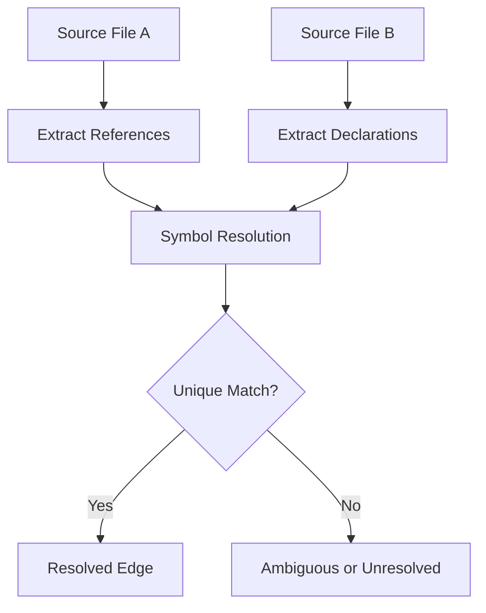

## 11.2 What Information Helps Resolution?

- Import declarations.
- Qualified names.
- Package names.
- Class names.
- Method signatures.
- Scope information.
- Type references.

## 11.3 Example

```java
import com.example.services.TaskService;

public class TaskController {
    private TaskService service;
}
```

The import provides a clue about which `TaskService` declaration is referenced.

---

# Part XIII — Ambiguous References

## 12. What Is an Ambiguous Reference?

An ambiguous reference occurs when multiple possible targets exist.

Example:

```text
services/TaskService
legacy/TaskService
```

Suppose an extractor encounters:

```text
TaskService
```

without enough context to determine the correct declaration.

## 12.1 Possible Outcomes

The analyzer may:

1. Resolve a unique declaration.
2. Record an ambiguous relationship.
3. Leave the reference unresolved.

## 12.2 Why Guessing Is Dangerous

An incorrect resolution can affect downstream analysis.

For example:

```text
Wrong reference
    ↓
Wrong dependency
    ↓
Wrong impact analysis
    ↓
Incorrect coding-agent recommendation
```

## 12.3 Best Practice

Preserve uncertainty instead of forcing a relationship when the evidence is insufficient.

---

# Part XIV — Duplicate Nodes

## 13. What Causes Duplicate Entities?

Duplicates may arise from:

- Repeated extraction.
- Multiple file paths pointing to the same content.
- Inconsistent naming.
- Different import aliases.
- Partial identifiers.
- Re-indexing without reconciliation.

## 13.1 Example

```text
TaskService
com.example.tasks.TaskService
TaskService.java::TaskService
```

These might represent the same declaration.

But they could also represent different entities depending on the repository.

## 13.2 Deduplication

Deduplication attempts to identify records referring to the same entity.

Conceptually:

```python
nodes_by_id = {}

for node in extracted_nodes:
    nodes_by_id[node["id"]] = node
```

This example assumes IDs are already correct.

It does not solve identity ambiguity.

## 13.3 Important

Deduplication based only on display labels can incorrectly merge unrelated entities.

---

# Part XV — Graph Normalization

## 14. What Is Graph Normalization?

Graph normalization is the process of making graph data consistent.

It may involve:

- Standardizing identifiers.
- Standardizing relationship labels.
- Removing exact duplicates.
- Resolving aliases.
- Validating references.
- Handling missing nodes.

## 14.1 Example

Before normalization:

```text
TaskService
task_service
com.example.TaskService
```

After normalization, the system may determine whether these are aliases for one declaration or genuinely different entities.

## 14.2 Why Normalization Matters

Without consistent graph data, queries may return:

- Duplicate results.
- Missing relationships.
- Incorrect dependency paths.
- Misleading centrality measurements.

## 14.3 Important

Normalization rules must preserve meaningful differences.

Two functions named `save()` should not be merged merely because their labels match.

---

# Part XVI — Unresolved References

## 15. What Is an Unresolved Reference?

An unresolved reference occurs when the analyzer finds a reference but cannot identify its declaration.

Example:

```java
ExternalLibrary.performAction();
```

If the external library is not indexed, its declaration may be unavailable.

## 15.1 Common Causes

- External dependencies.
- Generated code.
- Missing files.
- Unsupported languages.
- Dynamic imports.
- Reflection.
- Incomplete repositories.

## 15.2 Possible Modeling Strategies

A graph system may:

- Omit the unresolved relationship.
- Preserve an unresolved reference record.
- Create an external placeholder node.
- Mark the relationship as uncertain.

These are general design options, not a claim that Graphify implements all of them.

## 15.3 Why This Matters

A missing edge does not necessarily prove that two components are independent.

It may indicate incomplete extraction coverage.

---

# Part XVII — Graph Schema Validation

## 16. What Is a Graph Schema?

A graph schema defines expected structures and constraints.

For example:

```json
{
  "nodes": [
    {
      "id": "TaskService",
      "label": "TaskService",
      "source_file": "TaskService.java",
      "source_location": "L10"
    }
  ],
  "edges": [
    {
      "source": "TaskController",
      "target": "TaskService",
      "relation": "references",
      "confidence": "EXTRACTED"
    }
  ]
}
```

This is an illustrative extraction object.

## 16.1 Graphify Validation

Graphify's architecture documentation identifies:

```python
validate_extraction(data)
```

The validation stage checks extraction data against its expected contract.

## 16.2 Useful Validation Rules

A robust graph pipeline may check:

- Node IDs are valid.
- Required fields exist.
- Edge endpoints are valid.
- Relationship labels are supported.
- Confidence labels are recognized.
- Data types are correct.

## 16.3 Structural vs Semantic Validation

**Structural validation** checks whether data follows the expected format.

**Semantic validation** checks whether the represented relationship is meaningful or correct.

A graph can pass structural validation while containing an incorrect dependency.

---

# Part XVIII — Graph Consistency

## 17. What Is Graph Consistency?

Graph consistency means the graph follows its structural and semantic rules.

Examples:

- Every required node has an identifier.
- Edges reference valid nodes.
- Relationship types are consistent.
- Duplicate handling follows defined rules.
- Source metadata remains accurate.

## 17.1 Referential Integrity

Suppose an edge references:

```text
TaskController → TaskService
```

But `TaskService` does not exist in the graph.

The graph may contain a dangling reference.

## 17.2 Why Referential Integrity Matters

Missing endpoints can cause:

- Query failures.
- Broken visualizations.
- Incorrect traversal.
- Incomplete dependency analysis.

## 17.3 Consistency Checks

A conceptual validation process:

```text
For each edge:
    Verify source exists.
    Verify target exists.
    Verify relationship is valid.
    Verify confidence is valid.
```

---

# Part XIX — Multi-Relationships and Graph Types

## 18. Can Two Nodes Have Multiple Relationships?

Yes.

For example:

```text
TaskController imports TaskService.
TaskController references TaskService.
```

These are distinct relationships between the same entities.

## 18.1 Simple Graph

A simple graph generally represents at most one edge between a pair of nodes.

## 18.2 Multigraph

A multigraph supports multiple edges between the same pair of nodes.

## 18.3 NetworkX Examples

Conceptual Python:

```python
import networkx as nx

graph = nx.Graph()
```

A multigraph:

```python
graph = nx.MultiGraph()
```

A directed multigraph:

```python
graph = nx.MultiDiGraph()
```

## 18.4 Why Graph Type Matters

The chosen graph structure determines whether the system can represent:

- Direction.
- Multiple relationship types.
- Parallel edges.
- Edge-specific metadata.

Graphify's documented use of `nx.Graph` should be considered when interpreting how multiple source relationships are stored or exported.

---

# Part XX — Dependency Analysis

## 19. What Is Dependency Analysis?

Dependency analysis examines which components rely on other components.

Example:

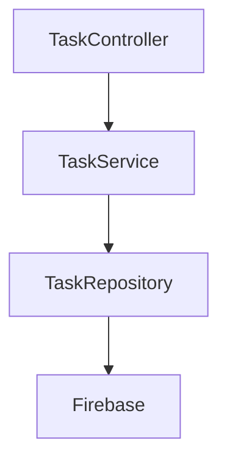

## 19.1 Direct Dependency

A direct dependency exists between immediately connected components.

Example:

```text
TaskController → TaskService
```

## 19.2 Transitive Dependency

A transitive dependency is reached through other components.

Example:

```text
TaskController → TaskService → TaskRepository
```

The controller may indirectly depend on repository behavior.

## 19.3 Why This Matters

Dependency analysis supports:

- Refactoring.
- Architecture review.
- Change planning.
- Test selection.
- Impact assessment.

---

# Part XXI — Impact Analysis

## 20. What Is Change Impact Analysis?

Impact analysis estimates which components may be affected by a proposed change.

Suppose a developer modifies:

```text
TaskRepository
```

Potentially affected components:

```text
TaskService
TaskController
TaskDetailsActivity
```

## 20.1 Conceptual Workflow

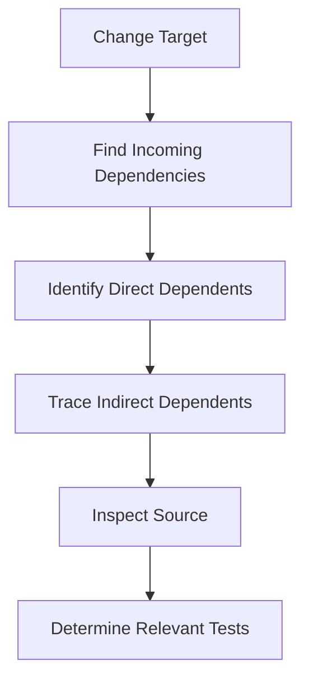

## 20.2 Important

A graph can suggest possible impact.

It cannot guarantee that every listed component will fail or change behavior.

## 20.3 Direction Matters

For impact analysis, developers often need to traverse relationships in reverse.

If:

```text
Controller → Service
```

means the controller depends on the service, then changing the service may affect the controller.

---

# Part XXII — Centrality and Important Nodes

## 21. What Is Centrality?

Centrality measures how important or connected a node is according to a particular graph metric.

Common measures include:

- Degree centrality.
- Betweenness centrality.
- Closeness centrality.
- Eigenvector centrality.

## 21.1 Degree Centrality

Degree centrality is based on the number of connections a node has.

For a simple graph with (n) nodes:

\[
C_D(v)=\frac{deg(v)}{n-1}
\]

## 21.2 Example

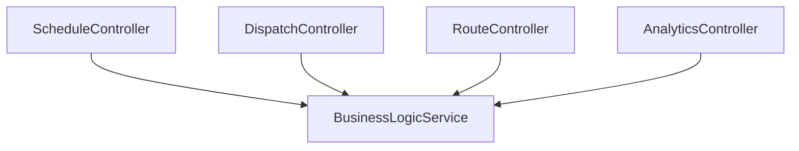

The shared service has several connections.

## 21.3 Why This Matters

Highly connected nodes may represent:

- Shared services.
- Core abstractions.
- Integration points.
- Potential refactoring hotspots.

## 21.4 Important

High centrality is not automatically evidence of poor design.

Some components are intentionally shared.

---

# Part XXIII — Community Detection

## 22. What Is a Graph Community?

A community is a group of nodes that are more closely connected to each other than to other parts of the graph.

Example:

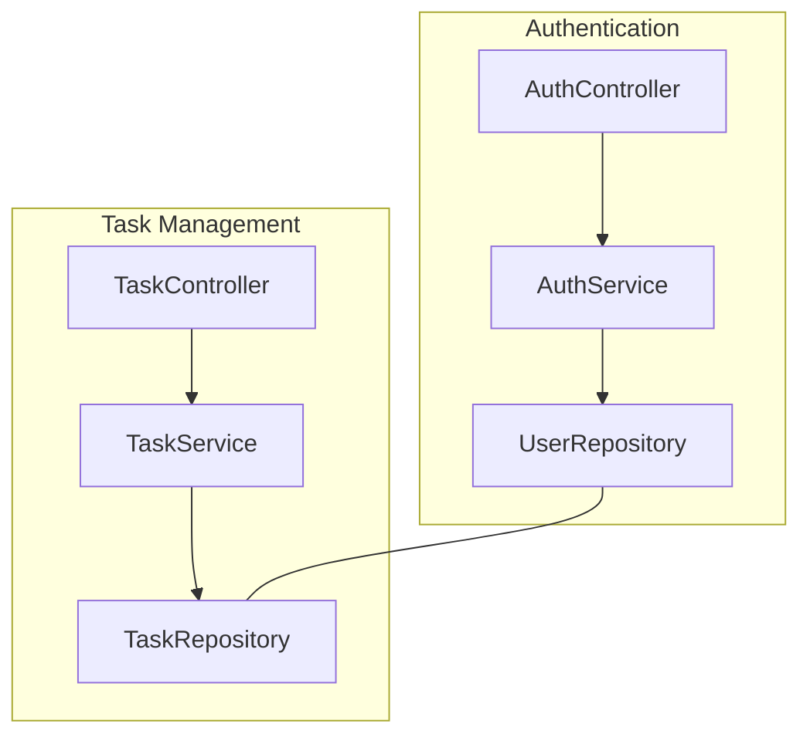

## 22.1 Why Communities Matter

Community detection can help identify:

- Subsystems.
- Closely related components.
- Architectural boundaries.
- Cross-module coupling.

## 22.2 Graphify Clustering

Graphify's architecture includes a clustering stage:

```python
cluster(G)
```

This stage assigns community information to graph nodes.

## 22.3 Important

Algorithmically detected communities are not guaranteed to match official business modules.

---

# Part XXIV — Graph Freshness

## 23. What Happens When Code Changes?

A graph represents the codebase at a particular time.

Suppose:

```text
TaskService.completeTask()
```

is renamed to:

```text
TaskService.markCompleted()
```

An older graph may still reference the previous method.

## 23.1 Stale Graph Risks

- Missing new symbols.
- References to deleted methods.
- Incorrect dependency paths.
- Outdated architectural conclusions.

## 23.2 Graph Refresh Strategy

A conceptual refresh workflow:

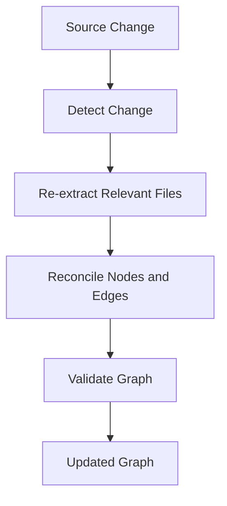

## 23.3 Important

The exact refresh behavior depends on Graphify's implementation.

File watching and incremental graph updates are separate capabilities.

---

# Part XXV — Graph Provenance and Trust

## 24. Why Should Graph Claims Be Verifiable?

A graph can contain incorrect or outdated relationships.

For reliable code intelligence, an agent should be able to trace a claim back to source evidence.

## 24.1 Evidence Chain

```text
Graph Edge
    ↓
Source File
    ↓
Source Location
    ↓
Actual Declaration or Reference
    ↓
Verified Conclusion
```

## 24.2 Example

Graph claim:

```text
ScheduleController references ScheduleService.
```

Verification:

1. Locate the controller.
2. Inspect imports and dependencies.
3. Confirm the referenced service.
4. Check whether the relationship is current.

## 24.3 Best Practice

Treat graph output as a navigation aid and evidence source, not as an unquestionable authority.

---

# Part XXVI — GroupTrack Android Case Study

## 25. Scenario: Task Completion Dependencies

Consider an illustrative GroupTrack architecture:

```text
TaskDetailsActivity
TaskRepository
Task
Firebase
```

## 25.1 Conceptual Graph

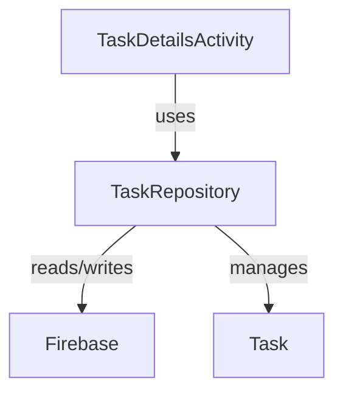

## 25.2 Questions the Graph May Help Answer

- Which activity handles task details?
- Which repository manages task records?
- Which model represents task data?
- Which components depend on the repository?

## 25.3 Impact Analysis Example

Suppose the task status field changes.

Potential investigation targets:

- Task model.
- Repository.
- Completion handler.
- Progress calculation.

## 25.4 MVP Constraint

Graph exploration should support the existing five-feature MVP.

It should not become a reason to introduce unnecessary libraries or architecture layers.

---

# Part XXVII — GoPasig Laravel Case Study

## 26. Scenario: Dispatch and Scheduling

Consider these components:

```text
ScheduleController
BusinessLogicService
Schedule
Bus
Driver
Trip
```

## 26.1 Conceptual Graph

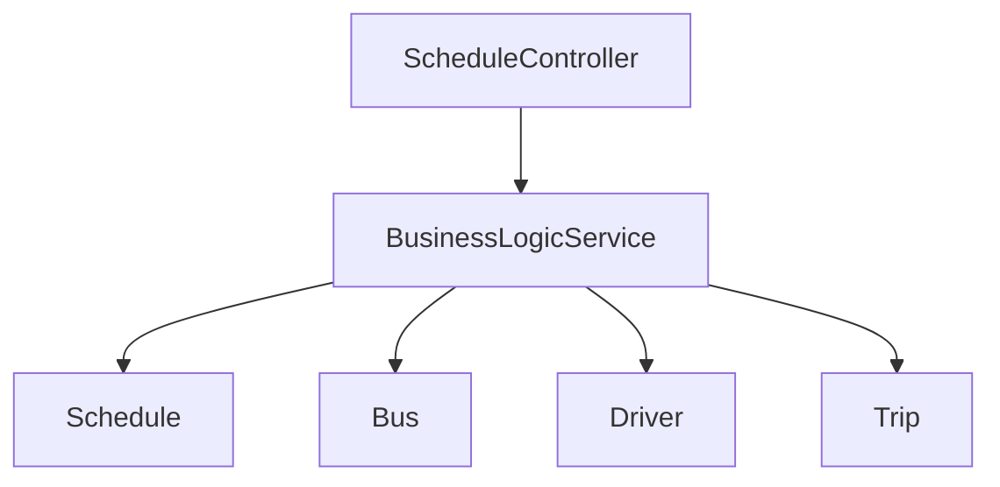

## 26.2 Architectural Questions

- Which controllers depend on scheduling logic?
- Which models are referenced by dispatch services?
- What components may be affected by schedule-validation changes?
- Which services are highly connected?

## 26.3 Important Limitation

Laravel's dependency injection and dynamic Eloquent behavior may not be fully captured by generic syntax parsing.

Graph findings should be verified against the actual application.

---

# Part XXVIII — Next.js and Laravel E-commerce Case Study

## 27. Scenario: Product Management

Consider:

```text
Next.js ProductsPage
Next.js API Client
Laravel ProductController
Laravel Product Model
PostgreSQL
```

## 27.1 Conceptual Architecture

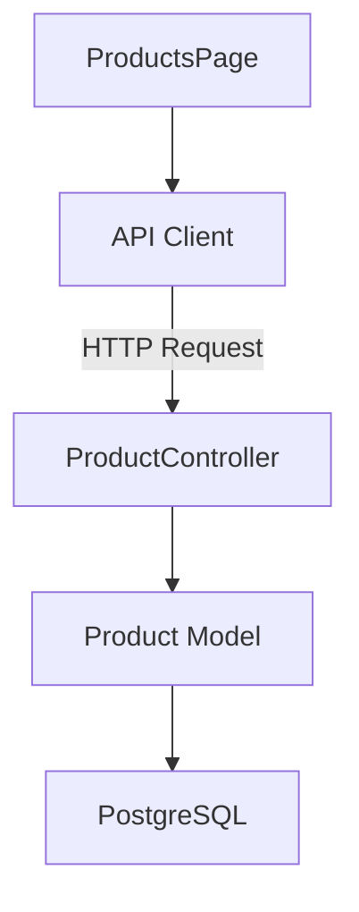

## 27.2 Important Distinction

Not all relationships are visible through ordinary imports or method calls.

For example:

```text
API Client → ProductController
```

may require interpreting HTTP routes and configuration.

## 27.3 Graph Modeling Lesson

A multi-stack graph may need different relationship categories:

- Static source relationships.
- Framework-derived relationships.
- Runtime or deployment relationships.

These should not be treated as equally certain.

---

# Part XXIX — Graph Quality Metrics

## 28. How Do We Evaluate Graph Quality?

Graph quality should be assessed through more than the number of nodes and edges.

Useful measures include:

- Node coverage.
- Edge precision.
- Edge recall.
- Duplicate rate.
- Unresolved reference rate.
- Staleness.
- Query usefulness.

## 28.1 Node Coverage

\[
Coverage=
\frac{\text{Correctly Extracted Entities}}
{\text{Expected Entities}}
\times100\%
\]

## 28.2 Duplicate Rate

\[
DuplicateRate=
\frac{\text{Duplicate Records}}
{\text{Total Extracted Records}}
\times100\%
\]

## 28.3 Edge Precision

\[
Precision=\frac{TP}{TP+FP}
\]

## 28.4 Edge Recall

\[
Recall=\frac{TP}{TP+FN}
\]

## 28.5 Hypothetical Example

Suppose a test repository has:

- 100 expected entities.
- 92 correctly extracted entities.
- 5 duplicate records.

Then entity coverage is:

\[
\frac{92}{100}\times100=92\%
\]

The duplicate rate requires a clearly defined total-record count.

These figures are illustrative, not Graphify benchmark results.

---

# Part XXX — Graph Modeling Best Practices

## 29. Recommended Principles

### 29.1 Use Stable Identifiers

Avoid relying only on short display names.

### 29.2 Preserve Source Provenance

Store enough information to verify extracted entities.

### 29.3 Distinguish Relationship Types

Do not collapse semantically different relationships without a reason.

### 29.4 Preserve Uncertainty

Ambiguous references should not be silently treated as resolved.

### 29.5 Validate Before Construction

Malformed extraction data should be detected early.

### 29.6 Avoid Incorrect Deduplication

Two declarations with the same label may still be different entities.

### 29.7 Track Graph Freshness

Graph results should correspond to the current source version.

### 29.8 Verify Important Conclusions

Use the graph to locate relevant code, then inspect the code itself.

---

# Part XXXI — Common Graph Modeling Mistakes

## 30. Mistake 1: Using Names as Unique IDs

Problem:

```text
save()
```

Multiple functions may share this name.

Better approach:

Use qualified identity information.

## 30.1 Mistake 2: Ignoring Edge Direction

Problem:

Treating:

```text
Controller → Service
```

as equivalent to:

```text
Service → Controller
```

These express different dependencies.

## 30.2 Mistake 3: Treating Inferred Edges as Facts

Problem:

An inferred relationship is presented as certain.

Better approach:

Inspect supporting evidence.

## 30.3 Mistake 4: Merging Similar Names

Problem:

Different classes are combined because they share a label.

Better approach:

Use namespaces, paths, and signatures.

## 30.4 Mistake 5: Assuming Missing Edges Mean No Dependency

Problem:

Unsupported or dynamic relationships may be absent.

Better approach:

Consider extraction coverage and framework behavior.

## 30.5 Mistake 6: Ignoring Graph Freshness

Problem:

Using outdated graph data after significant refactoring.

Better approach:

Refresh or verify the graph before important analysis.

---

# Part XXXII — Practical Exercises

## Exercise 1 — Node Identification

Given:

```java
class ProjectService {
    void createProject() {}
}
```

Identify possible graph nodes.

## Exercise 2 — Unique IDs

Design distinct IDs for:

```text
com.example.services.UserService
com.example.repositories.UserService
```

## Exercise 3 — Method Overloading

Design identifiers for:

```java
void update(int id) {}
void update(String code) {}
```

## Exercise 4 — Node Attributes

Create a conceptual node record containing:

- ID.
- Label.
- Type.
- Language.
- Source file.
- Source location.

## Exercise 5 — Edge Modeling

Represent:

```text
TaskController uses TaskService.
```

as an edge record.

## Exercise 6 — Relationship Semantics

Explain the difference between:

- Imports.
- Calls.
- Extends.
- Implements.
- References.

## Exercise 7 — Directed Graph

Explain why dependency direction matters.

## Exercise 8 — Confidence Classification

Classify three relationships as extracted, inferred, or ambiguous.

## Exercise 9 — Duplicate Detection

Explain why two methods named `save()` should not automatically be merged.

## Exercise 10 — Unresolved Reference

Describe how an analyzer might handle a reference to an external dependency.

## Exercise 11 — Graph Validation

Design five structural validation rules.

## Exercise 12 — Impact Analysis

Draw a dependency graph for a controller, service, and repository.

Explain what might be affected if the repository changes.

## Exercise 13 — Android

Design a conceptual graph for task completion in GroupTrack.

## Exercise 14 — Laravel

Design a conceptual graph for scheduling and dispatch in GoPasig.

## Exercise 15 — E-commerce

Design a graph showing the relationship between a Next.js page, API client, Laravel controller, model, and database.

## Exercise 16 — Graph Quality

A test repository contains 200 expected entities.

An extractor correctly identifies 180.

Calculate entity coverage.

## Exercise 17 — Graph Consistency

Explain what happens if an edge references a node that does not exist.

## Exercise 18 — Final Exercise

Design a complete graph data model for a hypothetical task-management application.

Include:

1. Node categories.
2. Node identifiers.
3. Node metadata.
4. Edge categories.
5. Confidence labels.
6. Cross-file resolution.
7. Duplicate handling.
8. Unresolved references.
9. Validation rules.
10. Query and impact-analysis use cases.

---

# Part XXXIII — Review Questions

1. What is a graph?
2. What is a node?
3. What is an edge?
4. What is a node identifier?
5. What is a node label?
6. Why must node IDs be unique?
7. What is a qualified name?
8. Why do overloaded methods complicate identity?
9. What are node attributes?
10. What is provenance?
11. What are edge attributes?
12. What is relationship semantics?
13. What is a directed graph?
14. What is an undirected graph?
15. Why does direction matter?
16. What is a multigraph?
17. What is an extracted edge?
18. What is an inferred edge?
19. What is an ambiguous edge?
20. What is cross-file resolution?
21. What is an unresolved reference?
22. What causes duplicate nodes?
23. What is graph normalization?
24. What is referential integrity?
25. What is graph consistency?
26. What is schema validation?
27. What is dependency analysis?
28. What is a transitive dependency?
29. What is impact analysis?
30. What is degree centrality?
31. What is community detection?
32. Why does graph freshness matter?
33. What is node coverage?
34. What is edge precision?
35. Why must graph conclusions be verified against source code?

---

# Part XXXIV — Key Takeaways

> [!summary]
> - Nodes represent code entities.
> - Edges represent relationships between entities.
> - Unique IDs distinguish declarations with similar names.
> - Labels are for readability, not necessarily identity.
> - Node metadata supports filtering and verification.
> - Edge semantics describe the meaning of relationships.
> - Direction matters for dependency analysis.
> - Graphify documents extracted, inferred, and ambiguous confidence labels.
> - Cross-file resolution connects references to declarations.
> - Ambiguous relationships should preserve uncertainty.
> - Duplicate handling requires reliable identity rules.
> - Graph normalization improves consistency.
> - Unresolved references may indicate incomplete coverage.
> - Schema validation checks structural correctness.
> - Referential integrity prevents invalid edge endpoints.
> - Dependency graphs support impact analysis.
> - Centrality highlights structurally important nodes.
> - Communities reveal groups of related components.
> - Graph freshness affects accuracy.
> - Graph quality should be measured.
> - Source-code verification remains essential.

---

# Part XXXV — Final Mental Model

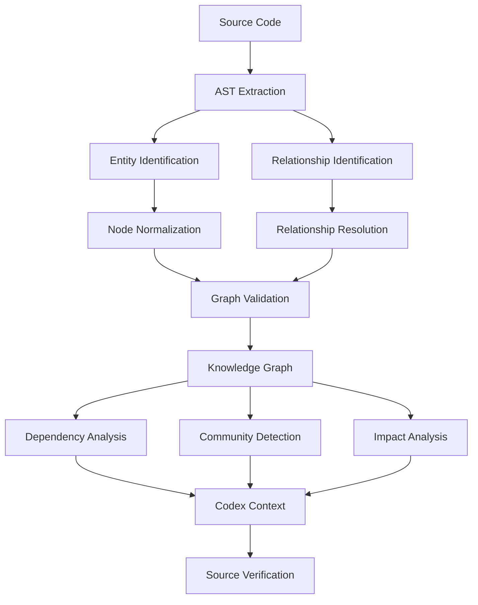

> [!important] Final Principle
> **A useful knowledge graph depends on accurate entity identity, meaningful relationship semantics, reliable resolution, and consistent validation. More nodes and edges do not automatically mean better code intelligence.**

---

# Part XXXVI — Official References

## Graphify

- [Graphify Repository](https://github.com/Graphify-Labs/graphify)
- [Graphify README](https://github.com/Graphify-Labs/graphify/blob/main/README.md)
- [Graphify Architecture](https://github.com/Graphify-Labs/graphify/blob/main/ARCHITECTURE.md)
- [Graphify Security Policy](https://github.com/Graphify-Labs/graphify/blob/main/SECURITY.md)

## Graph Theory and NetworkX

- [NetworkX Documentation](https://networkx.org/documentation/stable/)
- [NetworkX Graph](https://networkx.org/documentation/stable/reference/classes/graph.html)
- [NetworkX DiGraph](https://networkx.org/documentation/stable/reference/classes/digraph.html)
- [NetworkX MultiGraph](https://networkx.org/documentation/stable/reference/classes/multigraph.html)
- [NetworkX Centrality](https://networkx.org/documentation/stable/reference/algorithms/centrality.html)
- [NetworkX Community Detection](https://networkx.org/documentation/stable/reference/algorithms/community.html)

## Parsing and Code Intelligence

- [Tree-sitter Documentation](https://tree-sitter.github.io/tree-sitter/)
- [Tree-sitter GitHub](https://github.com/tree-sitter/tree-sitter)
- [Model Context Protocol](https://modelcontextprotocol.io/)
- [OpenAI Codex Documentation](https://developers.openai.com/codex/)

> [!note] Documentation Scope
> This lesson combines Graphify's documented architecture with general graph-modeling and static-analysis concepts.
>
> The example schemas, identifier strategies, relationship categories, and project diagrams are conceptual illustrations. They should not be interpreted as verified descriptions of every internal Graphify implementation detail.
>
> No installation, graph construction, source-code modification, or test execution was performed.

---

# Part XXXVII — Next Lesson

**[[06 - Graph Construction and NetworkX]]**

Topics:

1. Graph construction pipeline.
2. NetworkX fundamentals.
3. Graph data structures.
4. Graph, DiGraph, and MultiGraph.
5. Adding nodes and edges.
6. Merging extraction results.
7. Graph normalization.
8. Attribute management.
9. Graph traversal.
10. Connected components.
11. Shortest paths.
12. Degree and centrality.
13. Community detection preparation.
14. Graph serialization.
15. Performance and scalability.
16. Practical exercises.
17. Official references.

**End of Lesson 05 — Nodes, Edges, and Relationships.**
