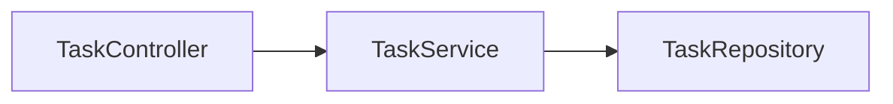
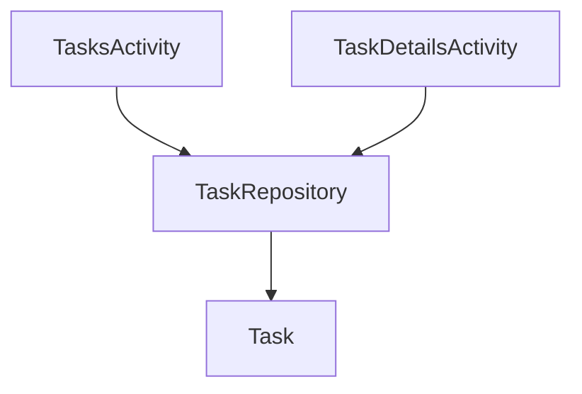
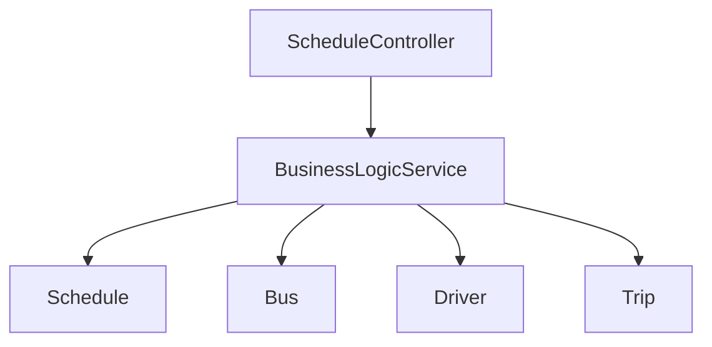
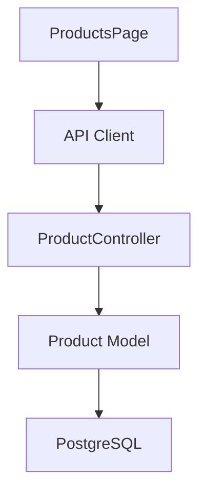

# 06 — Graphify: Graph Construction and NetworkX

> [!abstract] Lesson Information
> **Repository:** [Graphify-Labs/graphify](https://github.com/Graphify-Labs/graphify)
>
> **Category:** Agentic Engineering / Knowledge Graphs / Graph Algorithms / Code Intelligence
>
> **Difficulty:** Intermediate to Advanced
>
> **Learning Approach:** Theory First
>
> **Prerequisites:**
> - [[04 - AST Parsing and Code Intelligence]]
> - [[05 - Nodes, Edges, and Relationships]]
>
> **Primary Goal:** Understand how extracted source-code entities are assembled into a repository-wide graph, how NetworkX represents and analyzes relationships, and how graph construction supports architecture discovery and agentic development.

---

# Part I — Learning Objectives

After completing this lesson, you should be able to:

1. Explain the complete graph construction pipeline.
2. Understand Graphify's documented graph builder.
3. Distinguish `Graph`, `DiGraph`, `MultiGraph`, and `MultiDiGraph`.
4. Understand node and edge insertion.
5. Explain extraction merging, duplicate handling, and graph metadata.
6. Explain validation, normalization, traversal, shortest paths, and connected components.
7. Calculate degree and centrality and interpret communities.
8. Explain graph serialization, performance, and scalability.
9. Recognize limitations of static dependency graphs.
10. Design graph-assisted exploration workflows for Codex.

---

# Part II — Graph Construction

Graph construction transforms extracted entities and relationships into a graph data structure:

```text
Source Files → AST Parsing → Entity Extraction → Relationship Extraction
            → Validation → Graph Construction → Repository Knowledge Graph
```

For example:



File-level extraction must be merged so that relationships discovered in different files become a repository-wide structure.

## Graphify's documented pipeline

```text
detect() → extract() → build_graph() → cluster() → analyze() → report() → export()
```

The documented graph-builder interface is:

```python
build_graph(extractions)
```

Its input is a list of extraction dictionaries and its output is a NetworkX graph. Construction and analysis are separate: algorithms cannot make an incorrectly extracted graph reliable.

| Module | Responsibility |
|---|---|
| `detect.py` | Find relevant files |
| `extract.py` | Produce nodes and edges |
| `validate.py` | Validate extraction records |
| `build.py` | Construct the graph |
| `cluster.py` | Assign communities |
| `analyze.py` | Analyze relationships |
| `report.py` | Generate findings |
| `export.py` | Export artifacts |

---

# Part III — NetworkX Graph Types

NetworkX is a Python library for creating, manipulating, and analyzing graphs.

| Type | Directed | Parallel edges |
|---|---:|---:|
| `nx.Graph` | No | No |
| `nx.DiGraph` | Yes | No |
| `nx.MultiGraph` | No | Yes |
| `nx.MultiDiGraph` | Yes | Yes |

Graphify's documented architecture identifies the graph builder output as `nx.Graph`. Do not assume that every relationship is directed or that parallel relationships are preserved; verify the implementation and exported schema.

```python
import networkx as nx

graph = nx.Graph()
graph.add_node("TaskController", label="TaskController")
graph.add_node("TaskService", label="TaskService")
graph.add_edge(
    "TaskController",
    "TaskService",
    relation="uses",
    confidence="EXTRACTED",
)
```

In a simple graph, adding the same node twice preserves one node. Adding an existing edge updates its attributes rather than creating a parallel edge.

---

# Part IV — Extraction, Merging, and Validation

Graphify documents a common extraction shape:

```python
{
    "nodes": [],
    "edges": []
}
```

Illustrative records:

```json
{
  "nodes": [
    {
      "id": "TaskService",
      "label": "TaskService",
      "source_file": "TaskService.java",
      "source_location": "L1"
    }
  ],
  "edges": [
    {
      "source": "TaskController",
      "target": "TaskService",
      "relation": "uses",
      "confidence": "EXTRACTED"
    }
  ]
}
```

A common schema lets Java, PHP, and TypeScript extractors feed one graph builder. A production builder must define policies for duplicate IDs, conflicting labels, missing endpoints, aliases, overloaded methods, and path normalization.

Validation should check required node identifiers, edge endpoints, relationship types, confidence labels, data types, and source locations. NetworkX can create an endpoint automatically when an edge references an unknown node; that does not prove the declaration was resolved.

> [!important]
> Deduplication should follow symbol identity, not display-label similarity. `App\\Services\\UserService` and `App\\Repositories\\UserService` are not the same entity merely because their short names match.

---

# Part V — Traversal and Paths

Traversal visits graph nodes by following edges.

## Breadth-first search

BFS explores layer by layer and is useful for nearby dependencies and unweighted shortest paths.

```python
neighbors = list(nx.bfs_tree(graph, source="TaskController").nodes())
```

## Depth-first search

DFS explores one branch before returning to another branch and is useful for reachability and dependency-chain exploration.

```python
visited = list(nx.dfs_preorder_nodes(graph, source="TaskController"))
```

## Connected components

Connected components reveal groups that are connected in an undirected graph:

```python
components = list(nx.connected_components(graph))
```

Disconnected components may represent independent subsystems, missing relationships, or intentionally isolated modules.

## Shortest paths

```python
path = nx.shortest_path(
    graph,
    source="Controller",
    target="Model",
)
```

A shortest path is structural according to the graph. It is not automatically the runtime execution path, a data-flow path, or the safest refactoring path.

---

# Part VI — Neighborhoods, Centrality, and Communities

A one-hop neighborhood contains nodes directly connected to a selected node. A two-hop neighborhood includes nodes reachable through one intermediate node. This supports questions such as: “What could be affected if `TaskService` changes?”

For an undirected graph, degree centrality is:

\[
C_D(v)=\frac{\deg(v)}{n-1}
\]

NetworkX examples:

```python
degree = graph.degree["TaskService"]
degree_scores = nx.degree_centrality(graph)
betweenness_scores = nx.betweenness_centrality(graph)
```

High degree may identify shared services or architectural hubs. High betweenness may identify bridges between subsystems. Neither score proves poor design; both depend on graph completeness and representation.

Graphify documents a clustering stage using `cluster(G)` and describes community detection using Leiden. Communities can reveal structural clusters, but they are mathematical groupings rather than guaranteed business modules.

The analysis stage may identify god nodes, surprising relationships, and suggested questions. These are investigation aids, not automatic diagnoses.

---

# Part VII — Serialization, Visualization, and Performance

Graphify documents a persisted graph artifact at:

```text
graphify-out/graph.json
```

It also documents `graph.html` for interactive visualization. Serialized graphs can be reused without rebuilding, but consumers should check metadata such as `graph.schema_version` and `graph.graphify_version`.

Large visualizations can become cluttered. Use visualization to discover patterns, then use targeted queries and source inspection to investigate them.

Let `V` be the number of nodes and `E` the number of edges. Basic adjacency-based BFS and DFS are commonly approximately:

\[
O(V+E)
\]

Scalability strategies include filtering irrelevant files, caching extraction, limiting query neighborhoods, avoiding unnecessary full-graph analysis, persisting graph artifacts, and measuring expensive operations. NetworkX's flexible Python object model is convenient but can require substantial memory for very large graphs.

---

# Part VIII — Project Applications

## GroupTrack Android



The graph can help identify affected activities, repositories, and models. It cannot replace Android compilation, UI testing, Firebase rules verification, or runtime testing.

## GoPasig Laravel



Connectivity can guide investigation of scheduling and dispatch dependencies, but it cannot prove transaction correctness, conflict handling, database locking, or runtime availability.

## Next.js and Laravel e-commerce



Static imports alone do not automatically resolve frontend HTTP requests to backend controllers. Cross-stack mapping may require API routes, HTTP methods, base URLs, proxy configuration, and framework conventions.

---

# Part IX — Graphify and Codex

Graph construction gives Codex a structured navigation layer:

```text
User Request → Query Graph → Identify Related Nodes → Inspect Source
            → Implement → Test and Verify
```

The graph can reduce exploratory reading and improve dependency discovery, but it remains an index of extracted knowledge. Codex must verify important findings against current source code, repository instructions, tests, and runtime behavior.

## Common misconceptions

- Graph construction is not merely drawing nodes; it includes identity, merging, validation, and relationship semantics.
- Not every NetworkX graph is directed.
- A simple graph does not preserve parallel edges automatically.
- A shortest path is not necessarily a runtime execution path.
- High centrality does not automatically mean bad architecture.
- Communities are not guaranteed to be official modules.
- A successful graph build does not guarantee complete or accurate extraction.

---

# Part X — Practical Exercises

1. Combine three extraction dictionaries and explain how duplicate nodes are handled.
2. Compare `Graph`, `DiGraph`, `MultiGraph`, and `MultiDiGraph`.
3. Design an edge record with source, target, relation, confidence, and source location.
4. Define five validation rules for extraction data.
5. Draw a six-node graph and demonstrate BFS and DFS.
6. Create three disconnected components and identify them.
7. Draw two paths between a controller and repository and identify the shortest path.
8. Calculate degree centrality for a node with degree 4 in a nine-node graph.
9. Draw authentication, task, and reporting communities.
10. Design a graph-assisted workflow for GroupTrack, GoPasig, or the e-commerce project.

---

# Part XI — Key Takeaways

> [!summary]
> - Graph construction combines file-level extraction results.
> - Graphify documents `build_graph(extractions)` as its graph-building function.
> - NetworkX provides graph structures and algorithms.
> - Graph types differ in direction and parallel-edge support.
> - Node IDs determine identity; merging requires consistent identifiers.
> - Validation and normalization protect graph quality.
> - BFS, DFS, components, shortest paths, centrality, and communities support analysis.
> - Serialization enables graph reuse and version-aware integrations.
> - Graph quality matters more than raw size.
> - Graph-assisted retrieval improves exploration but does not replace source verification and testing.

> [!important] Final Principle
> **Graph construction transforms isolated source-code observations into a connected architectural representation. NetworkX makes that representation analyzable, but every algorithm depends on the correctness and completeness of the underlying nodes and relationships.**

---

# Part XII — Official References

## Graphify

- [Graphify Repository](https://github.com/Graphify-Labs/graphify)
- [Graphify Architecture](https://github.com/Graphify-Labs/graphify/blob/main/ARCHITECTURE.md)
- [Graphify README](https://github.com/Graphify-Labs/graphify/blob/main/README.md)
- [Graphify Documentation](https://docs.graphify.com/)

## NetworkX

- [NetworkX Official Documentation](https://networkx.org/documentation/stable/)
- [Graph Classes](https://networkx.org/documentation/stable/reference/classes/)
- [Traversal Algorithms](https://networkx.org/documentation/stable/reference/algorithms/traversal.html)
- [Shortest Paths](https://networkx.org/documentation/stable/reference/algorithms/shortest_paths.html)
- [Centrality Algorithms](https://networkx.org/documentation/stable/reference/algorithms/centrality.html)
- [Community Detection](https://networkx.org/documentation/stable/reference/algorithms/community.html)

## Supporting Technologies

- [Tree-sitter Documentation](https://tree-sitter.github.io/tree-sitter/)
- [OpenAI Codex Documentation](https://developers.openai.com/codex/)

> [!note] Documentation Scope
> This lesson is grounded in Graphify's documented architecture and README, alongside general NetworkX concepts. Python snippets, schemas, and diagrams are educational examples, not necessarily Graphify's exact implementation. No installation, graph construction, project modification, or code execution was performed.

---

# Part XIII — Next Lesson

**[[07 - Query, Explain, and Path Commands]]**

Topics:

1. Graph retrieval fundamentals.
2. Graphify CLI query architecture.
3. Natural-language graph queries.
4. Node explanation and relationship path tracing.
5. Query scoping, relevance, and confidence.
6. Graph freshness and result interpretation.
7. Codex-assisted investigation and retrieval evaluation.

**End of Lesson 06 — Graph Construction and NetworkX.**
