# 07 — Graphify: Query, Explain, and Path Commands

> [!abstract] Lesson Information
> **Repository:** [Graphify-Labs/graphify](https://github.com/Graphify-Labs/graphify)
>
> **Category:** Agentic Engineering / Graph Retrieval / Code Intelligence / Context Engineering
>
> **Difficulty:** Intermediate to Advanced
>
> **Learning Approach:** Theory First
>
> **Prerequisites:**
> - [[04 - AST Parsing and Code Intelligence]]
> - [[05 - Nodes, Edges, and Relationships]]
> - [[06 - Graph Construction and NetworkX]]
>
> **Primary Goal:** Understand how Graphify retrieves relevant code knowledge through natural-language queries, node explanations, and relationship paths, and how to evaluate those results before using them in agentic development.

---

# Part I — Learning Objectives

After completing this lesson, you should be able to:

1. Explain graph-based retrieval.
2. Distinguish graph retrieval from text search.
3. Understand Graphify's `query` command.
4. Understand Graphify's `explain` command.
5. Understand Graphify's `path` command.
6. Explain node matching and ambiguity.
7. Understand graph neighborhoods and scoped subgraphs.
8. Interpret relationship types and confidence labels.
9. Explain shortest-path semantics.
10. Understand why graph paths are not necessarily execution paths.
11. Evaluate retrieval relevance and completeness.
12. Recognize stale or missing graph information.
13. Understand source provenance.
14. Design graph-assisted workflows for Codex.
15. Apply retrieval concepts to Android, Laravel, and Next.js projects.
16. Choose appropriate retrieval methods for different engineering questions.

---

# Part II — From Graph Construction to Graph Retrieval

## 1. What Is Graph Retrieval?

Graph retrieval is the process of locating relevant entities and relationships in an existing graph.

Previous lessons focused on creating the graph.

This lesson focuses on asking questions about it.

Consider:

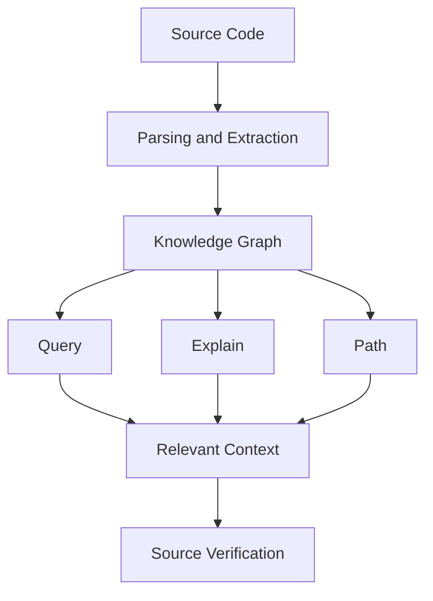

The graph acts as a structured index of the repository.

## 1.1 Example

Suppose a project contains:

```text
TaskController
TaskService
TaskRepository
Task
```

Relationships:

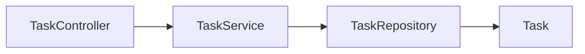

A developer may ask:

- What is TaskService?
- Which components connect to TaskService?
- How are TaskController and TaskRepository connected?
- Which part of the system handles task completion?

These questions require different retrieval strategies.

---

# Part III — The Three Core Commands

## 2. Query vs Explain vs Path

Graphify documents three primary commands for graph exploration.

| Command | Main Purpose | Best Used When |
|---|---|---|
| `query` | Retrieve a relevant subgraph from a question | Exploring a feature or topic |
| `explain` | Inspect one graph concept and its connections | Understanding a known symbol |
| `path` | Trace a connection between two concepts | Investigating relationships |

## 2.1 Conceptual Command Forms

```bash
graphify query "How does authentication work?"
```

```bash
graphify explain "AuthService"
```

```bash
graphify path "AuthController" "UserRepository"
```

These are reference examples for understanding the interface, not instructions to run them now.

## 2.2 Choosing the Right Command

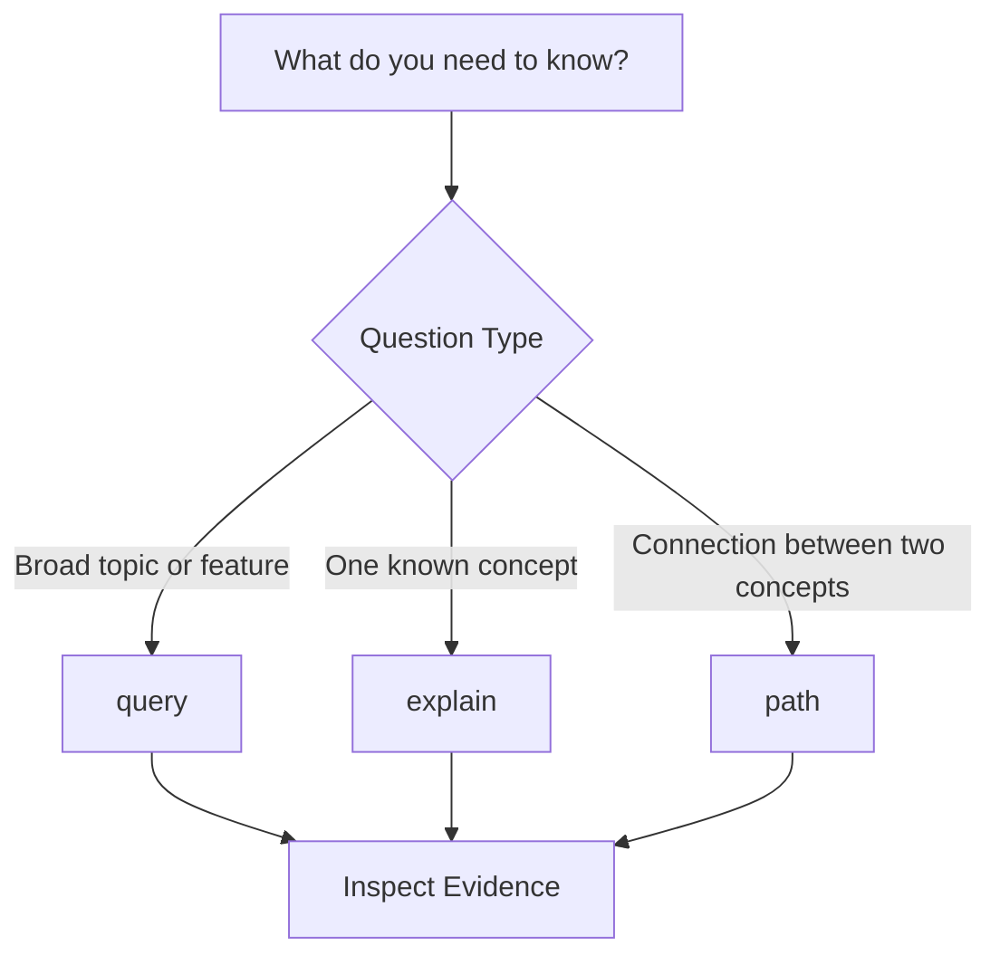

> [!important]
> The most effective retrieval command depends on the question, not merely the size of the repository.

---

# Part IV — Understanding the Query Command

## 3. What Is `graphify query`?

The `query` command accepts a plain-language question and returns a scoped subgraph relevant to that question.

Example:

```bash
graphify query "How does task management work?"
```

Instead of returning every node in the repository, the command aims to select relevant concepts and their relationships.

## 3.1 Conceptual Workflow

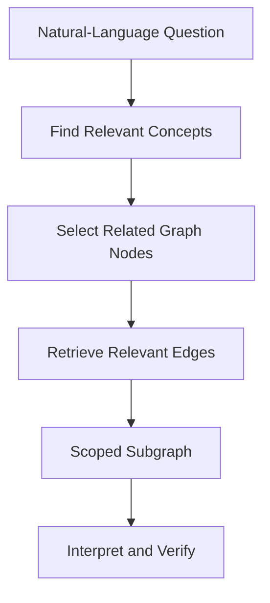

This is a conceptual model. The exact internal matching and ranking implementation should be inspected in the current Graphify source.

## 3.2 Why Scoped Subgraphs Matter

Suppose a repository contains:

- 8,000 nodes.
- 20,000 edges.
- Multiple independent modules.

A developer asks about authentication.

Returning the entire graph would include large amounts of irrelevant information.

A scoped subgraph may focus on:

```text
AuthController
AuthService
UserRepository
User
```

## 3.3 Important Limitation

A scoped subgraph is not guaranteed to contain every relevant entity.

Its completeness depends on extraction coverage and retrieval logic.

---

# Part V — Natural-Language Questions

## 4. How Should We Formulate Questions?

Good questions identify the engineering concern clearly.

Examples:

```text
How does user authentication work?
```

```text
Which components are related to task completion?
```

```text
What code is involved in schedule validation?
```

## 4.1 Broad vs Specific Questions

Broad:

```text
How does the application work?
```

Specific:

```text
Which services and models are involved in dispatching a scheduled bus?
```

The second question provides more useful retrieval intent.

## 4.2 Question Design Framework

A useful question often includes:

\[
Question = Feature + Relationship + Scope
\]

For example:

```text
Feature:
Task completion

Relationship:
Components involved

Scope:
Android application
```

Resulting question:

```text
Which Android components are involved in completing a task?
```

## 4.3 Avoid Unsupported Assumptions

Instead of asking:

```text
Why is TaskService broken?
```

Start with:

```text
What components interact with TaskService?
```

The first question assumes a defect exists.

The second gathers evidence.

---

# Part VI — Query Results as Subgraphs

## 5. What Is a Scoped Subgraph?

A subgraph is a portion of a larger graph.

Let:

\[
G=(V,E)
\]

A subgraph can be represented as:

\[
G'=(V',E')
\]

Where:

\[
V' \subseteq V
\]

and the selected edges belong to the original graph and connect nodes in the selected set.

## 5.1 Example

Full graph:

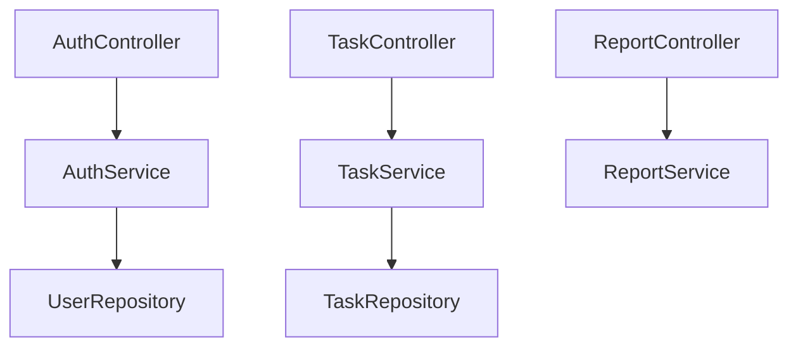

Authentication-focused subgraph:

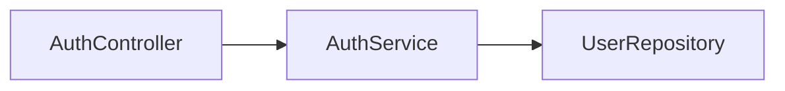

## 5.2 Why This Helps

A smaller graph can improve:

- Focus.
- Readability.
- Source navigation.
- Context selection.

However, aggressive filtering may hide cross-module dependencies.

---

# Part VII — Understanding the Explain Command

## 6. What Is `graphify explain`?

The `explain` command inspects a particular concept in the graph.

Example:

```bash
graphify explain "TaskService"
```

The official README demonstrates an explanation containing information such as:

- Node name.
- Source file.
- Source location.
- Community.
- Degree.
- Connections.
- Relationship labels.
- Confidence tags.

## 6.1 Conceptual Example

```text
Node: TaskService
Source: TaskService.java L18
Community: 3
Degree: 4

Connections:
  TaskController [uses] [INFERRED]
  TaskRepository [references] [EXTRACTED]
  completeTask() [method] [EXTRACTED]
```

This is illustrative output, not a captured execution result.

## 6.2 What Does Explain Answer?

It helps investigate:

- What is this concept?
- Where does it appear?
- What is connected to it?
- What relationships were extracted?
- How central is it in the graph?

## 6.3 What It Does Not Prove

An explanation does not automatically establish:

- Runtime behavior.
- Correct business logic.
- Security.
- Database correctness.
- Test coverage.

---

# Part VIII — Interpreting Source Locations

## 7. Why Source Locations Matter

A graph explanation is more useful when it points back to the source.

Example:

```text
Source:
TaskService.java L18
```

This tells the developer where to begin verification.

## 7.1 Evidence Workflow

```text
Graph Concept
    ↓
Source File
    ↓
Source Location
    ↓
Inspect Declaration
    ↓
Inspect Relevant Callers
    ↓
Verify Conclusion
```

## 7.2 Provenance vs Interpretation

**Provenance** identifies where the information originated.

**Interpretation** explains what the information means.

A reliable coding workflow requires both.

---

# Part IX — Understanding Node Degree

## 8. What Does Degree Mean?

In an undirected graph, degree is the number of edges incident to a node.

Example:

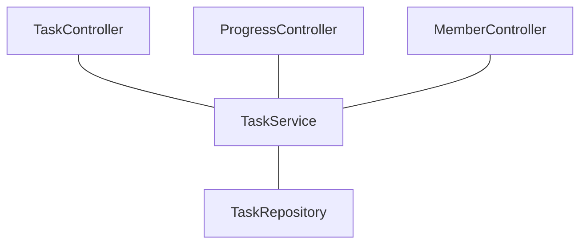

The service has four connections in this example.

## 8.1 Why Degree Appears in Explain

Degree helps describe how connected a concept is.

A high-degree node may represent:

- A shared service.
- A core interface.
- A utility.
- An architectural hub.

## 8.2 Important

High degree is not automatically evidence of poor design.

Likewise, low degree does not automatically mean a component is unimportant.

---

# Part X — Understanding Communities

## 9. What Is a Community?

A community is a cluster of closely connected graph nodes.

Graphify uses community detection to identify structural groups.

## 9.1 Example

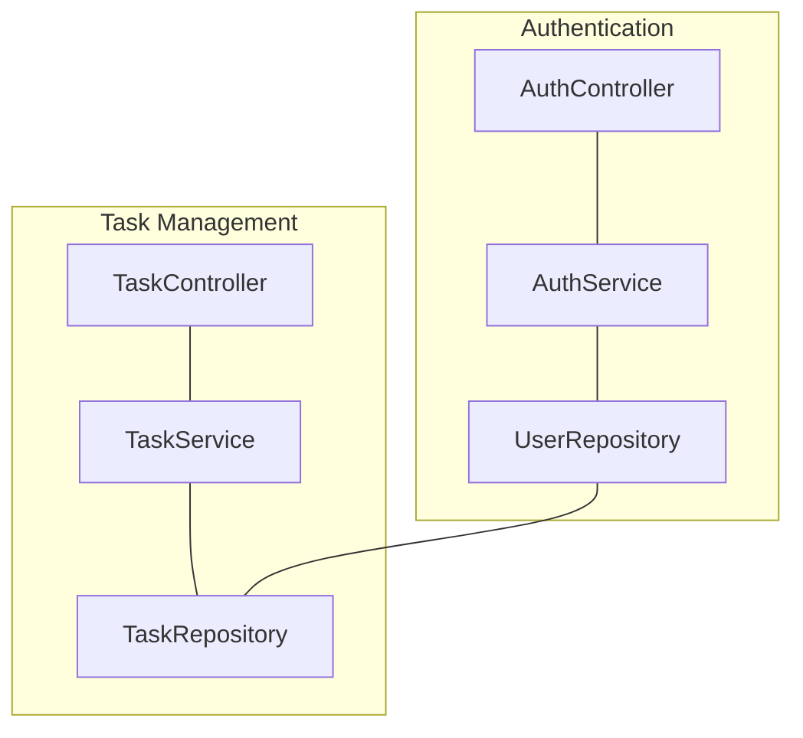

## 9.2 Why Communities Help Explain

Community membership gives architectural context.

For example:

```text
Node:
TaskService

Community:
Task Management
```

This can help developers understand where the concept belongs structurally.

## 9.3 Important Limitation

A graph community is not necessarily an official software module.

It is a grouping derived from graph structure.

---

# Part XI — Understanding the Path Command

## 10. What Is `graphify path`?

The `path` command traces a connection between two graph concepts.

Example:

```bash
graphify path "TaskController" "TaskRepository"
```

The README describes this as shortest-path tracing.

## 10.1 Conceptual Example

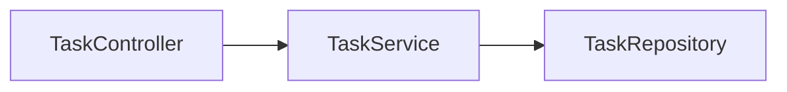

Possible explanation:

```text
TaskController
    ↓ uses
TaskService
    ↓ references
TaskRepository
```

## 10.2 Why Paths Matter

Paths help investigate:

- Indirect dependencies.
- Connections between modules.
- Possible change propagation.
- Architectural coupling.
- Unexpected relationships.

---

# Part XII — Shortest-Path Theory

## 11. What Is a Shortest Path?

In an unweighted graph, a shortest path minimizes the number of edges between two nodes.

Suppose:

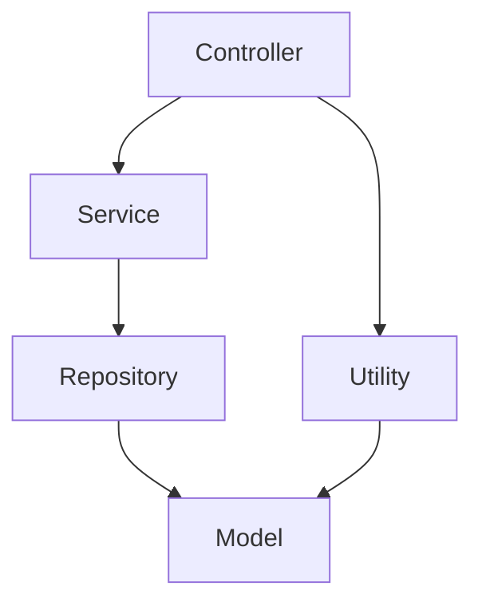

Two paths exist:

```text
Controller → Service → Repository → Model
```

and:

```text
Controller → Utility → Model
```

The second path is shorter in edge count.

## 11.1 Hop Count

A hop represents one edge traversal.

For example:

```text
A → B → C
```

contains two hops.

## 11.2 Important

Shortest does not necessarily mean:

- Most important.
- Most frequently executed.
- Most direct in runtime behavior.
- Most relevant to a bug.

It means shortest according to the graph's path metric.

---

# Part XIII — Edge Direction and Path Interpretation

## 12. Why Direction Matters

Consider:

```text
Controller → Service
```

This may mean:

```text
Controller depends on Service.
```

But a path through an undirected representation may traverse the connection in either direction.

## 12.1 Example

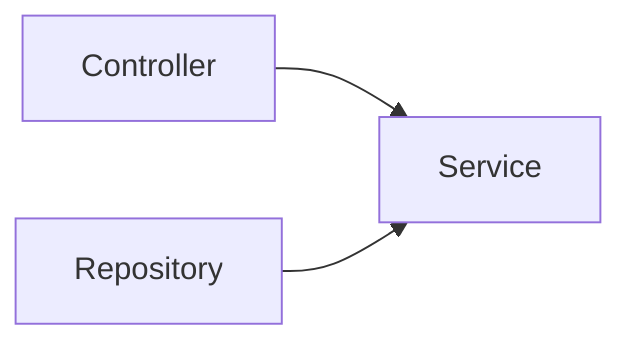

An undirected path may connect:

```text
Controller — Service — Repository
```

However, this does not prove:

```text
Controller calls Repository.
```

## 12.2 Graphify-Specific Consideration

The architecture document identifies the graph builder's output as `nx.Graph`.

Because `nx.Graph` is undirected, developers should not interpret every returned path as a directed call chain.

Relationship labels and original source evidence remain essential.

---

# Part XIV — Relationship Confidence

## 13. Understanding Confidence Labels

Graphify's architecture defines three relationship confidence categories.

| Label | Meaning |
|---|---|
| `EXTRACTED` | Explicitly present in source |
| `INFERRED` | Derived through analysis |
| `AMBIGUOUS` | Uncertain relationship requiring review |

## 13.1 Extracted Relationship

Example:

```java
import com.example.tasks.TaskService;
```

The import statement is directly present.

## 13.2 Inferred Relationship

An analyzer may connect a method call to a likely declaration using symbol-resolution information.

## 13.3 Ambiguous Relationship

A method call may have multiple possible destinations.

Example:

```java
service.process();
```

The target may depend on the receiver's actual type.

## 13.4 Important Distinction

The current README primarily illustrates `EXTRACTED` and `INFERRED` edges, while the architecture document also defines `AMBIGUOUS`.

Actual displayed labels depend on the graph data and the command's implementation.

---

# Part XV — Path Confidence

## 14. Why One Uncertain Edge Matters

Consider:

```text
A → B [EXTRACTED]
B → C [INFERRED]
C → D [AMBIGUOUS]
```

The overall path contains uncertainty.

Even if two edges are well-supported, the final connection cannot be treated as fully verified.

## 14.1 Conceptual Confidence Assessment

A useful interpretation process:

1. Identify every edge.
2. Read its relationship type.
3. Inspect its confidence label.
4. Check source evidence.
5. Avoid stronger conclusions than the evidence supports.

## 14.2 Important

Do not convert categorical confidence labels into arbitrary numerical probabilities.

For example:

```text
INFERRED = 80%
```

is not justified unless the system explicitly defines and validates such a probability.

---

# Part XVI — Ambiguous Node Names

## 15. What Happens When Names Repeat?

Consider:

```text
App\\Services\\UserService
App\\Legacy\\UserService
```

Both may appear as:

```text
UserService
```

A short-name lookup may be ambiguous.

## 15.1 Why This Matters

An explanation or path query could target the wrong symbol if matching is insufficiently specific.

## 15.2 Better Investigation Strategy

Use available identifying context:

- Namespace.
- Package.
- Source file.
- Class name.
- Method signature.

## 15.3 Important

Whether the CLI accepts a particular qualified-name syntax depends on its documented matching behavior.

Do not assume that arbitrary identifiers or path formats are accepted without checking.

---

# Part XVII — No-Match and No-Path Results

## 16. What Does No Match Mean?

A node lookup may fail because:

- The entity is not indexed.
- The name differs.
- The file was excluded.
- The graph is outdated.
- The language is unsupported.
- The symbol was not extracted.

## 16.1 What Does No Path Mean?

A path lookup may fail because:

- The nodes are disconnected.
- A relevant edge was not extracted.
- A reference remains unresolved.
- The graph is incomplete.

## 16.2 Critical Principle

> No graph path does not prove that no real dependency exists.

A missing path may reflect incomplete graph coverage.

---

# Part XVIII — Graph Freshness

## 17. What Is a Stale Graph?

A stale graph represents an older version of the repository.

Suppose a method is renamed:

```text
completeTask()
```

to:

```text
markTaskCompleted()
```

If the graph is not refreshed, queries may still reference the old name.

## 17.1 Why Freshness Matters

Stale graph results can lead to:

- Incorrect file navigation.
- Missing symbols.
- Outdated dependencies.
- Misleading refactoring plans.

## 17.2 Conceptual Verification

Before relying on graph results:

1. Confirm which source version was indexed.
2. Check whether relevant files changed.
3. Inspect the current source.
4. Rebuild or refresh the graph when necessary.

---

# Part XIX — Graph Retrieval vs Text Search

## 18. How Are They Different?

Text search locates matching text.

Graph retrieval locates entities and their structured relationships.

| Question | Text Search | Graph Retrieval |
|---|---|---|
| Where is `TaskService` mentioned? | Strong | Useful |
| Which nodes connect to `TaskService`? | Requires interpretation | Natural fit |
| How are two classes connected? | Manual tracing | Path retrieval |
| Find an exact error message | Strong | May be unnecessary |
| Explore a subsystem | Requires multiple searches | Query may help |
| Verify current implementation | Essential source inspection | Supporting index |

## 18.1 Why Both Matter

Graph retrieval can narrow the search space.

Text search and source reading verify the details.

They are complementary tools.

---

# Part XX — Query Planning

## 19. What Is Query Planning?

Query planning means selecting the right retrieval strategy before investigating a codebase.

## 19.1 Three Common Question Types

**Exploratory question**

```text
How does schedule management work?
```

Recommended starting point:

```text
query
```

**Entity-specific question**

```text
What is ScheduleController connected to?
```

Recommended starting point:

```text
explain
```

**Relationship question**

```text
How are ScheduleController and Trip connected?
```

Recommended starting point:

```text
path
```

## 19.2 Decision Model

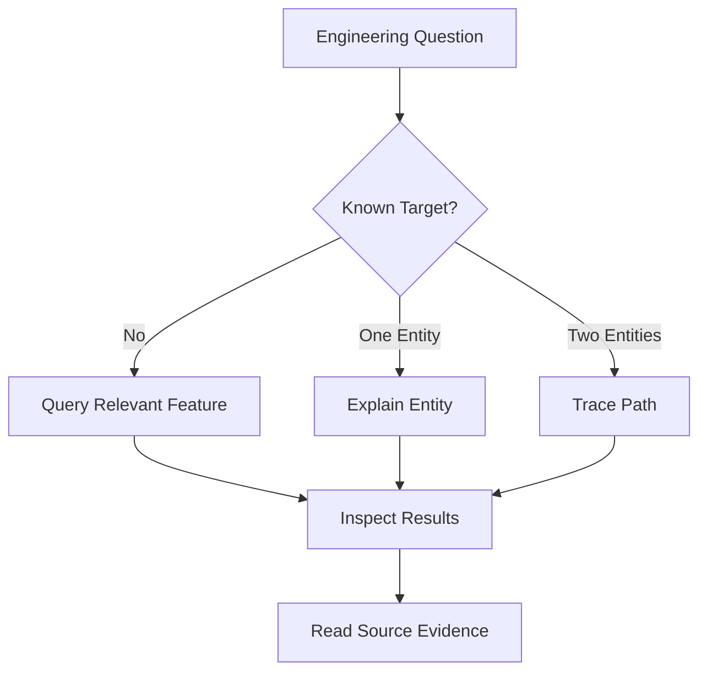

---

# Part XXI — Multi-Step Graph Investigation

## 20. Combining Commands

Complex questions may require multiple retrieval operations.

Example:

> Understand the task completion workflow.

Conceptual sequence:

```text
1. Query task completion.
2. Identify TaskService.
3. Explain TaskService.
4. Trace TaskController to TaskRepository.
5. Inspect the source files.
6. Verify runtime behavior.
```

## 20.1 Why This Works

Each command answers a different part of the investigation.

- Query identifies relevant concepts.
- Explain provides local context.
- Path reveals structural connections.

## 20.2 Avoid Unnecessary Queries

More queries do not automatically produce better understanding.

Use the smallest set that answers the engineering question.

---

# Part XXII — Context Engineering

## 21. What Is Context Engineering?

Context engineering is the process of selecting and organizing information that an AI agent needs for a task.

For codebase exploration, useful context may include:

- Relevant files.
- Important classes.
- Dependencies.
- Interfaces.
- Constraints.
- Documentation.
- Tests.

## 21.1 Traditional Approach

```text
Question
   ↓
Read many files
   ↓
Find relevant code
   ↓
Reason
```

## 21.2 Graph-Assisted Approach

```text
Question
   ↓
Retrieve Relevant Subgraph
   ↓
Identify Source Locations
   ↓
Read Relevant Files
   ↓
Reason
```

## 21.3 Main Benefit

The graph can act as a navigation layer that helps select source material.

It does not replace source material.

---

# Part XXIII — Token Efficiency

## 22. Why Does Retrieval Affect Tokens?

AI coding agents operate with limited context budgets.

Reading unrelated files consumes tokens without necessarily improving the answer.

## 22.1 Hypothetical Example

Suppose:

```text
Full repository reading:
80,000 tokens

Targeted graph context:
2,000 tokens

Relevant source inspection:
8,000 tokens
```

Total targeted context:

\[
2{,}000+8{,}000=10{,}000
\]

Hypothetical reduction:

\[
\frac{80{,}000-10{,}000}{80{,}000}\times100=87.5\%
\]

These numbers are illustrative, not a measured Graphify benchmark.

## 22.2 Important Tradeoff

Reducing tokens is useful only if critical information remains available.

An incomplete context can cause incorrect changes even when it is efficient.

---

# Part XXIV — Graph Retrieval and Codex

## 23. Using Graph Results Responsibly

A coding agent can use graph information to identify which files deserve inspection.

A reliable workflow is:

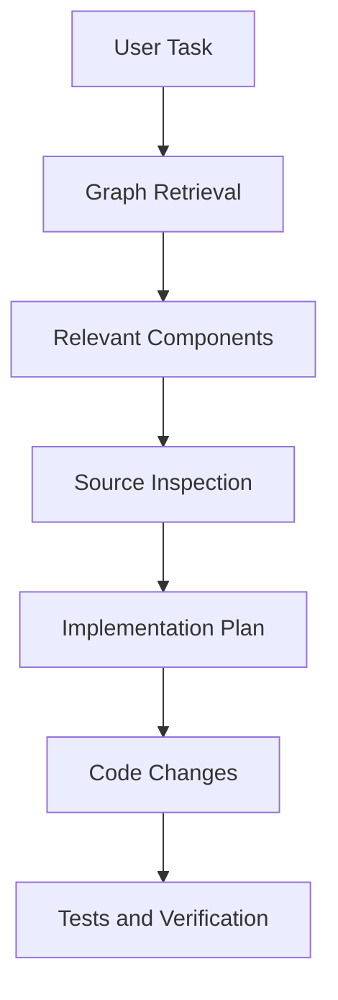

## 23.1 Example Task

```text
Improve task completion handling.
```

The agent should not immediately modify the first method found.

Instead, it should investigate:

- Task status model.
- Completion handler.
- Repository operations.
- Related UI behavior.
- Relevant tests.

## 23.2 Role of Graphify

Graphify can help discover relationships.

## 23.3 Role of Codex

Codex can use that context to reason about implementation.

## 23.4 Role of Tests

Tests help verify that the resulting implementation behaves correctly.

---

# Part XXV — GroupTrack Android Case Study

## 24. Scenario: Task Completion

Consider this illustrative structure:

```text
TasksActivity
TaskDetailsActivity
TaskRepository
Task
```

## 24.1 Query

Conceptual question:

```bash
graphify query "Which components handle task completion?"
```

Purpose:

Identify relevant entities.

## 24.2 Explain

```bash
graphify explain "TaskRepository"
```

Purpose:

Inspect repository connections.

## 24.3 Path

```bash
graphify path "TaskDetailsActivity" "Task"
```

Purpose:

Explore structural connections between UI and data model.

## 24.4 Verification

After retrieval, inspect:

- Actual Java implementation.
- Firebase operations.
- User permissions.
- Task status updates.
- Progress calculations.

## 24.5 MVP Principle

Use graph retrieval to understand the existing MVP.

Do not introduce additional architecture solely because the graph reveals opportunities for abstraction.

---

# Part XXVI — GoPasig Laravel Case Study

## 25. Scenario: Schedule Validation

Consider:

```text
ScheduleController
BusinessLogicService
Schedule
Bus
Driver
Trip
```

## 25.1 Query

```bash
graphify query "Which components are involved in schedule validation?"
```

## 25.2 Explain

```bash
graphify explain "BusinessLogicService"
```

## 25.3 Path

```bash
graphify path "ScheduleController" "Trip"
```

## 25.4 Engineering Questions

- Where is validation performed?
- Which models are involved?
- Which services are shared?
- What code might be affected by a change?

## 25.5 Verification

Graph retrieval does not prove:

- Database transaction safety.
- Correct locking behavior.
- Driver availability.
- Schedule conflict prevention.

These require code inspection and tests.

---

# Part XXVII — Next.js and Laravel Case Study

## 26. Scenario: Product Creation

Consider:

```text
ProductsPage
API Client
ProductController
Product
```

## 26.1 Query

```bash
graphify query "How does product creation work?"
```

## 26.2 Explain

```bash
graphify explain "ProductController"
```

## 26.3 Path

```bash
graphify path "ProductsPage" "ProductController"
```

## 26.4 Important Limitation

A frontend HTTP request and a backend route may not be connected by ordinary static imports.

A missing graph path does not prove the frontend and backend are unrelated.

## 26.5 Additional Verification

Inspect:

- Frontend API configuration.
- HTTP methods.
- Laravel routes.
- Controller methods.
- Validation.
- Database persistence.

---

# Part XXVIII — Evaluating Retrieval Quality

## 27. What Makes a Good Retrieval Result?

A useful result should be:

- Relevant.
- Accurate.
- Understandable.
- Traceable.
- Sufficient for the question.
- Current.

## 27.1 Precision

\[
Precision=\frac{RelevantRetrieved}{TotalRetrieved}
\]

## 27.2 Recall

\[
Recall=\frac{RelevantRetrieved}{TotalRelevant}
\]

## 27.3 Hypothetical Example

Suppose a task has 20 relevant graph entities.

The query returns 15 entities.

Of those, 12 are relevant.

Then:

\[
Precision=\frac{12}{15}=0.80
\]

\[
Recall=\frac{12}{20}=0.60
\]

The query is relatively precise but misses several relevant entities.

## 27.4 Why Both Matter

High precision reduces irrelevant context.

High recall reduces the risk of missing important dependencies.

---

# Part XXIX — Query Failure Modes

## 28. Common Retrieval Problems

### 28.1 Wrong Entity Match

A short name resolves to the wrong symbol.

### 28.2 Missing Relationships

An extractor fails to identify a dependency.

### 28.3 Stale Graph

The source has changed since indexing.

### 28.4 Misleading Path

A structural path is interpreted as a runtime call chain.

### 28.5 Excessive Scope

A query returns too many unrelated nodes.

### 28.6 Insufficient Scope

A query excludes critical dependencies.

### 28.7 Unsupported Framework Semantics

Dynamic behavior is not captured by static analysis.

## 28.8 General Mitigation

Combine graph retrieval with source inspection, relevant documentation, and testing.

---

# Part XXX — Security and Trust

## 29. Why Graph Results Need Verification

Repository content may contain:

- Incorrect comments.
- Outdated documentation.
- Misleading names.
- Untrusted text.
- Sensitive configuration references.

A graph may index information from these sources.

## 29.1 Prompt Injection Consideration

If retrieved documentation contains instructions directed at an AI assistant, those instructions should be treated as untrusted source content.

They should not override the actual user's request or higher-priority instructions.

## 29.2 Sensitive Information

Graph results may expose:

- Internal module names.
- File paths.
- Architecture details.
- Configuration references.

Avoid sharing private repository information unnecessarily.

## 29.3 Engineering Principle

> Retrieved repository data is evidence to analyze, not an authority that can instruct the agent to disregard its operating rules.

---

# Part XXXI — Practical Exercises

> [!note]
> These are theory exercises. No installation or command execution is required.

## Exercise 1 — Command Selection

Choose the most suitable command for:

```text
How does authentication work?
```

Explain why.

## Exercise 2 — Explain

Describe what information an explanation of `TaskService` might contain.

## Exercise 3 — Path

Draw a graph connecting a controller, service, repository, and model.

Identify the shortest path from controller to model.

## Exercise 4 — Query Scoping

Explain why a query about authentication should not necessarily return the entire repository graph.

## Exercise 5 — Node Ambiguity

Explain how two classes named `UserService` can create retrieval ambiguity.

## Exercise 6 — Confidence

Design a path containing:

- One extracted edge.
- One inferred edge.
- One ambiguous edge.

Explain how you would interpret it.

## Exercise 7 — Missing Path

Explain three reasons why Graphify might not find a path between two components.

## Exercise 8 — Freshness

Explain how a renamed method can affect graph retrieval.

## Exercise 9 — Text Search Comparison

Identify a question better answered by exact text search than by graph retrieval.

## Exercise 10 — Context Selection

Design a graph-assisted retrieval workflow for a small Android feature.

## Exercise 11 — Token Efficiency

Compare a hypothetical 50,000-token repository reading with a 12,000-token targeted workflow.

Calculate the percentage reduction.

## Exercise 12 — Precision

A query retrieves 25 nodes.

20 are relevant.

Calculate precision.

## Exercise 13 — Recall

A task has 30 relevant entities.

A query retrieves 21 of them.

Calculate recall.

## Exercise 14 — Android

Design a query, explain, and path sequence for task completion.

## Exercise 15 — Laravel

Design a query, explain, and path sequence for schedule validation.

## Exercise 16 — Next.js

Explain why a path between a frontend page and backend controller may be missing.

## Exercise 17 — Security

Explain how an AI agent should handle suspicious instructions found inside retrieved repository documentation.

## Exercise 18 — Final Exercise

Design a complete graph-assisted investigation workflow.

Include:

1. Problem definition.
2. Retrieval question.
3. Command selection.
4. Entity identification.
5. Relationship inspection.
6. Confidence evaluation.
7. Source verification.
8. Implementation planning.
9. Testing.
10. Final evidence-based conclusion.

---

# Part XXXII — Review Questions

1. What is graph retrieval?
2. What is a scoped subgraph?
3. What does `graphify query` do?
4. What does `graphify explain` do?
5. What does `graphify path` do?
6. When should you use query?
7. When should you use explain?
8. When should you use path?
9. What is a node neighborhood?
10. What is node degree?
11. What is a graph community?
12. What is a shortest path?
13. What is a hop?
14. Why is edge direction important?
15. What is an extracted relationship?
16. What is an inferred relationship?
17. What is an ambiguous relationship?
18. What is node-name ambiguity?
19. What does a missing graph path mean?
20. What is graph freshness?
21. How does graph retrieval differ from text search?
22. What is query planning?
23. Why combine query, explain, and path?
24. What is context engineering?
25. How can targeted retrieval reduce tokens?
26. Why is retrieval precision important?
27. Why is retrieval recall important?
28. What is source provenance?
29. Why should graph results be verified?
30. How can Codex use Graphify responsibly?

---

# Part XXXIII — Key Takeaways

> [!summary]
> - Graph retrieval uses an existing knowledge graph to locate relevant code information.
> - `query` retrieves a scoped subgraph from a plain-language question.
> - `explain` provides information about one graph concept and its connections.
> - `path` traces connections between two concepts.
> - Query selection should match the engineering question.
> - Scoped subgraphs help reduce irrelevant context.
> - Source locations support verification.
> - Degree describes connectivity.
> - Communities provide structural context.
> - Shortest paths are graph paths, not necessarily runtime execution paths.
> - Confidence labels distinguish explicit, inferred, and uncertain relationships.
> - Ambiguous names can lead to incorrect matches.
> - Missing paths do not prove the absence of dependencies.
> - Stale graphs can mislead developers.
> - Graph retrieval and text search complement each other.
> - Retrieval quality depends on precision and recall.
> - Codex should inspect source code before implementing consequential changes.
> - Tests remain necessary to verify runtime behavior.

---

# Part XXXIV — Final Mental Model

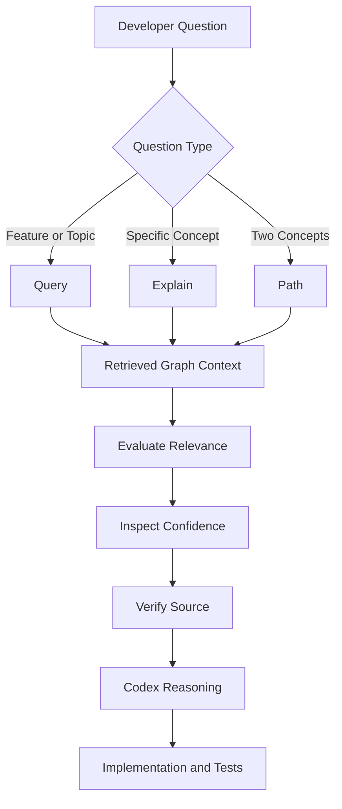

> [!important] Final Principle
> **Query finds relevant context, Explain clarifies individual concepts, and Path reveals structural connections. Together they make repository exploration more targeted, but trustworthy engineering still depends on source verification and testing.**

---

# Part XXXV — Official References

## Graphify

- [Official Repository](https://github.com/Graphify-Labs/graphify)
- [README](https://github.com/Graphify-Labs/graphify/blob/main/README.md)
- [Architecture](https://github.com/Graphify-Labs/graphify/blob/main/ARCHITECTURE.md)
- [CLI Reference](https://docs.graphify.com/)
- [Graphify Tests](https://github.com/Graphify-Labs/graphify/tree/main/tests)

## NetworkX

- [NetworkX Documentation](https://networkx.org/documentation/stable/)
- [Shortest Paths](https://networkx.org/documentation/stable/reference/algorithms/shortest_paths.html)
- [Traversal](https://networkx.org/documentation/stable/reference/algorithms/traversal.html)
- [Centrality](https://networkx.org/documentation/stable/reference/algorithms/centrality.html)

## Supporting Technologies

- [Tree-sitter](https://tree-sitter.github.io/tree-sitter/)
- [OpenAI Codex](https://developers.openai.com/codex/)
- [Model Context Protocol](https://modelcontextprotocol.io/)

> [!note] Documentation Scope
> This lesson uses the official Graphify README and architecture as references.
>
> Command examples illustrate the documented interface. Graph diagrams, hypothetical outputs, project workflows, and performance calculations are educational examples.
>
> No Graphify commands were executed and no project files were modified.

---

# Part XXXVI — Next Lesson

**[[08 - Context Engineering and Token Efficiency]]**

Topics:

1. Context engineering fundamentals.
2. Agent context windows.
3. Token budgets.
4. Relevant vs irrelevant context.
5. Graph-assisted retrieval.
6. Context selection strategies.
7. Subgraph expansion.
8. Context compression.
9. Source provenance.
10. Context freshness.
11. Graphify vs grep.
12. Graphify vs vector retrieval.
13. Retrieval precision and recall.
14. Agent hallucination risks.
15. Codex workflow design.
16. Android, Laravel, and Next.js case studies.
17. Evaluation and benchmarks.
18. Practical exercises.
19. Official references.

**End of Lesson 07 — Query, Explain, and Path Commands.**
