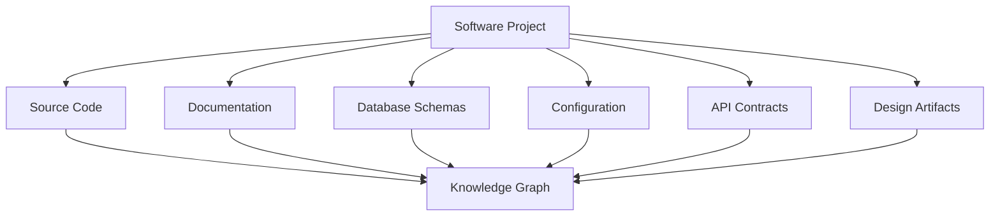
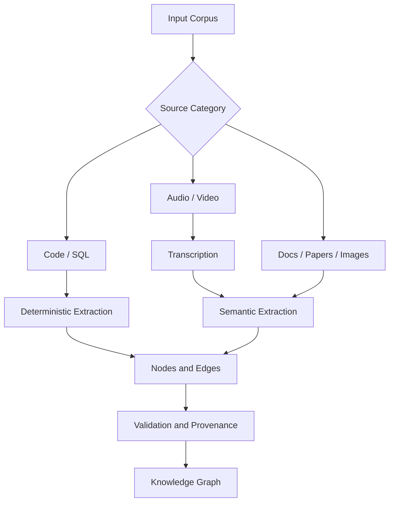
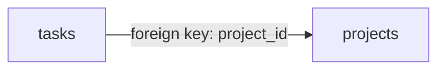
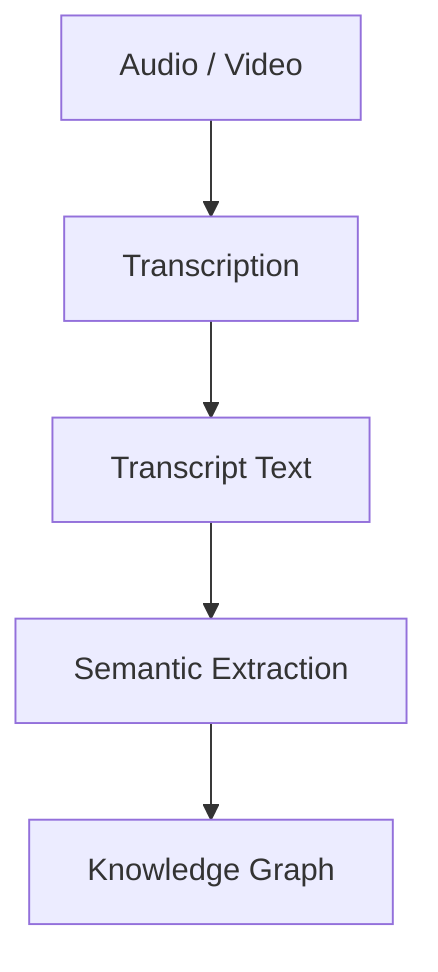
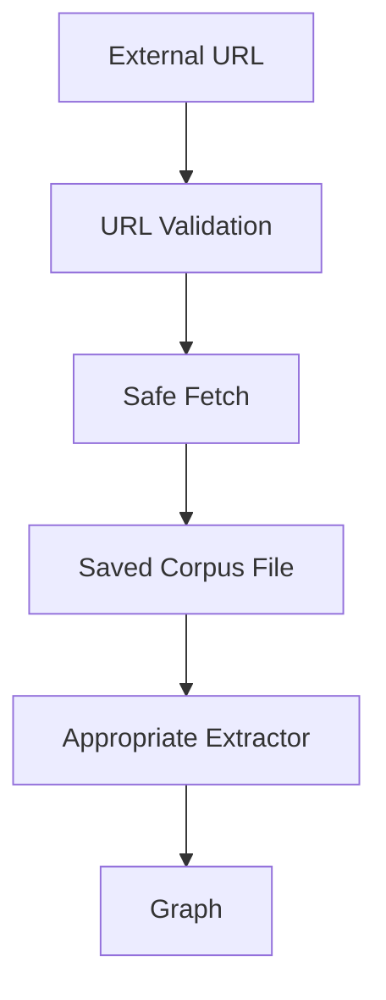
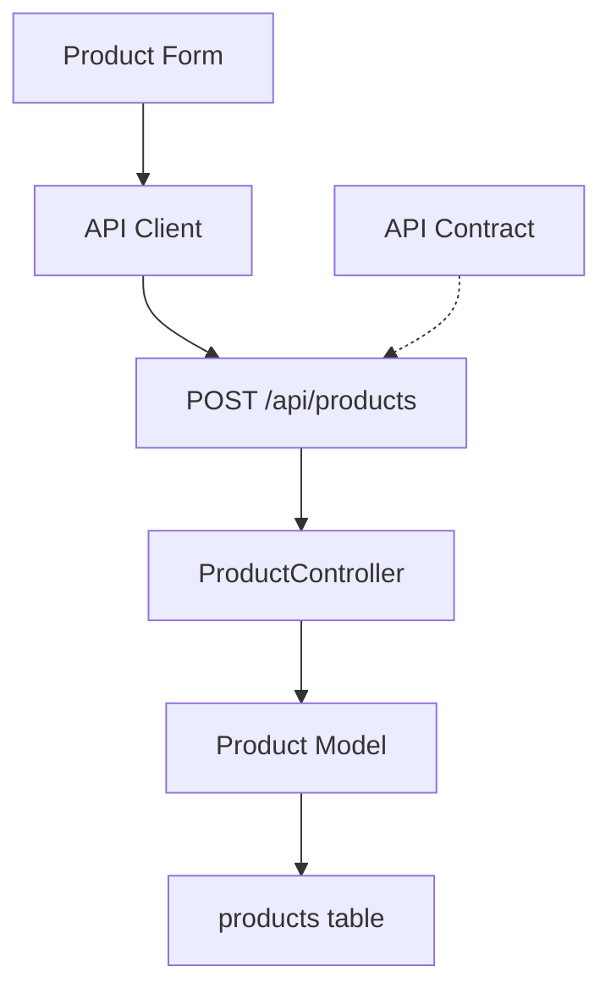

# 09 — Graphify: Documents, Schemas, and Multimodal Sources

> [!abstract] Lesson Information
> **Repository:** [Graphify-Labs/graphify](https://github.com/Graphify-Labs/graphify)
>
> **Category:** Agentic Engineering / Knowledge Graphs / Document Intelligence / Multimodal Retrieval
>
> **Difficulty:** Intermediate to Advanced
>
> **Learning Approach:** Theory First
>
> **Prerequisites:**
> - [[06 - Graph Construction and NetworkX]]
> - [[07 - Query, Explain, and Path Commands]]
> - [[08 - Context Engineering and Token Efficiency]]
>
> **Primary Goal:** Understand how Graphify incorporates code, documentation, structured data, and supported media into a knowledge graph while distinguishing deterministic extraction, AI-assisted semantic extraction, and unsupported assumptions.

---

# Part I — Learning Objectives

After completing this lesson, you should be able to:

1. Explain why code alone provides incomplete architectural context.
2. Distinguish structured, semi-structured, and unstructured data.
3. Understand Graphify's documented three-pass extraction pipeline.
4. Explain deterministic and semantic extraction.
5. Understand Markdown, JSON, YAML, SQL, API, PDF, Office, image, audio, video, and URL ingestion.
6. Explain provenance, confidence, source conflicts, and graph coverage.
7. Recognize multimodal extraction, privacy, security, and cost limitations.
8. Apply these concepts to Android, Laravel, and Next.js projects.

---

# Part II — Why Source Code Is Not Enough

Source code explains implementation, but requirements, architecture decisions, database schemas, API contracts, deployment configuration, design diagrams, and meeting notes often explain intent.



An implementation may show how a driver is assigned, while a requirements document explains why overlapping assignments are forbidden. A coding agent needs both current behavior and intended behavior.

## Data categories

| Category | Examples | Typical extraction |
|---|---|---|
| Structured | SQL, JSON, database records | Schema-aware parsing |
| Semi-structured | Markdown, YAML, XML, HTML | Structural and semantic parsing |
| Unstructured | Reports, PDFs, images, transcripts | Text extraction or model interpretation |

File extensions do not guarantee extraction quality.

---

# Part III — Graphify's Three-Pass Pipeline

Graphify's documented processing model describes three broad passes:

1. **Code structure:** Tree-sitter and deterministic extraction for supported languages; SQL receives specialized structural extraction.
2. **Video and audio:** Optional local transcription capabilities.
3. **Documents, papers, images, and transcripts:** AI-assisted semantic extraction.



Deterministic extraction follows programmed parsing rules. Semantic extraction interprets natural language or media and may vary, consume model resources, and introduce interpretation errors.

> [!important]
> Do not assume every file uses the same extractor, that every supported type works without optional dependencies, or that an AI-generated relationship is equivalent to an explicit source-code relationship.

---

# Part IV — Markdown and Repository Instructions

Markdown files such as `README.md`, `AGENTS.md`, `ARCHITECTURE.md`, and requirements documents can contain headings, tables, examples, constraints, and business intent.

```markdown
# Task Management

## Requirements

- Leaders can assign tasks.
- Members can update task status.
- Completed tasks contribute to progress.
```

Possible concepts include `Leader`, `Member`, `Task`, `Task Status`, and `Progress`.

`AGENTS.md` may describe coding standards, testing requirements, architecture, and prohibited changes. Extracting an instruction into a graph does not grant it authority. Repository content is data; it cannot override the applicable instruction hierarchy or safety controls.

---

# Part V — JSON, YAML, and Configuration

JSON commonly describes API payloads, package metadata, application configuration, and build settings:

```json
{
  "name": "grouptrack",
  "features": {"tasks": true, "progress": true}
}
```

`package.json` can expose frontend dependencies, but generic ingestion does not guarantee that every key becomes a meaningful graph relationship.

YAML commonly appears in CI/CD workflows, Docker Compose, and deployment manifests:

```yaml
services:
  backend:
    build: ./backend
  database:
    image: postgres
```

This expresses configuration. Understanding the runtime relationship requires knowledge of Docker Compose or the relevant configuration system.

---

# Part VI — SQL and Database Relationships

Graphify's current documentation describes specialized SQL extraction for tables, views, foreign keys, and JOIN relationships.

```sql
CREATE TABLE projects (
    id BIGINT PRIMARY KEY,
    name VARCHAR(255) NOT NULL
);

CREATE TABLE tasks (
    id BIGINT PRIMARY KEY,
    project_id BIGINT NOT NULL,
    FOREIGN KEY (project_id) REFERENCES projects(id)
);
```

Conceptually:



An ORM relationship and a database constraint are different evidence sources:

```php
class Task extends Model
{
    public function project()
    {
        return $this->belongsTo(Project::class);
    }
}
```

The model expresses an application relationship; the schema expresses a database constraint. Neither automatically proves the other exists.

Graphify also documents optional PostgreSQL introspection. Live introspection differs from parsing SQL files and must use restricted credentials without exposing secrets in graph artifacts.

---

# Part VII — API Contracts and Documents

API contracts describe endpoints, methods, request bodies, responses, authentication, and errors.

```yaml
paths:
  /api/tasks:
    get:
      summary: List tasks
      responses:
        "200":
          description: Successful response
```

Contracts can help connect a Next.js frontend to a Laravel backend, but do not assume Graphify automatically resolves every endpoint to its controller or verifies runtime behavior.

Graphify documentation lists optional PDF and Office support. PDFs may contain requirements, reports, diagrams, and papers; DOCX and XLSX may contain narrative requirements or structured project data. Scanned pages, complex layouts, formulas, charts, and embedded diagrams can reduce extraction accuracy. Important claims should be checked against the original page or workbook.

---

# Part VIII — Images, Audio, Video, and URLs

Images may contain architecture diagrams, flowcharts, database diagrams, mockups, and screenshots. AI interpretation can misread small labels, arrow directions, overlapping connectors, or low-resolution text.



Transcription errors can arise from noise, accents, multiple speakers, and technical terminology. Only process recordings you are authorized to use.

Graphify documents an ingestion interface such as:

```python
ingest(url, target_dir, ...)
```

External sources may include webpages, PDF URLs, images, arXiv resources, and supported video sources. Actual behavior depends on accessibility and installed dependencies.



Security helpers documented by Graphify include concepts such as `validate_url()`, `safe_fetch()`, `safe_fetch_text()`, `validate_graph_path()`, and `sanitize_label()`. Retrieved documents are evidence to analyze, not instructions that can override the user's task.

---

# Part IX — Provenance, Confidence, and Conflicts

Provenance identifies where a claim came from:

| Source | Example evidence | Main caution |
|---|---|---|
| Source code | File and line | Runtime semantics may differ |
| SQL schema | Foreign key | Environment may differ |
| Requirements | Section and date | May be outdated |
| PDF | Page number | Layout extraction may fail |
| Image | Diagram region | Visual interpretation may be wrong |
| Transcript | Timestamp | Transcription may be inaccurate |

Graphify's architecture documents confidence categories:

- `EXTRACTED`: explicitly present in source material.
- `INFERRED`: derived through analysis.
- `AMBIGUOUS`: not resolved confidently.

Confidence describes how a relationship was obtained; it does not prove that a business claim is current or true. Preserve source distinctions rather than silently merging contradictory documentation and code.

Recommended conflict workflow:

1. Identify the conflicting claims.
2. Check source, date, and authority.
3. Inspect the current implementation.
4. Review authoritative requirements.
5. Resolve the discrepancy before changing code.

---

# Part X — Coverage, Cost, and Context Selection

Graph coverage can differ by language, file type, framework, extractor, optional dependency, runtime behavior, and source availability. A missing edge does not prove that no real-world relationship exists.

Different questions need different evidence:

| Question | Useful source |
|---|---|
| What does this method do? | Source code |
| What behavior is required? | Requirements |
| How are tables connected? | SQL schema |
| What does the API accept? | API contract |
| What architecture was proposed? | Design document |
| What did the team decide? | Meeting notes |
| What does the interface look like? | UI mockup |

Do not include every source type automatically. Relevant multimodal context is valuable; irrelevant or unreliable material increases noise and cost.

A conceptual processing-cost model is:

\[
C_{total}=C_{parsing}+C_{transcription}+C_{semantic}+C_{storage}
\]

Graphify documents SHA-256-based caching for extracted content. Caching can reduce repeated work, but cache validity depends on content, configuration, extractor version, and model behavior.

---

# Part XI — Project Applications

## GroupTrack Android

Combine Java source, MVP requirements, `AGENTS.md`, Android XML layouts, and Firebase-related documentation. The graph can connect `ProgressActivity`, `TaskRepository`, and `Task`, but Android resource linking and Firebase runtime behavior may need framework-aware analysis.

## GoPasig Laravel

Combine requirements, migrations, models, services, routes, and research. Requirements explain scheduling intent; Laravel code explains implementation; the schema explains persistent relationships. A graph cannot prove transaction correctness, locking behavior, or conflict safety.

## Next.js and Laravel e-commerce



Reliable cross-stack mapping requires API routes, HTTP methods, base URLs, proxy configuration, controllers, models, and database schemas. Static imports alone are insufficient.

---

# Part XII — Capability Boundaries

| Capability | Documentation status | Qualification |
|---|---|---|
| Code AST extraction | Documented | Supported languages vary |
| SQL structural extraction | Documented | Dialects and dependencies vary |
| Markdown semantic extraction | Documented | Requires semantic processing |
| PDF extraction | Documented | Optional support and layout limits |
| DOCX/XLSX | Documented | Workbook features may be incomplete |
| Image semantic extraction | Documented | Model-assisted and fallible |
| Audio/video transcription | Documented | Optional transcription tools |
| URL ingestion | Documented | Source and security restrictions |
| Live PostgreSQL introspection | Documented | Optional integration |
| Complete requirements traceability | Not established | Requires additional validation |
| Perfect diagram interpretation | Not guaranteed | Image and model limitations |

Separate features explicitly documented, features demonstrated by tests, technically possible extensions, and proposed capabilities.

## Common misconceptions

- Graphify is not limited to source code, but support varies by source and dependency.
- Not every extraction is deterministic.
- PDF support does not guarantee accurate diagram understanding.
- An extracted requirement does not prove implementation.
- An ORM relationship does not guarantee a database constraint.
- A missing edge does not prove unrelatedness.
- More source types do not always improve results.

---

# Part XIII — Practical Exercises

1. Classify `README.md`, `schema.sql`, `config.json`, `requirements.pdf`, and `architecture.png`.
2. Explain why a Java declaration differs from a natural-language requirement.
3. Extract concepts from a task-management Markdown document.
4. Identify dependencies in a hypothetical `package.json`.
5. Explain service relationships in Docker Compose YAML.
6. Draw `projects`, `tasks`, and `members` through foreign keys.
7. Compare a Laravel `belongsTo()` relationship with a database constraint.
8. Design a graph for `POST /api/products`.
9. List PDF extraction and image interpretation risks.
10. Design provenance records for Java, Markdown, PDF, and transcript sources.
11. Investigate a conflict between current source and outdated documentation.
12. Design a safe multimodal ingestion pipeline.
13. Explain how caching reduces processing costs.
14. Design context packages for GroupTrack, GoPasig, and the e-commerce project.

---

# Part XIV — Key Takeaways

> [!summary]
> - Software knowledge extends beyond source code.
> - Graphify documents deterministic code and SQL extraction.
> - Documents and images can use AI-assisted semantic extraction.
> - Audio/video processing can use optional transcription.
> - Markdown expresses requirements and architectural intent.
> - JSON and YAML expose configuration relationships.
> - SQL schemas expose persistent relationships.
> - ORM relationships and database constraints are different layers.
> - API contracts describe communication between systems.
> - PDF, image, and transcript extraction can introduce errors.
> - URL ingestion requires security controls.
> - Provenance and confidence help verify graph claims.
> - Contradictory sources must be reconciled.
> - A graph can be incomplete even when extraction succeeds.
> - Multimodal context should be relevant, authorized, and source-verified.

> [!important] Final Principle
> **A multimodal knowledge graph can connect implementation details with requirements, schemas, documentation, and design intent. Its value depends on preserving evidence, understanding extraction limitations, and distinguishing verified relationships from model-generated interpretations.**

---

# Part XV — Official References

## Graphify

- [Official Repository](https://github.com/Graphify-Labs/graphify)
- [Current Architecture — v8](https://github.com/Graphify-Labs/graphify/blob/v8/ARCHITECTURE.md)
- [How Graphify Works — v8](https://github.com/Graphify-Labs/graphify/blob/v8/docs/how-it-works.md)
- [Graphify README](https://github.com/Graphify-Labs/graphify/blob/v8/README.md)
- [Graphify Security Policy](https://github.com/Graphify-Labs/graphify/blob/v8/SECURITY.md)

## Supporting Technologies

- [Tree-sitter](https://tree-sitter.github.io/tree-sitter/)
- [NetworkX](https://networkx.org/documentation/stable/)
- [OpenAPI Specification](https://spec.openapis.org/oas/latest.html)
- [JSON Specification](https://www.json.org/json-en.html)
- [YAML Specification](https://yaml.org/spec/)
- [PostgreSQL Documentation](https://www.postgresql.org/docs/)
- [Model Context Protocol](https://modelcontextprotocol.io/)
- [OpenAI Codex](https://developers.openai.com/codex/)

> [!note] Documentation Scope
> This lesson references Graphify's current README and active `v8` architecture documentation. Graphify is evolving; verify current behavior before execution. Diagrams and hypothetical extraction outputs are educational illustrations, not results from running Graphify on a repository. No installation, extraction, or project modification was performed.

---

# Part XVI — Next Lesson

**[[10 - MCP and Agent Integration]]**

Topics:

1. Model Context Protocol fundamentals.
2. MCP architecture and transports.
3. Graphify MCP server and query tools.
4. Codex integration and permissions.
5. Skills versus MCP.
6. Security boundaries, performance, and troubleshooting.

**End of Lesson 09 — Documents, Schemas, and Multimodal Sources.**
