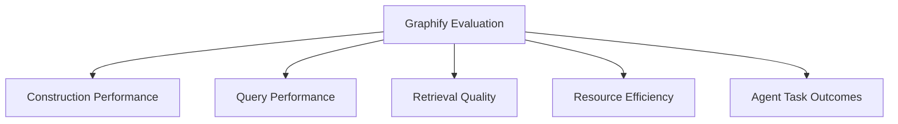
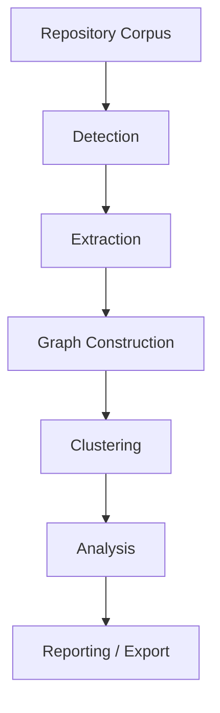
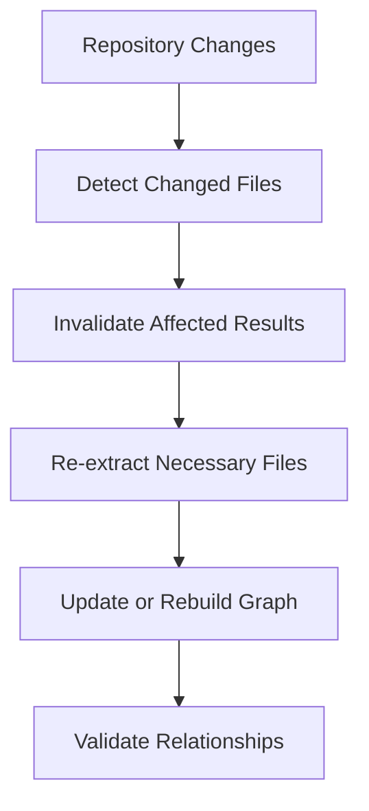
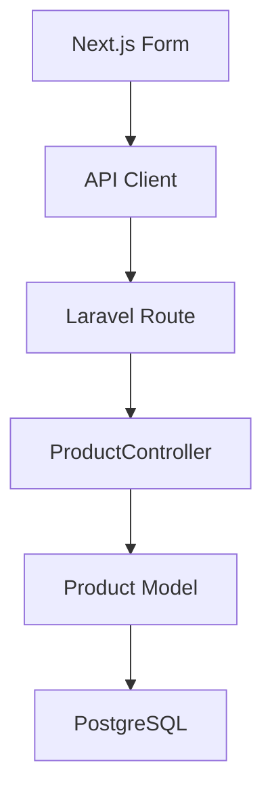

# 12 — Graphify: Performance Benchmarks and Evaluation

> [!abstract] Lesson Information
> **Repository:** [Graphify-Labs/graphify](https://github.com/Graphify-Labs/graphify)
>
> **Category:** Agentic Engineering / Performance Engineering / Retrieval Evaluation / Benchmarking
>
> **Difficulty:** Intermediate to Advanced
>
> **Learning Approach:** Theory First
>
> **Prerequisites:**
> - [[06 - Graph Construction and NetworkX]]
> - [[07 - Query, Explain, and Path Commands]]
> - [[08 - Context Engineering and Token Efficiency]]
> - [[09 - Documents, Schemas, and Multimodal Sources]]
> - [[10 - MCP and Agent Integration]]
> - [[11 - Security, Privacy, and Limitations]]
>
> **Primary Goal:** Learn how to evaluate Graphify using reproducible benchmarks for graph construction, query performance, retrieval quality, token efficiency, and real-world coding-agent outcomes.

---

# Part I — Learning Objectives

After completing this lesson, you should be able to:

1. Define performance benchmarking and distinguish it from correctness.
2. Identify Graphify's processing stages and measure their cost.
3. Measure parsing throughput, graph size, density, latency, memory, caching, and incremental work.
4. Define precision, recall, F1, edge accuracy, and independently verified ground truth.
5. Compare Graphify with text search and vector retrieval.
6. Measure token efficiency and coding-agent task outcomes.
7. Design controlled, reproducible experiments and recognize benchmark bias.
8. Apply evaluation concepts to Android, Laravel, and Next.js projects.

---

# Part II — What Is Performance Benchmarking?

Performance benchmarking systematically measures behavior under defined conditions. It can answer how fast a system is, how much memory it uses, how it scales, how accurate its results are, and how efficiently it uses resources.



Performance and correctness are different. A 20 ms query with 60% correct relationships may be less useful than a 100 ms query with 95% correctness.

> [!important]
> A fast knowledge graph is not automatically a useful knowledge graph.

---

# Part III — Processing Pipeline and Stage Metrics

Graphify's conceptual pipeline is:



Depending on enabled features, extraction may include deterministic code parsing, SQL extraction, semantic document extraction, image interpretation, and audio/video transcription.

| Stage | Useful metric |
|---|---|
| Detection | Files discovered per second |
| Extraction | Files, bytes, or lines processed per second |
| Construction | Nodes and edges processed per second |
| Clustering | Time per graph |
| Analysis | Analysis duration |
| Export | Serialization time and output size |

If total indexing is slow, stage-level timing identifies the bottleneck instead of hiding it in one wall-clock number.

Let:

\[
T_{total}=T_{detect}+T_{extract}+T_{build}+T_{cluster}+T_{analyze}+T_{export}
\]

This is a simplified sequential model; record actual wall-clock time when stages overlap.

---

# Part IV — Throughput, Cold Runs, and Caching

Throughput measures work completed per unit time:

\[
Throughput_{files}=\frac{Files\ Processed}{Elapsed\ Seconds}
\]

Also consider bytes or lines of code because one thousand small files are not equivalent to one thousand large source files.

## Cold and warm processing

A cold run has no reusable extraction results and measures initial indexing cost. A warm run may reuse cached results and measures repeated processing. They must be reported separately.

```text
Cold run: 40 seconds
Warm run: 8 seconds
Speedup: 5×
```

A cache hit rate is:

\[
HitRate=\frac{CacheHits}{CacheHits+CacheMisses}
\]

Measure hit rate, time saved, storage size, invalidation correctness, and behavior after source changes. A high hit rate is not useful if stale results are reused.

## Incremental processing



Caching unchanged extraction inputs does not prove that graph construction, clustering, analysis, and export are all incremental. Evaluate deleted entities, renamed symbols, and refreshed cross-file relationships.

---

# Part V — Graph Size, Density, Complexity, and Memory

A graph is commonly represented as:

\[
G=(V,E)
\]

where `V` is nodes and `E` is edges. Track node count, edge count, attributes, duplicate rate, unresolved rate, serialized size, and peak memory.

For a simple undirected graph:

\[
Density=\frac{2|E|}{|V|(|V|-1)}
\]

For a simple directed graph without self-loops:

\[
Density=\frac{|E|}{|V|(|V|-1)}
\]

Density is descriptive, not a universal quality score. Software graphs are often sparse.

With adjacency-list representations, BFS and DFS are commonly approximately:

\[
O(|V|+|E|)
\]

Serialized JSON size is not the same as in-memory size. NetworkX's Python objects and analysis structures may have significant overhead.

---

# Part VI — Query Latency and Tail Behavior

Latency is the time between a request and its response:

\[
Latency=t_{response}-t_{request}
\]

Benchmark node lookup, neighborhood retrieval, shortest paths, community lookup, and broad natural-language queries separately.

Report:

- P50 (median).
- P90.
- P95.
- P99.
- Mean, minimum, maximum, and trial count.

An average can hide slow outliers. Tail latency matters when an agent performs many sequential tool calls.

---

# Part VII — Retrieval Quality

Retrieval quality measures whether results are relevant and complete.

## Precision

\[
Precision=\frac{TP}{TP+FP}
\]

Precision measures the fraction of retrieved items that are relevant.

## Recall

\[
Recall=\frac{TP}{TP+FN}
\]

Recall measures the fraction of relevant items that were retrieved.

## F1

\[
F1=2\frac{Precision\times Recall}{Precision+Recall}
\]

F1 balances precision and recall but does not measure latency, tokens, runtime correctness, or agent success.

## Relationship accuracy

Node retrieval can be correct while edges are wrong. Evaluate edge precision, edge recall, relationship-label accuracy, and source-location accuracy separately. Distinguish explicit, inferred, and ambiguous relationships.

---

# Part VIII — Ground Truth and Baselines

Ground truth is a verified reference set of expected entities, edges, locations, or relevant files. Build it independently:

1. Select representative tasks.
2. Inspect the source code and documentation.
3. Identify relevant entities and relationships.
4. Record supporting evidence.
5. Review disagreements.

Do not copy Graphify output into the reference set; that makes evaluation circular.

## Graphify vs text search

Text search is a realistic baseline for exact symbols and error messages. Graphify may help with relationship exploration and dependency context. Compare on the same repository, task set, and criteria.

## Graphify vs vector retrieval

Vector retrieval uses semantic similarity; graph retrieval uses explicit or inferred relationships. A hybrid workflow can use vectors to find candidate files, graphs to expand dependencies, and source inspection to verify results. Additional complexity must be justified by measured benefit.

| Dimension | Graph retrieval | Vector retrieval |
|---|---|---|
| Main signal | Relationships | Semantic similarity |
| Path tracing | Strong fit | Requires extra processing |
| Natural-language matching | Implementation-dependent | Strong fit |
| Main risk | Missing or incorrect edges | Irrelevant similar chunks |

---

# Part IX — Token Efficiency and Agent Outcomes

Token reduction is:

\[
Reduction=\frac{T_{baseline}-T_{graph}}{T_{baseline}}\times100
\]

For example, reducing context from 60,000 to 18,000 tokens is a 70% reduction. This is useful only if the context still contains what the task requires.

Evaluate downstream outcomes:

- Correct files identified.
- Acceptance criteria satisfied.
- Tests passed.
- No unrelated modifications.
- No security regressions.
- Reasonable completion time.

> [!important]
> Optimize for reliable task completion, with token efficiency as an important secondary constraint.

---

# Part X — Controlled Experiments and Reproducibility

A controlled experiment changes one major variable while keeping other conditions comparable.

| Group | Retrieval method |
|---|---|
| A | Text search only |
| B | Graphify plus source inspection |

Keep constant the repository commit, task specification, model configuration, test environment, time limits, and evaluation criteria. Repeat tasks to reduce random variation.

Record:

```yaml
benchmark:
  repository: sample-project
  commit: example-commit-hash
  graphify_version: example-version
  python_version: example-python-version
  cache_state: cold
  task_count: 20
  trials_per_task: 5
```

Also record operating system, hardware, dependencies, extraction configuration, query set, ground-truth procedure, and failures. Do not report placeholders as measured results.

## Benchmark bias

Avoid selecting only graph-friendly tasks, ignoring indexing cost, using stale baselines, excluding failures, measuring only successful queries, or choosing tasks after reviewing outcomes. Report limitations and unsuccessful runs.

---

# Part XI — Project Case Studies

## GroupTrack Android

Task: identify components affected by task completion changes.

Potential entities include `TaskDetailsActivity`, `TaskRepository`, `Task`, and `ProgressActivity`. Compare direct repository search with Graphify-assisted retrieval using relevant files found, unrelated files inspected, tokens, time, correctness, and tests. Respect the existing MVP.

## GoPasig Laravel

Task: identify dependencies involved in schedule conflict validation.

Evaluate services, models, migrations, transaction-related files, and tests. Retrieval quality does not prove database concurrency correctness.

## Next.js and Laravel e-commerce

Task: trace product creation from frontend to database.



Evaluate whether the workflow finds the frontend component, API call, route, controller, model, and database migration without inventing unsupported cross-stack connections.

---

# Part XII — Evaluation Scorecard

An illustrative weighted scorecard:

| Category | Weight |
|---|---:|
| Retrieval correctness | 30% |
| Dependency coverage | 20% |
| Agent task success | 25% |
| Token efficiency | 10% |
| Query performance | 10% |
| Reproducibility | 5% |
| **Total** | **100%** |

\[
Score=\sum_{i=1}^{n}w_i s_i
\]

Weights are illustrative and should reflect project priorities. Security-sensitive systems may assign more weight to correctness and verification.

Common mistakes include measuring only speed, ignoring indexing cost, mixing cold and warm runs, using circular ground truth, reporting only successful runs, ignoring agent outcomes, and overclaiming from one small repository.

---

# Part XIII — Practical Exercises

1. List five performance dimensions for Graphify.
2. Calculate total time for detection, extraction, construction, clustering, and export stages.
3. Calculate files-per-second throughput.
4. Explain cold versus warm processing.
5. Calculate cache hit rate from hits and misses.
6. Explain why extraction caching does not prove fully incremental graph updates.
7. Calculate graph density.
8. Compare mean and P95 latency.
9. Explain serialized versus in-memory graph size.
10. Calculate precision, recall, and F1.
11. Design an independently verified ground-truth set.
12. Compare Graphify fairly with ripgrep.
13. Identify a task where vector retrieval may outperform exact search.
14. Calculate token reduction while preserving task quality.
15. Design a two-group controlled experiment.
16. Identify benchmark bias and create reproducibility metadata.
17. Design Android, Laravel, and Next.js evaluation tasks.
18. Create a complete evaluation plan with metrics, trials, limitations, and interpretation.

---

# Part XIV — Knowledge Check

1. What is benchmarking?
2. How does performance differ from correctness?
3. Why measure Graphify stages separately?
4. What are throughput, cache hit rate, and incremental processing?
5. What are graph size and density?
6. What are P50, P95, and P99 latency?
7. What affects graph memory consumption?
8. What are precision, recall, and F1?
9. What is relationship accuracy?
10. What is independently verified ground truth?
11. How does graph retrieval differ from text and vector retrieval?
12. What is token efficiency?
13. Why are token savings insufficient as a success metric?
14. What is agent task success?
15. What is a controlled experiment?
16. What is benchmark bias?
17. What makes a benchmark reproducible and trustworthy?

---

# Part XV — Key Takeaways

> [!summary]
> - Benchmarking measures behavior under defined conditions.
> - Speed and correctness are separate dimensions.
> - Graphify should be evaluated at pipeline and retrieval levels.
> - Stage-level timing identifies bottlenecks.
> - Throughput should account for workload characteristics.
> - Cold, warm, and incremental processing are different measurements.
> - Cache efficiency depends on correct invalidation.
> - Graph size and density affect processing behavior.
> - Query evaluation should include tail latency and memory.
> - Precision, recall, and F1 measure retrieval quality.
> - Edge accuracy must be evaluated separately from node retrieval.
> - Ground truth must be independently verified.
> - Graphify should be compared against realistic baselines.
> - Token reduction is useful only when task quality is preserved.
> - Agent task success is a critical outcome metric.
> - Controlled experiments and reproducibility make conclusions trustworthy.

> [!important] Final Principle
> **The value of Graphify should be demonstrated through measurable improvements in relevant context retrieval, reliable coding-agent outcomes, and acceptable resource costs—not inferred from graph size, query speed, or token reduction alone.**

---

# Part XVI — Official References

## Graphify

- [Graphify Repository](https://github.com/Graphify-Labs/graphify)
- [Graphify README](https://github.com/Graphify-Labs/graphify/blob/v8/README.md)
- [Graphify Architecture](https://github.com/Graphify-Labs/graphify/blob/v8/ARCHITECTURE.md)
- [Graphify How It Works](https://github.com/Graphify-Labs/graphify/blob/v8/docs/how-it-works.md)

## NetworkX and Evaluation

- [NetworkX Documentation](https://networkx.org/documentation/stable/)
- [Graph Density](https://networkx.org/documentation/stable/reference/generated/networkx.classes.function.density.html)
- [Shortest Paths](https://networkx.org/documentation/stable/reference/algorithms/shortest_paths.html)
- [Python `timeit`](https://docs.python.org/3/library/timeit.html)
- [Python `cProfile`](https://docs.python.org/3/library/profile.html)
- [Python `tracemalloc`](https://docs.python.org/3/library/tracemalloc.html)
- [pytest Documentation](https://docs.pytest.org/)
- [scikit-learn Model Evaluation](https://scikit-learn.org/stable/modules/model_evaluation.html)

## Agentic Development

- [OpenAI Codex Documentation](https://developers.openai.com/codex/)
- [Model Context Protocol](https://modelcontextprotocol.io/)
- [ripgrep](https://github.com/BurntSushi/ripgrep)

> [!note] Documentation Scope
> All numerical examples are hypothetical educational calculations, not measured Graphify results. Actual performance depends on Graphify version, repository size, file types, hardware, cache state, enabled extractors, and query workload. No benchmarks or Graphify commands were executed for this lesson.

---

# Part XVII — Next Lesson

**[[13 - Best Practices and Practical Exercises]]**

Topics:

1. Graphify adoption strategy.
2. Repository readiness and integration choices.
3. Graph construction and query best practices.
4. Context engineering, freshness, provenance, and security.
5. Performance optimization and avoiding overengineering.
6. Android, Laravel, and Next.js workflows.
7. Complete agentic development lifecycle and evaluation checklist.

**End of Lesson 12 — Performance Benchmarks and Evaluation.**
