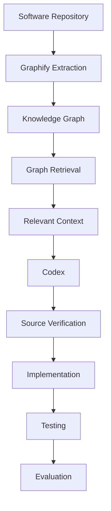
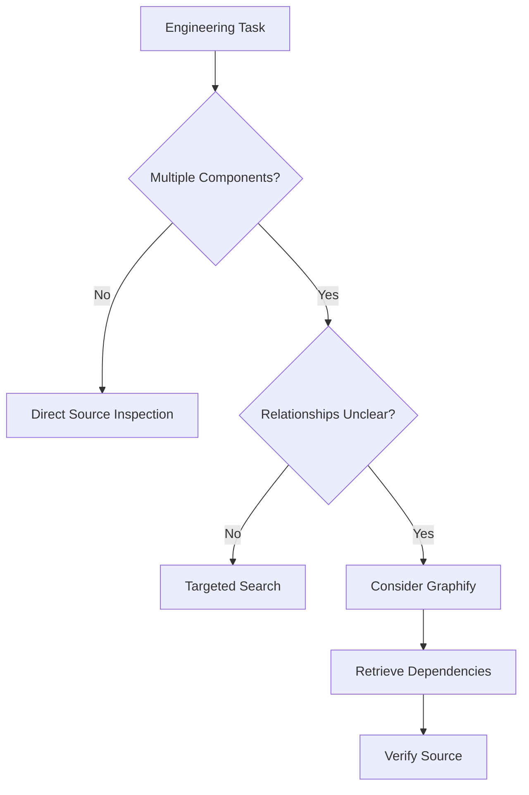
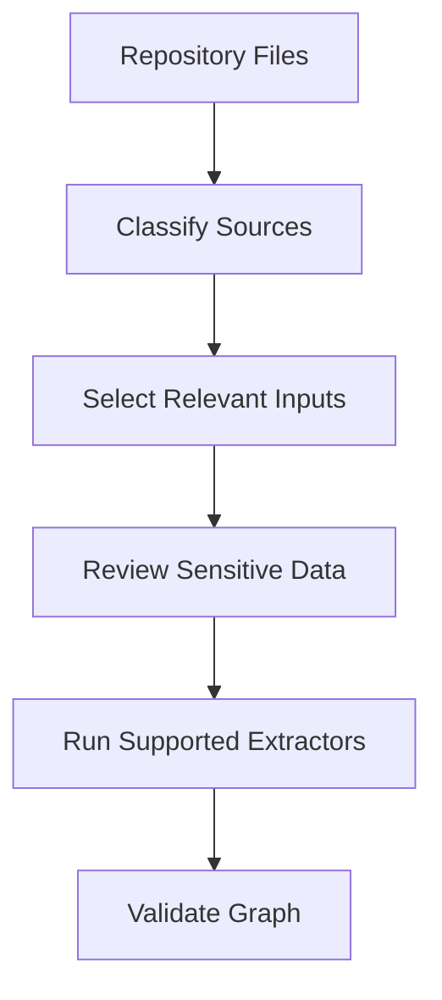
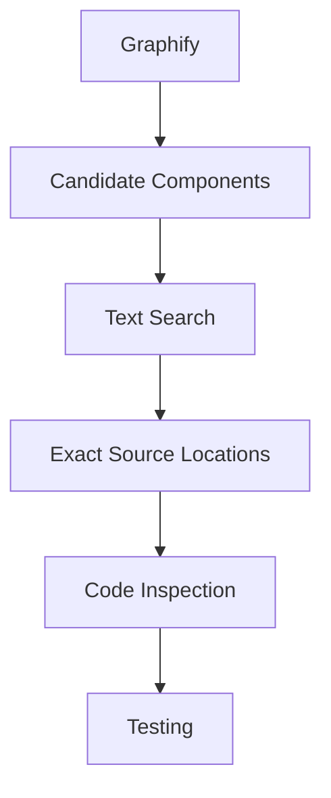
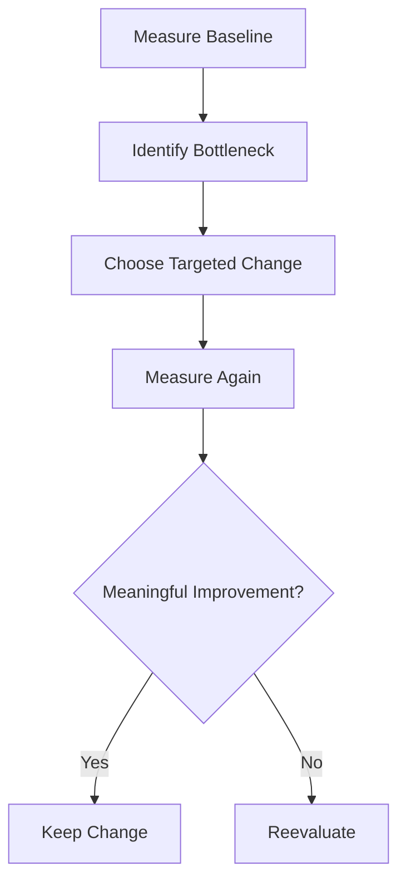
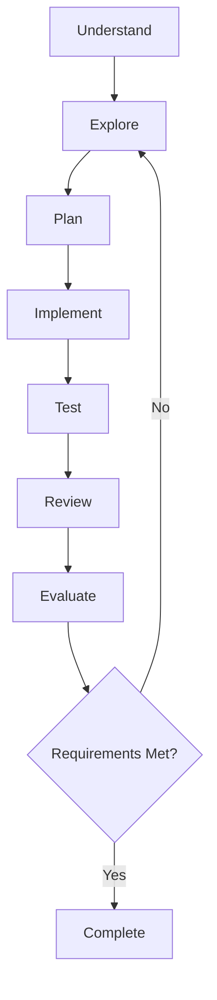
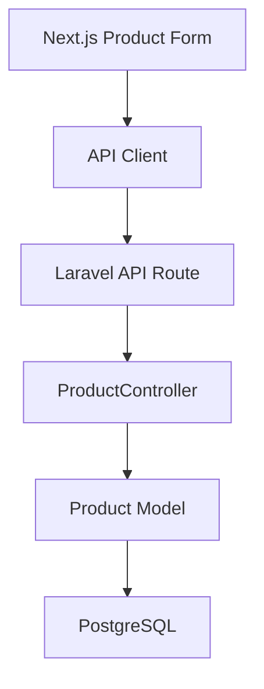
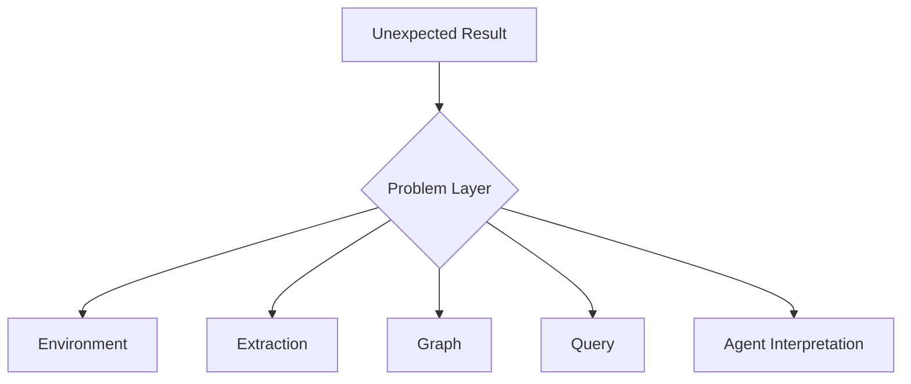

# 13 — Graphify: Best Practices and Practical Exercises

> [!abstract] Lesson Information
> **Repository:** [Graphify-Labs/graphify](https://github.com/Graphify-Labs/graphify)
>
> **Category:** Agentic Engineering / Knowledge Graphs / Context Engineering / Software Development Workflows
>
> **Difficulty:** Intermediate to Advanced
>
> **Learning Approach:** Theory First
>
> **Lesson Type:** Final Integration and Evaluation
>
> **Prerequisites:** Lessons 00–12
>
> **Primary Goal:** Design a complete, secure, efficient, and maintainable graph-assisted agentic development workflow using Graphify and Codex without introducing unnecessary complexity.

---

# Part I — Learning Objectives

After completing this lesson, you should be able to:

1. Evaluate whether a repository benefits from Graphify.
2. Select between direct source inspection, CLI, skills, and MCP.
3. Design an indexing strategy and maintain graph freshness.
4. Write focused graph questions and interpret nodes, edges, communities, and paths.
5. Combine Graphify with source search and verify relationships against code.
6. Apply context engineering, security, privacy, testing, and performance principles.
7. Plan Android, Laravel, and Next.js workflows.
8. Recognize failure modes, avoid overengineering, and create an adoption strategy.
9. Evaluate retrieval and agent performance.
10. Demonstrate mastery through a capstone workflow.

---

# Part II — Complete Graphify Mental Model



> [!important]
> **Graphify helps an agent discover where to investigate. Source code, requirements, and tests establish what should be implemented and whether it works.**

Graph retrieval is not a substitute for engineering judgment.

---

# Part III — When Should You Use Graphify?

Evaluate the task before selecting tools.

| Task | Graphify value |
|---|---|
| Change static text | Usually low |
| Fix simple CSS alignment | Usually low |
| Locate a known method | Often low |
| Explore unfamiliar architecture | Potentially high |
| Investigate cross-module dependencies | Potentially high |
| Plan a broad refactor | Potentially high |
| Verify runtime behavior | Supporting role only |
| Check database concurrency | Supporting role only |



Use Graphify when the expected improvement in understanding outweighs indexing, integration, and maintenance costs.

---

# Part IV — Repository Readiness

Before adoption, review:

## Architecture

- Are source modules identifiable?
- Are responsibilities reasonably separated?
- Are dependencies understandable?

## Documentation

- Is there a maintained README?
- Are requirements and architecture decisions documented?
- Are repository instructions available?

## Security

- Are secrets handled correctly?
- Are generated artifacts protected?
- Is external processing acceptable?

## Evaluation

- Are tests and acceptance criteria available?
- Can changes be verified independently of Graphify?

A poorly documented repository may still benefit from Graphify, but the graph cannot replace missing requirements or guarantee architectural correctness.

---

# Part V — Choosing the Integration

| Integration | Primary purpose | Main consideration |
|---|---|---|
| CLI | Direct graph operations | Command and environment setup |
| Skill | Reusable Codex workflow guidance | Maintained instructions |
| Local MCP | Structured local tools | Server configuration and access |
| Hosted MCP | Remote graph access | Authentication and governance |

Recommended adoption order:

1. Understand the repository.
2. Identify a graph-worthy task.
3. Try direct CLI or skill usage.
4. Add MCP only when structured tool access provides clear value.
5. Consider hosted infrastructure only when justified.

Avoid multiple graph servers and overlapping integrations without a measurable reason.

---

# Part VI — Graph Construction and Query Best Practices

Select relevant inputs such as source code, SQL schemas, architecture documents, and supported configuration artifacts. Exclude generated outputs, dependency caches, temporary files, unrelated binaries, archives, and unnecessary sensitive data.



A useful graph has meaningful nodes, accurate relationships, source references, manageable duplication, relevant coverage, and current data. Optimize for useful, verifiable relationships—not maximum graph size.

Start queries with a concrete engineering question:

- Which components handle task completion?
- What is the responsibility of `TaskRepository`?
- Which modules depend on the authentication service?
- How are `ScheduleController` and `Trip` related?
- What should be reviewed before changing this service?

Start narrow and expand only when necessary.

When interpreting an edge, ask:

1. What does the relationship mean?
2. Is it extracted or inferred?
3. What source supports it?
4. Is the source current?
5. Does it imply runtime behavior?

Graph paths are structural evidence, not guaranteed execution order, data flow, authorization correctness, or transaction safety.

---

# Part VII — Context Engineering and Traditional Tools

Build the smallest sufficient context:

```text
Requirements → Architecture → Source Code → Tests
```

An example context package might contain the task, constraints, relevant components, evidence to inspect, and required verification. It should identify evidence rather than replace it with unsupported summaries.

Graphify complements rather than replaces:

- `rg` for exact text search.
- Git for history and repository state.
- IDE navigation for source inspection.
- Tests for behavior verification.
- Debuggers for runtime investigation.



Use the tool best suited to each stage.

---

# Part VIII — Freshness, Provenance, and Evidence

Repositories evolve through renames, moves, deletions, new dependencies, and architecture changes. Track the repository revision associated with a graph and refresh it after significant changes.

Useful provenance includes file path, symbol, source location, extraction method, and repository revision.

Prioritize evidence in this order for implementation decisions:

1. Current source code.
2. Current tests and runtime behavior.
3. Maintained requirements.
4. Verified graph relationships.
5. Older summaries and assumptions.

Documentation may describe intended behavior while code describes current behavior. Investigate disagreements instead of silently merging them.

---

# Part IX — Security, Privacy, and Prompt Injection

Graph artifacts can expose credentials, internal endpoints, private source, personal data, and confidential documentation.

Best practices:

- Use least-privilege access.
- Protect generated graph artifacts.
- Review external processing and hosted services.
- Exclude unnecessary sensitive inputs.
- Treat retrieved content as untrusted.
- Verify tool permissions.
- Keep dependencies updated.

Repository comments, Markdown, external documents, issue descriptions, and transcripts may contain prompt-injection text. Retrieved content may inform an answer, but it does not automatically have authority over the agent.

Graphify is not a substitute for secret scanning, vulnerability scanning, or application security testing.

---

# Part X — Performance and Avoiding Overengineering

Measure before optimizing:

- Initial indexing time.
- Query latency.
- Graph memory usage.
- Cache efficiency.
- Retrieval relevance.
- Agent token consumption.



Overengineering includes adding multiple graph servers for a small project, introducing a vector database without evidence of need, creating several agents for a simple task, or building complex caching before measurement.

Before adding infrastructure, ask:

- What problem does it solve?
- Is the problem measurable?
- Is a simpler solution sufficient?
- What maintenance does it introduce?
- Can the benefit be demonstrated?

> [!important]
> Use the least complex workflow that achieves the required reliability.

---

# Part XI — Agentic Development Lifecycle



Graphify is particularly useful during exploration and impact analysis. It may also help during review by identifying potentially affected dependencies.

1. Understand requirements and constraints.
2. Explore with Graphify and source search.
3. Plan affected files and dependencies.
4. Make minimal authorized changes.
5. Run relevant checks.
6. Review correctness, security, and scope.
7. Evaluate task success.

---

# Part XII — Project Case Studies

## GroupTrack Android

For a task-completion issue, investigate `TaskDetailsActivity`, `TaskRepository`, `Task`, and `ProgressActivity`. Review Firebase behavior, plan the smallest MVP-preserving fix, and verify persistence, progress calculation, authorization, and tests. Graph relationships cannot prove authorization correctness.

## GoPasig Laravel

For schedule conflict validation, investigate `ScheduleController`, `BusinessLogicService`, `Schedule`, `Driver`, `Bus`, and `Trip`. Review migrations, transactions, locking, role permissions, and tests. A structural graph cannot prove concurrency safety.

## Next.js and Laravel e-commerce



Inspect the frontend form, API request, backend route, controller validation, model constraints, migrations, and tests. A static graph may not resolve the HTTP connection automatically. Frontend validation never replaces backend validation.

---

# Part XIII — Troubleshooting Framework



| Layer | Examples |
|---|---|
| Environment | Missing dependency, wrong Python environment, invalid path |
| Extraction | Unsupported syntax, missing files, failed semantic extraction |
| Graph | Missing edges, duplicate nodes, stale data |
| Query | Ambiguous names, broad question, missing path |
| Interpretation | Inferred edge treated as fact, graph path treated as runtime trace |

Fix the problem at the layer where it occurs.

---

# Part XIV — Evaluation Framework

Measure:

| Metric | Question |
|---|---|
| Precision | How many retrieved results were relevant? |
| Recall | How many relevant results were found? |
| Relationship accuracy | Are the edges correct? |
| Query latency | How quickly were results returned? |
| Token usage | How much context was consumed? |
| Task success | Was the engineering task completed? |
| Test success | Did implementation pass verification? |

A workflow that uses fewer tokens but misses critical dependencies is not automatically better.

---

# Part XV — Adoption Roadmap

1. **Understand:** Learn graph fundamentals, architecture, extraction limits, and queries.
2. **Evaluate:** Choose a task where relationships may provide value.
3. **Integrate:** Select CLI, skill, local MCP, or hosted MCP.
4. **Validate:** Check quality, provenance, freshness, and permissions.
5. **Apply:** Use Graphify for real repository investigation.
6. **Measure:** Compare against a realistic baseline.
7. **Maintain:** Keep documentation, configuration, and artifacts aligned with repository changes.

---

# Part XVI — Practical Exercises

1. Decide whether Graphify is necessary for a ten-file project.
2. Create a Laravel repository-readiness checklist.
3. Compare CLI, skill, and MCP for a local project.
4. Select repository inputs and exclusions for indexing.
5. Define five indicators of graph quality.
6. Write five authentication-module graph questions.
7. Choose seed nodes for task-completion investigation.
8. Explain why a shortest graph path does not prove runtime execution.
9. Design a minimal Laravel validation context package.
10. Explain when `rg` is more appropriate than graph retrieval.
11. Link a graph relationship to source evidence.
12. Explain how a class rename affects freshness.
13. Identify five sensitive repository information types.
14. Describe safe handling of prompt injection in documentation.
15. Design a Graphify-versus-text-search performance comparison.
16. Calculate precision and recall for a retrieved entity set.
17. Design GroupTrack, GoPasig, and e-commerce investigation plans.
18. Identify when MCP introduces unnecessary complexity.

---

# Part XVII — Advanced Scenarios

## Large repository exploration

Design a focused authentication workflow with requirements review, seed selection, graph retrieval, dependency exploration, source verification, and an architecture summary. Avoid unrelated modules.

## Refactoring a central service

Identify callers, interfaces, tests, and regression risks. Node degree alone cannot determine refactoring risk.

## Conflicting documentation

Identify claims, compare source and dates, determine authoritative requirements, avoid unsupported changes, and update documentation appropriately.

## Incomplete graph

Investigate HTTP requests, API routes, configuration, dynamic relationships, and extractor coverage when no frontend-to-backend path appears.

## Security-sensitive repository

Minimize indexed data, use least privilege, protect artifacts, review external processing, and verify all retrieved evidence.

---

# Part XVIII — Final Capstone Exercise

Choose GroupTrack, GoPasig, or the e-commerce project and design a complete graph-assisted workflow.

Include:

1. Problem definition.
2. Scope and exclusions.
3. Repository assessment.
4. CLI, skill, or MCP choice.
5. Graph construction strategy.
6. Query strategy and seed nodes.
7. Dependency analysis.
8. Smallest sufficient context.
9. Source verification.
10. Minimal implementation plan.
11. Security and trust-boundary review.
12. Tests and acceptance criteria.
13. Retrieval and performance metrics.
14. Failure modes and risks.
15. Maintainability evaluation.

---

# Part XIX — Final Evaluation Rubric

| Category | Weight |
|---|---:|
| Graph fundamentals | 10% |
| Architecture understanding | 10% |
| Extraction and relationships | 10% |
| Query design | 10% |
| Context engineering | 15% |
| Agent integration | 10% |
| Security and limitations | 15% |
| Testing and evaluation | 10% |
| Practical workflow design | 10% |
| **Total** | **100%** |

| Score | Interpretation |
|---|---|
| 90–100 | Strong conceptual mastery |
| 80–89 | Good understanding |
| 70–79 | Developing proficiency |
| 60–69 | Further review recommended |
| Below 60 | Revisit foundations |

This is an educational rubric, not an official Graphify certification.

---

# Part XX — Best Practices Checklist

## Before Using Graphify

- [ ] Understand the task and confirm graph relationships are useful.
- [ ] Review architecture, instructions, sensitive information, and integration choices.

## During Graph Construction

- [ ] Select relevant inputs and exclude unnecessary artifacts.
- [ ] Review optional dependencies, warnings, repository revision, and important relationships.

## During Retrieval

- [ ] Ask focused questions and start with relevant concepts.
- [ ] Check provenance, confidence, freshness, and source evidence.

## During Implementation

- [ ] Read actual source code, follow repository instructions, preserve scope, and make minimal changes.

## During Verification

- [ ] Run tests, check acceptance criteria, review security, and inspect unexpected changes.

## During Evaluation

- [ ] Measure relevance, dependency coverage, tokens, task success, and comparison with realistic alternatives.

---

# Part XXI — Key Takeaways

> [!summary]
> - Graphify is valuable when understanding dependencies matters.
> - Not every coding task requires graph analysis.
> - Graph quality depends on extraction, input selection, provenance, and freshness.
> - Query design should begin with concrete engineering questions.
> - Graph paths are structural evidence, not guaranteed runtime traces.
> - Context engineering should prioritize relevant and verifiable information.
> - Traditional search tools remain essential.
> - Security and privacy must be considered before sharing repository information.
> - MCP provides structured tools; skills provide workflow guidance.
> - Source inspection and tests are required before consequential changes.
> - Token reduction alone does not establish engineering success.
> - Avoid unnecessary integrations, agents, and abstractions.
> - The best workflow is the simplest one that reliably completes the task.

> [!important] Final Principle
> **Graphify should make agentic software development more informed—not more complicated. Its role is to help Codex discover relevant structure, investigate dependencies, and select useful context while preserving source verification, security, testing, and human-defined project scope.**

---

# Part XXII — Official References

## Graphify

- [Graphify GitHub Repository](https://github.com/Graphify-Labs/graphify)
- [Graphify README](https://github.com/Graphify-Labs/graphify/blob/v8/README.md)
- [Graphify Architecture](https://github.com/Graphify-Labs/graphify/blob/v8/ARCHITECTURE.md)
- [Graphify How It Works](https://github.com/Graphify-Labs/graphify/blob/v8/docs/how-it-works.md)
- [Graphify Security Policy](https://github.com/Graphify-Labs/graphify/blob/v8/SECURITY.md)

## Agentic Development and Graph Analysis

- [OpenAI Codex Documentation](https://developers.openai.com/codex/)
- [Model Context Protocol](https://modelcontextprotocol.io/)
- [NetworkX Documentation](https://networkx.org/documentation/stable/)
- [Tree-sitter](https://tree-sitter.github.io/tree-sitter/)
- [Git Documentation](https://git-scm.com/doc)
- [ripgrep](https://github.com/BurntSushi/ripgrep)
- [pytest Documentation](https://docs.pytest.org/)
- [OWASP Cheat Sheet Series](https://cheatsheetseries.owasp.org/)
- [NIST Secure Software Development Framework](https://csrc.nist.gov/projects/ssdf)

> [!note] Documentation Scope
> Specific commands, tool names, and integration behavior may vary by Graphify version. Consult the documentation and tool definitions for the installed release. Project architectures, relationships, evaluation criteria, and diagrams are educational illustrations unless explicitly verified. No Graphify installation, graph construction, benchmark, or project modification was performed.

---

# Part XXIII — Curriculum Completion

## Graphify Learning Roadmap

- [x] 00 — Repository Overview and Purpose
- [x] 01 — Knowledge Graph Fundamentals
- [x] 02 — Architecture and Core Components
- [x] 03 — Installation and Codex Integration
- [x] 04 — AST Parsing and Code Intelligence
- [x] 05 — Nodes, Edges, and Relationships
- [x] 06 — Graph Construction and NetworkX
- [x] 07 — Query, Explain, and Path Commands
- [x] 08 — Context Engineering and Token Efficiency
- [x] 09 — Documents, Schemas, and Multimodal Sources
- [x] 10 — MCP and Agent Integration
- [x] 11 — Security, Privacy, and Limitations
- [x] 12 — Performance Benchmarks and Evaluation
- [x] 13 — Best Practices and Practical Exercises

You should now be able to explain what Graphify is, how repository graphs are constructed, how graph retrieval supports coding agents, how context engineering improves exploration, how skills and MCP differ, how to recognize security and extraction limitations, how to evaluate practical usefulness, and when simpler tools are sufficient.

## Recommended Next Stage

Apply the theory to a real repository through a controlled, scope-limited exercise:

1. Select an existing project.
2. Define one architecture question.
3. Establish a direct-search baseline.
4. Use the supported Graphify workflow.
5. Compare the findings.
6. Verify relationships in source code.
7. Record whether Graphify improved the investigation.

**End of Lesson 13 — Best Practices and Practical Exercises.**

**Graphify Curriculum Complete — Lessons 00–13.**
