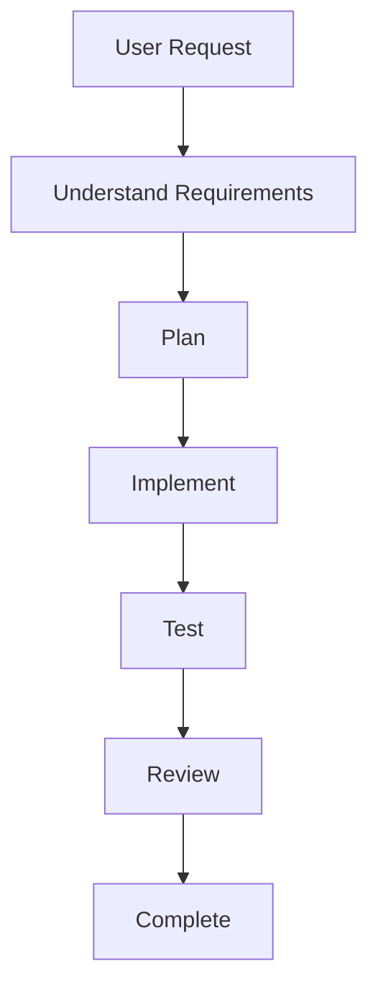
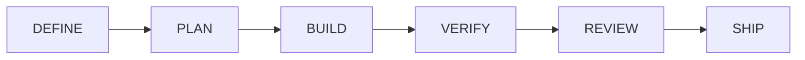
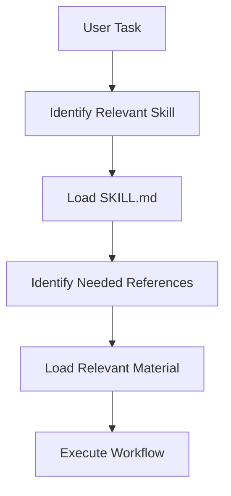
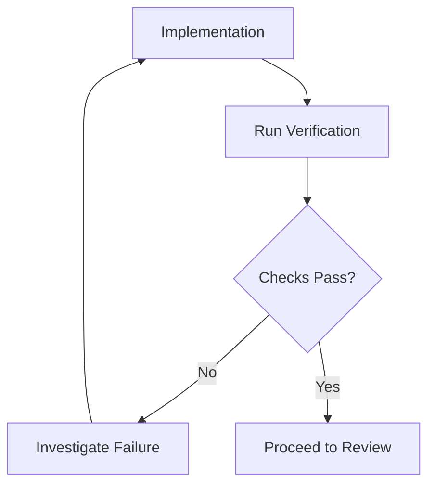
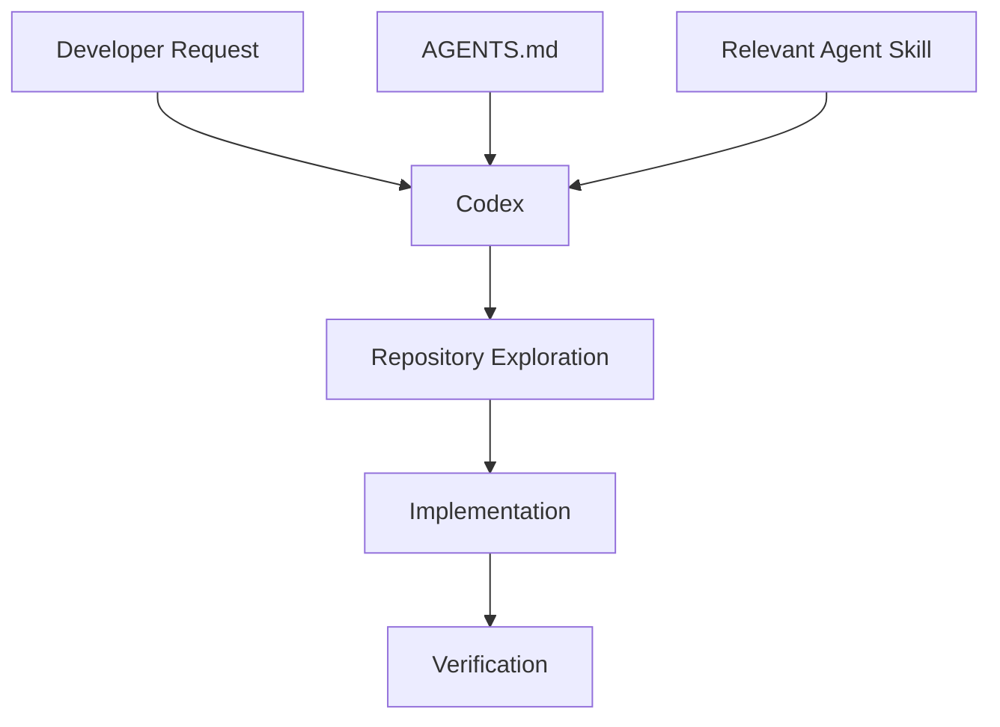
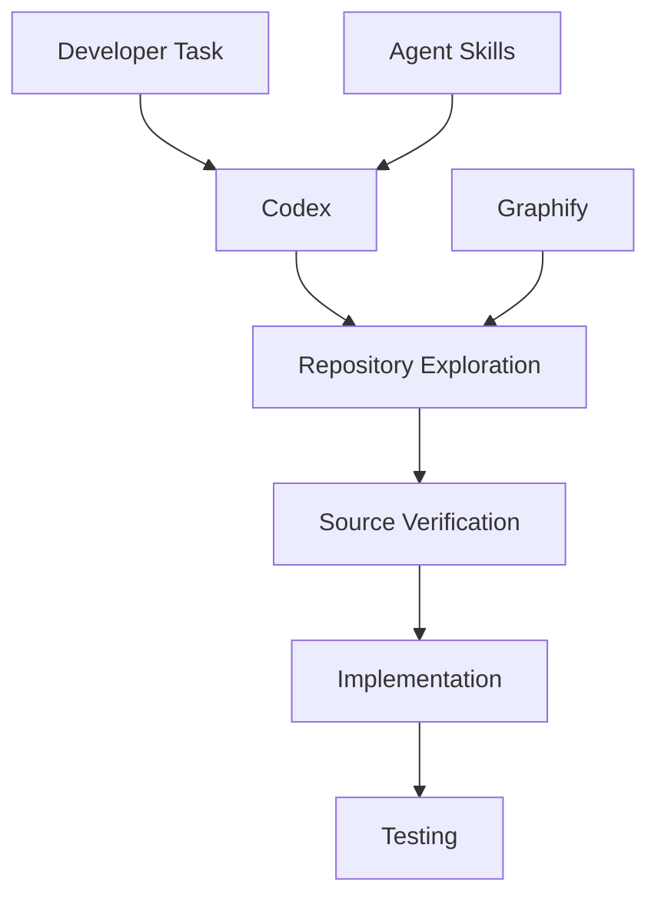

# 00 — Agent Skills: Repository Overview and Purpose

> [!abstract] Lesson Information
> **Repository:** [addyosmani/agent-skills](https://github.com/addyosmani/agent-skills)
>
> **Author:** Addy Osmani
>
> **License:** MIT
>
> **Category:** Agentic Engineering / AI Coding Agents / Software Engineering Workflows
>
> **Difficulty:** Beginner to Intermediate
>
> **Learning Approach:** Theory First
>
> **Lesson Type:** Repository Introduction
>
> **Primary Goal:** Understand the purpose, philosophy, structure, and engineering practices behind Agent Skills before studying individual skills and integrations.

---

# Part I — Learning Objectives

After completing this lesson, you should be able to:

1. Explain what the Agent Skills repository is and what problems it addresses.
2. Distinguish AI coding capability from engineering discipline.
3. Explain its development lifecycle and repository structure.
4. Understand reusable skills, `SKILL.md`, commands, agents, and references.
5. Explain why verification and incremental development matter.
6. Understand progressive disclosure, Codex integration, and platform portability.
7. Recognize limitations, tradeoffs, and appropriate use cases.

---

# Part II — Introduction to Agent Skills

**Agent Skills** is an open-source collection of structured engineering workflows for AI coding agents. It focuses on how engineering work should be performed rather than teaching one programming language.

Workflows may cover requirements, specifications, planning, incremental implementation, testing, debugging, review, security, performance, documentation, and deployment.

Without a workflow, an agent asked to “build an authentication system” may immediately generate routes and models while skipping questions about roles, validation, failure behavior, tests, and security. Agent Skills is intended to make those responsibilities explicit.

> [!important]
> **Generating code is only one part of software engineering. Reliable development also requires requirements, planning, verification, review, and maintenance.**

---

# Part III — The Problem It Attempts to Solve

AI agents can generate code quickly, but the shortest route to code is not necessarily the safest or most maintainable route to a working system.

Common risks include:

- Implementing before requirements are clear.
- Making unsupported assumptions.
- Changing unrelated files.
- Skipping tests and runtime verification.
- Introducing unnecessary dependencies.
- Ignoring existing architecture.
- Declaring completion without evidence.



Agent Skills does not guarantee correct software. It provides structured instructions and checkpoints intended to improve process reliability.

---

# Part IV — Repository Philosophy and Lifecycle

The repository packages good engineering practices as reusable, actionable instructions. “Write clean code” is generic; “inspect conventions, make the smallest necessary change, run relevant checks, and review the diff” is an observable workflow.

It emphasizes verification over confidence. Useful evidence may include successful tests, builds, runtime observations, acceptance-criteria checks, and reviewed diffs.

## Six-stage lifecycle



| Stage | Question | Primary output |
|---|---|---|
| Define | What should we build? | Clear requirements |
| Plan | How should we build it? | Actionable tasks |
| Build | How do we implement it? | Working implementation |
| Verify | Does it work? | Evidence of correctness |
| Review | Is it safe and maintainable? | Quality assessment |
| Ship | Is it ready to release? | Controlled release |

### Define

Clarify the problem, scope, requirements, constraints, and specification.

### Plan

Understand architecture, identify components, break work down, define acceptance criteria, and order dependencies.

### Build

Implement small changes while following conventions, boundaries, and tests.

### Verify

Run unit, integration, runtime, regression, and reproduction checks appropriate to the risk.

### Review

Assess correctness, security, complexity, performance, maintainability, and change scope.

### Ship

Perform final checks, deployment preparation, rollback planning, and post-release observation.

---

# Part V — Repository Components

```text
agent-skills/
├── skills/
├── commands/
├── agents/
├── references/
├── docs/
├── scripts/
├── evals/
├── hooks/
├── .claude/
├── .claude-plugin/
├── .codex-plugin/
├── .gemini/
├── .github/
├── .opencode/
├── AGENTS.md
├── CLAUDE.md
├── README.md
└── LICENSE
```

| Component | Purpose |
|---|---|
| `skills/` | Reusable engineering workflows |
| `commands/` | Workflow invocation definitions |
| `agents/` | Specialist perspectives/personas |
| `references/` | Checklists and supporting material |
| `docs/` | Usage and platform guidance |
| `scripts/` | Maintenance and validation tooling |
| `evals/` | Skill behavior and routing evaluation |
| `AGENTS.md` | Repository-specific agent instructions |

This is a simplified conceptual structure, not a complete recursive listing.

---

# Part VI — Agent Skills and `SKILL.md`

An **agent skill** is a reusable package of instructions for a type of work. It can define when it should be used, required inputs, process steps, constraints, verification, and failure patterns.

```text
skills/
└── test-driven-development/
    └── SKILL.md
```

`SKILL.md` is the primary instruction document. A typical skill contains frontmatter and Markdown guidance:

```markdown
---
name: task-implementation
description: Guide an agent through a scoped implementation task.
---

# Task Implementation

## When to Use
Use this skill when implementing an approved feature.

## Process
1. Read requirements.
2. Inspect relevant source.
3. Make the smallest necessary change.
4. Run relevant tests.
5. Review the diff.

## Verification
Do not claim completion without checking the required behavior.
```

| Section | Purpose |
|---|---|
| Frontmatter | Skill metadata |
| Overview | Workflow purpose |
| When to Use | Trigger conditions |
| Process | Required steps |
| Red Flags | Warning signs |
| Verification | Completion evidence |

A skill primarily supplies instructions. It is not automatically an executable program, though it may reference tools or scripts.

---

# Part VII — The Documented Skill Categories

The repository documents skills organized around the lifecycle.

## Meta

- `using-agent-skills`

## Define

- `interview-me`
- `idea-refine`
- `spec-driven-development`
- `constraint-driven-development`

## Plan

- `planning-and-task-breakdown`

## Build

- `incremental-implementation`
- `test-driven-development`
- `context-engineering`
- `source-driven-development`
- `doubt-driven-development`
- `frontend-ui-engineering`
- `api-and-interface-design`

## Verify

- `browser-testing-with-devtools`
- `debugging-and-error-recovery`

## Review

- `code-review-and-quality`
- `code-simplification`
- `security-and-hardening`
- `performance-optimization`

## Ship

- `git-workflow-and-versioning`
- `ci-cd-and-automation`
- `deprecation-and-migration`
- `documentation-and-adrs`
- `observability-and-instrumentation`
- `shipping-and-launch`

The documented count and names may change. Select relevant skills based on task scope and risk; do not activate everything automatically.

---

# Part VIII — Commands and Agent Personas

The repository documents workflow commands such as:

| Command | Purpose |
|---|---|
| `/spec` | Define requirements |
| `/plan` | Break work into tasks |
| `/build` | Implement incrementally |
| `/test` | Verify behavior |
| `/constraints` | Establish quality standards |
| `/review` | Review code quality |
| `/webperf` | Audit web performance |
| `/code-simplify` | Simplify implementation |
| `/ship` | Prepare release |

These names are integration entry points and should not be assumed to exist identically in every agent. Codex may use native skill discovery and invocation rules instead.

The documented specialist personas include:

| Persona | Focus |
|---|---|
| `code-reviewer` | Code quality and maintainability |
| `test-engineer` | Test strategy and verification |
| `security-auditor` | Security review |
| `web-performance-auditor` | Web performance |

Commands invoke workflows, skills define procedures, and personas define review perspectives. None is an independent guarantee of expertise or correctness.

---

# Part IX — Progressive Disclosure and Anti-Rationalization

Progressive disclosure loads only relevant information when it becomes useful:



Loading every skill, checklist, and reference at once increases context usage and conflicting guidance. A UI task may need frontend and accessibility guidance but not deployment and observability material.

Anti-rationalization guidance addresses shortcuts such as “the change is small, so testing is unnecessary.” The correct response is to identify what behavior changed and what proportionate evidence supports completion. Verification should match risk; not every typo requires the same process as authentication logic.

---

# Part X — Verification Gates

A verification gate is a condition that must be satisfied before progressing.



| Claim | Evidence |
|---|---|
| Code compiles | Successful build |
| Behavior works | Relevant passing tests |
| UI works | Runtime or browser verification |
| API validates input | Validation tests |
| Change is scoped | Reviewed diff |

If verification cannot be performed, report that limitation rather than claiming success.

---

# Part XI — Relationship to Codex and `AGENTS.md`

Codex can inspect repositories, edit files, execute permitted commands, and assist with development. Agent Skills provides structured guidance for deciding how those capabilities should be used.



`AGENTS.md` provides project-specific rules. Skills provide reusable process guidance. A project rule such as “use Java, preserve package organization, and keep the MVP scope” should constrain how a generic skill is applied.

```text
AGENTS.md → What constraints apply here?
Agent Skill → What workflow should be followed?
Codex → Perform the authorized task.
```

Repository instructions and retrieved content must still be interpreted according to the applicable instruction hierarchy.

---

# Part XII — Agent Skills vs Graphify

These tools solve different but complementary problems.

| Aspect | Graphify | Agent Skills |
|---|---|---|
| Primary purpose | Repository intelligence | Engineering workflows |
| Core concept | Knowledge graph | Reusable skills |
| Main artifact | Graph data | `SKILL.md` |
| Strength | Dependency exploration | Development discipline |
| Main support | Structural retrieval | Planning and verification |



Using both is optional. A small task may be completed effectively without Graphify or additional infrastructure.

---

# Part XIII — Project Examples

## GroupTrack Android

For a Tasks-page improvement, Define the required data, filters, loading, empty, and error states. Plan Activities or Fragments, layouts, repositories, models, and tests. Build the smallest change, verify rendering and navigation, and review MVP scope and dependencies.

## GoPasig Laravel

For schedule validation, clarify conflicts, roles, messages, and preserved behavior. Plan routes, controllers, validation, services, models, constraints, and tests. Verify valid, conflicting, invalid, unauthorized, and database behavior.

## Next.js and Laravel e-commerce

For a product creation form, define fields, validation, roles, and errors. Separate frontend form/API work from backend route, authorization, validation, persistence, and response work. Test successful, invalid, unauthorized, API-error, and database cases.

Agent Skills organizes the process; it does not replace Android, Laravel, Next.js, database, or security expertise.

---

# Part XIV — Benefits, Limitations, and Use Cases

Potential benefits include consistency, better planning, explicit verification, maintainability, reuse, and context efficiency. These are intended benefits, not guarantees.

Limitations include:

- Skills are instructions, not correctness guarantees.
- Structured workflows add overhead to trivial tasks.
- Loading too many skills creates context overhead.
- Skills and project rules may overlap or conflict.
- Recommended tools may be unavailable.
- Tests may be missing or incomplete.

Use skills especially for new features, multi-file changes, unfamiliar repositories, refactoring, APIs, debugging, security-sensitive work, review, and releases. For a static-label spelling fix, a proportionate workflow may simply locate, edit, and verify the text.

> Use skills to improve engineering judgment, not to replace it with rigid ceremony.

---

# Part XV — Practical Exercises

1. Explain Agent Skills and the problem it addresses.
2. Compare code generation with completing an engineering task.
3. Describe Define, Plan, Build, Verify, Review, and Ship with one output each.
4. Explain `skills/`, `commands/`, `agents/`, `references/`, `docs/`, and `evals/`.
5. Design a conceptual bug-fixing `SKILL.md`.
6. Explain why skills and slash commands are not identical.
7. Select a persona for authentication review, test coverage, frontend performance, and code quality.
8. Explain why loading every skill at once is inefficient.
9. Design API-development verification gates.
10. Explain how to respond when an agent wants to skip testing.
11. Describe how `AGENTS.md` interacts with reusable skills.
12. Design GroupTrack, GoPasig, and e-commerce workflows.
13. Create an Agent Skills adoption proposal for an existing project.

---

# Part XVI — Knowledge Check

1. What is Agent Skills and what problem does it address?
2. What is an agent skill and what is `SKILL.md`?
3. Why are workflows more actionable than generic advice?
4. What are the six lifecycle stages?
5. What is a verification gate?
6. Why is code generation not proof of correctness?
7. What is progressive disclosure?
8. What is anti-rationalization?
9. What are the roles of `skills/`, `commands/`, `agents/`, `references/`, and `evals/`?
10. How do skills differ from commands and personas?
11. What is the purpose of `AGENTS.md`?
12. How can Agent Skills support Codex?
13. How does Agent Skills differ from Graphify?
14. Why should workflows match task complexity?
15. What limitations do instruction-based skills have?

---

# Part XVII — Key Takeaways

> [!summary]
> - Agent Skills is an open-source collection of reusable engineering workflows.
> - It focuses on development discipline rather than one programming language.
> - Skills guide task-specific procedures; commands provide entry points; personas provide perspectives.
> - `SKILL.md` is the main instruction document for a skill.
> - The lifecycle is Define, Plan, Build, Verify, Review, and Ship.
> - Progressive disclosure controls context usage.
> - Anti-rationalization discourages unjustified shortcuts.
> - Verification gates require evidence before completion.
> - `AGENTS.md` provides repository-specific constraints.
> - Agent Skills and Graphify are complementary, not interchangeable.
> - Skills cannot guarantee correctness.
> - Workflows should be proportional to complexity and risk.
> - Reliable engineering requires clear requirements, appropriate implementation, and actual verification.

> [!important] Final Principle
> **Agent Skills helps transform AI-assisted coding from an implementation-first activity into a structured engineering process. Its value comes from selecting appropriate workflows, respecting project constraints, and requiring evidence that the work is correct.**

---

# Part XVIII — Official References

## Primary Repository

- [Agent Skills — GitHub](https://github.com/addyosmani/agent-skills)
- [README.md](https://github.com/addyosmani/agent-skills/blob/main/README.md)
- [Skills Directory](https://github.com/addyosmani/agent-skills/tree/main/skills)
- [Commands Directory](https://github.com/addyosmani/agent-skills/tree/main/commands)
- [Agent Personas](https://github.com/addyosmani/agent-skills/tree/main/agents)
- [Reference Checklists](https://github.com/addyosmani/agent-skills/tree/main/references)
- [Codex Setup Guide](https://github.com/addyosmani/agent-skills/blob/main/docs/codex-setup.md)

## Supporting Documentation

- [OpenAI Codex Documentation](https://developers.openai.com/codex/)
- [Agent Skills Standard](https://agentskills.io/)
- [Model Context Protocol](https://modelcontextprotocol.io/)
- [GitHub Engineering Practices](https://google.github.io/eng-practices/)

> [!note] Documentation Scope
> This lesson is based on the public Agent Skills repository README and documented structure. Repository contents, skill counts, command names, and integrations may change. Verify the installed version before use. Examples and workflows are educational illustrations. No Agent Skills package was installed and no project code was modified.

---

# Part XIX — Next Lesson

**[[01 - Agent Skills Fundamentals]]**

Topics:

1. Agent skill definitions and reusable capabilities.
2. Skill metadata and `SKILL.md` structure.
3. Skill discovery, triggers, and invocation.
4. Progressive disclosure and workflow instructions.
5. Verification requirements and portable skill design.
6. Skills vs prompts, rules, MCP, and agents.
7. Codex examples, limitations, exercises, and references.

**End of Lesson 00 — Repository Overview and Purpose.**
