# 01 — Agent Skills Fundamentals

> [!abstract] Lesson Information
> **Repository:** [addyosmani/agent-skills](https://github.com/addyosmani/agent-skills)
>
> **Category:** Agentic Engineering / Agent Skills / Context Engineering / Codex CLI
>
> **Difficulty:** Beginner to Intermediate
>
> **Learning Approach:** Theory First
>
> **Prerequisites:** [[00 - Repository Overview and Purpose]]
>
> **Primary Goal:** Understand how agent skills are structured, discovered, activated, and executed, and how they support reliable, reusable engineering workflows.

---

# Part I — Learning Objectives

After completing this lesson, you should be able to:

1. Define an agent skill.
2. Explain why skills are useful in agentic development.
3. Understand the Agent Skills open specification.
4. Explain the role of `SKILL.md`.
5. Identify required and optional skill metadata.
6. Understand skill discovery.
7. Explain skill activation.
8. Understand progressive disclosure.
9. Distinguish explicit and automatic skill invocation.
10. Explain the purpose of the `using-agent-skills` meta-skill.
11. Understand workflow instructions and verification gates.
12. Explain anti-rationalization guidance.
13. Distinguish skills from prompts and repository rules.
14. Distinguish skills from MCP tools and subagents.
15. Understand skill portability.
16. Identify security and trust considerations.
17. Recognize common skill design mistakes.
18. Apply these concepts to Codex and real development projects.

---

# Part II — What Is an Agent Skill?

## 1. Definition

An **agent skill** is a reusable package of instructions and supporting resources that helps an AI agent perform a specific type of task.

A skill can contain:

- Procedural instructions.
- Engineering conventions.
- Checklists.
- Reference documents.
- Templates.
- Supporting scripts.
- Verification requirements.

At minimum, a skill consists of a directory containing a `SKILL.md` file.

## 1.1 Simple Example

Imagine asking Codex:

> Implement an API endpoint for creating products.

Codex may already understand Laravel and PHP.

However, technical knowledge alone does not establish your preferred development process.

An API development skill can guide Codex to:

1. Review existing API conventions.
2. Define the request and response contract.
3. Check authorization requirements.
4. Implement server-side validation.
5. Follow existing architectural boundaries.
6. Write relevant tests.
7. Review the final changes.

The skill provides a **process**, not a new programming language.

## 1.2 Core Mental Model

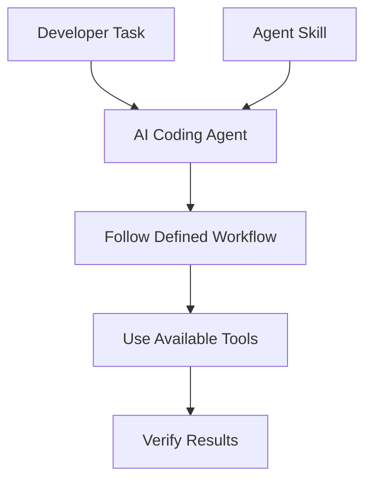

> [!important]
> **An agent skill describes how work should be approached. The AI agent and its available tools perform the actual work.**

---

# Part III — Why Agent Skills Exist

## 2. The Repetition Problem

Developers frequently give similar instructions:

- Read the existing code first.
- Do not overengineer.
- Follow project conventions.
- Make minimal changes.
- Run relevant tests.
- Do not claim success without verification.

Repeating these instructions in every conversation is inefficient.

## 2.1 The Consistency Problem

Without a reusable workflow, the same agent may approach similar tasks differently.

One session may include planning and testing.

Another may jump directly to implementation.

Skills aim to make important engineering practices more consistent.

## 2.2 The Context Problem

An agent does not need every engineering guideline for every task.

For example:

A CSS alignment task may need frontend guidance.

A database migration may need schema, validation, and rollback guidance.

Loading every available guideline can create unnecessary context overhead.

## 2.3 The Solution

Package specialized workflows into separate skills and load them when relevant.

---

# Part IV — The Agent Skills Open Format

## 3. Standard Directory Structure

The open Agent Skills specification defines a skill as a directory containing a required `SKILL.md`.

Optional directories can provide additional resources.

```text
my-skill/
├── SKILL.md
├── scripts/
│   └── validate.sh
├── references/
│   └── checklist.md
└── assets/
    └── template.md
```

## 3.1 Component Responsibilities

| Component | Required? | Purpose |
|---|---|---|
| `SKILL.md` | Yes | Metadata and workflow instructions |
| `scripts/` | No | Executable helpers |
| `references/` | No | Supporting documentation |
| `assets/` | No | Templates and static resources |

## 3.2 Important Distinction

The directory format is standardized.

However, the exact installation paths, discovery behavior, and tool permissions depend on the agent host.

A valid skill does not automatically work identically across every AI application.

---

# Part V — Understanding SKILL.md

## 4. The Main Skill File

`SKILL.md` contains two primary parts:

1. YAML frontmatter.
2. Markdown instructions.

## 4.1 Basic Structure

```markdown
---
name: scoped-implementation
description: Guides agents through small, verified code changes. Use when implementing an approved feature or bug fix.
---

# Scoped Implementation

## When to Use

Use this skill for approved implementation tasks.

## Process

1. Understand the requirement.
2. Inspect the existing implementation.
3. Identify affected files.
4. Plan the smallest necessary change.
5. Implement.
6. Run relevant checks.
7. Review the diff.

## Verification

- Confirm acceptance criteria.
- Confirm relevant tests.
- Report any checks that could not be performed.
```

This is an educational example.

## 4.2 Why Markdown?

Markdown is:

- Human-readable.
- Easy to version-control.
- Portable.
- Compatible with developer tooling.
- Suitable for structured instructions.

## 4.3 Why YAML Frontmatter?

Frontmatter provides machine-readable metadata.

It helps compatible agents discover and identify the skill.

---

# Part VI — Required Metadata

## 5. The `name` Field

Example:

```yaml
name: scoped-implementation
```

Under the Agent Skills specification, a name must:

- Be 1–64 characters.
- Use lowercase letters, numbers, and hyphens.
- Match the parent directory name.
- Not begin or end with a hyphen.
- Not contain consecutive hyphens.

## 5.1 The `description` Field

Example:

```yaml
description: Guides agents through scoped implementation tasks. Use when modifying existing application behavior.
```

The description should explain:

- **What** the skill does.
- **When** the skill should be used.

The specification permits a maximum of 1,024 characters.

## 5.2 Why Descriptions Matter

A compatible agent can use skill descriptions to decide which skill is relevant.

A vague description may lead to poor skill selection.

Compare:

**Weak description**

```yaml
description: Helps with programming.
```

**Better description**

```yaml
description: Guides agents through reproducible bug investigation and verification. Use when tests fail, builds break, or application behavior is unexpected.
```

The second description gives a clearer activation condition.

---

# Part VII — Optional Metadata

## 6. Additional Fields

The open specification also defines optional fields.

| Field | Purpose |
|---|---|
| `license` | License information |
| `compatibility` | Environment requirements |
| `metadata` | Additional key-value metadata |
| `allowed-tools` | Experimental tool-related declaration |

## 6.1 Example

```yaml
---
name: api-review
description: Reviews API contracts and validation. Use when designing or changing backend interfaces.
license: MIT
compatibility: Requires access to repository source files.
metadata:
  author: example-team
  version: "1.0"
---
```

## 6.2 Important

Optional metadata does not guarantee that every agent host supports or enforces the same behavior.

In particular, a metadata declaration should not be treated as a replacement for actual runtime permissions.

---

# Part VIII — Skill Anatomy in Addy Osmani's Repository

## 7. Beyond the Minimum Specification

The `addyosmani/agent-skills` repository follows a more opinionated engineering structure.

Its documented skill anatomy includes:

- Overview.
- When to Use.
- Process.
- Rationalizations.
- Red Flags.
- Verification.

## 7.1 Purpose of Each Section

| Section | Engineering Purpose |
|---|---|
| Overview | Establishes the skill's responsibility |
| When to Use | Defines relevant task conditions |
| Process | Specifies workflow steps |
| Rationalizations | Addresses excuses for skipping steps |
| Red Flags | Identifies warning signs |
| Verification | Requires evidence of completion |

## 7.2 Why This Matters

A generic skill might say:

> Follow good development practices.

A structured skill defines what those practices require in a particular task.

This makes the instructions more actionable and easier to evaluate.

---

# Part IX — Skill Discovery

## 8. What Is Skill Discovery?

**Skill discovery** is the process by which an agent becomes aware of available skills.

Compatible hosts typically expose skill metadata before loading complete instructions.

## 8.1 Discovery Architecture

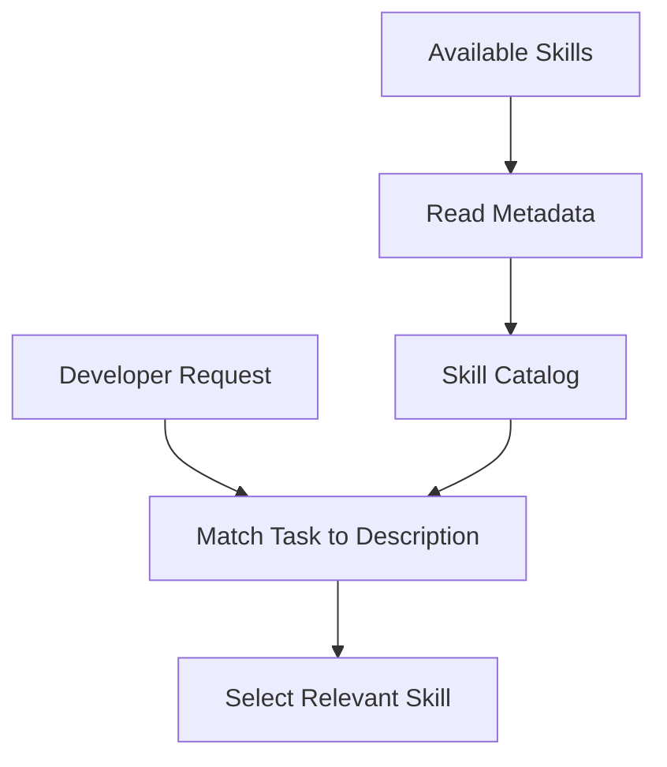

## 8.2 Example Catalog

```text
Available skills:

frontend-ui-engineering
  UI architecture and implementation workflow

debugging-and-error-recovery
  Reproducible debugging workflow

api-and-interface-design
  API contract and boundary design

code-review-and-quality
  Structured code review workflow
```

## 8.3 Important

Discovery does not necessarily mean that every skill's full instructions are already loaded.

This distinction is essential for progressive disclosure.

---

# Part X — Skill Activation

## 9. What Is Activation?

**Activation** occurs when an agent selects and loads a relevant skill for a task.

## 9.1 Example

Developer request:

> Fix the validation error in my Laravel API.

Potentially relevant skill:

```text
debugging-and-error-recovery
```

The agent may load the skill's instructions to guide its investigation.

## 9.2 Activation Workflow

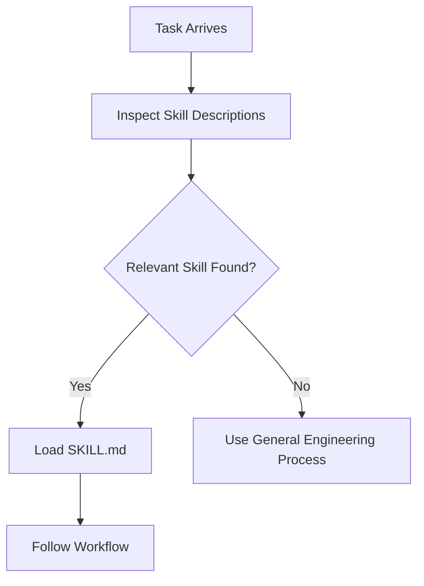

## 9.3 Important

Activation is not a guarantee of correct execution.

The agent must still:

- Understand the task.
- Read relevant source files.
- Use appropriate tools.
- Verify results.

---

# Part XI — Explicit vs Automatic Invocation

## 10. Automatic Invocation

A compatible agent may select a skill based on the user's task and the skill description.

Example:

> Review this authentication implementation.

The agent may identify a relevant review or security skill.

## 10.1 Explicit Invocation

A developer may directly request a particular skill.

Conceptual example:

```text
Use the test-driven-development skill for this bug fix.
```

For Codex, the repository's setup guide documents direct skill invocation such as:

```text
@spec-driven-development
```

The exact interface depends on the Codex version and integration.

## 10.2 Comparison

| Method | Selection |
|---|---|
| Automatic | Agent selects a matching skill |
| Explicit | Developer identifies the skill |
| Meta-skill routing | A dedicated skill helps determine which workflow applies |

## 10.3 Best Practice

Use explicit invocation when you want a particular workflow.

Allow native discovery when the task and skill descriptions are sufficiently clear.

---

# Part XII — Progressive Disclosure

## 11. Definition

**Progressive disclosure** means loading skill information in stages.

The Agent Skills specification describes three levels.

### Level 1 — Metadata

The agent sees the skill's name and description.

### Level 2 — Instructions

When activated, the agent loads the complete `SKILL.md`.

### Level 3 — Supporting Resources

Additional references, scripts, or assets are accessed when needed.

## 11.1 Architecture

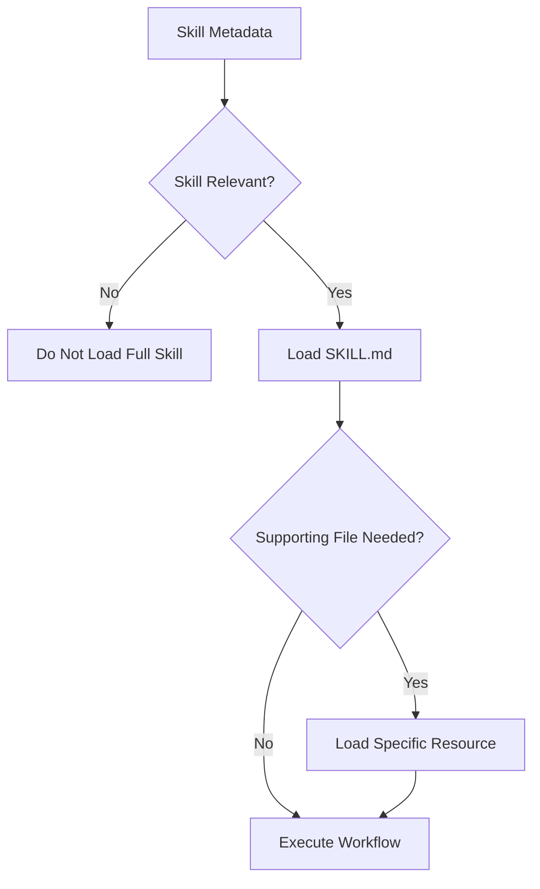

## 11.2 Why This Matters

Suppose a repository contains 25 skills.

Loading every skill in full could consume substantial context.

Loading only the relevant instructions reduces unnecessary context use.

## 11.3 Recommended Size

The specification recommends keeping the main `SKILL.md` under approximately 500 lines and moving detailed material into supporting files.

This is a maintainability and context-efficiency recommendation, not a guarantee of token savings in every host.

---

# Part XIII — Context Engineering

## 12. Skills as Context Packages

A skill provides task-specific procedural context.

For example, a frontend skill might provide guidance about:

- Component architecture.
- Responsive behavior.
- Accessibility.
- State handling.
- UI verification.

A debugging skill may provide:

- Reproduction steps.
- Investigation procedure.
- Root-cause analysis.
- Regression prevention.

## 12.1 Context Layers

```text
Agent Instructions
       ↓
Project Rules
       ↓
Relevant Skill
       ↓
Task Requirements
       ↓
Source Code and Evidence
```

These layers serve different purposes.

They should not be confused with a universal instruction-priority hierarchy.

## 12.2 Important

A skill provides workflow context.

It does not automatically provide accurate knowledge of the current repository.

The agent must inspect the codebase.

---

# Part XIV — The using-agent-skills Meta-Skill

## 13. What Is a Meta-Skill?

A **meta-skill** is a skill that helps coordinate the use of other skills.

In this repository, `using-agent-skills` helps determine which engineering workflow applies.

## 13.1 Example Routing

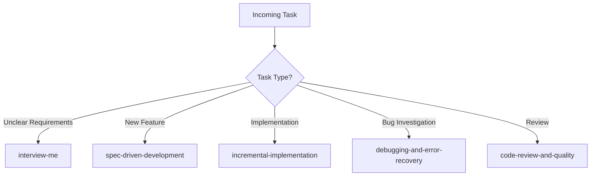

## 13.2 Why It Exists

Not every agent environment provides native skill routing.

The meta-skill can help in environments where skill selection needs explicit guidance.

## 13.3 Important Codex Guidance

The repository's Codex setup guide warns against copying the entire `using-agent-skills` instructions into always-on `AGENTS.md` when Codex already performs native skill discovery.

Doing so can create redundant routing instructions.

## 13.4 Key Principle

> Use one clear skill-discovery strategy instead of stacking multiple competing routers without a reason.

---

# Part XV — Skills as Executable Workflows

## 14. Instructions vs Execution

A skill can describe actions such as:

1. Read requirements.
2. Inspect source files.
3. Run tests.
4. Review results.

But the skill itself does not necessarily execute these steps.

The host agent performs actions using its available tools.

## 14.1 Conceptual Flow

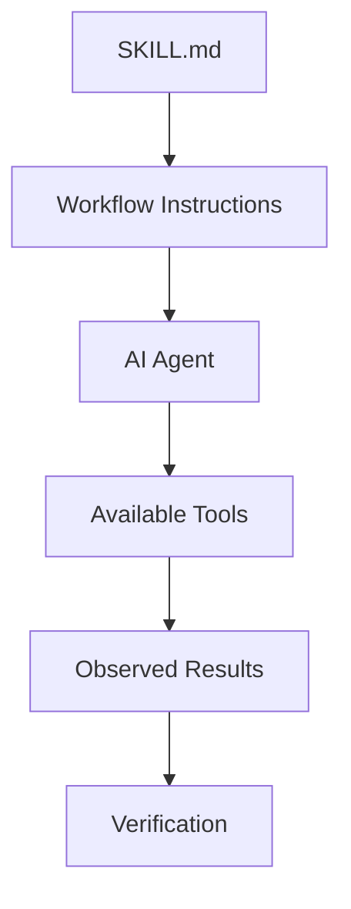

## 14.2 Example

A skill may say:

> Run the project's relevant tests.

The actual test command depends on the project.

For example:

```text
Android:
Gradle test tasks

Laravel:
PHP test runner

Next.js:
Configured lint and test scripts
```

The agent should inspect project configuration before deciding which command is appropriate.

---

# Part XVI — Verification Gates

## 15. What Is a Verification Gate?

A verification gate is a checkpoint requiring evidence before a workflow proceeds or is declared complete.

## 15.1 Example

Task:

> Fix a login validation bug.

Possible gates:

**Gate 1 — Reproduction**

The original failure is understood.

**Gate 2 — Implementation**

The intended behavior is changed.

**Gate 3 — Testing**

Relevant checks pass.

**Gate 4 — Review**

The change is scoped and does not introduce obvious regressions.

## 15.2 Verification Diagram

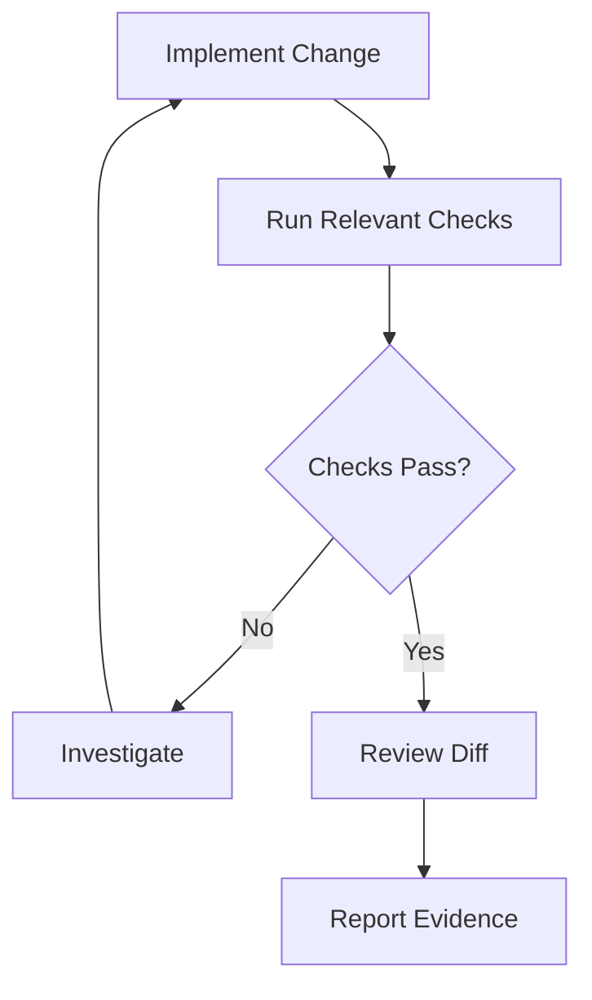

## 15.3 Evidence vs Assumption

| Statement | Evidence Quality |
|---|---|
| It should work | Assumption |
| The code looks correct | Limited review |
| Relevant tests passed | Stronger evidence |
| Runtime behavior was verified | Direct behavioral evidence |

## 15.4 Important

If a test cannot be run, the agent should say so.

It should not fabricate successful results.

---

# Part XVII — Anti-Rationalization

## 16. What Is Anti-Rationalization?

Anti-rationalization guidance addresses common reasons an agent might use to skip important workflow steps.

## 16.1 Example Table

| Rationalization | Better Response |
|---|---|
| The change is too small to verify | Choose proportionate verification |
| I'll test it later | Define verification before completion |
| The code looks correct | Seek actual evidence |
| I know this framework already | Inspect the project's conventions |
| More abstraction is always better | Justify complexity against requirements |

## 16.2 Why It Matters

AI agents can produce convincing explanations.

But a convincing explanation does not establish that the implementation works.

## 16.3 Important

Anti-rationalization should encourage disciplined judgment, not unnecessary ceremony.

A minor documentation edit does not require the same checks as an authentication change.

---

# Part XVIII — Red Flags

## 17. What Is a Red Flag?

A red flag is a sign that the workflow may be going wrong.

Examples:

- Implementation starts before requirements are understood.
- The agent modifies unrelated files.
- New dependencies are introduced without justification.
- Existing tests are ignored.
- A failed build is described as successful.
- Source code is not inspected.
- A skill is invoked without a relevant task.

## 17.1 Example

Developer request:

> Improve the Tasks page alignment.

Potential red flag:

```text
The agent redesigns the entire navigation system.
```

Why?

The implementation has expanded beyond the authorized task.

## 17.2 Correct Response

Return to:

- The actual requirement.
- Existing architecture.
- Minimal change scope.
- Relevant verification.

---

# Part XIX — Skills vs Ordinary Prompts

## 18. What Is a Prompt?

A prompt is an instruction or request given to an AI model.

Example:

```text
Help me fix this Laravel validation bug.
```

## 18.1 What Makes a Skill Different?

A skill is:

- Reusable.
- Structured.
- Discoverable.
- Version-controlled.
- Potentially supported by additional files.
- Designed around a specific workflow.

## 18.2 Comparison

| Ordinary Prompt | Agent Skill |
|---|---|
| Often task-specific | Reusable across tasks |
| May be informal | Structured instructions |
| Usually written during conversation | Stored in files |
| May omit verification | Can define explicit verification |
| No standard packaging required | Uses a standard skill format |

## 18.3 Important

A skill is still instruction-based.

It is not inherently more authoritative or more accurate simply because it is packaged in `SKILL.md`.

---

# Part XX — Skills vs AGENTS.md

## 19. AGENTS.md

`AGENTS.md` is commonly used to describe repository-specific instructions for compatible coding agents.

Example:

```markdown
# Project Rules

- Use Java for Android source code.
- Follow the existing package structure.
- Do not introduce unnecessary dependencies.
- Respect the documented MVP.
```

## 19.1 Agent Skill

A skill describes a reusable process.

Example:

```text
For implementation tasks:

1. Understand the requirement.
2. Inspect existing architecture.
3. Plan minimal changes.
4. Implement.
5. Verify.
```

## 19.2 Comparison

| AGENTS.md | Agent Skill |
|---|---|
| Repository-specific | Often reusable |
| Defines project constraints | Defines a task workflow |
| Applies according to host rules | Loaded when relevant |
| Maintained with the project | Can be shared across projects |

## 19.3 Working Together

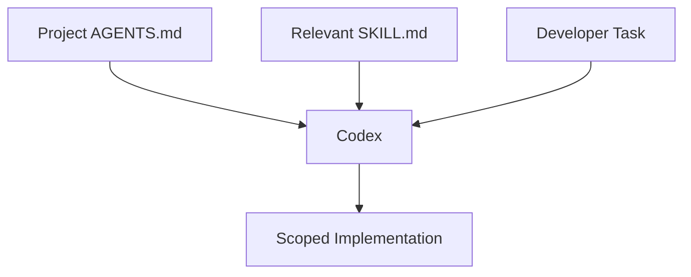

## 19.4 Important

Reusable skill guidance should be adapted to the project's authorized constraints.

---

# Part XXI — Skills vs MCP

## 20. What Is MCP?

The Model Context Protocol provides a standardized way for compatible applications to communicate with external tools and data sources.

## 20.1 Core Difference

**Skill:**

Defines a procedure.

**MCP:**

Provides a protocol for accessing capabilities.

## 20.2 Example

A debugging skill may instruct:

> Inspect application logs and reproduce the failure.

An MCP-connected tool may provide access to relevant logs.

## 20.3 Comparison

| Agent Skill | MCP |
|---|---|
| Workflow instructions | Tool and data integration protocol |
| Describes what to do | Enables supported operations |
| Primarily Markdown-based | Structured client-server communication |
| Can reference tools | Exposes tools and resources |
| Does not itself guarantee tool access | Depends on server permissions |

## 20.4 Combined Architecture

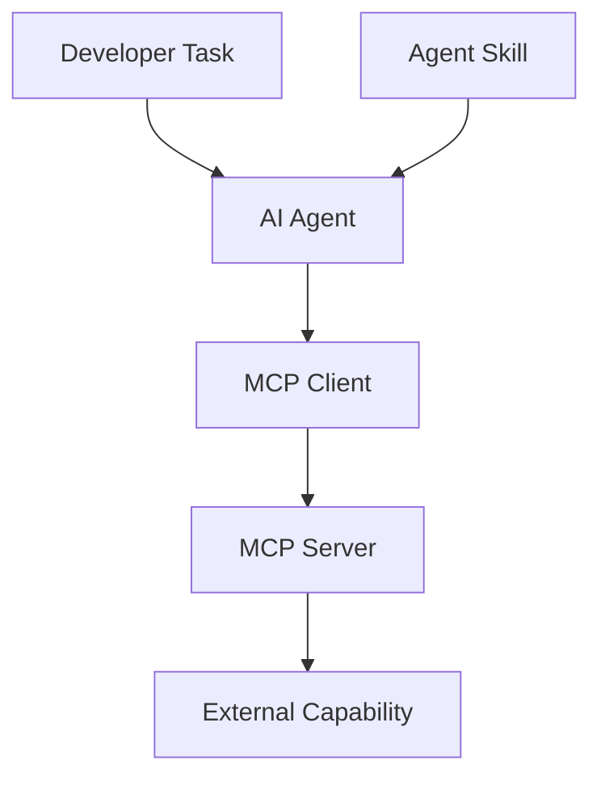

## 20.5 Key Principle

> A skill can guide the use of an MCP tool, but the two are not interchangeable.

---

# Part XXII — Skills vs Subagents

## 21. What Is a Subagent?

A subagent is a separate agent execution context used to handle delegated work in systems that support it.

Examples of delegated work might include:

- Code review.
- Test analysis.
- Documentation review.
- Architecture investigation.

## 21.1 Core Difference

A skill provides instructions.

A subagent provides a separate execution context.

## 21.2 Comparison

| Skill | Subagent |
|---|---|
| Reusable procedure | Delegated agent execution |
| Can run within the current agent | May use separate context |
| Does not inherently create another agent | Requires host support |
| Useful for workflow consistency | Useful for task delegation |

## 21.3 Important

Installing a skill does not automatically create a subagent.

Likewise, a specialist persona file does not necessarily create an independently running agent.

---

# Part XXIII — Skill Portability

## 22. What Does Portable Mean?

A portable skill can be reused across compatible AI agent environments.

The open format makes it easier to share:

- Instructions.
- References.
- Templates.
- Scripts.

## 22.1 Portability Limitations

Different hosts may vary in:

- Skill installation paths.
- Activation interfaces.
- Tool availability.
- Execution permissions.
- Context management.
- Script support.

## 22.2 Example

A skill may instruct:

> Run the project's test suite.

This instruction is broadly portable.

A skill that assumes a particular proprietary tool exists everywhere is less portable.

## 22.3 Best Practice

Write workflow instructions that describe the intended engineering procedure while documenting environment-specific requirements separately.

---

# Part XXIV — Skill Security

## 23. Skills Are Executable Guidance

A skill may influence:

- Which files an agent reads.
- Which commands it runs.
- Which scripts it executes.
- Which external services it contacts.

Therefore, skills should be treated as a meaningful part of the development environment.

## 23.1 Security Considerations

Before adopting a third-party skill:

1. Review its instructions.
2. Inspect bundled scripts.
3. Understand external dependencies.
4. Check requested permissions.
5. Evaluate data-sharing requirements.
6. Confirm compatibility with project policies.

## 23.2 Important

A valid `SKILL.md` format does not guarantee that a skill is safe.

Format validation and security review are different activities.

## 23.3 Trust Boundary

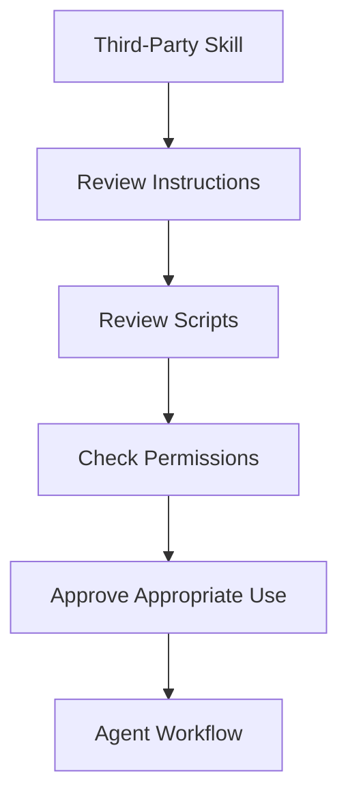

---

# Part XXV — Common Skill Design Mistakes

## 24. Mistake 1 — Vague Description

```yaml
description: Helps with software development.
```

Problem:

The activation condition is unclear.

## 24.1 Mistake 2 — Excessive Instructions

A skill contains hundreds of unrelated guidelines.

Problem:

The workflow becomes difficult to follow and consumes unnecessary context.

## 24.2 Mistake 3 — Missing Verification

The skill describes implementation but no way to confirm success.

Problem:

Completion becomes subjective.

## 24.3 Mistake 4 — Unnecessary Tool Assumptions

The skill assumes every host supports the same commands.

Problem:

Portability decreases.

## 24.4 Mistake 5 — Duplicate Skills

Several skills perform nearly identical workflows.

Problem:

Discovery becomes ambiguous.

## 24.5 Mistake 6 — Overengineering

A simple task requires many unnecessary approval and reporting stages.

Problem:

Workflow cost outweighs its benefit.

## 24.6 Mistake 7 — Ignoring Project Rules

A generic skill introduces architecture that conflicts with the existing repository.

Problem:

The workflow no longer serves the actual project.

---

# Part XXVI — GroupTrack Android Case Study

## 25. Scenario: Members Page

Suppose the task is:

> Implement the Members page according to the existing MVP.

## 25.1 Relevant Skills

Potentially useful:

- `frontend-ui-engineering`
- `incremental-implementation`
- `context-engineering`
- `test-driven-development`

## 25.2 Context Requirements

The agent should inspect:

- Existing Android layouts.
- Current navigation.
- Member data model.
- Relevant repository methods.
- Existing UI conventions.
- Documented MVP constraints.

## 25.3 Workflow

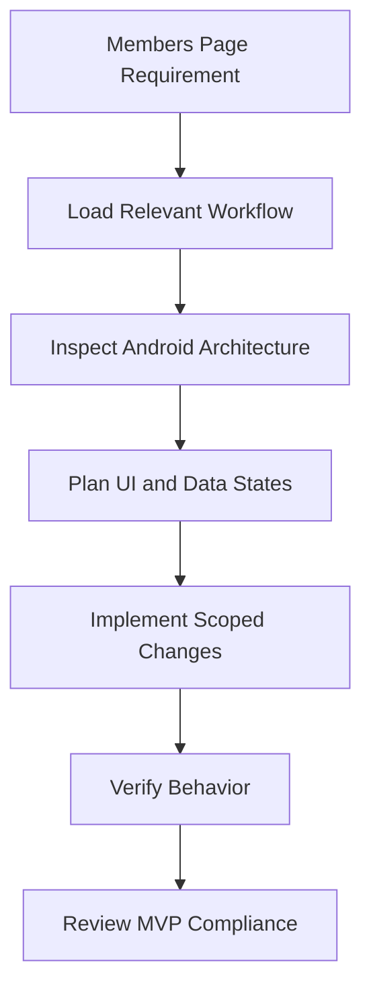

## 25.4 Important

A skill should help the agent follow the project's architecture.

It should not justify introducing a new UI framework or unrelated feature.

---

# Part XXVII — GoPasig Laravel Case Study

## 26. Scenario: Schedule Validation

Task:

> Improve schedule conflict validation.

## 26.1 Relevant Skills

Potentially useful:

- `spec-driven-development`
- `planning-and-task-breakdown`
- `api-and-interface-design`
- `security-and-hardening`
- `test-driven-development`

## 26.2 Context Requirements

The agent should understand:

- Schedule validation rules.
- Controller responsibilities.
- Existing services.
- Driver and bus relationships.
- Database constraints.
- Authorization requirements.

## 26.3 Workflow

1. Define conflict behavior.
2. Identify relevant components.
3. Review current validation.
4. Plan minimal changes.
5. Implement.
6. Test valid and conflicting schedules.
7. Review authorization and concurrency concerns.

## 26.4 Important

A skill cannot independently prove database concurrency safety.

Actual implementation and testing are required.

---

# Part XXVIII — Next.js and Laravel Case Study

## 27. Scenario: Product Creation

Task:

> Implement a product creation workflow.

## 27.1 Relevant Skills

Potentially useful:

- `frontend-ui-engineering`
- `api-and-interface-design`
- `incremental-implementation`
- `security-and-hardening`
- `code-review-and-quality`

## 27.2 Architecture

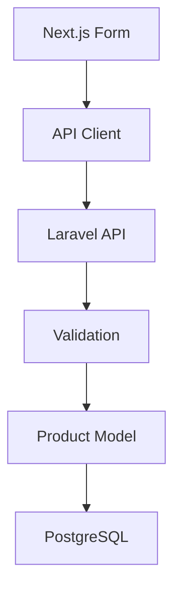

This is a conceptual architecture diagram.

## 27.3 Workflow

**Define**

Clarify fields and expected behavior.

**Plan**

Separate frontend and backend responsibilities.

**Build**

Implement the necessary components.

**Verify**

Test successful and invalid submissions.

**Review**

Check authorization, validation, and maintainability.

## 27.4 Important

Frontend validation improves usability.

Backend validation remains essential for enforcing server-side requirements.

---

# Part XXIX — Designing a Good Skill

## 28. Skill Design Principles

A well-designed skill should be:

**Specific**

It addresses a clear task category.

**Actionable**

It describes steps the agent can follow.

**Verifiable**

It defines observable completion criteria.

**Minimal**

It avoids unnecessary instructions.

**Portable**

It minimizes assumptions about a specific agent host.

**Maintainable**

It is easy to update as workflows evolve.

## 28.1 Design Process

```mermaid
flowchart TD
    A["Identify Repeated Task"] --> B["Define Trigger"]
    B --> C["Document Workflow"]
    C --> D["Define Verification"]
    D --> E["Identify Supporting Files"]
    E --> F["Review for Simplicity"]
    F --> G["Evaluate on Real Tasks"]
```

## 28.2 Example Design Question

Before creating a skill, ask:

> Is this a reusable workflow, or is it merely a one-time project instruction?

If it is specific to one repository, `AGENTS.md` or project documentation may be more appropriate.

---

# Part XXX — Practical Exercises

> [!note]
> Theory-first exercises. No installation or command execution required.

## Exercise 1 — Definition

Explain what an agent skill is.

## Exercise 2 — Motivation

Identify three problems that reusable skills attempt to solve.

## Exercise 3 — Directory Structure

Draw a skill directory containing:

- `SKILL.md`
- `scripts/`
- `references/`
- `assets/`

Explain each component.

## Exercise 4 — Metadata

Write valid YAML frontmatter for a Laravel debugging skill.

## Exercise 5 — Description Quality

Compare these descriptions:

```text
A: Helps with code.

B: Guides agents through reproducible bug investigation. Use when builds fail or behavior is unexpected.
```

Explain which is better and why.

## Exercise 6 — Discovery

Explain how a compatible agent can discover available skills.

## Exercise 7 — Activation

Describe the difference between discovering a skill and activating it.

## Exercise 8 — Invocation

Compare automatic and explicit skill invocation.

## Exercise 9 — Progressive Disclosure

Explain the three levels of skill loading.

## Exercise 10 — Meta-Skill

Explain the purpose of `using-agent-skills`.

## Exercise 11 — Verification

Design verification gates for an Android UI implementation task.

## Exercise 12 — Anti-Rationalization

Identify three common excuses an agent might use to skip important steps.

## Exercise 13 — Red Flags

List five signs that an implementation workflow is going wrong.

## Exercise 14 — Skills vs Prompts

Explain why a reusable skill is different from a one-time prompt.

## Exercise 15 — Skills vs AGENTS.md

Give examples of instructions that belong in each.

## Exercise 16 — Skills vs MCP

Explain how a skill could guide the use of an MCP-connected tool.

## Exercise 17 — Skills vs Subagents

Explain why loading a skill does not automatically create another agent.

## Exercise 18 — Security

Design a checklist for reviewing a third-party skill before installation.

## Exercise 19 — GroupTrack

Choose relevant skills for implementing the Members page.

Justify your choices.

## Exercise 20 — GoPasig

Design a skill-assisted workflow for investigating schedule conflicts.

## Exercise 21 — E-commerce

Design a skill-assisted workflow for product creation.

## Exercise 22 — Final Exercise

Create a conceptual agent skill for scoped feature implementation.

Include:

1. Skill name.
2. Description.
3. Trigger conditions.
4. Required inputs.
5. Workflow steps.
6. Constraints.
7. Common rationalizations.
8. Red flags.
9. Verification gates.
10. Completion criteria.

---

# Part XXXI — Knowledge Check

1. What is an agent skill?
2. Why are reusable skills useful?
3. What is the Agent Skills open format?
4. What is the minimum required skill file?
5. What is YAML frontmatter?
6. What is the purpose of `name`?
7. What is the purpose of `description`?
8. Why should descriptions include trigger conditions?
9. What optional metadata fields exist?
10. What is skill discovery?
11. What is skill activation?
12. What is automatic invocation?
13. What is explicit invocation?
14. What is progressive disclosure?
15. Why should supporting resources load on demand?
16. What is a meta-skill?
17. What does `using-agent-skills` do?
18. Why should duplicate routing be avoided?
19. What is a workflow instruction?
20. What is a verification gate?
21. What is anti-rationalization?
22. What is a red flag?
23. How does a skill differ from a prompt?
24. How does a skill differ from `AGENTS.md`?
25. How does a skill differ from MCP?
26. How does a skill differ from a subagent?
27. What makes a skill portable?
28. What security risks can third-party skills introduce?
29. What makes a skill maintainable?
30. When should a reusable skill not be created?

---

# Part XXXII — Key Takeaways

> [!summary]
> - An agent skill is a reusable package of instructions and supporting resources.
> - The required entry point is `SKILL.md`.
> - YAML frontmatter identifies the skill and describes when to use it.
> - The `name` and `description` fields are required.
> - Skill descriptions support discovery.
> - Activation loads the relevant workflow instructions.
> - Progressive disclosure reduces unnecessary context loading.
> - Supporting resources should be loaded only when needed.
> - The `using-agent-skills` meta-skill supports skill routing.
> - Codex can use native skill discovery.
> - Avoid redundant always-on routing instructions.
> - Skills describe procedures; agents execute them.
> - Verification gates require evidence.
> - Anti-rationalization guidance discourages unjustified shortcuts.
> - Skills differ from prompts, project rules, MCP tools, and subagents.
> - Portability depends on both the standard format and host capabilities.
> - Third-party skills require security review.
> - Good skills are specific, actionable, verifiable, minimal, and maintainable.

---

# Part XXXIII — Final Mental Model

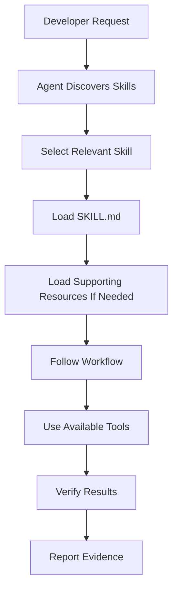

> [!important] Final Principle
> **An agent skill is not a magic command that guarantees correct code. It is a reusable engineering procedure that helps an AI agent approach tasks consistently, use context efficiently, and verify its work.**

---

# Part XXXIV — Official References

## Primary Repository

- [Agent Skills — GitHub](https://github.com/addyosmani/agent-skills)
- [Repository README](https://github.com/addyosmani/agent-skills/blob/main/README.md)
- [Skill Anatomy](https://github.com/addyosmani/agent-skills/blob/main/docs/skill-anatomy.md)
- [Getting Started](https://github.com/addyosmani/agent-skills/blob/main/docs/getting-started.md)
- [Codex Setup Guide](https://github.com/addyosmani/agent-skills/blob/main/docs/codex-setup.md)
- [Using Agent Skills](https://github.com/addyosmani/agent-skills/blob/main/skills/using-agent-skills/SKILL.md)

## Open Standard

- [Agent Skills](https://agentskills.io/)
- [Agent Skills Specification](https://agentskills.io/specification)
- [Agent Skills Reference Implementation](https://github.com/agentskills/agentskills)

## Supporting Technologies

- [OpenAI Codex Documentation](https://developers.openai.com/codex/)
- [Model Context Protocol](https://modelcontextprotocol.io/)
- [Git Documentation](https://git-scm.com/doc)

> [!note] Documentation Scope
> This lesson is based on the public Agent Skills repository documentation and the open Agent Skills specification.
>
> Examples of skill files, workflows, and project integrations are educational illustrations unless explicitly identified as repository behavior.
>
> The exact discovery and invocation mechanisms depend on the agent host and installed version.
>
> No skill was installed, executed, or modified during this lesson.

---

# Part XXXV — Next Lesson

**[[02 - Repository Architecture and SKILL.md Anatomy]]**

Topics:

1. Repository architecture.
2. Skill directory organization.
3. Detailed `SKILL.md` structure.
4. Frontmatter validation.
5. Skill descriptions and triggering.
6. Workflow section design.
7. Rationalization tables.
8. Red flags and verification gates.
9. Supporting scripts.
10. Reference documents.
11. Assets and templates.
12. Context efficiency.
13. Skill portability.
14. Repository conventions.
15. Codex compatibility.
16. Common design mistakes.
17. Practical examples.
18. Exercises.
19. Official references.

**End of Lesson 01 — Agent Skills Fundamentals.**
