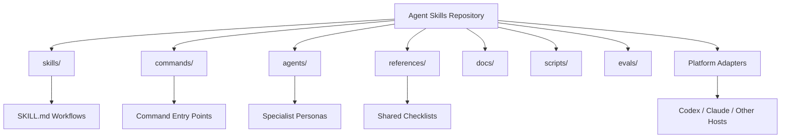
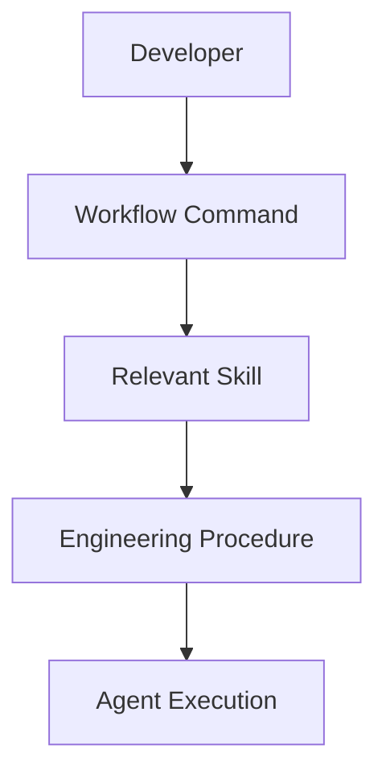
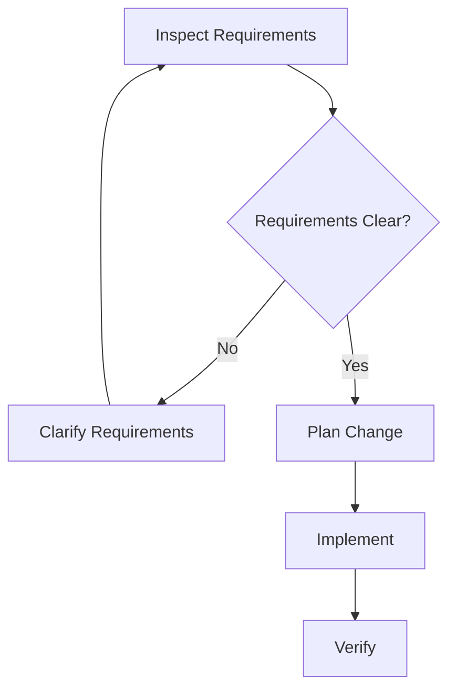
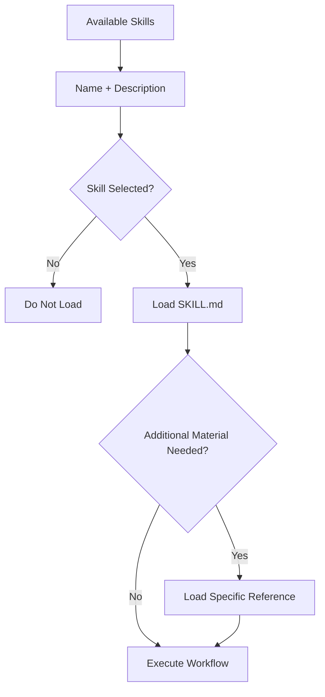
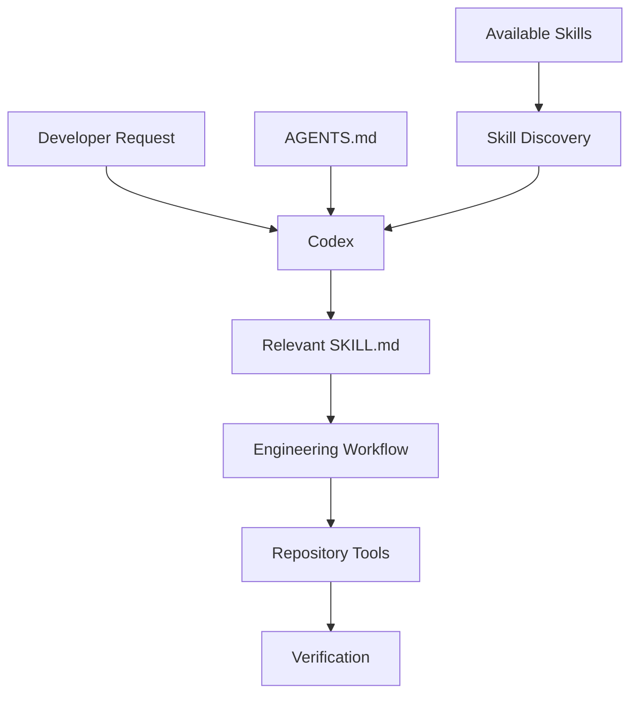
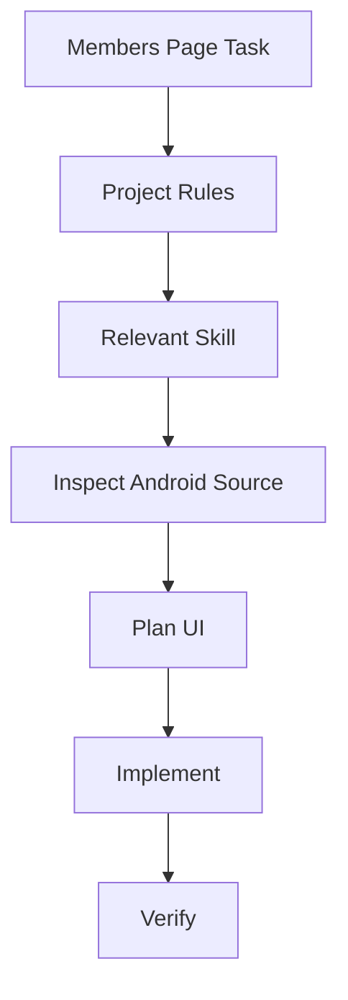
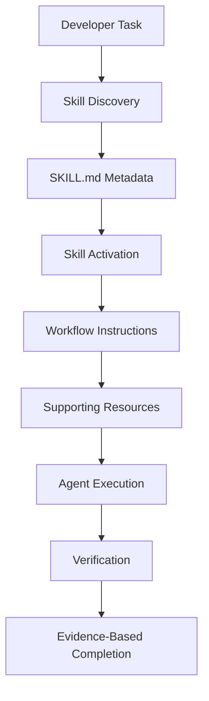

# 02 — Agent Skills: Repository Architecture and SKILL.md Anatomy

> [!abstract] Lesson Information
> **Repository:** [addyosmani/agent-skills](https://github.com/addyosmani/agent-skills)
>
> **Category:** Agentic Engineering / Skill Architecture / Context Engineering / Codex CLI
>
> **Difficulty:** Intermediate
>
> **Learning Approach:** Theory First
>
> **Prerequisites:**
> - [[00 - Repository Overview and Purpose]]
> - [[01 - Agent Skills Fundamentals]]
>
> **Primary Goal:** Understand the architectural organization of the Agent Skills repository and learn how to design, interpret, validate, and maintain production-quality `SKILL.md` files.

---

# Part I — Learning Objectives

After completing this lesson, you should be able to:

1. Explain the architectural structure of the Agent Skills repository.
2. Identify the responsibilities of its major directories.
3. Understand the relationship between skills, commands, agents, and shared references.
4. Explain the role of `SKILL.md`.
5. Identify required and optional frontmatter fields.
6. Understand how skill descriptions influence discovery.
7. Design clear workflow instructions.
8. Understand triggering and exclusion conditions.
9. Explain rationalization tables and red flags.
10. Define verification gates and exit criteria.
11. Organize scripts, references, and assets.
12. Understand progressive disclosure.
13. Explain the tradeoffs of shared references.
14. Distinguish portable skill instructions from platform-specific configuration.
15. Understand skill validation.
16. Identify architectural anti-patterns.
17. Apply skill design principles to Android, Laravel, and Next.js projects.

---

# Part II — Repository Architecture

## 1. High-Level Overview

The Agent Skills repository is organized around reusable engineering workflows.

Its architecture separates:

- Skill definitions.
- Workflow entry points.
- Specialist personas.
- Shared reference materials.
- Documentation.
- Validation and evaluation tooling.
- Platform-specific integration files.

This separation makes the repository easier to maintain and reuse.

## 1.1 Conceptual Architecture



## 1.2 Architectural Principle

> [!important]
> **Reusable workflow instructions should be separated from host-specific integration details whenever possible.**

This makes the skills easier to maintain across different coding agents.

---

# Part III — Repository Directory Structure

## 2. Simplified Repository Tree

```text
agent-skills/
├── skills/
│   ├── using-agent-skills/
│   │   └── SKILL.md
│   ├── spec-driven-development/
│   │   └── SKILL.md
│   ├── planning-and-task-breakdown/
│   │   └── SKILL.md
│   ├── incremental-implementation/
│   │   └── SKILL.md
│   ├── test-driven-development/
│   │   └── SKILL.md
│   └── ...
│
├── commands/
├── agents/
├── references/
├── docs/
├── scripts/
├── evals/
├── hooks/
│
├── .codex-plugin/
├── .claude-plugin/
├── .github/
│
├── AGENTS.md
├── CLAUDE.md
├── README.md
└── LICENSE
```

This is a simplified architectural illustration rather than a complete file inventory.

## 2.1 Why This Organization Matters

A developer can locate different types of information without searching through one large instruction file.

For example:

| Requirement | Location |
|---|---|
| Skill workflow | `skills/` |
| Command definition | `commands/` |
| Specialist persona | `agents/` |
| Shared checklist | `references/` |
| Setup documentation | `docs/` |
| Maintenance tooling | `scripts/` |
| Evaluation cases | `evals/` |
| Host integration | Platform adapter directories |

---

# Part IV — The skills/ Directory

## 3. Primary Responsibility

The `skills/` directory contains reusable engineering procedures.

Each skill has its own directory.

Example:

```text
skills/
└── test-driven-development/
    └── SKILL.md
```

## 3.1 Why One Directory per Skill?

This structure supports:

- Independent maintenance.
- Clear naming.
- Reusable instructions.
- Optional supporting resources.
- Skill discovery.
- Version control.

## 3.2 Skill Directory as a Unit

A skill should be understandable as a coherent package.

Conceptually:

```text
skill-name/
├── SKILL.md
├── references/
├── scripts/
└── assets/
```

Only `SKILL.md` is required.

## 3.3 Important

Not every skill needs scripts, references, or assets.

Adding unnecessary files increases maintenance complexity.

---

# Part V — The commands/ Directory

## 4. Workflow Entry Points

The `commands/` directory contains command-oriented interfaces for supported agent environments.

A command provides a convenient way to initiate an engineering workflow.

For example, the repository documents lifecycle commands associated with:

- Specification.
- Planning.
- Implementation.
- Testing.
- Review.
- Shipping.

## 4.1 Commands vs Skills

A command is an entry point.

A skill contains the procedure.



## 4.2 Important

Command availability and invocation syntax vary by host.

Do not assume every command appears as an identical slash command in Codex.

---

# Part VI — The agents/ Directory

## 5. Specialist Personas

The repository includes specialist agent definitions for focused engineering review.

Examples include:

- Code reviewer.
- Test engineer.
- Security auditor.
- Web performance auditor.

## 5.1 Why Separate Personas?

Different review activities require different perspectives.

A test engineer focuses on verification coverage.

A security auditor focuses on security risks.

A code reviewer focuses on maintainability and correctness.

## 5.2 Important Distinction

A persona file is not automatically a separately running agent.

Whether it runs as a subagent depends on the host environment and its orchestration capabilities.

---

# Part VII — The references/ Directory

## 6. Shared Knowledge and Checklists

The repository uses shared reference documents for guidance reused across multiple skills.

Examples include:

- Security checklists.
- Performance checklists.
- Accessibility guidance.
- Testing patterns.
- Observability guidance.

## 6.1 Why Shared References?

Suppose five skills require the same security checklist.

Duplicating the checklist five times creates maintenance problems.

A single shared copy reduces duplication.

## 6.2 Tradeoff: Portability

There is an important architectural tradeoff.

A whole-repository installation may preserve shared references.

But copying only one skill directory may omit references stored at the repository root.

Example:

```text
agent-skills/
├── skills/
│   └── security-and-hardening/
│       └── SKILL.md
└── references/
    └── security-checklist.md
```

If only `skills/security-and-hardening/` is copied, the shared checklist may be missing.

## 6.3 Best Practice

Use skill-local references for information required only by that skill.

Use shared references when multiple skills genuinely depend on the same material.

When distributing skills individually, verify that required references are included.

---

# Part VIII — The docs/, scripts/, and evals/ Directories

## 7. Documentation

The `docs/` directory provides explanations about:

- Installation.
- Skill anatomy.
- Platform integration.
- Adoption.
- Advanced configuration.

## 7.1 Scripts

The `scripts/` directory contains supporting automation and maintenance tools.

These may assist with validation or repository management.

## 7.2 Evaluations

The `evals/` directory supports evaluation of skill behavior.

Evaluation can examine whether an agent:

- Selects an appropriate skill.
- Follows expected workflow steps.
- Produces relevant verification evidence.
- Avoids known failure patterns.

## 7.3 Important

A skill being valid according to its file format does not prove that it improves coding-agent performance.

Structural validation and behavioral evaluation are separate.

---

# Part IX — Anatomy of SKILL.md

## 8. Main Structure

A `SKILL.md` file contains:

1. YAML frontmatter.
2. Markdown instructions.

The repository recommends a consistent instructional structure.

```text
SKILL.md
│
├── YAML Frontmatter
│   ├── name
│   └── description
│
└── Markdown Body
    ├── Overview
    ├── When to Use
    ├── Process
    ├── Specific Techniques
    ├── Common Rationalizations
    ├── Red Flags
    └── Verification
```

## 8.1 Required vs Recommended

The frontmatter requirements come from the Agent Skills specification.

The body section structure is a recommended repository convention, not a mandatory universal template.

---

# Part X — YAML Frontmatter

## 9. Required Fields

The Agent Skills specification requires:

```yaml
---
name: skill-name
description: Guides agents through a particular workflow. Use when specific task conditions apply.
---
```

## 9.1 Name Requirements

The `name` must:

- Contain 1–64 characters.
- Use lowercase letters, numbers, and hyphens.
- Match the parent directory name.
- Avoid leading or trailing hyphens.
- Avoid consecutive hyphens.

Valid:

```yaml
name: api-review
```

Invalid:

```yaml
name: API_Review
```

## 9.2 Description Requirements

The `description` must:

- Be nonempty.
- Contain no more than 1,024 characters.
- Explain what the skill does.
- Explain when the skill should be used.

## 9.3 Why These Rules Exist

Consistent metadata makes skills easier for compatible agents to discover and identify.

---

# Part XI — Description Engineering

## 10. Why Descriptions Are Important

Skill descriptions influence discovery.

A good description communicates the task category and activation conditions.

## 10.1 Weak Example

```yaml
description: Helps with code.
```

Problem:

The description is too broad.

## 10.2 Better Example

```yaml
description: Guides agents through reproducible bug investigation. Use when application behavior is unexpected, tests fail, or builds break.
```

This provides:

- Purpose.
- Trigger conditions.
- Relevant keywords.

## 10.3 Avoid Putting the Entire Workflow in the Description

The repository recommends keeping procedural detail in the Markdown body.

Why?

A description overloaded with workflow steps may encourage an agent to rely on the summary rather than loading the complete skill.

## 10.4 Recommended Pattern

```text
What the skill does.
Use when [specific task or condition].
```

---

# Part XII — Optional Frontmatter Fields

## 11. Supported Fields

The open specification supports these optional fields:

| Field | Purpose |
|---|---|
| `license` | License information |
| `compatibility` | Environment requirements |
| `metadata` | Additional string key-value metadata |
| `allowed-tools` | Experimental tool declaration |

## 11.1 Example

```yaml
---
name: laravel-api-review
description: Reviews Laravel API contracts, validation, and authorization. Use when modifying backend endpoints.
license: MIT
compatibility: Requires access to the Laravel repository.
metadata:
  author: example-team
  version: "1.0"
---
```

## 11.2 Repository-Specific Validation

The Agent Skills repository restricts top-level frontmatter keys to fields defined by the specification.

Vendor-specific settings such as:

```yaml
model: example-model
max_turns: 10
```

should not be added as arbitrary top-level fields.

The repository directs platform-specific settings to supported metadata or adapter configuration.

## 11.3 Important

The experimental `allowed-tools` field should not be assumed to enforce permissions in every host.

Actual permissions depend on the runtime.

---

# Part XIII — The Overview Section

## 12. Purpose

The Overview explains what the skill does and why it matters.

Example:

```markdown
# Scoped Implementation

## Overview

This skill guides agents through small, verified changes to existing software.

It emphasizes understanding requirements, preserving architecture, and avoiding unrelated modifications.
```

## 12.1 Good Overview Characteristics

A useful overview is:

- Brief.
- Specific.
- Action-oriented.
- Focused on the skill's responsibility.

## 12.2 Avoid

Long explanations of general software engineering that do not help the agent execute the workflow.

---

# Part XIV — When to Use

## 13. Trigger Conditions

The `When to Use` section identifies tasks that should activate the skill.

Example:

```markdown
## When to Use

Use this skill when:

- Implementing an approved feature.
- Modifying existing application behavior.
- Fixing a scoped bug.
```

## 13.1 Exclusion Conditions

Good skills also identify when they should not be used.

Example:

```markdown
Do not use this skill when:

- The request is only to explain a concept.
- The user requests a review without implementation.
- Requirements are too unclear to begin coding.
```

## 13.2 Why Exclusions Matter

Without exclusions, broad skills may activate unnecessarily.

This creates:

- Context overhead.
- Workflow conflicts.
- Unnecessary steps.

## 13.3 Principle

> A well-designed skill defines both its responsibility and its boundaries.

---

# Part XV — The Process Section

## 14. The Core Workflow

The Process section contains the actual engineering procedure.

Example:

```markdown
## Process

1. Understand the requested behavior.
2. Inspect relevant source code.
3. Identify affected components.
4. Define acceptance criteria.
5. Implement the smallest necessary change.
6. Run relevant tests.
7. Review the final diff.
```

## 14.1 Why Numbered Steps?

Numbered steps make the process:

- Easier to follow.
- Easier to evaluate.
- Easier to debug.
- More predictable.

## 14.2 Decision Points

Some workflows require branching.



## 14.3 Important

A workflow should be structured but not unnecessarily rigid.

Different tasks may require different verification depths.

---

# Part XVI — Specific Techniques

## 15. Specialized Guidance

The repository allows skills to include detailed techniques and patterns.

Examples:

- Debugging strategies.
- API contract examples.
- Testing patterns.
- Architecture conventions.
- Performance measurement procedures.

## 15.1 When to Separate References

If detailed guidance becomes lengthy, move it into supporting files.

Example:

```text
api-review/
├── SKILL.md
└── references/
    ├── validation-patterns.md
    └── error-response-guidelines.md
```

## 15.2 Why?

This supports progressive disclosure.

The agent can load only the detailed material required for the current task.

---

# Part XVII — Common Rationalizations

## 16. What Are Rationalizations?

Rationalizations are excuses an agent might use to skip required steps.

The repository uses tables to identify these shortcuts and explain why they are problematic.

## 16.1 Example

| Rationalization | Reality |
|---|---|
| The change is small, so no verification is needed | Choose verification proportional to risk |
| I already know the framework | Inspect existing project conventions |
| Tests can be added later | Define the relevant verification before completion |
| The implementation looks correct | Appearance is not behavioral evidence |
| Refactoring everything will improve quality | Unrelated changes increase risk |

## 16.2 Why This Matters

AI coding agents may produce plausible explanations for incomplete work.

Explicit rationalization guidance helps keep the workflow aligned with observable requirements.

---

# Part XVIII — Red Flags

## 17. Warning Signs

A Red Flags section identifies behavior that may indicate the workflow is failing.

Example:

```markdown
## Red Flags

- Implementation begins before requirements are understood.
- Unrelated files are modified.
- New dependencies are introduced without justification.
- Existing tests are ignored.
- Failed checks are reported as successful.
- The agent claims completion without evidence.
```

## 17.1 Example Scenario

Task:

> Improve alignment in an Android form.

Red flag:

The agent rewrites the entire navigation architecture.

Why?

The implementation exceeds the requested scope.

## 17.2 Correct Response

Return to:

1. User requirements.
2. Existing architecture.
3. Minimal change scope.
4. Relevant verification.

---

# Part XIX — Verification Section

## 18. Verification as an Exit Gate

The Verification section defines what must be checked before completion.

Example:

```markdown
## Verification

Before reporting completion:

- [ ] Requirements are satisfied.
- [ ] Relevant tests were run.
- [ ] Build status is known.
- [ ] No unrelated files were modified.
- [ ] Limitations are reported.
```

## 18.1 Evidence Hierarchy

| Claim | Supporting Evidence |
|---|---|
| Code should compile | Assumption |
| Code was reviewed | Inspection |
| Build passed | Build output |
| Behavior works | Relevant passing tests or runtime verification |
| Feature is complete | Acceptance criteria verified |

## 18.2 Important

Verification should be relevant to the task.

Not every change requires a full end-to-end test suite.

## 18.3 Completion Rule

> Never claim that a test, build, or runtime check passed unless it was actually performed.

---

# Part XX — Supporting Scripts

## 19. What Belongs in scripts/?

Scripts are executable helpers that support a skill.

Examples:

- Validation utilities.
- Formatting checks.
- Repetitive analysis tasks.
- Artifact generation.
- Structured report preparation.

## 19.1 Conceptual Structure

```text
code-review/
├── SKILL.md
└── scripts/
    └── collect-diff-summary.py
```

## 19.2 Design Principles

Scripts should:

- Have a clear purpose.
- Document dependencies.
- Handle errors.
- Avoid unnecessary side effects.
- Be reviewed before execution.

## 19.3 Important

Scripts are not required for every skill.

A skill can be fully useful with only a well-designed `SKILL.md`.

---

# Part XXI — Supporting References

## 20. What Belongs in references/?

References contain detailed information that does not need to be loaded immediately.

Examples:

- Testing guidelines.
- API conventions.
- Security checklists.
- Framework-specific notes.
- Detailed examples.

## 20.1 Example

```text
laravel-api-review/
├── SKILL.md
└── references/
    ├── validation.md
    ├── authorization.md
    └── response-contracts.md
```

## 20.2 Referencing Files

Use relative paths.

Example:

```markdown
For validation guidance, read:

[Validation Reference](references/validation.md)
```

## 20.3 Best Practice

Avoid unnecessarily deep chains of references.

The agent should be able to find supporting material easily.

---

# Part XXII — Assets and Templates

## 21. What Belongs in assets/?

Assets may include:

- Templates.
- Static diagrams.
- Configuration examples.
- Structured data.
- Supporting resources.

## 21.1 Example

```text
project-kickoff/
├── SKILL.md
└── assets/
    └── requirements-template.md
```

## 21.2 References vs Assets

References primarily provide information for the agent to read.

Assets primarily provide material the workflow can reuse or produce.

This distinction is a practical convention, not a strict technical boundary.

---

# Part XXIII — Progressive Disclosure Architecture

## 22. Three Levels

The Agent Skills specification describes progressive disclosure through:

1. Metadata.
2. Instructions.
3. Supporting resources.

## 22.1 Diagram



## 22.2 Context Efficiency

The specification recommends:

- Keeping `SKILL.md` concise.
- Targeting fewer than 500 lines.
- Keeping detailed material in supporting files.
- Loading references only when needed.

## 22.3 Why This Matters

If every skill includes extensive reference material directly in `SKILL.md`, activation may consume unnecessary context.

Progressive disclosure helps control that overhead.

---

# Part XXIV — Shared References vs Skill-Local References

## 23. Architectural Tradeoff

Consider two approaches.

### Approach A — Skill-Local

```text
skills/
└── security-and-hardening/
    ├── SKILL.md
    └── references/
        └── checklist.md
```

Advantages:

- Self-contained.
- Easier individual distribution.
- Clear ownership.

Disadvantages:

- Possible duplication across skills.

### Approach B — Shared Repository Reference

```text
skills/
├── security-and-hardening/
│   └── SKILL.md
└── code-review-and-quality/
    └── SKILL.md

references/
└── security-checklist.md
```

Advantages:

- One shared source of truth.
- Less duplication.

Disadvantages:

- Individual skill installation may omit the shared file.

## 23.1 Decision Rule

Use skill-local references when portability is more important.

Use shared references when multiple skills genuinely require the same maintained content.

Verify that the installation method preserves the necessary files.

---

# Part XXV — Portable vs Platform-Specific Configuration

## 24. Portable Skill Content

Portable content describes engineering procedures.

Example:

```markdown
1. Inspect the relevant source files.
2. Identify affected dependencies.
3. Implement the smallest necessary change.
4. Run relevant tests.
```

These instructions can apply across multiple coding agents.

## 24.1 Platform-Specific Configuration

Platform-specific configuration may control:

- Model selection.
- Tool permissions.
- Agent runtime behavior.
- Execution limits.
- Plugin integration.

## 24.2 Why Separate Them?

Putting host-specific configuration directly into portable skill frontmatter may break validation or compatibility.

## 24.3 Example

Do not assume arbitrary top-level keys such as:

```yaml
model: some-model
tools: all
```

are valid Agent Skills frontmatter.

Use the documented metadata or host adapter mechanisms instead.

---

# Part XXVI — Skill Validation

## 25. Structural Validation

Validation checks whether a skill follows the required format.

Potential checks include:

- `SKILL.md` exists.
- YAML frontmatter is valid.
- Required fields are present.
- Skill name is valid.
- Directory name matches metadata.
- Unsupported top-level keys are absent.

## 25.1 Reference Validator

The Agent Skills specification documents the reference validator:

```bash
skills-ref validate ./my-skill
```

This is an illustrative command for a future practical exercise; it has not been executed.

## 25.2 Validation vs Evaluation

| Validation | Evaluation |
|---|---|
| Checks file format | Checks behavior |
| Detects structural errors | Measures workflow usefulness |
| Can be automated | Requires representative tasks |
| Does not prove task success | Can assess task outcomes |

## 25.3 Important

A structurally valid skill can still contain poor or unsafe instructions.

---

# Part XXVII — Codex Integration Architecture

## 26. How Codex Fits In

Codex can use agent skills through supported discovery and invocation mechanisms.

The repository documents native Codex plugin integration and skill invocation.

## 26.1 Conceptual Architecture



## 26.2 Important

Skill discovery, plugin installation, and invocation syntax depend on the installed Codex version.

Consult the repository's Codex setup guide before using version-specific commands.

## 26.3 Avoid Duplicate Routers

If Codex already discovers skills natively, do not automatically copy a complete skill router into always-on project instructions.

Redundant routing can increase context overhead and create conflicting guidance.

---

# Part XXVIII — Android Example: GroupTrack

## 27. Scenario

Task:

> Implement the Members page according to the existing MVP.

## 27.1 Relevant Skill Responsibilities

A frontend engineering skill can guide:

- UI structure.
- State handling.
- Layout consistency.
- Accessibility.
- Verification.

An incremental implementation skill can guide:

- Small changes.
- Scope control.
- Regression prevention.

## 27.2 Project-Specific Rules

These belong in project documentation or `AGENTS.md`.

Examples:

- Use Java.
- Follow existing Android architecture.
- Preserve the documented MVP.
- Avoid unnecessary dependencies.

## 27.3 Conceptual Workflow



## 27.4 Lesson

The skill provides the engineering process.

The project provides the architectural constraints.

---

# Part XXIX — Laravel Example: GoPasig

## 28. Scenario

Task:

> Improve schedule validation.

## 28.1 Relevant Skill Responsibilities

An API design skill can guide:

- Request validation.
- Error semantics.
- Contract consistency.

A testing skill can guide:

- Valid cases.
- Invalid cases.
- Boundary conditions.
- Regression checks.

## 28.2 Project Context

The agent must inspect:

- Routes.
- Controllers.
- Services.
- Models.
- Database constraints.
- Tests.

## 28.3 Important

A generic skill cannot determine the correct scheduling rules without project requirements.

The skill should guide investigation, not invent business logic.

---

# Part XXX — Next.js and Laravel Example

## 29. Scenario

Task:

> Add product creation with frontend and backend validation.

## 29.1 Relevant Skills

Potentially useful:

- `frontend-ui-engineering`
- `api-and-interface-design`
- `incremental-implementation`
- `test-driven-development`

## 29.2 Responsibilities

**Frontend**

- Form design.
- User feedback.
- Client-side validation.
- API interaction.

**Backend**

- Authorization.
- Server-side validation.
- Persistence.
- Response contract.

## 29.3 Skill Architecture Principle

A reusable skill should describe how to approach these concerns.

It should not hardcode assumptions about a particular project's route names, database tables, or folder structure.

---

# Part XXXI — Common Architectural Mistakes

## 30. Mistake 1 — One Giant Skill

A single skill contains every development workflow.

Problem:

- Excessive context.
- Unclear triggering.
- Difficult maintenance.

## 30.1 Mistake 2 — Overlapping Skills

Several skills have nearly identical descriptions.

Problem:

- Ambiguous discovery.
- Redundant instructions.

## 30.2 Mistake 3 — Missing Exclusions

The skill activates for unrelated tasks.

Problem:

- Unnecessary workflow overhead.

## 30.3 Mistake 4 — Duplicated References

The same checklist is copied into many skills.

Problem:

- Documentation drift.

## 30.4 Mistake 5 — Broken Shared References

A skill is copied without required shared files.

Problem:

- Missing supporting context.

## 30.5 Mistake 6 — Invalid Frontmatter

Unsupported top-level keys are added.

Problem:

- Validation failures.

## 30.6 Mistake 7 — No Verification

The skill defines implementation but no exit criteria.

Problem:

- Completion becomes subjective.

## 30.7 Mistake 8 — Unreviewed Scripts

A third-party skill contains scripts that are executed without inspection.

Problem:

- Security and reliability risks.

---

# Part XXXII — Practical Exercises

> [!note]
> Theory-first exercises. No installation or execution required.

## Exercise 1 — Architecture

Draw the high-level architecture of the Agent Skills repository.

Explain the role of each major directory.

## Exercise 2 — Directory Responsibilities

Compare:

- `skills/`
- `commands/`
- `agents/`
- `references/`
- `docs/`
- `scripts/`
- `evals/`

## Exercise 3 — Skill Directory

Design a skill directory for Laravel API review.

## Exercise 4 — Frontmatter

Write valid frontmatter for a skill named:

```text
android-ui-review
```

## Exercise 5 — Description

Write a description that includes:

- What the skill does.
- When to use it.
- Relevant task keywords.

## Exercise 6 — Exclusions

Write three conditions when an Android UI skill should not activate.

## Exercise 7 — Workflow

Design a seven-step implementation workflow.

## Exercise 8 — Rationalizations

Create five rationalization-and-reality pairs.

## Exercise 9 — Red Flags

Identify five warning signs for a debugging workflow.

## Exercise 10 — Verification

Create exit criteria for an API implementation skill.

## Exercise 11 — Supporting References

Decide which content should be in `SKILL.md` and which should be moved to `references/`.

## Exercise 12 — Shared References

Explain the tradeoff between shared and skill-local checklists.

## Exercise 13 — Scripts

Identify when a helper script is justified.

## Exercise 14 — Progressive Disclosure

Explain how metadata, instructions, and references are loaded.

## Exercise 15 — Portability

Identify three platform-specific assumptions that could reduce skill portability.

## Exercise 16 — Validation

Explain the difference between structural validation and behavioral evaluation.

## Exercise 17 — GroupTrack

Design the anatomy of a skill for scoped Android UI implementation.

## Exercise 18 — GoPasig

Design a skill workflow for schedule validation changes.

## Exercise 19 — E-commerce

Design a skill workflow for API contract review.

## Exercise 20 — Final Exercise

Design a complete conceptual `SKILL.md` for **Scoped Feature Implementation**.

Include:

1. Valid YAML frontmatter.
2. Overview.
3. When to Use.
4. When Not to Use.
5. Required Inputs.
6. Process.
7. Decision Points.
8. Specific Techniques.
9. Common Rationalizations.
10. Red Flags.
11. Verification.
12. Supporting References.
13. Optional Scripts.
14. Portability Considerations.
15. Security Considerations.

---

# Part XXXIII — Knowledge Check

1. What is the architectural purpose of the Agent Skills repository?
2. What belongs in `skills/`?
3. What belongs in `commands/`?
4. What belongs in `agents/`?
5. What belongs in `references/`?
6. What belongs in `docs/`?
7. What belongs in `scripts/`?
8. What belongs in `evals/`?
9. What is `SKILL.md`?
10. What is YAML frontmatter?
11. Which fields are required?
12. What naming rules apply to skills?
13. Why must the description include triggering conditions?
14. Why should the description avoid detailed process steps?
15. What optional metadata fields exist?
16. Why are arbitrary top-level keys problematic?
17. What is the Overview section?
18. What is the When to Use section?
19. Why are exclusion conditions useful?
20. What belongs in the Process section?
21. What are rationalization tables?
22. What are red flags?
23. What is a verification gate?
24. What belongs in supporting references?
25. When should a script be included?
26. What is progressive disclosure?
27. Why should `SKILL.md` remain concise?
28. What is the shared-reference portability tradeoff?
29. What is structural validation?
30. How does validation differ from evaluation?
31. How does Codex discover skills?
32. Why should duplicate skill routers be avoided?
33. What makes a skill portable?
34. What makes a skill maintainable?
35. What makes a skill production-ready?

---

# Part XXXIV — Key Takeaways

> [!summary]
> - The Agent Skills repository separates workflows, commands, personas, references, and tooling.
> - Each skill has its own directory.
> - `SKILL.md` is the only required file.
> - YAML frontmatter provides required metadata.
> - `name` and `description` are mandatory.
> - Descriptions should communicate what the skill does and when it applies.
> - The repository recommends Overview, When to Use, Process, Rationalizations, Red Flags, and Verification sections.
> - Supporting references should load on demand.
> - Scripts should be included only when useful.
> - Shared references reduce duplication but can complicate individual skill distribution.
> - Progressive disclosure improves context efficiency.
> - Portable workflow instructions should be separated from host-specific configuration.
> - Structural validation checks format.
> - Behavioral evaluation checks usefulness.
> - Verification gates support evidence-based completion.
> - A production-quality skill should be specific, actionable, verifiable, secure, and maintainable.

---

# Part XXXV — Final Mental Model



> [!important] Final Principle
> **A production-quality agent skill is a carefully scoped engineering workflow with clear activation conditions, actionable instructions, supporting resources, and verifiable exit criteria. Its architecture should make the workflow easy to discover, execute, maintain, and reuse.**

---

# Part XXXVI — Official References

## Primary Repository

- [Agent Skills Repository](https://github.com/addyosmani/agent-skills)
- [Repository README](https://github.com/addyosmani/agent-skills/blob/main/README.md)
- [Skill Anatomy](https://github.com/addyosmani/agent-skills/blob/main/docs/skill-anatomy.md)
- [Getting Started](https://github.com/addyosmani/agent-skills/blob/main/docs/getting-started.md)
- [Codex Setup](https://github.com/addyosmani/agent-skills/blob/main/docs/codex-setup.md)
- [Advanced Per-Agent Configuration](https://github.com/addyosmani/agent-skills/blob/main/docs/advanced-per-agent-configuration.md)

## Agent Skills Standard

- [Agent Skills Specification](https://agentskills.io/specification)
- [Agent Skills Reference Repository](https://github.com/agentskills/agentskills)

## Supporting Documentation

- [OpenAI Codex Documentation](https://developers.openai.com/codex/)
- [Model Context Protocol](https://modelcontextprotocol.io/)
- [Git Documentation](https://git-scm.com/doc)

> [!note] Documentation Scope
> This lesson is based on the repository's documented skill anatomy and the open Agent Skills specification.
>
> The repository's recommended section structure is not a mandatory requirement of the universal specification.
>
> Architecture diagrams, sample skills, and project scenarios are educational illustrations.
>
> No skills were installed, modified, validated, or executed during this lesson.

---

# Part XXXVII — Next Lesson

**[[03 - Installation and Codex Integration]]**

Topics:

1. Installation approaches.
2. Repository cloning.
3. Global vs project-level installation.
4. Native Codex plugin integration.
5. Skill discovery paths.
6. Codex invocation.
7. `AGENTS.md` integration.
8. Avoiding duplicate routers.
9. Skill validation.
10. Version compatibility.
11. Updating installed skills.
12. Troubleshooting.
13. Windows and PowerShell considerations.
14. Android, Laravel, and Next.js integration.
15. Security considerations.
16. Practical exercises.
17. Official references.

**End of Lesson 02 — Repository Architecture and SKILL.md Anatomy.**
