# 03 — Agent Skills: Installation and Codex Integration

> [!abstract] Lesson Information
> **Repository:** [addyosmani/agent-skills](https://github.com/addyosmani/agent-skills)
>
> **Category:** Agentic Engineering / Codex CLI / Agent Skills / Development Environment
>
> **Difficulty:** Beginner to Intermediate
>
> **Learning Approach:** Theory First
>
> **Prerequisites:**
> - [[00 - Repository Overview and Purpose]]
> - [[01 - Agent Skills Fundamentals]]
> - [[02 - Repository Architecture and SKILL.md Anatomy]]
>
> **Primary Goal:** Understand how to install, discover, invoke, maintain, and troubleshoot Agent Skills in OpenAI Codex, including Windows environments, project-specific rules, and secure integration practices.

---

# Part I — Learning Objectives

After completing this lesson, you should be able to:

1. Explain the purpose of installing Agent Skills.
2. Identify Codex installation prerequisites.
3. Understand native Codex plugin installation.
4. Explain marketplace registration.
5. Distinguish marketplace registration from plugin installation.
6. Understand local repository installation.
7. Compare native plugins and standalone skill installation.
8. Understand global versus project-level scope.
9. Explain how Codex discovers skills.
10. Invoke skills explicitly.
11. Understand automatic skill selection.
12. Explain why Codex uses progressive disclosure.
13. Integrate skills with `AGENTS.md`.
14. Avoid duplicate skill-routing instructions.
15. Understand Windows PowerShell execution policies.
16. Diagnose common installation failures.
17. Understand version compatibility.
18. Plan skill updates and maintenance.
19. Evaluate third-party skill security.
20. Design integration strategies for Android, Laravel, and Next.js projects.

---

# Part II — Understanding Installation

## 1. What Does Installing Agent Skills Mean?

Installing Agent Skills means making its reusable engineering workflows available to a compatible AI coding agent.

It does not mean installing a new programming language or replacing Codex.

The repository provides skill instructions that Codex can discover and use.

## 1.1 Conceptual Architecture

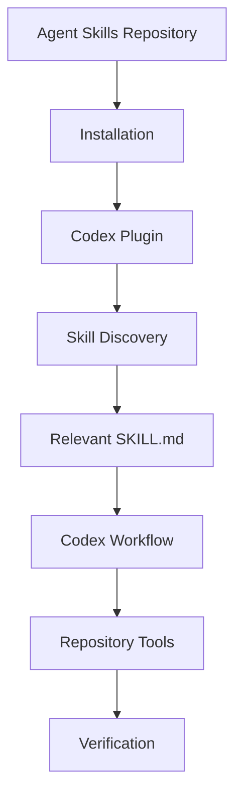

## 1.2 What Changes After Installation?

When the integration works correctly:

- Codex can discover the installed skills.
- Skills can be selected for relevant tasks.
- Developers can explicitly request a skill.
- Codex can load the corresponding `SKILL.md`.
- Supporting resources may be accessed as needed.

## 1.3 What Does Not Automatically Change?

Installing Agent Skills does not automatically:

- Modify your application source code.
- Generate new project features.
- Fix existing bugs.
- Create an MCP server.
- Guarantee passing tests.
- Replace project-specific documentation.
- Create independently running subagents.

> [!important]
> **Installation makes engineering workflows available. It does not automatically execute them against a project.**

---

# Part III — Installation Prerequisites

## 2. Required Environment

The native Codex integration requires a compatible Codex CLI installation.

The repository's Codex setup guide specifies:

**Codex CLI v0.122 or later.**

Other useful prerequisites include:

- A working terminal.
- Internet access for remote installation.
- Git for local cloning.
- Appropriate file permissions.
- A functioning Codex authentication session.

## 2.1 Version Verification

Illustrative command:

```powershell
codex --version
```

This checks which Codex version is installed.

## 2.2 Why Version Matters

Command syntax and plugin support can change between releases.

A command documented for a newer version may not exist in an older installation.

## 2.3 Windows Considerations

Windows users should also verify:

- PowerShell or Command Prompt works.
- Codex is accessible from the terminal.
- Git is available.
- Node.js and npm work if using the alternative `npx` installation method.

---

# Part IV — Native Codex Plugin Architecture

## 3. What Is a Codex Plugin?

A Codex plugin packages supported integrations so Codex can discover and use them.

For this repository, the native plugin exposes the existing `skills/` directory.

The repository does not need a separate copy of each skill for Codex.

## 3.1 Architecture

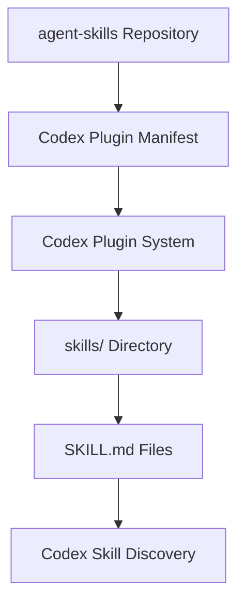

## 3.2 Relevant Repository Files

The documented integration uses:

```text
agent-skills/
├── .codex-plugin/
│   └── plugin.json
├── .agents/
│   └── plugins/
│       └── marketplace.json
└── skills/
    ├── using-agent-skills/
    │   └── SKILL.md
    ├── spec-driven-development/
    │   └── SKILL.md
    └── ...
```

## 3.3 Responsibilities

| Component | Purpose |
|---|---|
| `.codex-plugin/plugin.json` | Codex plugin manifest |
| `.agents/plugins/marketplace.json` | Marketplace registration metadata |
| `skills/` | Portable skill definitions |
| `SKILL.md` | Individual workflow instructions |

## 3.4 Architectural Benefit

The same skill definitions can serve multiple compatible coding agents.

This reduces duplicated documentation and maintenance work.

---

# Part V — Native Plugin Installation

## 4. Official Installation Commands

The repository documents the following installation process:

```powershell
codex plugin marketplace add addyosmani/agent-skills
codex plugin add agent-skills@agent-skills
```

These are official repository commands, presented here for study rather than execution.

## 4.1 First Command — Register Marketplace

```powershell
codex plugin marketplace add addyosmani/agent-skills
```

Purpose:

Register the repository as a plugin marketplace source.

## 4.2 Second Command — Install Plugin

```powershell
codex plugin add agent-skills@agent-skills
```

Purpose:

Install and enable the Agent Skills plugin from the registered marketplace.

## 4.3 Installation Sequence

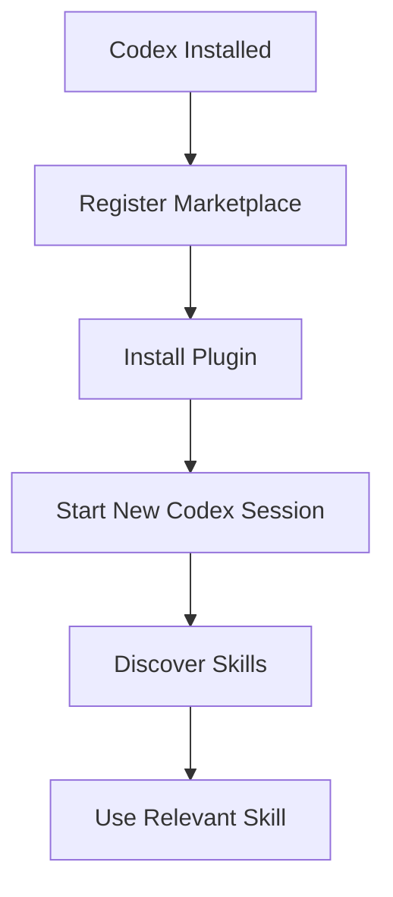

## 4.4 Why Two Commands?

Marketplace registration and plugin installation are separate operations.

Registering a marketplace does not necessarily install its plugins.

## 4.5 Important

The repository explicitly recommends starting a new Codex session after installation so skills are discovered.

---

# Part VI — Version Compatibility

## 5. Codex CLI Version Requirement

The repository documents:

```text
Codex CLI >= 0.122
```

For older releases, the marketplace command was different.

Older syntax:

```powershell
codex marketplace add
```

Current documented syntax:

```powershell
codex plugin marketplace add
```

## 5.1 Why Command Changes Matter

CLI tools evolve.

Documentation may describe features unavailable in older releases.

## 5.2 Compatibility Workflow

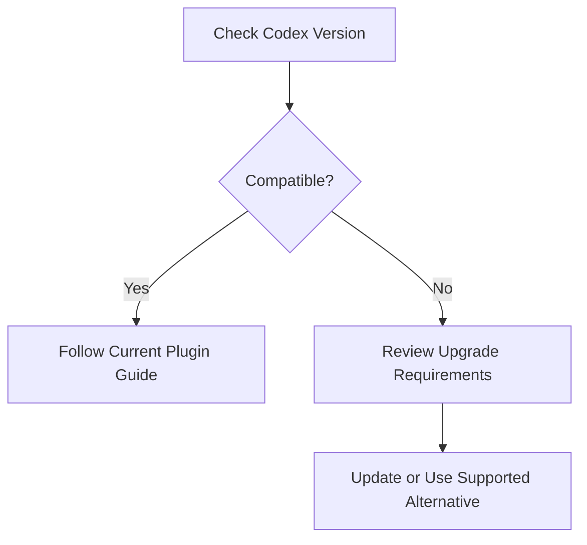

## 5.3 Best Practice

Always verify:

1. Installed Codex version.
2. Required plugin version.
3. Current documentation.
4. Available CLI commands.

Do not assume commands from an older tutorial still apply.

---

# Part VII — Local Repository Installation

## 6. Why Use a Local Clone?

A local clone is useful when:

- Inspecting skill source files.
- Studying repository architecture.
- Reviewing scripts.
- Evaluating changes.
- Developing custom skills.
- Testing local modifications.

## 6.1 Clone the Repository

Illustrative command:

```powershell
git clone https://github.com/addyosmani/agent-skills.git
```

This creates a local copy of the repository.

## 6.2 Local Marketplace Registration

The Codex setup guide documents:

```powershell
codex plugin marketplace add /path/to/your/clone
codex plugin add agent-skills@agent-skills
```

On Windows, replace the example path with the actual repository location.

## 6.3 Conceptual Windows Example

```powershell
codex plugin marketplace add "C:\Dev\agent-skills"
codex plugin add agent-skills@agent-skills
```

The path is illustrative.

## 6.4 Local vs Remote

| Remote Marketplace | Local Clone |
|---|---|
| Uses remote repository source | Uses local repository source |
| Convenient for normal adoption | Useful for inspection and development |
| Less manual source management | Requires maintaining the clone |
| Suitable for standard installation | Suitable for controlled experimentation |

## 6.5 Important

Cloning a repository does not automatically activate its skills in Codex.

The repository must be integrated through a supported mechanism.

---

# Part VIII — Alternative Installation with Skills CLI

## 7. What Is the Skills CLI?

The repository also documents installation through the open Skills CLI.

This method supports multiple agent environments.

## 7.1 Install All Skills

```powershell
npx skills add addyosmani/agent-skills
```

## 7.2 List Available Skills

```powershell
npx skills add addyosmani/agent-skills --list
```

## 7.3 Install One Skill

```powershell
npx skills add addyosmani/agent-skills --skill test-driven-development
```

## 7.4 Why Install Individual Skills?

Possible reasons:

- Only a few workflows are needed.
- Smaller installation scope.
- Reduced maintenance burden.
- Easier experimentation.

## 7.5 Shared Reference Limitation

The repository warns that individual skill installation may omit shared files from the repository-level `references/` directory.

The skill may remain usable, but some supplementary checklists may not be available.

## 7.6 Comparison

| Native Codex Plugin | Skills CLI |
|---|---|
| Codex-specific integration | Multi-agent installation |
| Uses repository plugin metadata | Uses Skills CLI conventions |
| Exposes the full skill pack | Supports individual skill selection |
| Recommended for native Codex integration | Useful for selective adoption |

## 7.7 Best Practice

Choose one primary installation strategy.

Avoid installing the same skill pack through multiple mechanisms unless there is a specific reason.

---

# Part IX — Global vs Project-Level Installation

## 8. What Is Installation Scope?

Installation scope determines where a skill is available.

### Global Scope

Skills are available across multiple projects.

### Project Scope

Skills are associated with a particular repository or workspace.

## 8.1 Conceptual Structure

```text
Global Skills
    ├── Code Review
    ├── Debugging
    └── Test-Driven Development

Project-Specific Skills
    ├── Android UI Workflow
    └── Laravel API Workflow
```

## 8.2 Comparison

| Global | Project-Level |
|---|---|
| Reusable across repositories | Specific to one repository |
| Centralized maintenance | Project-specific customization |
| Useful for generic workflows | Useful for unique conventions |
| Risk of overly broad assumptions | Requires project maintenance |

## 8.3 Important Distinction

A native Codex plugin installation is not necessarily equivalent to copying files into a global or project skill directory.

The exact scope depends on the installation mechanism and Codex's supported discovery rules.

## 8.4 Recommended Strategy

Use shared skills for general engineering practices.

Use project documentation and `AGENTS.md` for project-specific rules.

---

# Part X — Skill Discovery in Codex

## 9. How Does Codex Find Skills?

The repository documents Codex's native progressive disclosure model.

Conceptually:

1. Codex discovers available skill metadata.
2. It considers the current task.
3. A relevant skill is selected.
4. The full `SKILL.md` is loaded.
5. Supporting material is accessed when needed.

## 9.1 Discovery Diagram

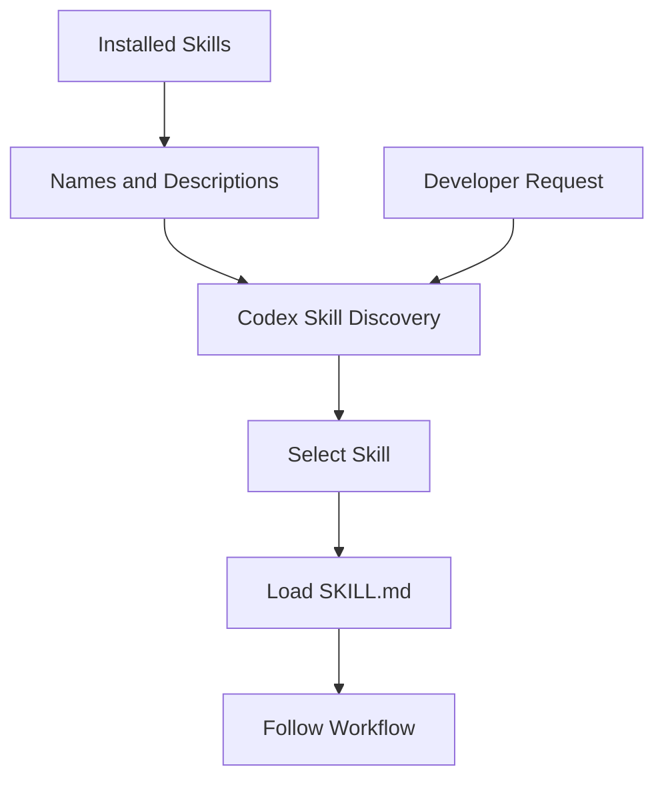

## 9.2 Why Metadata Matters

The `description` field helps Codex understand when a skill is relevant.

A vague description can make skill selection less reliable.

## 9.3 Important

Skill discovery does not mean that all 25 skill documents must be loaded into context simultaneously.

---

# Part XI — Explicit Skill Invocation

## 10. Using the @ Syntax

The repository documents explicit skill invocation in Codex chat.

Example:

```text
@spec-driven-development
```

This requests the specification-driven development skill.

## 10.1 Other Examples

```text
@planning-and-task-breakdown
```

```text
@incremental-implementation
```

```text
@test-driven-development
```

```text
@code-review-and-quality
```

## 10.2 Example Developer Request

```text
@spec-driven-development

Help me define the requirements for a task management feature.

Do not implement code yet.
```

## 10.3 Why Explicit Invocation?

Explicit invocation is useful when:

- You want a particular engineering workflow.
- The task could match multiple skills.
- You are studying a specific skill.
- You want predictable workflow selection.

---

# Part XII — Automatic Skill Selection

## 11. Do Skills Always Need Explicit Invocation?

No.

The repository states that Codex can select relevant skills based on the task description.

## 11.1 Example

Developer request:

> Review this API endpoint for validation and security problems.

Potentially relevant skills:

- `api-and-interface-design`
- `security-and-hardening`
- `code-review-and-quality`

## 11.2 Important

Automatic selection is not guaranteed to choose every useful skill.

The quality of skill descriptions and the task's clarity influence selection.

## 11.3 Best Practice

Use natural task descriptions for normal development.

Use explicit skill invocation when a particular workflow matters.

---

# Part XIII — Codex Commands vs Claude Commands

## 12. Important Platform Difference

The repository includes lifecycle slash commands for Claude Code.

Examples:

```text
/spec
/plan
/build
/test
/review
/ship
```

These commands are not automatically exposed as identical commands in Codex.

## 12.1 Codex Equivalent

The repository recommends invoking the underlying skill.

For example:

| Claude Code Command | Codex Skill |
|---|---|
| `/spec` | `@spec-driven-development` |
| `/plan` | `@planning-and-task-breakdown` |
| `/build` | `@incremental-implementation` |
| `/test` | `@test-driven-development` |
| `/review` | `@code-review-and-quality` |

These are conceptual workflow equivalents, not guarantees of identical behavior.

## 12.2 Why This Matters

Agent platforms have different integration systems.

Portable skills may be shared, while command wrappers remain platform-specific.

---

# Part XIV — The using-agent-skills Meta-Skill

## 13. What Is the Meta-Skill?

`using-agent-skills` helps determine which skill workflow applies.

It is a routing-oriented skill.

## 13.1 Why Codex Is Different

Codex already provides native skill discovery.

The repository specifically warns against pasting the full `using-agent-skills/SKILL.md` into:

- `AGENTS.md`
- System prompts
- Other always-on context

## 13.2 Why Avoid This?

It duplicates routing behavior.

Possible consequences:

- Extra context usage.
- Redundant decisions.
- Conflicting selection guidance.
- Unnecessary workflow overhead.

## 13.3 Correct Principle

```text
Codex Native Skill Discovery
           ↓
Relevant Skill
           ↓
Workflow Execution
```

Not:

```text
Always-On Router
       ↓
Native Router
       ↓
Another Router
       ↓
Workflow
```

## 13.4 Important

The meta-skill may remain installed.

The warning concerns preloading its complete instructions into always-on context.

---

# Part XV — AGENTS.md Integration

## 14. What Is AGENTS.md?

`AGENTS.md` provides repository-specific guidance to compatible coding agents.

Examples:

- Coding conventions.
- Architecture rules.
- Project scope.
- Testing requirements.
- Dependency policies.

## 14.1 Example

```markdown
# Project Instructions

## Technology Stack

- Android application written in Java.
- Firebase for backend services.

## Architecture

- Follow existing package organization.
- Reuse established repository patterns.

## Scope

- Implement only documented MVP features.
- Avoid unnecessary dependencies.

## Verification

- Run relevant Gradle checks.
- Review changed files before completion.
```

## 14.2 How Skills Complement AGENTS.md

| AGENTS.md | Agent Skills |
|---|---|
| Project-specific rules | Reusable workflows |
| Defines architecture constraints | Defines engineering process |
| Maintained with the project | May be shared across projects |
| Describes local requirements | Guides task execution |

## 14.3 Integration Model

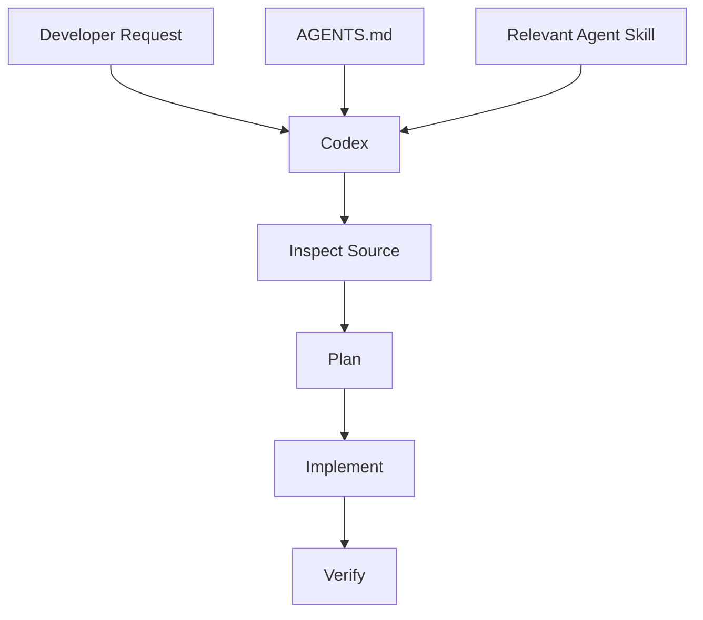

## 14.4 Best Practice

Keep `AGENTS.md` focused on project-specific requirements.

Do not copy entire skill documents into it unnecessarily.

---

# Part XVI — Windows PowerShell Fundamentals

## 15. Why Windows Can Behave Differently

Windows PowerShell has an execution-policy system that controls certain script execution behaviors.

Node.js tools installed through npm may create PowerShell launcher files ending in `.ps1`.

Examples:

```text
npm.ps1
codex.ps1
```

## 15.1 Common Error

```text
codex.ps1 cannot be loaded because running scripts is disabled on this system.
```

This does not necessarily mean Codex failed to install.

It may mean PowerShell is blocking the script launcher.

## 15.2 Important Distinction

There are three separate questions:

1. Is Codex installed?
2. Can the terminal locate Codex?
3. Can the selected shell execute its launcher?

A failure at one layer does not prove failure at every layer.

---

# Part XVII — Diagnosing PowerShell Issues

## 16. Check Executable Resolution

Illustrative commands:

```powershell
Get-Command codex -All
```

```powershell
Get-Command npm -All
```

These help identify which executable or script PowerShell resolves.

## 16.1 Check Execution Policy

```powershell
Get-ExecutionPolicy -List
```

This displays execution-policy settings across scopes.

## 16.2 PowerShell vs CMD Launchers

On Windows, npm-installed tools may provide `.cmd` launchers in addition to `.ps1` scripts.

Examples:

```powershell
codex.cmd --version
```

```powershell
npm.cmd --version
```

These can be useful diagnostic alternatives when the PowerShell launcher is blocked.

## 16.3 Security Consideration

Execution policies may be configured by an organization or system administrator.

Do not bypass managed security restrictions.

If policy changes are required, follow the machine owner's or administrator's approved procedure.

## 16.4 Best Practice

Diagnose the launcher problem before reinstalling the entire development environment.

---

# Part XVIII — Common Installation Problems

## 17. Problem: Codex Not Recognized

Example:

```text
codex is not recognized as the name of a command
```

Possible causes:

- Codex is not installed.
- The executable is not on PATH.
- The terminal has not refreshed its environment.
- The wrong user profile is being used.

## 17.1 Problem: PowerShell Blocks Codex

Example:

```text
codex.ps1 cannot be loaded
```

Possible cause:

PowerShell execution policy blocks the launcher.

## 17.2 Problem: Plugin Command Missing

Possible causes:

- Older Codex version.
- Different CLI syntax.
- Incorrect installation.
- Unsupported plugin feature.

## 17.3 Problem: Skills Not Discovered

Possible causes:

- Plugin installation incomplete.
- New session not started.
- Skill metadata invalid.
- Wrong installation location.
- Plugin not enabled.

## 17.4 Problem: Skill Cannot Access References

Possible cause:

Only an individual skill was copied, while shared repository-level references were omitted.

## 17.5 Troubleshooting Principle

> Identify the failing layer before changing configuration.

---

# Part XIX — Troubleshooting Decision Tree

## 18. Diagnostic Workflow

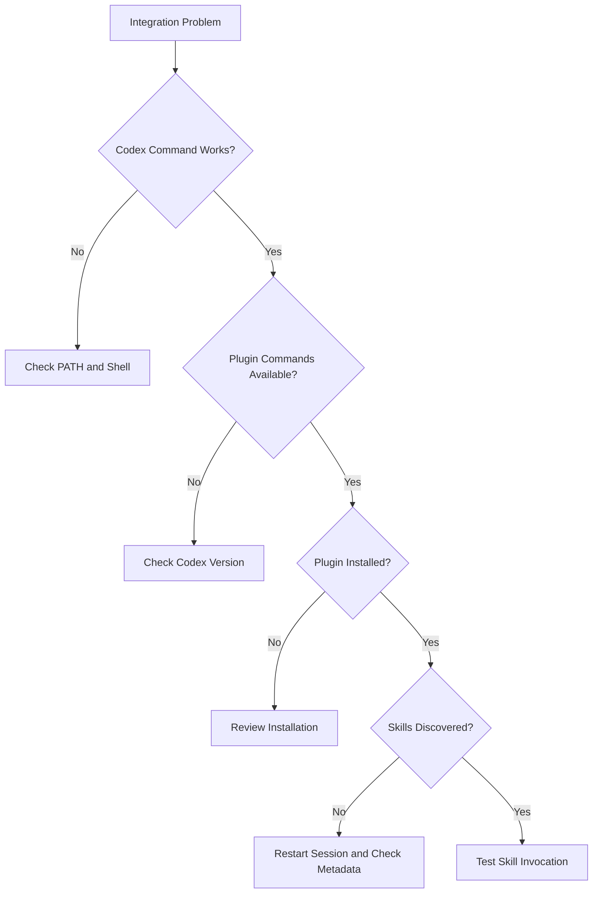

## 18.1 Recommended Diagnostic Order

1. Check Codex version.
2. Check shell behavior.
3. Check plugin command availability.
4. Check installation status.
5. Start a new session.
6. Test one known skill.
7. Review errors and logs.

## 18.2 Why This Order?

It moves from basic environment requirements toward higher-level integration behavior.

This avoids unnecessary reinstallations.

---

# Part XX — Security Considerations

## 19. Third-Party Skills Are Instructions

Installing a third-party skill gives an AI agent access to external workflow instructions.

Those instructions may influence:

- Files inspected.
- Commands executed.
- Scripts run.
- External services contacted.
- Development decisions.

## 19.1 Security Checklist

Before installation:

- [ ] Verify the repository source.
- [ ] Review relevant `SKILL.md` files.
- [ ] Inspect bundled scripts.
- [ ] Understand requested permissions.
- [ ] Review external service dependencies.
- [ ] Avoid unnecessary sensitive data exposure.
- [ ] Confirm compatibility with project policies.

## 19.2 Supply Chain Risk

Third-party repositories can change.

Updates may introduce:

- New dependencies.
- Modified instructions.
- New scripts.
- Different behavior.

## 19.3 Best Practice

Review updates before adopting them in sensitive projects.

For reproducible environments, consider recording the repository revision or release used.

---

# Part XXI — Updating Agent Skills

## 20. Why Updates Matter

The repository may receive:

- New skills.
- Updated workflows.
- Improved verification steps.
- Compatibility fixes.
- Documentation changes.

## 20.1 Update Strategy

A controlled update process should:

1. Identify the installed version.
2. Review upstream changes.
3. Inspect changed instructions.
4. Check compatibility.
5. Update through the supported installation mechanism.
6. Verify skill discovery.
7. Test a representative workflow.

## 20.2 Important

The exact update command depends on the installation method.

Native plugins, local clones, and copied skills may require different procedures.

Do not assume one update command applies to every installation.

---

# Part XXII — Uninstalling or Disabling Skills

## 21. Why Might You Remove a Skill?

Possible reasons:

- It is no longer useful.
- It overlaps with another skill.
- Its instructions conflict with project requirements.
- It introduces unnecessary complexity.
- Its dependencies are unavailable.

## 21.1 Removal Principles

Before removing an integration:

- Identify how it was installed.
- Check whether other workflows depend on it.
- Use the host's supported removal mechanism.
- Verify that the skill is no longer discovered.

## 21.2 Important

Deleting a random directory is not always equivalent to properly uninstalling a registered plugin.

---

# Part XXIII — Android Integration Strategy

## 22. GroupTrack Example

Technology context:

```text
Android Studio
Java
Firebase
Gradle
Codex CLI
```

## 22.1 Recommended Skill Categories

Potentially useful:

- `frontend-ui-engineering`
- `incremental-implementation`
- `test-driven-development`
- `debugging-and-error-recovery`
- `code-review-and-quality`

## 22.2 Project Rules

Keep project-specific requirements in `AGENTS.md`.

Examples:

- Follow Java conventions.
- Preserve existing architecture.
- Respect the documented MVP.
- Avoid unnecessary dependencies.
- Verify relevant UI states.

## 22.3 Example Workflow

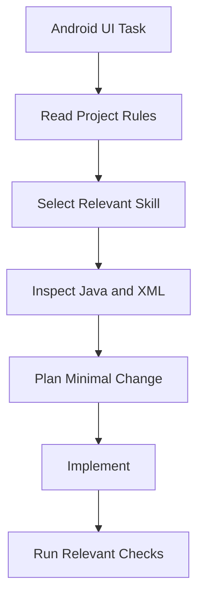

## 22.4 Important

A skill should help Codex follow the existing Android project architecture, not replace it with a new framework.

---

# Part XXIV — Laravel Integration Strategy

## 23. GoPasig Example

Technology context:

```text
Laravel
PHP
MySQL
Google Maps
Codex CLI
```

## 23.1 Relevant Skills

Potentially useful:

- `spec-driven-development`
- `planning-and-task-breakdown`
- `api-and-interface-design`
- `security-and-hardening`
- `test-driven-development`

## 23.2 Example Task

> Improve schedule validation.

The workflow should:

1. Understand business rules.
2. Inspect routes and controllers.
3. Review services and models.
4. Plan minimal changes.
5. Implement validation.
6. Run relevant tests.
7. Review authorization and data integrity.

## 23.3 Important

The skill does not know the project's business rules automatically.

Those must come from requirements and source code.

---

# Part XXV — Next.js and Laravel Integration Strategy

## 24. E-commerce Example

Technology context:

```text
Next.js
TypeScript
Laravel API
PostgreSQL
Codex CLI
```

## 24.1 Relevant Skills

Potentially useful:

- `frontend-ui-engineering`
- `api-and-interface-design`
- `incremental-implementation`
- `test-driven-development`
- `security-and-hardening`

## 24.2 Cross-Stack Workflow

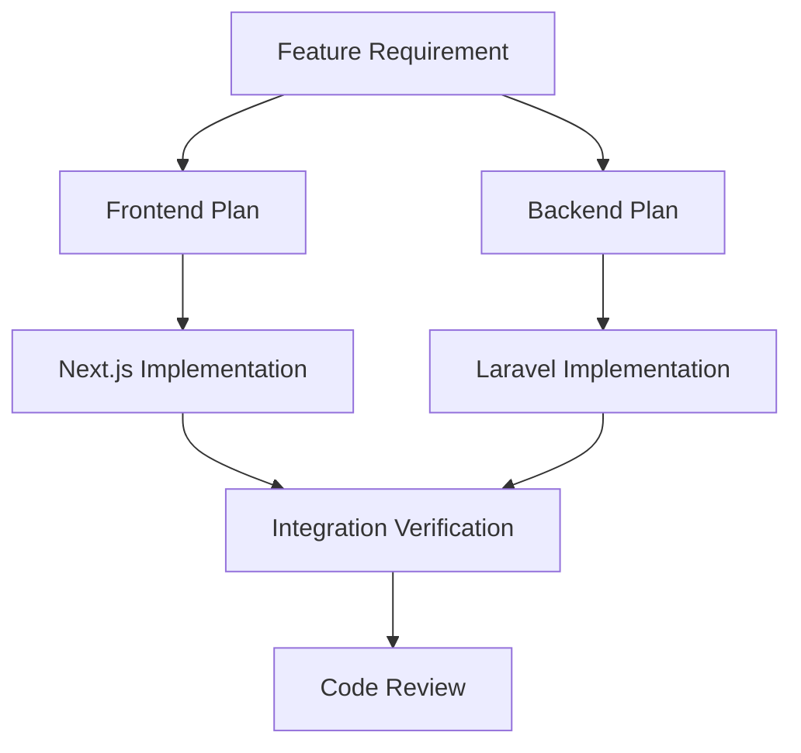

## 24.3 Project-Specific Constraints

Examples:

- Frontend handles presentation and interaction.
- Backend owns business rules and persistence.
- API contracts must remain consistent.
- Backend authorization must be enforced.

## 24.4 Important

Reusable skills guide the engineering process.

They do not replace explicit architectural boundaries.

---

# Part XXVI — Choosing the Right Integration Strategy

## 25. Decision Matrix

| Situation | Suggested Approach |
|---|---|
| Normal Codex usage | Native Codex plugin |
| Studying repository internals | Local clone |
| Only one skill is needed | Selective skill installation |
| Multiple agent platforms | Skills CLI |
| Unique project constraints | `AGENTS.md` |
| Repeated custom project workflow | Project-specific skill |

## 25.1 Decision Flow

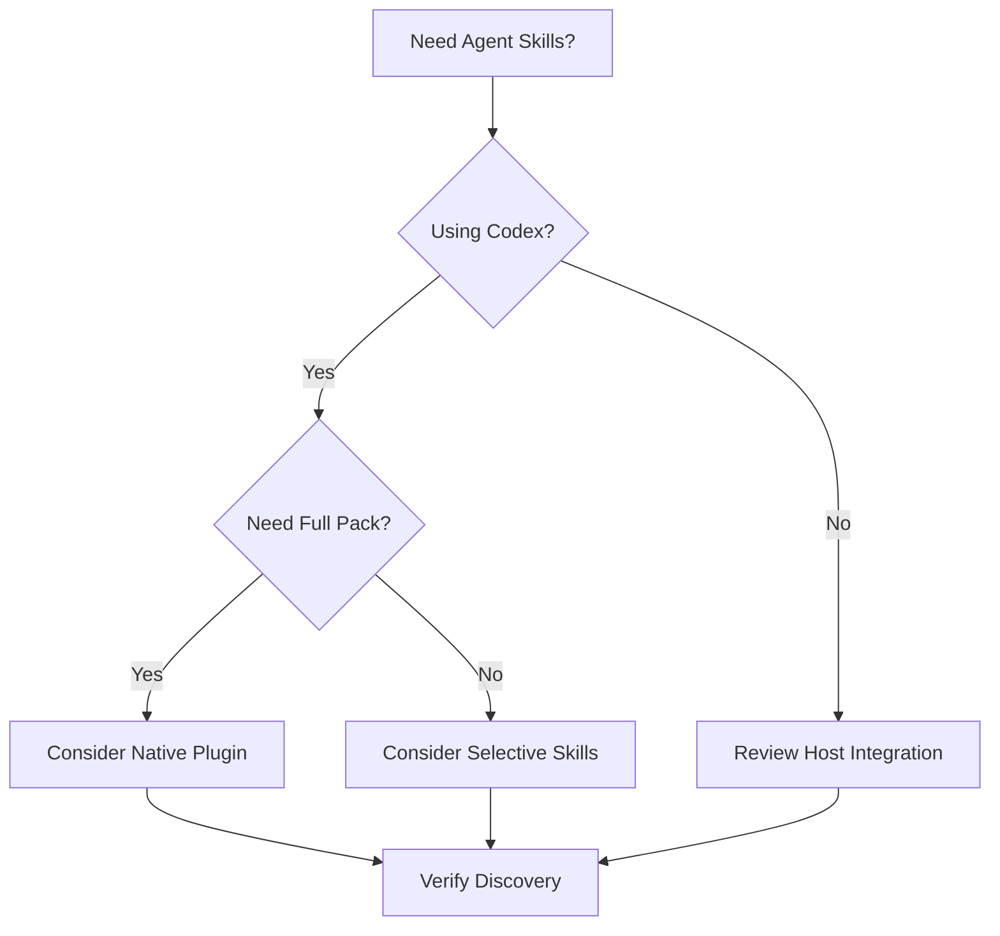

## 25.2 Important

This is a recommended decision framework, not a mandatory installation sequence.

---

# Part XXVII — Avoiding Overengineering

## 26. Common Overengineering Patterns

### Installing Everything Without a Need

A project may only require a few workflows.

### Duplicating Skill Routers

Native discovery and a copied always-on meta-router may overlap.

### Adding Unnecessary MCP Servers

Agent Skills does not require an MCP server simply to provide Markdown workflow instructions.

### Replacing Project Architecture

A generic skill should not override an existing application's justified design.

### Excessive Verification

Verification should be proportional to task complexity and risk.

## 26.1 Best Practice

Start with a clear problem.

Select the simplest integration that solves it.

Measure whether it improves your development workflow.

---

# Part XXVIII — Practical Exercises

> [!note]
> Theory exercises only. No installation or command execution required.

## Exercise 1 — Installation Meaning

Explain what changes when Agent Skills is installed in Codex.

## Exercise 2 — Prerequisites

List the prerequisites for native Codex integration.

## Exercise 3 — Marketplace Registration

Explain the purpose of:

```powershell
codex plugin marketplace add addyosmani/agent-skills
```

## Exercise 4 — Plugin Installation

Explain the purpose of:

```powershell
codex plugin add agent-skills@agent-skills
```

## Exercise 5 — Session Restart

Explain why starting a new Codex session may be necessary.

## Exercise 6 — Plugin Architecture

Identify the responsibilities of:

- `.codex-plugin/plugin.json`
- `.agents/plugins/marketplace.json`
- `skills/`

## Exercise 7 — Local Clone

Explain when local repository installation is preferable.

## Exercise 8 — Skills CLI

Compare full-pack and individual-skill installation.

## Exercise 9 — Shared References

Explain the portability limitation of selective installation.

## Exercise 10 — Global vs Project Scope

Design a strategy for sharing generic skills across projects while keeping project-specific rules separate.

## Exercise 11 — Skill Discovery

Explain how Codex discovers and loads relevant skills.

## Exercise 12 — Explicit Invocation

Write a conceptual Codex request using:

```text
@spec-driven-development
```

## Exercise 13 — Automatic Invocation

Describe a task that could naturally trigger `debugging-and-error-recovery`.

## Exercise 14 — Platform Commands

Explain why `/spec` and `@spec-driven-development` are not necessarily identical interfaces.

## Exercise 15 — AGENTS.md

Explain why entire skill files should not be copied into project rules unnecessarily.

## Exercise 16 — PowerShell

Distinguish:

- Command not recognized.
- Script execution blocked.
- Plugin command unavailable.

## Exercise 17 — Troubleshooting

Design a diagnostic workflow for a skill that does not appear in Codex.

## Exercise 18 — Security

Create a checklist for reviewing third-party skill updates.

## Exercise 19 — Android

Design an integration strategy for GroupTrack.

## Exercise 20 — Laravel

Design an integration strategy for GoPasig.

## Exercise 21 — Next.js

Design an integration strategy for a Next.js and Laravel e-commerce application.

## Exercise 22 — Final Exercise

Create a complete Agent Skills adoption plan for Codex.

Include:

1. Environment assessment.
2. Codex version verification.
3. Installation method.
4. Skill discovery.
5. Explicit invocation.
6. Automatic selection.
7. Project rules.
8. Security review.
9. Verification strategy.
10. Troubleshooting.
11. Update strategy.
12. Maintenance responsibilities.
13. Success criteria.
14. Rollback or removal plan.
15. Evaluation of complexity.

---

# Part XXIX — Knowledge Check

1. What does installing Agent Skills accomplish?
2. What is the minimum Codex version documented for the native plugin?
3. What is a plugin marketplace?
4. How does marketplace registration differ from plugin installation?
5. Why is a new Codex session recommended after installation?
6. What is the purpose of `.codex-plugin/plugin.json`?
7. What is the purpose of `.agents/plugins/marketplace.json`?
8. Why does Codex reuse the root `skills/` directory?
9. When is a local clone useful?
10. How does Skills CLI installation differ from native plugin installation?
11. What is the shared-reference portability limitation?
12. What is global installation scope?
13. What is project-level installation scope?
14. How does Codex discover skills?
15. What is progressive disclosure?
16. How do you explicitly invoke a skill?
17. What is automatic skill selection?
18. Why do Claude slash commands differ from Codex skill invocation?
19. What is the `using-agent-skills` meta-skill?
20. Why should duplicate routers be avoided?
21. What belongs in `AGENTS.md`?
22. What belongs in reusable skills?
23. What is a PowerShell execution policy?
24. What does a `.ps1` launcher do?
25. What does command-not-recognized mean?
26. Why might a plugin command be unavailable?
27. Why might skills fail to appear after installation?
28. What security risks can third-party skills introduce?
29. Why should updates be reviewed?
30. Why should installation methods not be mixed unnecessarily?
31. How can Agent Skills support Android development?
32. How can Agent Skills support Laravel development?
33. How can Agent Skills support Next.js development?
34. What is the simplest appropriate integration strategy?
35. How do you determine whether Agent Skills improves your workflow?

---

# Part XXX — Key Takeaways

> [!summary]
> - Agent Skills provides reusable engineering workflows for compatible AI coding agents.
> - Native Codex integration uses the plugin system.
> - The repository documents Codex CLI v0.122 or later.
> - Marketplace registration and plugin installation are separate operations.
> - Codex consumes the repository's existing `skills/` directory.
> - Starting a new session enables fresh skill discovery.
> - Skills can be explicitly invoked using `@skill-name`.
> - Codex can also select relevant skills automatically.
> - Progressive disclosure avoids loading every skill in full.
> - Claude slash commands are not automatically available in Codex.
> - Do not duplicate native skill routing with an always-on meta-router.
> - `AGENTS.md` should contain project-specific constraints.
> - Local cloning is useful for inspection and development.
> - Selective installation may omit shared references.
> - Windows PowerShell errors should be diagnosed by layer.
> - Third-party skills require security review.
> - Updates should be controlled and verified.
> - Integration complexity should be justified by actual project needs.

---

# Part XXXI — Final Mental Model

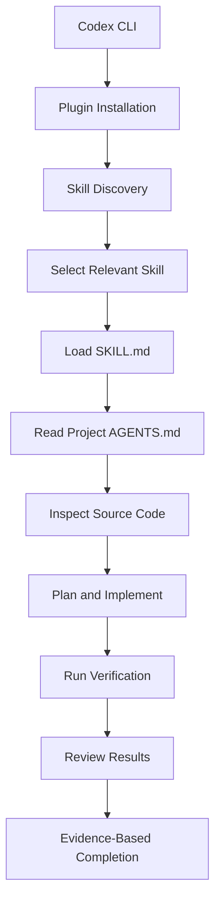

> [!important] Final Principle
> **The purpose of integrating Agent Skills with Codex is not to add more tools or complexity. It is to make reliable engineering workflows discoverable, reusable, and consistently applied while respecting the project's actual architecture and requirements.**

---

# Part XXXII — Official References

## Primary Repository

- [Agent Skills GitHub Repository](https://github.com/addyosmani/agent-skills)
- [Repository README](https://github.com/addyosmani/agent-skills/blob/main/README.md)
- [Official Codex Setup Guide](https://github.com/addyosmani/agent-skills/blob/main/docs/codex-setup.md)
- [Getting Started](https://github.com/addyosmani/agent-skills/blob/main/docs/getting-started.md)
- [Adoption Guide](https://github.com/addyosmani/agent-skills/blob/main/docs/adoption-guide.md)

## Codex

- [OpenAI Codex Documentation](https://developers.openai.com/codex/)
- [Codex CLI](https://developers.openai.com/codex/cli)
- [Codex Skills](https://developers.openai.com/codex/skills)
- [Codex Plugins](https://developers.openai.com/codex/plugins/build)

## Agent Skills

- [Agent Skills Open Standard](https://agentskills.io/)
- [Agent Skills Specification](https://agentskills.io/specification)
- [Skills CLI](https://github.com/vercel-labs/skills)

## Windows

- [PowerShell Execution Policies](https://learn.microsoft.com/en-us/powershell/module/microsoft.powershell.core/about/about_execution_policies)
- [PowerShell Get-Command](https://learn.microsoft.com/en-us/powershell/module/microsoft.powershell.core/get-command)
- [Git Documentation](https://git-scm.com/doc)

> [!note] Documentation Scope
> This lesson reflects the installation and integration methods documented in the Agent Skills repository.
>
> Commands are provided as educational examples and were not executed.
>
> Installation syntax and platform support may change between Codex releases.
>
> No plugins, skills, files, or development environments were modified during this lesson.

---

# Part XXXIII — Next Lesson

**[[04 - Skills Discovery and Progressive Disclosure]]**

Topics:

1. Skill discovery architecture.
2. Metadata-based routing.
3. Skill description engineering.
4. Trigger matching.
5. Explicit invocation.
6. Automatic activation.
7. Progressive disclosure.
8. Context-window management.
9. Supporting-resource loading.
10. Skill conflicts.
11. Duplicate routing.
12. Skill selection evaluation.
13. Token efficiency.
14. Codex integration.
15. Android, Laravel, and Next.js examples.
16. Practical exercises.
17. Official references.

**End of Lesson 03 — Installation and Codex Integration.**
