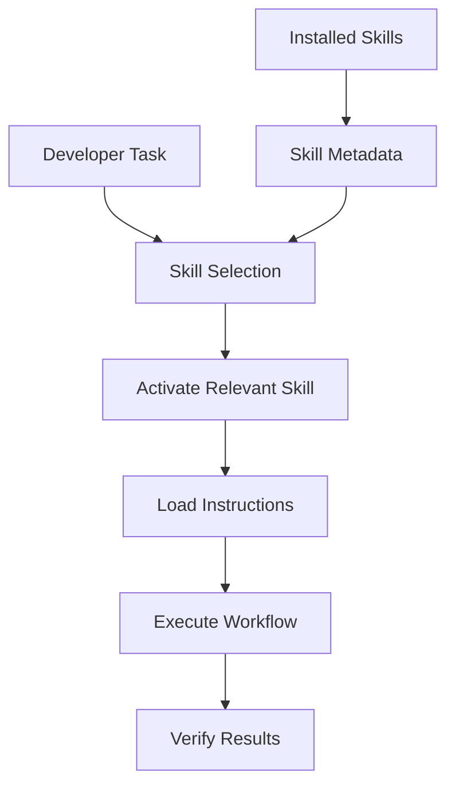
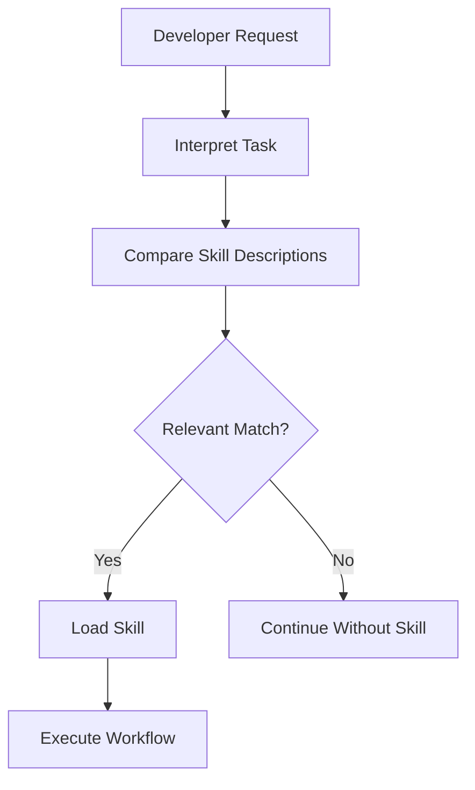
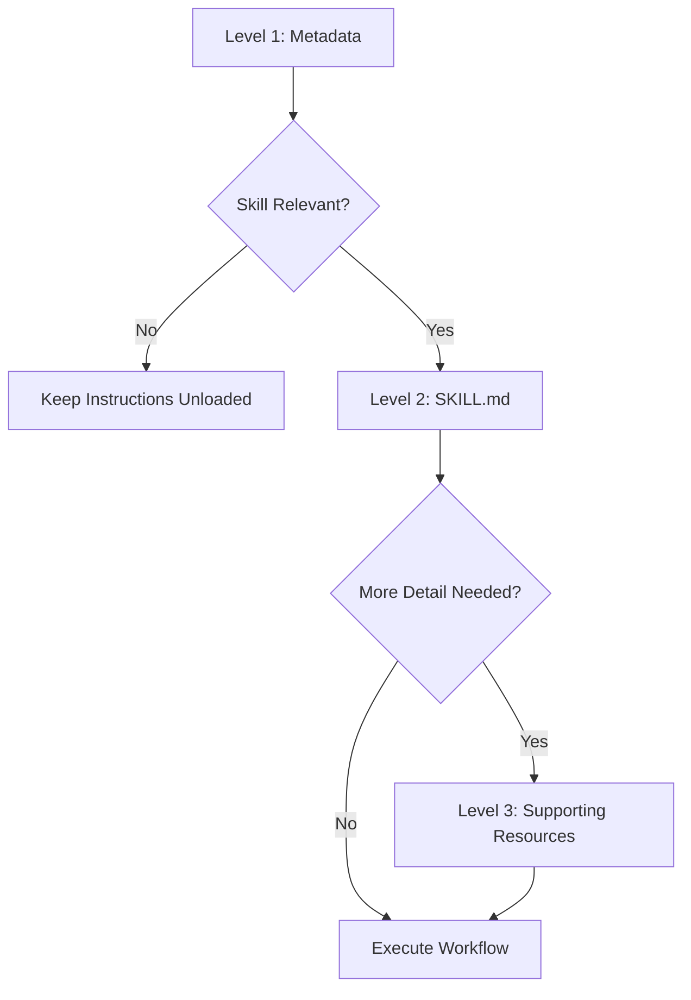
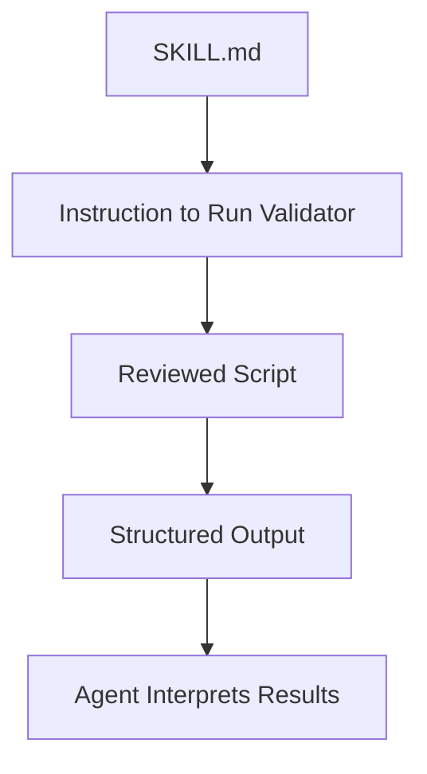
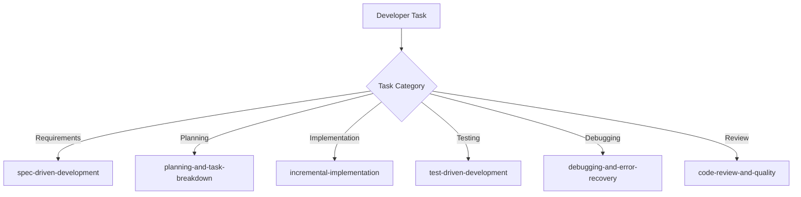
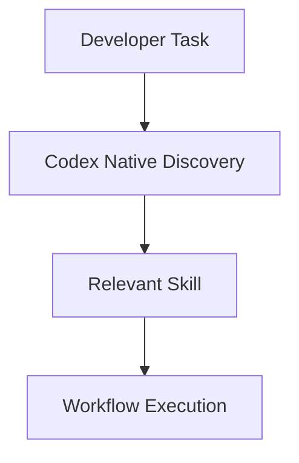
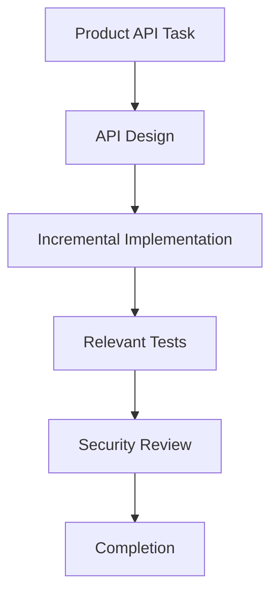
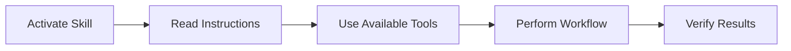

# 04 — Agent Skills: Skills Discovery and Progressive Disclosure

> [!abstract] Lesson Information
> **Repository:** [addyosmani/agent-skills](https://github.com/addyosmani/agent-skills)
>
> **Category:** Agentic Engineering / Skill Discovery / Context Engineering / Codex CLI
>
> **Difficulty:** Intermediate
>
> **Learning Approach:** Theory First
>
> **Prerequisites:**
> - [[00 - Repository Overview and Purpose]]
> - [[01 - Agent Skills Fundamentals]]
> - [[02 - Repository Architecture and SKILL.md Anatomy]]
> - [[03 - Installation and Codex Integration]]
>
> **Primary Goal:** Understand how AI coding agents discover, select, activate, and combine reusable skills while managing context efficiently through progressive disclosure.

---

# Part I — Learning Objectives

After completing this lesson, you should be able to:

1. Define discovery, selection, activation, execution, and verification.
2. Explain metadata-based skill routing and description quality.
3. Distinguish explicit and automatic invocation.
4. Explain the three stages of progressive disclosure.
5. Manage context-window limitations and supporting resources.
6. Understand routing, overlapping skills, duplicate routers, and conflicts.
7. Evaluate routing accuracy and token-efficiency tradeoffs.
8. Apply these concepts to Codex, Android, Laravel, and Next.js workflows.

---

# Part II — Discovery, Selection, and Activation

Skill discovery is how an agent becomes aware of reusable skills available in its environment.

```text
Available Skills
├── spec-driven-development
├── planning-and-task-breakdown
├── incremental-implementation
├── test-driven-development
├── debugging-and-error-recovery
├── frontend-ui-engineering
├── api-and-interface-design
└── code-review-and-quality
```

These are different operations:

| Operation | Purpose |
|---|---|
| Discovery | Identify available skills |
| Selection | Match a task to a workflow |
| Activation | Load the selected instructions |
| Execution | Follow the workflow |
| Verification | Evaluate the result |



> [!important]
> **A skill can be available without being activated, and activation does not guarantee successful execution.**

---

# Part III — Why Discovery Matters

Suppose 25 skills are installed and the request is:

> Fix a validation error in a Laravel controller.

Possible candidates include debugging, API design, testing, and security. A UI skill would be an inappropriate route. Selection depends on the task, its risk, and the current lifecycle stage.

Skills may be sequential:

```text
Debugging
   ↓
Identify validation defect
   ↓
Implement correction
   ↓
Run tests
   ↓
Review
```

There is no universal rule that every bug fix activates the same sequence.

---

# Part IV — Metadata and Description Engineering

Each skill's `SKILL.md` contains metadata such as:

```yaml
---
name: debugging-and-error-recovery
description: Guides agents through systematic debugging and recovery. Use when tests fail, builds break, or application behavior is unexpected.
---
```

The `name` identifies the skill. The `description` tells the router what the skill does and when it applies.

Weak description:

```yaml
description: Helps developers write better code.
```

Improved description:

```yaml
description: Guides agents through scoped implementation of approved features. Use when requirements are clear and existing behavior must be extended without unrelated changes.
```

Recommended pattern:

```text
[What the skill does]. Use when [task conditions or relevant situations].
```

Quality checklist:

- [ ] One coherent responsibility.
- [ ] Recognizable triggering conditions.
- [ ] No vague promises.
- [ ] Differentiated from neighboring skills.
- [ ] Does not reproduce the full procedure.
- [ ] Uses natural developer terminology.

Descriptions should communicate routing information, not contain the entire workflow.

---

# Part V — Trigger Matching and Invocation

Matching generally depends on the meaning of the developer request and skill descriptions, not only exact keywords.

| Request | Likely interpretation |
|---|---|
| “The application crashes after form submission.” | Debugging |
| “Design the product creation API before coding.” | API design |
| “Review this Laravel implementation.” | Code review |
| “Improve my dashboard.” | Ambiguous: UI, performance, accessibility, or bug fix |

When ambiguity materially changes the work, clarify rather than silently guessing.

## Explicit invocation

The repository documents invocation patterns such as:

```text
@planning-and-task-breakdown
```

Explicit invocation gives the developer control, helps learning, and makes overlapping workflows more predictable. It does not replace source inspection or verification.

## Automatic selection



Automatic routing is convenient but can miss a relevant skill, activate an unnecessary one, or choose a broad skill instead of a specialized one. Use clear task descriptions and explicit invocation when necessary.

---

# Part VI — Progressive Disclosure

Progressive disclosure reveals information in stages rather than loading everything immediately. The three common stages are:

1. Metadata.
2. Full `SKILL.md` instructions.
3. Supporting resources.



## Level 1 — Metadata

The agent sees names and descriptions and can evaluate relevance without loading complete workflows. This lowers initial context overhead, though a large catalog still has discovery cost.

## Level 2 — `SKILL.md`

After selection, the agent reads the complete workflow: overview, triggers, process, red flags, techniques, and verification. Reading instructions does not automatically run commands or tests.

## Level 3 — Supporting resources

A skill may contain references such as checklists, examples, framework guidance, or regression-testing material. Load these only when the active workflow needs them.

```text
debugging-and-error-recovery/
├── SKILL.md
└── references/
    ├── investigation-checklist.md
    └── regression-testing.md
```

Supporting resources should be relevant, not merely available.

---

# Part VII — Context Windows and Token Efficiency

A context window may contain system and developer instructions, conversation history, skill metadata, activated skills, source files, tool results, and remaining working context.

Excessive irrelevant context can cause higher token use, competing instructions, difficulty locating important information, and reduced attention. However, smaller is not automatically better: removing critical information can harm accuracy.

Hypothetical example:

```text
25 skills × 2,000 tokens each = 50,000 tokens if eagerly loaded
25 metadata records × 80 tokens = 2,000 tokens
2 activated skills × 2,000 tokens = 4,000 tokens
Progressive-disclosure total = 6,000 tokens
```

The hypothetical reduction is:

\[
\frac{50000-6000}{50000}\times100=88\%
\]

These are educational assumptions, not Agent Skills or Codex benchmarks. The objective is relevant context, not minimal context at any cost.

---

# Part VIII — Efficient Skill and Resource Design

Keep `SKILL.md` focused. The repository recommends keeping the main skill under approximately 500 lines and moving detailed material into references.

```text
my-skill/
├── SKILL.md
└── references/
    ├── examples.md
    ├── framework-guide.md
    └── troubleshooting.md
```

Recommended principles:

- Keep the main workflow concise.
- Use precise metadata.
- Reference supporting files directly.
- Avoid deep chains of references.
- Do not duplicate large documents.
- Load details when needed.

One-level references are easier to navigate than chains of documents referencing other documents.

## Scripts and deterministic work

Use reviewed scripts for deterministic operations when that reduces repeated inline instructions and context. Scripts can produce structured output for the agent to interpret.



Scripts introduce execution and security considerations. Do not run unfamiliar scripts solely because a skill recommends them.

---

# Part IX — Skill Routing and the Meta-Skill

Skill routing maps developer tasks to workflows:



The `using-agent-skills` meta-skill provides routing guidance and shared behaviors such as making assumptions visible, clarifying meaningful uncertainty, raising technical concerns, preferring simplicity, maintaining scope, and verifying results.

| Task | Potential skill |
|---|---|
| Unclear requirements | `interview-me` |
| Rough idea | `idea-refine` |
| New feature specification | `spec-driven-development` |
| Planning | `planning-and-task-breakdown` |
| Implementation | `incremental-implementation` |
| UI work | `frontend-ui-engineering` |
| API design | `api-and-interface-design` |
| Debugging | `debugging-and-error-recovery` |
| Review | `code-review-and-quality` |
| Security | `security-and-hardening` |
| Performance | `performance-optimization` |

The meta-skill is useful where native routing is unavailable, but it is not necessarily an always-on instruction.

---

# Part X — Native Codex Routing and Duplicate Routers

The conceptual Codex sequence is:

```text
Installed Skill Catalog → Name + Description → Developer Task
→ Skill Selection → Load SKILL.md → Execute Workflow
```

Explicit invocation may look like:

```text
@debugging-and-error-recovery
```

Automatic invocation may occur for a request such as:

```text
Investigate why this Laravel API returns a validation error.
```

Exact behavior depends on the installed Codex version and environment.

## Duplicate routers

Duplicate routing occurs when native discovery and an always-on meta-router both attempt to select skills.

Potential consequences:

- Unnecessary context consumption.
- Redundant instructions.
- Conflicting selection decisions.
- Harder troubleshooting.

When native discovery is available, do not copy the complete `using-agent-skills/SKILL.md` into always-on `AGENTS.md` or system instructions without a clear reason. The repository's release documentation describes reducing redundant automatic injection for hosts with native discovery.

Preferred model:



---

# Part XI — Overlapping Skills and Conflicts

Multiple skills can apply to one task. For a secure product API, possible workflows include API design, incremental implementation, security, and testing.

Use a primary workflow and introduce supporting workflows at the stage where they become relevant:



When instructions conflict:

1. Identify the conflict.
2. Review user requirements and project constraints.
3. Determine whether both can be satisfied.
4. Prefer the smallest justified solution.
5. Clarify material ambiguity.

Skills do not grant permission to ignore higher-priority instructions or explicit project constraints.

If no skill matches, perform a proportionate workflow. A README typo may require locating, editing, and verifying the text rather than loading a full feature-development process.

---

# Part XII — Activation Is Not Execution

Activating a skill loads guidance. It does not automatically:

- Inspect the repository.
- Modify files.
- Run tests.
- Start servers.
- Verify runtime behavior.



An agent should not claim that a command, test, or verification occurred unless it actually did.

---

# Part XIII — Applying Discovery to Projects

## GroupTrack Android

For “fix task completion and progress,” route through requirements, planning, implementation, testing, and review. Candidate skills may include specification, incremental implementation, testing, and debugging. Inspect Java, layouts, repositories, models, Firebase behavior, and MVP constraints.

## GoPasig Laravel

For schedule validation, route through debugging or API design as appropriate, then testing and security review. Inspect routes, controllers, services, models, database constraints, authorization, and transactions.

## Next.js and Laravel e-commerce

For product creation, use API design, incremental implementation, testing, and security guidance. Separate frontend form behavior from backend validation and persistence. A skill workflow coordinates the work but does not automatically resolve HTTP relationships.

---

# Part XIV — Routing Evaluation

Evaluate routing with a task set representing:

- Requirements clarification.
- Planning.
- Implementation.
- Debugging.
- UI work.
- API work.
- Testing.
- Security.
- Performance.
- Review.

Useful metrics include:

| Metric | Question |
|---|---|
| Routing precision | How often was an activated skill relevant? |
| Routing recall | How often was a necessary skill selected? |
| Activation latency | How quickly was a relevant workflow available? |
| Context overhead | How much instruction was loaded? |
| Task success | Did the workflow support a correct result? |
| Duplicate rate | How often were redundant skills activated? |

Ground truth should be independently reviewed. A skill selection is not successful merely because it produced a plausible explanation.

---

# Part XV — Practical Exercises

1. Define discovery, selection, activation, execution, and verification.
2. Write metadata for a debugging skill.
3. Improve a vague skill description.
4. Classify five developer requests by lifecycle stage.
5. Design explicit and automatic invocation examples.
6. Draw the three levels of progressive disclosure.
7. Calculate hypothetical token savings from metadata-first loading.
8. Design a focused `SKILL.md` and supporting references.
9. Identify a deterministic operation that should use a reviewed script.
10. Route tasks through the `using-agent-skills` meta-skill.
11. Identify duplicate-router risks in a Codex setup.
12. Combine API, security, testing, and implementation skills sequentially.
13. Resolve a conflict between a project rule and a generic skill suggestion.
14. Design routing tests for Android, Laravel, and Next.js tasks.
15. Explain why activation is not execution.

---

# Part XVI — Knowledge Check

1. What is skill discovery?
2. How does activation differ from discovery?
3. What role do name and description play?
4. What makes a description useful?
5. What is explicit invocation?
6. What is automatic selection?
7. What is progressive disclosure?
8. What are its three stages?
9. Why is unnecessary context harmful?
10. Why is minimal context not always sufficient?
11. Why keep `SKILL.md` focused?
12. What is the role of supporting resources?
13. Why use reviewed scripts for deterministic tasks?
14. What is skill routing?
15. What does `using-agent-skills` provide?
16. What is a duplicate router?
17. How should overlapping skills be handled?
18. How should skill conflicts be resolved?
19. What is routing precision and recall?
20. Why is activation not execution?

---

# Part XVII — Key Takeaways

> [!summary]
> - Discovery makes skills known; activation loads them; execution applies them; verification evaluates them.
> - Metadata lets agents route tasks without loading every full skill.
> - Descriptions should state responsibility and trigger conditions.
> - Explicit invocation gives control; automatic routing gives convenience.
> - Progressive disclosure uses metadata, `SKILL.md`, and supporting resources.
> - Context efficiency means relevant context, not blindly minimal context.
> - Focused skills and direct references are easier to maintain.
> - Reviewed scripts can handle deterministic work outside model context.
> - `using-agent-skills` supports routing where native discovery is unavailable.
> - Duplicate routers can waste context and create conflicts.
> - Overlapping skills should be sequenced by lifecycle stage and risk.
> - Activation does not run tools or prove results.
> - Routing quality should be evaluated with representative tasks.

> [!important] Final Principle
> **Efficient skill systems reveal only the guidance needed for the current task, route work deliberately, and preserve enough context for accurate execution and verification.**

---

# Part XVIII — Official References

## Agent Skills

- [Agent Skills Repository](https://github.com/addyosmani/agent-skills)
- [Skills Directory](https://github.com/addyosmani/agent-skills/tree/main/skills)
- [Codex Setup Guide](https://github.com/addyosmani/agent-skills/blob/main/docs/codex-setup.md)
- [Agent Skills Standard](https://agentskills.io/)

## Supporting Documentation

- [OpenAI Codex Documentation](https://developers.openai.com/codex/)
- [Model Context Protocol](https://modelcontextprotocol.io/)
- [Context Engineering](https://developers.openai.com/cookbook/examples/agents_sdk/context-engineering/)

> [!note] Documentation Scope
> This lesson explains discovery and progressive-disclosure concepts using the Agent Skills repository and general context-engineering principles. Skill counts, metadata, invocation behavior, and Codex integration may change. Verify the installed release before relying on specific commands or routing behavior. No skills were installed and no project code was modified.

---

# Part XIX — Next Lesson

**[[05 - Skill Lifecycle and Workflow Execution]]**

Topics:

1. Skill activation lifecycle.
2. Workflow execution.
3. Input gathering.
4. Repository inspection.
5. Plan and implementation gates.
6. Tool use.
7. Verification.
8. Error recovery.
9. Skill handoff.
10. Completion evidence.
11. Codex examples.
12. Practical exercises.

**End of Lesson 04 — Skills Discovery and Progressive Disclosure.**
