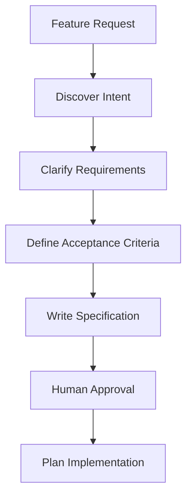
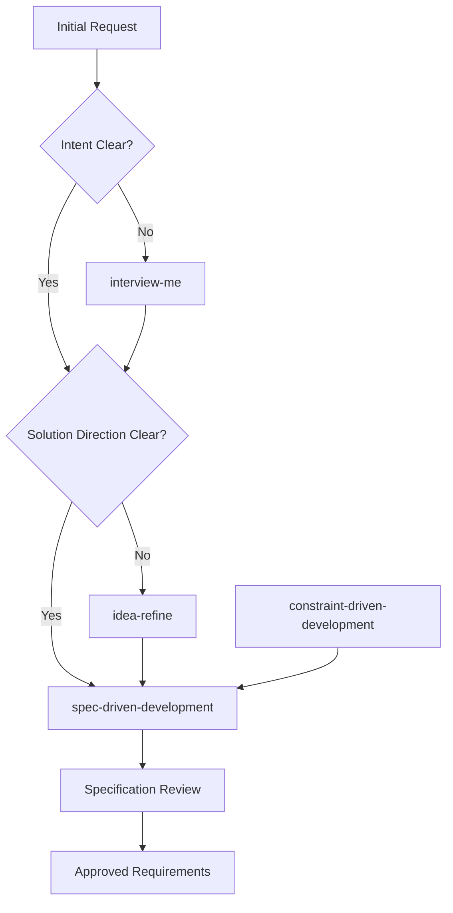
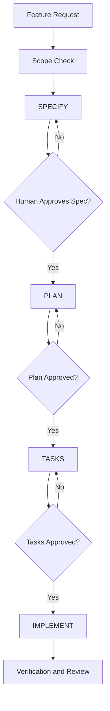
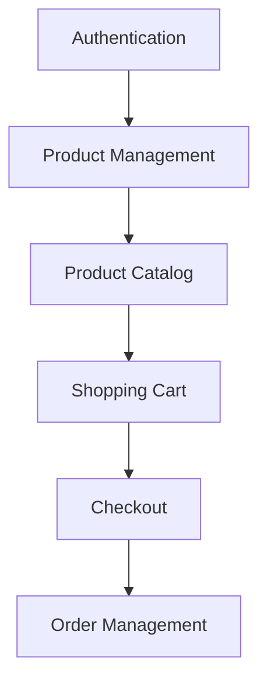
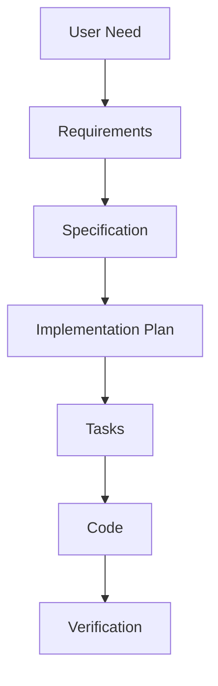
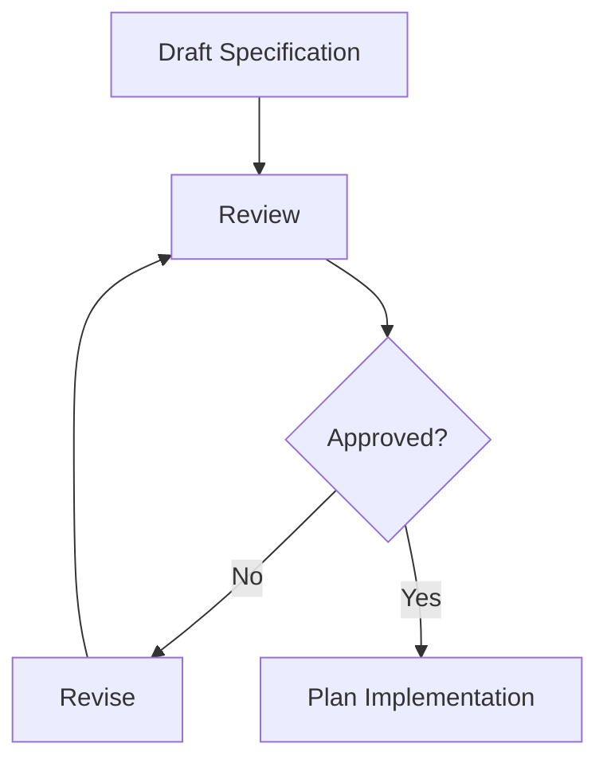

# 05 — Requirements and Spec-Driven Development

> [!abstract] Lesson Overview
> **Repository:** [addyosmani/agent-skills](https://github.com/addyosmani/agent-skills)
>
> **Focus:** Transforming ambiguous software requests into clear, testable, approved specifications.
>
> **Primary Skills:** `interview-me`, `idea-refine`, `spec-driven-development`, `constraint-driven-development`
>
> **Prerequisites:** Lessons 00–04
>
> **Learning Outcome:** Understand how an AI coding agent should discover intent, clarify requirements, define scope, establish constraints, and prepare a specification before implementation.

---

# Part I — Learning Objectives

After completing this lesson, you should be able to:

1. Define requirements engineering and explain why it precedes implementation.
2. Distinguish user requests from underlying needs.
3. Identify functional and non-functional requirements.
4. Surface assumptions, ambiguities, stakeholders, constraints, and success criteria.
5. Explain the four Define-phase skills.
6. Understand the gated Specify → Plan → Tasks → Implement workflow.
7. Define acceptance criteria, capability maps, approval gates, traceability, and scope boundaries.
8. Apply specification workflows to Android, Laravel, and Next.js.
9. Evaluate whether a specification is ready for planning.

---

# Part II — Requirements Engineering Fundamentals

Requirements engineering discovers, analyzes, documents, validates, and manages what a system must accomplish. It asks:

- What problem are we solving?
- Who experiences it?
- What should the system do?
- What constraints apply?
- How will we know it works?

Example:

```text
Request:
Build a dashboard.

Possible underlying need:
Administrators need to identify active buses
and routes without available vehicles.
```

The request suggests a solution; the need defines an outcome.

> [!important]
> **A feature request describes what someone thinks should be built. Requirements engineering determines what actually needs to be achieved.**

---

# Part III — Avoiding Implementation-First Development

AI agents can write code quickly, which creates pressure to implement before important questions are answered:

- Who can use the feature?
- Which data should appear?
- What existing architecture applies?
- What happens on empty, invalid, or failed states?
- What tests and security rules are required?



Specification reduces misunderstandings while they are still inexpensive to correct.

---

# Part IV — Four Define-Phase Skills

| Skill | Primary question | Deliverable |
|---|---|---|
| `interview-me` | What does the user actually need? | Confirmed intent |
| `idea-refine` | Which solution direction is worth pursuing? | Refined concept |
| `spec-driven-development` | What exactly must be built? | Approved specification |
| `constraint-driven-development` | What quality and operating boundaries apply? | Explicit constraints |



This is a decision model, not a mandatory sequence for every task.

---

# Part V — Intent Discovery and `interview-me`

A useful intent statement identifies:

| Element | Question |
|---|---|
| Outcome | What should improve? |
| User | Who benefits? |
| Motivation | Why is it needed? |
| Success | How will improvement be measured? |
| Constraint | What limits the solution? |
| Out of scope | What must not be built? |

`interview-me` is useful when the user, purpose, success criteria, or constraints are unclear. Its approach is to state a hypothesis, expose uncertainty, ask one focused question at a time, progressively clarify, and restate the final intent for confirmation.

Example:

```text
Current understanding:
Students should see project completion progress.

Question:
Should progress represent overall project completion
or individual member contributions?
```

One focused question reduces cognitive load and avoids a large, unfocused questionnaire.

The final restatement should be explicitly confirmed. Any confidence threshold is only a heuristic, not proof that requirements are correct.

---

# Part VI — Idea Refinement

`idea-refine` helps turn an early concept into a justified direction.

## Divergent thinking

Generate reasonable alternatives before committing:

- Completed-task counts.
- Contribution history.
- Progress indicators.
- Activity summaries.

## Convergent thinking

Evaluate options against user value, effort, existing data, MVP fit, and maintainability.

| Approach | User value | Complexity | MVP fit |
|---|---:|---:|---|
| Completed-task count | High | Low | Strong |
| Activity timeline | Medium | Medium | Depends |
| Automated contribution scoring | Uncertain | High | Weak |
| Status summary | High | Low | Strong |

Refined concept:

```text
Feature: Member contribution summary
Purpose: Show completed assigned tasks per member
Data: Existing assignment and status fields
Scope: Read-only counts
Excluded: Automated grading and rankings
```

Explore alternatives when solution direction is uncertain, then stop when a sufficiently justified direction is selected.

---

# Part VII — Spec-Driven Development

Spec-driven development defines expected behavior before implementation. A specification becomes a shared technical description of what will be built, why it matters, which constraints apply, and how success will be verified.

Example:

```text
Feature: User sign-in
Actors: Registered users
Inputs: Email and password
Success: User reaches the appropriate application area
Failure: Invalid credentials show a clear error
Constraint: Follow the existing authentication architecture
```

Writing the specification first exposes misunderstandings before they become code.

---

# Part VIII — The Gated Workflow

The repository's `spec-driven-development` workflow uses four major phases, with a conditional scope check for large requests:

1. Specify.
2. Plan.
3. Tasks.
4. Implement.



After writing the specification, save it, summarize it, identify unresolved questions, request approval, and stop. Do not silently proceed to planning or coding.

---

# Part IX — Capability Mapping

Large requests may contain multiple independently testable capabilities. For example, an e-commerce system may include authentication, product management, inventory, cart, checkout, orders, and administration.



| Module | Responsibility | Depends on |
|---|---|---|
| AUTH | Identity and access | None |
| PROD | Product management | AUTH for protected actions |
| CART | Cart operations | PROD |
| ORDER | Order creation | CART and product data |

Capability mapping helps establish boundaries, dependencies, ownership, implementation order, and independently testable outcomes. It is useful for genuinely large requests, not for a simple form change.

---

# Part X — Specification Areas

The repository's specification workflow centers on:

1. Objective.
2. Commands.
3. Project structure.
4. Code style.
5. Testing strategy.
6. Boundaries.

It also benefits from explicit stakeholders, scope, success criteria, assumptions, open questions, and approval status.

## Objective

Define what is being built, why, who benefits, and what success means.

## Commands

Document actual project commands such as `npm run build`, `npm run lint`, or `php artisan test`. Verify commands against the repository; never invent scripts.

## Project structure

Identify where relevant source, tests, configuration, and documentation belong.

## Code style

Record naming, formatting, architectural boundaries, error handling, and existing examples.

## Testing strategy

Define test levels, frameworks, cases, commands, and acceptance evidence.

## Boundaries

Define what the agent must always do, must ask before doing, and must never do.

---

# Part XI — Always / Ask First / Never

```text
Always:
- Follow existing conventions.
- Validate input.
- Run relevant tests.
- Review changed files.

Ask First:
- Modify the database schema.
- Add major dependencies.
- Change CI configuration.
- Expand approved scope.

Never:
- Commit credentials.
- Modify unrelated production data.
- Remove failing tests to make checks pass.
- Ignore explicit constraints.
```

Boundaries prevent a broad request from being interpreted as unlimited permission. They supplement, but do not override, tool permissions and instruction priorities.

---

# Part XII — Assumptions and Requirements

An assumption is something treated as true without confirmation. Examples include who can approve requests, whether existing statuses are reused, and whether archived data is read-only.

Use an assumption register:

| ID | Assumption | Impact | Status |
|---|---|---|---|
| A-01 | Only leaders approve join requests | High | Needs confirmation |
| A-02 | Existing task statuses are reused | Medium | Confirmed |
| A-03 | Archived projects are read-only | High | Needs confirmation |

Before writing a final specification, identify material assumptions, explain their implications, ask for confirmation, record unresolved items, and avoid presenting assumptions as facts.

## Functional requirements

Describe observable behavior:

```text
FR-001: Display members grouped by project.
FR-002: Display each member's role.
FR-003: Display completed assigned-task count.
```

Avoid vague wording such as “manage members.”

## Non-functional requirements

Describe quality attributes and constraints such as performance, security, accessibility, compatibility, reliability, and maintainability. Make them measurable where practical, but do not invent numerical targets without agreement.

---

# Part XIII — Acceptance and Success Criteria

Acceptance criteria define observable conditions for a specific requirement:

```text
Given a member has assigned tasks
When the member opens the Tasks page
Then the system displays those tasks
```

Example:

```text
AC-001: Selecting Working shows Working tasks.
AC-002: Selecting For Review shows For Review tasks.
AC-003: No matches display an appropriate empty state.
```

Acceptance criteria establish feature behavior. Success criteria describe whether the larger intended outcome has been achieved.

```text
Acceptance: Selecting a status shows matching tasks.
Success: Members can reliably identify pending work.
```

Both perspectives matter.

---

# Part XIV — Requirements, Specifications, Plans, and Tasks

| Artifact | Main question |
|---|---|
| Requirement | What must the system do? |
| Specification | What behavior and constraints are agreed? |
| Plan | How will it be implemented? |
| Task | What concrete unit comes next? |



Example:

```text
Requirement: Display completed task counts.
Specification: Count assigned tasks with status DONE by member.
Plan: Reuse existing data access and update the Members page.
Task: Add the query and verify its results.
```

---

# Part XV — Approval, Living Specifications, and Traceability

A specification written by an agent is a draft until an authorized human reviews and approves it.



Review objective, scope, requirements, quality attributes, assumptions, acceptance criteria, constraints, and open questions.

Specifications may change with stakeholder feedback or technical discoveries. For a material change:

1. Identify the change.
2. Evaluate impact.
3. Update the specification.
4. Obtain approval where required.
5. Update plans and tasks.
6. Implement and verify.

Requirements traceability connects requirements to implementation and evidence:

| Requirement | Component | Verification |
|---|---|---|
| FR-001: Display members | Members UI | UI verification |
| FR-002: Display roles | Member row | Rendering test |
| FR-003: Count DONE tasks | Data layer | Query test |
| FR-004: Empty state | Members UI | Empty-state test |

---

# Part XVI — Scope Control and Case Studies

Scope creep occurs when work expands beyond approved requirements. A Members page does not automatically authorize rankings, grading, badges, or analytics.

## GroupTrack Android

For a Members page, define actors, grouped projects, roles, completed-task counts, loading/empty/error states, retry behavior, and archived labels. Constrain the work to the existing Android architecture and MVP. Exclude contribution grading, gamification, and unrelated collaboration modules.

## GoPasig Laravel

For schedule conflict validation, clarify overlap rules, buffers, multiple non-overlapping shifts, override roles, and simultaneous updates. Preserve existing Laravel conventions, authorization, and database behavior.

## Next.js and Laravel e-commerce

For product creation, specify frontend form behavior, API submission, server validation, authorization, persistence, success, and error feedback. Resolve mandatory fields, images, roles, duplicate identifiers, and inventory behavior before approval.

These examples are candidate requirements for study; real projects require stakeholder confirmation.

---

# Part XVII — Reusable Specification Template

```markdown
# Feature Specification: [Feature Name]

## Objective
What problem are we solving? Who benefits? What outcome defines success?

## Scope
### In Scope
- ...
### Out of Scope
- ...

## Stakeholders
- ...

## Functional Requirements
- FR-001:

## Non-Functional Requirements
- NFR-001:

## Technology Stack
- ...

## Development Commands
- Build:
- Test:
- Lint:

## Project Structure
- ...

## Code Style
- ...

## Testing Strategy
- Unit:
- Integration:
- UI / End-to-End:

## Boundaries
### Always
- ...
### Ask First
- ...
### Never
- ...

## Acceptance Criteria
- AC-001:

## Assumptions
- ...

## Open Questions
- ...

## Success Criteria
- ...

## Approval
Status: Draft / Approved / Revision Required
Approved By:
Date:
```

This is an educational template based on the repository's core areas, not a verbatim copy.

---

# Part XVIII — Example Codex Workflow

```text
@spec-driven-development

I want to add a Members page to our Android application.

Before implementation:
1. Review AGENTS.md and documentation.
2. Identify the user problem.
3. Extract functional and non-functional requirements.
4. Surface assumptions and open questions.
5. Define acceptance criteria.
6. Document scope boundaries.
7. Produce a reviewable specification.

Do not write application code.
Stop after the specification and wait for approval.
```

Expected output: a specification, assumptions, open questions, acceptance criteria, and an approval request.

The agent should not create Activities, modify layouts, add Firebase queries, change the database, or start implementation during this phase.

---

# Part XIX — Rationalizations and Red Flags

| Shortcut | Better response |
|---|---|
| “The feature is simple.” | Use proportionate acceptance criteria. |
| “I will document it after coding.” | Clarify expected behavior first. |
| “The user knows what they want.” | Confirm material assumptions. |
| “Requirements may change.” | Maintain a living specification. |
| “Planning will resolve everything.” | Define scope and boundaries first. |
| “I can implement while writing the spec.” | Respect the approval gate. |
| “More features make it better.” | Follow approved scope. |

Warning signs include code before requirements, invented business rules, missing acceptance criteria, undefined scope, ignored stakeholders, one unmanageable specification for a huge request, unreviewed architecture changes, assumed approval, unrequested features, and tests that cannot be traced to requirements.

Corrective action: return to the earliest unresolved decision.

---

# Part XX — Specification Readiness Checklist

- [ ] The user problem is understood.
- [ ] Intended users are identified.
- [ ] Objective and scope are documented.
- [ ] Functional requirements are testable.
- [ ] Relevant quality requirements are identified.
- [ ] Assumptions and open questions are visible.
- [ ] Acceptance criteria are defined.
- [ ] Actual development commands are recorded.
- [ ] Project structure and conventions are understood.
- [ ] Testing strategy is defined.
- [ ] Always / Ask First / Never boundaries are established.
- [ ] Large capabilities are separated where appropriate.
- [ ] Specification is saved in the agreed location.
- [ ] Authorized reviewer has approved it.

> [!important]
> **An unapproved specification is a draft, not permission to begin implementation.**

---

# Part XXI — Practical Exercises

1. Explain requirements engineering.
2. Rewrite “Build a better dashboard” and identify missing information.
3. Create three focused `interview-me` questions.
4. Generate and compare three solutions for contribution visibility.
5. Select the appropriate Define-phase skill for five requests.
6. Write five functional requirements for task management.
7. Write five non-functional requirements for Android.
8. Convert requirements into Given–When–Then scenarios.
9. Build an assumption register for authentication.
10. Write Always / Ask First / Never rules for Laravel.
11. Decompose e-commerce into capabilities and dependencies.
12. Explain the specification approval gate.
13. Identify scope creep in a Members page.
14. Create a requirements-to-tests traceability matrix.
15. Describe change management for a living specification.
16. Draft the GroupTrack Members-page specification.
17. Identify unanswered GoPasig conflict-validation questions.
18. Write product-creation acceptance criteria.
19. Review whether a specification is implementation-ready.
20. Create a complete specification containing objectives, scope, requirements, constraints, criteria, commands, structure, testing, boundaries, assumptions, questions, success, traceability, and approval.

---

# Part XXII — Knowledge Check

1. What is requirements engineering?
2. Why are user requests different from user needs?
3. What is premature implementation?
4. What do `interview-me`, `idea-refine`, `spec-driven-development`, and `constraint-driven-development` do?
5. What are divergent and convergent thinking?
6. What are the four gated phases?
7. What is capability mapping?
8. What are the six core specification areas?
9. What is an assumption register?
10. What are functional and non-functional requirements?
11. What are acceptance criteria?
12. How do success criteria differ from acceptance criteria?
13. What are technical constraints?
14. What does Always / Ask First / Never mean?
15. How do requirements, specifications, plans, and tasks differ?
16. Why are approval gates important?
17. What is a living specification?
18. What is requirements traceability?
19. What is scope creep?
20. When is a specification ready for planning?

---

# Part XXIII — Key Takeaways

> [!summary]
> - Requirements engineering identifies what the system must accomplish.
> - User requests and underlying needs are not always identical.
> - `interview-me` clarifies ambiguous intent.
> - `idea-refine` evaluates solution directions.
> - `spec-driven-development` converts requirements into an agreed specification.
> - `constraint-driven-development` establishes operating boundaries.
> - Functional requirements define behavior; non-functional requirements define quality and constraints.
> - Acceptance criteria make requirements verifiable.
> - Assumptions should be surfaced rather than silently accepted.
> - Large requests may need capability mapping.
> - The gated workflow is Specify, Plan, Tasks, and Implement.
> - Human approval separates specification from planning.
> - Specifications should evolve visibly as requirements change.
> - Traceability connects expectations to implementation and tests.
> - Scope boundaries prevent overengineering.

> [!important] Final Principle
> **Spec-driven development turns assumptions into explicit decisions, vague requests into testable requirements, and unapproved ideas into reviewed engineering agreements before implementation begins.**

---

# Part XXIV — Official References

## Primary Repository

- [Agent Skills Repository](https://github.com/addyosmani/agent-skills)
- [interview-me Skill](https://github.com/addyosmani/agent-skills/blob/main/skills/interview-me/SKILL.md)
- [idea-refine Skill](https://github.com/addyosmani/agent-skills/blob/main/skills/idea-refine/SKILL.md)
- [spec-driven-development Skill](https://github.com/addyosmani/agent-skills/blob/main/skills/spec-driven-development/SKILL.md)
- [constraint-driven-development Skill](https://github.com/addyosmani/agent-skills/blob/main/skills/constraint-driven-development/SKILL.md)
- [Skill Anatomy](https://github.com/addyosmani/agent-skills/blob/main/docs/skill-anatomy.md)

## Supporting Documentation

- [OpenAI Codex Documentation](https://developers.openai.com/codex/)
- [Agent Skills Specification](https://agentskills.io/specification)
- [ISO/IEC/IEEE 29148 — Requirements Engineering](https://www.iso.org/standard/72089.html)
- [Git Documentation](https://git-scm.com/doc)

> [!note] Documentation Scope
> This lesson is based on the public Agent Skills repository and its documented specification workflow. Examples are educational illustrations, not approved production specifications. No application code was modified and no specification was submitted for approval during this lesson.

---

# Part XXV — Next Lesson

**[[06 - Planning and Task Breakdown]]**

Topics:

1. Technical implementation planning.
2. Translating specifications into architecture.
3. Task decomposition and dependency analysis.
4. Vertical slicing and implementation order.
5. Task sizing and acceptance criteria.
6. Verification checkpoints and risk assessment.
7. Parallel versus sequential work.
8. The `planning-and-task-breakdown` skill.
9. Android, Laravel, and Next.js examples.
10. Practical exercises and references.

**End of Lesson 05 — Requirements and Spec-Driven Development.**
