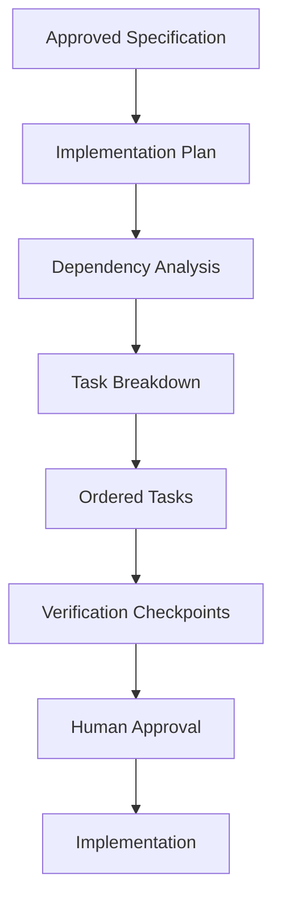
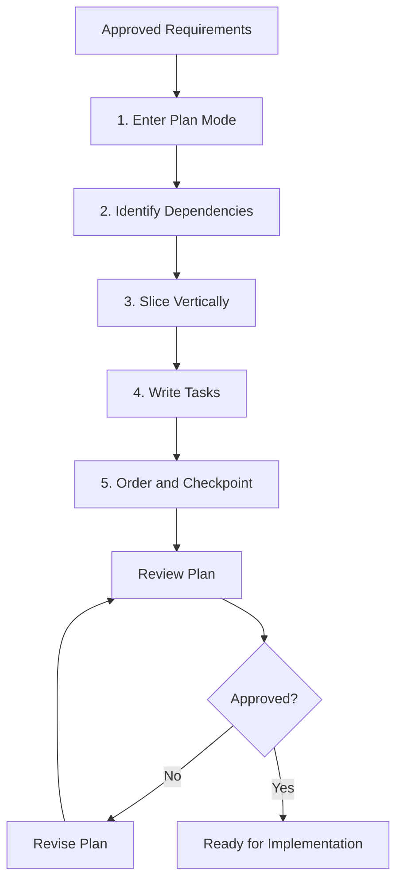
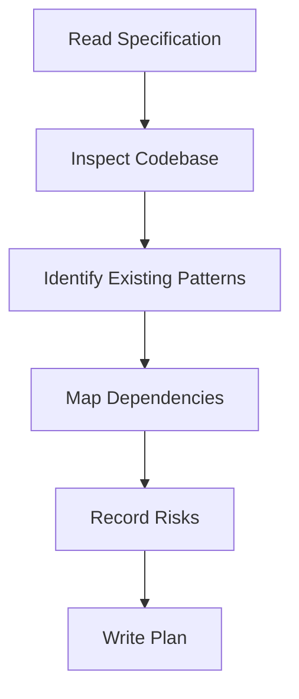
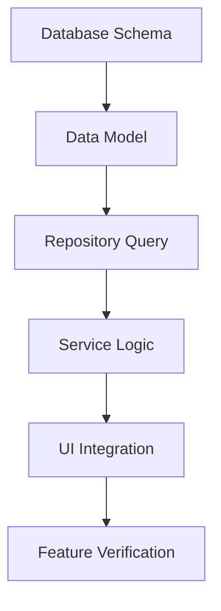
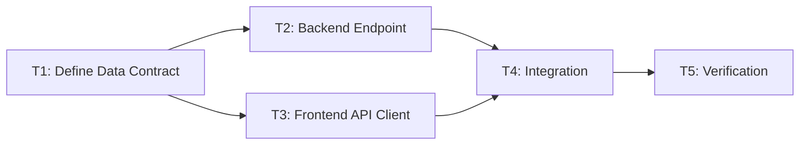
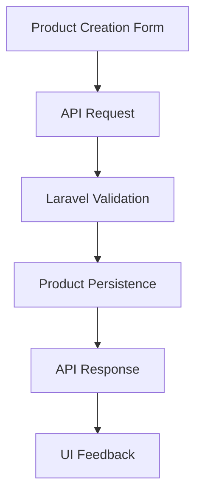
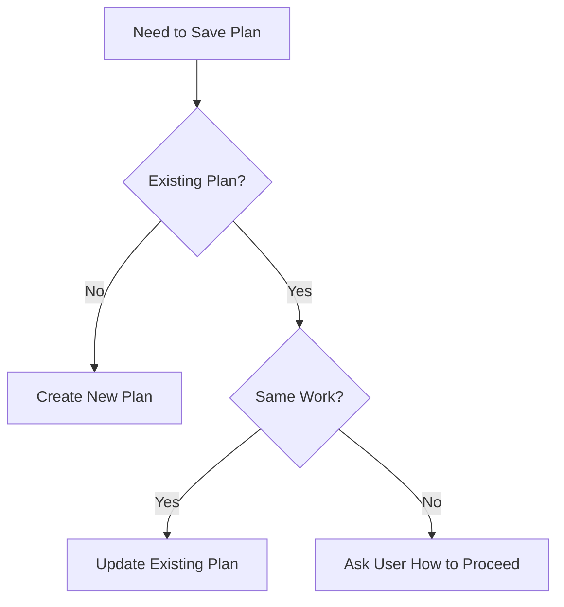
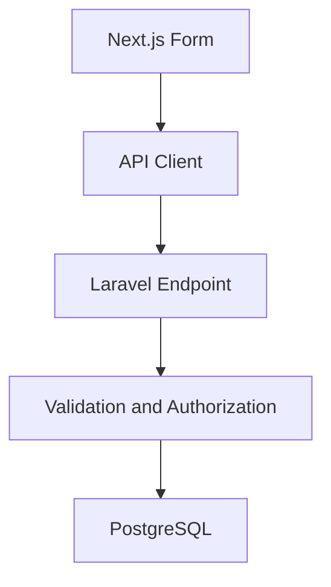
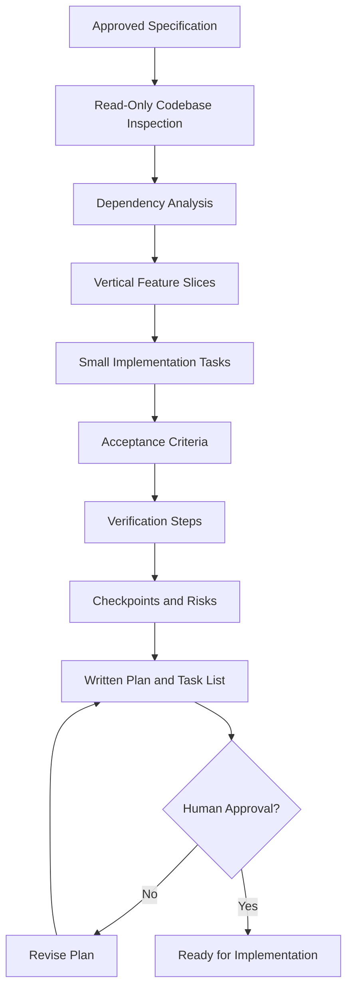

# 06 — Planning and Task Breakdown

> [!abstract] Lesson Overview
> **Repository:** [addyosmani/agent-skills](https://github.com/addyosmani/agent-skills)
>
> **Primary Skill:** `planning-and-task-breakdown`
>
> **Purpose:** Transform an approved specification into an ordered, dependency-aware, testable implementation plan.
>
> **Prerequisites:**
> - [[00 - Repository Overview and Purpose]]
> - [[01 - Agent Skills Fundamentals]]
> - [[02 - Repository Architecture and SKILL.md Anatomy]]
> - [[03 - Installation and Codex Integration]]
> - [[04 - Skills Discovery and Progressive Disclosure]]
> - [[05 - Requirements and Spec-Driven Development]]
>
> **Learning Approach:** Theory First — no application code will be implemented.

---

# Part I — Learning Objectives

After completing this lesson, you should be able to:

1. Define implementation planning.
2. Explain the difference between specifications, plans, and tasks.
3. Understand the purpose of the `planning-and-task-breakdown` skill.
4. Explain read-only planning.
5. Identify architectural dependencies.
6. Construct dependency graphs.
7. Understand topological ordering.
8. Compare horizontal and vertical slicing.
9. Decompose large features into smaller tasks.
10. Apply task-sizing guidelines.
11. Write measurable task acceptance criteria.
12. Define task-level verification.
13. Understand task dependencies and blockers.
14. Identify high-risk work.
15. Plan verification checkpoints.
16. Understand task parallelization.
17. Distinguish independent from dependent work.
18. Understand planning artifacts.
19. Manage existing incomplete plans safely.
20. Understand external issue-tracker integration.
21. Avoid overengineering.
22. Define implementation readiness.
23. Apply planning concepts to Android, Laravel, and Next.js.
24. Evaluate an implementation plan before coding.

---

# Part II — What Is Implementation Planning?

## 1. Definition

**Implementation planning** is the process of translating approved requirements into a structured approach for building, testing, and verifying software.

A specification explains **what must be built**. An implementation plan explains **how the work should be organized**. A task describes **one concrete unit of work**.

## 1.1 Example

Suppose the approved requirement is:

> Members must be able to view their assigned tasks across all projects.

The plan identifies existing data sources, required queries, UI components, integration boundaries, task dependencies, and verification procedures.

## 1.2 Relationship



> [!important]
> **Planning is not implementation. Planning determines the work that should be performed before code changes begin.**

---

# Part III — Why Planning Matters in Agentic Development

AI coding agents can produce code quickly, but speed does not guarantee understanding of existing architecture, feature dependencies, business rules, testing strategy, or integration risks.

Without planning, an agent may modify several components before discovering that its approach is incorrect.

## 2.1 Planning-First Approach

For a project progress dashboard, investigate:

1. Where task statuses are stored.
2. How project membership works.
3. Whether progress is already calculated.
4. Which UI components can be reused.
5. What verification is required.

The result may be a much smaller implementation.

> The purpose of planning is not to create more documentation. It is to reduce uncertainty and prevent unnecessary work.

---

# Part IV — The planning-and-task-breakdown Skill

## 3. Purpose

The `planning-and-task-breakdown` skill guides agents in decomposing work into small, ordered, verifiable tasks. Use it when a specification exists, requirements are sufficiently clear, a task is too large for one reliable step, dependencies are unclear, multiple agents may participate, or a reviewable plan is needed.

## 3.1 When Not to Use It

Full planning may be unnecessary for a simple single-file change with obvious scope or for a specification that already contains sufficiently detailed implementation tasks.

## 3.2 Core Philosophy

Each task should be small enough to understand, implement, test, and verify—ideally within one focused working session.

---

# Part V — The Five-Step Planning Process

The skill defines five major steps:

1. Enter Plan Mode.
2. Identify the Dependency Graph.
3. Slice Vertically.
4. Write Tasks.
5. Order and Checkpoint.



---

# Part VI — Step 1: Enter Plan Mode

## 5. Read-Only Planning

During planning, the agent should read the specification, inspect relevant source files, understand the architecture, identify dependencies, record risks, and document unresolved questions.

The agent should not modify application code during this phase. Read-only planning does not prevent writing planning artifacts; it prevents implementation from beginning prematurely.



---

# Part VII — Codebase Exploration Before Planning

Inspect only relevant code. Large-scale exploration may waste context without improving the plan.

### Android

- Activities or Fragments.
- XML layouts.
- Data models and repositories.
- Firebase integration.
- Navigation and tests.

### Laravel

- Routes, controllers, services, models, migrations, validation classes, and tests.

### Next.js

- App Router structure, components, API clients, types, state management, tests, and package scripts.

Before planning, ask:

1. What already exists?
2. What can be reused?
3. Which files are likely affected?
4. Which dependencies are involved?
5. Which behaviors must remain unchanged?
6. How is the current system tested?

---

# Part VIII — Step 2: Dependency Analysis

A dependency exists when one task requires another task's output before it can proceed.



Incorrect ordering can cause rework, integration failures, blocked tasks, duplicate implementations, and unnecessary assumptions.

> Build or confirm required foundations before implementing components that depend on them.

---

# Part IX — Dependency Graphs

A dependency graph represents tasks as nodes and dependency relationships as directed edges. For many plans, the graph should be acyclic; a cycle may indicate unclear task boundaries.



| Task | Depends On |
|---|---|
| T1 — Define contract | None |
| T2 — Implement endpoint | T1 |
| T3 — Implement API client | T1 |
| T4 — Integrate | T2, T3 |
| T5 — Verify flow | T4 |

---

# Part X — Topological Ordering

Topological ordering is a sequence of tasks that respects dependencies. If B depends on A, A must be completed first.

Dependencies:

```text
T1 → T2
T1 → T3
T2 → T4
T3 → T4
```

Valid orders include `T1 → T2 → T3 → T4` and `T1 → T3 → T2 → T4`. `T4 → T1 → T2 → T3` is invalid.

Independent tasks may have multiple valid orders, but priority does not remove dependencies.

---

# Part XI — Step 3: Vertical Slicing

**Vertical slicing** divides a feature into small, complete user-facing capabilities across architectural layers.

```text
UI → API → Business Logic → Database
```

Horizontal slicing organizes work by layer:

```text
All database work → all backend work → all frontend work → integration
```

Vertical slicing organizes work by capability:

```text
User can register → user can sign in → user can create a task → user can view tasks
```

| Horizontal Slicing | Vertical Slicing |
|---|---|
| Organized by technical layer | Organized by working capability |
| Integration may happen late | Integration happens incrementally |
| Harder to demonstrate progress | Easier to verify behavior |
| Can produce unfinished layers | Produces smaller completed flows |

Vertical slicing is preferred where practical, but necessary foundations such as a migration or API contract may still come first.

---

# Part XII — Vertical Slice Architecture

## 11. Example: Product Creation



A complete slice can verify valid submission, invalid submission, authorization, persistence, and UI feedback. Keep slices small; inventory, media processing, and supplier management may be separate approved capabilities.

---

# Part XIII — Step 4: Writing Tasks

Each task should include a title, description, acceptance criteria, verification, dependencies, likely files, and estimated scope.

```markdown
## Task [N]: [Short Title]

**Description:**
Explain the intended change.

**Acceptance Criteria:**
- [ ] Observable condition 1
- [ ] Observable condition 2

**Verification:**
- [ ] Relevant test passes
- [ ] Relevant build succeeds
- [ ] Manual behavior is checked

**Dependencies:** Task numbers or None

**Files Likely Touched:**
- path/to/file
- path/to/test

**Estimated Scope:** Small / Medium / Large
```

Structured tasks are easier to estimate, delegate, verify, resume, and review.

---

# Part XIV — Task Acceptance Criteria

Weak:

> Implement the Members page.

Better:

> Display existing project members with their names and roles using the current data model.

```markdown
- [ ] Members appear under the correct project.
- [ ] Each member displays the expected name and role.
- [ ] The empty state appears when no members exist.
```

Good criteria are specific, testable, relevant, limited in scope, and traceable to approved requirements. They must not introduce unapproved features.

---

# Part XV — Task-Level Verification

Acceptance criteria describe expected behavior; verification describes how to check it.

| Type | Purpose |
|---|---|
| Unit test | Verify isolated logic |
| Integration test | Verify components together |
| Build check | Detect compilation or build failures |
| UI check | Verify visible behavior |
| Manual review | Inspect expected outcomes |
| Diff review | Detect unrelated modifications |

A task is not complete merely because code was written. Completion requires appropriate evidence.

---

# Part XVI — Task Sizing

| Size | Files | Typical Scope |
|---|---:|---|
| XS | 1 | Small function or configuration change |
| S | 1–2 | One component or endpoint |
| M | 3–5 | One feature slice |
| L | 5–8 | Multi-component feature |
| XL | 8+ | Should be decomposed further |

The repository favors Small and Medium tasks. File count is a heuristic, not a universal measure of complexity; a one-file security change may exceed a five-file UI change in risk.

Split tasks when they exceed one focused session, have too many acceptance criteria, involve independent subsystems, combine separate outcomes, or become difficult to verify.

---

# Part XVII — Task Decomposition

Instead of:

```text
Build the entire task management system
```

use:

```text
T1: Confirm task data model
T2: Implement task creation
T3: Implement task listing
T4: Implement task status updates
T5: Implement task filtering
T6: Verify complete task workflow
```

Each task should have one coherent objective. A title such as “Implement login and reporting and notifications” likely contains several tasks.

---

# Part XVIII — Risk-Driven Planning

Risk is uncertainty that could negatively affect the project.

| Risk | Impact | Mitigation |
|---|---|---|
| Existing query cannot support required data | Medium | Inspect data layer early |
| API contract is unclear | High | Confirm contract before implementation |
| New UI conflicts with navigation | Medium | Review navigation architecture |
| Database change may affect existing data | High | Require approval and migration review |

Address high-risk work early to discover blockers before substantial work is completed. Investigate risk early, but do not implement without required approval.

---

# Part XIX — Step 5: Ordering and Checkpoints

A checkpoint is a planned pause for verification and review. The repository recommends checkpoints after approximately every two or three tasks.

```text
Task 1: Implement data query
Task 2: Implement UI rendering

CHECKPOINT:
- Build passes
- Data displays correctly
- No unrelated changes

Task 3: Add loading and empty states
Task 4: Add error handling

CHECKPOINT:
- All states verified
- Relevant tests pass
```

Checkpoints detect regressions early, limit accumulated errors, support human review, improve progress visibility, and reduce difficult debugging sessions.

---

# Part XX — The Definition of Done

A **Definition of Done** is a shared quality standard for completed work; it differs from task-specific acceptance criteria.

Example project-wide standards:

- Relevant tests pass.
- Code follows project conventions.
- No unrelated files are modified.
- Security requirements are respected.
- Completion evidence is recorded.

| Acceptance Criteria | Definition of Done |
|---|---|
| Task-specific behavior | Shared quality standard |
| Varies by feature | Applies across relevant tasks |
| Expected behavior exists | Work meets completion standards |

Both are necessary for reliable task completion.

---

# Part XXI — Planning Artifacts

The default planning structure is:

```text
tasks/
├── plan.md
└── todo.md
```

`tasks/plan.md` contains the implementation strategy, architecture decisions, task index, risks, mitigations, and open questions.

`tasks/todo.md` contains actionable tasks with descriptions, acceptance criteria, verification, dependencies, likely files, and estimated scope.

The plan records reasoning and strategy; the task list records executable work and progress.

---

# Part XXII — Example plan.md

```markdown
# Implementation Plan: [Feature Name]

## Overview
Describe the approved feature.

## Architecture Decisions
- Decision 1 and rationale.
- Decision 2 and rationale.

## Task List
### Phase 1 — Foundation
- [ ] Task 1
- [ ] Task 2

### Checkpoint 1
- [ ] Relevant tests pass.
- [ ] Build succeeds.

## Risks and Mitigations
| Risk | Impact | Mitigation |
|---|---|---|
| ... | ... | ... |

## Open Questions
- ...

## Approval
Status: Draft
```

This is an educational template; actual plans must reflect project requirements and architecture.

---

# Part XXIII — Example todo.md

```markdown
# Implementation Tasks

## Task 1 — Inspect Existing Data Access

**Description:** Identify how the application currently retrieves project members and completed tasks.

**Acceptance Criteria:**
- [ ] Existing data sources are identified.
- [ ] Required data relationships are documented.

**Verification:**
- [ ] Findings match the inspected source files.

**Dependencies:** None
**Files Likely Touched:** Existing repository and model files (inspection only)
**Estimated Scope:** Small

---

## Task 2 — Implement Required Data Query

**Description:** Add the minimum data-access behavior needed by the approved Members page.

**Acceptance Criteria:**
- [ ] Required members can be retrieved.
- [ ] Completed-task counts are correct.

**Verification:**
- [ ] Relevant query tests pass.

**Dependencies:** Task 1
**Estimated Scope:** Medium
```

Finalize paths and verification commands after inspecting the actual codebase.

---

# Part XXIV — Protecting Existing Incomplete Plans

Before writing `tasks/plan.md` or `tasks/todo.md`, check whether they already exist.

If the files describe the same work, update them appropriately. If they contain incomplete tasks for another feature, stop and ask the user how to proceed. Do not silently delete, overwrite, or rename them.



Incomplete plans may represent work in another session; overwriting them can destroy project state.

---

# Part XXV — External Task Trackers

When an external tracker is designated by the user or project rules—such as GitHub Issues, Jira, or Linear—use it for individual tasks rather than creating a competing local checklist.

`plan.md` should still record architecture decisions, risks, open questions, task order, and tracker references. Avoid duplicate sources of truth.

```text
tasks/plan.md → Task Index → GitHub Issues
                              ├── Issue #21
                              ├── Issue #22
                              └── Issue #23
```

The issue numbers are illustrative.

---

# Part XXVI — Parallel vs Sequential Work

Parallelization is appropriate when tasks are independent, ownership is clear, and shared interfaces are stable.

Potential parallel candidates include independent UI components, documentation for completed interfaces, tests for stable functionality, and separate features with no shared mutable files.

Sequential examples include a migration before code requiring its schema, an API contract before client integration, a shared model change before dependent features, and integration verification after components exist.

Frontend and backend teams may work independently once an API contract is approved.

---

# Part XXVII — Parallelization Risks

Parallel agents may modify the same files, make incompatible assumptions, introduce conflicting interfaces, duplicate functionality, or overwrite changes.

For example, a backend returning `product_name` conflicts with a frontend expecting `name`.

Better approach:

1. Define the API contract.
2. Assign clear ownership.
3. Identify shared files.
4. Parallelize independent implementation.
5. Integrate.
6. Verify.

Parallelization is not automatically faster; coordination overhead can exceed the time saved on small tasks.

---

# Part XXVIII — Task Ownership and Coordination

Each task should have a responsible party when multiple developers or agents are involved.

| Task | Owner | Dependency |
|---|---|---|
| API contract | Developer A | None |
| Backend endpoint | Developer B | API contract |
| Frontend form | Developer C | API contract |
| Integration testing | Developer A | Backend and frontend |

Ownership clarifies who performs the task, which files are involved, the expected deliverable, verification, and integration review. Multiple agents should not independently modify shared architecture without coordination.

---

# Part XXIX — Risk vs Priority vs Dependency

**Risk** asks what could go wrong. **Priority** asks how important the task is. **Dependency** asks what must happen first.

| Task | Priority | Risk | Dependency |
|---|---|---|---|
| Define API contract | High | Medium | None |
| Implement product form | High | Low | Contract |
| Implement backend validation | High | Medium | Contract |
| Add optional animations | Low | Low | Core UI |

A high-priority task may still be blocked; a high-risk task should often be investigated early; a low-priority task should not expand approved scope.

---

# Part XXX — Avoiding Overengineering

Common planning mistakes include too many tasks, tasks that are too large, unnecessary architecture, missing dependencies, no verification, unapproved scope expansion, and overwriting existing work.

> Plan the smallest set of tasks that can deliver the approved behavior reliably.

---

# Part XXXI — GroupTrack Android Case Study

## 30. Feature: Members Page

Approved behavior:

- Group members by project.
- Display member names and roles.
- Show completed assigned-task counts.
- Handle loading, empty, and error states.
- Respect existing MVP constraints.

| Task | Objective | Dependencies |
|---|---|---|
| T1 | Inspect existing member and task data access | None |
| T2 | Implement missing aggregation query, if required | T1 |
| T3 | Render project-grouped member rows | T1, T2 if needed |
| T4 | Add loading, empty, error, and Retry states | T3 |
| T5 | Verify navigation, data, and archived labels | T3, T4 |

These are illustrative tasks. Actual boundaries require current source inspection.

---

# Part XXXII — GoPasig Laravel Case Study

## 31. Feature: Schedule Conflict Validation

Goal: prevent invalid schedule assignments according to approved business rules.

| Task | Objective | Dependencies |
|---|---|---|
| T1 | Inspect current scheduling rules and validation | None |
| T2 | Define test cases for approved conflicts | T1 |
| T3 | Implement minimal validation corrections | T2 |
| T4 | Verify valid and invalid scheduling cases | T3 |
| T5 | Review authorization and regression risks | T4 |

Potential high-risk areas include overlapping schedules, driver and bus availability, concurrent updates, authorization, and existing schedule integrity. The plan must not invent scheduling rules.

---

# Part XXXIII — Next.js + Laravel Case Study

## 32. Feature: Product Creation



| Task | Objective | Dependencies |
|---|---|---|
| T1 | Confirm product data and API contract | None |
| T2 | Implement Laravel creation endpoint | T1 |
| T3 | Implement Next.js form and API client | T1 |
| T4 | Integrate frontend and backend | T2, T3 |
| T5 | Verify success, validation, and authorization | T4 |

After T1, T2 and T3 may proceed independently; T4 waits for both; T5 verifies the complete flow.

---

# Part XXXIV — Example Codex Planning Prompt

```text
@planning-and-task-breakdown

We have an approved specification for the GroupTrack Members page.

Before implementation:
1. Read AGENTS.md and relevant project documentation.
2. Inspect the existing Java, XML, and data-access code.
3. Identify existing reusable components.
4. Map task dependencies.
5. Break the work into small, verifiable tasks.
6. Prefer vertical slices where practical.
7. Define acceptance criteria for every task.
8. Define verification steps.
9. Identify likely files affected.
10. Record risks and open questions.
11. Create the implementation plan and task list in designated locations.

Do not modify application code.
Do not overwrite unrelated incomplete plans.
Stop after planning and wait for approval.
```

Expected output: an implementation plan, ordered task list, dependencies, acceptance criteria, verification, risks, open questions, and a request for approval. The agent should not immediately create Activities, modify layouts, change schemas, add dependencies, or implement the feature.

---

# Part XXXV — Planning Verification Checklist

Before implementation:

- [ ] The specification is approved.
- [ ] Relevant codebase sections were inspected.
- [ ] Existing architecture is understood.
- [ ] Dependencies are identified.
- [ ] Tasks are correctly ordered.
- [ ] Tasks are small enough to implement and verify.
- [ ] Each task has acceptance criteria and verification steps.
- [ ] Likely affected files are identified.
- [ ] High-risk work is addressed early.
- [ ] Checkpoints exist between major phases.
- [ ] Existing incomplete plans were preserved.
- [ ] The designated task tracker is used.
- [ ] No unapproved features were introduced.
- [ ] The plan has been reviewed.
- [ ] Human approval has been obtained.

> [!important]
> **A plan is ready for implementation only when its dependencies, scope, acceptance criteria, verification, and approval are sufficiently clear.**

---

# Part XXXVI — Practical Exercises

> [!note]
> Theory-first exercises. No application code execution required.

1. Explain implementation planning in your own words.
2. Compare a specification, implementation plan, and task list.
3. Explain why application code should not be modified during planning.
4. Identify files to inspect before planning an Android feature.
5. Create a dependency graph for user authentication.
6. Given `T1 → T3`, `T2 → T3`, `T3 → T4`, write two valid orders.
7. Compare horizontal and vertical slicing for e-commerce.
8. Write a complete task with description, criteria, verification, dependencies, files, and scope.
9. Classify five example tasks as XS, S, M, L, or XL.
10. Break a dashboard feature into small tasks.
11. Identify high-risk tasks in Laravel scheduling.
12. Design checkpoints for a five-task feature.
13. Write a project-wide Definition of Done.
14. Explain `tasks/plan.md` and `tasks/todo.md`.
15. Explain how to handle an incomplete plan for another feature.
16. Design a GitHub Issues tracking strategy.
17. Identify tasks that can run in parallel.
18. Explain how an API contract enables parallel frontend and backend work.
19. Create a dependency-aware GroupTrack Members plan.
20. Create a GoPasig schedule-validation plan.
21. Create a vertical-slice product-creation plan.

## Exercise 22 — Final Exercise

Create a complete implementation plan for an approved feature. Include overview, requirements, architecture decisions, codebase findings, dependency graph, task breakdown, sizing, acceptance criteria, verification, likely files, risks, high-risk ordering, checkpoints, parallelization, ownership, Definition of Done, artifacts, open questions, approval status, and implementation readiness. Do not implement code.

---

# Part XXXVII — Knowledge Check

1. What is implementation planning?
2. How does a plan differ from a specification?
3. What is the purpose of `planning-and-task-breakdown`?
4. When should this skill be used?
5. When is full planning unnecessary?
6. What are the five planning steps?
7. What is read-only planning?
8. Why should the codebase be inspected first?
9. What is a task dependency?
10. What is a dependency graph?
11. What is topological ordering?
12. Why must dependency order be respected?
13. What is horizontal slicing?
14. What is vertical slicing?
15. Why are vertical slices useful?
16. What belongs in a task description?
17. What are task acceptance criteria?
18. What is task verification?
19. What are the repository's task sizes?
20. When should a task be decomposed further?
21. What is risk-driven planning?
22. What does fail fast mean?
23. What is a verification checkpoint?
24. How often does the skill recommend checkpoints?
25. What is Definition of Done?
26. What belongs in `tasks/plan.md`?
27. What belongs in `tasks/todo.md`?
28. Why must existing incomplete plans be preserved?
29. How does an external tracker change the workflow?
30. What is safe parallelization?
31. Which tasks must remain sequential?
32. Why are shared API contracts important?
33. What is task ownership?
34. How does planning prevent overengineering?
35. What must be verified before implementation begins?

---

# Part XXXVIII — Key Takeaways

> [!summary]
> - Planning transforms approved specifications into executable work.
> - The `planning-and-task-breakdown` skill uses five major steps.
> - Planning should occur before application code changes.
> - Source inspection prevents architecture assumptions.
> - Dependency graphs establish implementation order.
> - Topological ordering respects dependencies.
> - Vertical slicing delivers complete, testable capabilities.
> - Small and Medium tasks are generally preferred.
> - Every task needs acceptance criteria and verification steps.
> - High-risk work should be investigated early.
> - Checkpoints prevent errors from accumulating.
> - `tasks/plan.md` stores implementation strategy.
> - `tasks/todo.md` is the default task checklist.
> - External trackers should be used when designated.
> - Existing incomplete plans must not be overwritten without authorization.
> - Parallel work requires independent tasks or coordinated contracts.
> - Planning should avoid unnecessary abstractions and features.
> - Human approval is required before implementation.

---

# Part XXXIX — Final Mental Model



> [!important] Final Principle
> **A good implementation plan is not the longest plan. It is the smallest reliable sequence of tasks that delivers the approved behavior, respects dependencies, and provides evidence of correctness at each meaningful checkpoint.**

---

# Part XL — Official References

## Primary Repository

- [Agent Skills Repository](https://github.com/addyosmani/agent-skills)
- [Planning and Task Breakdown Skill](https://github.com/addyosmani/agent-skills/blob/main/skills/planning-and-task-breakdown/SKILL.md)
- [Spec-Driven Development Skill](https://github.com/addyosmani/agent-skills/blob/main/skills/spec-driven-development/SKILL.md)
- [Incremental Implementation Skill](https://github.com/addyosmani/agent-skills/blob/main/skills/incremental-implementation/SKILL.md)
- [Definition of Done Reference](https://github.com/addyosmani/agent-skills/blob/main/references/definition-of-done.md)

## Supporting Documentation

- [OpenAI Codex Documentation](https://developers.openai.com/codex/)
- [OpenAI Codex Skills](https://developers.openai.com/codex/skills)
- [Agent Skills Specification](https://agentskills.io/specification)
- [Git Documentation](https://git-scm.com/doc)

> [!note] Documentation Scope
> This lesson is based on the public `planning-and-task-breakdown` skill.
>
> Task lists, architecture diagrams, and project case studies are educational illustrations.
>
> No project files were inspected or modified during this lesson.
>
> No implementation plan was created in an actual repository.

---

# Part XLI — Next Lesson

**[[07 - Incremental Implementation and TDD]]**

Topics:

1. Incremental implementation fundamentals.
2. The `incremental-implementation` skill.
3. The `test-driven-development` skill.
4. Red–Green–Refactor.
5. Implementing one task at a time.
6. Verification after each change.
7. Regression prevention.
8. Test-first development.
9. Unit and integration testing.
10. Build verification.
11. Managing incomplete work.
12. Safe refactoring.
13. Task completion evidence.
14. Git integration.
15. Avoiding overengineering.
16. Android, Laravel, and Next.js examples.
17. Practical exercises.
18. Official references.

**End of Lesson 06 — Planning and Task Breakdown.**
