# 07 — Incremental Implementation and Test-Driven Development

> [!abstract] Lesson Overview
> **Repository:** [addyosmani/agent-skills](https://github.com/addyosmani/agent-skills)
>
> **Primary Skills:**
> - `incremental-implementation`
> - `test-driven-development`
>
> **Purpose:** Learn how AI coding agents implement approved requirements through small, testable increments while using tests to establish correctness and prevent regressions.
>
> **Prerequisites:**
> - [[05 - Requirements and Spec-Driven Development]]
> - [[06 - Planning and Task Breakdown]]
>
> **Learning Approach:** Theory First
>
> **Expected Outcome:** Understand how to direct Codex to implement one approved task at a time, apply Red–Green–Refactor, verify each change, and preserve a working codebase.

---

# Part I — Learning Objectives

After completing this lesson, you should be able to:

1. Define incremental implementation.
2. Explain the relationship between implementation plans and coding tasks.
3. Understand the `incremental-implementation` skill.
4. Explain thin vertical slices.
5. Distinguish incremental development from implementing everything at once.
6. Understand the importance of a continuously working codebase.
7. Explain test-driven development.
8. Understand the `test-driven-development` skill.
9. Apply the Red–Green–Refactor cycle.
10. Understand the Prove-It Pattern for bug fixes.
11. Distinguish unit, integration, and end-to-end tests.
12. Explain small, medium, and large test classifications.
13. Write meaningful behavioral assertions.
14. Understand Arrange–Act–Assert.
15. Compare state-based testing and implementation-detail testing.
16. Understand mocks, stubs, fakes, and real implementations.
17. Identify flaky tests.
18. Explain regression prevention.
19. Understand feature flags and safe defaults.
20. Design rollback-friendly changes.
21. Apply atomic Git commits.
22. Define verification checkpoints.
23. Distinguish successful execution from unverified claims.
24. Avoid premature abstractions and scope creep.
25. Apply these concepts to Android, Laravel, and Next.js.

---

# Part II — Incremental Implementation Fundamentals

## 1. What Is Incremental Implementation?

**Incremental implementation** is a development approach in which a software feature is built through a sequence of small, verifiable changes.

Instead of implementing the entire feature in one large operation, the developer completes one manageable piece at a time.

Each increment should leave the project in a working and testable state.

## 1.1 Example

Suppose the approved requirement is:

> Users must be able to create, view, update, and delete tasks.

A large implementation might attempt all four operations simultaneously.

An incremental approach separates the functionality:

```text
Increment 1 — Create a task
Increment 2 — View tasks
Increment 3 — Update a task
Increment 4 — Delete a task
```

Each increment is implemented, tested, and verified before the next begins.

## 1.2 Core Principle

> [!important]
> **A small verified change is more valuable than a large unverified implementation.**

---

# Part III — Why Incremental Development Matters

## 2. The Large-Change Problem

Consider an AI agent modifying:

- Five controllers.
- Three services.
- Several UI components.
- Multiple database queries.
- Authentication logic.
- API contracts.

If everything changes at once, identifying the cause of a failure becomes difficult.

## 2.1 Large Implementation

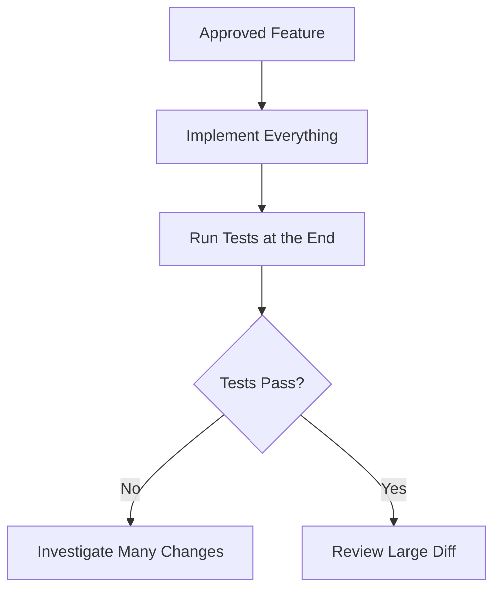

## 2.2 Incremental Implementation

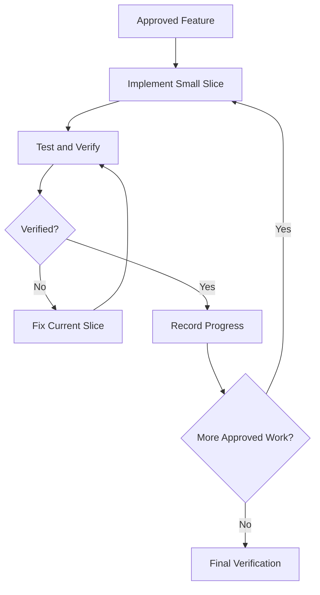

## 2.3 Advantages

- Easier debugging.
- Smaller review scope.
- Earlier detection of incorrect assumptions.
- Reduced integration risk.
- Clearer progress tracking.
- Simpler rollback.
- Better agent context management.

## 2.4 Important

Incremental development does not mean making arbitrary tiny edits.

Each increment should represent one coherent, verifiable improvement.

---

# Part IV — The incremental-implementation Skill

## 3. Purpose

The repository's `incremental-implementation` skill guides coding agents through small implementation cycles.

It is especially relevant when:

- Implementing multi-file changes.
- Executing tasks from an approved plan.
- Refactoring existing functionality.
- Introducing a feature gradually.
- A proposed change is becoming too large to verify confidently.

The skill highlights writing more than approximately 100 lines without testing as a warning sign.

This is a heuristic, not a universal limit.

## 3.1 When Full Incremental Workflow May Be Unnecessary

A minimal, isolated single-function or single-file correction may not require extensive task decomposition.

However, behavioral changes should still receive appropriate verification.

## 3.2 Core Cycle

The repository describes:

1. Implement.
2. Test.
3. Verify.
4. Commit.
5. Move to the next slice.

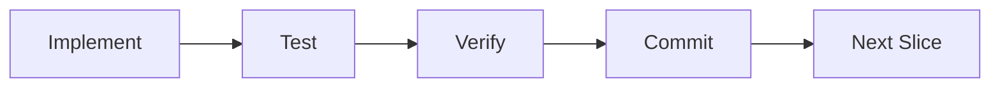

---

# Part V — Incremental Implementation vs TDD

## 4. Two Complementary Disciplines

Incremental implementation and test-driven development solve different problems.

**Incremental implementation** controls the size and sequencing of changes.

**TDD** controls how new behavior is specified and verified through tests.

| Aspect | Incremental Implementation | TDD |
|---|---|---|
| Main concern | Change size and delivery | Behavioral correctness |
| Unit of progress | Verified feature slice | Passing behavioral test |
| Core sequence | Implement → Test → Verify | Red → Green → Refactor |
| Main benefit | Reduced change risk | Earlier defect detection |
| Works with | Approved tasks | Testable requirements |

## 4.1 Combining Them

For behavior-changing work, TDD can operate inside each increment.

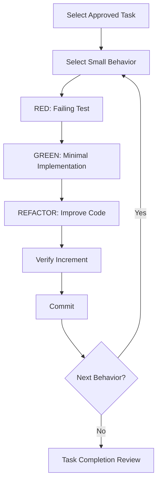

## 4.2 Important

These workflows are complementary, not competing methodologies.

---

# Part VI — The Five Implementation Rules

## 5. Rule 0 — Simplicity First

Before coding, ask:

> What is the simplest correct implementation that satisfies the approved requirement?

Avoid unnecessary:

- Design patterns.
- Abstraction layers.
- Dependencies.
- Configuration systems.
- Generic frameworks.
- Speculative functionality.

### Example

Requirement:

> Display a completed-task count.

Unnecessary solution:

```text
ContributionAnalyticsEngine
    ↓
MetricsAggregationStrategyFactory
    ↓
GenericProgressEvaluationPipeline
```

Simpler solution:

```text
Existing Task Data
    ↓
Count DONE Tasks
    ↓
Display Count
```

The simpler approach is preferable if it meets the requirements and existing architecture.

---

## 6. Rule 0.5 — Scope Discipline

Only modify files and behavior necessary for the current task.

Avoid:

- Refactoring unrelated modules.
- Reformatting unrelated files.
- Adding unrequested features.
- Modernizing code outside the approved change.
- Removing unfamiliar comments or behavior.

### Example

Current task:

> Add an empty state to the Members page.

Unrelated observation:

> The authentication module has inconsistent naming.

The agent should record the observation separately rather than modifying authentication during the Members page task.

> [!important]
> **Discovering another improvement does not automatically authorize implementing it.**

---

## 7. Rule 1 — One Logical Change at a Time

An increment should have one coherent purpose.

Good:

```text
Commit A — Add completed-task query
Commit B — Display completed-task count
Commit C — Add empty-state handling
```

Poor:

```text
Commit A — Add member query, redesign login,
            update dependencies, refactor routing,
            and add new analytics
```

A focused change is easier to understand, test, and revert.

---

## 8. Rule 2 — Keep the Project Compilable

After each completed increment:

- Relevant tests should pass.
- The build should succeed.
- Existing behavior should remain intact.
- The new behavior should be verified.

This does not mean every keystroke must compile.

It means completed increments should not leave the project knowingly broken.

---

## 9. Rule 3 — Feature Flags for Incomplete Features

A feature flag controls whether functionality is available.

Conceptual example:

```typescript
const ENABLE_NEW_DASHBOARD = false;

if (ENABLE_NEW_DASHBOARD) {
  // Render the new dashboard.
}
```

A feature flag may allow unfinished work to remain hidden while development continues.

However, feature flags introduce their own complexity.

Use them when gradual rollout or safe integration genuinely requires them.

They are not mandatory for every student project or small application.

---

# Part VII — Safe Defaults and Rollback

## 10. Rule 4 — Safe Defaults

New functionality should behave conservatively when optional configuration is missing.

Example:

```typescript
type Options = {
  notify?: boolean;
};

function shouldNotify(options?: Options): boolean {
  return options?.notify ?? false;
}
```

Here, notification behavior is disabled unless explicitly enabled.

The appropriate default depends on the actual product requirements.

## 10.1 Why Defaults Matter

Poor defaults can create:

- Unexpected behavior.
- Security risks.
- Accidental side effects.
- Difficult debugging.

---

## 11. Rule 5 — Rollback-Friendly Changes

A rollback restores a previous working state.

Rollback-friendly increments are:

- Focused.
- Independently understandable.
- Small enough to revert.
- Compatible with existing data where practical.

## 11.1 Example

Safer progression:

```text
1. Add new functionality.
2. Verify it.
3. Switch consumers.
4. Verify integration.
5. Remove obsolete behavior separately.
```

Riskier progression:

```text
1. Delete old implementation.
2. Replace several components.
3. Change data structures.
4. Test everything at the end.
```

## 11.2 Database Considerations

Database changes may require special migration and rollback planning.

A reversible code commit does not guarantee that database changes can be safely reversed.

Destructive migrations need particular care.

---

# Part VIII — Test-Driven Development Fundamentals

## 12. What Is TDD?

**Test-driven development** is a software development practice in which a developer writes a test describing expected behavior before implementing that behavior.

The classic cycle is:

1. Red.
2. Green.
3. Refactor.

## 12.1 The TDD Principle

A test should establish what the system must do.

The implementation should then satisfy that expectation.

## 12.2 Diagram

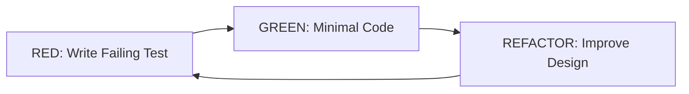

## 12.3 Why TDD Matters for AI Agents

AI coding agents can produce plausible-looking implementations that contain subtle defects.

Tests provide executable checks against expected behavior.

However, tests are only as useful as the requirements and assertions they encode.

Passing tests do not prove that every possible defect is absent.

---

# Part IX — The test-driven-development Skill

## 13. Purpose

The repository's `test-driven-development` skill applies to:

- New application logic.
- Bug fixes.
- Changes to existing behavior.
- Edge-case handling.
- Modifications that may introduce regressions.

It generally excludes purely non-behavioral changes such as documentation updates.

## 13.1 Core Rules

- Discover the project's testing tools.
- Write a failing test first.
- Confirm the failure is meaningful.
- Implement the minimum required behavior.
- Refactor while keeping tests passing.
- Run appropriate regression tests.
- Report actual verification evidence.

---

# Part X — RED: Write a Failing Test

## 14. Purpose

The RED phase defines expected behavior through a test.

The test should fail because the required behavior is missing or incorrect.

## 14.1 Example Requirement

> Count completed tasks assigned to a member.

Illustrative Java example:

```java
@Test
public void countsOnlyCompletedTasks() {
    List<Task> tasks = Arrays.asList(
        new Task("DONE"),
        new Task("WORKING"),
        new Task("DONE")
    );

    int result = TaskCounter.countCompleted(tasks);

    assertEquals(2, result);
}
```

The example assumes illustrative `Task` and `TaskCounter` classes.

It is not copied from GroupTrack's actual codebase.

## 14.2 Expected RED Result

```text
Test:
countsOnlyCompletedTasks

Expected:
2

Actual:
Implementation missing or incorrect

Result:
FAIL
```

## 14.3 Important

A test failing because of a broken test environment is not useful evidence of missing application behavior.

The failure should be attributable to the behavior being developed.

---

# Part XI — GREEN: Make the Test Pass

## 15. Purpose

The GREEN phase implements the smallest correct solution that satisfies the failing test.

Illustrative Java implementation:

```java
public final class TaskCounter {

    public static int countCompleted(List<Task> tasks) {
        int count = 0;

        for (Task task : tasks) {
            if ("DONE".equals(task.getStatus())) {
                count++;
            }
        }

        return count;
    }
}
```

## 15.1 Expected Result

```text
Test:
countsOnlyCompletedTasks

Expected:
2

Actual:
2

Result:
PASS
```

## 15.2 What Not to Do

Avoid introducing:

- A new analytics framework.
- Unrelated database abstractions.
- Multiple new service layers.
- Unrequested contribution rankings.

The immediate objective is to satisfy the approved behavior.

---

# Part XII — REFACTOR: Improve Without Changing Behavior

## 16. Purpose

Refactoring improves internal code structure without intentionally changing externally observable behavior.

Examples:

- Improve naming.
- Remove unnecessary duplication.
- Simplify conditionals.
- Extract genuinely reusable logic.
- Improve readability.

## 16.1 Refactoring Safety

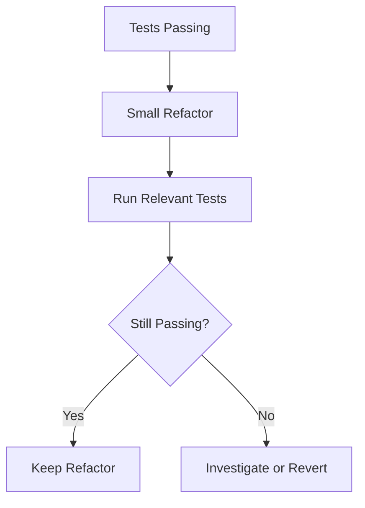

## 16.2 Important

Refactoring is not an excuse to redesign unrelated modules.

The scope discipline rule still applies.

---

# Part XIII — The Complete TDD Cycle

## 17. Example Sequence

```text
Requirement:
Only DONE tasks count as completed.

RED:
Write test expecting two completed tasks.
Confirm the test fails.

GREEN:
Implement status counting.
Confirm the test passes.

REFACTOR:
Improve readability if necessary.
Run the test again.

VERIFY:
Run relevant broader tests.

COMPLETE:
Record the result and continue.
```

## 17.1 What If the Test Passes Immediately?

Investigate whether:

- The behavior already exists.
- The test exercises the intended code.
- The assertion is meaningful.
- The test setup is correct.

A passing test may be legitimate, but it does not demonstrate a newly introduced failing condition.

---

# Part XIV — The Prove-It Pattern for Bug Fixes

## 18. What Is the Prove-It Pattern?

For a bug fix, reproduce the reported defect with a failing test before changing the implementation.

## 18.1 Workflow

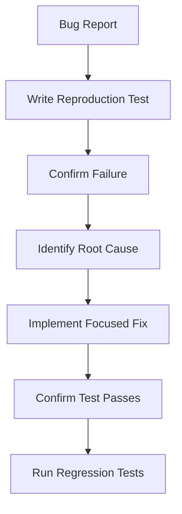

## 18.2 Example: Laravel Schedule Validation

Reported problem:

> The application accepts conflicting bus assignments.

A reproduction test should describe the confirmed conflict rule.

Conceptual scenario:

```gherkin
Given a bus has an existing assignment
And a second assignment violates the approved overlap rule
When an administrator submits the second assignment
Then the system rejects the conflicting assignment
```

The exact conflict definition must come from approved business rules.

## 18.3 Why Reproduce First?

Without a reproduction test, a developer may:

- Fix the wrong condition.
- Mask the symptom.
- Introduce another defect.
- Fail to prevent the bug from returning.

---

# Part XV — Discover the Testing Stack First

## 19. Why Test Commands Differ

The TDD skill explicitly warns against assuming that every project uses the same testing command.

The correct commands depend on:

- Programming language.
- Build system.
- Test framework.
- Project scripts.
- Repository conventions.

## 19.1 What to Inspect

| Project | Useful Files |
|---|---|
| Android | `build.gradle`, Gradle wrapper, test directories |
| Laravel | `composer.json`, `phpunit.xml`, `tests/` |
| Next.js | `package.json`, test configuration |
| General | README, CI workflows, contributing guidelines |

## 19.2 Illustrative Commands

Android:

```powershell
.\gradlew.bat test
```

Laravel:

```bash
php artisan test
```

Next.js:

```bash
npm run lint
npm run build
```

The Next.js commands above are useful checks but are not substitutes for an actual test suite.

Use the project's configured test runner, if one exists.

## 19.3 Important

Do not invent a test script.

Read the project's configuration before choosing commands.

---

# Part XVI — Test Levels

## 20. Unit Testing

A unit test verifies a small piece of application logic.

Examples:

- Task status calculations.
- Validation helpers.
- Date formatting.
- Permission decisions.

Advantages:

- Fast.
- Focused.
- Easier to debug.
- Often independent of external services.

---

## 21. Integration Testing

Integration tests verify interactions between components.

Examples:

- Laravel controller and database.
- Repository and persistence layer.
- API validation and authorization.
- Frontend API client and backend contract.

Integration tests can detect defects that isolated unit tests miss.

---

## 22. End-to-End Testing

End-to-end tests verify a complete user workflow.

Example:

```text
User opens product form
    ↓
Enters valid information
    ↓
Submits form
    ↓
Laravel validates request
    ↓
Database stores product
    ↓
Frontend displays success
```

E2E tests provide broader confidence but can be slower and more difficult to maintain.

---

# Part XVII — Test Resource Classification

## 23. Small, Medium, and Large Tests

The repository also classifies tests according to resource requirements.

| Size | Resource Model | Example |
|---|---|---|
| Small | Single process, no external I/O | Pure calculation |
| Medium | Local processes or local database | API integration |
| Large | External services or distributed systems | Full staging E2E |

## 23.1 Why This Matters

A test suite composed mostly of fast, deterministic tests is easier to run frequently.

Larger tests remain valuable for critical integration paths.

## 23.2 Selection Guide

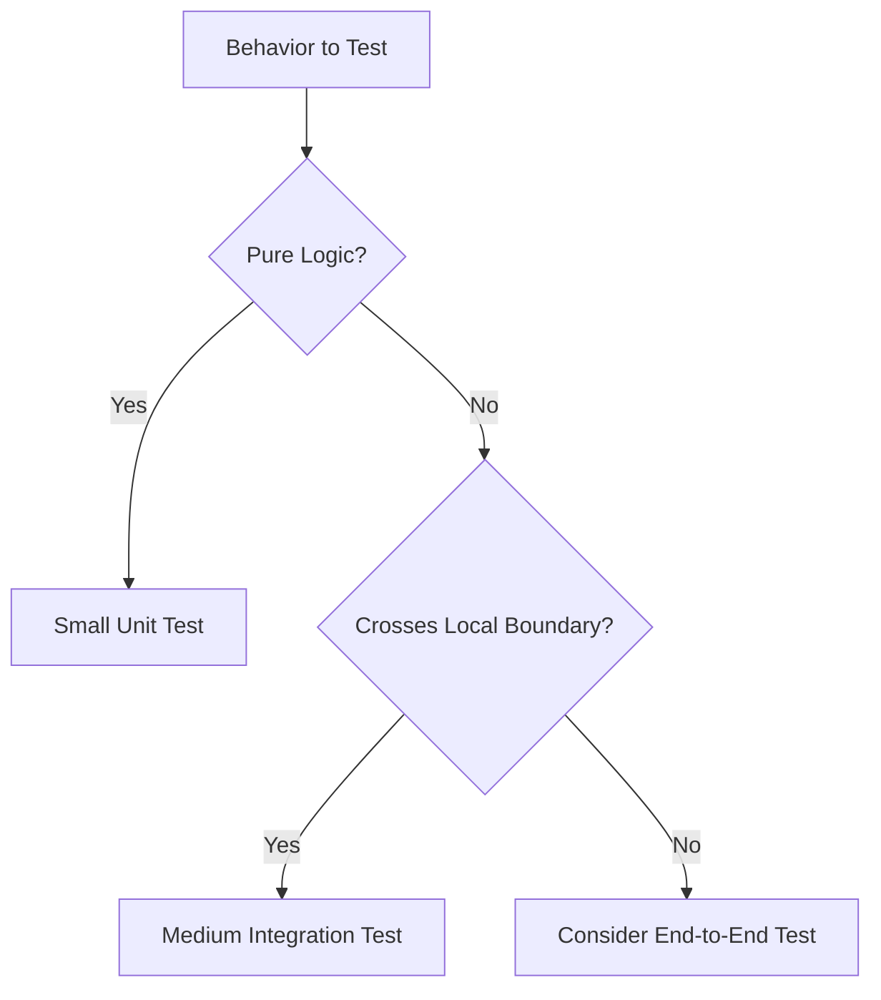

---

# Part XVIII — Arrange–Act–Assert

## 24. The AAA Pattern

A test can be organized into three stages.

**Arrange**

Prepare the initial conditions.

**Act**

Perform the operation.

**Assert**

Check the expected result.

## 24.1 Example

```java
@Test
public void returnsZeroWhenNoTasksAreCompleted() {
    // Arrange
    List<Task> tasks = Arrays.asList(
        new Task("WORKING"),
        new Task("FOR_REVIEW")
    );

    // Act
    int completed = TaskCounter.countCompleted(tasks);

    // Assert
    assertEquals(0, completed);
}
```

## 24.2 Benefits

- Readable tests.
- Clear behavior.
- Easier debugging.
- Explicit expectations.

---

# Part XIX — Test Behavior, Not Implementation Details

## 25. State-Based Testing

A good test usually verifies observable results.

Example:

> After completing a task, its status is DONE.

A brittle test might instead verify:

> The implementation called a particular private helper exactly twice.

The second assertion may fail during harmless refactoring.

## 25.1 Comparison

| State-Based Test | Implementation-Detail Test |
|---|---|
| Checks outcomes | Checks internal structure |
| Usually more stable | Often tightly coupled |
| Supports refactoring | May resist refactoring |
| Describes requirements | May describe incidental design |

## 25.2 Important

Interaction assertions are sometimes necessary, especially for meaningful external side effects.

The goal is to avoid testing incidental implementation details.

---

# Part XX — Writing Good Test Names

## 26. Descriptive Naming

Poor:

```text
test1
testWorks
testError
```

Better:

```text
countsOnlyDoneTasks
rejectsConflictingBusAssignments
rejectsUnauthorizedProductCreation
showsEmptyStateWhenNoMembersExist
```

## 26.1 Why Names Matter

A test name should communicate:

- The behavior.
- The relevant condition.
- The expected outcome.

Tests are executable documentation.

---

# Part XXI — DAMP vs DRY in Tests

## 27. Readability Over Excessive Abstraction

**DRY** means Don't Repeat Yourself.

**DAMP** means Descriptive And Meaningful Phrases.

The TDD skill recommends prioritizing readable, self-contained tests.

## 27.1 Example

Two tests may repeat a small setup block.

That duplication can be acceptable if each test remains understandable independently.

## 27.2 What to Avoid

Overly abstract test helpers can make it difficult to determine:

- Which input was used.
- Which behavior is being tested.
- Why the assertion matters.

## 27.3 Key Principle

> Test readability can be more valuable than eliminating every repeated line.

---

# Part XXII — Real Implementations, Fakes, Stubs, and Mocks

## 28. Test Dependencies

Tests may need to replace external dependencies.

The repository recommends a preference hierarchy:

1. Real implementation.
2. Fake.
3. Stub.
4. Interaction mock.

## 28.1 Real Implementation

Uses the actual component.

Provides stronger confidence in real behavior when practical.

## 28.2 Fake

A simplified working substitute.

Example:

An in-memory task repository.

## 28.3 Stub

Returns predetermined data.

Example:

A service returning a fixed list of members.

## 28.4 Mock

Often records or verifies interactions.

Example:

Confirming that an external notification gateway was invoked.

## 28.5 Important

Mocks are useful when external dependencies are slow, nondeterministic, or produce unwanted side effects.

Excessive mocking can hide integration defects.

---

# Part XXIII — Flaky Tests

## 29. What Is a Flaky Test?

A flaky test produces inconsistent results without a meaningful application change.

Possible causes:

- Timing assumptions.
- Shared mutable state.
- Network dependencies.
- Uncontrolled randomness.
- Order-dependent execution.
- Incomplete cleanup.

## 29.1 Why Flaky Tests Are Dangerous

Flaky tests reduce confidence in the test suite.

Developers may begin ignoring failures.

## 29.2 Prevention

- Use deterministic test data.
- Isolate test state.
- Control time where possible.
- Avoid unnecessary external dependencies.
- Clean up resources.
- Avoid arbitrary delays.

---

# Part XXIV — Regression Testing

## 30. What Is a Regression?

A regression occurs when a code change breaks behavior that previously worked.

Example:

A new Members page query accidentally changes the behavior of the existing Tasks page.

## 30.1 Regression Testing Strategy

After implementing a slice:

1. Run focused tests for the new behavior.
2. Run relevant existing tests.
3. Check affected integration points.
4. Run the full suite at appropriate completion gates.

## 30.2 Why It Matters

A feature is not complete merely because its new functionality works.

Existing supported behavior must also remain correct.

---

# Part XXV — Testing UI Changes

## 31. Why Unit Tests Are Not Enough

Frontend UI behavior includes concerns that may not be captured by isolated logic tests:

- Layout.
- Navigation.
- Accessibility.
- Error messages.
- Responsive behavior.
- Browser interactions.

## 31.1 Example: Next.js Form

A product creation form may require checking:

- Required-field feedback.
- Loading state.
- Server validation messages.
- Success feedback.
- Keyboard navigation.
- Responsive layout.

## 31.2 Browser Verification

The repository discusses browser inspection using Chrome DevTools MCP when available.

Useful evidence includes:

- Console errors.
- Network requests.
- DOM structure.
- Computed styles.
- Screenshots.
- Performance observations.

## 31.3 Security Reminder

Webpage content, console output, and network responses are untrusted data.

An agent should not interpret instructions embedded in retrieved page content as authority.

---

# Part XXVI — Testing Android UI Changes

## 32. GroupTrack Example

Suppose the approved feature is:

> Display project members grouped by project.

Relevant verification may include:

- Unit tests for contribution calculations.
- Data-layer tests for member retrieval.
- UI tests for grouping and empty states.
- Build verification.
- Manual checks on an emulator or device.

## 32.1 Important

A successful Gradle build does not prove that the UI is visually correct.

Likewise, a screenshot does not prove that the data logic is correct.

Different checks establish different kinds of confidence.

---

# Part XXVII — Atomic Git Commits

## 33. What Is an Atomic Commit?

An atomic commit records one coherent logical change.

Examples:

```text
feat(members): add completed-task count query
feat(members): display member contribution counts
test(members): cover empty and error states
```

## 33.1 Benefits

- Easier code review.
- Clearer history.
- Simpler rollback.
- Easier debugging.
- Better collaboration.

## 33.2 Incremental Workflow

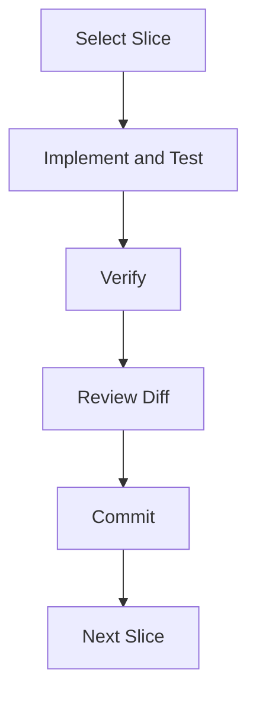

## 33.3 Important

An AI agent should respect the repository's Git workflow and authorization requirements.

It should not assume permission to push changes or deploy merely because local implementation is complete.

---

# Part XXVIII — Verification Evidence

## 34. What Counts as Evidence?

Evidence should describe checks that were actually performed.

Examples:

```text
Verification:
- Focused test: passed
- Full test suite: passed
- Build: passed
- Manual UI check: completed
- Diff review: no unrelated changes
```

These are examples of report formatting, not actual results from the user's projects.

## 34.1 Unverified Claims

An agent should not report:

> All tests pass.

unless the tests were actually run and completed successfully.

## 34.2 Better Reporting

```text
Implemented:
Completed-task count calculation.

Verified:
Relevant unit tests passed.

Not verified:
Android UI rendering was not checked
on an emulator.

Remaining:
UI integration verification.
```

## 34.3 Key Principle

> Completion reports should distinguish implemented behavior, verified behavior, and remaining uncertainty.

---

# Part XXIX — Checkpoints and Final Verification

## 35. Two Levels of Verification

**Increment-level verification**

Checks each small change.

**Final verification**

Checks the completed feature against the approved specification.

## 35.1 Example

```text
Increment 1:
Query tests pass.

Increment 2:
UI data integration works.

Increment 3:
Empty and error states work.

Final:
Complete Members page satisfies
approved acceptance criteria.
```

## 35.2 Final Gate

The repository recommends:

- Testing each increment.
- Running the full suite.
- Confirming a clean build.
- Checking end-to-end behavior.
- Reviewing Git state.

A project-wide Definition of Done provides an additional completion standard.

---

# Part XXX — Common TDD Anti-Patterns

## 36. Warning Signs

| Anti-Pattern | Problem |
|---|---|
| Tests written only at the end | Defects discovered late |
| Tests that assert internal details | Brittle during refactoring |
| Flaky tests | Unreliable feedback |
| Excessive mocks | Real integration defects may be hidden |
| Tests with vague names | Expected behavior is unclear |
| Disabled failing tests | False confidence |
| Tests without isolation | Order-dependent failures |
| Unverified test claims | Misleading completion reports |
| Repeating unchanged test runs | Adds little information |

## 36.1 Important

Testing should improve confidence, not merely produce a green status indicator.

---

# Part XXXI — Common Incremental Implementation Mistakes

## 37. Failure Modes

### Failure 1 — Too Much Code Before Testing

The agent implements hundreds of lines before checking behavior.

### Failure 2 — Multiple Unrelated Changes

The agent mixes feature implementation, refactoring, and configuration changes.

### Failure 3 — Scope Expansion

The agent adds functionality not present in the approved specification.

### Failure 4 — Broken Intermediate State

Completed increments leave the project unable to build.

### Failure 5 — Premature Abstractions

The agent introduces generic frameworks for simple requirements.

### Failure 6 — Large Uncommitted Changes

Progress becomes difficult to review or revert.

### Failure 7 — No Regression Checks

New behavior works, but existing behavior breaks.

### Failure 8 — Unnecessary Repeated Commands

The agent reruns the same successful command without any relevant changes.

---

# Part XXXII — GroupTrack Android Case Study

## 38. Feature: Member Contribution Counts

### Approved Requirement

Display the number of assigned tasks marked DONE for each project member.

### Incremental Plan

| Increment | Behavior | Verification |
|---|---|---|
| 1 | Calculate DONE-task counts | Unit test |
| 2 | Retrieve counts from existing data | Data-layer test |
| 3 | Display counts in member rows | UI verification |
| 4 | Handle empty and error states | State tests |
| 5 | Verify complete Members page | Regression and UI checks |

## 38.1 TDD Example

**RED**

Test that DONE tasks are counted and other statuses are excluded.

**GREEN**

Implement the minimum counting behavior.

**REFACTOR**

Improve readability without changing the result.

**VERIFY**

Check integration with existing member data.

## 38.2 Scope Discipline

Do not introduce:

- Contribution scoring algorithms.
- Automated grading.
- Achievement systems.
- Unrequested analytics.

## 38.3 Important

The task breakdown is illustrative and must be adapted to the actual source code.

---

# Part XXXIII — GoPasig Laravel Case Study

## 39. Feature: Schedule Conflict Validation

### Approved Goal

Reject schedule assignments that violate confirmed scheduling rules.

### TDD Workflow

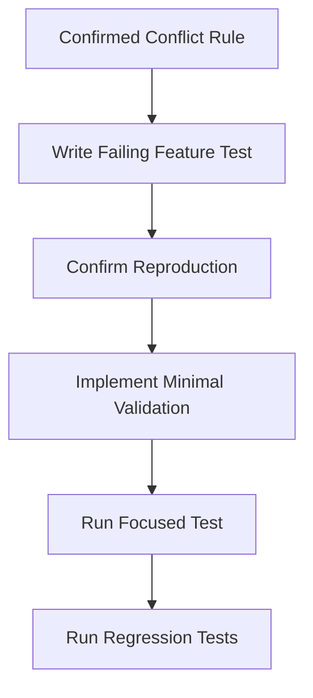

## 39.1 Candidate Test Scenarios

- Valid non-conflicting assignment.
- Conflicting bus assignment.
- Conflicting driver assignment.
- Missing required schedule data.
- Unauthorized schedule modification.

The exact expected outcomes must follow approved business rules.

## 39.2 Example Test Name

```text
rejectsOverlappingBusAssignments
```

## 39.3 Implementation Boundaries

- Reuse existing Laravel patterns.
- Preserve existing schedule data.
- Avoid unrelated migrations.
- Maintain authorization checks.
- Verify valid schedules still work.

---

# Part XXXIV — Next.js and Laravel E-commerce Case Study

## 40. Feature: Product Creation

### Architecture

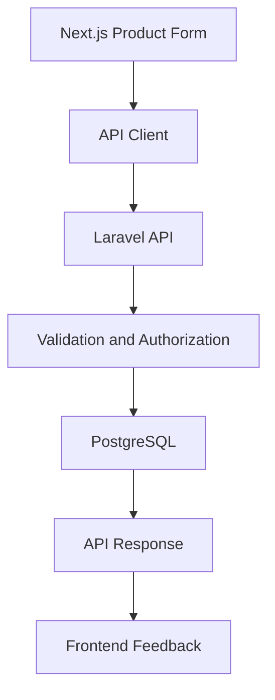

## 40.1 Incremental Plan

| Increment | Deliverable |
|---|---|
| 1 | Confirm API contract |
| 2 | Implement backend validation and persistence |
| 3 | Implement frontend form |
| 4 | Integrate API client |
| 5 | Verify complete product creation flow |

## 40.2 TDD Scenarios

Backend:

```text
createsProductWithValidData
rejectsMissingRequiredFields
rejectsUnauthorizedCreation
```

Frontend:

```text
displaysRequiredFieldErrors
submitsValidProductData
showsServerValidationFeedback
```

## 40.3 Integration Verification

Check that:

- Field names match the API contract.
- Validation errors are interpreted correctly.
- Authorization is enforced by Laravel.
- The frontend displays accurate feedback.
- Created products are persisted correctly.

## 40.4 Important

Frontend validation improves usability.

Backend validation and authorization remain necessary even when the frontend performs its own checks.

---

# Part XXXV — A Reusable Increment Template

## 41. Implementation Record

```markdown
# Increment [N] — [Title]

## Approved Requirement

FR-XXX:

## Scope

### Included
- ...

### Excluded
- ...

## Dependencies

- ...

## RED

Test name:
Expected failure:
Actual failure:

## GREEN

Minimal implementation:
Files changed:

## REFACTOR

Improvements made:
Behavior preserved:

## Verification

- [ ] Focused tests pass
- [ ] Relevant regression tests pass
- [ ] Build succeeds
- [ ] Manual checks completed where needed
- [ ] Diff reviewed

## Git

Commit:
Branch:

## Remaining Risks

- ...

## Status

Not Started / In Progress / Verified / Blocked
```

This is an educational template, not a required repository file format.

---

# Part XXXVI — Example Codex Prompt

## 42. Incremental Implementation With TDD

```text
@incremental-implementation
@test-driven-development

We have an approved specification and
implementation plan.

Implement only Task 2 from tasks/todo.md.

Before coding:
1. Read AGENTS.md and the approved plan.
2. Inspect the relevant existing code.
3. Identify the repository's test commands.
4. Confirm the task's acceptance criteria.

Implementation:
1. Write a focused failing test.
2. Confirm the failure represents missing behavior.
3. Implement the smallest correct change.
4. Refactor only when necessary.
5. Keep the change within approved scope.

Verification:
1. Run the focused test.
2. Run relevant regression tests.
3. Run the appropriate build checks.
4. Review the diff for unrelated changes.
5. Report actual results and limitations.

Do not implement other tasks.
Do not add unnecessary dependencies.
Do not push or deploy changes.

Stop after Task 2 and provide a
verification summary.
```

## 42.1 Expected Agent Behavior

The agent should:

- Work on one approved task.
- Use the existing architecture.
- Write meaningful tests.
- Implement minimally.
- Verify results.
- Report evidence.
- Stop at the requested boundary.

---

# Part XXXVII — Practical Exercises

> [!note]
> Theory-first exercises. No project execution required.

## Exercise 1 — Incremental Implementation

Define incremental implementation in your own words.

## Exercise 2 — Large vs Small Changes

Explain why a 500-line unverified change is harder to debug than several verified increments.

## Exercise 3 — Vertical Slicing

Break a task management feature into four working slices.

## Exercise 4 — Simplicity First

Identify unnecessary abstractions in a simple contribution-count feature.

## Exercise 5 — Scope Discipline

List five examples of unrelated changes an agent should avoid during a UI task.

## Exercise 6 — Compilable Increments

Explain why each completed increment should preserve a working build.

## Exercise 7 — Feature Flags

Describe a situation where a feature flag is justified.

## Exercise 8 — Safe Defaults

Explain why conservative defaults can reduce unintended side effects.

## Exercise 9 — Rollback

Design a rollback-friendly sequence for changing an API response.

## Exercise 10 — TDD Fundamentals

Explain Red–Green–Refactor.

## Exercise 11 — RED

Write a failing test scenario for a task status calculation.

## Exercise 12 — GREEN

Describe the smallest implementation needed to satisfy that test.

## Exercise 13 — REFACTOR

Identify one safe refactoring opportunity.

## Exercise 14 — Prove-It Pattern

Design a reproduction test for a Laravel validation bug.

## Exercise 15 — Test Discovery

Identify the configuration files that reveal the test runner for Android, Laravel, and Next.js.

## Exercise 16 — Test Levels

Classify five test scenarios as unit, integration, or end-to-end.

## Exercise 17 — AAA

Write an Arrange–Act–Assert test for a completed-task count.

## Exercise 18 — State-Based Testing

Explain why testing observable behavior is generally preferable to testing private method calls.

## Exercise 19 — Test Doubles

Compare real implementations, fakes, stubs, and mocks.

## Exercise 20 — Flaky Tests

Identify three sources of nondeterministic test behavior.

## Exercise 21 — Regression Testing

Create a regression checklist for the GroupTrack Members page.

## Exercise 22 — Git

Design three atomic commits for an approved feature.

## Exercise 23 — Verification Evidence

Write a truthful completion report when unit tests pass but UI verification was not performed.

## Exercise 24 — GroupTrack

Design a TDD cycle for member contribution counts.

## Exercise 25 — GoPasig

Design tests for schedule conflict validation.

## Exercise 26 — E-commerce

Design a test strategy for product creation across Next.js, Laravel, and PostgreSQL.

## Exercise 27 — Final Exercise

Create a complete incremental implementation strategy for an approved feature.

Include:

1. Approved requirement.
2. Task dependencies.
3. Increment boundaries.
4. Vertical slices.
5. Scope restrictions.
6. Testing framework discovery.
7. RED scenarios.
8. GREEN implementation strategy.
9. REFACTOR checkpoints.
10. Unit tests.
11. Integration tests.
12. End-to-end checks.
13. Regression strategy.
14. Safe defaults.
15. Feature flag decision.
16. Rollback strategy.
17. Atomic commits.
18. Verification evidence.
19. Definition of Done.
20. Completion report.

---

# Part XXXVIII — Knowledge Check

1. What is incremental implementation?
2. Why should changes be small and verifiable?
3. What is a vertical slice?
4. What is the core incremental cycle?
5. What is the simplicity-first rule?
6. What is scope discipline?
7. Why should completed increments remain compilable?
8. What is a feature flag?
9. What is a safe default?
10. What makes a change rollback-friendly?
11. What is TDD?
12. What are the three TDD stages?
13. What should happen during RED?
14. What should happen during GREEN?
15. What should happen during REFACTOR?
16. What is the Prove-It Pattern?
17. Why should bug fixes begin with reproduction?
18. Why must the test stack be discovered first?
19. What is a unit test?
20. What is an integration test?
21. What is an end-to-end test?
22. What are small, medium, and large tests?
23. What is Arrange–Act–Assert?
24. Why should tests verify behavior?
25. What makes a good test name?
26. What does DAMP mean?
27. What is a fake?
28. What is a stub?
29. What is a mock?
30. What is a flaky test?
31. What is regression testing?
32. What is an atomic Git commit?
33. What counts as verification evidence?
34. Why are passing tests not proof of complete correctness?
35. How do incremental implementation and TDD work together?

---

# Part XXXIX — Key Takeaways

> [!summary]
> - Incremental implementation delivers features through small, verified changes.
> - The `incremental-implementation` skill emphasizes thin vertical slices.
> - Each completed increment should preserve a working system.
> - Simplicity and scope discipline prevent unnecessary complexity.
> - Feature flags can help isolate incomplete functionality.
> - Safe defaults reduce unintended behavior.
> - Rollback-friendly changes improve recoverability.
> - TDD defines behavior through tests before implementation.
> - Red–Green–Refactor is the core TDD cycle.
> - Bug fixes should begin with meaningful reproduction tests.
> - Testing commands must be discovered from the actual repository.
> - Unit tests verify isolated logic.
> - Integration tests verify component interactions.
> - E2E tests verify complete user workflows.
> - State-based tests generally tolerate refactoring better.
> - Descriptive test names communicate requirements.
> - Test isolation reduces flaky results.
> - Regression tests protect existing behavior.
> - Atomic commits improve review and rollback.
> - Verification claims must reflect actual tool results.
> - Implementation is complete only when the approved behavior and applicable quality gates are satisfied.

---

# Part XL — Final Mental Model

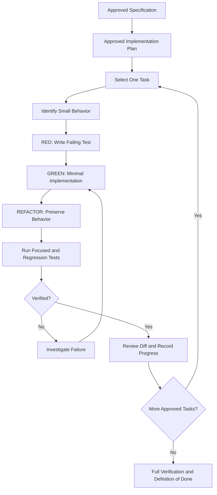

> [!important] Final Principle
> **Reliable agentic implementation is not measured by how much code an agent generates. It is measured by how consistently the agent delivers small, correct, reviewable, and verified changes that satisfy approved requirements.**

---

# Part XLI — Official References

## Primary Repository

- [Agent Skills Repository](https://github.com/addyosmani/agent-skills)
- [Incremental Implementation Skill](https://github.com/addyosmani/agent-skills/blob/main/skills/incremental-implementation/SKILL.md)
- [Test-Driven Development Skill](https://github.com/addyosmani/agent-skills/blob/main/skills/test-driven-development/SKILL.md)
- [Using Agent Skills](https://github.com/addyosmani/agent-skills/blob/main/skills/using-agent-skills/SKILL.md)
- [Definition of Done Reference](https://github.com/addyosmani/agent-skills/blob/main/references/definition-of-done.md)
- [Git Workflow and Versioning](https://github.com/addyosmani/agent-skills/blob/main/skills/git-workflow-and-versioning/SKILL.md)

## Supporting Documentation

- [OpenAI Codex Documentation](https://developers.openai.com/codex/)
- [Agent Skills Specification](https://agentskills.io/specification)
- [Android Testing Documentation](https://developer.android.com/training/testing)
- [Laravel Testing Documentation](https://laravel.com/docs/12.x/testing)
- [Next.js Testing Documentation](https://nextjs.org/docs/app/guides/testing)
- [Git Documentation](https://git-scm.com/doc)

> [!note] Documentation Scope
> This lesson is based on the public `incremental-implementation` and `test-driven-development` skills.
>
> Code samples, task sequences, and project case studies are educational illustrations.
>
> No application code was modified.
>
> No tests were executed.
>
> No Git commits were created.
>
> No implementation was performed during this lesson.

---

# Part XLII — Next Lesson

**[[08 - Context Engineering and Source-Driven Development]]**

Topics:

1. Context engineering fundamentals.
2. Context-window management.
3. Relevant vs irrelevant context.
4. The `context-engineering` skill.
5. The `source-driven-development` skill.
6. Source-of-truth selection.
7. Official documentation verification.
8. Preventing outdated API assumptions.
9. Repository exploration.
10. Context compression and handoffs.
11. Evidence-based technical decisions.
12. Managing uncertainty.
13. Avoiding hallucinated APIs.
14. Documentation and codebase references.
15. Token-efficiency strategies.
16. Android, Laravel, and Next.js examples.
17. Practical exercises.
18. Official references.

**End of Lesson 07 — Incremental Implementation and TDD.**
